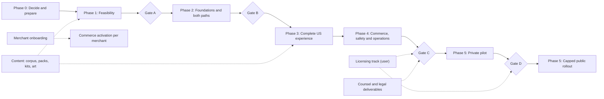

# Holiday: product plan

This is the product plan for **Holiday** (a working name; see [D-29](decisions.md#d-29)): a web app that shows people their real home decorated for a holiday, from a US address through Google Street View or from a photo they upload, and then links them to decorations they can buy through affiliate programs. It states what the US Release is, how it behaves, what it must prove before anyone outside the team uses it, and where the detailed specifications live. Status: see [README Status](README.md#status).

**Owns:** product promise and product thesis (simple, beautiful, emotional); requirement IDs (REQ-01 to REQ-12, NFR-01 to NFR-09); US Release scope and out-of-scope list; the required fallback behavior table; growth and acquisition hypotheses; the risk register.
**Baseline:** planning baseline 2026-11-09; external facts retrieved 2026-11-08.

## 1. Product promise

**See your real space beautifully decorated for a holiday, then find decorations that help you create the look.**

### Why Holiday exists: simple, beautiful, emotional

The point of Holiday is to move people. With almost no effort on their part, a visitor sees their own front porch, dining table or balcony dressed for the holiday that is coming, and feels something: anticipation, nostalgia, pride, the pull of having people over. That feeling is what nudges them to make the picture real by decorating the space themselves, and Shop the look is there at that moment to help.

Anyone can already upload a photo to a general-purpose AI tool and ask it to decorate the room. Holiday does not win on that capability; it wins on the experience. Product-market fit rests on three qualities, and together they are the product's most important feature (Fixed [D-49](decisions.md#d-49)):

| Quality | What it means | How the plan delivers it | How we know |
| --- | --- | --- | --- |
| **Simple** | One address or one photo, and nothing else to learn: no prompt to write, no settings before the first result, no trial and error. The product makes the creative choices; the visitor only reacts. | One input; at most one blocking step before the first render ([friction budget](specs/experience.md#friction-budget)); the first render starts by itself when the match is clear; reviewed holiday packs and three styles instead of free-text prompts ([section 7](#7-decorating-with-ai)) | Effort and time from landing to the first preview, and first-preview completion without coaching, in the private pilot ([pilot evaluation](specs/quality-and-benchmark.md#pilot-evaluation)) |
| **Beautiful** | Every image is hyperrealistic and professionally art-directed, indistinguishable from a real photograph: the seasonal hero (real homes, dining rooms and landscapes), the decorations, and the place itself, which stays recognizably theirs. Nothing on the platform is illustrated, cartoon-like or animated. | Art-directed, reviewed holiday packs ([holiday packs](specs/holidays-and-content.md#holiday-packs)); the place preserved (Fixed [D-07](decisions.md#d-07)); appeal is part of the quality bar, not only correctness ([section 10](#10-quality-bar-and-release-criteria)); the evening relight wherever it passes the benchmark | Appeal scores in the benchmark ([review rubric](specs/quality-and-benchmark.md#review-rubric)) and participants' own ratings in the pilot |
| **Emotional** | It is their place, transformed. The first reveal of their own home decorated is the product's central moment, and everything around it (the seasonal hero, warm copy, the before and after comparison, sharing with family) serves that moment. | The reveal and the comparison ([result and comparison](specs/experience.md#result-and-comparison)) under the [experience principles](specs/experience.md#experience-principles); share cards that carry the picture to family and friends | The pilot's emotional-response measures, and the shares, saves and Shop the look clicks that follow ([pilot evaluation](specs/quality-and-benchmark.md#pilot-evaluation)) |

The purchase nudge follows the emotion and never replaces it. Shop the look appears after the reveal, offers items that help recreate the look, and is labeled honestly ([section 9](#9-commerce-and-business-model)). There is no pressure, no countdown and no interruption of the moment; a visitor who only wants to enjoy the picture loses nothing.

**How this governs the build.** When a feature, control, notice or setting would add friction, dilute the look or interrupt the moment, it is left out, deferred or redesigned. More capability is never the goal by itself: a feature earns its place only if it makes the experience simpler, more beautiful or more moving. Safety, honesty and legal obligations still apply in full; the [friction budget](specs/experience.md#friction-budget) places each one with the same care.

### The experience

A visitor arrives at a bright, professional seasonal photograph for the holiday that is coming up, types an address or uploads a photo, and after a short wait sees a believable decorated version of that exact place beside the original. The place stays recognizably theirs: the building, windows, furniture and neighbors stay as they are; decorations are added and, only if the visitor chooses it, the scene is relit for evening. They can switch holiday, style and lighting, save the result, share it without revealing the address, and shop for items similar to what is pictured. The interface stays quiet so the photograph and the result carry the experience.

### Who it is for

The audience is adults (18 or older, Proposed [D-17](decisions.md#d-17)) planning decorations for their own home, apartment or other place of living. Anyone may look up any US address; what they can do with the result is bounded by the trust, privacy and misuse rules in [section 8](#8-trust-privacy-and-safety). Looking up an address never reveals anything about the people who live there. Vocabulary used throughout the plan is defined in the [glossary](glossary.md).

## 2. Requirements

The user's original request ([original_prompt.txt](original_prompt.txt)), the product thesis the user added on 2026-11-09 and the fixed decisions D-01 to D-07 and D-49 ([decisions](decisions.md#fixed-decisions)) establish twelve requirements. Nine derived requirements follow from building the product responsibly. Where the plan interprets the brief's words rather than taking them literally (for example "any/all information about the address" or "a provider with every address"), the interpretation and its reason are recorded in [traceability: interpretations of the brief](traceability.md#interpretations-of-the-brief).

| ID | Requirement (user-stated) | How the plan meets it | Decisions |
| --- | --- | --- | --- |
| REQ-01 | pnpm monorepo structured like Pulse and Dynamic Liquidity | `apps/*` and `packages/*` workspace with a browser-safe core package and a Node-only server package; conventions compared with both references in [architecture](architecture.md#conventions-from-the-reference-repositories) | D-01 (Fixed), D-30, D-31 |
| REQ-02 | Beautiful, simple, plain landing page with a bright, professional seasonal picture for the most popular upcoming holiday (mid-November: Thanksgiving dinner in a candlelit dining room; mid-December: Christmas) | A server-rendered landing shell with one hero chosen by the holiday promotion window; the mid-November and mid-December examples hold ([section 5](#5-holidays-and-seasonal-behavior), [landing](specs/experience.md#landing)) | D-06 (Fixed), D-08, D-09, D-11 |
| REQ-03 | A single input for their address or any address, with autocomplete from Google or an equivalent provider | One address field; Places Autocomplete (New) through the server, restricted to the US; manual entry through the Geocoding API when autocomplete has no match ([section 6](#6-sources-addresses-street-view-and-photos)) | D-06 (Fixed), D-38, D-39 |
| REQ-04 | On selection, obtain the clearest real picture(s) of the property | Street View metadata search, viewpoint selection with up to three candidate views, confirmation when a match is ambiguous; the user's own photo where Street View cannot supply an image or may not be processed ([section 6](#6-sources-addresses-street-view-and-photos)) | D-03 (Fixed), D-07 (Fixed), D-15, D-16 |
| REQ-05 | A very strong image AI decorates the picture for the holiday explicitly, specifically and in fine, clear detail | A structured pipeline: scene analysis, a validated decoration plan from reviewed holiday packs, deterministic prompt compilation, a benchmark-selected image-edit provider, quality checks and at most one repair ([section 7](#7-decorating-with-ai)) | D-07 (Fixed), D-10, D-42, D-43 |
| REQ-06 | Easily toggle the address and the holiday | Persistent holiday, style and lighting controls after the first result; already-rendered variants switch instantly and free; a new address starts a new project; new renders are bounded by the allowance ([section 4, Journey C](#4-experience-overview)) | D-06 (Fixed), D-12, D-13 |
| REQ-07 | Dead simple to use | A friction budget of at most one blocking step before the first render on each path, one primary action per screen, honest states ([friction budget](specs/experience.md#friction-budget)) | D-06 (Fixed), D-17 (the one blocking step on the upload path) |
| REQ-08 | Business model: decorations from popular vendors with affiliate links | Shop the look below every result with `similar` and `described` items from merchant programs; commerce activates per merchant; the economics are measured in the pilot ([section 9](#9-commerce-and-business-model)) | D-05 (Fixed), D-24, D-25, D-26, D-27 |
| REQ-09 | Homes, apartments and other places of living, including interiors | Uploads for `house_exterior`, `apartment_entry`, `balcony` and `interior` scenes with no address required; multi-unit facades route to a photo of the actual space ([section 6](#6-sources-addresses-street-view-and-photos)) | D-04 (Fixed), D-18, D-41 |
| REQ-10 | US addresses first; international later without rework | US Release scope with country-coded contracts, provider adapters and one capability row per country ([section 3](#3-scope-of-the-us-release), [international extension boundaries](architecture.md#international-extension-boundaries)) | D-02 (Fixed), D-47 |
| REQ-11 | Street View path in the initial build; licensing handled in parallel by the user | Address to Street View to decoration to before/after is built and fixture-tested now (tested against recorded stand-in responses instead of live Google calls; [section 6](#6-sources-addresses-street-view-and-photos)); public activation follows the recorded licensing outcome ([licensing outcomes and activation](specs/address-and-street-view.md#licensing-outcomes-and-activation)) | D-03 (Fixed), D-15, D-16 |
| REQ-12 | The point is to pull on people's emotions very simply, easily and with very little friction, by recreating their own spaces decorated for a holiday, and to nudge them toward buying items to decorate those spaces themselves. Because people could already do this with general AI tools, product-market fit and the most important feature are "simple", "beautiful" and "emotional" (added by the user on 2026-11-09) | The product thesis in [section 1](#why-holiday-exists-simple-beautiful-emotional) governs every trade-off: one input and no prompts ([friction budget](specs/experience.md#friction-budget)), art-directed packs with the place preserved ([holiday packs](specs/holidays-and-content.md#holiday-packs)), the reveal as the central moment ([experience principles](specs/experience.md#experience-principles)), Shop the look after the reveal with honest labels and no pressure ([section 9](#9-commerce-and-business-model)); measured by effort to the first preview, appeal and the pilot's emotional-response measures ([pilot evaluation](specs/quality-and-benchmark.md#pilot-evaluation)) | D-49 (Fixed), D-06 (Fixed), D-07 (Fixed), D-11, D-24 |

| ID | Derived requirement | How the plan meets it |
| --- | --- | --- |
| NFR-01 | Honesty: never present synthesized or neighboring imagery as the user's place; label AI previews; state product relationships accurately | The fallback behavior table in [section 4](#4-experience-overview); the "AI preview" label and provenance in [section 7](#7-decorating-with-ai); relationship labels in [section 9](#9-commerce-and-business-model) |
| NFR-02 | Privacy and rights: per-asset permissions, data minimization, retention, verifiable deletion | Asset policies evaluated before every provider call, no property dossier, retention schedule and deletion verification ([section 8](#8-trust-privacy-and-safety), [privacy, safety and legal](specs/privacy-safety-legal.md#data-handling-rules)) |
| NFR-03 | Safety: content admission, child safety, abuse handling, adult audience | Screening before any paid call, a child-safety reporting procedure, report and takedown flows, an 18+ stance ([section 8](#8-trust-privacy-and-safety)) |
| NFR-04 | Cost safety: allowance, limits, spend ceilings, ledger, no duplicate paid attempts | Allowance and limits enforced before any reservation, a ledger entry per paid call, at most two paid attempts per job, transport retries that never buy another attempt ([section 7](#7-decorating-with-ai), [economics](specs/economics.md#capacity-and-spend-ceilings), [allowance, quotas and rate limits](specs/data-and-api.md#allowance-quotas-and-rate-limits)) |
| NFR-05 | Performance: web vitals targets and render latency target | [Section 10](#10-quality-bar-and-release-criteria) |
| NFR-06 | Accessibility: WCAG 2.2 AA | [Accessibility](specs/experience.md#accessibility) and the [accessibility statement](specs/privacy-safety-legal.md#accessibility-statement) |
| NFR-07 | Reliability: durable jobs, idempotency, recovery, no stale publication | [Jobs and queue](architecture.md#jobs-and-queue), [idempotency and concurrency](specs/data-and-api.md#idempotency-and-concurrency), [lifecycle state machines](specs/render-pipeline.md#lifecycle-state-machines) |
| NFR-08 | Extensibility: country-coded contracts and adapters for later markets | [International extension boundaries](architecture.md#international-extension-boundaries) |
| NFR-09 | Provider-terms compliance: Google Maps Platform, model vendors and merchant programs | Research documents with dated claims registers ([address and imagery](research/address-and-imagery.md), [image AI providers](research/image-ai-providers.md), [commerce and markets](research/commerce-and-markets.md)) and the fixture/live matrix in [external integrations](architecture.md#external-integrations-and-fixture-modes) |

## 3. Scope of the US Release

The **US Release** is the first public release: US addresses, uploads from anywhere in the US, the Street View path as its activation state allows, English copy and USD offers. The delivery phases in [section 11](#11-delivery-phases-and-gates) build it; "Phase N" in these documents always means a delivery phase, never a product release.

### In scope

| Area | In the US Release |
| --- | --- |
| Address path | US address autocomplete and manual entry; Street View discovery, viewpoint selection and confirmation; the Street View image displayed with Google attribution and capture date; Street View AI decoration built and fixture-tested in all four source modes, publicly activated only as the licensing outcome allows (Fixed [D-03](decisions.md#d-03); Proposed [D-15](decisions.md#d-15), [D-16](decisions.md#d-16)) |
| Upload path | Photos of `house_exterior`, `apartment_entry`, `balcony` and `interior` scenes, no address required; camera capture on phones; content admission and people handling (Fixed [D-04](decisions.md#d-04)) |
| Holidays | Halloween, Thanksgiving (US) and Christmas as versioned, reviewed holiday packs; New Year's Eve if its pack passes review (Proposed [D-08](decisions.md#d-08)); one curated hero per holiday and one permissioned before/after example per holiday and scene type |
| Decoration controls | Three styles (`subtle`, `classic`, `abundant`) and two lighting modes (`source`, `evening`); no free-text prompts |
| Rendering | One image-edit provider selected at Gate A; asynchronous render jobs with a normative lifecycle; before/after comparison at identical sizes; cached variants; "AI preview" labeling and provenance metadata |
| Allowance and accounts | A guest allowance of accepted variants per owner; optional account by email magic link; private saved projects; explicit, revocable, address-free sharing; download rules per source; deletion of projects and accounts |
| Commerce | Shop the look with `similar` and `described` items, activated per merchant program; visible advertising disclosure; click tracking without personal data |
| Trust and safety | Private by default; age stance; content policy; child-safety reporting procedure; report, takedown and homeowner opt-out flows; retention and verifiable deletion |
| Operations | Capability activation records per integration; spend ceilings and a global pause; cost ledger; fixture mode for every integration leg; observability; runbooks |
| Access | Mobile-first layout; keyboard-only flows; WCAG 2.2 AA |

### Later expansion (after evidence)

This list is the plan-level summary of [later expansion](backlog.md#later-expansion). These follow the US Release only when pilot or benchmark evidence justifies them: international addresses, languages and regional calendars ([international extension boundaries](architecture.md#international-extension-boundaries)); international merchants; `reference` and `verified` product relationships (merchant imagery as a render input with identity review); item hotspots on the result; shopping lists with quantity ranges; installer partnerships; paid looks or HD downloads (an interest test with no charge comes first, [D-27](decisions.md#d-27)); sponsored collections; free-text or object-level editing; an embedded interactive panorama for viewpoint adjustment, unless Open [D-40](decisions.md#d-40) adopts it at Gate A; indexable seasonal example pages, one per holiday and scene type, built only from licensed example pairs; Google sign-in; additional holiday packs.

### Out of scope

3D reconstruction, AR measurement, installation plans, electrical-load or structural advice, guaranteed dimensions or quantities, checkout or payment processing for merchant goods, real-estate data aggregation (residents, ownership, contact details, valuations), any public gallery or directory of addresses, AI upscaling of outputs, video or animation, and any use of user images to train models.

### International extension

The US Release stores an explicit country code, locale, timezone and currency on the contracts that will vary by market, keeps provider-specific logic behind adapters, and keys holiday packs and offers by region, so that a second country adds configuration, adapters, content and offers without rewriting the pipeline or the workspace. The rules and the list of what is deferred are in [international extension boundaries](architecture.md#international-extension-boundaries).

## 4. Experience overview

Five journeys cover the product. Each step links to the screen that implements it in the [experience specification](specs/experience.md#screen-and-state-inventory).

### Journey A: address with Street View AI publicly activated

Applies when the `street_view_ai` capability is `live_public`, which requires a recorded licensing grant ([licensing outcomes and activation](specs/address-and-street-view.md#licensing-outcomes-and-activation)).

1. The visitor sees the hero for the in-window holiday, one address field and a quieter "Upload a photo instead" action ([landing](specs/experience.md#landing)).
2. They type an address; suggestions appear after a few characters; selecting one resolves the property and creates a project ([address entry and confirmation](specs/experience.md#address-entry-and-confirmation); mechanics in [address entry](specs/address-and-street-view.md#address-entry)).
3. Source discovery returns a match class: `auto_start` requests the first render immediately; `confirm` asks "Is this the right place?" with up to three candidate views, alternates and nudges; `skip_to_upload` explains why and offers the photo path ([match confidence and auto-start](specs/address-and-street-view.md#match-confidence-and-auto-start)).
4. While the job runs, the screen shows the canonical stage labels, an example before/after for the holiday and scene type, and a cancel action; no percentages ([waiting and progress](specs/experience.md#waiting-and-progress)).
5. The result shows "Before" and "AI preview" at identical sizes with a slider and a toggle, Google attribution and capture date, thumbs feedback and a report entry ([result and comparison](specs/experience.md#result-and-comparison)).
6. Journey C begins.

### Journey A′: address, interim experience

Applies until `street_view_ai` is `live_public` (Proposed [D-16](decisions.md#d-16)). Engineering builds and tests A and A′ now; configuration switches between them.

1. Steps 1 and 2 of Journey A, then discovery as in step 3 except that no render starts: in `display_only` mode the Street View image is served to the browser from a server-signed Static API URL and is never fetched or stored by the server.
2. The visitor confirms the place from that image, shown with Google attribution and capture date.
3. The screen explains that the street photo cannot be decorated yet and asks for the visitor's own photo of the front, through the same photo controls as Journey B. The copy never says that no photo was available and never suggests taking a screenshot ([address entry and confirmation](specs/experience.md#address-entry-and-confirmation)).
4. A visitor who cannot photograph the place (for example someone else's address) is told plainly that only photos they took or may use can be decorated, and is offered another address or "See an example".
5. The upload pipeline renders the visitor's photo; the before/after compares the visitor's photo, not the Street View image.
6. Journey C begins. The Street View display still incurs Static API charges and counts against the [pre-render spend controls](specs/address-and-street-view.md#pre-render-spend-controls).

### Journey B: upload

The upload control is visually secondary to the address field and a first-class path in product terms: it is the primary path for interiors, apartment entries and balconies, and the fallback for every exterior Street View cannot supply.

1. The visitor chooses "Upload a photo instead"; on phones this offers "Take a photo" (rear camera) and "Choose from library", on desktop one picker ([photo upload and capture](specs/experience.md#photo-upload-and-capture)).
2. One checkbox confirms age and photo rights (Proposed [D-17](decisions.md#d-17)); short guidance asks for good light, a wide view and a level phone.
3. The browser prepares the file and uploads it; the server validates, re-encodes and screens it before anything reaches a paid model ([upload flow](specs/uploads.md#upload-flow), [content admission](specs/uploads.md#content-admission)). If people are detected, a one-tap crop is suggested (Open [D-18](decisions.md#d-18)).
4. The detected scene type (`house_exterior`, `apartment_entry`, `balcony` or `interior` with its room type) is shown as one-tap correction chips ([scene type and photo guidance](specs/uploads.md#scene-type-and-photo-guidance)).
5. The render runs and the result appears exactly as in Journey A, with no attribution line.
6. The visitor can replace the photo or change holiday without starting over.

### Journey C: variations and shopping

1. After the first result, holiday, style and lighting controls appear ([changing holiday, style and lighting](specs/experience.md#changing-holiday-style-and-lighting)). Switching to a variant the owner already has is instant and free; any other change requests a new render job from the original source.
2. Rapid changes are coalesced; a newer request supersedes the running one; completed variants are kept privately.
3. A counter shows how many more looks the allowance permits today; at the limit the current result and every control stay usable and the allowance state appears instead of an error (Open [D-13](decisions.md#d-13); [allowance and limits](specs/experience.md#allowance-and-limits)).
4. Below the result, Shop the look lists three to six items with their relationship label and the advertising disclosure; the panel never appears on a screen that shows Google imagery unless the licensing grant covers it ([Shop the look](specs/commerce.md#shop-the-look)).
5. Tapping an item records a minimal click event and opens the merchant page.

### Journey D: save, share and return

1. "Save" sends an email magic link; verifying it creates or signs in to the optional account (Proposed [D-21](decisions.md#d-21); [saving, accounts and sharing](specs/experience.md#saving-accounts-and-sharing)).
2. Saved projects are private; the display address is stored per owner and the place is re-resolved under the current policy when the owner returns (Proposed [D-23](decisions.md#d-23)).
3. Sharing is an explicit grant: an opaque token, no address, a default expiry, a share-card preview, revocable at any time. The share page shows the AI preview with its label and a call to action, never product links; a Street View-origin result is shareable or downloadable only if the grant allows distribution (Proposed [D-22](decisions.md#d-22)).
4. Downloads follow the same per-source rules; the visitor is told that downloaded or re-shared copies cannot be recalled.
5. Deleting a project or the account removes originals, variants, shares and provider copies where an API exists, and is verified ([deletion and verification](specs/privacy-safety-legal.md#deletion-and-verification)).

### Required fallback behavior

This table is normative for what the visitor must experience in each situation. The experience specification implements it screen by screen and links back here; error codes and their HTTP mapping are owned by [error codes](specs/data-and-api.md#error-codes).

| Situation | Required experience | Code or state |
| --- | --- | --- |
| Autocomplete has no match, or the address is outside the US | Keep the typed text; offer manual entry (US only) and the photo path; explain the US scope plainly | `ADDRESS_NOT_FOUND`, `ADDRESS_OUT_OF_SCOPE` |
| Too many suggestion requests or bot check required | Generic rate-limit copy with the typed text preserved; complete the verification challenge and continue | `RATE_LIMITED`, `VERIFICATION_REQUIRED` |
| No usable Street View imagery near the property | Say that a suitable street photo was not available and offer the photo path immediately; never synthesize a house or show a placeholder as the home | `skip_to_upload` with reason `no_imagery`; `NO_STREET_VIEW` only when a confirmed panorama is gone at `PUT /v1/projects/:id/source` or `PUT /v1/projects/:id/viewpoint` |
| Ambiguous match (possible wrong house, old capture, blocked view) | Show up to three candidate views with capture dates and nudges; ask "Is this the right place?"; "None of these" leads to the photo path; never render a nearby building quietly | `confirm`; `NEEDS_CONFIRMATION` |
| Multi-unit building | Ask for a photo of the actual unit, entry or balcony; never imply that the address pin identifies a unit; never decorate the shared facade as "your home" | `skip_to_upload` with reason `multi_unit` (no error code; the client never requests a render) |
| Low location precision, blocked address (homeowner opt-out) or out of scope | The same photo-path experience as no imagery; for a blocked address the copy says only that a street photo isn't available for this address and never claims that no imagery exists; the opt-out list is never disclosed to visitors ([abuse, harassment and takedown](specs/privacy-safety-legal.md#abuse-harassment-and-takedown)) | `skip_to_upload` with reason `low_precision`, `blocked_address` (shown to the client as `unavailable`) or `out_of_scope` |
| Street View image exists but AI processing is not permitted (`display_only`) | Journey A′: confirm the place from the displayed image, then ask for the visitor's own photo; never store or send Street View pixels; do not say no photo was available; no retry timer, because this is a policy state | `SOURCE_NOT_EDITABLE` (`details.reason: display_only`; the client should not request a render in this mode); `NEEDS_PHOTO` is returned only when the source mode is `unavailable` or the project has no Street View or upload source ([error codes](specs/data-and-api.md#error-codes)) |
| The holiday pack has no scene section for the detected scene type | Offer the holidays that support that scene or a scene-type correction; never substitute inappropriate symbolism | copy key in the [copy deck](specs/experience.md#copy-deck) |
| Nothing decoratable found in the photo (no usable anchor such as a door, window, porch, railing, mantel or table, or the facade is not in frame) | Say so as soon as analysis ends, before any paid image edit and before the "Decorating" stage; suggest a wider or closer view; offer another viewpoint (Street View sources) or another photo; never offer "Try again" with the same source; the allowance is not consumed | `failed` with `failureKind` `source_rejected` and `failureDetail` `no_usable_anchors` or `facade_not_in_frame`; copy in the [copy deck](specs/experience.md#copy-deck) |
| Quality checks reject the render | Attempt 1 with a repairable code gets one repair from the original (attempt 2); a second failure or a non-repairable code ends the job `rejected`; the original is preserved; offer "try again later" (a new job) or another photo; the allowance is not consumed | `rejected`; `RENDER_REJECTED` |
| Provider slow or unavailable | Honest status, cancel and a retry path; bounded transport retries only; never a loop of paid attempts | `failed` with `failureKind` `provider_error` or `timeout`; `PROVIDER_UNAVAILABLE` |
| Job exceeds its maximum duration | "This is taking longer than usual" with cancel and retry-later; the job ends `failed`; a late provider result never publishes ([latency budget](specs/render-pipeline.md#latency-budget)) | `failed` with `failureKind` `timeout` |
| The model vendor refuses the input | Explain that this photo cannot be decorated and offer another; refusals are terminal for that input with no retries (Proposed [D-19](decisions.md#d-19)) | `failed` with `failureKind` `moderation_blocked` |
| Visitor changes address, holiday, style or lighting mid-render | Mark the running job `superseded`; keep completed variants privately; stop billable work where the provider allows; cancellation is never presented as a refund | `superseded`, `canceled` |
| Guest allowance reached | Keep the result and every control usable; the counter was visible before the tap; show the configured allowance state with the reset time; dispatch no render and reserve no spend (default for the pilot: "More looks tomorrow", Open [D-13](decisions.md#d-13)) | `ALLOWANCE_EXHAUSTED` |
| Service-wide spend ceiling reached or generation paused | "Paused for today" copy distinct from the allowance state; existing results stay viewable; no retry loop | `BUDGET_PAUSED` |
| At capacity | An honest "busy right now" sheet with "Try again" enabled after `Retry-After`; queue position is shown only once a job is admitted; never a fake progress indicator | `AT_CAPACITY` with `Retry-After` |
| Upload rejected for format or size | Name the accepted formats or the limit and let the visitor pick another file | `UPLOAD_UNSUPPORTED_FORMAT`, `UPLOAD_TOO_LARGE` |
| Upload declined by content screening | Neutral copy that the photo cannot be used, with the content policy linked; no detail that would help evade screening; child-safety incidents follow the [reporting procedure](specs/privacy-safety-legal.md#child-safety-reporting) | `declined`; `UPLOAD_DECLINED` |
| People detected in the upload | Suggest a one-tap crop; if the visitor proceeds uncropped the variant is private-only with no share or download (default Option A of Open [D-18](decisions.md#d-18)) | `PEOPLE_DETECTED` |
| No offers for the holiday and scene, or outside a commerce window | Keep the visualization useful; hide the panel or show short "plan ahead" copy; never show retired or unverified links; never route to a foreign-market offer | no code; panel state `no_offers`, `off_season` or `hidden` |
| Share link revoked or expired | A plain page saying the preview is no longer shared, with a call to action to the landing page; no address, no image | `SHARE_REVOKED`, `NOT_FOUND` |
| Project changed in another tab | Reload the project state and show the current result; never overwrite the newer version | `STALE_PROJECT_VERSION` |
| Street View source changed or removed since confirmation (including saved projects) | Tell the visitor the view changed; show the current view for reconfirmation, which creates a new source asset; never deliver a variant from unconfirmed imagery; purge derivatives of blurred or removed panoramas ([panorama changes, blur and takedown](specs/address-and-street-view.md#panorama-changes-blur-and-takedown)) | source asset `stale`; `SOURCE_NOT_EDITABLE` (`details.reason: stale`) if a render is requested on it |

## 5. Holidays and seasonal behavior

**Catalog (Proposed [D-08](decisions.md#d-08)).** The US Release ships Halloween (`halloween`), Thanksgiving (`thanksgiving_us`) and Christmas (`christmas`), with New Year's Eve (`new_years_eve`) included only if its pack passes content review. Packs are secular by default: no religious symbols unless a user explicitly selects a later religious pack, and religion is never inferred from an address, name or image. Other traditions are later packs ([US holiday catalog](specs/holidays-and-content.md#us-holiday-catalog)).

**Windows and defaults (Proposed [D-09](decisions.md#d-09)).** Each holiday occurrence has a promotion window that selects the hero and the default holiday, and a separate commerce window that governs offers. Both are configuration; the default dates and a worked 2026 to 2028 calendar are in [windows and selection](specs/holidays-and-content.md#windows-and-selection) and the [seasonal commerce calendar](specs/commerce.md#seasonal-commerce-calendar). The user's examples hold: a visit on November 15 shows Thanksgiving and a visit on December 15 shows Christmas. The server resolves the hero and the default in the editorial timezone (America/New_York); the client does not swap them by the visitor's timezone.

**Precedence.** A deliberate holiday choice in the session or saved project wins; otherwise the in-window default applies; otherwise the off-season rule. Changing the address never erases a deliberate holiday choice, and a `?holiday=` link preselects one.

**Off-season.** Outside every promotion window the landing shows a neutral seasonal hero and a picker with all supported holidays, and no render starts until a holiday is chosen ([off-season behavior](specs/holidays-and-content.md#off-season-behavior)). With the default windows the off-season runs from January 2 to September 14, about eight and a half months (plus December 26 to January 1 if New Year's Eve is not enabled), during which no hero promotes a holiday. Covering other occasions, for example Valentine's Day or Independence Day, is a content decision under D-08: each is a later pack with its own art, kit and review, added as content and configuration rather than a pipeline change.

**Mid-November emphasis (Proposed [D-11](decisions.md#d-11)).** The Thanksgiving hero is a candlelit dining room, while the address path produces an exterior: a harvest porch with no electric lights. To keep the promise and the output aligned, the landing and result screens invite a dining-room or table photo more strongly during the Thanksgiving window, "See an example" shows a permissioned before/after for each holiday and scene type before any spend, and the same examples appear while a render runs. Because Christmas decor buying is already under way in November ([seasonal demand](research/commerce-and-markets.md#seasonal-demand)), the Christmas pack and its offers are live from the start of the Christmas commerce window and switching a Thanksgiving result to Christmas is one tap.

**Holiday packs.** All decoration content is a versioned, reviewed holiday pack: scene sections per scene type with anchor categories and placement rules, three styles, a lighting policy, a style kit, prompt fragments, a forbidden list and hero references. The pack's MAJOR.MINOR version is part of the variant key, so a content change that alters renders invalidates cached variants while copy fixes do not. Packs never add snow unless it is visible in the source, never remove or cover existing decorations, never decorate a neighbor's property, never block doors or paths, and contain nothing child-directed ([holiday packs](specs/holidays-and-content.md#holiday-packs), [climate, culture and existing decorations](specs/holidays-and-content.md#climate-culture-and-existing-decorations)).

## 6. Sources: addresses, Street View and photos

### Address lookup

The address field uses Places Autocomplete (New) through the server, restricted to the US, with a session token per search and termination by Place Details (New) Essentials fields; the browser never holds a Places key. Manual entry goes through the Geocoding API and always requires confirmation. No provider has every address, so manual entry and the photo path cover the gaps ([interpretations of the brief](traceability.md#interpretations-of-the-brief)). Resolution records a target point, a precision class and a multi-unit flag; building outlines and entrances from Geocoding SearchDestinations inform the camera heading when available (Proposed [D-39](decisions.md#d-39)). Per-session limits and per-SKU daily ceilings bound what one visitor can spend before any render ([pre-render spend controls](specs/address-and-street-view.md#pre-render-spend-controls)). Only location and imagery are fetched: never residents, ownership, contact details or valuations.

### Street View

Discovery searches Street View metadata near the target point, selects up to three candidate viewpoints by geometry and metadata, and classifies the match as `auto_start`, `confirm` or `skip_to_upload` from signals such as precision, panorama distance, capture age, multi-unit status and whether the imagery is Google's or a contributor's ([viewpoint selection](specs/address-and-street-view.md#viewpoint-selection), [match confidence and auto-start](specs/address-and-street-view.md#match-confidence-and-auto-start)). The Static API image is the source: its maximum size is 640×640 pixels ([Street View Static API facts](research/address-and-imagery.md#street-view-static-api-facts); request parameters in [viewpoint selection](specs/address-and-street-view.md#viewpoint-selection)), so Street View-origin results are modest in resolution compared with a phone photo, are shown at the same size as the before image, and are never AI-upscaled in the US Release. Google attribution and the per-image copyright accompany the before image and every Street View-derived output.

Google's standard terms do not clearly permit AI editing of Street View imagery; the user is pursuing a license with Google Sales in parallel with engineering, and the single description of what each outcome (full, partial, denied, unknown) means for the product lives in [licensing outcomes and activation](specs/address-and-street-view.md#licensing-outcomes-and-activation) (Fixed [D-03](decisions.md#d-03); Proposed [D-15](decisions.md#d-15)). Until Google answers, no Street View image is sent to any model, not even for an internal demonstration: the Street View path is built and judged on Street View-shaped photos from the permissioned corpus, and the first real Street View render happens only under a written grant or the evaluation allowance requested in the licensing brief ([live Street View validation](specs/quality-and-benchmark.md#live-street-view-validation)).

Every Street View source asset carries an asset policy; the evaluated permission decides the **source mode**:

| Mode | Meaning |
| --- | --- |
| `persist` | Pixels may be stored; the before image is served from storage; stored copies are revalidated against Google's metadata and purged when the panorama changes or is blurred |
| `transient` | Pixels exist only in worker memory for the duration of one job; later variants refetch and compare checksums; a changed panorama creates a new source asset and the user is told |
| `display_only` | The before image is shown from a server-signed Static URL; decorating requires the user's own photo (Journey A′) |
| `unavailable` | No usable imagery, or display is not permitted; the photo path is offered |

An `unknown` permission evaluates as denied for live traffic, and only Google-attributed imagery is ever sent to a model; contributor imagery is display-only unless a license says otherwise ([Street View source modes](specs/address-and-street-view.md#street-view-source-modes)). Until a grant is recorded, the public address path is Journey A′ (Proposed [D-16](decisions.md#d-16)).

### Uploads

Uploads need no address. The server accepts JPEG, PNG and WebP by default, with the handling of HEIC from iPhones an open decision (Open [D-41](decisions.md#d-41)); size and resolution limits, client-side resizing and the device test matrix are in [accepted formats and HEIC](specs/uploads.md#accepted-formats-and-heic) and [limits and client-side preparation](specs/uploads.md#limits-and-client-side-preparation). Every upload is re-encoded, stripped of EXIF and GPS, and screened before any paid call: hash matching for known child-abuse imagery, a moderation classifier, a dwelling-or-room check, then people detection (Proposed [D-19](decisions.md#d-19); [content admission](specs/uploads.md#content-admission)). People handling is detection only, with no face templates and no age estimation (Open [D-18](decisions.md#d-18)). Scene type is detected and correctable with one tap. A phone photo is higher in resolution than a Street View image and its rights are clear, so the upload path is a strong source for exteriors too.

### Fixture and live evidence

Every integration leg (Places, Geocoding, Street View metadata and fetch, image editing, vision analysis, content screening, email, bot defense, merchant links) has a fixture mode with contract-shaped responses and permissioned photos, so the whole product runs end to end without live keys ([external integrations and fixture modes](architecture.md#external-integrations-and-fixture-modes)). Fixture success is always labeled as such and never counts as live validation. Live rendering on the upload path needs only an image-edit vendor account, not Street View licensing.

## 7. Decorating with AI

A render request asks for one variant: a source asset decorated for one holiday in one style and one lighting mode. The request becomes a render job that moves through the stages below; the normative state machine, stage contracts and schemas are in the [render pipeline specification](specs/render-pipeline.md#lifecycle-state-machines).

| Job state | What happens | Visitor sees |
| --- | --- | --- |
| `queued`, `preparing` | Load the source (from storage, or a transient Street View fetch into worker memory); normalize the working image; re-evaluate permissions immediately before any provider call | "Getting your photo ready" |
| `analyzing` | A vision model returns a structured scene analysis: scene type, anchors (door, roofline, railing, mantel, table and so on) with boxes and confidence, regions to preserve, access routes, hazards, existing decorations, people and blurred regions, lighting estimate ([scene analysis](specs/render-pipeline.md#scene-analysis)) | "Planning the decorations" |
| `planning` | A deterministic plan builder places kit items from the holiday pack's scene section on detected anchors; a validator rejects anything in a preserved or access region or on the forbidden list; a deterministic compiler turns the plan into provider instructions ([decoration plan](specs/render-pipeline.md#decoration-plan), [prompt compilation](specs/render-pipeline.md#prompt-compilation)) | "Planning the decorations" |
| `rendering` | One paid image-edit call with the original image and the compiled instructions; the provider operation ID is recorded before the result is awaited ([rendering](specs/render-pipeline.md#rendering)) | "Decorating" |
| `checking` | Deterministic checks (camera alignment, change outside planned regions, blur and face preservation, text detection) and a vision-model judge return failure codes; any critical code rejects; in `source` mode compositing restores the original pixels outside the decoration regions ([quality checks](specs/render-pipeline.md#quality-checks)) | "Checking the details" |
| `needs_review` (pilot only) | A person approves or rejects before delivery (Proposed [D-14](decisions.md#d-14)) | "A person is checking your preview" |
| `succeeded` | The accepted variant is stored under its variant key and delivered with the "AI preview" label | The result |

Rules that hold on every path:

- **Always from the original.** Every variant starts from the original source asset, never from a previous output, so edits do not accumulate drift.
- **No free-text prompts.** Visitors choose holiday, style and lighting only; everything else comes from reviewed holiday packs and deterministic code.
- **One job at a time per project.** A newer request supersedes the running one; canceled, superseded, expired or deleted jobs never publish, even if a late provider response arrives.
- **One repair, two paid attempts at most.** When attempt 1 fails quality checks with a repairable code, the job re-plans once from the original with the failure as a constraint (attempt 2). Non-repairable codes and vendor refusals end the job. Transport retries re-dispatch the same attempt after querying the recorded provider operation and never buy another attempt; a user retry is a new job ([repair and retries](specs/render-pipeline.md#repair-and-retries)).
- **Variants are cached per owner.** The variant key is (source asset, holiday, style, lighting mode, pack MAJOR.MINOR, compiler version); a request that matches an owner's accepted variant returns it at once and consumes nothing ([variant key and reuse](specs/render-pipeline.md#variant-key-and-reuse)).
- **Every paid call is in the ledger.** Each job reserves its worst case (including the repair) before dispatch and settles afterwards; unknown outcomes are reconciled against the provider ([cost recording](specs/render-pipeline.md#cost-recording)).

**Styles and lighting (Proposed [D-10](decisions.md#d-10)).** Styles are `subtle`, `classic` (default) and `abundant`, defined per scene section as how much of the kit is placed. Lighting modes are `source` ("As photographed", the default; electric decor glows against the photo's own light) and `evening` ("Evening"; a dusk relight with decor lights clearly lit), offered after the first result for the `house_exterior`, `balcony` and `interior` scenes of Christmas, Halloween and New Year's Eve and for Thanksgiving interiors. `apartment_entry` scenes offer `source` only, and Thanksgiving exteriors use no electric lights. For Street View-origin sources, whether `evening` is offered also depends on the recorded grant (configuration per source kind, with the pack as the upper bound). `evening` becomes a default only if the benchmark's lighting arm passes its decision rule ([lighting modes](specs/render-pipeline.md#lighting-modes), [lighting policy](specs/holidays-and-content.md#lighting-policy)).

**Provider selection at Gate A (Open [D-42](decisions.md#d-42)).** The image-edit provider is chosen from the formal benchmark against hard criteria: no training on inputs, retention or zero-data-retention terms that counsel accepts, age terms compatible with the 18+ stance, US processing and commercial rights to outputs; routing by source kind is allowed if a license requires a specific processor. The vision model for analysis and judging (Open [D-43](decisions.md#d-43)) is chosen on analysis quality and judge calibration, from the default and candidates in [D-43](decisions.md#d-43), compared with comparable OpenAI and Google vision models. Until Gate A, provisional live defaults recorded in the decision log let the product be tried with real models; they are not the Gate A selection. The shortlist, terms and prices are in [image AI providers](research/image-ai-providers.md#candidate-shortlist). Switching providers later needs compiler and pack re-tuning and a re-benchmark; the adapter limits code churn, not quality work.

**Honesty constraints (Fixed [D-07](decisions.md#d-07); NFR-01).** The automated judge and the human rubric share one list of failure codes. Critical, and always rejected: `structure_changed`, `wrong_property`, `neighbor_decorated`, `access_blocked`, `privacy_regression` (a Google blur, face, plate or person made clearer or reconstructed), `people_altered`, `text_added`, `unsafe_or_offensive`, `camera_changed`, `attribution_altered` (Street View-origin outputs only: required attribution cropped, covered or altered). Major, counted against acceptability: `unrequested_change` (repainting, landscaping, added snow or a season change), `plan_not_followed`, `implausible_decor`, `lighting_implausible`. No check can prove a property unchanged, so the plan never claims 100% and keeps a person in the loop: pre-delivery review in the private pilot and sampled audits after.

**Resolution and display.** The before and after are always shown at the same rendered size. Street View sources are limited to the Static API's maximum size; uploads are higher-resolution. Working and output sizes per provider are in [compositing and resolution](specs/render-pipeline.md#compositing-and-resolution); there is no AI upscaling in the US Release.

**Provenance (Proposed [D-28](decisions.md#d-28)).** Every generated image carries a visible "AI preview" label on results, share pages and share cards, a small burned-in "AI preview" corner mark on downloads by default (configuration; the owner may turn it off), IPTC digital-source-type metadata on delivered files, and, from Phase 4, a Holiday-signed C2PA manifest with the provider's manifest as an ingredient where present (compositing and re-encoding strip the vendor's own signature) ([provenance and labeling](specs/render-pipeline.md#provenance-and-labeling)).

**Model behavior risks** (refusals, run-to-run variance, beautification drift, hallucinated anchors, text artifacts, Halloween content limits) are handled by the validator, the checks and the pack forbidden lists, and measured in the benchmark ([moderation and model-behavior risks](specs/render-pipeline.md#moderation-and-model-behavior-risks)).

## 8. Trust, privacy and safety

**Principles.** Projects are private by default, with opaque IDs, signed access and no public gallery. Only location and imagery are collected about a place: the Google place ID, time-limited coordinates and, for saved projects, a display address stored per owner. Addresses never appear in share links, share pages, analytics, merchant links, logs or object keys. Providers receive the image and the decoration plan, never the address; permissions are evaluated at submission and again immediately before every provider call; the `train` permission is always false and vendors' no-training and zero-retention settings are used where they exist. Uploads are re-encoded with EXIF and GPS removed. Analytics are first-party with no third-party trackers or ad pixels, and error reports are scrubbed (Proposed [D-45](decisions.md#d-45)). The single rule set is [data-handling rules](specs/privacy-safety-legal.md#data-handling-rules).

**Audience and age (Proposed [D-17](decisions.md#d-17)).** Holiday is for adults and is not directed to children. A passive line under the address input states the 18+ condition and links the Terms; the first upload adds one checkbox covering age and photo rights. There is no age estimation. Heroes, packs and kits contain no child-oriented characters, mascots or toys. The COPPA posture (actual knowledge, with a deletion procedure if a child user is discovered) and the model vendors' age clauses are in [audience and age](specs/privacy-safety-legal.md#audience-and-age); counsel reviews the stance.

**Content policy and child safety (Proposed [D-19](decisions.md#d-19)).** Holiday decorates dwellings and rooms and declines everything else: non-dwelling subjects, nudity, documents and IDs. Every upload passes hash matching and a moderation classifier before any paid call; a documented NCMEC CyberTipline procedure (detect, quarantine, minimize viewing, report, preserve, block) is signed off by counsel before Gate C; vendor refusals are terminal for that input ([content policy and admission](specs/privacy-safety-legal.md#content-policy-and-admission), [child safety reporting](specs/privacy-safety-legal.md#child-safety-reporting)). People in uploads are handled by detection only, with no face templates and no age estimation (Open [D-18](decisions.md#d-18)).

**Retention and deletion (Open [D-20](decisions.md#d-20)).** Anonymous projects expire soon after their last activity, saved projects persist until deleted or long inactive, share grants pin only the shared derivative, Street View-derived data follows the licensing grant, and backups are bounded with deletion re-applied after any restore; the values and mechanisms are in the [retention schedule](specs/privacy-safety-legal.md#retention-schedule). Deletion revokes access, cancels jobs, tombstones records, removes objects and purges the CDN, requests provider deletion where an API exists, and is verified by a test harness and audit log ([deletion and verification](specs/privacy-safety-legal.md#deletion-and-verification)). Visitors are told that downloaded or re-shared copies cannot be recalled and, for Street View sources, will not receive later Google blurs.

**Sharing (Proposed [D-22](decisions.md#d-22)).** Sharing works as described in Journey D: an explicit grant, no address, a default expiry, revocation, and no product links on share pages. Street View-origin sharing and download require a grant that allows distributing derivatives; private-only variants (uncropped people) can be neither shared nor downloaded.

**Abuse, harassment and opt-out.** The threats are decorating someone else's home to mock or harass them, offensive content, impersonation and bulk use. Mitigations: curated packs only and no added text, private by default, no public gallery, no address in shares, report entry points on every result and share page (reasons: harmful or offensive, privacy, "this is my home", a child is pictured, copyright, other), takedown service levels, repeat-offender blocks, a homeowner opt-out ("Don't decorate my home") that puts the place ID on a blocklist routing the Street View path to `skip_to_upload`, a DMCA designated agent and a law-enforcement request policy ([abuse, harassment and takedown](specs/privacy-safety-legal.md#abuse-harassment-and-takedown)).

**Street View privacy.** Google's blurs are preserved and checked (`privacy_regression`); owner-blurred houses are not rendered when detected or reported; contributor imagery is not processed by default; people and vehicles are never sharpened or reconstructed; stored copies are revalidated and purged when a panorama changes ([Street View privacy](specs/privacy-safety-legal.md#street-view-privacy)).

**Law and legal deliverables.** The US privacy law register (state comprehensive privacy laws, biometric laws with detection-only processing, COPPA, CAN-SPAM, FTC Act section 5, AI disclosure law) and the legal deliverables by gate (Terms with the Google Maps end-user terms flow-down, Privacy Policy, content policy, AI and affiliate disclosure pages, accessibility statement, DMCA policy, opt-out page, vendor data processing agreements, Google licensing records) are in [US privacy law](specs/privacy-safety-legal.md#us-privacy-law) and [legal deliverables](specs/privacy-safety-legal.md#legal-deliverables). Every legal conclusion in these documents is marked for counsel to confirm.

## 9. Commerce and business model

**Shop the look.** Below each result, Shop the look shows three to six items with our own title, the merchant name, "Check price at retailer" unless a permitted price with an adjacent timestamp is available, a relationship label and the advertising disclosure. It never appears on a screen that shows Google imagery unless the licensing grant covers it (the `commerceAdjacent` permission), and share pages never carry product links ([Shop the look](specs/commerce.md#shop-the-look)). Because a Street View-origin result is itself Google-derived imagery, Shop the look is hidden on Journey A results until the recorded grant covers commerce adjacency, which section 2 of the licensing request brief asks about; upload-origin results, including those of the interim experience, carry the panel whenever a merchant program is active. If Google permits processing but not adjacency, the fallback is a separate shopping view that shows no Google imagery ([licensing outcomes and activation](specs/address-and-street-view.md#licensing-outcomes-and-activation)).

**Product relationships (Proposed [D-24](decisions.md#d-24)).** A relationship is never upgraded without its evidence and is downgraded or hidden when a check fails; a model-generated wreath is never evidence that a retailer's wreath appeared ([product relationships](specs/commerce.md#product-relationships)).

| Relationship | Meaning | Customer wording | US Release |
| --- | --- | --- | --- |
| `similar` | Category and style match chosen after the render | "Similar item" | Yes |
| `described` | Our own text specification of this real product's public attributes was sent to the renderer and a post-render adherence check passed | "Similar to what's pictured" | Yes |
| `reference` | A permitted merchant image was a render input | Later wording | Later |
| `verified` | Reference used and identity review passed | Later wording | Later |

**Style kits.** One versioned style kit per holiday and scene type lists product archetypes with specifications written in our own words from public attributes; styles select subsets. No merchant images or merchant text ever enter a prompt ([style kits and products](specs/commerce.md#style-kits-and-products)).

**Merchant onboarding and activation (Proposed [D-25](decisions.md#d-25)).** Each merchant program has its own `commerce:<merchantProgramId>` capability and activates independently of public rollout: Gate D can pass with commerce off and the panel hidden. Network accounts (Impact, CJ, Rakuten, Partnerize and others) are opened early; applications to merchant programs are submitted only once the public site meets each program's prerequisites. Amazon Associates gives a new applicant 180 days to refer three qualifying sales before it reviews the account and otherwise withdraws the application (https://affiliate-program.amazon.com/help/node/topic/G7MJTPEP9NC3YKMG, retrieved 2026-11-08), so Holiday applies only when three sales are plausible; Amazon's product API requires sales history, so offers are manually curated links at first and Amazon images are never stored ([merchant onboarding](specs/commerce.md#merchant-onboarding), [Amazon Associates](research/commerce-and-markets.md#amazon-associates)).

**Disclosure (Proposed [D-26](decisions.md#d-26)).** A visible "Ad" label and a plain disclosure line sit next to Shop the look before any click, Amazon's required statement appears wherever Amazon links do, and paid placements are labeled "Sponsored"; the exact wording and its FTC basis are in [disclosure](specs/commerce.md#disclosure). Relevance (kit match, adherence, availability) ranks items; commission never silently outranks relevance ([ranking integrity](specs/commerce.md#ranking-integrity)).

**Seasonal commerce.** Offers live under a commerce window that starts before and ends before the holiday's promotion window (merchant shipping cut-offs), carry a lifecycle (`draft`, `active`, `paused`, `retired`) and are re-verified on a cadence through merchant or network APIs or by hand, never by fetching merchant pages. Outside a window the panel hides or shows "plan ahead" copy. Because Christmas decor is bought while the Thanksgiving hero is showing, Christmas offers are live from the start of the Christmas commerce window whenever the visitor selects Christmas, and switching a Thanksgiving result to Christmas is one tap; a separately labeled "Get ready for Christmas" row under Thanksgiving results is configuration that is off by default and is turned on only by a decision-log entry under [D-24](decisions.md#d-24) ([seasonal commerce calendar](specs/commerce.md#seasonal-commerce-calendar)).

**Click tracking.** `POST /v1/clicks` records a minimal event with opaque sub-IDs and no personal data, then opens the merchant link; merchant reports are reconciled against clicks, including reversals ([click tracking and attribution](specs/commerce.md#click-tracking-and-attribution)).

### Unit economics illustration

These figures illustrate the shape of the business; they are not quotes or forecasts. List prices were retrieved 2026-11-08 (Google Maps Platform: https://developers.google.com/maps/billing-and-pricing/pricing; image models: https://aistudio.google.com/docs/pricing and https://developers.openai.com/api/docs/pricing; Amazon Associates standard rates: https://affiliate-program.amazon.com/help/node/topic/GRXPHT8U84RAYDXZ; Claude prices from Anthropic's model table cached 2026-10-06). The full worksheet is [cost worksheet](specs/economics.md#cost-worksheet); the per-attempt figures below are the pre-build estimates, kept for comparability, and the first measured live costs (2026-11-09: a cheaper edit, a dearer vision model, the same conclusion) are in that worksheet. The blended figure treats every address-path visitor as Journey A with Street View AI live and leaves out upload screening; the interim address path pays the same Google cost plus upload screening for each visitor who continues, the upload path pays no Google cost, and Journey A earns no commission while Shop the look is hidden on Street View-origin results ([contribution per path](specs/economics.md#unit-economics-model)).

| Assumption | Value |
| --- | --- |
| Visitors who complete at least one preview | 60% |
| Visitors who use the address path | 70% |
| Google cost per address-path visitor (autocomplete session, Geocoding, SearchDestinations, Static display loads: typically 2, at most 6 per address) | about $0.05 typical, $0.09 worst case |
| Cost per render attempt (pre-build estimate: image edit about $0.13 mid-range plus about $0.04 for vision analysis and QA; the measured live costs, including the localization call, are in [Measured live costs](specs/economics.md#measured-live-costs)) | about $0.17 |
| Attempts per accepted variant | 1.2, so about $0.20 per accepted variant |
| Completers who click to shop | 25% |
| Shoppers who purchase | 4% |
| Eligible basket | $120 |
| Commission | 3% (Amazon's home category; 4% shown as an upside) |

Revenue per visitor is 0.6 × 0.25 × 0.04 × $120 × 0.03 = **$0.0216** (at 4%: $0.0288). Variable cost per visitor is 0.7 × $0.05 + 0.6 × V × $0.20 = **$0.155** when each completing visitor gets one accepted variant (V = 1), **$0.275** at V = 2 and **$0.395** at V = 3. Each extra accepted variant per completing visitor therefore costs about $0.12 per visitor, several times the whole illustrated commission. Under these assumptions affiliate commission alone does not cover generation cost. To break even at V = 1 on commission alone, revenue must grow about 7.2 times, so one illustrated rate would have to move to about a 29% purchase rate (from 4%), an $860 basket (from $120) or a 21.5% commission (from 3%); no researched decor program offers a commission near that, so the business depends on the pre-authorized levers below and the pilot decides which ([sensitivity](specs/economics.md#sensitivity)). The 25%, 4% and $120 figures have no credible external benchmark for home-decor affiliate traffic and are pilot measurements, not assumptions to defend. Contribution is always computed at list prices, even while pilot volumes sit inside free tiers.

**Decision rules (Proposed [D-27](decisions.md#d-27)).** The pilot measures the real rates per holiday, scene type, source and merchant program, the worst cohort governs, and no business decision is taken before the minimum sample. The pre-authorized levers, in order, are a cheaper fidelity-passing render tier, paid looks or HD downloads (interest test first, no charge), installer leads and sponsored collections. Unlimited free renders and commission-driven ranking are never options ([decision rules](specs/economics.md#decision-rules), [revenue experiments](specs/economics.md#revenue-experiments)).

### Growth and acquisition hypotheses

Holiday does not plan paid acquisition for the US Release; if a paid channel is ever tried, its cost per visitor is added to the contribution formula for that channel ([unit economics model](specs/economics.md#unit-economics-model)). The landing and any editorial pages are built only from licensed hero and example content and are indexable; share pages are not indexed; no page is ever generated from a visitor's address or image, and there is no address directory. Each hypothesis below is measured with first-party events ([analytics events](specs/data-and-api.md#analytics-events)). Seasonal example pages are not built in the US Release: they are listed under [later expansion](#later-expansion-after-evidence), so that row is marked "Later" and is measured only once they exist; in the US Release examples appear only behind "See an example" and during waits.

| Hypothesis | Mechanism | Measured by |
| --- | --- | --- |
| Share loop | A visitor shares a result; the share page's call to action opens the landing with the holiday preselected and the viewer tries their own place | `share_created`, `share_viewed`, `landing_viewed` arrivals from share pages, then `address_selected` or `upload_started` |
| Seasonal example and idea pages (Later) | Indexable pages per holiday and scene type built from licensed examples attract search traffic in the promotion window | `landing_viewed` arrivals from search, `holiday_changed`, `render_requested` |
| Return visits per holiday | A visitor who decorated for Halloween returns for Christmas; saved projects and the "email me my preview" experiment prompt the return | `project_saved`, returning-owner `landing_viewed`, `render_requested` per holiday |
| Later merchant co-marketing | Once programs are approved, merchants feature Holiday in their own seasonal channels | `landing_viewed` arrivals from merchant referrers, `product_clicked` |

Affiliate approvals depend on referred sales, so visitor volume is load-bearing for the business model, not only for revenue. Until a program is `provisional` or `approved` its links are plain and carry no commission, so contribution readings from the pilot and the first public days show zero or partial affiliate revenue by construction and are read per merchant program and link mode (`plain`, `tracking`), never as the result of the affiliate model ([revenue assumptions](specs/economics.md#revenue-assumptions)); purchase intent is measured from `product_clicked` on plain links from the first public day.

## 10. Quality bar and release criteria

The release criteria below are provisional targets that only a dated entry in the [decision log](decisions.md#decision-log), with evidence attached, may change. Every rate is reported with its denominator and a Wilson 95% interval, per cohort as well as pooled, and attempt-level counts are never used as a gate denominator. Fixture evidence is labeled and never counts as live validation. Because no check can prove a property unchanged, there is no 100% claim anywhere in the plan. The exact rules live in the [quality and benchmark specification](specs/quality-and-benchmark.md#quality-goals).

| Measure | Requirement (summary) | Exact rule | Checked at |
| --- | --- | --- | --- |
| Structural fidelity | No critical failure code on benchmark renders, reported pooled, per cohort (detached houses, attached houses, apartment entries and balconies, interiors) and at photo level; the Street View-shaped arm reported separately | [Statistics and decision rules](specs/quality-and-benchmark.md#statistics-and-decision-rules) (QA-1 to QA-4) | Gate A (benchmark), Gate C (re-benchmark), Gate D (pilot) |
| Property correctness | No known mismatched building is ever rendered as the selected home; ambiguous matches require confirmation; live imagery validates it | [Match confidence and auto-start](specs/address-and-street-view.md#match-confidence-and-auto-start), [live Street View validation](specs/quality-and-benchmark.md#live-street-view-validation) | Gate B (fixture), Gate D (live, when `live_private` is permitted) |
| Acceptability | Share of renders acceptable on the first attempt and after the single repair, under one definition used by all reviewers | [Review rubric](specs/quality-and-benchmark.md#review-rubric); [statistics and decision rules](specs/quality-and-benchmark.md#statistics-and-decision-rules) (QA-6 to QA-9) | Gate A |
| Appeal | Anchored 1 to 5 reviewer scores with the share of high scores as a secondary indicator | [Review rubric](specs/quality-and-benchmark.md#review-rubric); [statistics and decision rules](specs/quality-and-benchmark.md#statistics-and-decision-rules) (QA-10) | Gate A |
| Privacy preservation | No `privacy_regression` in any delivered output | [Quality checks](specs/render-pipeline.md#quality-checks); [statistics and decision rules](specs/quality-and-benchmark.md#statistics-and-decision-rules) (QA-5) | Gate A, Gate C |
| Reviewer agreement | Two blinded reviewers with adjudication; scores count only once agreement on critical flags reaches Cohen's kappa of at least 0.6 | [Review rubric](specs/quality-and-benchmark.md#review-rubric) | Gate A |
| Delivered-output rule (Proposed [D-14](decisions.md#d-14)) | Every delivered output passes automated checks; in the private pilot a person reviews each output before delivery; in public rollout automated checks gate delivery for each scene type once its calibration and reviewer-agreement criteria are met, a sample is audited afterwards, and lagging scene types stay under pre-delivery review | [QA judge calibration](specs/quality-and-benchmark.md#qa-judge-calibration), [pilot evaluation](specs/quality-and-benchmark.md#pilot-evaluation) | Gate C (pre-delivery review on), Gate D (switch per scene type) |
| Judge calibration | The automated judge meets its recall and precision targets on critical failures against adjudicated labels before automated-only delivery | [QA judge calibration](specs/quality-and-benchmark.md#qa-judge-calibration) | Gate C, Gate D |
| Latency (Proposed [D-14](decisions.md#d-14)) | Automated-path p90 of `qaPassedAt − max(requestedAt, sourceReadyAt)`: aspiration 60 s, decision range 60 to 120 s fixed at Gate A from measurements; human-review wait, source discovery and total address-to-result reported separately | [Latency budget](specs/render-pipeline.md#latency-budget); [statistics and decision rules](specs/quality-and-benchmark.md#statistics-and-decision-rules) (QA-12) | Gate A (range), Gate D |
| Web performance | Core Web Vitals at p75 on a defined mobile test cohort: LCP 2.5 s or better, INP 200 ms or better, CLS 0.1 or better (https://web.dev/articles/vitals, retrieved 2026-11-08) | [Continuous integration and testing](architecture.md#continuous-integration-and-testing) | Gate C |
| Privacy and cost checks | Cross-owner isolation; deletion verified end to end; exactly one paid call per authorized attempt and the ledger reconciles to attempts; spend ceilings and the pause switch enforced; no stale or late publication | [Continuous integration and testing](architecture.md#continuous-integration-and-testing), [deletion and verification](specs/privacy-safety-legal.md#deletion-and-verification) | Gate B (fixture), Gate C (live) |
| Cost per accepted variant | Within the ceiling in the economics specification, at list prices | [Decision rules](specs/economics.md#decision-rules); [statistics and decision rules](specs/quality-and-benchmark.md#statistics-and-decision-rules) (QA-11) | Gate A (benchmark), Gate D (pilot) |
| Pilot usability | Private pilot of 10 to 15 adults; at least 80% complete a first preview without coaching; no recurring belief that a similar product is the exact item pictured | [Pilot evaluation](specs/quality-and-benchmark.md#pilot-evaluation) | Gate D |
| Simple, beautiful, emotional (Fixed [D-49](decisions.md#d-49)) | In the private pilot: the effort from landing to the first preview, participants' own rating of how the result looks, how seeing their place decorated made them feel and whether it made them want to decorate, read alongside what they then did (shares, saves, Shop the look clicks) | [Pilot evaluation](specs/quality-and-benchmark.md#pilot-evaluation) | Gate D |
| Accessibility | WCAG 2.2 AA; keyboard-only flows pass automated checks and a manual audit | [Accessibility](specs/experience.md#accessibility) | Gate C |
| Safety and legal readiness | Content admission live; child-safety procedure signed off by counsel; legal deliverables published; capability records match configuration | [Legal deliverables](specs/privacy-safety-legal.md#legal-deliverables) | Gate C |

## 11. Delivery phases and gates

Terminology: the **US Release** is the product release defined in [section 3](#3-scope-of-the-us-release); **Phases 0 to 5** are delivery phases, named identically here and in the [backlog](backlog.md#how-to-use-this-backlog); **Gates A to D** are decision points whose checklists live only in [gates](backlog.md#gates). Each gate is decided by the product owner (the user), advised by the engineering lead, and its outcome is recorded as a dated entry in the [decision log](decisions.md#decision-log). The phases are ordered by dependency, not by calendar, and the plan states no durations: an item's phase is the gate it must be complete by, and any item may start once its dependencies are done, so foundation items such as B00 and B01 may start during Phase 1 when Phase 1 work needs the workspace. Completion is described in three words defined in the [glossary](glossary.md#scope-and-delivery-terms): *engineering-complete* (works end to end in `fixture` mode with automated tests), *live-validated* (verified in `live_private` with recorded evidence) and *publicly activated* (`live_public`).

| Phase | Goal | Main outputs | Backlog items | Exit gate |
| --- | --- | --- | --- | --- |
| Phase 0: Decide and prepare | Settle the decisions the build depends on and prepare the inputs no code can replace | Decision log entries for the Proposed and Open decisions due in Phase 0; audience, retention and budget decisions with counsel; the permissioned photo corpus and its Street View-shaped set; provider and vendor accounts; approved holiday, hero and example briefs; brand, trademark and domain (the licensing request brief is sent to Google Sales in this phase with volume placeholders and the evaluation-allowance request, P06; engineering's parameter sheet, F12, follows before Gate A) | P01 to P08; K01, K02 | None; feeds Phase 1 |
| Phase 1: Feasibility | Prove the address path and rendering fidelity before building on them | Google address-path validation and manual entry; metadata-only coverage probe and discovery sample; exploratory spike on the tuning set; formal benchmark with provider comparison; holiday pack drafts for the exploratory spike and the formal benchmark; adapter contracts; merchant discovery and program requirements records; image-edit provider decision or recorded deferral; vision-model, HEIC and viewpoint-UI evaluations; live attribution test; the engineering parameter sheet for the licensing request brief | F01 to F12; K03 | Gate A: Feasibility and provider decision |
| Phase 2: Foundations and both paths | Make the repository, infrastructure, pipeline and both source paths engineering-complete in fixture mode | Repository hygiene and scaffold; persistence, storage and sessions; capability records and holiday configuration; durable jobs and ledger; the Street View path with all four source modes fixture-tested; the upload path; the AI pipeline stages; environments, CI and deployment; fixture library | B00 to B14; A01 to A06, A08, A09; K07, K10 | Gate B: Both paths complete |
| Phase 3: Complete US experience | Finish every screen and state of the US Release | Landing shell; address and upload polish; result, variants and allowance UX; magic-link accounts, saving and sharing; deletion; accessibility; example gallery; report, feedback and opt-out screens; approved holiday packs, style kits, hero and example art, copy deck | M01 to M13; K04, K05, K06, K08, K09 | None; Gate C follows Phase 4 |
| Phase 4: Commerce, safety and operations | Make the product safe, honest and operable for real people | Catalog, Shop the look, disclosure and click tracking; content admission and child safety; abuse, report, takedown and opt-out; legal deliverables; retention and deletion verification; provenance; cost and failure panel; judge calibration; load and capacity test; runbooks; pilot review tooling; production pipeline re-benchmark (A07, an AI pipeline item placed here because Gate C needs it) | C01 to C07; S01 to S07; O01 to O08; A07 | Gate C: Private pilot readiness |
| Phase 5: Pilot and rollout | Learn from real adults, then open a capped public rollout (public traffic under the capped-rollout spend ceilings and admission-control values in [capacity and spend ceilings](specs/economics.md#capacity-and-spend-ceilings)) | Private pilot; pilot evaluation and the Gate D package; capped public rollout; per-merchant commerce activation (may follow Gate D); post-launch review; revenue experiments (L07); season readiness cycle | L01 to L07 | Gate D: Public rollout readiness (inside the phase, after the pilot) |
| Later expansion (not a numbered phase) | Add markets and capabilities on evidence | International markets; `reference` and `verified` relationships; hotspots; shopping lists; installers; paid plans | [Later expansion](backlog.md#later-expansion) | Per item |

The gates, each defined in full in [gates](backlog.md#gates):

- **Gate A: Feasibility and provider decision** (exit of Phase 1) decides whether the benchmark supports building on the pipeline, selects the image-edit provider or records an explicit deferral, fixes the latency decision range, and chooses a failure branch (revise and rerun, proceed in fixture mode with selection deferred, pre-delivery review for a failing cohort, disable auto-start, or revise thresholds with evidence) if no candidate passes.
- **Gate B: Both paths complete** (exit of Phase 2) confirms that the Street View and upload paths are engineering-complete: automated suites green, both paths demonstrated in a private environment, the ledger reconciling to attempts, deletion verified, every evidence item labeled `fixture`, `replay` or `live`.
- **Gate C: Private pilot readiness** (exit of Phase 4) confirms safety, legal, operational and quality readiness for real participants, confirms that pre-delivery review is on for every scene type in the pilot (Proposed [D-14](decisions.md#d-14)), and records the Street View activation state the pilot will run under.
- **Gate D: Public rollout readiness** (inside Phase 5, after the private pilot) confirms the pilot evidence against [section 10](#10-quality-bar-and-release-criteria), the capability records for every publicly enabled path, spend ceilings and the pause switch in production, the report and takedown flows, the brand decision, and the commerce state (per merchant, possibly off).

Four tracks run beside the phases and are dependencies rather than phases: the user's Street View licensing track (feeds Gates C and D through the recorded outcome), merchant onboarding (feeds commerce activation per program), counsel and legal deliverables (feed Gate C) and content production (corpus and pack drafts for Phase 1; approved packs, kits and art for Phase 3). The dependency chain is drawn in the backlog's [critical path](backlog.md#critical-path).

## 12. Risks and open questions

| Risk | Impact | Mitigation | Owner | Trigger |
| --- | --- | --- | --- | --- |
| Street View license denied or unanswered | Journey A never activates publicly; the address path stays interim | All four source modes built and fixture-tested; Journey A′ is a complete product; the user sets the date or event at which "unknown" is recorded as denied; the licensing request brief frames the ask ([licensing outcomes and activation](specs/address-and-street-view.md#licensing-outcomes-and-activation)) | User | Google Sales response, or the user's recorded trigger |
| Insufficient AI fidelity for a cohort (apartments, interiors, Street View-shaped inputs) | Broken previews for a whole class of homes; trust lost | Per-cohort intervals in the benchmark; Gate A failure branches; pre-delivery review in the pilot; a cohort stays under review until live evidence clears it | Engineering lead; user at Gate A | Interval floors missed at Gate A; regressions at the production re-benchmark |
| Cost per accepted variant too high, or many variants per visitor | Negative contribution grows with every render | Allowance, ledger, spend ceilings; cheaper fidelity-passing tier; decision rules choose levers on measured data ([decision rules](specs/economics.md#decision-rules)) | User | Cost per accepted variant above the ceiling; contribution bands in the decision rules |
| Affiliate commission alone cannot cover variable cost | Negative contribution at every volume until a lever is added | Decision rules and lever order ([D-27](decisions.md#d-27)); finite allowance ([D-12](decisions.md#d-12)); no business decision before the minimum sample ([decision rules](specs/economics.md#decision-rules)) | User | Measured contribution at Gate D and the post-launch review |
| Google grants processing but not commerce adjacency | No shop panel on Street View-origin results; commerce revenue only from upload-origin results | Separate shopping view without Google imagery; adjacency asked explicitly in the licensing request brief ([licensing outcomes and activation](specs/address-and-street-view.md#licensing-outcomes-and-activation)) | User | Partial-grant clause mapping recorded under [D-15](decisions.md#d-15) |
| Affiliate approvals delayed or denied | Commerce off at launch; no revenue signal | Commerce activates per merchant independently of Gate D; network accounts opened early; program applications once the public site qualifies; Amazon timed to plausible sales; manual links until API access | User and commercial lead | Program status `declined` or `withdrawn` |
| Demand concentrated in short windows exceeds capacity or provider rate limits | `AT_CAPACITY`, budget pauses and slow renders at peak demand | Admission control with queue caps and `Retry-After`; provider concurrency limits; load test before Gate C; earned rate-limit tiers; per-season ceilings ([capacity and spend ceilings](specs/economics.md#capacity-and-spend-ceilings)) | Engineering lead | Queue age and `AT_CAPACITY` rates; spend alerts |
| Provider terms change (retention, age clauses, training) | The selected provider no longer meets the hard criteria | Adapter and per-source routing; re-benchmark on switch; dated claims registers with re-verify triggers; contract terms recorded in the decision | Engineering lead and counsel | Claims register re-verification; vendor notice |
| Safety incident (child-abuse imagery, harassment, offensive output) | Legal exposure and harm | Admission before any paid call; NCMEC procedure; report and takedown; no free text; curated packs; repeat-offender blocks | User and counsel | Any report or vendor flag |
| Legal exposure (privacy law, biometrics, COPPA, AI disclosure, Google terms flow-down) | Fines, forced changes, takedown of the product | Counsel review before Gate C; legal deliverables; detection-only people processing; no third-party trackers; Global Privacy Control honored ([US privacy law](specs/privacy-safety-legal.md#us-privacy-law)) | User and counsel | Gate C legal checklist; law changes |
| Street View coverage and precision weak in target areas (rural, new-build, multi-unit) | High `skip_to_upload` rates; the address path disappoints | Metadata-only coverage probe before build-out; thresholds tuned on the discovery sample; manual entry; the photo path ([coverage probe](specs/address-and-street-view.md#coverage-probe)) | Engineering lead | Probe results; `source_discovery_completed` distribution |
| Mid-November default monetizes weakly | Thanksgiving decor sells less than Christmas decor during the highest-intent period of the year | Christmas pack and offers live from the start of the Christmas commerce window; one-tap switch from a Thanksgiving result to Christmas; a labeled cross-holiday row is available as configuration, off by default ([D-24](decisions.md#d-24)); contribution reported per pack | User | Per-pack contribution in the pilot |
| Panorama change, blur or takedown after a saved project | Stale or non-compliant derivatives | Revalidation, `stale` assets, purge; `transient` mode wherever the grant does not require storage | Engineering lead | Metadata revalidation |
| Render latency above the target | Abandonment during the wait | Levers swept in the exploratory spike; range fixed at Gate A; honest waiting UX; maximum job duration | Engineering lead | Exploratory spike and benchmark timings; live p90 |
| Brand and trademark | "Holiday" cannot be used publicly | Naming, trademark and domain decided before Gate D (Open [D-29](decisions.md#d-29)); no brand-dependent assets until then | User | Gate D |

### Open questions

Each open question is an Open decision with a recorded default until it is settled.

| Decision | Question | Settled by |
| --- | --- | --- |
| [D-13](decisions.md#d-13) | What happens at the allowance limit in public rollout: "more looks tomorrow", an optional account for extra looks, or a paid-looks interest test | Gate D |
| [D-18](decisions.md#d-18) | People in uploaded photos: detection with a crop suggestion and private-only variants, or guidance and attestation only | Phase 0, with counsel |
| [D-20](decisions.md#d-20) | Retention periods for anonymous and saved projects, logs and backups | Phase 0, with counsel |
| [D-29](decisions.md#d-29) | Brand, trademark and domain | Gate D |
| [D-40](decisions.md#d-40) | Viewpoint adjustment: discrete candidates and nudges, or an embedded interactive panorama | Gate A |
| [D-41](decisions.md#d-41) | How HEIC uploads from iPhones are handled | Before the upload path is built, with counsel |
| [D-42](decisions.md#d-42) | Which image-edit provider | Gate A |
| [D-43](decisions.md#d-43) | Which vision model for analysis and judging | Gate A |
| [D-44](decisions.md#d-44) | Which content-safety vendors | Phase 4, with counsel |
| [D-48](decisions.md#d-48) | Which email delivery provider | Phase 3 |

Interpretations of the brief that the user should confirm are listed in [traceability](traceability.md#interpretations-of-the-brief).
