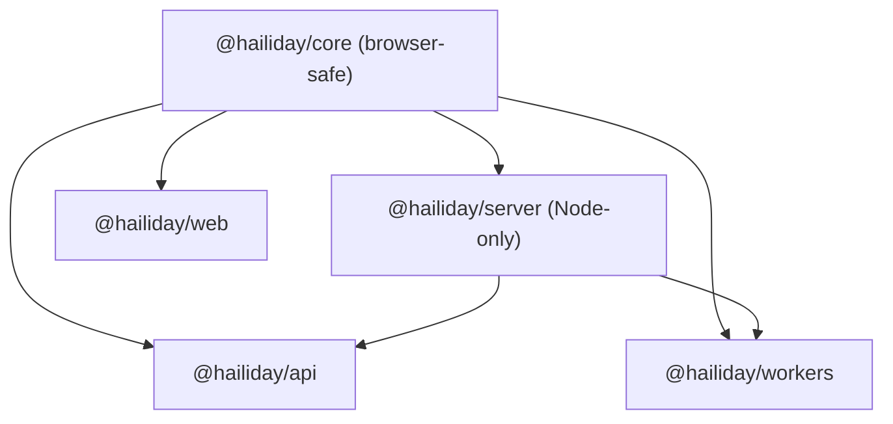
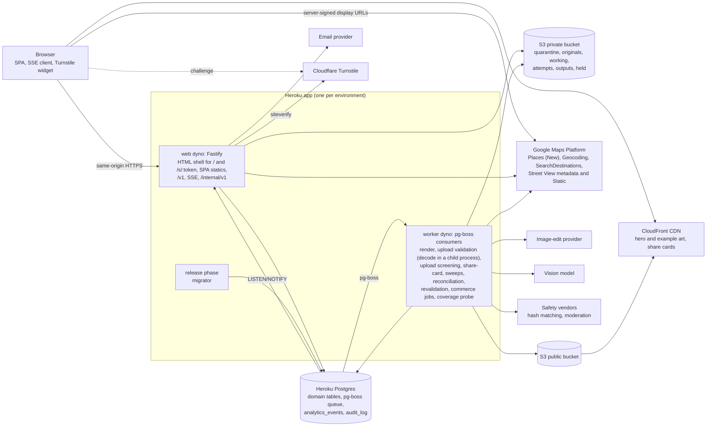

# Hailiday: system architecture

This document describes how Hailiday is built and run: the monorepo and the conventions it inherits from the reference repositories, the packages and their boundaries, the runtime topology, the job queue, storage and media delivery, the landing and share pages, every external integration and its fixture mode, security, capacity and admission control, environments and deployment, continuous integration and testing, observability, and the boundaries that let later countries be added. It is written for engineers and AI coding agents who implement from it. Product behavior, payloads, state semantics and numeric limits live in the specifications it links to; this file says how the system is assembled so that those specifications can be met.

**Owns:** monorepo layout and conventions; packages; runtime topology; queue; storage; landing and share-page delivery mechanics; integrations and the fixture/live matrix; security architecture (keys, bot defense, SSRF, webhooks, admin auth); capacity and admission control mechanics; environments; deployment; CI and test strategy; observability; international extension boundaries.
**Baseline:** planning baseline 2026-11-09; external facts retrieved 2026-11-08.

## Conventions from the reference repositories

Hailiday is a pnpm monorepo modeled on `~/nodejs/pulse` (Pulse) and `~/moontography/dynamic-liquidity` (Dynamic Liquidity), as fixed by [D-01](decisions.md#d-01). Both repositories were inspected on 2026-11-08. The table records what each reference does and what Hailiday does. Where the two references differ, Hailiday picks one; where Hailiday departs from both, the next table gives the reason and the decision that records it.

| Area | Pulse | Dynamic Liquidity | Hailiday |
| --- | --- | --- | --- |
| Workspace | Private root, `packageManager` pnpm 10.28.1, `apps/*` and `packages/*`, scoped `@pulse/*` packages, `workspace:*` dependencies, no Turborepo; `pnpm-workspace.yaml` carries a large security `overrides` block | Private root, `packageManager` pnpm 10.24.0, `engines` node ≥ 22, same two globs, scoped `@dynamic-liquidity/*` | Same layout and globs, `@hailiday/*` scope, `workspace:*`, no Turborepo. Do not copy Pulse's `overrides` block or either reference's version numbers |
| Shared core package | `@pulse/core` is a Node-only server library: Kysely, pg, Redis, S3, Twilio, the logger and all migrations. Single CommonJS `tsc` build; `main` and `types` only, no `exports` map; consumed only by the Node apps | `@dynamic-liquidity/core` is a browser-safe SDK: dual CJS and ESM `tsc` builds, an `exports` map with subpaths, consumed by both the Vite app and the Node indexer; the root `typecheck` and `test` build it first | Two packages ([D-31](decisions.md#d-31)): `@hailiday/core` follows the Dynamic Liquidity shape (browser-safe, `exports` map, built before consumers) and `@hailiday/server` follows the Pulse shape (Node-only database, migrations, logger and clients shared by the API and the workers) |
| Application split | `apps/pulse` (React SPA served same-origin by the API), `apps/api` (Express 5), `apps/workers`, `apps/pulse-landing` (static HTML on S3 and CloudFront) | `apps/web` (SPA) and `apps/indexer`; there is no separate API app: the indexer package serves the Fastify API on the web dyno and the chain indexer on the worker dyno from two Dockerfiles | `apps/web`, `apps/api`, `apps/workers`: the Pulse shape with three deployables, minus the separate landing app (see [Landing and share-page delivery](#landing-and-share-page-delivery)) |
| Module format | `tsconfig.base.json` with `module: commonjs` | Same; only its core package also emits ESM | ESM throughout ([D-30](decisions.md#d-30)) |
| TypeScript | Shared `tsconfig.base.json`: ES2022, strict, `skipLibCheck`, `esModuleInterop`; the React apps do not extend it | Shared base extended by every package, plus `declaration` and `resolveJsonModule` | One strict base extended by every package, with ESM module settings; the web app extends it with `jsx` and `noEmit` |
| Root scripts | `dev: pnpm -r dev`; `typecheck` does not prebuild core; `migrate` filters to `@pulse/core`; `format` on `"**/*.{ts,tsx,json}"`; no root `test` | `build` and `test` use `--workspace-concurrency=1`; `typecheck` and `test` build core first; `--no-bail` on tests; domain-prefixed aliases (`web:dev`, `indexer:migrate`, `docker:up`); `format` on `"**/*.{ts,tsx,json,md}"` | Dynamic Liquidity's prebuild-and-serialize pattern; `db:migrate` filters to `@hailiday/server` (the Pulse migration home) |
| Lint and format | ESLint 10 flat config, typescript-eslint, `eslint-config-prettier`, react-hooks, react-refresh; Prettier 3: `semi: true`, `singleQuote`, `trailingComma: all`, `printWidth: 100`; `.prettierignore` | Same tooling; Prettier `semi: false`, otherwise identical | Same tooling. Prettier style is Pulse's: `semi: true`, `singleQuote: true`, `trailingComma: "all"`, `printWidth: 100`, with a `.prettierignore` for `dist`, `node_modules`, `coverage` and `pnpm-lock.yaml` |
| Tests | No test runner; standalone `ts-node` scripts per test, each creating its own Postgres database | Vitest in every TypeScript package | Vitest and Playwright ([D-46](decisions.md#d-46)) |
| Web stack | React 19, Vite 6, react-router 7, zustand, a hand-written typed fetch wrapper, plain CSS, no UI kit; dev server proxies to the API | React 19, Vite 6, react-router 7, plain CSS, a small app-state module, Vitest component tests | React 19, Vite, react-router 7, plain CSS (CSS modules allowed), typed fetch wrapper, zustand, no UI kit ([D-35](decisions.md#d-35)) |
| API framework | Express 5 with hand-written middleware (auth, rate limit, same-origin, error handler) | Fastify 5 with `@fastify/cors`, inside the indexer package | Fastify 5 ([D-32](decisions.md#d-32)) |
| Runtime validation | None (no zod, joi, ajv or yup in any manifest) | None | zod schemas in `@hailiday/core` with a Fastify zod type provider ([D-32](decisions.md#d-32)) |
| Database | PostgreSQL 16, Kysely 0.28 and pg in `packages/core/src/database`; 130 numbered TypeScript migrations run by a Kysely `Migrator` wrapper with an advisory lock; executed in the Heroku release phase by `deploy/heroku-release.sh` | PostgreSQL 16, Kysely 0.27; an idempotent `schema.sql` applied at boot, with a comment to move to a numbered migrator when destructive migrations arrive | PostgreSQL 16 or later, Kysely and pg, numbered TypeScript migrations with an advisory lock in `@hailiday/server`, run in the release phase ([D-33](decisions.md#d-33)) |
| Jobs | node-resque on Redis; separate worker and scheduler dynos | No queue: a polling loop plus Postgres `LISTEN/NOTIFY` feeding SSE | pg-boss on the same PostgreSQL, transactional enqueue ([D-34](decisions.md#d-34)); SSE fed by `NOTIFY` as in Dynamic Liquidity |
| Object storage | S3 through the AWS SDK; CloudFront for the landing page | None for application data; S3 and CloudFront only host the static bundle | Private S3 bucket with signed URLs, public bucket behind CloudFront, RustFS (S3-compatible) locally ([D-37](decisions.md#d-37)) |
| Authentication | Self-built: arctic (Google OAuth), jose, hash-wasm, cookie-parser, role middleware, row-level security context | None (public dashboard) | Anonymous cookie sessions from the first request; optional account by email magic link ([D-21](decisions.md#d-21)) |
| Configuration | Root `.env` (ignored), committed `.env.example`, a `config.ts` per service reading `process.env`, Heroku config vars in production | Same, plus `${VAR:-default}` interpolation in compose and build-time validation of `VITE_` variables | Same pattern; the config module in `@hailiday/server` parses the environment with zod and fails fast |
| Local development | `docker-compose.yml`: Redis, Postgres 16 on host port 5433, every app, a `cli` profile; a prod-like compose file | Postgres 16 Alpine on host port 5433 with a healthcheck; apps behind profiles; root `docker:*` scripts | One `docker-compose.yml` that `docker compose up --build` starts in full, as in Pulse: Postgres 16 Alpine on host port 5434 (5433 stays free for Pulse), RustFS as the S3-compatible store, Mailpit for email, a one-shot `migrate` service (migrations, bucket setup, seed), then `api` and `workers`; `docker:*` root scripts, including `docker:infra` for the infrastructure alone |
| Deployment | Heroku container stack: `deploy/deploy-pulse.sh` builds linux/amd64 images for web (API plus built SPA, same origin), worker and scheduler, pushes to the registry, runs a release-phase image for migrations; flags `--dry-run`, `--skip-build`, `--no-release`, `--only`; Node 26 slim images | `deploy/deploy-heroku.sh` modeled on Pulse's script (web = Fastify API, worker = indexer) with a post-release one-off migration | Heroku container stack with web, worker and release images and a deploy script carrying the same flags ([D-37](decisions.md#d-37)); migrations in the release phase as in Pulse. The three Dockerfiles exist; the deploy and release scripts are planned under B12 |
| Continuous integration | No `.github` directory; enforcement is a local git pre-commit hook | `ci.yml` and `security.yml` exist but trigger only on `workflow_dispatch` | Automatic CI on every push and pull request (planned under B12, not built yet; see [Continuous integration and testing](#continuous-integration-and-testing)) |
| Logging and errors | bunyan; Heroku log drain; no error-tracking SDK | bunyan with URL redaction before logging; no error-tracking SDK | pino (Fastify's logger) with redaction modeled on Dynamic Liquidity's URL redaction; Sentry with PII scrubbing ([D-45](decisions.md#d-45)) |
| Node and pnpm pins | `packageManager` only; no `.node-version` or `engines`; Dockerfiles use `node:26-slim` and install pnpm with npm because Corepack is no longer bundled | `.node-version` 22 and `engines` ≥ 22, while its Dockerfiles and CI use Node 26 | Node 26 LTS everywhere (`.node-version`, `engines`, Dockerfiles, CI) and pnpm 10 pinned through `packageManager` ([D-30](decisions.md#d-30)). **Verify:** Node 26 is still the Active LTS line at scaffold time, against the Node.js release schedule (https://github.com/nodejs/Release, retrieved 2026-11-08: v26 entered Active LTS on 2026-10-28); owner: engineering lead |

### Deliberate deviations

| Deviation | Reference behavior | Reason | Decision |
| --- | --- | --- | --- |
| ESM throughout | Both references compile to CommonJS | New code, no CommonJS consumers, and the web app and both shared packages ship one module format; dual output is added only for a demonstrated consumer | [D-30](decisions.md#d-30) |
| Two shared packages from the first scaffold | Pulse has one Node-only core; Dynamic Liquidity has one browser-safe core | The API and the workers both need the database, the policy evaluator, the ledger and the storage client, and app-to-app imports are forbidden; the browser needs the schemas and holiday logic without any of that | [D-31](decisions.md#d-31) |
| zod schemas shared by web, API and workers | Neither reference has a runtime schema library | One schema validates the request in the browser, in Fastify and in the worker, and generates the TypeScript types; golden files and fixtures are validated against the same schemas | [D-32](decisions.md#d-32) |
| pg-boss on PostgreSQL | Pulse runs node-resque on Redis; Dynamic Liquidity has no queue | The job row, the ledger reservation and the queue entry commit in one transaction, so there is no separate dispatcher process or handoff table; one fewer datastore; built-in heartbeats, expiry, retries and dead-letter queues | [D-34](decisions.md#d-34) |
| Server-rendered landing shell inside the API process | Pulse keeps a separate static landing app for crawlable marketing content behind which sits an authenticated app; Dynamic Liquidity renders its landing inside the SPA | Hailiday's landing is the product's entry screen: the hero depends on today's date and the share page depends on the token, so the first HTML response must be computed per request, which neither a static page nor a client-rendered SPA can do; same-origin serving is the pattern Pulse already uses for `apps/pulse` | [D-36](decisions.md#d-36) |
| Object-storage emulator in compose | Neither reference emulates S3 locally | Every environment, including a laptop, must exercise signed uploads, lifecycle behavior and the Street View write refusal | [D-37](decisions.md#d-37) |
| Vitest and Playwright | Pulse has no runner; Dynamic Liquidity has Vitest but no browser tests | Browser flows (combobox, slider, upload, switching mid-render) and accessibility checks are release criteria | [D-46](decisions.md#d-46) |
| pino with redaction | Both references use bunyan | pino is Fastify's native logger; redaction paths replace Dynamic Liquidity's hand-written URL scrubbing and are tested | [D-45](decisions.md#d-45) |
| Automatic CI | Neither reference runs CI automatically | Fixture-mode tests are the only evidence that both paths are engineering-complete; they must run on every change | [D-46](decisions.md#d-46) |

Version drift between the references is itself a reason to choose fresh pins at scaffold time: pnpm 10.28.1 versus 10.24.0, Kysely 0.28 versus 0.27, Vitest 4 in one package versus 3 in others, and a `.node-version` of 22 beside Node 26 images. Pick current versions once, record them under [D-30](decisions.md#d-30), and keep `.node-version`, `engines`, every Dockerfile `FROM` line and the CI `setup-node` version identical.

Repository hygiene is backlog item B00: add `.gitignore` and `.dockerignore` before the first scaffold commit, and adapt or remove the `.claude` hook copied from Pulse (it cites `docs/reference/CODE-COMMENTS.md` and Pulse-only paths that do not exist here).

## Repository layout

```text
hailiday/
  apps/
    web/                          # @hailiday/web: React SPA (Vite)
      src/features/{landing,address,project,upload,share,shop,account,gallery,report,legal}/
                                  # project holds confirm, render waiting, compare slider, result and look controls;
                                  # gallery holds the gallery page and its viewer
      src/{app,api,state,copy,experience,analytics,config,styles,ui,test}/
                                  # routes, typed fetch and SSE client, stores, copy deck, shared components
      e2e/                        # Playwright specs (01-landing ... 14-evening-fallback; sixteen files, 05 and 07
                                  # each have a second file) and support.ts
      index.html, vite.config.ts, playwright.config.ts
      public/                     # build-time statics copied to the root of the build and served from the app origin: favicon.svg (the brand mark); the generic site OG image is planned. Fonts are not here: Outfit and JetBrains Mono ship as hashed woff2 files bundled from @fontsource-variable/outfit and @fontsource-variable/jetbrains-mono through the global stylesheet, so the CSP's `font-src 'self'` covers them (the document head, `apps/web/index.html`, preloads the latin Outfit woff2; Vite resolves that link to the same hashed file the stylesheet loads)
    api/                          # @hailiday/api: Fastify
      src/routes/                 # /v1 and /internal/v1 route plugins
      src/domain/                 # orchestration: allowance, projects, renders, sources, discovery, commerce, spend, events
      src/{auth,http,sse}/        # sessions and limits, request and error handling, the SSE hub
      src/html/                   # server-rendered shell for GET / and GET /s/:token
    workers/                      # @hailiday/workers: pg-boss consumers
      src/{index,worker}.ts       # process entry and queue registration; the job handlers live in
                                  # packages/server/src/pipeline/{render,uploads,jobs}/
  packages/
    core/                         # @hailiday/core: browser-safe
      src/{schemas,types,holidays,errors}/
    server/                       # @hailiday/server: Node-only
      src/config/                 # zod-parsed environment, .env loading
      src/{db,ledger,policy,limits,settings,capabilities}/
                                  # Kysely instance, typed schema, migrations/ (numbered TypeScript), migrator,
                                  # seed; allowance and spend ledger; AssetPermission evaluator; limits; runtime settings
      src/{storage,queue,email,turnstile,logger,clock,ids,errors,content}/
                                  # S3 client and key scheme; pg-boss queue; SMTP and fixture mail; bot check;
                                  # pino with redaction; clock; UUIDv7; AppError; content loading
      src/providers/{address,street-view,image-editor,vision,safety}/
                                  # each with a fixture and, where chosen, live adapters; create.ts selects them
      src/pipeline/{plan,compile,render,imaging,uploads,jobs}/
                                  # scene plan, prompt compilation, render stages, compositing, upload checks, job handlers
      src/fixtures/               # fixture renderers: street-view frames, compositor, decor sprites, rooms
      src/{migrate,storage-init,seed,render-examples,bakeoff,tombstones-replay}.ts
                                  # release-phase scripts, the live example renderer and the model bake-off
      content/                    # holiday packs, style kits, commerce catalog, heroes, examples, photo library
      fixtures/                   # fictional places and upload file-name triggers (data only)
  docs/                           # the planning set: README.md (start here), PLAN.md, original_prompt.txt,
                                  # glossary, decisions, traceability, architecture, development, backlog, specs/, research/
  scripts/                        # planned
    seed-capabilities.ts          # per-environment capability profile
    coverage-probe.ts             # enqueues a coverage_probe run
    ops/report.ts                 # SQL-view reports for operations
  deploy/
    Dockerfile.heroku.web         # API plus built SPA
    Dockerfile.heroku.worker
    Dockerfile.heroku.release     # runs the compiled migrator, storage setup and seed
    deploy.sh                     # planned: --dry-run, --skip-build, --no-release, --only <type>
    heroku-release.sh             # planned
  .github/workflows/              # planned
    ci.yml                        # automatic, fixture mode only
    live-smoke.yml                # manual dispatch against staging keys
  docker-compose.yml              # postgres (host port 5434; also the job queue), storage (RustFS), mailpit, migrate, api, workers
  docker-compose.e2e.yml          # override that forces fixture mode and blanks provider keys for the browser tests
  .env.example                    # placeholders with explanations; no real values
  CLAUDE.md                       # notes for coding agents
  .gitignore
  .dockerignore
  .node-version
  .prettierrc
  .prettierignore
  eslint.config.mjs
  package.json
  pnpm-workspace.yaml
  pnpm-lock.yaml
  tsconfig.base.json
```

Entries marked planned do not exist yet. Running the stack locally is described in [development](development.md).

Hero photographs, example before/after pairs and share cards are not in `apps/web/public`; they live in the public bucket behind the CDN and are referenced from database rows (see [Storage and media delivery](#storage-and-media-delivery)), so adding or swapping a hero is a content change rather than a web deploy. Holiday packs are server-only content files loaded by `@hailiday/server` and projected publicly through `GET /v1/experience` ([holiday packs](specs/holidays-and-content.md#holiday-packs)).

### Root scripts contract

```json
{
  "name": "hailiday",
  "private": true,
  "packageManager": "pnpm@10.x.y",
  "engines": { "node": ">=26" },
  "scripts": {
    "dev": "pnpm build:packages && pnpm -r --parallel dev",
    "build:packages": "pnpm -r --filter './packages/*' --workspace-concurrency=1 build",
    "build": "pnpm -r --workspace-concurrency=1 build",
    "typecheck": "pnpm build:packages && pnpm -r --workspace-concurrency=1 typecheck",
    "test": "pnpm build:packages && pnpm -r --workspace-concurrency=1 --no-bail test",
    "test:e2e": "pnpm --filter @hailiday/web test:e2e",
    "lint": "eslint .",
    "lint:fix": "eslint . --fix",
    "format": "prettier --write \"**/*.{ts,tsx,json,md,yml}\"",
    "format:check": "prettier --check \"**/*.{ts,tsx,json,md,yml}\"",
    "db:migrate": "pnpm --filter @hailiday/server migrate",
    "db:seed": "pnpm --filter @hailiday/server seed",
    "db:storage-init": "pnpm --filter @hailiday/server exec node --import ./dist/config/load-env/index.js dist/storage-init.js",
    "models:bakeoff": "pnpm --filter @hailiday/server models:bakeoff",
    "tombstones:replay": "pnpm --filter @hailiday/server tombstones:replay",
    "web:dev": "pnpm --filter @hailiday/web dev",
    "api:dev": "pnpm --filter @hailiday/api dev",
    "workers:dev": "pnpm --filter @hailiday/workers dev",
    "docker:up": "docker compose up --build -d",
    "docker:infra": "docker compose up -d postgres storage mailpit",
    "docker:e2e": "docker compose -p hailiday-e2e -f docker-compose.yml -f docker-compose.e2e.yml up --build -d",
    "docker:e2e:down": "docker compose -p hailiday-e2e -f docker-compose.yml -f docker-compose.e2e.yml down",
    "docker:e2e:reset": "docker compose -p hailiday-e2e -f docker-compose.yml -f docker-compose.e2e.yml down -v",
    "docker:e2e:logs": "docker compose -p hailiday-e2e -f docker-compose.yml -f docker-compose.e2e.yml logs -f",
    "docker:down": "docker compose down",
    "docker:reset": "docker compose down -v",
    "docker:logs": "docker compose logs -f"
  }
}
```

Rules behind the contract:

- `build:packages` builds `@hailiday/core` and then `@hailiday/server` before any app runs, typechecks or tests, because the apps import built package outputs through `exports` maps.
- `dev` runs the per-package watchers in parallel after that prebuild; the `--parallel` flag is new relative to both references (whose `dev` is `pnpm -r dev`) and exists so that long-running watch processes do not block each other. The API and worker `dev` scripts restart their process on change; the package `dev` scripts are `tsc --watch`.
- `format` and `format:check` use an explicit glob and a `.prettierignore`, as both references do.
- `db:migrate` runs the `@hailiday/server` migrator against `DATABASE_URL`. Production runs the compiled migrator (`node packages/server/dist/migrate.js`) in the release phase before any dyno boots.
- `db:migrate`, `db:seed` and `db:storage-init` run the compiled release-phase scripts on the host through the `.env` preload (`dist/config/load-env`), so they need built packages. `db:storage-init` creates both buckets, their CORS and the public-read policy, as the release phase does.
- `models:bakeoff` runs the [model bake-off](development.md#model-bake-off) (`packages/server/src/bakeoff.ts`): it calls paid providers, so the test suites cover it only with stand-in models and never run it, and it writes its output outside the repository.
- `tombstones:replay` runs the tombstone replay of the restore runbook (`packages/server/src/tombstones-replay.ts`, the compiled `node --import ./dist/config/load-env/index.js dist/tombstones-replay.js` of the server package; in the release image `node dist/tombstones-replay.js`). It takes no arguments (`--help` prints the usage), prints one JSON line of counts (`batches`, `lines`, `tombstonesRestored`, `projectsRedeleted`, `sourceAssetsRedeleted`, `renderAssetsRedeleted`, `sharesRevoked`, `ownersRedeleted`) and exits 0, 2 for an unknown argument or 1 on failure.
- Workspace concurrency is 1 for build, typecheck and test so a clean checkout validates deterministically; introduce caching or Turborepo only after a measured need.

### Package manifests

| Directory | Package | Kind | Required scripts | Dependencies on the workspace |
| --- | --- | --- | --- | --- |
| `apps/web` | `@hailiday/web` | Vite React app, private | `dev`, `build` (`tsc -p tsconfig.json --noEmit && vite build`), `typecheck`, `test` (Vitest), `test:e2e` (Playwright) | `@hailiday/core` only |
| `apps/api` | `@hailiday/api` | Node ESM service, private | `dev`, `build` (`tsc -p tsconfig.build.json`), `typecheck`, `test`, `start` | `@hailiday/core`, `@hailiday/server` |
| `apps/workers` | `@hailiday/workers` | Node ESM service, private | same as the API | `@hailiday/core`, `@hailiday/server` |
| `packages/core` | `@hailiday/core` | ESM library, private, `exports` map with subpaths `.`, `./schemas`, `./types`, `./holidays`, `./errors`; `sideEffects: false` | `dev` (`tsc --watch`), `build`, `typecheck`, `test` | none |
| `packages/server` | `@hailiday/server` | ESM Node library, private, `exports` map with one subpath per directory (`./db`, `./policy`, `./ledger`, `./storage`, `./queue`, `./providers`, `./logger`, `./config`) | `dev`, `build`, `typecheck`, `test`, `migrate`, `seed`, `examples:render`, `models:bakeoff`, `tombstones:replay` | `@hailiday/core` |

Linting runs only from the root (`pnpm lint` is `eslint .` over the whole repository), so no package declares a `lint` script.

Every workspace dependency is declared as `"@hailiday/core": "workspace:*"` (or `@hailiday/server`), never as a relative path or a TypeScript path alias.

## Packages and boundaries

| Package | What lives there | What never lives there |
| --- | --- | --- |
| `@hailiday/core` | zod schemas for every `/v1` request and response, for `SceneAnalysis`, `DecorationPlan` and `JudgeResult` ([coordinate and schema conventions](specs/render-pipeline.md#coordinate-and-schema-conventions)) and for the holiday pack file ([pack schema](specs/holidays-and-content.md#pack-schema)); TypeScript types inferred from them; the enums in [the glossary](glossary.md) (states, kinds, match classes, source modes, failure codes, product relationships); holiday window and default-selection logic ([windows and selection](specs/holidays-and-content.md#windows-and-selection)); the error-code enum and its HTTP status map ([error codes](specs/data-and-api.md#error-codes)); the variant-key function ([variant key and reuse](specs/render-pipeline.md#variant-key-and-reuse)); pure helpers (bearing and fov clamp used by the viewpoint algorithm, allowance arithmetic) | Node built-ins, database access, provider SDKs, secrets, storage clients, prompt text, pack content, copy strings |
| `@hailiday/server` | Kysely instance and typed schema; numbered migrations and the migrator with its advisory lock; the single `AssetPermission` evaluator ([rights and permissions in the glossary](glossary.md#rights-and-permissions)); the `usage_ledger` writer (reserve, settle, release); the storage client with the key scheme, signed URLs and the Street View write refusal; the `JobQueue` interface and its pg-boss implementation; provider adapters with their fixture and live implementations, request signing, the SSRF-safe fetch helper and cost recording; pino logger with redaction; zod-parsed configuration | HTTP routes, React, browser code |
| `@hailiday/api` | Fastify server: `/v1` routes, `/internal/v1` routes, the HTML shell, middleware (session cookie, Turnstile verification, rate limits, same-origin check, operator authentication, error mapping), SSE endpoint listening to `NOTIFY` | Direct provider SDK usage, direct SQL outside `@hailiday/server`, image decoding |
| `@hailiday/workers` | pg-boss consumers for the queues in [Jobs and queue](#jobs-and-queue); stage orchestration for render jobs; the decode child process for `upload_validate` | Route handlers, HTML |
| `@hailiday/web` | The SPA: features, the typed fetch wrapper generated from core schemas, the zustand store, the SSE client, the copy deck loader ([copy deck](specs/experience.md#copy-deck)) | Secrets, provider keys other than the referrer-restricted Street View display key and Turnstile site key delivered in the experience JSON |

Import rules, enforced by ESLint `no-restricted-imports` and by the absence of path aliases:

1. Apps never import other apps. `@hailiday/workers` must not depend on `@hailiday/api`; it would drag Fastify into the worker image and duplicate the database client.
2. Apps consume packages only through `workspace:*` dependencies and the packages' `exports` maps.
3. `@hailiday/web` depends on `@hailiday/core` only. A build step asserts that no Node built-in or `@hailiday/server` import reaches the browser bundle.
4. `@hailiday/core` imports nothing from the workspace and nothing from Node.
5. `@hailiday/server` imports `@hailiday/core`.
6. The policy evaluator is one module. The API calls it at `POST /v1/renders` and `PUT /v1/projects/:id/source`; the worker calls it again immediately before every provider call and before every storage write. It is never reimplemented per app ([rights and permissions in the glossary](glossary.md#rights-and-permissions)).
7. Build order is `core` → `server` → `api`, `workers`, `web`.



## Runtime topology



How a request moves through the system:

- The browser talks to one origin. The web dyno serves the HTML shell, the hashed SPA assets, the `/v1` API, the SSE stream and the role-protected `/internal/v1` API. The only third-party endpoints the browser contacts are the CDN (public art), Google's Street View Static endpoint (display URLs that the server has signed; [before image and attribution](specs/address-and-street-view.md#before-image-and-attribution)) and the Turnstile widget.
- Every other provider call is made by the server. The API makes the cheap synchronous ones during address entry (suggestions, resolution, geocoding, Street View metadata) and the worker makes every expensive or slow one (Street View pixel fetch, image editing, vision analysis and judging, content screening, share-card rendering, email). Both go through the adapters in `@hailiday/server`, which select the fixture or live implementation from the capability state ([External integrations and fixture modes](#external-integrations-and-fixture-modes)) and record cost.
- The API and the workers read and write PostgreSQL and object storage only through `@hailiday/server`. The queue is a set of pg-boss tables in the same database, so a render request's job row, ledger reservation and queue entry are one transaction ([Jobs and queue](#jobs-and-queue)).
- State changes on render jobs are published with `NOTIFY` in the same transaction that writes them; the API's SSE endpoint listens and forwards them ([live updates](specs/data-and-api.md#live-updates)). Polling `GET /v1/renders/:id` remains the recovery path.
- The release phase runs the migrator before the web and worker dynos of a new release start.
- The browser never holds a Google key that can call Places, Geocoding or Street View metadata ([D-38](decisions.md#d-38)); it holds a referrer-restricted key enabled only for the Street View Static API, used solely inside server-signed display URLs, and a Turnstile site key.

## Jobs and queue

PostgreSQL is both the source of truth and the job transport ([D-34](decisions.md#d-34)). Workers run pg-boss 12.x (12.38.1 published 2026-11-05, Node ≥ 22.12; https://github.com/timgit/pg-boss, retrieved 2026-11-08) and the API enqueues through pg-boss's Kysely adapter, which runs `send()` inside an existing Kysely transaction so that a rollback also removes the job (https://pgboss.io/api/adapters, retrieved 2026-11-08). graphile-worker is the recorded alternative. The domain never imports pg-boss directly; it uses a small `JobQueue` interface in `@hailiday/server` (`send`, `cancel`, `work`, `onStateChange`), so the transport can change without touching domain code.

### Queues

| Queue | Producer | Trigger | Singleton key | Expiry | Transport retries |
| --- | --- | --- | --- | --- | --- |
| `render` | API, in the `POST /v1/renders` transaction | A render request that misses the variant cache | `projectId` (one active job per project) | `RENDER_MAX_JOB_DURATION_S` plus 30 s | `RENDER_TRANSPORT_RETRY_LIMIT` with backoff; dead letter `render_dead` |
| `upload_validate` | API, in the `POST /v1/uploads/:id/complete` transaction | A completed upload in `quarantined` | `sourceAssetId` | `UPLOAD_VALIDATE_MAX_DURATION_S` | 1; dead letter marks the source asset `failed` |
| `upload_screen` | `upload_validate`, in the transaction that promotes the normalized original | A validated upload in `screening` | `sourceAssetId` | `UPLOAD_SCREEN_MAX_DURATION_S` | 1; dead letter marks the source asset `failed` |
| `share_card` | API, at `POST /v1/shares` | A new share grant | `shareToken` | 120 s | 2 |
| `retention_sweep` | pg-boss schedule | Every 15 minutes (configuration) | fixed key | 600 s | 0 (next run retries) |
| `attempt_sweep` | pg-boss schedule | Hourly (configuration) | fixed key | 600 s | 0 |
| `coordinate_expiry` | pg-boss schedule | Daily | fixed key | 600 s | 0 |
| `reconciliation` | pg-boss schedule | Every 10 minutes (configuration) | fixed key | 600 s | 0 |
| `street_view_revalidation` | pg-boss schedule | Hourly (configuration); selects ready Street View sources due under the revalidation rules, and stale or declined sources that keep a stored frame or still have live variants; takes due sources oldest check first in pages of 200 until none is due, its 50-minute budget is spent or the job is aborted | fixed key | 3300 s | 0 |
| `offer_verification` | pg-boss schedule | Daily (configuration); selects offers due under the commerce verification cadence | fixed key | 600 s | 0 |
| `affiliate_report_import` | pg-boss schedule | Daily (configuration) | fixed key | 1800 s | 0 |
| `coverage_probe` | `scripts/coverage-probe.ts` | Manual, Phase 1 | per probe run | 3600 s | 0 |

Configuration keys, with defaults that are revised from Phase 1 measurements: `RENDER_HEARTBEAT_S` default 15 (pg-boss requires at least 10); `RENDER_MAX_JOB_DURATION_S` (default 240, and its floor: a lower value is raised to 240, `MIN_RENDER_MAX_JOB_DURATION_S`) is the render spec's `maxJobDuration` ([latency budget](specs/render-pipeline.md#latency-budget)) and the `render` queue expires a job 30 s after it (`RENDER_QUEUE_EXPIRY_MARGIN_S`, a constant, not a setting), so the job's own deadline, counted from its start, always fires first and the fallbacks that run at the deadline can still deliver the picture the job has (the queue's abort signal fires only when a run outlasts the limit by 30 s; the lease still counts from the start and the limit); `RENDER_TRANSPORT_RETRY_LIMIT`, `RENDER_RETRY_DELAY_S` and `RENDER_RETRY_DELAY_MAX_S` default to the transport-retry limit and exponential backoff in the render spec's dispatch sequence ([rendering](specs/render-pipeline.md#rendering)); `UPLOAD_VALIDATE_MAX_DURATION_S` equals the decoder job time limit in [upload security](specs/uploads.md#upload-security); `UPLOAD_SCREEN_MAX_DURATION_S` default 120; `STREET_VIEW_FRAME_MAX_AGE_DAYS` (positive integer, default 30) is the age after which a stored Street View frame is fetched again before it is decorated. These values are read from the environment when a worker creates or updates its queues, so they change with a config-var release rather than through `runtime_settings`. pg-boss queue options used: `heartbeatSeconds`, `expireInSeconds`, `retryLimit`, `retryDelay`, `retryBackoff`, `retryDelayMax`, `deadLetter` and the queue policy (https://pgboss.io/api/queues, retrieved 2026-11-08).

### Transactional enqueue

`POST /v1/renders` performs, in one Kysely transaction: insert the `render_jobs` row in state `queued` with its input snapshot; insert the `usage_ledger` reservation for the worst case (two attempts for a daylight job and three for a relit job, with a judge and an escalation per attempt and a localization per decorating attempt, plus one Street View fetch whenever the job will fetch pixels: every transient job, and a persist source with no stored frame yet or one past `STREET_VIEW_FRAME_MAX_AGE_DAYS`; a reserved fetch also reserves a scene analysis, because a fetched frame may carry other bytes; [cost recording](specs/render-pipeline.md#cost-recording)); `boss.send('render', payload, { id: renderJobId, singletonKey: projectId, db: adapter })`. The render job ID is the pg-boss job ID, so the two records share one identifier. If any step fails the transaction rolls back and no job, reservation or queue entry exists. The response is 202 with `{renderJobId, state, queuePosition}` ([HTTP API](specs/data-and-api.md#http-api)).

Allowance, verification, spend ceiling and capacity checks run before the transaction opens and are documented at their [enforcement points](specs/data-and-api.md#allowance-quotas-and-rate-limits).

### One active job per project

Two mechanisms, both required: a partial unique index on `render_jobs (project_id) WHERE state NOT IN (terminal states)` is the domain guarantee ([idempotency and concurrency](specs/data-and-api.md#idempotency-and-concurrency)), and `singletonKey = projectId` with a queue policy that admits one active job per key is the queue-level guard. A newer render request for the same project supersedes the older non-terminal job: the API marks the old job `superseded` and cancels it in the queue before enqueueing the new one. **Verify:** which pg-boss queue policy (`singleton` or `exclusive`) matches "one active job per key" in the pinned version, at B04; owner: engineering lead.

Domain idempotency stays in the domain: `Idempotency-Key` per owner with a stored request hash and a unique index; pg-boss `singletonKey` is a throttling control and is never described as the idempotency mechanism ([idempotency and concurrency](specs/data-and-api.md#idempotency-and-concurrency)).

### Heartbeat, expiry and transport retries

The worker's `work()` sends heartbeats automatically; when a worker dies mid-job the pg-boss monitor fails the job after `heartbeatSeconds` plus its monitor interval and schedules a retry under the queue's retry settings. Expiry is the maximum duration of the whole `preparing` → `checking` pipeline plus 30 s (`RENDER_QUEUE_EXPIRY_MARGIN_S`), not one provider call.

A pg-boss retry is a transport retry, never a render attempt. pg-boss documents that a stalled-but-alive worker can cause a job to run twice, so handlers are idempotent: before any paid call the handler reads `render_attempts` for an in-flight or completed provider operation on this job and resumes or reconciles it through `ImageEditor.getOperation` ([rendering](specs/render-pipeline.md#rendering)) instead of buying another attempt. The single repair after a QA rejection is a domain decision recorded in `render_attempts` ([repair and retries](specs/render-pipeline.md#repair-and-retries)); it is not a queue retry. A user retry is a new render job.

### Dead-letter consumer

A consumer on `render_dead` settles the ledger (release the unused reservation, settle any attempt whose outcome is known), writes `failed` with `failureKind` (`unknown_outcome` when a provider operation was started and its status could not be recovered, `provider_error` or `timeout` for provider failures, otherwise `internal_error`), writes `terminalAt`, publishes the state change, and raises an alert. Unknown outcomes are retried by the `reconciliation` job, which queries the recorded provider operation and settles the real cost when it becomes known.

### Cancellation and late results

`POST /v1/renders/:id/cancel` writes `canceled` in the domain, calls `boss.cancel(jobId)`, and the handler checks the job's abort signal between stages and passes it to provider calls. An in-flight paid call may complete and is settled at its real cost. A job that is `canceled`, `superseded`, `expired` or whose project was deleted never publishes an output: the publish step re-reads the job state and the project version inside the transaction that would write the `render_assets` row ([lifecycle state machines](specs/render-pipeline.md#lifecycle-state-machines)).

### NOTIFY to SSE

Every state transition on `render_jobs` writes the new state and its timestamp and runs `NOTIFY render_job_changed` with an IDs-only payload (`{"jobId":…,"seq":…}`) in the same transaction. The API's SSE endpoint holds one `LISTEN` connection per web process, re-reads the row and fans out to the clients subscribed to that job; the payload, `Last-Event-ID` reconnection and the polling fallback are defined in [live updates](specs/data-and-api.md#live-updates). Upload screening has no stream; the client polls `GET /v1/uploads/:id` ([live updates](specs/data-and-api.md#live-updates)).

### Other jobs

- `upload_validate`: the uploads spec's decoder pool. Loads the quarantined upload, decodes and re-encodes it in a child process with a minimal environment and resource limits ([Image decoding isolation](#image-decoding-isolation)), moves the source asset to `screening` when it starts, writes the normalized original, deletes the quarantine object, and at promotion, in one transaction, records the validation fields and enqueues `upload_screen` ([server-side validation](specs/uploads.md#server-side-validation)).
- `upload_screen`: the uploads spec's screening pool. Runs content admission on the normalized original in the order defined by [content admission](specs/uploads.md#content-admission) and moves the source asset to `ready` or `declined`, or leaves it `screening` with `holdForReview`. It never reads quarantine objects and never holds image-edit credentials.
- `share_card`: renders the 1200×630 card for a grant ([Landing and share-page delivery](#landing-and-share-page-delivery)).
- `retention_sweep`: expires anonymous projects and saved projects by age or inactivity only while the runtime setting `retention.time_based_deletion` is on (off by default, [D-20](decisions.md#d-20)), and always expires share grants and quarantine objects of uploads that never completed (inactive accounts are not expired: that step is not built), per the [retention schedule](specs/privacy-safety-legal.md#retention-schedule); runs deletion with receipts ([deletion and verification](specs/privacy-safety-legal.md#deletion-and-verification)). Each run first resumes deletion requests that did not finish (and `held` ones whose holds were released), and also purges expired `auth_tokens`, nulls hashed IP and device signals older than 7 days, deletes reports 12 months after resolution, mirrors new tombstones to `tombstones/` and ages out tombstones and mirror batches. It skips rows and objects under a preservation hold.
- `attempt_sweep`: deletes `attempts/` objects of terminal jobs past the rejected-candidate retention in the [retention schedule](specs/privacy-safety-legal.md#retention-schedule) and `working/` objects past their grace period; skips held objects.
- `coordinate_expiry`: deletes Places coordinates past `coordsExpireAt` ([saved projects and address storage](specs/address-and-street-view.md#saved-projects-and-address-storage)).
- `reconciliation`: resolves `unknown_outcome` attempts (and attempts left `pending` with an operation ID on a job terminal for over an hour), closes `pending` Street View enhancement rows whose job is gone or has been terminal for over an hour (`abandoned`; counted in the result's `enhancementsAbandoned`), settles reservations left open past expiry, lists storage objects with no live owning row or past expiry and deletes them (never under `held/`, never an object of a row covered by a preservation hold; an object under `enhanced/` is live only while a `source_enhancements` row names it and its source is held, or is not deleted or expired, still keeps a stored frame and has the row's frame checksum, and anything else is deleted after the usual grace of one hour), and records the "objects past expiry" metric, which must be zero.
- `street_view_revalidation`: calls `StreetViewProvider.refreshPanorama(panoId, { location, locationRadiusM })` (the property target point with a 60 m radius, `REFRESH_TARGET_POINT_RADIUS_M`) for every ready Street View source, in either mode, that keeps a stored frame or still has live variants and whose last check is older than the revalidation interval (oldest check first, never checked first, in pages of 200 with a cursor, so a source whose call fails is taken once per run; the run budget and the job's abort signal are checked before every source). Before its metadata call each source's policy is brought up to the current template: a policy that no longer allows distribution revokes the source's share links and deletes their public copies, one that no longer allows storage deletes the stored frame, and a capability that is only missing or not live changes neither. A source the configured provider cannot judge (the fixture adapter and real imagery, or the live provider and a fixture stand-in) is skipped and stays due. The answer is `unchanged`, `replaced` (newer imagery at the pinned location: the source is marked `stale` and its stored bytes deleted, variants kept), `missing` (metadata reports no imagery and no other panorama answers at the pinned location, the property target point while its coordinates are retained: the source is marked `stale` and its stored bytes deleted, and its derivatives are purged) or `error` (a failed or uninformative metadata call: nothing changes and the check stays due). A held source keeps its stored bytes on every path. In either mode it also re-checks sources already `stale` or `declined` that keep a stored frame or still have live variants (not deleted, not withdrawn) when a stale one was marked stale after its last check or the check is older than 24 hours. A `missing` panorama (removed or blurred) purges its derivatives (`purgeSourceDerivatives`: variants withdrawn and deleted, share grants revoked, public copies, outputs and downloads deleted) and deletes the stored copy; a replaced one deletes the stored copy and keeps the variants labeled; a still-present one makes a stale source `ready` again with its stored copy (a declined source stays declined and keeps it) and has only `sourceCheckedAt` written into its stored viewpoint, a single key set in the database, so a framing a render recorded meanwhile ([framing](specs/render-pipeline.md#framing)) is never lost; a held source keeps its copy on every path; an `error` retries on the next run. The job result counts these in `restored` (stale sources made ready again). A removal noticed at render time is therefore purged within one run even if the render-time path did not purge it ([panorama changes, blur and takedown](specs/address-and-street-view.md#panorama-changes-blur-and-takedown)).
- `offer_verification`: runs `api` or `feed` checks for offers whose program grants access, and auto-pauses offers past their freshness limit; manual checks are recorded by operators through the internal API ([offers and lifecycle](specs/commerce.md#offers-and-lifecycle)).
- `affiliate_report_import`: imports each program's reports into `affiliate_conversions` and reconciles them with `affiliate_clicks` ([click tracking and attribution](specs/commerce.md#click-tracking-and-attribution)).
- `coverage_probe`: the metadata-only Street View coverage sample ([coverage probe](specs/address-and-street-view.md#coverage-probe)).

Post-delivery audit sampling needs no queue: in `sampled_audit` review mode the publish step selects delivered variants at the sample rate owned by the [quality spec](specs/quality-and-benchmark.md#pilot-evaluation) and inserts the audit item into the review queue in the same transaction ([internal operations API](specs/data-and-api.md#internal-operations-api)).

## Storage and media delivery

Two S3 buckets per environment ([D-37](decisions.md#d-37)), emulated by RustFS locally. Retention values are owned by the [retention schedule](specs/privacy-safety-legal.md#retention-schedule); this section defines the mechanisms that implement them.

| Bucket | Access | Prefix | Contents and lifetime |
| --- | --- | --- | --- |
| `hailiday-<env>-private` | No public access; signed URLs only; every image response carries `Cache-Control: private, no-store`; never behind a shared CDN cache | `quarantine/{sourceAssetId}` | Client bytes exactly as uploaded; deleted by `upload_validate` on promotion, otherwise by the quarantine lifecycle backstop in the [retention schedule](specs/privacy-safety-legal.md#retention-schedule) |
| | | `originals/{ownerId}/{sourceAssetId}` | The normalized original of an upload (re-encoded, oriented, metadata-stripped); the immutable source for lineage, whose checksum is the lineage checksum ([server-side validation](specs/uploads.md#server-side-validation)) |
| | | `enhanced/{ownerId}/{sourceAssetId}/{enhancementId}.png` | The accepted enhancement of a stored Street View frame: the frame redrawn sharper and cleaner by the image editor, checked, on the working grid, the picture every look of the source is made on ([enhancing](specs/render-pipeline.md#enhancing)). Written only where `store` is allowed (the storage client applies the frame's rule, a derivative of Google's frame with `derivative: false`); lives as long as the stored frame and is deleted with it on every path that deletes, purges, replaces or blocks the frame; no lifecycle rule. Its raw provider output is under `attempts/{renderJobId}/{enhancementId}/raw.<extension>` |
| | | `working/{renderJobId}/` | Provider-sized input and masks for one job; deleted by `attempt_sweep` when the job reaches `terminalAt` plus a short grace period |
| | | `attempts/{renderJobId}/{attemptId}/` | Raw and composited candidate of each attempt (`candidate_object_key`); the accepted candidate is promoted to `outputs/`; rejected or failed candidates are kept for the period in the [retention schedule](specs/privacy-safety-legal.md#retention-schedule) and deleted by `attempt_sweep` |
| | | `outputs/{ownerId}/{renderAssetId}/` | Accepted variants and their display derivatives ([compositing and resolution](specs/render-pipeline.md#compositing-and-resolution)) |
| | | `downloads/{ownerId}/{renderAssetId}` | The download file of a `downloadable` variant ([D-22](decisions.md#d-22)), written by the render worker at acceptance in the same job, after `qaPassedAt` and before `succeededAt`; its labeling and attribution are defined in [provenance and labeling](specs/render-pipeline.md#provenance-and-labeling). Read only through the short-lived signed `downloadUrl` on the `Variant` payload ([HTTP API](specs/data-and-api.md#http-api)); retention follows the variant, and it is deleted with it |
| | | `held/{holdId}/{originalKeyHash}` | Objects under a preservation hold, including child-safety matches (the uploads spec's restricted preservation prefix); encrypted at rest; no lifecycle rule; excluded from `retention_sweep`, `attempt_sweep`, `reconciliation` and user deletion; readable only through the internal API by `operator` accounts, every read audited; moved back or deleted only on hold release ([preservation holds](specs/privacy-safety-legal.md#preservation-holds)). Hold placement copies every covered object here and records the copies on the hold (`held_objects`); the source keys stay protected too, because every sweep and deletion path skips held rows. Street View pixels are not copied (the storage client writes them only under an evaluated permission) and are protected in place; so are the enhanced pictures of held Street View sources |
| `hailiday-<env>-public` | Readable only through CloudFront (bucket policy restricted to the distribution's origin identity) | `hero/{heroAssetId}/{crop}.{ext}` | Hero art per responsive crop, content-hashed keys, `Cache-Control: public, max-age=31536000, immutable` |
| | | `examples/{exampleAssetId}/{before,after}.{ext}` | Permissioned example pairs, same caching |
| | | `shared/{shareToken}/{after,before}.jpg` | Copies of the shared derivative made when a grant is created; `before` exists only when distribution of the source is permitted; `Cache-Control: public, max-age=300, s-maxage=3600`; invalidated on revocation |
| | | `cards/{shareToken}.jpg` | 1200×630 share card; `Cache-Control: public, max-age=300, s-maxage=3600` (browsers revalidate after 5 minutes, the CDN keeps an hour); invalidated on revocation |

Rules:

- Object keys contain only opaque identifiers in the format defined in [data-and-api conventions](specs/data-and-api.md#conventions). Never an address, place ID, panorama ID, email, original filename or any user-supplied text.
- The storage client in `@hailiday/server` is the only writer. Its `put` requires the source asset kind and the evaluated `AssetPermission`. For `kind = street_view` it refuses the write unless `permission.store` is true, and it records the evidence ID on the object's metadata when it does write. The transient Street View path never calls `put` for pixels: the worker fetches by panorama and view parameters into memory, keeps them through QA and repair, stores only the checksum on the attempt and discards them ([Street View source modes](specs/address-and-street-view.md#street-view-source-modes)). A test exercises the refusal (run by hand until CI exists).
- No recorded Street View image is ever committed to the repository or a fixtures package; storing Street View images is restricted under Google's standard terms ([licensing outcomes and activation](specs/address-and-street-view.md#licensing-outcomes-and-activation)). Fixture mode uses permissioned Street View-shaped photos instead.
- Uploads use a presigned POST into `quarantine/` with a server-chosen key, a content-length range, a content-type condition and an expiry of at most 5 minutes; `POST /v1/uploads/:id/complete` verifies the object by HEAD before enqueueing `upload_validate` ([upload security](specs/uploads.md#upload-security) owns the constraint details).
- Private reads use presigned GET URLs that expire within 15 minutes and pin `response-cache-control: private, no-store`. The SPA refreshes a URL by re-fetching the resource that issued it; URLs are never persisted client-side beyond the page session.
- Hero, example and shared assets are the only objects the browser fetches without a signature, and only through the CDN.
- Versioning is off on both buckets (or non-current versions expire within 1 day); no cross-region replication. Postgres backups never contain image bytes. Tombstones hold opaque IDs and key hashes only and are mirrored as append-only objects (`tombstones/{date}/{batchId}.jsonl` in the private bucket, one object per batch so writers never read-modify-write; each completed deletion writes its batch and the retention sweep mirrors any tombstone not yet mirrored) so that a database restore replays them before traffic resumes ([deletion and verification](specs/privacy-safety-legal.md#deletion-and-verification)). Restore runbook: restore Postgres, run the migrations, run `pnpm tombstones:replay` (the root alias of the server package script, which calls `replayTombstoneMirror`; see the [scripts contract](#root-scripts-contract)), then let traffic in; the next `retention_sweep` completes the deletions the replay re-opened.
- Lifecycle rules are a backstop independent of application code. Prefixes with a backstop value in the [retention schedule](specs/privacy-safety-legal.md#retention-schedule) use it (`quarantine/`, `reviews/`, `tombstones/`, `shared/` and `cards/`); anonymous projects' `originals/`, `outputs/` and `downloads/`, and `enhanced/`, have no lifecycle rule (no object is tagged, because those prefixes are shared with saved projects) and rely on the `retention_sweep` (the planned tag-based backstop is in the [backlog](backlog.md)); `working/` and `attempts/` expire at their TTL plus 1 day; `held/` has no lifecycle rule, so a hold is applied by copying the object there; sliding-TTL classes (saved projects) rely on the `retention_sweep` job and the `reconciliation` job's "objects past expiry" check, which must read zero. The release-phase `storage-init` script applies the rules (values in `lifecycleRulesFor` in `@hailiday/server/storage`, listed in the [retention schedule](specs/privacy-safety-legal.md#retention-schedule)); RustFS honors them locally, and an endpoint without lifecycle support is logged and skipped.
- Deletion order for any asset: revoke access (tombstone row, cancel jobs), delete objects, invalidate CDN paths for public copies, delete or tombstone rows, write the deletion receipt. Provider-side deletion is requested where an API exists ([deletion and verification](specs/privacy-safety-legal.md#deletion-and-verification)). CDN invalidation goes through the storage client's `purgePublic` and its `CdnPurger` interface; no CDN exists in local development or tests, where the default purger records the paths it was asked to purge. A CloudFront purger is planned deploy work (not built), and until it exists the public copies are bounded by the `s-maxage 3600` the share cards and shared copies carry.

## Landing and share-page delivery

The Fastify API serves the built SPA same-origin through `@fastify/static` (https://registry.npmjs.org/@fastify/static, retrieved 2026-11-08), as Pulse serves `apps/pulse`, and renders two HTML documents itself: the landing shell at `GET /` and the share page at `GET /s/:token` ([D-36](decisions.md#d-36)). The recorded alternative is one prerendered static page per season selected at the CDN edge; it was not chosen because hero changes would need a deploy and share pages would still need per-token rendering.

### Landing shell

1. Resolve the current time in America/New_York, look up the promotion window and the default holiday, and load the published hero for that holiday from `hero_assets` ([windows and selection](specs/holidays-and-content.md#windows-and-selection); [hero and example art](specs/holidays-and-content.md#hero-and-example-art)). The hero's intrinsic width and height, crops and rights record are database columns, so no deploy is involved.
2. Return HTML whose body already contains the page in the app's own markup and classes: the hero frame, a full-viewport photograph with the header (brand, the holiday label and the Gallery link) laid over it, the hero as `<picture>` with `` covering the frame (`sizes` is `100vw`, and the portrait source is used on any viewport taller than wide), the scrim layer, and the content block (the eyebrow pill, the headline, then the dock with the subhead, the address field with its placeholder, the routes with a real `/upload` link, "See an example" when examples exist, the age line and the invitation when the holiday asks for it; [experience: landing](specs/experience.md#landing)), with the ink `theme-color` (`#0d0d0f`) and a matching `<link rel="preload" as="image" imagesrcset imagesizes fetchpriority="high">` in the head (`imagesrcset` and `imagesizes` are defined for `rel="preload" as="image"`, https://developer.mozilla.org/en-US/docs/Web/HTML/Reference/Elements/link, retrieved 2026-11-08), site-level Open Graph and Twitter tags with the generic site image, the web build's icon and font links (`<link rel="icon" href="/favicon.svg" type="image/svg+xml">` and a `<link rel="preload" as="font" type="font/woff2" crossorigin>` for the latin Outfit face, so the server-painted headline does not swap faces), and the resolved experience as inline JSON in `<script type="application/json" id="experience">`. The inline JSON is the public part of the `GET /v1/experience` response (holiday default, picker list, occurrence calendar, hero, examples, public capability projection; [HTTP API](specs/data-and-api.md#http-api)); the allowance snapshot is session-specific and arrives after `POST /v1/sessions`.
3. The SPA hydrates from the inline JSON and paints no second hero. It calls `GET /v1/experience` only for what the shell lacks (the allowance, once a session exists, and a deep-linked holiday); choosing a holiday sends no request, and there is no client-side timezone swap of the hero or the default ([selection precedence](specs/holidays-and-content.md#selection-precedence)).
4. Caching: the shell is memoized in process per (window ID, hero asset ID, pack version) and served with `Cache-Control: public, max-age=60, stale-while-revalidate=300` and an `ETag` that includes the window ID, so a cached copy can be at most about a minute stale at a window boundary. If a CDN is ever placed in front of the web dyno, the cache key must include the window ID.
5. The hero `` in the initial HTML is the page's LCP element (the photograph stops one pixel short of the frame's lower edge so the browser counts it as the largest paint); the mobile p75 targets are in [PLAN §10](PLAN.md#10-quality-bar-and-release-criteria) (Core Web Vitals thresholds: https://web.dev/articles/vitals; discoverability of the LCP resource from the HTML: https://web.dev/articles/optimize-lcp, both retrieved 2026-11-08).

### Share pages

- `GET /s/:token` looks up the grant by token hash. An active grant renders the same template with: the shared after image from `shared/{token}/after.jpg`, the before image only when `shared/{token}/before.jpg` exists, the "AI preview" label, Google Maps attribution and the per-image copyright when the output derives from Street View and distribution is permitted, a call to action to the landing page, a report link, and no product links ([D-26](decisions.md#d-26)). The picture sits on a picture stage under an ink header band with the ink `theme-color`, in the markup and classes of the app's share page ([experience: share page](specs/experience.md#share-page)). Open Graph and Twitter tags carry `og:image` pointing at `cards/{token}.jpg`, `twitter:card` `summary_large_image`, and a title and description that never include an address. A `share_viewed` analytics event is emitted server-side. Page content rules are owned by [saving, accounts and sharing](specs/experience.md#saving-accounts-and-sharing).
- A revoked or expired grant returns HTTP 410 with a neutral page; the JSON twin `GET /v1/shares/:token` returns `SHARE_REVOKED`.
- The `share_card` job runs when `POST /v1/shares` commits. It copies the shared derivative into `shared/{token}/`, composes a 1200×630 JPEG under 5 MB (LinkedIn requires at least 1200×627 at 1.91:1 and at most 5 MB, https://www.linkedin.com/help/linkedin/answer/a521928, retrieved 2026-11-08) from the after image with the "AI preview" label, the wordmark and the Google attribution where required, and writes it to `cards/{token}.jpg`. The before image never appears on a card unless the grant explicitly covers it: share cards are promotional material, which Google's Geo Guidelines restrict for Street View imagery (https://about.google/brand-resource-center/products-and-services/geo-guidelines/, retrieved 2026-11-08). Until the card exists, `og:image` falls back to the generic site image.
- `DELETE /v1/shares/:token` marks the grant revoked, deletes `shared/{token}/` and `cards/{token}.jpg`, asks the storage client's `CdnPurger` to invalidate those paths (a CloudFront purger is planned deploy work; locally there is no CDN, and cards carry `s-maxage 3600` until then) and makes the page return 410. Expiry does the same through `retention_sweep`. The grant pins retention of the shared derivative only ([D-22](decisions.md#d-22); values in the [retention schedule](specs/privacy-safety-legal.md#retention-schedule)).

## External integrations and fixture modes

Fixture versus live is decided per integration leg, never per path. The Google license question attaches to exactly one capability, `street_view_ai` (Street View pixels fetched for a model, stored, or distributed as a derivative); an owner decision of 2026-11-10 ([D-15](decisions.md#d-15)) lets that capability run without a recorded grant, at the owner's accepted risk, under the `STREET_VIEW_USE_POLICY` configuration, which by default also covers imagery credited to third parties (`STREET_VIEW_CONTRIBUTOR_IMAGERY`, owner decision of 2026-11-12). Every other leg is standard self-serve API use under published terms and runs live wherever its capability row says so. In particular, live rendering on the upload path needs only an image-edit vendor account plus the vision and safety vendors; it does not depend on Street View licensing. Every evidence artifact is labeled fixture or live, and fixture success never counts as live validation.

### Capability-driven selection

Each adapter in `@hailiday/server` has a fixture implementation and a live implementation. At request time the adapter factory reads the `country_capabilities` row for the capability and the country ([D-47](decisions.md#d-47)): `fixture` selects the fixture implementation; `live_private` selects the live implementation and the API admits only sessions whose account holds the `pilot`, `reviewer` or `operator` role ([entities](specs/data-and-api.md#entities)); `live_public` selects the live implementation for everyone. The row is changed through the internal operations API, audited, and takes effect without a deploy. Street View pixels have a second, independent gate: the evaluated `AssetPermission` ([licensing outcomes and activation](specs/address-and-street-view.md#licensing-outcomes-and-activation)). The address path runs the interim experience ([D-16](decisions.md#d-16)) when `STREET_VIEW_USE_POLICY=display_only`, and for contributor imagery when `STREET_VIEW_CONTRIBUTOR_IMAGERY=display_only`. Merchant programs have a second gate too, the commerce mode (`COMMERCE_PROGRAMS`, resolved once as `config.providers.commerce`): it decides which kind of program, fixture or real, can be served at all, so example and real retailers are never served together; it takes `auto`, `fixture` or `real`; unset, it is `auto` under `APP_ENV=development` and `fixture` elsewhere; `auto` resolves to `real` everywhere except `APP_ENV=test`, where it resolves to `fixture`; and `real` under `APP_ENV=test` refuses to start ([served programs](specs/commerce.md#served-programs)). A missing base capability row locally takes `defaultCapabilityState` in both the API and the worker; a commerce capability has no such default and exists only through the seed.

### Fixture kinds

| Kind | Definition | Allowed for | Storage |
| --- | --- | --- | --- |
| Contract fixture | Hand-authored response matching the provider's documented schema, containing no real provider content; covers every documented status and error shape | Every leg | `packages/server/src/providers/<leg>/fixtures/`, committed |
| Recorded replay | A real response captured once, with provenance (provider, model ID, timestamp, request hash, input checksum, captor, terms in force) | Image editor and vision model, on permissioned corpus images only; never Street View pixels; never Places, Geocoding or metadata bodies beyond place ID and panorama ID | `packages/server/test-fixtures/replays/`, committed with its provenance file |
| Permissioned stand-in photo | A Street View-shaped photo from the permissioned corpus with its rights record, returned by the Street View adapter in fixture mode and paired with contract-fixture metadata | `street_view_ai` and `street_view_display` fixture modes | The corpus store; referenced by ID |

Labeling: `source_assets.kind = fixture` for stand-ins, `render_attempts.providerMode ∈ {fixture, replay, live}` for every attempt, a visible badge in non-production UI, and the badge present in every evidence screenshot. A pilot participant never sees a stand-in presented as imagery of their address.

### Integration matrix

| Leg | Capability | Adapter | Fixture source | `live_private` prerequisites | `live_public` prerequisites | Cost recording |
| --- | --- | --- | --- | --- | --- | --- |
| Places Autocomplete (New) | `address_lookup` | `AddressProvider.suggest` | Contract fixture: US suggestion sets, empty result, non-US result, error statuses | Google Cloud project with billing; server key restricted to Places API (New); per-minute quota lowered; session-token handling verified against a live billing report ([address entry](specs/address-and-street-view.md#address-entry)) | Same; capability row `live_public` | One `usage_ledger` row per request, SKU `places_autocomplete_requests` |
| Place Details (New), Essentials fields | `address_lookup` | `AddressProvider.resolve` | Contract fixture: Essentials shape for `street_address`, `premise` and `subpremise` types | Same project and key | Same | One row per terminating call, SKU `places_details_essentials` |
| Geocoding (manual entry; display address by place ID) | `address_lookup` | `AddressProvider.geocode`, `AddressProvider.displayAddress` | Contract fixture: `location_type` and `partial_match` variants, no result | Key restricted to Geocoding API; the per-owner storage rule for display addresses ([D-23](decisions.md#d-23)) | Same | One row per call, SKU `geocoding` |
| Geocoding v4 SearchDestinations | `address_lookup` | `DestinationGeometry.search` | Contract fixture: outline with entrances; no outline | Same key; launch stage verified ([D-39](decisions.md#d-39)) | Same | One row per call, SKU `geocoding_search_destinations` (billed as Geocoding) |
| Street View metadata | `street_view_display` | `StreetViewProvider.metadata` | Contract fixture: every documented status, Google versus contributor copyright, year-only and absent dates, changed panorama ID | Server key enabled for Street View Static API | Same | One zero-price `usage_ledger` row, SKU `street_view_metadata`, recorded for counts |
| Street View display URL signing | `street_view_display` | `StreetViewProvider.signDisplayUrl` | Fixture returns a stand-in image URL served by the API | Browser key referrer-restricted and API-restricted to Street View Static; signing secret in config; attribution rendered ([before image and attribution](specs/address-and-street-view.md#before-image-and-attribution)) | Same; the interim experience governs what follows | One row per URL issued, SKU `street_view_static_display` (each browser load is billable; reconciled against the billing export) |
| Street View pixel fetch, `transient` | `street_view_ai` | `StreetViewProvider.fetchTransient` | Permissioned stand-in photo with contract metadata; `source_assets.kind = fixture` | `asset_policies` rows that allow `aiProcess` (Google-attributed imagery and, unless `STREET_VIEW_CONTRIBUTOR_IMAGERY=display_only`, contributor imagery): the `decorate` or `full` use policy template (evidence `owner-decision:2026-11-10`) or a recorded licensing outcome; pilot roles only | Operator activation of `street_view_ai`, with the owner's decision or a grant as evidence ([D-15](decisions.md#d-15)) | One row per fetch, SKU `street_view_static_fetch`, reserved before the fetch |
| Street View pixel fetch, `persist` | `street_view_ai` | `StreetViewProvider.fetchToStorage` | As the transient fetch; the fixture writes the stand-in, never Street View pixels | As the transient fetch, plus `store` allowed by the asset policy (the `full` use policy, the default) | As the transient fetch, with storage allowed | One row per fetch (the first render of a source), SKU `street_view_static_fetch`, reserved before the fetch |
| Street View revalidation (`persist` only) | `street_view_ai` | `StreetViewProvider.refreshPanorama` | Contract fixtures: unchanged, replaced, missing and error panorama IDs | As the persist fetch | Same | Zero-price `street_view_metadata` row per check; `street_view_static_fetch` row when bytes are refetched for comparison |
| Street View framing (inside `preparing`, [framing](specs/render-pipeline.md#framing)) | `street_view_ai`, `vision_analysis` | `VisionModel.locateHome`; `StreetViewProvider.fetchTransient` at the framed view, written with `storage.put` for a source with a stored frame | The fixture vision model answers `locateHome` with the fixture analysis's target facade and the fixture Street View provider pans and zooms its stand-in photograph by the view, so most fixture frames record `kept`, and for a `road` view it answers from the residential buildings in the frame (the fixture place on the road is framed, turned and refused by the geometry of its frames); the browser-test stack pins `STREET_VIEW_FRAMING` on, and the server test configuration turns it off by default | The vision and Street View legs live, `STREET_VIEW_FRAMING` on (the default), `aiProcess` allowed for the source (`persist` or `transient` mode) | Same | Up to four direct charges at the look that frames a source (its first, or the next of a place with earlier looks), stage `framing` (a `road` view that is re-aimed adds one `vision_call` and one `street_view_static_fetch`): the locate `vision_call`, the framed `street_view_static_fetch`, for a source without a stored frame one `street_view_static_display`, and one more `street_view_static_fetch` when a refused framing is taken back, nothing reserved at admission; a framed source whose stored frame may no longer be shown also has one `street_view_static_display` on stage `display` at the first project read or look `beforeImageUrl` that falls back to the framed display URL |
| Street View enhancement (inside `analyzing`, [enhancing](specs/render-pipeline.md#enhancing)) | `image_editing`, `vision_analysis` | `ImageEditor.edit` with an enhance request; `VisionModel.judgeEnhancement` | The fixture editor answers an enhance request with a deterministic unsharp mask and a gentle tone curve (`enhanceDeterministic`), the fixture judge passes it, the ledger lines are `is_fixture`; the browser-test stack pins `STREET_VIEW_ENHANCE` on, and the server test configuration turns it off by default | The editor and vision legs live, `STREET_VIEW_ENHANCE` on (the default), and `store` allowed for the source (`persist` mode); nothing is enhanced in `transient` mode | Same | Two lines per first look of a frame and release, stage `enhancing`: one `image_edit_attempt` and one `vision_call` |
| Image editor(s) | `image_editing` | `ImageEditor.edit`, `ImageEditor.getOperation` | Recorded replays from Phase 1 on permissioned corpus images; contract fixtures for error, timeout and refusal | Vendor account under paid terms with no training on inputs and zero data retention where offered; only permissioned corpus images and pilot-role users until the data-processing record covers real user photos ([data, training and age terms](research/image-ai-providers.md#data-training-and-age-terms)) | Provider selected and recorded ([D-42](decisions.md#d-42)) | One row per attempt: provider, model ID, units, unit price, reserved then settled ([cost recording](specs/render-pipeline.md#cost-recording)) |
| Vision model (scene analysis, QA judge) | `vision_analysis` | `VisionModel.analyzeScene`, `VisionModel.judge` | Recorded replays; contract fixtures for schema violations and refusals | Vendor account; structured-output contract validated against the core schemas | Model selected and recorded ([D-43](decisions.md#d-43)) | One row per call, tokens × unit price |
| Triage model (Street View triage; upload living-space and scene check) | `vision_analysis` | `VisionModel.classifyUpload` | Recorded replays; seeded results keyed by fixture ID | As the vision model | Same | One row per call, tokens × unit price |
| Moderation classifier | `content_screening` | `ContentScreener.moderate` | Contract fixtures: clean, each declined category, error | Vendor account from the [D-44](decisions.md#d-44) candidates | Vendor recorded; counsel review | One row per image |
| People detector | `content_screening` | `ContentScreener.detectPeople` | Contract fixtures: no people, seeded boxes, error | Vendor or model account; behavior per [D-18](decisions.md#d-18) ([people in photos](specs/uploads.md#people-in-photos)) | Same; counsel review | One row per image where billed |
| Hash matching | `content_screening` | `ContentScreener.hashMatch` | Contract fixture: no match, synthetic positive flag; never real hashes | Vendor eligibility granted ([D-44](decisions.md#d-44)); reporting procedure in place ([child safety reporting](specs/privacy-safety-legal.md#child-safety-reporting)) | Same | One row per image where billed |
| Email | infrastructure | `EmailSender.send` | Messages written to a local table and the console | Provider account ([D-48](decisions.md#d-48)); sending domain verified; transactional templates | Same | One row per message |
| Turnstile | infrastructure | `BotChallenge.verify` | Accepts a configured test token; never calls siteverify | Cloudflare account; widget for the staging hostnames (Free plan, unlimited challenges, embeddable without proxying traffic through Cloudflare: https://developers.cloudflare.com/turnstile/plans/ and https://developers.cloudflare.com/turnstile/, retrieved 2026-11-08) | Widget for the production hostnames | None |
| Merchant links | `commerce:<merchantProgramId>`, with the commerce mode `COMMERCE_PROGRAMS` | The products panel built from the commerce tables (options, and search links filled from each program's `searchUrlTemplate`); `POST /v1/clicks` | The six fixture programs (kind `fixture`) with seeded offers and search patterns on `example.com`, served only in commerce mode `fixture` at capability state `fixture`; no network is ever called, and no page is fetched for a link | A program of kind `real` with its search pattern opened and checked by an operator, served only in commerce mode `real` at a live state; for tracking links, status `provisional` or `approved`, a tracking template and display rights recorded with evidence ([display rights](specs/commerce.md#display-rights)) | Per-program activation ([commerce activation](specs/commerce.md#commerce-activation)) | One `affiliate_clicks` row per click; no cost |

CI is planned (B12) and does not exist yet; when built it runs with every capability in `fixture` and holds no live key. The planned `live-smoke.yml` is a manually dispatched GitHub Actions job that runs a small live smoke test against the staging environment for the standard-terms legs (address lookup, Street View metadata and display, image editor on a permissioned corpus image, vision model, email). Live validation of `street_view_ai` is gate evidence, not a CI job ([live Street View validation](specs/quality-and-benchmark.md#live-street-view-validation)).

## Security architecture

### Key inventory

| Key or secret | Where it lives | Restrictions | Used by |
| --- | --- | --- | --- |
| Google browser key (Street View Static display) | Delivered in the experience JSON per environment | HTTP-referrer restriction to that environment's hostnames; API restriction to the Street View Static API only; per-minute quota lowered to expected peak plus buffer | `` loads of server-signed display URLs ([D-38](decisions.md#d-38)) |
| Google server key | Config var | API restriction to Places API (New), Geocoding API and Street View Static API (metadata and pixel fetch); quotas lowered per API. Google states that web-service keys are not meant to be exposed publicly and that Static requests should be signed (https://developers.google.com/maps/api-security-best-practices, retrieved 2026-11-08) | `@hailiday/server` providers in the API and the workers |
| Street View URL signing secret | Config var | Server-only; never in the SPA; signatures do not expire per URL, so quotas and referrer restriction bound abuse | Display URL signing and pixel fetch |
| Maps JavaScript key | Only if [D-40](decisions.md#d-40) adopts the embedded panorama | Referrer-restricted; Maps JavaScript API only | Browser |
| Image-edit provider key(s) | Config var | Vendor project configured for no training and zero data retention where offered | `render` job |
| Vision model key | Config var | | `render` job (analysis, judging, triage); `upload_screen` job (triage) |
| Safety vendor keys | Config var | | `upload_screen` job |
| Email provider key | Config var | Sending domain only | Magic links; "email me my preview" |
| Turnstile site key and secret | Site key in the experience JSON; secret in config var | Widget bound to the environment's hostnames | `POST /v1/sessions` |
| Object storage credentials | Config var | One IAM identity per environment, scoped to that environment's two buckets; bucket CORS allows only the environment's own origin (`STORAGE_CORS_ORIGINS`, default `PUBLIC_BASE_URL`; development and test also allow the Vite dev server) | Storage client |
| Database URL | Config var | TLS required | API, workers, release phase |
| Session token | Random 256-bit value in the cookie; only its SHA-256 hash is stored; rotated at sign-in. The cookie is named `__Host-hailiday_session` wherever it is issued with `Secure` and `hailiday_session` on plain-HTTP local stacks | `HttpOnly; Secure; SameSite=Lax; Path=/` (the `__Host-` name makes the browser accept it only with `Secure`, `Path=/` and no `Domain`, and only from a secure origin, so staging and production refuse to start unless `PUBLIC_BASE_URL` uses https) | API |
| Device cookie (`hailiday_device`) | Random 128-bit value in a long-lived cookie; only a keyed hash is stored (`device_hash`) | `HttpOnly; Secure; SameSite=Lax; Path=/`; a backstop signal, never identity | Device dimension of the render backstop |
| Sentry DSN | Config var (server); public DSN in the SPA | PII scrubbing in `beforeSend` | API, workers, web |

Separate Google Cloud projects, vendor accounts, buckets and keys exist for development, staging and production. Rotation: on suspected exposure, when an operator leaves, and on the cadence in the key-rotation runbook; Google keys rotate by creating the replacement, deploying, then deleting the old key. **Verify:** whether the host provides a fixed egress address for IP-restricting the server key; if not, API restriction plus quotas is the control; owner: engineering lead.

### Sessions, CSRF and CORS

- `POST /v1/sessions` creates an anonymous session after Turnstile verification and sets the cookie. The owner of every object is derived from the session (or the signed-in account) on the server for every request; no owner identifier is accepted from the client. Anonymous session lifetime follows the [retention schedule](specs/privacy-safety-legal.md#retention-schedule).
- The session token is rotated at sign-in: the row keeps its id, but the cookie value it had while anonymous stops working, so a value planted in a browser before sign-in never becomes a signed-in credential, and the internal API's CSRF token (derived from the token) changes with it. A magic link signs in only the session that opens it and claims only that session's rows; the session that asked for it keeps its rows. Logout leaves a new anonymous session whose first use runs the bot check again.
- Same origin only: CORS is not enabled on `/v1` in the US Release. Every state-changing request must carry the session cookie and pass a Fastify hook that checks `Origin` (or `Sec-Fetch-Site`) against the environment's hostnames, on every path (the check does not depend on the URL, so a percent-encoded API path cannot skip it); `SameSite=Lax` is the backstop. The internal API additionally requires a per-session CSRF token.
- Response headers on every HTML document: a Content Security Policy allowing scripts from the origin and `challenges.cloudflare.com`, images from the origin, the CDN and `maps.googleapis.com`, and no inline scripts (the experience JSON is `type="application/json"`, which is not executed); `Strict-Transport-Security`; `Referrer-Policy: strict-origin-when-cross-origin`; `X-Content-Type-Options: nosniff`. Outbound affiliate links use `rel="noopener noreferrer nofollow sponsored"`.

### Operator and administrator authentication

Internal routes live under `/internal/v1` and are never linked from the SPA. Access requires an account whose `roles` include `operator` (review endpoints also accept `reviewer`), whose email is on the configured allowlist, and a fresh re-authentication within 15 minutes (configuration) for every mutating call ([internal operations API](specs/data-and-api.md#internal-operations-api)). Re-authentication counts only an `operator_reauth` token consumed by the calling session; a sign-in (`magic_link`) token never satisfies it, and a magic link only ever signs in the session that opens it. The `operator` role is effective only while the email is on the allowlist: every request drops it from the account's roles and audience otherwise (so removing an email also revokes `live_private` access at once), and the next sign-in removes it from the stored roles. Every mutating internal call, every re-authentication request and every image view through internal tools writes an `audit_log` row (actor, action, target, before and after, timestamp); a mutation's row commits in the same transaction as its database change. Endpoints and payloads are owned by the [internal operations API](specs/data-and-api.md#internal-operations-api).

### Outbound requests and SSRF

Hailiday never fetches a user-supplied URL. The only outbound HTTP is to providers, through one fetch helper in `@hailiday/server` that: allows only an explicit list of HTTPS hosts (Google Maps Platform endpoints, the selected image-edit, vision, safety and email vendors, and their documented result-file hosts); resolves DNS and rejects private, loopback, link-local and cloud-metadata ranges on every hop; follows redirects only to allowlisted hosts; enforces a maximum response size and a timeout; and never sends provider keys to any other host. The vision adapter, which calls Claude through the vendor SDK, pins the SDK to `https://api.anthropic.com` and gives it a transport with the same host allowlist and no redirects; the SDK's own redirect variables (`ANTHROPIC_BASE_URL`, `ANTHROPIC_AUTH_TOKEN`, `ANTHROPIC_CUSTOM_HEADERS`) are removed by the host env loader and refused by the configuration at startup. Aggregator result URLs that are publicly reachable for days are not acceptable as storage; results are downloaded once into the private bucket and the remote object is deleted where the vendor allows it.

### Webhooks

No provider callback is required in the US Release: provider operations are polled through `getOperation`. If a selected vendor requires callbacks, the endpoint verifies an HMAC signature with a constant-time comparison, enforces a timestamp tolerance, deduplicates by event ID in a table, lives on an unguessable path, and can only advance a job that the recorded operation ID matches.

### Secrets, dependencies and rate limits

- Secrets exist only as host config vars and in the local `.env`, which `.gitignore` and `.dockerignore` exclude (`.env.example` is the only committed variant, with placeholders). pino redaction paths cover authorization headers, cookies, signed URLs, query text, addresses, emails, prompts and provider keys; a test asserts that a synthetic address and a synthetic key never appear in log output.
- Planned CI (B12; not built) runs `pnpm audit` and a dependency-update bot keeps the lockfile current; `pnpm install --frozen-lockfile` everywhere.
- Security floors that `pnpm audit` cannot see are pinned explicitly. pnpm itself is not in the lockfile, so its version (the `packageManager` field and the Dockerfiles' global install) is checked against the GitHub advisory database whenever it changes. Vulnerable transitive versions are lifted with `overrides` in `pnpm-workspace.yaml`, each with a comment that names the advisory.
- `@fastify/rate-limit` enforces per-session and secondary per-IP limits at the [enforcement points](specs/data-and-api.md#allowance-quotas-and-rate-limits) with `RATE_LIMITED` and `Retry-After`; the values are owned by [pre-render spend controls](specs/address-and-street-view.md#pre-render-spend-controls).
- Per-IP limits, the device/IP render backstop and the Turnstile `remoteip` all key on the client address, so the API trusts exactly `TRUST_PROXY_HOPS` proxies in front of it and never the whole `X-Forwarded-For` chain: the client address is the entry the outermost trusted hop appended, and anything a client prepends is ignored. The default is 1 outside development and test (Heroku's router is one hop) and 0 locally, where the header is ignored. A deployment behind an extra proxy or CDN raises it to the real hop count; setting it higher than the real count lets clients choose their own address.
- Bot defense: Turnstile in non-interactive or invisible mode runs when the page first needs a session (not on landing load alone, and never for analytics or choosing a holiday) and is verified server-side at session creation; a client analytics batch is sent only over an existing session (`session: false`, held in memory until one exists and dropped if the page closes first), so analytics never starts a session or a bot check; a missing or expired token yields `VERIFICATION_REQUIRED` and the client re-runs the widget ([D-38](decisions.md#d-38)).
- Secure by default: staging and production refuse to start unless `TURNSTILE_MODE=live` (with both Turnstile keys) and `EMAIL_PROVIDER=smtp`; as a second guard `createEmailSender` itself throws a startup error naming `EMAIL_PROVIDER=smtp` when asked for the fixture sender outside development and test. The fixture bot check accepts a public constant token and the fixture email sender stores sign-in links in the database instead of delivering them, so both exist only in development and test.

### Image decoding isolation

Untrusted image bytes are decoded only inside the `upload_validate` job (the uploads spec's decoder pool), in a short-lived child process spawned with a minimal environment (storage credentials only; no provider, safety-vendor or email keys), a memory limit, a wall-clock timeout, explicit sharp input limits, and no network use other than object storage. The parent writes the normalized original only if the child exits cleanly. `upload_screen` (the screening pool) and every provider-calling job read only the normalized original and never client bytes. Decoder settings, format rules and the security fixture list are owned by [upload security](specs/uploads.md#upload-security).

The screening pool must not hold image-edit credentials. Heroku config vars belong to the app rather than to a process type (https://devcenter.heroku.com/articles/config-vars, retrieved 2026-11-09), so a separate process type alone does not separate credentials. **Verify:** at B06, choose between running `upload_validate` and `upload_screen` in a separate Heroku app per environment with only storage, safety-vendor and vision config vars, or another host mechanism that gives the screening pool its own credential set; owner: engineering lead.

## Capacity and admission control

Numeric values (peak model, concurrency, queue depth, maximum wait, spend ceilings, alert thresholds) are owned by [capacity and spend ceilings](specs/economics.md#capacity-and-spend-ceilings). This section defines the mechanisms.

- Provider concurrency: each live adapter is wrapped in a per-provider semaphore in `@hailiday/server` whose size is configuration (`<PROVIDER>_MAX_CONCURRENCY`); the `render` queue's worker concurrency is set at or below the smallest provider limit it depends on. A `429` from a provider is a transport failure with backoff, never a new paid attempt.
- Queue depth cap: `POST /v1/renders` counts `queued` jobs; above `RENDER_QUEUE_DEPTH_MAX`, or when the estimated wait (queue position × the observed p50 job duration) exceeds `RENDER_MAX_WAIT_S`, it returns `AT_CAPACITY` with `Retry-After` and no reservation is made. Queue position is exposed in `GET /v1/renders/:id` and over SSE ([waiting and progress](specs/experience.md#waiting-and-progress)).
- Where the values are read: the environment variables `RENDER_QUEUE_DEPTH_MAX`, `RENDER_MAX_WAIT_S` and `<PROVIDER>_MAX_CONCURRENCY` supply the defaults for the `runtime_settings` keys `admission.max_queue_depth`, `admission.max_wait_s` and `admission.provider_concurrency.<provider>` ([allowance, quotas and rate limits](specs/data-and-api.md#allowance-quotas-and-rate-limits)); the pause switches default to off in the same way. The API and the workers read the runtime setting through the settings cache and fall back to the environment value when no row exists, so operators change these limits without a deploy.
- One active job per project ([Jobs and queue](#jobs-and-queue)) bounds per-user load; the guest allowance bounds per-owner spend ([D-12](decisions.md#d-12)).
- Spend ceilings: service-wide daily and monthly ceilings and per-SKU daily ceilings are checked before every paid action; at 100% the affected action returns `BUDGET_PAUSED` and degrades honestly (autocomplete to manual entry, discovery to the photo prompt, rendering to a wait message) rather than failing silently. Alerts fire at the thresholds in the economics spec.
- Degradation ladder: the steps below are applied in order and reversed in the opposite order. Each is a `runtime_settings` change through the internal operations API, audited and effective without a deploy; the values (W, the reduced allowance) are owned by [capacity and spend ceilings](specs/economics.md#capacity-and-spend-ceilings).

  | Step | Action | Switch | Client-visible effect |
  | --- | --- | --- | --- |
  | 1 | Shed load at the predicted-wait limit W | `admission.max_wait_s` | `AT_CAPACITY` with `Retry-After` |
  | 2 | Pause auto-start: the address path requires an explicit tap before enqueueing | `discovery.autostart_paused` | `auto_start` matches are reported as `confirm` |
  | 3 | Lower the in-window allowance for new owners | `allowance.new_owner_variants_per_24h` | `ALLOWANCE_EXHAUSTED` sooner for new owners |
  | 4 | Disable the affected provider; route to a second live-validated provider if one exists, otherwise pause the capability | `pause.provider.<provider>`; routing table; `country_capabilities` row | `PROVIDER_UNAVAILABLE` when no route remains |
  | 5 | Global pause | `pause.global` | `BUDGET_PAUSED` for every paid action |

- Vendor rate-limit tiers are earned by cumulative spend and account age and are the binding external limit during promotion windows (OpenAI usage tiers: https://developers.openai.com/api/docs/guides/rate-limits; Gemini API spend-based limits per rolling 10 minutes: https://aistudio.google.com/docs/rate-limits; both retrieved 2026-11-08). The economics spec holds the per-tier values and the pre-window readiness check that confirms the account tier covers the modeled peak. **Verify:** the tier tables against each vendor dashboard before each promotion window; owner: engineering lead.
- A scripted load test against staging (queue, API and admission control in fixture mode; provider concurrency at small scale in `live_private`) runs before Gate C with targets from the economics peak model ([gates](backlog.md#gates)).

## Environments and deployment

| Environment | Where | Capability states allowed | Data and keys | Who |
| --- | --- | --- | --- | --- |
| Local | `docker-compose.yml`: Postgres 16 on host port 5434 (also the queue), RustFS, Mailpit, and the `migrate`, `api` and `workers` services; or the infrastructure alone (`pnpm docker:infra`) with the apps run by `pnpm dev`. The compose file itself sets the local storage's access key, secret and the two bucket names (`S3_ACCESS_KEY_ID`, `S3_SECRET_ACCESS_KEY`, `S3_PRIVATE_BUCKET`, `S3_PUBLIC_BUCKET` in `x-app-env`, with the same literals on the storage service), so a value left in `.env` from an earlier `.env.example` cannot make the stack's storage, the app and the tests disagree; those four `.env` values matter only for tools run on the host | `fixture` by default (seeded with the default capability profile by the release-phase seed, `packages/server/src/seed.ts`). With development keys in `.env`, the seed sets each standard-terms leg whose provider resolves live (`address_lookup`, `street_view_display`, `image_editing`, `vision_analysis`; `defaultCapabilityState` in `packages/server/src/capabilities`) to `live_public`, so an anonymous local session reaches the live model; this is a deliberate local-only deviation recorded under [D-47](decisions.md#d-47), and the `live_private` pilot path runs locally only when an operator sets a row through the internal capabilities API. `street_view_ai` defaults to `live_public` locally when the Street View provider and the image editor both resolve live and `STREET_VIEW_USE_POLICY` is not `display_only` (the seeded row at version 0 follows the keys on every re-seed; an operator-written row at version 1 or later is never changed). The commerce capability of each real merchant program defaults to `live_public` locally when the commerce mode resolves to `real` (the local default), so a local visitor sees the real retailers' plain search links; the browser-test stack pins `COMMERCE_PROGRAMS=fixture` | Local database and buckets; `.env` from `.env.example` | Engineers |
| CI (planned, B12; not built) | GitHub Actions service containers (Postgres, RustFS) | `fixture` only; no live keys exist in CI | Ephemeral | Automation |
| Staging | Heroku app `hailiday-staging`: web, worker, release | `live_private` allowed for every capability per the integration matrix; `street_view_ai` follows the activation rules (an operator move, evidence an owner decision or a recorded grant); the seed never sets a live state here, and every move follows the activation rules | Separate Google Cloud project, vendor accounts, buckets, keys and Sentry project; access limited to accounts with the `pilot`, `reviewer` or `operator` role | Engineers, pilot participants |
| Production | Heroku app `hailiday-production` | `live_public` per capability row | Separate accounts, buckets and keys | Public, per activation |

- Pipeline (planned, B12; only the three Dockerfiles exist): merges to `main` build the three images and deploy to staging automatically after CI passes; production is an explicit promotion by `deploy/deploy.sh` with `--dry-run`, `--skip-build`, `--no-release` and `--only <type>` flags modeled on the references' scripts. Images are `linux/amd64` on `node:26-slim`, with pnpm installed from the `packageManager` field.
- Release phase: `Dockerfile.heroku.release` runs `node packages/server/dist/migrate.js` under the advisory lock before any dyno of the new release starts. Migrations are written expand-and-contract so the previous release keeps running on the new schema; destructive steps ship in a later release.
- Process types: `web` (API plus built SPA), `worker` (all queues). Worker concurrency and the child-process decoder limits are config vars.
- Configuration is twelve-factor: every value comes from config vars, parsed once by the zod config module in `@hailiday/server`; the process fails to start on a missing or malformed value. Config groups: database, storage, queue, Google (including `STREET_VIEW_USE_POLICY` and `STREET_VIEW_CONTRIBUTOR_IMAGERY`, which every permission evaluation reads through one helper, and `STREET_VIEW_ATTRIBUTION_REGIONS`, a JSON map from the requested Static size `"<width>x<height>"` to a list of `[x0,y0,x1,y1]` boxes normalized to that frame; the default holds the rectangles measured on live 640×640 frames and `{}` disables them, none are ever guessed; and `STREET_VIEW_FRAME_MAX_AGE_DAYS`, default 30, the age after which a stored Street View frame is fetched again before it is decorated; invalid JSON, a bad key or a bad box refuses startup with an issue naming the variable), image editor, vision, safety, email, Turnstile, commerce (`COMMERCE_PROGRAMS`, the commerce mode; [capability-driven selection](#capability-driven-selection)), Sentry, limits and ceilings (defaults in the specs that own them), hostnames. Staging and production also require `TURNSTILE_MODE=live` with both Turnstile keys and `EMAIL_PROVIDER=smtp`; the release and migrate step loads the same configuration and shares that guard, and the default bucket CORS adds the Vite dev origin in development and test only.
- Capability records: the release-phase seed (`packages/server/src/seed.ts`) writes the per-environment default profile; later changes go through the internal API, are audited and never need a deploy ([D-47](decisions.md#d-47)).
- Rollback: Heroku release rollback restores the previous images; because migrations are expand-and-contract, the previous code runs against the current schema. The rollback runbook covers re-seeding caches and verifying queue consumers restart cleanly.
- Static assets: hashed SPA assets are served same-origin by the web dyno with immutable caching; hero, example and share assets come from the public bucket through CloudFront (the CloudFront distribution and purger are planned deploy work).

## Continuous integration and testing

Continuous integration is planned (B12) and not built: no `.github/workflows/` exists, so until it does the suites below are run by hand before committing ([development](development.md#tests)). The planned `ci.yml` will run on every push and pull request: checkout; `actions/setup-node` with the version from `.node-version` and pnpm from `packageManager`; `pnpm install --frozen-lockfile`; `pnpm lint`; `pnpm format:check`; `pnpm typecheck`; `pnpm test` with Postgres and RustFS service containers; `pnpm build`; `pnpm test:e2e` against the built app in fixture mode with accessibility checks; `pnpm audit`; a Docker build of the three images on `main`. The quality benchmark harness is a separate tool with its own corpus and is not part of CI ([formal benchmark](specs/quality-and-benchmark.md#formal-benchmark)).

| Layer | Tool | Runs | Must cover |
| --- | --- | --- | --- |
| Unit | Vitest, in every package | Every planned CI run (by hand until B12) | Holiday windows and timezone boundaries, including computed Thanksgiving dates and the mid-November and mid-December examples; default-holiday resolution; zod schemas for every payload, pack and model output; error-code map; the `AssetPermission` evaluator for every policy state and use, including `unknown` evaluating as denied for live traffic; source-mode derivation; variant key; plan validator rules (preserve and access regions, forbidden list, no snow unless visible); prompt compiler golden files; allowance, rate-limit and ledger arithmetic (reserve, settle, release); country-coded address schema with Unicode; viewpoint geometry (bearing formula, fov clamp, explicit heading with `headingMode` `geometry`, `point` or `road`; the on-road test and its views); log redaction (a synthetic address never appears); migration ordering and advisory-lock behavior |
| Integration | Vitest with Postgres and RustFS | Every planned CI run (by hand until B12) | Owner isolation on every object endpoint; transactional enqueue (a forced rollback leaves no job, reservation or queue entry); idempotency (same key and hash returns the same job, different hash returns `IDEMPOTENCY_CONFLICT`); `STALE_PROJECT_VERSION`; one active job per project and supersede; cancellation and late-result suppression; heartbeat and expiry recovery (kill the worker mid-job, assert a retry without a second paid call); dead-letter settlement; duplicate delivery never buys a second attempt; storage client refuses `street_view` writes when `store` is denied; deletion (create, delete, then the signed URL and object HEAD return not found, rows are tombstoned, the receipt exists, reconciliation reports zero objects past expiry); retention sweep, attempt sweep and coordinate expiry, with held objects surviving every sweep; share create, card generation, revoke, 410 and CDN purge call; `NOTIFY` to SSE delivery and `Last-Event-ID` replay; internal API authentication, allowlist and audit log; rate limits and Turnstile verification; spend ceilings and `BUDGET_PAUSED`; `AT_CAPACITY` |
| Contract fixtures per leg | Vitest | Every planned CI run (by hand until B12) | Street View metadata statuses (`OK`, `ZERO_RESULTS`, `NOT_FOUND`, `OVER_QUERY_LIMIT`, `REQUEST_DENIED`, `INVALID_REQUEST`, `UNKNOWN_ERROR`), Google versus contributor copyright, year-only and absent dates, changed panorama ID, Static 404 and 400 under `return_error_code=true`, the 640×640 ceiling, request signing; Places Autocomplete and Details Essentials shapes, non-US results; Geocoding `location_type` and `partial_match`; SearchDestinations with and without outlines; image editor error, timeout and refusal shapes plus recorded replays; vision model schema violations; moderation and hash-match positives and negatives; Turnstile failure; email delivery |
| Browser | Playwright with axe, fixture mode | Every planned CI run (by hand until B12) | The complete address route for `auto_start` and `confirm`; the interim photo prompt in `display_only`; `skip_to_upload` reasons; manual US entry; the upload route including camera and library inputs, declined uploads and the people-detected crop; before/after slider by keyboard and the toggle alternative; holiday, style and lighting changes mid-render with supersede; cached variant reuse; allowance reached, at capacity, budget paused and provider unavailable states; share page tags and 410 after revocation; the shell contains the hero `` with dimensions and a matching preload and the SPA does not swap it; keyboard-only flows; reduced motion; WCAG 2.2 AA automated checks ([accessibility](specs/experience.md#accessibility)) |
| Golden files | Vitest snapshots | Every planned CI run (by hand until B12) | Compiled prompts per provider and per example pack ([prompt compilation](specs/render-pipeline.md#prompt-compilation)); example packs validate against the pack schema; the `GET /` shell for each window |
| Upload security fixtures | Vitest, against the decoder child process | Every planned CI run (by hand until B12) | The fixture set in [upload security](specs/uploads.md#upload-security): decompression bomb, polyglots, truncated and mismatched files, animated images, CMYK with large ICC, EXIF orientations, iPhone HEIC, PNG with GPS XMP, oversize against the signed URL, reuse of an expired or foreign upload key |
| Live smoke | `live-smoke.yml` (planned), manual dispatch | On demand against staging | Standard-terms legs only; evidence labeled live |

Fixture-mode completion of both paths is the definition of engineering-complete; `live_private` evidence with recorded artifacts is live-validated. The two are reported separately in every gate package ([gates](backlog.md#gates)).

## Observability and operations

### Logging

pino structured logs in the API and the workers, with a correlation ID per request that is propagated into the render job and every provider call. Redaction paths remove addresses, suggestion query text, display addresses, image URLs and signatures, session tokens, emails, prompts and provider keys before a line is written; object keys are opaque and may be logged. Logs are kept redacted for the period in the [retention schedule](specs/privacy-safety-legal.md#retention-schedule) through the host's log drain.

### Metrics

Metrics are derived by SQL over `render_jobs`, `render_attempts`, `source_enhancements`, `usage_ledger`, `source_discoveries`, `source_assets`, `deletion_requests` and `analytics_events` ([analytics events](specs/data-and-api.md#analytics-events)); no third-party tracker or ad pixel exists in the US Release ([D-45](decisions.md#d-45)).

| Metric | Source | Purpose |
| --- | --- | --- |
| Stage latency per state transition; automated-path p90 of `qaPassedAt − max(requestedAt, sourceReadyAt)`; human-review wait reported separately | `render_jobs` timestamps | The [D-14](decisions.md#d-14) latency metric |
| Queue depth, queue age, dead-letter count, heartbeat failures | pg-boss tables | Capacity and worker health |
| Provider failures by provider, model and `failureKind`; refusal rate; `unknown_outcome` count | `render_attempts`, `render_jobs` | Vendor health; reconciliation backlog |
| Street View coverage: match-class and reason distribution, rate of `skip_to_upload` with reason `no_imagery`, candidate distance and capture-age distributions | `source_discoveries` | Address-path quality ([match confidence and auto-start](specs/address-and-street-view.md#match-confidence-and-auto-start)) |
| Spend per accepted variant; spend per SKU per day against its ceiling; reserved versus settled | `usage_ledger` | Cost safety; the economics decision rules |
| Street View enhancement outcomes per day: accepted, rejected and failed rows by reason, retries, edit latency, the lowest structure tile and the judge codes of every rejection | `source_enhancements` | The acceptance rate of the enhancement judge, which is unmeasured on real pictures ([enhancement acceptance](specs/quality-and-benchmark.md#enhancement-acceptance-unmeasured)) |
| Allowance exhaustion rate; `RATE_LIMITED`, `VERIFICATION_REQUIRED`, `AT_CAPACITY`, `BUDGET_PAUSED` counts | API logs and events | Abuse and friction |
| Upload declined rate by reason; people-detected rate | `source_assets` | Content admission health |
| Objects past expiry (must be zero); deletion receipts written; deletion failures | `reconciliation`, `deletion_requests` | Retention compliance |
| Funnel: `landing_viewed` → `address_selected` or `upload_started` → `render_requested` → `render_succeeded` → `shop_panel_viewed` → `product_clicked`; share loop | `analytics_events` | Product and growth measurement |
| Web vitals | Lab measurement in the Playwright run against the built shell; field measurement from the client `web_vitals` event through `POST /v1/analytics`, only from pages that started a session for another reason (analytics never starts one), so landing-only visits are not measured in the field | NFR-05. Lab measurement in the Playwright run remains the Gate C evidence |

Dashboards are SQL views plus `scripts/ops/report.ts`; a hosted SQL dashboard tool may read the same views. The cost and failure panel from the backlog is the first dashboard.

### Alerts

Spend at the thresholds in the economics spec per ceiling; dead-letter count above zero; queue age above the configured maximum wait; provider error rate above a threshold for five minutes; `unknown_outcome` older than the reconciliation interval; objects past expiry above zero; any deletion failure; any hash-match positive (page immediately; [child safety reporting](specs/privacy-safety-legal.md#child-safety-reporting)); Turnstile failure spike; release-phase migration failure.

### Error tracking

Sentry in the API, the workers and the SPA ([D-45](decisions.md#d-45)) with `sendDefaultPii` off, request bodies excluded, and a `beforeSend` scrubber that removes addresses, emails, signed URLs and tokens; Sentry is listed as a subprocessor in the privacy policy ([legal deliverables](specs/privacy-safety-legal.md#legal-deliverables)).

### Kill switches

All are runtime switches in the internal operations API, stored in `runtime_settings` (or, for activation, `country_capabilities`), read by the API and the workers with a short cache (default 30 s, configuration), and audited: global pause (every paid action returns `BUDGET_PAUSED`); per-provider disable; auto-start pause (the degradation ladder in [Capacity and admission control](#capacity-and-admission-control)); per-capability activation state ([D-47](decisions.md#d-47)); per-merchant-program activation; per-SKU and service-wide ceilings; pilot review mode (`needs_review`, [D-14](decisions.md#d-14)).

### Runbooks

| Runbook | Trigger | Outline |
| --- | --- | --- |
| Vendor outage | Provider error rate alert | Disable the provider; confirm `PROVIDER_UNAVAILABLE` copy; settle or reconcile in-flight attempts; re-enable after a smoke test |
| Budget exhausted | A ceiling at 100% | Confirm degradation is honest; decide whether to raise the ceiling (owner decision) or wait for the reset; verify ledger totals against the vendor dashboard |
| Stuck, expired or dead-lettered jobs | Dead-letter or queue-age alert | Inspect the attempt's provider operation; reconcile cost; redrive or fail with the right `failureKind`; notify affected owners through the UI state |
| Permission revocation or license change | Owner records a new licensing outcome | Flip capability rows; purge persisted Street View-derived data if the outcome requires it; confirm share pages and cards comply ([licensing outcomes and activation](specs/address-and-street-view.md#licensing-outcomes-and-activation)) |
| Deletion failure | Deletion-failure alert or a user report | Re-run the deletion; verify by HEAD and row checks; write the receipt; if a provider copy cannot be deleted, record it and notify per the privacy spec |
| Child-safety report | Hash-match positive or classifier escalation | Follow the [child safety reporting](specs/privacy-safety-legal.md#child-safety-reporting) procedure; minimize viewing; preserve evidence; block the owner |
| Takedown and homeowner opt-out | Report or opt-out form | Add the place ID to the blocklist; delete affected projects and shares; purge CDN copies; respond within the service level in the privacy spec ([abuse, harassment and takedown](specs/privacy-safety-legal.md#abuse-harassment-and-takedown)) |
| Panorama blur or removal | Revalidation marks assets `stale` | Purge derivatives of the affected source; inform owners ([panorama changes, blur and takedown](specs/address-and-street-view.md#panorama-changes-blur-and-takedown)) |
| Key rotation or exposure | Schedule or incident | Rotate per the key inventory; invalidate sessions if the session secret was involved; review audit logs |
| Restore from backup | Data loss | Restore; replay tombstones from the append-only store before traffic resumes; run reconciliation; verify objects past expiry is zero |
| Capability activation change | Gate outcome or owner decision | Record the decision-log entry; update the row with evidence and `reviewedAt`; confirm the interim experience switches as expected |

## International extension boundaries

This section is the single home for how later countries are added. The US Release ships one country; the contracts below are built so that a second country is configuration, content and adapters, not a rewrite ([D-02](decisions.md#d-02), NFR-08).

| Boundary | US Release implementation | What a new country adds | Deferred until a country is chosen |
| --- | --- | --- | --- |
| Addresses | Country-coded structured addresses: `countryCode`, provider place ID, structured components, display text; the US adapter validates state and ZIP; `includedRegionCodes` is configuration | A country code in configuration; a provider adapter or provider configuration for that country; its validation rules | International address UX and coverage testing |
| Locale, timezone, currency | Explicit fields on projects, occurrences and offers; defaults `en-US`, America/New_York for the editorial calendar, USD; never inferred from a hard-coded assumption elsewhere | New defaults per country row; occurrence rows in the country's timezone | Translations, right-to-left layout validation, number and date formatting review |
| Copy | Every string lives in the copy deck with an ID ([copy deck](specs/experience.md#copy-deck)); Unicode-safe text everywhere | A translated copy deck | Translation process and review |
| Imagery and geometry providers | `AddressProvider`, `DestinationGeometry` and `StreetViewProvider` adapters chosen by country code; Google Maps Platform terms depend on the billing-account address, not the searched country (EEA versus non-EEA Service Specific Terms, https://cloud.google.com/maps-platform/terms/maps-service-terms, retrieved 2026-11-08) | Provider eligibility, licensing outcomes and `asset_policies` for that country; possibly a different imagery provider | Per-country licensing requests and live validation |
| Holidays and content | Region-keyed occurrences and holiday packs; tradition separate from occurrence; country never implies religion ([holiday model](specs/holidays-and-content.md#holiday-model)) | Reviewed occurrences, packs, heroes and examples for that region | Non-Gregorian and locally announced calendars |
| Commerce | Offers carry destination country and currency; programs are per merchant ([offers and lifecycle](specs/commerce.md#offers-and-lifecycle)) | Merchant programs and offers for that destination; disclosure rules for that jurisdiction | International merchant onboarding and advertising-rule review |
| Capabilities | One `country_capabilities` row per capability for `US` ([D-47](decisions.md#d-47)) | One row per capability per new country, each starting in `fixture` | Pilot evidence per country |
| Privacy and legal | US register in the privacy spec | A data-transfer and privacy-law review for the country; processing-region decisions per vendor | Those reviews |
| Analytics and economics | Country as a dimension on events and ledger rows | Country-level reporting | Country-level decision rules |

A country is publicly activated only when its provider eligibility, licensing outcomes, content review, legal review and pilot evidence are recorded, following the same activation states as the US Release.
