# Hailiday: implementation backlog

This is the executable backlog for the US Release of Hailiday. It lists every work item an engineer, AI coding agent, editor, operator or counsel must complete, in dependency order, with the specification sections each item implements, numbered acceptance criteria that can be checked by someone who has read only that row and the linked sections, and the evidence artifact that proves it. It also defines what "done" means per item type, draws the critical path, and holds the only full checklists for Gates A to D. The product plan is [PLAN.md](PLAN.md); vocabulary is in the [glossary](glossary.md); decisions are cited by ID from the [decision register](decisions.md#decision-register).

**Owns:** work items, dependencies, acceptance criteria, definition of done, critical path, gate checklists.
**Baseline:** planning baseline 2026-11-09; external facts retrieved 2026-11-08.

## How to use this backlog

**Terminology.** The *US Release* is the first public product release ([PLAN §3](PLAN.md#3-scope-of-the-us-release)). *Phases 0 to 5* are delivery phases, named identically here and in [PLAN §11](PLAN.md#11-delivery-phases-and-gates); "Phase N" never means a product release. *Gates A to D* are decision points whose checklists live only in [Gates](#gates). Phases are ordered by dependency, not by calendar: an item may start as soon as every item in its "Depends on" column is done, whatever phase heading it sits under, and the gate at the end of a phase is what that phase's items must collectively satisfy. This file states no durations or dates.

### Item format

Every item is one table row with these columns.

| Column | Content |
| --- | --- |
| ID | Prefix plus two-digit number ([backlog item prefixes](glossary.md#backlog-item-prefixes)). IDs are never reused or renumbered. |
| Title and owner | What the item delivers, then the accountable role in parentheses. One accountable owner per item; others may contribute. |
| Depends on | Item IDs that must be done first, and the decisions the item settles (written "settles D-nn") or builds while the decision is settled elsewhere (written "implements D-nn"). A decision named as a dependency means its default is in force until the decision is Accepted. |
| Specs | Links to the specification sections the item implements. The linked text is normative; this row never restates it. |
| Acceptance criteria | Numbered, testable statements. Each either names a test, an artifact or a recorded decision. Scope boundaries are not acceptance criteria and are stated once in [PLAN §3](PLAN.md#3-scope-of-the-us-release). |
| Evidence | The artifact that proves the criteria, labeled `fixture`, `replay` or `live` where that distinction exists. |

### Roles

| Role | Who | Accountable for |
| --- | --- | --- |
| Product owner | The user | Fixed decisions, acceptance of Proposed decisions, every gate, the Street View licensing track, merchant accounts, legal deliverables, brand |
| Design and editorial lead | Design and content | Compositions, briefs, holiday packs, style kits (content side), heroes, example pairs, copy deck; first approver of content |
| Engineering lead | Engineering | Architecture, toolchain decisions, provider proposals, CI, gate evidence packages; advises the product owner at every gate |
| Backend engineer | Engineering | Database, queue, adapters, API, workers, security |
| Web engineer | Engineering | SPA, landing shell, accessibility, browser tests |
| AI pipeline engineer | Engineering | Scene analysis, plan builder, compiler, quality checks, repair, compositing, pack schema, golden renders, benchmark harness |
| Operations and commercial lead | Operations | Vendor and merchant operations, catalog, verification, readiness checklists, runbooks, reports |
| Trust and safety lead | The product owner until delegated ([child safety reporting](specs/privacy-safety-legal.md#child-safety-reporting)) | Child-safety registration and reporting, report triage decisions, preservation holds |
| Reviewers | Two trained reviewers and an adjudicator ([review rubric](specs/quality-and-benchmark.md#review-rubric)) | Benchmark scoring, judge calibration labels, pilot pre-delivery review |
| Counsel | External | Legal memos and sign-offs recorded in the [decision log](decisions.md#decision-log) |

### Statuses

| Status | Meaning |
| --- | --- |
| Not started | Work on the item has not begun and at least one dependency is not Done |
| Ready | Every dependency is Done |
| In progress | Work has started; the owner is named |
| Blocked | Cannot proceed; the blocking item, decision or external event is named in the tracker |
| Done | Every acceptance criterion is met and the [definition of done](#definition-of-done) for its type is satisfied; the evidence artifact exists |
| Dropped | Removed with a dated reason in the [decision log](decisions.md#decision-log) |

Until a tracker exists, the [built state](README.md#status) in README Status records which items exist as code. No item is Done yet: continuous integration and the deploy scripts (`deploy/deploy.sh`, `deploy/heroku-release.sh`) are planned under B12 and not built, so the code row of the definition of done cannot be met, and the suites are run by hand ([development](development.md#tests)).

### Fixture versus live

Every integration leg has a fixture implementation and a live implementation selected by the capability's activation state ([external integrations and fixture modes](architecture.md#external-integrations-and-fixture-modes)). An item is *engineering-complete* when it works end to end in `fixture` mode with automated tests, *live-validated* when it has been verified in `live_private` with recorded evidence, and *publicly activated* when its capability is `live_public` ([activation and completion](glossary.md#activation-and-completion)). Every evidence artifact that involves a test run or a measured number carries one of the labels `fixture`, `replay` or `live`; fixture success never counts as live validation, and every gate package reports the two separately.

**Street View licensing.** Google's standard terms restrict storing Street View imagery and creating derivative content from it; the owner decided on 2026-11-10 to decorate it anyway at an accepted risk ([D-15](decisions.md#d-15)). What each licensing outcome means for the product, and what engineering builds regardless, is defined once in [licensing outcomes and activation](specs/address-and-street-view.md#licensing-outcomes-and-activation) (Fixed [D-03](decisions.md#d-03); Accepted as amended 2026-11-12 [D-15](decisions.md#d-15), [D-16](decisions.md#d-16)). No item in this backlog is blocked by that track; items that need a live Street View pixel say so in their dependencies.

## Definition of done

An item is Done only when the general rules and its type's rules both hold. Where an item spans types (for example code plus a decision), every applicable row applies.

| Item type | Done means | Artifact and location |
| --- | --- | --- |
| All types | Every acceptance criterion in the row is met; the evidence artifact exists and is labeled `fixture`, `replay` or `live` where applicable; the item's "settles" decisions have a [decision log](decisions.md#decision-log) entry; any specification the work changed was amended in the same change so the documents never lag the code | Tracker entry linking the evidence |
| Code (B, A, M, C, O items and the engineering parts of S and L) | Merged to `main` through a pull request with automatic CI green on a clean checkout ([continuous integration and testing](architecture.md#continuous-integration-and-testing)); tests exist at every layer the CI table requires for the touched behavior (unit, integration, contract fixtures per leg, browser with accessibility checks, golden files, upload security fixtures); every integration leg touched has a fixture implementation and, where the integration matrix allows, a live implementation exercised in staging; telemetry is in place (the analytics events, metrics and ledger rows the specs name for that behavior); the security checklist passed (no secrets in the repository, redaction verified, owner scoping, SSRF rules, operator auth and audit for internal routes); `.env.example`, runbooks and the relevant specification are updated | Pull request, CI run, staging deployment record |
| Content (K items) | The artifact validates against its schema in CI (packs, kits) or meets its size and format table (heroes, examples); the [review checklist](specs/holidays-and-content.md#content-authoring-and-review) passed with both approvers recorded; a rights record exists as `asset_policies` or `hero_assets` rows before the asset is stored; golden renders exist and are approved where the authoring sequence requires them; the published row (`holiday_pack_versions`, `hero_assets`, `example_assets`, kit version) exists | Repository files, database rows, approval record |
| Decision (P items and any item that "settles" a decision) | A dated entry in the [decision log](decisions.md#decision-log) with the decision ID, the value chosen, who decided, and evidence links; the decision record's status and fields are updated; the primary documents listed in the record are updated in the same change | Decision log entry |
| Evaluation (F01, F02, F03, F07, F11, O02, O05, O06, A07, L02) | A dated report stating method, sample with denominators, every rate with its Wilson 95% interval where the quality spec requires one, raw results exported (CSV) with a reproducibility manifest (configuration tag, corpus manifest, model and prompt versions), a recommendation, open questions, and the `fixture`/`live` label on every number ([statistics and decision rules](specs/quality-and-benchmark.md#statistics-and-decision-rules)) | Report and CSVs stored with the gate record |
| Legal (S03 and the counsel parts of P05, S01, S06, S07) | Counsel review recorded as a dated decision log entry; the document is versioned and published at its route; the accepted version is recorded on sessions and upload attestations where the privacy spec requires it; numbers in the document are generated from or tested against configuration ([legal deliverables](specs/privacy-safety-legal.md#legal-deliverables)) | Published page, decision log entry, configuration-match test |
| Operations (O01, O04, O07, C06, C07, L06 and every runbook) | The runbook or checklist is written in the repository, exercised at least once in staging with a dated record, its alerts fire in a test, and an on-call owner is named ([observability and operations](architecture.md#observability-and-operations)) | Runbook file, drill record |

## Critical path

The critical path is computed from the "Depends on" columns: it is the chain of items ending at L03 that contains the most items. A dependency written as "only for criterion (n)" or "the default applies until then" does not hold an item back and is not counted. That chain runs from the Phase 0 decisions and the permissioned corpus through the Street View-shaped copies and the fixture library into discovery and the permission evaluator (K01, K02, K07, B05, B08), through the AI pipeline (A01 to A06, A08, A09; Gate B), through approved packs, example pairs, the result screen, sharing, reporting, report triage and the runbooks (K08, K06, M05, M09, M13, S02, O07; Gate C), and through the private pilot to public rollout (L01, L02, Gate D, L03). Items on a longest chain are marked ★ in the phase tables; P03, P04 and P05 tie as inputs to K01, so all three are marked. Many items sit only one item short of that length, so a dependency added to any of them can move the critical path. They include the scaffold, persistence, capability, job and upload items (B00 to B04, B06), the adapter contracts (F04), the address validation and coverage probe (F01, F02), the exploratory spike, formal benchmark, vision-model decision and recorded replays (F07, F03, F08, K10, which reach the pipeline at A02), the allowance, accessibility, commerce, cost-panel and release-checklist items (M10, M11, C02 to C04, C06, O01, O04), and the provenance and re-benchmark items (S05, A07). The provider decision (F06) reaches the pipeline at A04. Four tracks run beside the chain as dependencies rather than phases.

```mermaid
flowchart LR
  P01["P01 scope ★"] --> P03["P03 catalog and briefs ★"]
  P01 --> P04["P04 retention and budgets ★"]
  P01 --> P05["P05 audience and policy ★"]
  P03 --> K01["K01 corpus ★"]
  P04 --> K01
  P05 --> K01
  K01 --> K02["K02 SV-shaped ★"]
  K02 --> K07["K07 fixture library ★"]
  B01["B01 scaffold"] --> F04["F04 adapter contracts"]
  F04 --> K07
  B01 --> B02["B02 persistence"]
  B02 --> B03["B03 capabilities and holidays"]
  B02 --> B04["B04 jobs and ledger"]
  B03 --> B04
  F01["F01 address validation"] --> F02["F02 coverage probe"]
  K07 --> B05["B05 discovery ★"]
  B03 --> B05
  F02 --> B05
  B05 --> B08["B08 source modes ★"]
  B04 --> B06["B06 upload path"]
  K07 --> B06
  F09["F09 HEIC decision"] --> B06
  B08 --> A01["A01 preparation ★"]
  B06 --> A01
  B04 --> A01
  K02 --> F07["F07 exploratory spike"]
  F07 --> F03["F03 formal benchmark"]
  F03 --> F06["F06 provider decision"]
  F03 --> F08["F08 vision model"]
  F03 --> K10["K10 recorded replays"]
  F02 --> GA{"Gate A"}
  F06 --> GA
  F08 --> GA
  A01 --> A02["A02 analysis ★"]
  F08 --> A02
  K10 --> A02
  A02 --> A03["A03 plan ★"] --> A04["A04 compiler ★"] --> A08["A08 rendering ★"] --> A09["A09 compositing ★"] --> A05["A05 checks ★"] --> A06["A06 repair ★"]
  F06 --> A04
  B05 --> B07["B07 viewpoint"]
  B07 --> B11["B11 address client"]
  B08 --> B11
  B08 --> B10["B10 pixel fetch"]
  A01 --> B10
  A06 --> GB{"Gate B"}
  B06 --> GB
  B10 --> GB
  B11 --> GB
  A06 --> K08["K08 approved packs ★"] --> K06["K06 example pairs ★"] --> M05["M05 result and variants ★"]
  M05 --> M09["M09 sharing ★"] --> M13["M13 report screens ★"] --> S02["S02 report triage ★"] --> O07["O07 runbooks ★"] --> GC{"Gate C"}
  A05 --> O02["O02 judge calibration"] --> A07["A07 re-benchmark"]
  K08 --> A07
  M09 --> S05["S05 provenance"] --> A07
  A07 --> GC
  S01["S01 admission and child safety"] --> GC
  S03["S03 legal deliverables"] --> GC
  GC --> L01["L01 private pilot ★"] --> L02["L02 pilot evaluation ★"] --> GD{"Gate D"} --> L03["L03 capped rollout ★"]
  P06["P06 licensing request (user)"] -. recorded outcome .-> O05["O05 live Street View validation"] -.-> L02
  F05["F05 merchant discovery"] --> C05["C05 program tracking"] --> L04["L04 commerce activation"]
  L03 --> L04
```

Gate nodes stand for "every item of the phase is Done"; only the edges that matter for the chain are drawn into them.

| Track | Owner | Feeds | What it never blocks |
| --- | --- | --- | --- |
| Street View licensing ([P06](#phase-0-decide-and-prepare), [O05](#phase-4-commerce-safety-and-operations)) | Product owner | The `street_view_ai` state recorded at Gate C and Gate D; live Street View validation | Any engineering item; both paths are engineering-complete in `fixture` mode |
| Merchant onboarding ([F05](#phase-1-feasibility), [C05](#phase-4-commerce-safety-and-operations), [L04](#phase-5-pilot-and-rollout)) | Operations and commercial lead; the product owner decides Amazon timing | Per-program `commerce:<merchantProgramId>` activation | Gate D, which passes with commerce in `fixture` or plain-link mode ([commerce activation](specs/commerce.md#commerce-activation)) |
| Counsel and legal deliverables ([P05](#phase-0-decide-and-prepare), [S03](#phase-4-commerce-safety-and-operations)) | Product owner with counsel | Gate A (age-terms memo for the provider decision), Gate C (every deliverable the privacy spec marks "Gate C"), Gate D (accessibility statement, DMCA agent) | Phase 2 engineering, which proceeds on the Proposed defaults |
| Content production (K items) | Design and editorial lead | Phase 1 (corpus, pack drafts), Phase 3 (approved packs, kits, heroes, examples, copy) | Foundations (Phase 2), which use the drafts and fixtures |

## Phase 0: Decide and prepare

Goal: settle the decisions the build depends on and prepare the inputs no code can replace. Items marked (user) are owned by the product owner. This phase has no gate; it feeds Phase 1.

| ID | Title and owner | Depends on | Specs | Acceptance criteria | Evidence |
| --- | --- | --- | --- | --- | --- |
| P01 ★ | Confirm US Release scope, extension boundaries and interpretations (product owner) | None | [PLAN §3](PLAN.md#3-scope-of-the-us-release); [international extension boundaries](architecture.md#international-extension-boundaries); [interpretations of the brief](traceability.md#interpretations-of-the-brief) | (1) The in-scope, after-evidence and out-of-scope lists are accepted or amended, with amendments propagated to the specs they touch. (2) Each interpretation of the brief is confirmed or corrected. (3) The Proposed decisions whose "Settled by" is Phase 0 or a B item ([decision register](decisions.md#decision-register)) are each accepted or amended, or the owner records that the build proceeds on the defaults. | Decision log entries |
| P02 | Approve landing and result compositions (design and editorial lead) | P01, P03 (briefs and art direction) | [landing](specs/experience.md#landing); [result and comparison](specs/experience.md#result-and-comparison); [screen and state inventory](specs/experience.md#screen-and-state-inventory); [mobile layout](specs/experience.md#mobile-layout); [accessibility](specs/experience.md#accessibility); [friction budget](specs/experience.md#friction-budget); [experience principles](specs/experience.md#experience-principles) | (1) Compositions exist at the three width classes for every screen and state in the inventory, including the fallback situations table. (2) The friction budget's notice placement table is reflected on the compositions. (3) Focus order, visible focus states and keyboard interactions for the address combobox, the comparison control and the holiday picker are documented. (4) Hero crops reserve the focal point and safe area per crop. (5) The Thanksgiving-window emphasis and the "See an example" entry point are shown ([D-11](decisions.md#d-11)). | Design file; decision log entry accepting D-11 or amending it |
| P03 ★ | Approve the US holiday catalog, windows and briefs (product owner with the design and editorial lead; settles D-08, D-09, D-11) | P01 | [US holiday catalog](specs/holidays-and-content.md#us-holiday-catalog); [windows and selection](specs/holidays-and-content.md#windows-and-selection); [worked calendar](specs/holidays-and-content.md#worked-calendar); [hero and example art](specs/holidays-and-content.md#hero-and-example-art); [content authoring and review](specs/holidays-and-content.md#content-authoring-and-review) | (1) The catalog is decided, including whether New Year's Eve is attempted. (2) Promotion windows and the editorial timezone rule are accepted; the worked calendar's rows for 2026 to 2028 are checked against the computed Thanksgiving dates. (3) One brief per holiday (subject, mood, scene types, climate guidance, forbidden symbols, lighting policy) is approved by both owners and filed beside the pack sources. (4) One hero brief per occurrence and for the neutral hero states subject, crop requirements and sourcing route. | Decision log entries D-08, D-09, D-11; approved briefs |
| P04 ★ | Retention, sharing and budget defaults (product owner with counsel and the engineering lead; settles D-20; confirms the D-22 defaults) | P01 | [retention schedule](specs/privacy-safety-legal.md#retention-schedule); [deletion and verification](specs/privacy-safety-legal.md#deletion-and-verification); [saving, accounts and sharing](specs/experience.md#saving-accounts-and-sharing); [capacity and spend ceilings](specs/economics.md#capacity-and-spend-ceilings); [cost worksheet](specs/economics.md#cost-worksheet) | (1) The D-20 retention option is chosen with counsel, or the default is confirmed, and the retention promise wording is accepted. (2) The D-22 sharing and download defaults are confirmed as the basis for the Phase 3 build, or an amendment is recorded. (3) The spend reservations for F02, F07 and F03 are approved against the cost worksheet at list prices. (4) The private-pilot column of the spend ceilings table is adopted as the initial configuration, and the planning peak-day visitor count for the capped rollout is confirmed or amended by the owner. | Decision log entries; configuration record |
| P05 ★ | Audience, age, people, content policy and address storage decisions with counsel (product owner with counsel; settles D-17, D-18, D-23; confirms the D-19 default) | P01 | [audience and age](specs/privacy-safety-legal.md#audience-and-age); [content policy and admission](specs/privacy-safety-legal.md#content-policy-and-admission); [people in photos](specs/uploads.md#people-in-photos); [saved projects and address storage](specs/address-and-street-view.md#saved-projects-and-address-storage); [legal deliverables](specs/privacy-safety-legal.md#legal-deliverables) | (1) Counsel's memo on audience, COPPA factors and provider age terms is delivered; the age-terms part arrives before the Gate A provider decision. (2) D-17 is accepted or amended; the passive line and the combined checkbox wording are approved. (3) D-18 is decided between Option A and Option B. (4) Counsel's memo on Google §4.4(c)(ii) and the display-address basis is delivered and D-23 accepted or amended. (5) The content policy text (what Hailiday decorates and declines) is approved; vendor choice remains D-44. | Decision log entries; memos filed in the legal records |
| P06 | Street View licensing request (user) | P01, P04 (volume placeholders), P07 (Google Cloud project and billing identity); F12 only for criterion (4) | [licensing request brief](specs/address-and-street-view.md#licensing-request-brief); [licensing outcomes and activation](specs/address-and-street-view.md#licensing-outcomes-and-activation) | (1) The brief is sent to Google Sales without waiting for Phase 1: it follows the template, fills every section whose content the specification already states, requests the evaluation allowance (section 13), takes its volume placeholders from the economics peak model, and marks the parameters that need engineering measurements as following. (2) The sent date and the owner's trigger for treating "unknown" as denied for planning are recorded. (3) Any evaluation-allowance answer is recorded under D-15 as soon as it arrives, with the `asset_policies` rows it permits, so live Street View validation (O05) can run under it. (4) The F12 engineering parameter sheet is sent as a follow-up when F12 hands it over, and the D-42 outcome is sent after Gate A. (5) Every response is recorded per option as a licensing outcome: decision log entry under D-15, the `asset_policies` template, capability rows and configuration flags. (6) A material product change that the brief did not cover reopens the brief before it goes live. | Sent brief and follow-ups; decision log licensing-outcome entries |
| P07 | Provider and vendor accounts (user) | P01 | [external integrations and fixture modes](architecture.md#external-integrations-and-fixture-modes); [security architecture](architecture.md#security-architecture); [environments and deployment](architecture.md#environments-and-deployment); [capacity and spend ceilings](specs/economics.md#capacity-and-spend-ceilings); [data, training and age terms](research/image-ai-providers.md#data-training-and-age-terms) | (1) Separate Google Cloud projects for development, staging and production exist with billing, API restrictions and lowered quotas; the billing-account address, which selects EEA or non-EEA terms, is recorded. (2) Accounts for every shortlisted image-edit candidate and the vision-model vendor exist under paid terms with no-training and zero-data-retention settings where offered, seeded with prepaid credit so tiers are earned before public traffic. (3) Cloudflare Turnstile, object storage, Heroku apps and Sentry projects exist per environment; the email provider account is not part of this item and is opened under M06 (3) once D-48 is decided. (4) Safety-vendor eligibility applications are started for the D-44 candidates. (5) Every key is held only as a host config var and listed in the key inventory; nothing is committed. | Account and key inventory (private); capability evidence references |
| P08 | Brand, trademark and domain (user; the name is decided in D-29, this item clears it) | None; needed by Gate D | [PLAN §12](PLAN.md#12-risks-and-open-questions) | (1) The name Hailiday is cleared for use by counsel and a domain is registered. (2) Until then no brand-dependent asset (wordmark in share cards, sending domain) is produced beyond placeholders. | Decision log entry D-29 |
| K01 ★ | Permissioned corpus and consent register (design and editorial lead with operations; counsel approves the release template) | P03 (scene types from briefs), P04, P05 | [permissioned corpus](specs/quality-and-benchmark.md#permissioned-corpus); [data-handling rules](specs/privacy-safety-legal.md#data-handling-rules) | (1) The composition table is filled: tuning, formal, Street View-shaped additions and held-out sets with the cohort splits and the interior and apartment sub-requirements. (2) Every diversity row is satisfied by the formal set. (3) The release template is approved by counsel and every photo has a signed release with one grant state per use, including per-provider AI-processing lines and the separate opt-ins for example use and address lookup. (4) Each rights record is loaded as `asset_policies` rows for a source asset of kind `fixture`; consenter contact data is stored apart from the images. (5) No minors appear; people pictured consented. (6) Revocation is rehearsed on one asset and completes within the deletion service level. | Corpus manifest; consent register; counsel approval entry |
| K02 ★ | Street View-shaped processing (AI pipeline engineer) | K01; F11 for the measured JPEG quality (the default applies until then) | [permissioned corpus](specs/quality-and-benchmark.md#permissioned-corpus) (processing recipe); [viewpoint selection](specs/address-and-street-view.md#viewpoint-selection) | (1) A script in `scripts/` implements the five recipe steps and is deterministic (identical input yields identical checksum). (2) Every formal and additional house exterior and the tuning exteriors have a Street View-shaped copy recorded as a new `fixture` source asset inheriting the rights record, with crop box, equivalent fov, facade pixel width, JPEG quality, byte size and blur boxes. (3) Unit tests cover the fov computation and the blur-box recording. | Script, manifest, tests (`fixture`) |

## Phase 1: Feasibility

Goal: prove the address path and rendering fidelity before building on them, and gather the evidence Gate A needs. Exit: [Gate A](#gate-a-feasibility-and-provider-decision).

| ID | Title and owner | Depends on | Specs | Acceptance criteria | Evidence |
| --- | --- | --- | --- | --- | --- |
| F01 | Google address-path validation and manual entry (backend engineer; settles D-39) | P07 | [address entry](specs/address-and-street-view.md#address-entry); [manual entry](specs/address-and-street-view.md#manual-entry); [property resolution and precision](specs/address-and-street-view.md#property-resolution-and-precision); [pre-render spend controls](specs/address-and-street-view.md#pre-render-spend-controls); [Places and Geocoding facts](research/address-and-imagery.md#places-and-geocoding-facts); [pricing](research/address-and-imagery.md#pricing); [alternatives considered](research/address-and-imagery.md#alternatives-considered) | (1) On the labeled sample in `live_private`, autocomplete sessions terminated by Place Details (New) Essentials fields reconcile to the Google billing export under the session rule. (2) US restriction, the restriction of suggestions to address types and non-US handling behave as specified. (3) Manual entry through the Geocoding API returns candidates with `location_type` and `partial_match` and always requires confirmation. (4) SearchDestinations launch stage and hit rate are verified and the heading source decided (D-39). (5) The precision source for Place Details results is decided (added Geocoding call versus `types` proxy). (6) Cost per address session is measured against the cost worksheet. (7) No alternative address provider is carried forward; the Mapbox conflict with Google §3.2.3(e) is cited from the research. | Dated worksheet (`live`); decision log entry D-39 |
| F02 | Coverage probe and labeled discovery sample (backend engineer; operations supplies lawful addresses) | P07, K01 (consenting owners), F01 | [coverage probe](specs/address-and-street-view.md#coverage-probe); [viewpoint selection](specs/address-and-street-view.md#viewpoint-selection); [match confidence and auto-start](specs/address-and-street-view.md#match-confidence-and-auto-start) | (1) The stratified sample and the labeled sample are drawn only from lawful sources and resolved through the real Places and Geocoding path in `live_private`. (2) Discovery runs with the prototype of the production algorithm and records every Tier A signal and candidate without any address. (3) Every output metric in the probe's table is computed with denominators per stratum; wrong-building confusion among `auto_start` candidates is reported against its zero target. (4) The default-aim versus computed-heading comparison and the embedded-attribution observation are recorded. (5) Proposed `auto_start`, `confirm` and `skip_to_upload` thresholds are stated as configuration values with the data behind them. (6) Every Google call is ledgered at list prices. | Probe report (`live` for `address_lookup` and `street_view_display`; not evidence for `street_view_ai`) |
| F03 | Formal benchmark (engineering lead with the design and editorial lead; reviewers score) | F07 (frozen configuration), K01, K02, K03, F04, P04 (spend reservation) | [formal benchmark](specs/quality-and-benchmark.md#formal-benchmark); [review rubric](specs/quality-and-benchmark.md#review-rubric); [statistics and decision rules](specs/quality-and-benchmark.md#statistics-and-decision-rules); [provider comparison](specs/quality-and-benchmark.md#provider-comparison); [cost worksheet](specs/economics.md#cost-worksheet); [quality goals](specs/quality-and-benchmark.md#quality-goals) | (1) Every entry criterion in the exploratory spike section holds before the first formal render, including reviewer training to the agreement target. (2) Run 1, repair trials and run 2 complete for every arm on the formal set, the Street View-shaped arm, the lighting arm and the interior lighting check; the held-out set is not rendered. (3) The harness records every field in the harness-records list and writes a ledger entry per paid call. (4) Every rate is reported with denominator and Wilson interval by every reporting dimension. (5) The outcome of each Gate A rule (QA-1 to QA-12) is stated per arm and per path, the lighting rule per holiday, and the paired comparison per arm pair. (6) Per-photo anchor labels and per-output failure codes are exported for F08 and O02. | Benchmark report, CSVs, reproducibility manifest (`live` on corpus images) |
| F04 | Adapter contracts and fixture modes (backend engineer) | B01 | [external integrations and fixture modes](architecture.md#external-integrations-and-fixture-modes); [packages and boundaries](architecture.md#packages-and-boundaries); [rendering](specs/render-pipeline.md#rendering) (adapter interface); [cost recording](specs/render-pipeline.md#cost-recording) | (1) One interface per leg in `@hailiday/server` with the method names of the integration matrix, each with a fixture and a live implementation that compile. (2) The adapter factory selects the implementation from the `country_capabilities` row. (3) Contract fixtures for every leg and every documented status and shape in the CI table are authored in this item under the provider fixture paths, and contract tests run every leg against them in CI with no live key present; K07 later completes the fixture library with permissioned stand-ins and the upload security set, and K10 adds recorded replays. (4) Every live call records a ledger row and every attempt records `providerMode`. (5) One configuration group per leg is documented in `.env.example`. (6) The `ImageEditor` contract accommodates every arm still under consideration until F06 is recorded. | Contract test run (`fixture`) |
| F05 | Merchant discovery and program requirements records (operations and commercial lead) | P01, P03 | [merchant onboarding](specs/commerce.md#merchant-onboarding); [commerce activation](specs/commerce.md#commerce-activation); [Amazon Associates](research/commerce-and-markets.md#amazon-associates); [retail affiliate programs and networks](research/commerce-and-markets.md#retail-affiliate-programs-and-networks) | (1) The program record is completed for every candidate program with source URLs and check dates; items read only from third-party directories are marked unverified. (2) The site prerequisites and the Amazon application decision criteria are recorded; no application is submitted in this phase. (3) The networks and accounts actually needed are identified. (4) The contingency ladder for declines and withdrawals is adopted. (5) Each program is a `merchant_programs` row in status `planned` once C01 exists; until then, a requirements document. | Program records; decision log note on Amazon timing |
| F06 | Image-edit provider decision (engineering lead proposes; product owner decides; settles D-42) | F03, P05 (age-terms memo), P07 | [provider comparison](specs/quality-and-benchmark.md#provider-comparison); [statistics and decision rules](specs/quality-and-benchmark.md#statistics-and-decision-rules); [decision rules](specs/economics.md#decision-rules) (cost ceiling); [data, training and age terms](research/image-ai-providers.md#data-training-and-age-terms); [candidate shortlist](research/image-ai-providers.md#candidate-shortlist); [licensing request brief](specs/address-and-street-view.md#licensing-request-brief) (processor options) | (1) Every arm is checked against the D-42 hard criteria from the research record; failing arms are excluded. (2) The selection order is applied per path; the Street View path's selection is marked provisional until O05. (3) Either one arm per path is selected, or an explicit deferral names the remaining candidates and the failure branch chosen at Gate A. (4) The record states training, retention or zero-data-retention status, processing region, age-terms position, cost per accepted variant and the adapter capabilities the contract must support. (5) Compatibility with the brief's processor options is stated. (6) A passing alternative arm is recorded for resilience. | Decision log entry D-42 with the gate record attached |
| F07 | Exploratory spike (AI pipeline engineer with the design and editorial lead) | K01 (tuning set), K02 (tuning copies), K03, F04, P04, P07 | [exploratory spike](specs/quality-and-benchmark.md#exploratory-spike); [latency budget](specs/render-pipeline.md#latency-budget); [compositing and resolution](specs/render-pipeline.md#compositing-and-resolution); [moderation and model-behavior risks](specs/render-pipeline.md#moderation-and-model-behavior-risks); [model roster](specs/render-pipeline.md#model-roster) | (1) The render matrix is executed on the tuning set only. (2) Every output in the outputs table exists: frozen benchmark configuration v1 tagged in the repository, per-stage timings, variance observations, refusal observations, a failure bank of captioned renders, and first compositing and QA parameters. (3) The image token estimate is verified with the token-counting endpoint. (4) Results are labeled "tuning set, not representative" and never cited as gate evidence. (5) The held-out set is untouched. | Spike report; repository tag (`live` on tuning images) |
| F08 | Vision-model selection for analysis and judging (engineering lead; settles D-43) | F03 (labels), F07, K01 | [QA judge calibration](specs/quality-and-benchmark.md#qa-judge-calibration) (judge model selection, scene analysis validation); [model roster](specs/render-pipeline.md#model-roster); [scene analysis](specs/render-pipeline.md#scene-analysis) | (1) All corpus photos are human-annotated once (scene type and attribute, anchor boxes, people boxes, blurred regions, access regions). (2) Each candidate, including the two-tier triage-and-escalation configuration, runs on the identical labeled set with the same schemas and prompt versions. (3) Recall, precision, uncertain share and scene-analysis accuracy are reported against the targets. (4) The vendor's data-retention and training terms for the chosen tier are verified and recorded. (5) D-43 is recorded with the metric table. | Decision log entry D-43 |
| F09 | HEIC device test (web engineer; counsel on decoder exposure; settles D-41) | P05 (counsel engagement) | [accepted formats and HEIC](specs/uploads.md#accepted-formats-and-heic) (device test matrix); [limits and client-side preparation](specs/uploads.md#limits-and-client-side-preparation) | (1) Every row of the device test matrix is executed on physical devices and the observed route, orientation, dimensions and byte sizes are recorded. (2) Decoder load and decode times on a mid-range Android device are measured. (3) Counsel's view on shipping a WASM HEVC decoder is recorded. (4) D-41 is decided: the default or the server-side alternative. | Device test log; decision log entry D-41 |
| F10 | Viewpoint adjustment evaluation (engineering lead with the product owner; settles D-40) | F01, F02 | [viewpoint adjustment](specs/address-and-street-view.md#viewpoint-adjustment); [address entry and confirmation](specs/experience.md#address-entry-and-confirmation); [pricing](research/address-and-imagery.md#pricing) | (1) The default (discrete candidates plus bounded nudges) is prototyped on the labeled sample and its correction rate observed. (2) The embedded interactive panorama option is evaluated for SKU pricing, terms (including §3.2.3(e) and browser key exposure) and the point-of-view handoff question in the brief. (3) The optional confirmation map pin's price is verified. (4) D-40 is recorded. | Decision log entry D-40 |
| F11 | Live Street View attribution and response test (backend engineer) | P07, F01 | [before image and attribution](specs/address-and-street-view.md#before-image-and-attribution) (embedded attribution test); [permissioned corpus](specs/quality-and-benchmark.md#permissioned-corpus) (recipe step 3); [Street View Static API facts](research/address-and-imagery.md#street-view-static-api-facts) | (1) On a budgeted sample of display loads for consenting locations, the test records whether a logo or attribution is burned into the pixels and its rectangle, the JPEG quality and byte-size distribution, the behavior of `source=outdoor` with contributor imagery, `return_error_code=true` responses and the default heading; bytes are inspected in worker memory and discarded, never stored or sent to a model. (2) The results update the Street View-shaped recipe defaults (K02) and the compositing paste-back region (A09). | Dated test report (`live`, display only) |
| F12 | Engineering parameter sheet for the licensing request brief (engineering lead) | F01, F02, F11, P04 (volume placeholders) | [licensing request brief](specs/address-and-street-view.md#licensing-request-brief) (parameters table) | (1) Every row of the parameters table has a current value or option set, including processor options with regions, acquisition parameters, storage asks, output scope, attribution handling and the clauses to address. (2) Volume placeholders come from the economics peak model. (3) The sheet is handed to the product owner as soon as this item is Done, before Gate A, and sent under P06 (4); the provider decision is not an input because the processor options are listed as options. | Parameter sheet filed with P06 |
| K03 | Holiday pack drafts for the exploratory spike and benchmark (design and editorial lead with the AI pipeline engineer) | P03, B01 (pack schema in core) | [holiday packs](specs/holidays-and-content.md#holiday-packs); [pack schema](specs/holidays-and-content.md#pack-schema); [example packs](specs/holidays-and-content.md#example-packs); [style kits](specs/holidays-and-content.md#style-kits); [lighting policy](specs/holidays-and-content.md#lighting-policy); [climate, culture and existing decorations](specs/holidays-and-content.md#climate-culture-and-existing-decorations) | (1) Schema-valid draft packs for `halloween`, `thanksgiving_us` and `christmas` exist with every scene section the holiday offers, the `classic`/`source` cells complete, kit archetypes with own-words spec text, per-style quantity rules, the baseline forbidden list and prompt fragments. (2) Drafts pass CI validation. (3) Draft versions are below 1.0 and used only by F07 and F03. (4) The US state to climate class table used by the climate rule exists beside the packs in the content directory, has a row for every state code the address path accepts, is approved by the design and editorial lead, and is validated in CI. | Pack files; climate class table; CI validation (`fixture`) |

## Phase 2: Foundations and both paths

Goal: make the repository, infrastructure, AI pipeline and both source paths engineering-complete in `fixture` mode. Exit: [Gate B](#gate-b-both-paths-complete). B00 and B01 have no Phase 1 dependency and may be done first; F04 and K03 depend on B01. The fixture library (K07) and the source-path items (B05 to B11) do not wait for the formal benchmark; the pipeline stages that need its outputs (A02, A04, A05, A08, through F06, F08 and K10) do.

| ID | Title and owner | Depends on | Specs | Acceptance criteria | Evidence |
| --- | --- | --- | --- | --- | --- |
| B00 | Repository hygiene (engineering lead) | None | [conventions from the reference repositories](architecture.md#conventions-from-the-reference-repositories); [repository layout](architecture.md#repository-layout) | (1) `.gitignore` excludes dependencies, build output, coverage, every `.env*` file except `.env.example`, `.claude/settings.local.json` and OS files; `.dockerignore` excludes the same plus `.git` and tests. (2) The `.claude` hook copied from Pulse is either removed or adapted: its policy file exists in this repository, Pulse-only paths and allow-lists are gone, and its identifier rules match this backlog's ID scheme. (3) `.claude/settings.local.json` is not committed and carries no other repository's paths or blanket tool allows. (4) If wanted, a short project `CLAUDE.md` points agents to PLAN, decisions, architecture and the rule never to read `.env` files. (5) A dry-run `git add -A -n` before the first commit lists no secrets, local settings or stray files. | First commit diff |
| B01 | Workspace scaffold (engineering lead; settles D-30, D-31, D-32, D-35, D-46) | B00 | [repository layout](architecture.md#repository-layout) (tree, root scripts, manifests); [packages and boundaries](architecture.md#packages-and-boundaries); [conventions from the reference repositories](architecture.md#conventions-from-the-reference-repositories) | (1) The tree, root scripts contract and package manifests match the architecture, with `exports` maps, `workspace:*` dependencies, ESM, one strict TypeScript base, ESLint and Prettier in the stated style. (2) Node 26 LTS status is verified against the Node.js release schedule and the same version is pinned in `.node-version`, `engines`, every Dockerfile and CI; pnpm 10 is pinned through `packageManager`; one TypeScript version is declared once at the workspace root and inherited by every package (a single root devDependency or `pnpm.overrides`); fresh version pins, including the exact TypeScript version, are recorded under D-30. (3) Vitest exists in every package and Playwright in `apps/web`. (4) Import rules are enforced by `no-restricted-imports` and a browser-bundle assertion; build order is `core` → `server` → apps. (5) `pnpm install --frozen-lockfile`, `lint`, `format:check`, `typecheck`, `test` and `build` succeed on a clean checkout. (6) `.env.example` lists every configuration group with placeholders; `docker-compose.yml` provides Postgres (host port 5434, leaving Pulse's 5433 free), RustFS as the S3-compatible store, Mailpit, and the `migrate`, `api` and `workers` services, so `docker compose up --build` starts the whole application. | CI run on the scaffold |
| B02 | Persistence, storage and sessions (backend engineer; settles D-33, D-37) | B01 | [conventions](specs/data-and-api.md#conventions); [entity relationships](specs/data-and-api.md#entity-relationships); [entities](specs/data-and-api.md#entities); [storage and media delivery](architecture.md#storage-and-media-delivery); [security architecture](architecture.md#security-architecture) (sessions, CSRF and CORS, key inventory); [data-handling rules](specs/privacy-safety-legal.md#data-handling-rules) | (1) Kysely with pg, numbered TypeScript migrations under an advisory lock, and a migrator CLI exist in `@hailiday/server`; every entity in the spec has a migration with its retention class, indexes and tombstone behavior. (2) `POST /v1/sessions` creates an anonymous session after Turnstile verification and sets the HttpOnly, Secure, SameSite=Lax cookie; only the token hash is stored; every owner is derived server-side. (3) The same-origin hook, CSP and the other response headers are in place. (4) Both buckets exist per environment with the prefixes and cache rules of the storage table; object keys are opaque IDs only. (5) The storage client is the only writer, requires the source asset kind and the evaluated `AssetPermission`, and refuses `street_view` writes unless `store` is allowed (test in CI). (6) Presigned POST and GET URLs carry the constraints and lifetimes stated in the architecture. (7) Owner-isolation integration tests cover every object endpoint; a log-redaction test proves a synthetic address and key never appear. (8) A first implementation of `DELETE /v1/projects/:id` and its deletion integration test: access is revoked before the response, the project's rows are tombstoned, its objects are deleted, and every object endpoint then returns `NOT_FOUND` for it; M07 completes the full deletion order. | Integration tests; migration run in CI (`fixture`) |
| B03 | Capability records and holiday configuration (backend and web engineers; settles D-47) | B02, P03, K03 | [entities](specs/data-and-api.md#entities) (`country_capabilities`, pack versions, occurrences, `hero_assets`); [external integrations and fixture modes](architecture.md#external-integrations-and-fixture-modes) (capability-driven selection); [windows and selection](specs/holidays-and-content.md#windows-and-selection); [worked calendar](specs/holidays-and-content.md#worked-calendar); [off-season behavior](specs/holidays-and-content.md#off-season-behavior); [holiday packs](specs/holidays-and-content.md#holiday-packs); [HTTP API](specs/data-and-api.md#http-api) (`GET /v1/experience`) | (1) One `country_capabilities` row per capability for `US` with activation state, evidence reference and `reviewedAt`; the adapter factory reads it at request time; changes go through the internal API, are audited and need no deploy; the release-phase seed (`packages/server/src/seed.ts`) writes the per-environment profile. (2) The occurrence generator computes fixed dates and the fourth Thursday; window and default-selection logic lives in `@hailiday/core`. (3) Unit tests cover every worked-calendar row and test vector, including the timezone-boundary case and the November 15 and December 15 examples. (4) Selection precedence, `?holiday=` deep links and the rule that an address change never erases a deliberate choice are tested. (5) Pack files are validated at start and projected through `GET /v1/experience`; `holiday_pack_versions` activation and MAJOR.MINOR invalidation work. | Unit and integration tests (`fixture`) |
| B04 | Durable jobs and spend ledger (backend engineer; settles D-34) | B02, B03 (content cells and pack versions), F04 | [jobs and queue](architecture.md#jobs-and-queue); [cost recording](specs/render-pipeline.md#cost-recording); [idempotency and concurrency](specs/data-and-api.md#idempotency-and-concurrency); [live updates](specs/data-and-api.md#live-updates); [lifecycle state machines](specs/render-pipeline.md#lifecycle-state-machines) (cancellation and late results) | (1) pg-boss runs through the `JobQueue` interface with the queues, singleton keys, heartbeat, expiry, retry and dead-letter settings in the architecture table. (2) `POST /v1/renders` writes the job row, the worst-case ledger reservation and the queue entry in one transaction; a forced rollback leaves none of the three; the render job ID equals the queue job ID. (3) One non-terminal job per project is guaranteed by the partial unique index and the queue policy (the pg-boss policy choice is verified and recorded). (4) `Idempotency-Key` with request hash, `projectVersion` compare-and-set, supersede, cancellation through the queue plus an abort signal, and late-result suppression are implemented and tested. (5) Killing a worker mid-job yields a transport retry without a second paid call; duplicate delivery never buys an attempt; the dead-letter consumer settles reservations and the reconciliation job resolves `unknown_outcome`. (6) `NOTIFY` feeds SSE with `Last-Event-ID` replay. (7) Ledger reserve, settle and release arithmetic, `is_fixture` marking and exclusion from ceilings are unit-tested. (8) `POST /v1/renders` implements the normative check order of the [HTTP API](specs/data-and-api.md#http-api) end to end, including the variant-key cache lookup and the content-cell check; the source-readiness step calls the permission evaluator that B08 implements and wires (B08 (3)); the allowance, attempt-cap, device and IP backstop, budget, provider-availability and capacity steps read their `runtime_settings` values and are enabled by default. M10 verifies them with rolling-window tests and completes the user-facing states. | Integration tests listed in the CI table (`fixture`) |
| B05 ★ | Address resolution and source discovery (backend engineer; settles D-38) | B02, B03, F01, F02 (thresholds), K07 | [end-to-end sequence](specs/address-and-street-view.md#end-to-end-sequence); [address entry](specs/address-and-street-view.md#address-entry); [manual entry](specs/address-and-street-view.md#manual-entry); [property resolution and precision](specs/address-and-street-view.md#property-resolution-and-precision); [match confidence and auto-start](specs/address-and-street-view.md#match-confidence-and-auto-start); [pre-render spend controls](specs/address-and-street-view.md#pre-render-spend-controls); [HTTP API](specs/data-and-api.md#http-api) (addresses, projects, source discovery) | (1) Places Autocomplete (New) and Place Details (New) run only server-side with a UUID v4 session token per search, US restriction and an Essentials-only field mask protected by a unit test; the browser holds no Places key. (2) `POST /v1/addresses/resolve` accepts either a Places place ID with its session token or a `candidateId` returned by `POST /v1/addresses/geocode`, and creates the project and property with target point, precision class, multi-unit flag and `coordsExpireAt`; `POST /v1/addresses/geocode` returns manual-entry candidates. (3) SearchDestinations geometry is used transiently and only derived numbers persist. (4) Discovery checks `blocked_addresses` before any metadata call, computes the Tier A signals, applies the hard rules and configuration thresholds seeded from F02, and returns `matchClass`, `reason`, `sourceMode` and candidates; every discovery record is address-free. (5) The server never enqueues a render; `auto_start` is executed by the client. (6) All twelve test cases in pre-render spend controls pass; every Google call produces a ledger row. | Integration and contract tests (`fixture`) |
| B06 | Upload path (backend and web engineers) | B02, B04, F04, F09 (D-41), K07 | [upload flow](specs/uploads.md#upload-flow); [accepted formats and HEIC](specs/uploads.md#accepted-formats-and-heic); [limits and client-side preparation](specs/uploads.md#limits-and-client-side-preparation); [camera capture](specs/uploads.md#camera-capture); [server-side validation](specs/uploads.md#server-side-validation); [content admission](specs/uploads.md#content-admission); [people in photos](specs/uploads.md#people-in-photos); [scene type and photo guidance](specs/uploads.md#scene-type-and-photo-guidance); [upload security](specs/uploads.md#upload-security); [photo upload and capture](specs/experience.md#photo-upload-and-capture) | (1) `POST /v1/projects` creates an upload-first project; `POST /v1/uploads` returns a constrained presigned POST; `POST /v1/uploads/:id/complete` verifies the object and enqueues `upload_validate` in the same transaction; source asset states follow the spec. (2) The `upload_validate` job runs on the decoder pool, decodes in its isolated decoder child process with the stated limits, sniffs magic bytes, re-encodes, strips metadata, records checksum and dimensions, promotes the normalized original, deletes the quarantine object, and enqueues `upload_screen` in the promotion transaction. (3) The `upload_screen` job runs on the screening pool, which holds no image-edit credentials, executes the content admission checks in order against fixture screeners and yields `ready`, `declined` (with `UPLOAD_DECLINED`) or the people-detected outcome (`PEOPLE_DETECTED`) with the D-18 default behavior, including the `privateOnly` flag; a held upload stays `screening` with `holdForReview` for the configured hold window. (4) Scene type and room type are classified and correctable through `PUT /v1/projects/:id/source`; once a render job exists for the source asset, a correction creates a child source asset with a new ID. (5) The client prepares files as specified (orientation, resize, quality), the `accept` attribute is asserted by a unit test, the HEIC routes follow D-41, and mobile shows the two inputs. (6) The attestation version is stored on the asset. (7) The validation and security fixture set passes in CI. | Security fixtures and integration tests; browser tests (`fixture`) |
| B07 | Viewpoint algorithm (backend engineer) | B05, F02 | [viewpoint selection](specs/address-and-street-view.md#viewpoint-selection); [viewpoint adjustment](specs/address-and-street-view.md#viewpoint-adjustment); [HTTP API](specs/data-and-api.md#http-api) (`PUT /v1/projects/:id/viewpoint`) | (1) The metadata search follows the radius ladder with `source=outdoor`, alternates at the stated offsets along the road bearing, deduplication by panorama ID and at most three candidates; for a place without building geometry, the on-road test and its views across and along the road. (2) The bearing formula, fov clamp and explicit heading with its `headingMode` (`geometry`, `point` or `road`) live in `@hailiday/core` with unit tests; every image is requested by panorama ID with that explicit heading, and the candidate record carries every field in the spec. (3) Nudges are bounded and counted against the Static fetch cap; `PUT /v1/projects/:id/viewpoint` is compare-and-set on `projectVersion`. (4) Contract fixtures cover every metadata status, Google versus contributor copyright, year-only and absent dates and a changed panorama ID. | Unit and contract tests (`fixture`) |
| B08 ★ | Asset policies, permission evaluator and Street View source modes (backend engineer) | B02, B05 | [Street View source modes](specs/address-and-street-view.md#street-view-source-modes); [licensing outcomes and activation](specs/address-and-street-view.md#licensing-outcomes-and-activation) (recording an outcome; what engineering builds regardless); [rights and permissions](glossary.md#rights-and-permissions); [entities](specs/data-and-api.md#entities) (`asset_policies`); [packages and boundaries](architecture.md#packages-and-boundaries) (evaluator rule) | (1) `asset_policies` rows hold one state per use with evidence reference, license version, territory, attribution and expiry; new Street View assets inherit the current template. (2) One evaluator module produces `AssetPermission`; `unknown` evaluates as denied for live traffic; `train` is always false. (3) The evaluator runs at `POST /v1/renders`, at `PUT /v1/projects/:id/source`, in the worker before every provider call and before every storage write. (4) Source-mode derivation matches the table; expiry degrades to `display_only` and alerts. (5) Imagery is eligible for models only where its evaluated permission allows it, and contributor imagery is evaluated like Google-attributed imagery unless `STREET_VIEW_CONTRIBUTOR_IMAGERY=display_only`; the `commerceAdjacent` use is stored and evaluated like every other use, with `unknown` evaluating as denied. (6) Fixtures exercise every mode per match class, per hard rule and per revalidation outcome; unit tests cover every policy state and use. | Unit and integration tests (`fixture`) |
| B09 | Street View display URL signing and attribution (backend and web engineers) | B05, F11 | [before image and attribution](specs/address-and-street-view.md#before-image-and-attribution); [security architecture](architecture.md#security-architecture) (key inventory) | (1) Display URLs are built server-side by panorama ID, signed with the server-only secret, and use the referrer- and API-restricted browser key. (2) Each display load is counted against the per-address cap and ledgered. (3) The attribution component shows the Google Maps logo or text plus the per-image copyright adjacent to the image, never covered or cropped, with the capture date; it is reused by the result screen, share pages and cards where distribution is permitted. (4) Fixture mode serves a stand-in image URL from the API. | Contract tests; browser test for attribution presence (`fixture`) |
| B10 | Street View pixel fetch in transient and persist modes (backend engineer) | B04, B08, B09, A01 | [Street View source modes](specs/address-and-street-view.md#street-view-source-modes) (transient, persist); [panorama changes, blur and takedown](specs/address-and-street-view.md#panorama-changes-blur-and-takedown); [storage and media delivery](architecture.md#storage-and-media-delivery); [Street View privacy](specs/privacy-safety-legal.md#street-view-privacy) | (1) `StreetViewProvider.fetchTransient` fetches by panorama and view parameters into worker memory immediately before analysis, holds the pixels through quality checks and repair, stores only the checksum on the attempt and discards them. (2) A later variant refetches and works on the fetched frame; other bytes than an earlier attempt are analyzed again and never mark the asset `stale`. (3) Persist mode revalidates metadata per the revalidation rules, fetches a stored frame again once it is older than `STREET_VIEW_FRAME_MAX_AGE_DAYS` (or when it is missing or its bytes differ from the row) and replaces the stored copy with the fetched frame, marks assets `stale` for a replaced or missing panorama, and purges derivatives of blurred or removed panoramas. (4) Storage writes of Street View pixels are refused unless `store` is allowed. (5) Fixture mode returns a permissioned stand-in photo as `source_assets.kind = fixture`; no real Street View image is ever committed; `street_view_ai` never leaves `fixture` locally or in CI. | Integration tests (`fixture`); refusal test |
| B11 | Address-path client wiring (web engineer) | B05, B07, B08, B09, B13 | [address entry and confirmation](specs/experience.md#address-entry-and-confirmation); [screen and state inventory](specs/experience.md#screen-and-state-inventory); [address entry](specs/address-and-street-view.md#address-entry) (client rules); [required fallback behavior](PLAN.md#4-experience-overview) | (1) The address field implements the client rules (minimum characters, debounce, cancellation, no identical re-query) and every autocomplete state in the inventory. (2) Confirm place shows candidates with capture dates, alternates and nudges and "None of these". (3) On `auto_start` the client calls `POST /v1/renders` immediately. (4) The No Street View screen shows the reason-specific line for every `skip_to_upload` reason; a stored `blocked_address` reason reaches the client projected to `unavailable` and is never described as missing imagery. (5) In `display_only` the interim photo prompt appears with the specified copy and never suggests a screenshot. (6) Browser tests in fixture mode cover `auto_start`, `confirm`, every `skip_to_upload` reason, manual entry and `display_only`. | Playwright run (`fixture`) |
| B12 | Environments, CI and deployment (engineering lead) | B01 | [runtime topology](architecture.md#runtime-topology); [environments and deployment](architecture.md#environments-and-deployment); [continuous integration and testing](architecture.md#continuous-integration-and-testing); [security architecture](architecture.md#security-architecture) (secrets, dependencies) | (1) `ci.yml` runs the listed steps on every push and pull request with Postgres and RustFS service containers, every capability in `fixture` and no live key; `live-smoke.yml` is manual-dispatch against staging for standard-terms legs only. (2) The three Dockerfiles, `deploy.sh` with its flags and `heroku-release.sh` exist; the release phase runs the compiled migrator under the advisory lock before dynos start. (3) Merges to `main` deploy to staging after CI; production is an explicit promotion. (4) Development, staging and production have separate accounts, buckets, keys and Sentry projects; configuration is parsed once by the zod config module and fails fast. (5) `pnpm audit` and a dependency-update bot run, the bot also keeping the image digests of `docker-compose.yml` and the Dockerfiles current and waiting at least 7 days after a release, as `minimumReleaseAge` does; `--frozen-lockfile` everywhere. (6) Migrations are expand-and-contract and the rollback procedure is written. | CI runs; staging deployment record (`fixture`) |
| B13 | Web application foundation (web engineer) | B01 | [packages and boundaries](architecture.md#packages-and-boundaries) (`@hailiday/web`); [screen and state inventory](specs/experience.md#screen-and-state-inventory) (client routes); [error codes](specs/data-and-api.md#error-codes); [live updates](specs/data-and-api.md#live-updates); [copy deck](specs/experience.md#copy-deck) | (1) The client routes table is implemented with react-router; project and share routes carry only opaque identifiers. (2) The typed fetch wrapper is generated from the core schemas and maps every error code to its copy key and client behavior. (3) The SSE client handles `Last-Event-ID` reconnection and the polling fallback. (4) The zustand store, copy deck loader and the hydration from the inline experience JSON exist. (5) The bundle contains no Node built-in or `@hailiday/server` import (build assertion). (6) A development result view shows the source and the accepted variant at identical rendered sizes, with the non-production fixture badge ([external integrations and fixture modes](architecture.md#external-integrations-and-fixture-modes)) visible on every non-production screen; M05 replaces the view. | Unit tests; bundle assertion in CI (`fixture`) |
| B14 | Analytics events, log redaction and error tracking (backend and web engineers; implements D-45) | B02, B13 | [analytics events](specs/data-and-api.md#analytics-events); [observability and operations](architecture.md#observability-and-operations) (logging, error tracking); [data-handling rules](specs/privacy-safety-legal.md#data-handling-rules) | (1) `analytics_events` exists with the common envelope and a per-event zod schema in `@hailiday/core` for every event in the taxonomy; server events are written in the same transaction as the action; `POST /v1/analytics` accepts batched client events, including the field `web_vitals` event. (2) A property allowlist test proves no address, place ID, coordinate, image URL, object key, prompt, email or free text is accepted. (3) pino redaction paths are configured and a sentinel test proves a synthetic address and key never appear in logs; correlation IDs propagate into jobs and provider calls. (4) Sentry runs in the API, workers and SPA with `sendDefaultPii` off and a `beforeSend` scrubber. (5) The derived-metric SQL views exist. | Unit and integration tests (`fixture`) |
| A01 ★ | Preparation stage (`preparing`) (AI pipeline engineer) | B04, B06, B08 | [stage contracts](specs/render-pipeline.md#stage-contracts) (preparing); [compositing and resolution](specs/render-pipeline.md#compositing-and-resolution) (resolution and aspect policy); [concepts](specs/render-pipeline.md#concepts) | (1) The stage loads the normalized original from storage or receives the transient Street View pixels, re-evaluates the permission, and normalizes the working image to the provider's resolution and aspect policy (crop within the limit, otherwise pad and mask). (2) Working files are written under `working/{renderJobId}/` for `upload`, `fixture` and `persist` sources and never for `transient` Street View sources; `sourceReadyAt` is copied from the source asset. (3) A missing or unreadable source ends the job `failed` with `failureKind` `source_unavailable` and releases the reservation. (4) Fixture mode runs end to end on stand-in and corpus images. | Integration tests; golden working-image dimensions (`fixture`) |
| A02 ★ | Scene analysis stage (`analyzing`) (AI pipeline engineer) | A01, F04, F08, K10 | [scene analysis](specs/render-pipeline.md#scene-analysis); [coordinate and schema conventions](specs/render-pipeline.md#coordinate-and-schema-conventions); [model roster](specs/render-pipeline.md#model-roster) (triage, scene analysis) | (1) `VisionModel.analyzeScene` returns structured output parsed by the core `SceneAnalysis` schema; the zod parse is the only accepted truth. (2) Vendor coordinate formats are converted to the normalized convention with unit tests. (3) The triage pass runs for Street View sources; confidence floors apply; anchors outside the pack vocabulary are rejected. (4) `analysisModel`, `analysisPromptVersion` and `schemaVersion` are recorded and a ledger row is written per call. (5) Schema violations and refusals follow the stage contract's failure handling. (6) The K10 replays from F07 and F03 drive fixture mode. | Unit and replay tests (`replay`); analysis accuracy report against K01 annotations |
| A03 ★ | Decoration plan builder and validator (`planning`) (AI pipeline engineer) | A02, B03, K03 | [decoration plan](specs/render-pipeline.md#decoration-plan); [pack schema](specs/holidays-and-content.md#pack-schema); [style kits](specs/holidays-and-content.md#style-kits); [climate, culture and existing decorations](specs/holidays-and-content.md#climate-culture-and-existing-decorations) | (1) The deterministic builder in `@hailiday/server` (`pipeline/plan`) places kit items per the scene section, style quantity rules and detected anchors. (2) Every validator rule has its own unit test: anchor confidence floor, preserve and access regions, forbidden list, no snow unless visible, no religious symbols, placements on the target facade only, existing decorations preserved. (3) The plan record carries every field in the spec with `holidayPackVersion`, `styleKitVersionId` and `compilerVersion`. (4) A plan with no valid placement ends the job before any paid render call per the stage contract, `failed` with `failureKind` `source_rejected` and `failureDetail` `no_usable_anchors`; this is proven on at least four no-anchor fixtures (a blank wall, a sky-dominant exterior, a heavily occluded facade, an interior with no table or mantel) with the ledger showing zero image-edit attempts. (5) The rule-check pass rate on the benchmark analyses is reported. | Unit tests per rule (`fixture`) |
| A04 ★ | Prompt compiler (AI pipeline engineer) | A03, F06 | [prompt compilation](specs/render-pipeline.md#prompt-compilation) | (1) A per-provider compiler in `@hailiday/server` (`pipeline/compile`) emits image-first requests with structured instructions from spec text, preserve and negative instructions, lighting instructions and masks as guidance only. (2) Golden files exist per provider and per offered content cell of the example packs; a no-address assertion runs on every compiled request. (3) `compilerVersion` changes invalidate cached variants. (4) Only pack prompt fragments and spec text enter a request; no free text from any user. | Golden-file tests in CI (`fixture`) |
| A05 ★ | Quality checks and judge (`checking`) (AI pipeline engineer) | A09, F07 (first thresholds), F08, K10 | [quality checks](specs/render-pipeline.md#quality-checks); [lifecycle state machines](specs/render-pipeline.md#lifecycle-state-machines) (review mode); [QA judge calibration](specs/quality-and-benchmark.md#qa-judge-calibration); [Street View privacy](specs/privacy-safety-legal.md#street-view-privacy) | (1) The deterministic checks (alignment, out-of-region difference, blur and face or plate region preservation, dimensions, text detection, and the attribution check that yields `attribution_altered` for Street View-origin outputs) run first and catch every seeded regression fixture. (2) `VisionModel.judge` returns a `JudgeResult` with the shared critical and major codes, per-placement adherence and confidence; the escalated judge runs in the uncertain band. (3) The decision policy rejects on any critical code; uncertain renders are rejected in automated mode or routed to `needs_review` when the runtime review mode is on. (4) `qaPassedAt`, the judge version fields and a ledger row per call are recorded. (5) Thresholds are configuration seeded from F07 and replaced by O02. | Unit tests with seeded fixtures; replay tests (`replay`) |
| A06 ★ | Repair policy and attempt accounting (AI pipeline and backend engineers) | A05, B04 | [repair and retries](specs/render-pipeline.md#repair-and-retries); [cost recording](specs/render-pipeline.md#cost-recording); [lifecycle state machines](specs/render-pipeline.md#lifecycle-state-machines) | (1) Repairable and terminal code classes match the spec; a repairable first-attempt failure re-plans once from the original source with failure-informed constraints and creates attempt 2; terminal codes and vendor refusals end the job. (2) The ledger proves at most two paid attempts per job (three for a relit job that decorates its own base, with at most one repair) in every test, including duplicate delivery and worker restart. (3) Transport retries query the recorded provider operation before any call; a user retry is a new job. (4) The per-owner attempt cap is enforced at reservation; `rejected` and `failed` jobs consume no allowance. (5) No output is ever used as an input. | Integration tests (`fixture`) |
| A08 ★ | Rendering stage and image-editor dispatch (`rendering`) (backend and AI pipeline engineers) | A04, B04, F06, K10 | [rendering](specs/render-pipeline.md#rendering); [capacity and admission control](architecture.md#capacity-and-admission-control) (provider concurrency) | (1) `ImageEditor.edit` and `getOperation` are implemented for the selected provider and the benchmarked alternative; the operation ID is recorded before the result is awaited. (2) Timeouts, status recovery on transport retry and the per-provider semaphore are in place; a provider `429` is a transport failure, never a new attempt. (3) Per-source-kind routing is configuration. (4) Refusals end the job with `failureKind` `moderation_blocked`. (5) Each attempt records `provider`, `modelSnapshot`, `settingsHash` and `providerMode`, and reserves then settles its cost. (6) Fixture mode replays recorded outputs and contract fixtures for error, timeout and refusal shapes. | Integration tests including the kill-worker case (`fixture`, `replay`) |
| A09 ★ | Compositing, resolution and lighting modes (AI pipeline engineer) | A08, F07 (parameters), F11 (attribution rectangle) | [compositing and resolution](specs/render-pipeline.md#compositing-and-resolution); [lighting modes](specs/render-pipeline.md#lighting-modes); [lighting policy](specs/holidays-and-content.md#lighting-policy) | (1) Paste-back compositing restores original pixels outside feathered placement regions in `source` mode and is disabled in `evening` mode. (2) Working and output sizes per provider follow the spec; before and after are produced at identical rendered sizes with the same resampling; no AI upscaling. (3) An embedded attribution rectangle, when present, is restored verbatim. (4) Encoding and color profile follow the spec. (5) Lighting instructions per mode are compiled and the offered modes per holiday and scene type come from the pack lighting policy. | Unit tests on seeded fixtures; parity test (`fixture`) |
| K07 ★ | Fixture library: contract fixtures, permissioned stand-ins and upload security fixtures (backend engineer; design and editorial lead for stand-ins) | F04, K01, K02 | [external integrations and fixture modes](architecture.md#external-integrations-and-fixture-modes) (fixture kinds, integration matrix); [continuous integration and testing](architecture.md#continuous-integration-and-testing) (contract fixtures row); [upload security](specs/uploads.md#upload-security) | (1) The F04 contract fixtures are complete for every leg and every documented status and shape listed in the CI table, stored under the provider fixture paths. (2) Permissioned stand-in photos are referenced by ID with their rights records; no real Street View image exists anywhere in the repository. (3) The upload validation and security fixture set is complete. (4) The fixture merchant program `fixture_decor_us` and seeded offers exist. (5) Every fixture carries its labeling fields. | Contract test suite; provenance manifest (`fixture`) |
| K10 | Recorded replays from the exploratory spike and formal benchmark (AI pipeline engineer) | F07, F03, K01 | [external integrations and fixture modes](architecture.md#external-integrations-and-fixture-modes) (fixture kinds: recorded replay) | (1) Recorded replays for the image editor and the vision model exist only for permissioned corpus images, each with its provenance file (provider, model ID, timestamp, request hash, input checksum, captor, terms in force), under the replay path. (2) No Street View pixel and no Places, Geocoding or metadata body beyond place ID and panorama ID is recorded. (3) Every replay carries its labeling fields and is served with `providerMode` `replay`. | Replay manifest with provenance (`replay`) |

## Phase 3: Complete US experience

Goal: finish every screen and state of the US Release and produce the approved content. No gate ends this phase; [Gate C](#gate-c-private-pilot-readiness) follows Phase 4.

| ID | Title and owner | Depends on | Specs | Acceptance criteria | Evidence |
| --- | --- | --- | --- | --- | --- |
| M01 | Landing shell and hero delivery (web and backend engineers; settles D-36) | B03, B13, K05, P02 | [landing and share-page delivery](architecture.md#landing-and-share-page-delivery) (landing shell); [landing](specs/experience.md#landing); [hero and example art](specs/holidays-and-content.md#hero-and-example-art); [mobile layout](specs/experience.md#mobile-layout); [PLAN §10](PLAN.md#10-quality-bar-and-release-criteria) | (1) `GET /` renders the hero `` with dimensions, `srcset`, `sizes`, preload and priority hints, the inline experience JSON and site-level Open Graph tags, with the cache keys and ETag rule of the architecture. (2) The SPA hydrates without painting a second hero and swaps only under the boundary rule. (3) The composition matches P02 at the three width classes: headline and subhead, holiday chip and picker, address field, "Upload a photo instead", "See an example", footer links, Thanksgiving emphasis and off-season neutral hero. (4) A golden shell exists per window. (5) The lab web-vitals measurement in the browser run meets the PLAN §10 targets on the defined mobile cohort. | Playwright shell test; lab web-vitals report (`fixture`) |
| M02 | Address entry completion (web engineer) | B11, K09 | [address entry and confirmation](specs/experience.md#address-entry-and-confirmation); [accessibility](specs/experience.md#accessibility) (combobox); [copy deck](specs/experience.md#copy-deck) | (1) Every autocomplete state uses its copy key and preserves the typed text on errors. (2) The combobox pattern, keys and live-region announcements match the component table. (3) Manual entry is reachable by keyboard and always confirms. (4) Browser tests with accessibility checks cover every state. | Playwright with axe (`fixture`) |
| M03 | Confirm place, viewpoint adjustment and attribution display (web and backend engineers) | B07, B09, B11, F10 (D-40) | [address entry and confirmation](specs/experience.md#address-entry-and-confirmation) (confirm place); [viewpoint adjustment](specs/address-and-street-view.md#viewpoint-adjustment); [before image and attribution](specs/address-and-street-view.md#before-image-and-attribution); [required fallback behavior](PLAN.md#4-experience-overview) | (1) Candidates show capture dates and attribution; alternates and bounded nudges work and `remainingDisplayLoads` counts down; for a place on the road the two sides of the road arrive with their pictures and one line says what to do. (2) "None of these" leads to the photo path; old captures show the specified copy. (3) The optional map pin appears only if D-40 adopted it and only as a Google map. (4) The interim photo prompt copy is final. (5) Browser tests cover `confirm`, a place on the road, nudges and the display cap. | Playwright (`fixture`) |
| M04 | Upload experience completion (web engineer with the AI pipeline engineer) | B06, F09, K09 | [photo upload and capture](specs/experience.md#photo-upload-and-capture); [scene type and photo guidance](specs/uploads.md#scene-type-and-photo-guidance); [people in photos](specs/uploads.md#people-in-photos); [accepted formats and HEIC](specs/uploads.md#accepted-formats-and-heic) | (1) Picker, camera, guidance, attestation, preparing, uploading, screening, ready, declined, people-detected, unsupported-format and too-large states are implemented with their copy. (2) The people prompt offers the one-tap crop and explains the private-only consequence; scene-type chips appear passively above the confidence floor and require a choice below it, with room type for interiors. (3) Quality hints are suggestions, not blocks. (4) HEIC device hints appear per the detected route. (5) "Replace photo" keeps the project. (6) Browser tests include keyboard-only runs. | Playwright on the device matrix subset (`fixture`) |
| M05 ★ | Waiting, result, comparison and variants (web and backend engineers) | A06, B13, M01, K06 | [waiting and progress](specs/experience.md#waiting-and-progress); [result and comparison](specs/experience.md#result-and-comparison); [changing holiday, style and lighting](specs/experience.md#changing-holiday-style-and-lighting); [variant key and reuse](specs/render-pipeline.md#variant-key-and-reuse); [live updates](specs/data-and-api.md#live-updates); [HTTP API](specs/data-and-api.md#http-api) (renders, variants) | (1) The waiting screen shows only the canonical stage labels, queue position when admitted under load, the long-wait copy, the `needs_review` label and cancel; no percentages. (2) The result card shows "Before" and "AI preview" at identical rendered sizes with the keyboard-operable slider and the toggle alternative, the attribution strip for Street View origin, feedback and the report entry. (3) Holiday, style and lighting controls appear after the first result; a cached variant switches instantly and consumes nothing; other changes request a new job from the original. (4) Rapid changes are debounced client-side and superseded server-side; an integration test with a delayed provider proves a superseded job never replaces the newer result. (5) Render error states, the existing-decorations and stale-photo notices are implemented, including the nothing-to-decorate state (`failureDetail` `no_usable_anchors`) with its `wait.nothingToDecorate` copy and its "Use another view" and "Use another photo" actions, browser-tested on one exterior and one interior no-anchor fixture. (6) Accessibility checks pass at slider positions 0, 50 and 100. | Playwright and integration tests (`fixture`) |
| M06 | Accounts by email magic link (backend and web engineers; settles D-21 and D-48) | B02, B13, P07 (Turnstile, storage, hosting and Sentry accounts; the email account is opened inside this item) | [saving, accounts and sharing](specs/experience.md#saving-accounts-and-sharing); [HTTP API](specs/data-and-api.md#http-api) (accounts); [external integrations and fixture modes](architecture.md#external-integrations-and-fixture-modes) (email leg); [security architecture](architecture.md#security-architecture) (operator authentication) | (1) The magic-link, verify, logout, `GET /v1/me` and `DELETE /v1/me` endpoints exist; tokens are hashed, single-use and expiring; per-email and per-IP limits apply. (2) "Save" doubles as sign-in and a guest's projects move to the account without re-upload or re-render. (3) D-48 is decided and recorded first; the product owner then opens the email provider account (the step P07 (3) leaves to this item) and the sending domain is verified for staging; `EmailSender` has a fixture that writes to a table. (4) Account roles (`operator`, `reviewer`), the allowlist and fresh re-authentication for the internal API are implemented and audited. | Integration and browser tests (`fixture`); decision log entry D-48 |
| M07 | Deletion, expiry and retention sweeps (backend engineer) | B02, B04, M06 | [retention schedule](specs/privacy-safety-legal.md#retention-schedule) (mechanisms); [deletion and verification](specs/privacy-safety-legal.md#deletion-and-verification); [jobs and queue](architecture.md#jobs-and-queue) (sweeps); [saved projects and address storage](specs/address-and-street-view.md#saved-projects-and-address-storage) | (1) Project, account, share and operator deletions follow the eight-step order, including the append-only tombstone store, CDN purge and receipts. (2) The retention sweep, coordinate expiry, attempt sweep and share expiry jobs implement the schedule as configuration; bucket lifecycle rules are set as the code-independent backstop. (3) Preservation holds exempt held objects from every path. (4) The deletion test harness runs in CI with the three cases in the spec; the reconciliation job's "objects past expiry" reads zero. (5) `project_deleted` is emitted and account deletion sends its confirmation email. | Deletion harness in CI (`fixture`) |
| M08 | Saved projects and address storage (backend and web engineers) | M06, B05 | [saved projects and address storage](specs/address-and-street-view.md#saved-projects-and-address-storage); [saving, accounts and sharing](specs/experience.md#saving-accounts-and-sharing) (your places) | (1) The project shell fields are persisted; on save the display address is obtained by geocoding the place ID and stored per owner; coordinates expire on schedule. (2) Returning to a saved project re-resolves, rediscovers and refetches under the current policy; the place ID refresh rule is implemented. (3) `/places` lists projects with the expiring-soon state and deletion; `GET /v1/projects` paginates. | Integration and browser tests (`fixture`) |
| M09 ★ | Sharing, share pages, share cards and downloads (backend and web engineers; settles D-22) | M05, M06, B08, A09 | [saving, accounts and sharing](specs/experience.md#saving-accounts-and-sharing) (sharing, share page, downloads); [landing and share-page delivery](architecture.md#landing-and-share-page-delivery) (share pages); [HTTP API](specs/data-and-api.md#http-api) (shares); [retention schedule](specs/privacy-safety-legal.md#retention-schedule) (grant pinning) | (1) `POST /v1/shares` creates a grant with an opaque token, no address, the default expiry and a card preview; `DELETE` revokes, returns 410 on the page and purges the CDN. (2) `GET /s/:token` renders the after image, the before image only when permitted, the "AI preview" label, attribution where required and permitted, the call to action, the report link, Open Graph tags and no product links. (3) The `share_card` job produces the card within the stated size with label, wordmark and attribution where required. (4) `FORBIDDEN` reasons apply for private-only variants and for sources whose permission denies distribution; downloads follow the same rules and carry the IPTC metadata. (5) The native share sheet is used when available. (6) `share_created` and `share_viewed` are emitted. | Integration and browser tests; tag check (`fixture`) |
| M10 | Allowance and limits enforcement and UX (backend and web engineers; D-12 values as configuration; D-13 default) | B04, B13, M05 | [allowance, quotas and rate limits](specs/data-and-api.md#allowance-quotas-and-rate-limits); [allowance and limits](specs/experience.md#allowance-and-limits); [capacity and spend ceilings](specs/economics.md#capacity-and-spend-ceilings) (values); [capacity and admission control](architecture.md#capacity-and-admission-control) | (1) Every enforcement point in the spec not already delivered by B04 (`POST /v1/renders`) or B05 (address-path limits) is implemented, and every point is verified with rolling-window tests; allowance is consumed only on `succeeded` and cached variants are free; the attempt cap, device and IP backstop, spend ceilings and capacity cap run before any reservation. (2) `Retry-After` and rate-limit headers are returned; `GET /v1/experience` carries the allowance snapshot. (3) The counter appears after the first result; the allowance sheet follows the D-13 default and leaves every control usable; the budget-paused banner, at-capacity sheet with countdown and verification re-challenge are implemented. (4) Integration tests show zero provider calls past each cap. (5) `allowance_reached` is emitted. | Integration and browser tests (`fixture`) |
| M11 | Accessibility implementation and audit (web engineer with the design lead) | M01, M02, M03, M04, M05, M09, M10, M13 | [accessibility](specs/experience.md#accessibility); [accessibility statement](specs/privacy-safety-legal.md#accessibility-statement) | (1) Every component meets the component table; focus and announcement rules hold; targets, contrast, reduced motion, text resize and reflow meet the visual rules. (2) Axe checks run in CI over every route and state in the inventory. (3) Keyboard-only runs of both paths are in the browser suite. (4) A manual screen-reader pass (VoiceOver on iOS, NVDA on Windows) is completed with every issue fixed or listed as a known limitation in the statement. | Axe report in CI; manual audit report (Gate C artifact) (`fixture`) |
| M12 | Example gallery and Thanksgiving emphasis (web engineer with the design and editorial lead) | K06, M01, M05 | [landing](specs/experience.md#landing) (Thanksgiving emphasis); [waiting and progress](specs/experience.md#waiting-and-progress); [hero and example art](specs/holidays-and-content.md#hero-and-example-art) (example pairs) | (1) "See an example" shows the example pair for the current holiday and scene type with the "AI preview" label and "Example" caption before any spend. (2) The same examples appear during waits. (3) In the Thanksgiving window the landing and result screens invite a dining-room or table photo as specified. (4) Examples load from the CDN with curated alt text. | Playwright (`fixture`) |
| M13 ★ | Report, feedback and homeowner opt-out screens (web and backend engineers) | B13, M05, M09 | [reporting and feedback](specs/experience.md#reporting-and-feedback); [HTTP API](specs/data-and-api.md#http-api) (feedback, reports); [abuse, harassment and takedown](specs/privacy-safety-legal.md#abuse-harassment-and-takedown) (reports, homeowner opt-out) | (1) The report form with the six reasons is reachable from every result, every share page and the footer; `POST /v1/reports` works without a session behind Turnstile and references a share token or render ID, never an address. (2) Feedback thumbs with reasons post to `POST /v1/feedback`. (3) `/dont-decorate-my-home` collects the address and contact, geocodes to a place ID, submits `POST /v1/reports` with reason `this_is_my_home` and the resolved place (no separate endpoint), sends the confirmation email, deletes the typed text once the place ID is stored, and replies with the pointer to Google's own tool. (4) Rate limits and the `report_submitted` and `feedback_submitted` events are in place. | Browser and integration tests (`fixture`) |
| K04 | Style kits v1, content side (design and editorial lead with the commercial lead) | K03, P03 | [style kits](specs/holidays-and-content.md#style-kits); [style kits and products](specs/commerce.md#style-kits-and-products) | (1) One versioned kit per supported holiday and scene type with the archetype count, anchor category, own-words spec text, spec attributes and per-style quantity rules in the spec. (2) Every kit passes the review checklist items that apply to kits. (3) Kit archetypes are seeded for commerce mapping in C01. | Kit versions; review record |
| K05 | Hero art (design and editorial lead; operations keeps rights records) | P02, P03 | [hero and example art](specs/holidays-and-content.md#hero-and-example-art) (heroes); [storage and media delivery](architecture.md#storage-and-media-delivery) | (1) One approved hero per occurrence and one neutral hero exist from the permitted sources, with no identifiable people or children and climate-neutral content. (2) Each hero has the master, the art-directed crops with focal point and safe area, every rendition size and format, and meets the byte budget. (3) A rights record exists as `hero_assets` and `asset_policies` rows with approval at both sizes. (4) Assets live under the public `hero/` prefix and each occurrence names its `heroAssetId`. | `hero_assets` rows; approval record |
| K06 ★ | Example before/after pairs (design and editorial lead with the AI pipeline engineer) | K01 (example-use opt-ins), K08, A06 | [hero and example art](specs/holidays-and-content.md#hero-and-example-art) (example before/after pairs) | (1) One pair per holiday and scene type (plus New Year's Eve if enabled) is rendered by the production pipeline with the active pack version from corpus assets whose release permits example use. (2) Every pair passes the review checklist and is recorded as `example_assets` with its rights evidence. (3) The regeneration procedure for a pack MAJOR.MINOR change or re-benchmark is written and tested once. | `example_assets` rows; approval record |
| K08 ★ | Holiday packs v1 approved and published (design and editorial lead with a second approver and the AI pipeline engineer) | K03, F07, A04, A06 | [content authoring and review](specs/holidays-and-content.md#content-authoring-and-review); [holiday packs](specs/holidays-and-content.md#holiday-packs); [lighting policy](specs/holidays-and-content.md#lighting-policy) | (1) For each catalog holiday every scene section is complete and golden renders exist on the tuning set for every offered content cell. (2) Both approvers' checklist results are recorded in the pack's `review` block; a single failed item blocks. (3) The `holiday_pack_versions` row for 1.0 is published, occurrences pin it, and cache invalidation is verified. (4) Kit archetypes are seeded for commerce. (5) An occurrence is enabled only when its pack, hero and `classic`/`source` cells are approved. | Pack version rows; golden run IDs |
| K09 | Copy deck authoring and review (design and editorial lead; counsel reviews notices through S03) | P02, P05 | [copy deck](specs/experience.md#copy-deck); [error codes](specs/data-and-api.md#error-codes); [retention schedule](specs/privacy-safety-legal.md#retention-schedule) (retention promise); [disclosure](specs/commerce.md#disclosure) | (1) Every key in the copy deck and every error code has final English text in one source file loaded by the copy loader. (2) No string contains or interpolates an address. (3) The age line, attestation text, retention notice and disclosure strings match their owner specs and are marked for counsel review in S03. | Copy file; review record |

## Phase 4: Commerce, safety and operations

Goal: make the product safe, honest and operable for real people. Exit: [Gate C](#gate-c-private-pilot-readiness). Gate C does not require any merchant program to be approved or any live Street View pixel.

| ID | Title and owner | Depends on | Specs | Acceptance criteria | Evidence |
| --- | --- | --- | --- | --- | --- |
| C01 | Catalog: programs, products, offers and kit mapping (operations and commercial lead with a backend engineer; implements D-54 and D-56) | F05, K04, B02, M06 (operator authentication) | [offers and lifecycle](specs/commerce.md#offers-and-lifecycle); [style kits and products](specs/commerce.md#style-kits-and-products) (search phrases, look items); [merchant onboarding](specs/commerce.md#merchant-onboarding) (program record, display rights, real programs); [served programs](specs/commerce.md#served-programs); [internal operations API](specs/data-and-api.md#internal-operations-api) (programs, products, offers, kits, search phrases, look items); [entities](specs/data-and-api.md#entities) | (1) The commerce tables exist with every offer field and every program record field in the spec (kind, placement, search and tracking link patterns, display rights with evidence, refresh term), the search phrases and the look items; lifecycle transitions carry reasons and are audited; the migration has a tested down step. (2) Internal tools manage offers, products, kit item assignment with the attribute-equivalence check, kit version publication, program records (each display right replaced per use, evidence required unless `unknown`, its time set by the server, link patterns validated as the database checks them), search phrases and look items. (3) The verification job runs on the cadence the spec owns and never fetches merchant pages; failures auto-pause the offer; search links are never verified. (4) Amazon specifics hold: no stored images or text, links only on a line of its own (placement `separate`) and never an option, `priceSource = none` until API access. (5) The pilot catalog meets the sizing rule with plain destination URLs; every required kit item has an active offer or the low-coverage alert fires; the content loader refuses a kit item key without a search phrase, an unknown or duplicate phrase key, and a look item whose look does not exist, whose pack section has no lavish description, whose key lacks the look's prefix or whose key or sort order repeats; a re-seed never overwrites an operator's edit of a phrase or a look item. (6) The six fixture programs back contract tests and the five real programs of the spec are commerce content at status `planned`; a test shows that fixture and real programs are never served together and that `COMMERCE_PROGRAMS=real` refuses startup under `APP_ENV=test`. | Integration tests (`fixture`); catalog coverage report |
| C02 | Shop the look panel and product relationships (web, backend and AI pipeline engineers; implements D-24, D-53, D-55 and D-57) | C01, M05, A05 | [Shop the look](specs/commerce.md#shop-the-look); [product relationships](specs/commerce.md#product-relationships); [search links](specs/commerce.md#search-links); [ranking integrity](specs/commerce.md#ranking-integrity); [copy deck](specs/experience.md#copy-deck) (`shop.*`); [HTTP API](specs/data-and-api.md#http-api) (`GET /v1/renders/:id/products`) | (1) The panel renders below the result with the groups, options, search links, separate links, retailer filter, typical heading and note, and price policy in the spec, with the copy deck's exact wording and the `similar` and `described` labels on options only. (2) `described` appears only with recorded adherence evidence (human in the pilot; the calibrated judge later); downgrade and hide rules run; associations are per variant. (3) Options are ordered by stock, a displayable price, a spread across programs in the rotation of the rendering and offer ID; unit tests hold the order when two programs differ only in commission rate, attribution window or status; a program with placement `separate` never contributes options or appears in the filter; sponsored options are labeled and never take an ordered option's place; ranking metadata is recorded and the ranking audit query exists. (4) The panel state is `hidden` on any screen that shows Google imagery unless the evaluated `commerceAdjacent` use allows it and when no program is served, `no_offers` when nothing can show inside a window, `active` with season `off_season`, search links and no options outside a window, and `off_season` there when nothing can show or `searchLinksOffSeason` is off. (5) Look items show only for a lavish plan; a group without a product still shows when it has links; a link whose built `href` does not start with `https://` is dropped. (6) `shop_panel_viewed` is emitted with the group, option and search-link counts and the season. (7) Browser tests cover groups with options and search links, the disclosure before the first link, a click on a search link that posts the click and opens a new page, no offers and a Google-imagery screen; integration tests cover a stale offer. | Playwright and integration tests (`fixture`); ranking audit output |
| C03 | Advertising disclosure and merchant statements (web engineer with the commercial lead; counsel reviews; settles D-26) | C02, S03 | [disclosure](specs/commerce.md#disclosure); [legal deliverables](specs/privacy-safety-legal.md#legal-deliverables) (advertising disclosure page) | (1) In tracking mode the "Ad" label and the disclosure line sit adjacent to the panel before any click, with the "Ad" chip on every tracking option and before every tracking search link or separate link; in plain mode the plain-mode line appears and no "Ad" label. (2) Amazon's required statement appears wherever tracking options or links of a program of type `amazon_associates` appear and disappears when none remain. (3) Sponsored placements carry the "Sponsored" label. (4) The disclosure check runs per link mode in CI and is release-blocking. (5) `/affiliate-disclosure` is published; share pages carry no product links (test). (6) Counsel sign-off on the wording is recorded once per program type. | Disclosure test run; decision log entry |
| C04 | Click tracking and attribution reconciliation (backend engineer) | C02 | [click tracking and attribution](specs/commerce.md#click-tracking-and-attribution) | (1) `POST /v1/clicks` records the minimal event for an option, a search link or a separate link through its shop target (link kind, group basis and key, group and option positions; no offer and no relationship for a search link) and the browser opens a direct link or permitted redirect in a new tab with the required `rel` attributes; a repeated token records one click, and a token of another session or of a gone target answers `NOT_FOUND`. (2) Shop targets are written in one statement per panel load, once per target across loads, and the tokens of every load resolve. (3) Sub-IDs are opaque values derived from the token with SHA-256 (64 lowercase hex characters, not reversible to the token or the shop target), sent only to a program with sub-ID capability on a tracking link, and carry no personal data. (4) Merchant reports import by API or CSV into `affiliate_conversions` through the report import and reconciliation worker job and reconcile to clicks with delays and reversals; pending conversions age out as configured. (5) Metrics by the spec's dimensions, link kind and group basis among them, exist and `product_clicked` is emitted with the option position, link kind and group basis. (6) Deleting a render asset deletes its shop targets and keeps its click rows. | Integration tests (`fixture`); reconciliation report in staging |
| C05 | Merchant program applications and status tracking (operations and commercial lead; the product owner decides Amazon timing; implements D-25) | F05, S03 | [merchant onboarding](specs/commerce.md#merchant-onboarding) (runbook); [commerce activation](specs/commerce.md#commerce-activation) | (1) Every program is a `merchant_programs` row whose status transitions carry dated evidence and `audit_log` entries. (2) Network accounts actually needed are opened and their reporting access, SubId parameters and payout facts recorded. (3) The Amazon decision point, the application window tracker and the qualifying-sale count are implemented on the program row; no application is submitted before the site prerequisites hold (L04). (4) Each program's `disclosureText` is captured. (5) The contingency ladder is recorded as the owner's choice. | Program rows; decision log entries |
| C06 | Commerce operations tooling, cadence and incidents (operations and commercial lead with engineering) | C01, C02, C03, C04 | [commerce operations](specs/commerce.md#commerce-operations); [offers and lifecycle](specs/commerce.md#offers-and-lifecycle) (verification cadence) | (1) Roles are assigned and the weekly commerce report query runs with the spec's dimensions (link kind and season among them) and affiliate-tracking labels. (2) Every incident response in the spec is implemented or scripted, including the global commerce pause for disclosure defects, tracking-link removal on suspension, a broken search pattern, a phrase that brings up unsuitable results and a program's objection to a use recorded on the owner's go-ahead. (3) Report import status is visible and stale conversions are flagged. (4) Runbook entries exist and one incident drill has run in staging. | Runbook; drill record |
| C07 | Seasonal commerce calendar and readiness checklist (operations and commercial lead) | B03, C01 | [seasonal commerce calendar](specs/commerce.md#seasonal-commerce-calendar); [worked calendar](specs/holidays-and-content.md#worked-calendar) | (1) Commerce windows and `catalogRetireAt` per occurrence are configuration with the spec's defaults, validated against merchant shipping cut-offs before each window. (2) The off-season rule and the cross-holiday row (`crossHolidayRow`: Christmas offers under Thanksgiving results during the Christmas commerce window; default off, and turning it on needs a decision log entry under D-24) are implemented and tested. (3) The retirement run exists. (4) The readiness checklist is executed once in staging for the first window and stored as evidence. | Occurrence rows; completed checklist |
| S01 | Content admission vendors and the child-safety procedure (backend engineer; trust and safety lead; counsel; settles D-44) | B06, P05, P07 | [content admission](specs/uploads.md#content-admission); [child safety reporting](specs/privacy-safety-legal.md#child-safety-reporting); [content policy and admission](specs/privacy-safety-legal.md#content-policy-and-admission); [observability and operations](architecture.md#observability-and-operations) (alerts, runbooks) | (1) The hash-matching vendor and the moderation classifier are chosen from the D-44 candidates, their terms recorded, and the live adapters wired behind `content_screening`. (2) The admission order, decline reasons and cost per screened image match the spec. (3) CyberTipline registration is complete before the first real-user upload and the counsel-approved report template exists. (4) Preservation holds work end to end (held prefix, exempt from sweeps and deletion, audited placement and release). (5) Two trained reviewers are named and the reviewer guide carries the wellbeing provisions. (6) A hash-match positive pages immediately; the declined-checksum blocklist works. (7) A tabletop drill of the eight steps runs with a synthetic case and counsel signs off the procedure. | Decision log entries D-44 and sign-off; registration record; drill record |
| S02 ★ | Report triage, takedown, homeowner opt-out and repeat-offender tooling (backend engineer with operations; trust and safety lead decides) | M13, M07, M06, B05 | [abuse, harassment and takedown](specs/privacy-safety-legal.md#abuse-harassment-and-takedown); [internal operations API](specs/data-and-api.md#internal-operations-api) (reports, blocked addresses) | (1) The triage queue supports every action in the spec with audit entries, and service levels are configuration with alerting. (2) `blocked_addresses` management implements confirmation, typed-address deletion, hashed contact, bulk-request holds and requester-confirmed removal; discovery routes blocked place IDs to `skip_to_upload` with reason `blocked_address`; every derived output for the place ID is deleted across owners. (3) Repeat-offender cooldowns and hashed-signal blocks work. (4) DMCA notice intake and counter-notice handling exist and the designated agent is registered (needed by Gate D). (5) Law-enforcement requests are logged with authority references. (6) Lookup is only by opaque ID, share token, account email or place ID. | Integration tests (`fixture`); runbooks; agent registration receipt |
| S03 | Legal deliverables and counsel sign-off (product owner with counsel; web engineer publishes) | P04, P05, K09, F06, S01, M01 | [legal deliverables](specs/privacy-safety-legal.md#legal-deliverables); [US privacy law](specs/privacy-safety-legal.md#us-privacy-law); [AI disclosure and provenance](specs/privacy-safety-legal.md#ai-disclosure-and-provenance); [disclosure](specs/commerce.md#disclosure); [accessibility statement](specs/privacy-safety-legal.md#accessibility-statement); [data inventory](specs/privacy-safety-legal.md#data-inventory) | (1) Every deliverable in the table is drafted, versioned and published at its route from the client routes table, with the "Needed by" column honored (Gate C items before Gate C; Gate D items before Gate D). (2) The Terms carry the Google §3.2.2(a) flow-down, the 18+ eligibility, the attestation text, the affiliate clause and the DMCA policy; the Privacy Policy carries the CalOPPA contents, the retention promise, provider tails by name, the subprocessor list and the GPC statement. (3) The accepted version is recorded on sessions and upload attestations. (4) Numbers in the documents are generated from or tested against configuration by a "notices match configuration" test. (5) Counsel review of each deliverable is a dated decision log entry; vendor data processing agreements exist before each vendor's `live_private`; Google licensing records follow D-15. | Published pages; decision log entries; configuration-match test |
| S04 | Retention and deletion verification drill (backend engineer with operations) | M07, B12 | [deletion and verification](specs/privacy-safety-legal.md#deletion-and-verification) (verification, cadence); [observability and operations](architecture.md#observability-and-operations) (restore runbook) | (1) A full deletion drill runs in staging, including a database restore with tombstone replay, and the deletion harness passes against the restored environment. (2) "Objects past expiry" reads zero; lifecycle rules are verified on the staging buckets. (3) Provider-side deletion requests are exercised where an API exists. (4) Receipts exist and the runbook is updated. | Drill report (Gate C artifact) |
| S05 | Provenance and labeling (AI pipeline and web engineers; settles D-28) | A09, M05, M09 | [provenance and labeling](specs/render-pipeline.md#provenance-and-labeling); [AI disclosure and provenance](specs/privacy-safety-legal.md#ai-disclosure-and-provenance) | (1) The "AI preview" label is part of the result, share page and share card and cannot be hidden. (2) Delivered files carry IPTC digital source type metadata. (3) A Hailiday-signed C2PA manifest is attached with the provider's manifest as an ingredient when present; the signing key lives in configuration and a validator verifies the manifest in a test. (4) A deterministic test asserts that every delivered file carries the metadata after compositing and re-encoding. (5) Downloads carry the small burned-in "AI preview" corner mark, on by default and switchable by configuration. | Tests; validator output (`fixture`) |
| S06 | Audience, age and people handling (web and backend engineers; counsel) | P05, B06, M04, M09 | [audience and age](specs/privacy-safety-legal.md#audience-and-age); [people in photos](specs/uploads.md#people-in-photos); [friction budget](specs/experience.md#friction-budget) | (1) The passive 18+ line with the Terms link sits under the address input and the combined age-and-rights checkbox blocks once at first upload, with its version stored. (2) No age estimation and no face templates exist anywhere (code review assertion and dependency check). (3) The D-18 behaviors hold end to end, including the `privateOnly` share and download refusals. (4) The COPPA actual-knowledge deletion procedure is written as a runbook. (5) Provider age terms are recorded in the capability evidence for every roster vendor. (6) Heroes, packs and kits pass the child-appeal guardrail item of the review checklist. | Browser tests (`fixture`); procedure document; counsel memo |
| S07 | Privacy rights requests, GPC and the subprocessor register (backend engineer with the product owner; counsel) | S03, M07 | [US privacy law](specs/privacy-safety-legal.md#us-privacy-law); [data-handling rules](specs/privacy-safety-legal.md#data-handling-rules) (subprocessors); [deletion and verification](specs/privacy-safety-legal.md#deletion-and-verification) (rights requests) | (1) The Global Privacy Control signal is honored and a test proves no third-party sharing path exists. (2) The rights-request route and tracker meet the spec's service levels for users and non-users. (3) The subprocessor register lives in the repository and generates the Privacy Policy section. (4) The security incident and breach notification runbook is written with counsel. | Procedure documents; tests |
| O01 | Cost and failure panel (backend engineer with operations) | B04, B14, M10 | [observability and operations](architecture.md#observability-and-operations) (metrics, alerts, dashboards); [internal operations API](specs/data-and-api.md#internal-operations-api) (ledger summary, ceilings, pause, settings); [capacity and spend ceilings](specs/economics.md#capacity-and-spend-ceilings) (alert thresholds) | (1) SQL views and `scripts/ops/report.ts` produce every metric in the architecture table, including spend per accepted variant and reserved versus settled. (2) The ledger summary, ceilings, pause and settings endpoints work with audit. (3) Every alert in the architecture list fires in a staging test at the economics thresholds. (4) The panel distinguishes fixture from live rows. | Dashboard output; alert test record |
| O02 | QA judge calibration and scene analysis validation (AI pipeline engineer with reviewers) | A05, F03 (labels), F08, K01 | [QA judge calibration](specs/quality-and-benchmark.md#qa-judge-calibration); [quality checks](specs/render-pipeline.md#quality-checks) | (1) The labeled set is assembled from benchmark labels plus seeded failures to the required positive counts, split by photo. (2) The thresholds `Tc`, `Tu` and `Tm` are chosen on the selection split and the reported metrics on the held-back third meet the targets, or pre-delivery review stays on. (3) Deterministic check recall on the seeded set and per-code recall are reported. (4) Scene analysis meets its targets on the annotations. (5) The recalibration triggers are wired as alerts or runbook entries. | Calibration report; configuration values recorded (`live` on corpus images) |
| O03 | Security, isolation and race verification (engineering lead with a backend engineer) | B02, B04, B05, B06, B08, B12, B14, M07, M09, M10 | [security architecture](architecture.md#security-architecture); [continuous integration and testing](architecture.md#continuous-integration-and-testing) (integration row); [upload security](specs/uploads.md#upload-security); [idempotency and concurrency](specs/data-and-api.md#idempotency-and-concurrency) | (1) Every check in the CI integration row is green, including owner isolation on every object endpoint, cancellation and late-result suppression, spend races under concurrent requests, and the Street View write refusal. (2) Same-origin, CSP, cookie attributes, SSRF rules (private ranges, redirects, size and time limits) and operator authentication with re-authentication and audit are verified by tests. (3) Secrets scanning and `pnpm audit` are clean or triaged with recorded reasons. (4) Decoder isolation limits are enforced in a test. (5) A written security checklist is executed and signed by the engineering lead. | Test report; signed checklist (`fixture`) |
| O04 | Release checklist and configuration matching (engineering lead with operations) | S03, B03, M01, C03 | [environments and deployment](architecture.md#environments-and-deployment); [legal deliverables](specs/privacy-safety-legal.md#legal-deliverables); [licensing outcomes and activation](specs/address-and-street-view.md#licensing-outcomes-and-activation) (recording an outcome) | (1) A mechanical check compares published notices (retention, subprocessors, merchants, provider names), capability rows and configuration per environment and fails on any mismatch. (2) The release record template reports engineering-complete, live-validated and publicly activated states separately. (3) The capability-activation runbook is written. (4) The keyboard and mobile flow checklist is executed against the browser test list. | Checklist output per environment |
| O05 | Live Street View validation (engineering lead with reviewers; the product owner records the outcome) | B10, A06, K01 (address opt-ins), a licensing outcome allowing `live_private` (P06) | [live Street View validation](specs/quality-and-benchmark.md#live-street-view-validation); [licensing outcomes and activation](specs/address-and-street-view.md#licensing-outcomes-and-activation); [match confidence and auto-start](specs/address-and-street-view.md#match-confidence-and-auto-start) | (1) The validation runs only under a recorded grant, an evaluation allowance or the owner decision of 2026-11-10 (the `full` or `decorate` use policy), in the source mode it allows. (2) The sample, path and every measure in the spec table are executed and reported with intervals; property correctness, structural fidelity, acceptability and privacy preservation are each stated as pass or fail. (3) The blur-propagation check is performed and recorded. (4) The decision rule outcome (automatic start or confirm-first) is written for the owner's decision log entry, and the provisional D-42 selection for the Street View path is confirmed or reopened. (5) Every number is labeled `live`. | Validation report (Gate D) (`live`), or the statement that `street_view_ai` remains below `live_public` |
| O06 | Load and capacity test (backend engineer) | B04, B12, M10, A06 | [capacity and spend ceilings](specs/economics.md#capacity-and-spend-ceilings) (peak model, admission-control values, load test); [capacity and admission control](architecture.md#capacity-and-admission-control) | (1) The scripted test drives the capped-rollout arrival rate at the stated burst in `fixture` mode against provider stubs with realistic latency and passes every criterion in the spec (latency inside the D-14 range, `AT_CAPACITY` engaging and releasing, no duplicate paid attempts, ledger reconciling exactly). (2) Provider concurrency is exercised at small scale in `live_private`. (3) The admission-control values and degradation ladder are configured and each step is exercised. (4) The vendor-tier readiness check is documented for Gate D. | Load test report (`fixture` for the scripted test, `live` for the small-scale run) |
| O07 ★ | Runbooks, kill switches and on-call (operations and commercial lead with the engineering lead) | O01, B12, S01, S02 | [observability and operations](architecture.md#observability-and-operations) (kill switches, runbooks); [capacity and spend ceilings](specs/economics.md#capacity-and-spend-ceilings) (kill switches) | (1) Every runbook in the architecture table is written and exercised at least once in staging with a dated record. (2) Every kill switch is toggled in staging and its effect and reversal observed. (3) An on-call rota and paging route exist for every alert. (4) An incident log template exists. | Runbook files; drill records |
| O08 | Pilot review tooling and reviewer guide (web and backend engineers with the design and editorial lead) | A05, M06, S01 | [internal operations API](specs/data-and-api.md#internal-operations-api) (reviews); [lifecycle state machines](specs/render-pipeline.md#lifecycle-state-machines) (review mode); [pilot evaluation](specs/quality-and-benchmark.md#pilot-evaluation) (review wait); [child safety reporting](specs/privacy-safety-legal.md#child-safety-reporting) (minimize viewing) | (1) The review queue shows source, candidate, plan and judge result with blurred thumbnails by default and the wait time; nothing shows an address. (2) The decision endpoint moves `needs_review` to `succeeded` or `rejected` with reason codes and writes `reviews` and `reviewCompletedAt`. (3) `review.mode` is a runtime setting per scene type. (4) The reviewer guide covers the rubric codes, daily volume limits and the right to stop. (5) The review-wait metric is reported. | Browser tests (`fixture`); reviewer guide |
| A07 | Production pipeline re-benchmark (AI pipeline engineer with reviewers) | A01, A02, A03, A04, A05, A06, A08, A09, O02, K08, S05, M05 | [production pipeline re-benchmark](specs/quality-and-benchmark.md#production-pipeline-re-benchmark) | (1) The held-out set, the seeded formal sample, the Street View-shaped sample and the lighting sample run through `POST /v1/renders` and the worker with `image_editing` and `vision_analysis` in `live_private` on the selected provider. (2) Every measure in the block-rules table is evaluated and each block rule's outcome is stated; the JudgeResult is recorded before reviewers score. (3) The outcome is attached to the Gate C record. (4) The subset re-run procedure after any configuration change is written. | Re-benchmark report (`live` on corpus images) |

## Phase 5: Pilot and rollout

Goal: learn from real adults under `live_private`, then open a capped public rollout. [Gate D](#gate-d-public-rollout-readiness) sits inside this phase between L02 and L03.

| ID | Title and owner | Depends on | Specs | Acceptance criteria | Evidence |
| --- | --- | --- | --- | --- | --- |
| L01 ★ | Private pilot (product owner with operations; a facilitator runs sessions) | Gate C passed | [pilot evaluation](specs/quality-and-benchmark.md#pilot-evaluation) (participants and setup, tasks, questions); [capacity and spend ceilings](specs/economics.md#capacity-and-spend-ceilings) (private-pilot column) | (1) Participants meet the recruitment criteria and give written consent; their data is customer data under the retention schedule and never enters the corpus. (2) Capabilities are set as the spec states, review mode is on, and the pilot ceilings and allowance defaults are configured. (3) Tasks and questions follow the script; every intervention beyond it is recorded as coaching. (4) Which path each participant exercised is recorded; no participant sees a stand-in photo presented as their address. (5) Incidents are logged and resolved. | Session logs; misunderstanding log (`live`) |
| L02 ★ | Pilot evaluation and Gate D package (engineering lead with the product owner) | L01, O05 (report or statement) | [pilot evaluation](specs/quality-and-benchmark.md#pilot-evaluation) (measures, review-mode switch criteria, Gate D evidence); [PLAN §10](PLAN.md#10-quality-bar-and-release-criteria) | (1) Every measure is reported with denominator and interval against its pass rule, including the simple, beautiful and emotional measures that test the product thesis (D-49). (2) The misunderstanding log has no blocking item open. (3) The review-mode decision per scene type lists the four criteria's values. (4) The live Street View report or the statement of its absence is included. (5) Judge and reviewer agreement, allowance and funnel observations for D-12, D-13 and D-27, and the incident log are included. (6) Draft decision log entries for D-13, D-14 and, where applicable, D-42 are prepared. | Pilot report (Gate D) (`live`) |
| L03 ★ | Capped public rollout (engineering lead with the product owner) | Gate D passed, P08, O04 | [environments and deployment](architecture.md#environments-and-deployment); [capacity and spend ceilings](specs/economics.md#capacity-and-spend-ceilings) (capped rollout column); [licensing outcomes and activation](specs/address-and-street-view.md#licensing-outcomes-and-activation); [commerce activation](specs/commerce.md#commerce-activation) | (1) Production capability rows are set per the Gate D record with evidence; `street_view_ai` is `live_public` only under a recorded grant, an evaluation allowance or the owner decision of 2026-11-10 (evidence `owner-decision:2026-11-10`), otherwise the interim experience runs. (2) The capped-rollout ceilings and admission values are configured; automatic start on the address path follows the O05 decision. (3) Commerce programs are in `fixture` or `live_public` plain mode. (4) The configuration-matching check passes in production; monitoring, alerts and on-call are active. (5) Post-delivery audit sampling is configured for every scene type in automated mode. (6) The growth-hypothesis events in PLAN §9 are observed flowing. | Activation entries in the decision log; production checklist |
| L04 | Per-merchant commerce activation (operations and commercial lead; the product owner decides the Amazon application) | L03, C05, C03, C07; K11 (only for criterion 3) | [commerce activation](specs/commerce.md#commerce-activation); [merchant onboarding](specs/commerce.md#merchant-onboarding) (runbook) | (1) Applications are submitted only once each program's site prerequisites hold on the public site. (2) A program moves to `live_public` with the evidence the spec lists (for a program with links only, its search pattern opened and checked by an operator); its display rights are recorded with evidence before any tracking link; tracking links and paid-mode disclosures appear on status change without a release. (3) The Amazon application is submitted once, inside a commerce window with real public traffic and after the K11 guides are published; the decision is a dated decision log entry and its tracker runs. (4) The readiness checklist is completed for the first live commerce window. (5) Each status change is a merchant-program entry in the decision log. | Program rows; decision log entries |
| L05 | Post-launch review and decision rules (product owner with the engineering and commercial leads) | L03, O01, C04 | [decision rules](specs/economics.md#decision-rules); [revenue experiments](specs/economics.md#revenue-experiments); [pilot evaluation](specs/quality-and-benchmark.md#pilot-evaluation) (review-mode switch criteria); [unit economics model](specs/economics.md#unit-economics-model); [revenue assumptions](specs/economics.md#revenue-assumptions); [sensitivity](specs/economics.md#sensitivity); [PLAN §9](PLAN.md#9-commerce-and-business-model) | (1) No business decision is taken before the minimum sample in the decision rules; readings are reported by holiday, scene type, source, channel and program with affiliate-tracking labels. (2) Levers are chosen in the pre-authorized order and recorded under D-27, with D-12 and D-13 revisited on the measured rates. (3) Review-mode switches per scene type happen only when the criteria are met, and the post-delivery audit rate is reported per promotion window. (4) Growth hypotheses are measured by their named events. (5) The revenue experiments built in L07 are scheduled and read on evidence per their designs. | Review report; decision log entries |
| L06 | Season readiness cycle (design and editorial lead with the operations and commercial lead and engineering) | L03 | [content authoring and review](specs/holidays-and-content.md#content-authoring-and-review) (annual calendar review); [seasonal commerce calendar](specs/commerce.md#seasonal-commerce-calendar) (readiness checklist); [seasonality](specs/economics.md#seasonality); [capacity and spend ceilings](specs/economics.md#capacity-and-spend-ceilings) | (1) Before each Halloween promotion window the annual calendar review runs: next year's occurrences, windows, hero assignments, pack versions and the New Year's Eve decision, with the calendar tests re-run. (2) Before each commerce window the readiness checklist is completed. (3) Vendor tiers are verified in each dashboard against the peak model and per-season ceilings and allowance values are set. (4) `reviewedAt` and `reviewedBy` are recorded. | Occurrence rows; completed checklists |
| L07 | Revenue experiments (web and backend engineers with the operations and commercial lead; the product owner chooses experiment 2 at Gate D under D-13) | L03, M06, M10, B14 | [revenue experiments](specs/economics.md#revenue-experiments); [analytics events](specs/data-and-api.md#analytics-events); [data inventory](specs/privacy-safety-legal.md#data-inventory) | (1) Experiment 1 ("email me my preview") is implemented through the magic-link flow and emits its events. (2) Experiments 2 (interest card with two price arms) and 3 (installer-lead button) are implemented behind runtime settings; experiment 2 is switched on only if the product owner chose it at Gate D. Neither charges anything or shows a purchase control, and both emit `experiment_shown`, `experiment_clicked` and, for experiment 3, `lead_submitted`. (3) Each experiment's metric query exists and reads at the sample in the experiments table. (4) Copy never implies a paid product exists. (5) Installer leads carry their own consent copy and retention per the data inventory, and only upload-origin images are ever passed to installers. | Browser and integration tests (`fixture`); metric queries |
| K11 | Decorating guides for program review (design and editorial lead; implements D-58) | K09; S03 (only for criterion 3) | [original content for program review](specs/commerce.md#original-content-for-program-review); [audience rule for products](specs/commerce.md#audience-rule-for-products); [disclosure](specs/commerce.md#disclosure) | (1) The ten guides listed in the spec are written in our own words and approved by the editorial lead. (2) None is child-directed, none holds a retailer's text, pictures or prices, and every picture comes from a licensed or permissioned source and is labeled as an AI preview where it is one. (3) Every product or retailer link in a guide carries the disclosure of the commerce spec. (4) The guides are published on the public site with their dates, and at least one is updated within the 60 days before the Amazon application. (5) The L04 decision log entry on the Amazon application cites them. | Published pages; editorial review record |

## Tracked gaps and open items

Engineering gaps found in the built code and owner-facing items that no phase table carries. They have no IDs and no dependencies on the critical path; each is closed by a recorded outcome, not by a phase.

| Item | Why it is open | Closing condition | Where it is specified |
| --- | --- | --- | --- |
| Face, license-plate and text detectors in the quality checks | No detector exists; protected-region preservation is the relative-sharpness and new-edge test, house numbers are an SSIM comparison in `source` mode (skipped for a house number a decoration covers, which the judge guards and the check counts as `covered`), and the judge's protected-spots block covers the rest | A detector is built and calibrated on the permissioned corpus, and the deterministic checks use it | [tracked gap](specs/render-pipeline.md#tracked-gap-face-plate-and-text-detectors) |
| Street View enhancement acceptance rate (owner-facing) | The judge in `enhance` mode ran on no live enhanced picture before the first live address (accepted in 26 s, no finding), and its thresholds (tile correlation floor 0.35, critical at 0.4 and major at 0.7) rest on three recorded frames, so nobody knows how often enhancements are accepted. A rejected enhancement costs the visitor about $0.06 and 30 s for the frame they would have had | Ten new addresses on the owner's stack, with the counts of accepted, rejected and failed rows in `source_enhancements`, every rejection's codes and evidence read by hand, and one accepted address compared with "Before" at full size | [enhancement acceptance](specs/quality-and-benchmark.md#enhancement-acceptance-unmeasured), [enhancing](specs/render-pipeline.md#enhancing) |
| Detectors now also guard the Street View enhancement | The enhancement redraws the whole stored frame, so text and plates the analysis did not record are protected only by the instruction's last sentence (untested live) and the enhancement judge; the face, plate and text detector gap above matters more | The detectors are built, or enhanced Street View looks stay behind the owner's testing until they are; the owner decides before public activation | [tracked gap](specs/render-pipeline.md#tracked-gap-face-plate-and-text-detectors) |
| Vehicles in an enhanced Street View frame (owner decision, [D-07](decisions.md#d-07)) | The enhancement keeps Google's pixels for people, blurred areas, recorded plates, house numbers and signs, but a vehicle's body is sharpened with the rest of the scene, which changes the earlier rule that vehicles are never sharpened | The owner confirms the rule, or asks that vehicles keep Google's pixels too (every car becomes a soft rectangle and the box list grows by one kind) | [Street View privacy](specs/privacy-safety-legal.md#street-view-privacy) |
| Job time limit pinned below the default (owner setting). Resolved 2026-11-11 | The owner's environment pinned `RENDER_MAX_JOB_DURATION_S=180` from an early example file: the repair guard was at 132 s, and a first evening look of an address that needed a repair decided its third attempt at 126 to 137 s once the enhancement had run, so it fell back to the daylight look on slow runs | Resolved by a floor: a `RENDER_MAX_JOB_DURATION_S` below 240 is raised to 240 (`MIN_RENDER_MAX_JOB_DURATION_S`), so the pin no longer applies; recorded in the [decision log](decisions.md#decision-log) on 2026-11-11, and the owner was told. Nothing is left to do | [latency budget](specs/render-pipeline.md#latency-budget) |
| Tag-based lifecycle backstop for anonymous projects | No lifecycle rule covers anonymous projects' `originals/`, `outputs/` and `downloads/` (shared prefixes, no object is tagged), so the retention sweep is the only mechanism | Tag `retention=anonymous` at write (upload validation, render publish, share-card writes) for anonymous owners; remove the tag on save and claim; a repair sweep for missed tags; the 8-day tag rule restored in `lifecycleRulesFor` only together with untag-on-save | [retention schedule](specs/privacy-safety-legal.md#retention-schedule) |
| CloudFront purger and distribution | Public copies and share cards are invalidated through the `CdnPurger` interface, but only the recording purger exists; share cards carry `s-maxage 3600` until a real purger is supplied | A CloudFront purger and distribution ship with the deploy work (B12) | [storage rules](architecture.md#storage-and-media-delivery) |
| Live Street View attribution rectangles | The default `STREET_VIEW_ATTRIBUTION_REGIONS` holds the rectangles measured on three live 640×640 frames on 2026-11-10 (`[0, 0.955, 0.11, 1]` and `[0.80, 0.965, 1, 1]`); no other size is measured | Measure more frames, credits and sizes with the embedded attribution test and record them in the [decision log](decisions.md#decision-log) before the app requests another size | [embedded attribution test](specs/address-and-street-view.md#embedded-attribution-test-phase-1) |
| A `bright` base is not delivered when the relight is stopped before its attempt row is written | A kill switch or a permission change before the relight attempt still fails the job and the unpublished base is not delivered; only a relight edit that fails while rendering, a rejected relight and an exhausted time or attempt budget deliver the base | Decide whether those stop states should also deliver the base | [repair and retries](specs/render-pipeline.md#repair-and-retries) |
| Example art for the 2026-11-10 lighting defaults | The seven interior and apartment-entry example cells are now `bright` and the Thanksgiving interior evening example was removed; the new cells are inactive until `examples:render` runs against a live editor | Render and approve the new example cells | [example before/after pairs](specs/holidays-and-content.md#example-beforeafter-pairs) |
| Gallery thumbnails and viewer need a live check | The gallery and its signed-URL refresh are covered by unit and API tests and one browser spec in fixture mode only | Review the gallery on a populated owner database before relying on it | [gallery](specs/experience.md#gallery) |
| Device and IP backstop value (owner decision, [D-12](decisions.md#d-12)) | 6 render requests per IP per day refuses shared-IP households, offices and CGNAT carriers, and the device challenge only helps browsers whose jobs came from several addresses unless the two limits differ | The owner decides the IP value (the separate `quota.render_requests_per_ip_24h` setting, default 6, now exists beside the device setting) before the capped public rollout | [guest allowance and abuse limits](specs/economics.md#guest-allowance-and-abuse-limits) |
| Privacy Policy text (Gate C), including the Global Privacy Control statement | The policy text and its GPC statement are not drafted | Counsel-reviewed text published before Gate C passes | [legal deliverables](specs/privacy-safety-legal.md#legal-deliverables) |
| Deep-setback panorama beyond the revalidation probe (owner decision) | A panorama found beyond the 60 m target-point probe radius (for example a deep-setback property) reads `missing` on revalidation and its derivatives are purged when newer imagery retires it, because the panorama's own location is not persisted | The owner confirms the privacy-protective purge, or funds persisting the panorama's own location with the viewpoint so retired imagery is labeled stale instead of purged | [panorama changes, blur and takedown](specs/address-and-street-view.md#panorama-changes-blur-and-takedown) |
| Anonymous session lifetime (owner decision, [D-52](decisions.md#d-52)) | An anonymous session ends 400 days after its last activity and has no cap from creation, so an active visitor's gallery never ends; the session token is never rotated | The owner confirms that reading, or asks for an absolute cap from creation or periodic token rotation | [anonymous sessions](specs/privacy-safety-legal.md#data-handling-rules) |
| A "forget this browser" action for shared computers (owner decision, [D-52](decisions.md#d-52)) | An anonymous visitor can delete projects one by one but cannot end the session or delete everything at once, because logout and delete-everything need a sign-in; the session lasts 400 days and the address text is stored | The owner decides whether Gallery and Your places get an action that deletes every project of the anonymous owner, ends the session and clears the cookie | [anonymous sessions](specs/privacy-safety-legal.md#data-handling-rules) |
| Maximum age of a stored Street View frame (owner decision, [D-15](decisions.md#d-15)) | A stored frame is fetched again once it is 30 days old (`STREET_VIEW_FRAME_MAX_AGE_DAYS`, $0.007 per refetch; when the bytes differ, the analysis and blur check run again and the fetched frame replaces the stored copy), and that is the only check that brings a blur Google applies to a panorama it keeps into the stored copy | The owner confirms 30 days or sets another maximum | [Street View privacy](specs/privacy-safety-legal.md#street-view-privacy) |
| Production paid-attempt cap (owner decision, [D-12](decisions.md#d-12)) | The production cap is 8 paid attempts per owner per 24 hours. Admission counts 2 per job and the worker checks the third attempt of a relit look, so with the cap of 8 a third look is admitted after two relit looks used three attempts each and may be delivered without its relight or repair | The owner keeps 8 or raises `quota.attempts_per_owner_24h` to 11 (three more possible edits per owner per day). The development cap of 60 is unaffected | [guest allowance and abuse limits](specs/economics.md#guest-allowance-and-abuse-limits) |
| Landing examples never rendered live (owner decision, [D-11](decisions.md#d-11)) | None of the example assets has been rendered on the owner stack, so the landing's examples section, the "While you wait" examples and the examples sheet stay hidden | The owner approves a live run of `pnpm --filter @hailiday/server examples:render` for the current examples (about 26 image edits plus vision calls, roughly $3 at the prices measured on 2026-11-10), or leaves the sections hidden | [example before/after pairs](specs/holidays-and-content.md#example-beforeafter-pairs) |
| Inactive-account expiry is not built | The retention schedule says an account with no sign-in for 13 months and no saved projects is deleted; `runRetentionSweep` has no account step | The owner decides whether to build it or whether it falls under the paused time-based deletion ([D-52](decisions.md#d-52)) | [retention schedule](specs/privacy-safety-legal.md#retention-schedule) |
| Grace period before time-based deletion is turned back on (owner decision, [D-20](decisions.md#d-20)) | Setting `retention.time_based_deletion` on takes effect within the 30-second settings cache: the first sweeps delete every unsaved project idle over 24 hours or older than 7 days and kept sessions older than 7 days end | The owner decides whether a grace period from the moment of the switch is wanted: the sweep predicate and the session expiry would treat earlier last-activity and creation times as that moment | [retention schedule](specs/privacy-safety-legal.md#retention-schedule) |
| Search links all year (owner decision, [D-57](decisions.md#d-57)) | Search links show outside commerce windows by default (`searchLinksOffSeason`), so a program's reviewer between windows sees a working panel; the proposal recommended it, but it was not among the six questions the owner answered on 2026-11-17, so it stays Proposed while the build runs on it | The owner accepts or amends D-57 before the first merchant application (C05) | [rules](specs/commerce.md#rules) |
| Retailer products in Shop the look | The panel shows only our own titles, example offers and plain links to the retailers' search results; no retailer's product names, pictures or prices are read, because no program has accepted Hailiday and no network client exists | A network client once the Impact account exists, then the catalog layer once a real in-season catalog has been seen and checked ([build steps](research/retailer-catalogs.md#build-steps-and-what-each-waits-for)) | [merchant onboarding](specs/commerce.md#merchant-onboarding) |

## Gates

A gate is a decision point, not a ceremony. The decider for every gate is the product owner, advised by the engineering lead. The engineering lead assembles the evidence package, which reports engineering-complete (`fixture`), live-validated (`live_private`) and publicly activated (`live_public`) states separately and labels every artifact. The outcome, the failure branch chosen if the gate failed, and the decisions the gate settles are recorded as a dated gate-outcome entry in the [decision log](decisions.md#decision-log). Pass rules below link to the exact rules in their owner specifications and never restate thresholds. The requirement coverage each gate checks is listed in [coverage by gate](traceability.md#coverage-by-gate).

### Gate A: Feasibility and provider decision

**Trigger.** Every Phase 1 item is Done, and the Phase 0 items whose "Settled by" is Phase 0 ([decision register](decisions.md#decision-register)) have their decision log entries.

**Evidence artifacts.**

| Artifact | From |
| --- | --- |
| Formal benchmark report with CSVs and reproducibility manifest; every Gate A rule outcome per arm and path; lighting rule outcomes; paired comparisons; predicted latency; cost per accepted variant | F03 |
| Image-edit provider decision record, or an explicit deferral naming the remaining candidates | F06 |
| Exploratory spike report and the tagged frozen configuration (entry criteria only; never gate evidence) | F07 |
| Vision-model, HEIC and viewpoint-adjustment decision records | F08, F09, F10 |
| Address-path worksheet and coverage probe report with proposed thresholds | F01, F02 |
| Live attribution and response test report | F11 |
| Engineering parameter sheet for the licensing request brief | F12 |
| Contract test run for every adapter leg with no live key | F04 |
| Corpus manifest, consent register and counsel-approved release template; Street View-shaped manifest; validated pack drafts | K01, K02, K03 |
| Approved spend reservations and the counsel memo's age-terms conclusions | P04, P05 |

**Pass rule.**

1. For each path, F06 either selects an arm that passes every Gate A rule for that path in [statistics and decision rules](specs/quality-and-benchmark.md#statistics-and-decision-rules), applying the [provider comparison](specs/quality-and-benchmark.md#provider-comparison) selection order and the D-42 hard criteria, or records an explicit deferral together with the failure branch chosen below. The owner may accept an inconclusive rule with a recorded reason; a failed rule is never accepted.
2. The lighting arm is reported to the owner (the defaults are the owner's, D-10); the D-14 production latency target is fixed from the predicted p90 within the decision range; D-39, D-40, D-41 and D-43 are recorded.
3. The coverage probe outputs exist with denominators per stratum and the proposed match-class thresholds are stated as configuration.
4. The adapter contract tests are green in CI and the fixture library scope and labeling are agreed.
5. The parameter sheet has been handed to the product owner for P06 (4) (confirmation only; F12 hands it over as soon as it is Done, and sending it is the owner's licensing track, which never blocks this gate).

**Failure branch** (the owner chooses and records one or more): revise packs, compiler or provider settings and rerun as a new benchmark version; proceed with Phase 2 in `fixture` mode with provider selection deferred until a rerun passes, keeping the `ImageEditor` contract open to the remaining candidates; keep a failing cohort in scope under pre-delivery review as [statistics and decision rules](specs/quality-and-benchmark.md#statistics-and-decision-rules) already provides for apartments, balconies and interiors; run the address path confirm-first (no automatic start); revise a floor or bound with the evidence attached, as a dated owner decision.

**Record.** Gate-outcome entry naming the decisions settled: the D-14 range, D-39, D-40, D-41, D-42 (or its deferral) and D-43.

### Gate B: Both paths complete

**Trigger.** Every Phase 2 item is Done (B00 to B14, A01 to A06, A08, A09, K07, K10).

**Evidence artifacts.**

| Artifact | From |
| --- | --- |
| CI run on a clean checkout with every suite in the [CI table](architecture.md#continuous-integration-and-testing) green for the cases in scope for Phase 2 (Phase 3-owned cases excluded, as in pass rule 1) | B12 |
| Recorded staging demonstration, in `fixture` mode with the fixture badge visible, of Journey A (`auto_start` and `confirm`), Journey A′ (`display_only`), and Journey B (upload), each ending in a before/after | B11, B06, B13, A01 to A06, A08, A09 |
| Ledger reconciliation: reservations, attempts and settlements agree; duplicate delivery and worker restart never bought a second attempt | B04, A06, A08 |
| Deletion harness output | M07 or, if M07 is not yet Done, the B02 deletion integration test |
| Fixture and replay provenance manifests with their release references | K07, K10, K01 |
| Environment inventory for development, staging and CI | B12 |

**Pass rule.**

1. Every suite in scope for Phase 2 is green (cases owned by Phase 3 items are excluded until those items land), and both paths run end to end through one shared pipeline: every stage from `preparing` to `checking` executes and populates `scene_analyses`, `decoration_plans` and `render_attempts`; no delivered output bypasses `checking`.
2. All four Street View source modes are exercised by fixtures per match class, per hard rule and per revalidation outcome, and the storage client's refusal of Street View writes without `store` is tested.
3. The ledger reconciles to attempts; cancellation, supersede and late-result suppression are proven.
4. Deletion is verified in `fixture` mode.
5. Every evidence item is labeled `fixture`, `replay` or `live`; no live evidence is required to pass.

**Failure branch.** The missing criteria are listed, fixed and the gate re-run. There is no partial pass: an upload-only demonstration or a static result screen does not complete the Street View path.

**Record.** Gate-outcome entry; the technical decisions settled by B items (D-30 to D-35, D-37, D-38, D-46 and D-47) are confirmed as built.

### Gate C: Private pilot readiness

**Trigger.** Every Phase 3 and Phase 4 item is Done, except the S02 agent registration, the S03 deliverables whose "Needed by" is Gate D, and O05, which runs whenever a recorded licensing outcome permits it.

**Evidence artifacts.**

| Artifact | From |
| --- | --- |
| Production pipeline re-benchmark report with every block rule's outcome | A07 |
| Judge calibration report with the chosen thresholds | O02 |
| Security verification report and signed checklist | O03 |
| Configuration-matching check output for staging and production | O04 |
| Load and capacity test report | O06 |
| Child-safety drill record, CyberTipline registration, counsel sign-off; content-safety vendor records | S01 |
| Published Gate C legal deliverables with counsel entries; vendor data processing agreements for every `live_private` vendor | S03 |
| Deletion drill with restore | S04 |
| Provenance tests and validator output | S05 |
| Manual screen-reader audit and the axe report | M11 |
| Runbook drill records; alert test record; cost and failure panel | O07, O01 |
| Lab web-vitals report | M01 |
| Approved packs, kits, heroes, example pairs and copy | K04, K05, K06, K08, K09 |
| Commerce panel, disclosure and click tracking verified in `fixture` and plain-link mode | C01 to C04 |
| Review tooling and reviewer guide | O08 |
| The Street View use policy in force, any recorded licensing outcome and the `street_view_ai` state the pilot will run under | P06 |
| Pilot participant consent template, pilot ceilings and allowance configuration | L01 preparation, P04 |

**Pass rule.**

1. No block rule in [production pipeline re-benchmark](specs/quality-and-benchmark.md#production-pipeline-re-benchmark) is violated. The pilot proceeds in `needs_review` for every scene type regardless of the judge's result ([D-14](decisions.md#d-14)); a judge miss blocks only the later automated-delivery switch and never blocks Gate C on its own.
2. The child-safety procedure is signed off and registration is complete; every legal deliverable the [legal deliverables](specs/privacy-safety-legal.md#legal-deliverables) table marks "Gate C" is published and matches configuration.
3. The deletion drill, security checklist, load test and manual accessibility audit pass with no open critical issue.
4. Runbooks are exercised, alerts fire, and the kill switches work in staging.
5. The pilot runs with pre-delivery review on ([D-14](decisions.md#d-14)); the `street_view_ai` state and the Street View use policy in force are recorded (with the licensing outcome, if one exists) and the pilot configuration matches them; neither a live Street View pixel nor any merchant approval is required.
6. No critical privacy, rights, structural-publication or spend defect is open.

**Failure branch.** Only the failing artifacts are re-run after the fix; the owner may accept an inconclusive measurement with a recorded reason and never a failed block rule.

**Record.** Gate-outcome entry; confirmation of the Street View use policy in force (`STREET_VIEW_USE_POLICY`; the interim experience ([D-16](decisions.md#d-16)) applies to `display_only` and, for contributor imagery, to `STREET_VIEW_CONTRIBUTOR_IMAGERY=display_only`) and of the state of the owner's accepted licensing risk; D-19 and the pilot's D-12 values confirmed.

### Gate D: Public rollout readiness

**Trigger.** L02 is Done.

**Evidence artifacts.**

| Artifact | From |
| --- | --- |
| Pilot report with every measure, denominator and interval, the misunderstanding log and fixes | L02 |
| Review-mode decision per scene type with the four criteria's values | L02 |
| Live Street View validation report, or the statement that `street_view_ai` remains below `live_public` | O05 |
| Judge and reviewer agreement statistics; allowance and funnel observations; incident log | L02 |
| Capability records with evidence for every path to be enabled publicly | B03, O04 |
| Spend ceilings, per-SKU ceilings and the global pause verified in production; vendor tiers verified against the peak model | O01, O06, O07 |
| Report, takedown and homeowner opt-out flows live; DMCA agent registered | S02 |
| Gate D legal deliverables published (accessibility statement, DMCA policy) | S03, M11 |
| Brand, trademark and domain decision | P08 |
| Commerce state per program, each `fixture` or `live_public` in plain mode | C05, L04 preparation |
| Production configuration-matching check | O04 |

**Pass rule.**

1. The [pilot evaluation](specs/quality-and-benchmark.md#pilot-evaluation) pass rules are met, and every PLAN §10 criterion checked at Gate D ([quality bar and release criteria](PLAN.md#10-quality-bar-and-release-criteria)) is met or revised with evidence in a dated owner decision.
2. Every publicly enabled capability has a record with evidence; `street_view_ai` is `live_public` under a recorded grant or the owner decision of 2026-11-10 (evidence `owner-decision:2026-11-10`, accepted risk), otherwise the interim experience is the public address path.
3. Automatic start on the address path is enabled only if the [live Street View validation](specs/quality-and-benchmark.md#live-street-view-validation) decision rules passed; otherwise confirm-first.
4. Spend ceilings, the pause switch and the report and takedown flows are verified in production; the brand decision is recorded.
5. Commerce passes with every program at `fixture` or at `live_public` in plain mode; no merchant status is part of this rule.
6. No incident is unresolved.

**Failure branch.** Extend the pilot after fixing blocking misunderstandings; keep `needs_review` for lagging scene types; run the address path confirm-first; revise a threshold with evidence as a dated owner decision; hold the rollout until the named artifact passes.

**Record.** Gate-outcome entry; decisions settled: D-13, the D-14 review mode per scene type, D-29, the D-42 confirmation for the Street View path where O05 ran; D-27's rules and lever order confirmed, with levers chosen at L05 once the minimum sample exists; activation entries for every capability moved to `live_public`.

## Later expansion

Later expansion is not a numbered phase. Each item below is added on evidence, keeps the US Release's contracts, and gets its own backlog items when it starts.

**International.** A second country is configuration, content, adapters and evidence, not a rewrite: the boundaries, what a new country adds and what stays deferred are defined once in [international extension boundaries](architecture.md#international-extension-boundaries). The per-country work follows the same shape as the US Release: one `country_capabilities` row per capability starting in `fixture`, address and imagery adapters or configuration, provider eligibility and licensing outcomes, reviewed occurrences, packs, heroes and examples for the region, offers with destination country and currency, a privacy and data-transfer review, and a regional benchmark and pilot before any public activation.

**Later capabilities.**

| Capability | Precondition | Where it is specified |
| --- | --- | --- |
| `reference` and `verified` product relationships | Merchant image rights for AI processing and derivative creation; an identity review process | [product relationships](specs/commerce.md#product-relationships) |
| Item hotspots on the result and shopping lists with quantity ranges | Calibrated per-placement adherence; kit quantity rules per style | [Shop the look](specs/commerce.md#shop-the-look); [style kits](specs/holidays-and-content.md#style-kits) |
| Installer partnerships, paid looks or HD downloads, sponsored collections, credits for heavy users | The decision rules and the no-charge interest test under [D-27](decisions.md#d-27); tax and consumer-billing requirements for anything paid | [decision rules](specs/economics.md#decision-rules); [revenue experiments](specs/economics.md#revenue-experiments) |
| A cheaper fidelity-passing render tier or a second live-validated provider | Passing the Gate A rules on a new benchmark version and the re-benchmark | [provider comparison](specs/quality-and-benchmark.md#provider-comparison) |
| Embedded interactive panorama for viewpoint adjustment | [D-40](decisions.md#d-40) adopting it; pricing and terms questions answered in the licensing brief | [viewpoint adjustment](specs/address-and-street-view.md#viewpoint-adjustment) |
| Additional holiday packs, including explicitly selected religious sub-traditions and New Year's Eve if not shipped | Content review; a benchmarked `classic` cell in the scene type's base lighting (`source`, or `bright` for interiors) per scene type | [holiday model](specs/holidays-and-content.md#holiday-model); [content authoring and review](specs/holidays-and-content.md#content-authoring-and-review) |
| Google sign-in; AVIF uploads; server-side HEIC decode | [D-21](decisions.md#d-21); [accepted formats and HEIC](specs/uploads.md#accepted-formats-and-heic) | [saving, accounts and sharing](specs/experience.md#saving-accounts-and-sharing); [accepted formats and HEIC](specs/uploads.md#accepted-formats-and-heic) |
| A hosted dashboard tool reading the metric views (field `web_vitals` events are collected in the US Release through B14) | A subprocessor review when the tool is a vendor service | [observability and operations](architecture.md#observability-and-operations) |
| Indexable seasonal example pages, one per holiday and scene type, built only from licensed example pairs | K06 example pairs approved; no customer imagery; share pages stay `noindex` | [hero and example art](specs/holidays-and-content.md#hero-and-example-art); [landing and share-page delivery](architecture.md#landing-and-share-page-delivery); [share page](specs/experience.md#share-page) |
| Additional surfaces (native apps, embeds) | Pilot evidence of demand; the same `/v1` contract | [HTTP API](specs/data-and-api.md#http-api) |

Nothing in this list is built before its precondition is recorded, and none of it changes the workspace structure, the render pipeline or the activation model of the US Release.
