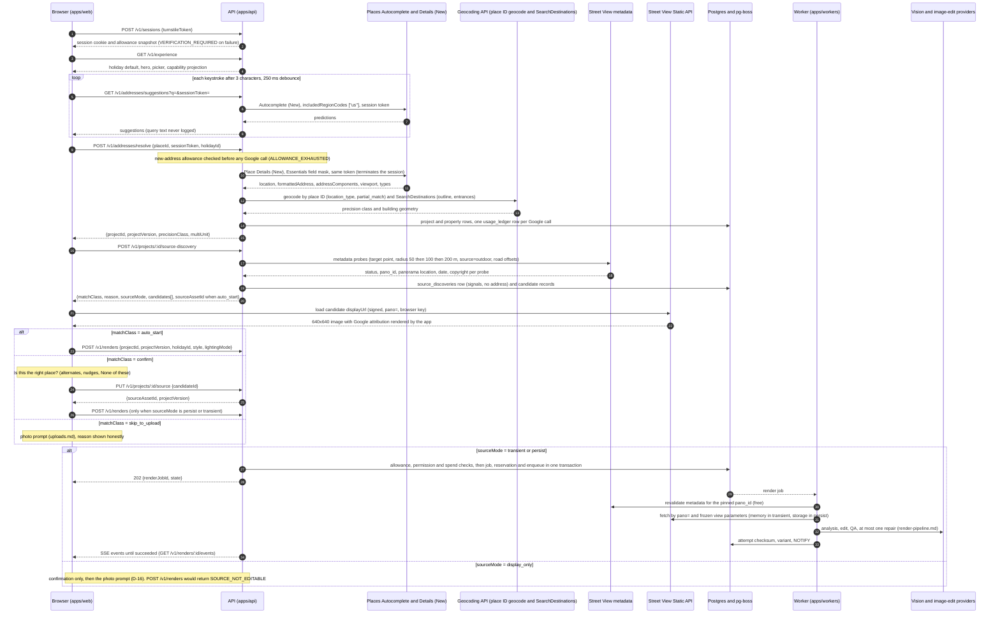

# Address and Street View source specification

This specification defines how Holiday turns a typed US address into a confirmed, rights-evaluated Street View source image, or into an honest hand-off to the user's own photo. It is written for the engineers and AI coding agents who implement the address path of the US Release: the sequence of calls, address entry and manual entry, property resolution and precision, viewpoint selection, match confidence, viewpoint adjustment, the four Street View source modes, the before image and its attribution, panorama changes, licensing outcomes and activation, saved-project address storage, pre-render spend controls, the coverage probe and the licensing request brief. Rendering begins where this document ends: see [render-pipeline.md](render-pipeline.md).

**Owns:** address entry and manual entry mechanics; property resolution and precision; the viewpoint algorithm; match confidence and auto-start; viewpoint adjustment; Street View source modes; before image and attribution; panorama change, blur and takedown handling; licensing outcomes and activation (the single home of the Street View licensing caveat); saved-project address storage; pre-render spend control values; the coverage probe; the licensing request brief.
**Baseline:** planning baseline 2026-11-09; external facts retrieved 2026-11-08.

## End-to-end sequence

The address path has three actors on our side (the browser app, the API and the worker) and five Google surfaces (Places Autocomplete (New), Place Details (New), the Geocoding API, Street View metadata and the Street View Static API). Every Google call is made by the API or the worker except the display of the before image, which the browser loads from a server-signed Static URL (see [Before image and attribution](#before-image-and-attribution)). The server never auto-enqueues a render: when discovery returns `auto_start`, the client immediately calls `POST /v1/renders`, so allowance, verification and spend checks run through one code path for every render request. Payloads are owned by [data-and-api.md](data-and-api.md#http-api); render states by [render-pipeline.md](render-pipeline.md#lifecycle-state-machines).

### Numbered narrative

1. **Session.** The browser calls `POST /v1/sessions` with a Cloudflare Turnstile token. The API verifies it server-side before any paid provider call is permitted; a missing or failed token returns `VERIFICATION_REQUIRED` and the client re-runs the widget. Session creation is the first enforcement point in [Pre-render spend controls](#pre-render-spend-controls).
2. **Experience.** `GET /v1/experience` returns the holiday default, picker list, hero and allowance snapshot, plus the public projection of `country_capabilities` so the client knows whether `address_lookup`, `street_view_display` and `street_view_ai` are `fixture`, `live_private` or `live_public`.
3. **Suggestions.** Each keystroke that passes the client rules in [Address entry](#address-entry) calls `GET /v1/addresses/suggestions`. The API proxies Places Autocomplete (New) with a server-minted session token and `includedRegionCodes: ["us"]`.
4. **Resolve.** Selecting a suggestion calls `POST /v1/addresses/resolve`. The API first checks the owner's new-address allowance ([Pre-render spend controls](#pre-render-spend-controls)); an exhausted owner receives `ALLOWANCE_EXHAUSTED` and no Google call is made. It then terminates the autocomplete session with Place Details (New) using the Essentials field mask, then calls the Geocoding API by place ID for `location_type` and `partial_match` and Geocoding v4 SearchDestinations for the building outline and entrances. It creates the project and property, ledgers each call, and returns the project ID, `projectVersion`, precision class and multi-unit flag. A different address always creates a new project.
5. **Discovery.** `POST /v1/projects/:id/source-discovery` runs synchronously in the API and issues only free Street View metadata requests (no Static images are fetched by the server here). It applies the [viewpoint algorithm](#viewpoint-selection) and the [match rules](#match-confidence-and-auto-start) and returns `matchClass`, `reason`, `sourceMode` and up to 3 candidate viewpoints, each with a signed display URL. Discovery is limited to one completed run per project version.
6. **Display.** The browser loads the primary candidate's display URL directly from the Static API and renders Google attribution and the capture date beside it. Each load is billable and counts against the per-address Static display budget ([Pre-render spend controls](#pre-render-spend-controls)).
7. **Auto-start.** When `matchClass` is `auto_start`, discovery has already bound the primary candidate as the project's source asset (kind `street_view`, state `ready`) and incremented `projectVersion`; the client calls `POST /v1/renders` at once while keeping the source image visible with a "Not your place?" action, so a wrong auto-start costs one tap and no second paid attempt. Auto-start happens only when `sourceMode` is `persist` or `transient`.
8. **Confirm.** When `matchClass` is `confirm`, the client shows "Is this the right place?" with the primary, the alternates and bounded nudges ([Viewpoint adjustment](#viewpoint-adjustment)). Confirming calls `PUT /v1/projects/:id/source` with the chosen `candidateId`, which creates the source asset in `ready` and increments `projectVersion`. "None of these" leads to the photo prompt.
9. **Skip to upload.** When `matchClass` is `skip_to_upload`, the client shows the photo prompt with copy specific to `reason` (no imagery, multi-unit, low precision, out of scope or error). A `blocked_address` reason is stored on the discovery but projected to the client as `unavailable`, with generic copy that never claims there is no imagery ([Removal, purge and takedown](#removal-purge-and-takedown)). The project keeps its property so the holiday default, climate rules and later shopping still use the resolved place. The required user-facing behavior per situation is owned by [PLAN.md §4](../PLAN.md#4-experience-overview); the screens by [experience.md](experience.md#address-entry-and-confirmation).
10. **Render request.** `POST /v1/renders` evaluates the owner's allowance, the source asset's `AssetPermission` and the spend ceilings, then writes the job, the ledger reservation and the queue entry in one transaction and returns 202 (or 200 with a cached variant; see [variant key and reuse](render-pipeline.md#variant-key-and-reuse)). Against a `display_only` source it returns `SOURCE_NOT_EDITABLE`; the client should not call it in that mode.
11. **Worker fetch.** In `preparing` the worker revalidates the pinned panorama with a free metadata call, then fetches the image by `pano=` with the frozen heading, pitch, fov and size. In `transient` mode the bytes live only in worker memory for the job; in `persist` mode they are written to private storage. A changed or missing panorama ends the job with `failureKind: source_unavailable` and marks the source asset `stale` ([Panorama changes, blur and takedown](#panorama-changes-blur-and-takedown)).
12. **Analysis, edit, QA.** The worker runs the stages in [render-pipeline.md](render-pipeline.md#stage-contracts), re-evaluating `AssetPermission` immediately before every provider call. The checksum of the bytes sent to the editor is stored on the render attempt.
13. **Result.** The variant is published; the client shows before and after at identical rendered sizes with the AI preview label and Google attribution ([Before image and attribution](#before-image-and-attribution)).
14. **Interim path.** When `sourceMode` is `display_only` (the public state until a grant is recorded; see [Licensing outcomes and activation](#licensing-outcomes-and-activation)), the confirmed Street View image serves only to confirm the place. The client emits `photo_prompt_shown` and hands over to the [upload flow](uploads.md#upload-flow); the resulting variant's before image is the user's photo, and no Street View image appears on that result screen.

### Outcomes at a glance

| Discovery result | Source bound? | Client's next call | Analytics | If `POST /v1/renders` is called prematurely |
| --- | --- | --- | --- | --- |
| `auto_start` (requires `sourceMode` `persist` or `transient`) | Yes, primary candidate, `ready` | `POST /v1/renders` | `source_discovery_completed`, `source_confirmed` | n/a |
| `confirm` | No | `PUT /v1/projects/:id/source` then `POST /v1/renders` | `source_discovery_completed`, then `source_confirmed` | `NEEDS_CONFIRMATION` |
| `confirm` with `sourceMode` `display_only` | After confirmation | `PUT /v1/projects/:id/source`, then the upload flow | `source_discovery_completed`, then `source_confirmed`, `photo_prompt_shown` | `SOURCE_NOT_EDITABLE` |
| `skip_to_upload`, reason `no_imagery` | No | Upload flow | `source_discovery_completed`, `source_unavailable`, `photo_prompt_shown` | `NEEDS_PHOTO` (`details.sourceMode`: `unavailable`) |
| `skip_to_upload`, any other reason | No | Upload flow | `source_discovery_completed`, `photo_prompt_shown` | `NEEDS_PHOTO` |

`POST /v1/renders` never returns `NO_STREET_VIEW`. That code belongs to `PUT /v1/projects/:id/source`, when a metadata recheck finds the chosen panorama gone, and to `PUT /v1/projects/:id/viewpoint`, when the project has no discovery with candidates ([data-and-api.md](data-and-api.md#error-codes)).

### Invariants

- The server never auto-enqueues a render; only `POST /v1/renders` creates render jobs.
- Discovery makes no paid call. Static images are loaded by the browser for display and fetched by the worker for rendering; both are ledgered.
- The billed image is always the evaluated panorama: the worker fetches by `pano=`, never by address.
- Addresses never appear in display URLs, discovery records, analytics, logs or object keys (data-handling rules in [privacy-safety-legal.md](privacy-safety-legal.md#data-handling-rules)).
- `AssetPermission` is evaluated at submission and again immediately before any provider call; `unknown` is denied for live traffic.
- In `fixture` activation the same code path runs against fixture adapters (contract-shaped metadata and SV-shaped permissioned photos); fixture evidence is labeled and never counts as live validation.

## Address entry

Address entry is the single prominent input on the landing page (D-06). Its accessibility pattern, keyboard behavior and copy are owned by [experience.md](experience.md#address-entry-and-confirmation); this section owns the mechanics.

### Topology (D-38)

All Places calls go through the API. The browser holds no Places key. The rejected alternative, Google's Maps JavaScript `PlaceAutocompleteElement` with a referrer-restricted browser key, handles sessions and attribution automatically but cannot be throttled, challenged or ledgered by our server, and referrer restrictions do not stop scripted clients; reviving it would require a decision record substituting Google per-minute quotas plus billing-export reconciliation ([decisions.md#d-38](../decisions.md#d-38)).

### Client rules

| Rule | Default (configuration) | Why |
| --- | --- | --- |
| Minimum query length | 3 characters after trim | Autocomplete Requests are billed per request |
| Debounce | 250 ms | One request per pause, not per keystroke |
| In-flight handling | Cancel stale requests; render only the latest response | Prevents out-of-order suggestion lists |
| Identical text | Never re-query identical or just-selected text | Avoids a billed request after selection |
| Input mode | Plain text; no geolocation permission requested | Dead simple (REQ-07); no location prompt |

### Server behavior

- `GET /v1/addresses/suggestions?q=&sessionToken=` calls Places Autocomplete (New) with `includedRegionCodes: ["us"]` (configuration; the list is the US Release scope per D-02), `input` = the trimmed query, and the session token. No location bias is sent; suggestions come from the text alone.
- Session tokens are UUID v4 values minted by the API: the first suggestions request of a search omits `sessionToken` and the response returns one; the client echoes it on every later request of that search. A token belongs to one session, is retired when `POST /v1/addresses/resolve` terminates it or when the user starts a new search, and is never reused afterwards (reuse bills per request). Token counts are limited per session ([Pre-render spend controls](#pre-render-spend-controls)).
- The API returns the prediction text and the place ID only. The query text is never written to logs, analytics or error reports; request logs record the length bucket and timing. Suggestions responses are not cached server-side beyond the request.
- "Powered by Google" attribution is required when Places results are shown without a Google map (https://developers.google.com/maps/documentation/places/web-service/policies, retrieved 2026-11-08); placement is in the experience spec.

### Termination with Place Details (New)

`POST /v1/addresses/resolve` terminates the session with one Place Details (New) call carrying the same token and the field mask `location,formattedAddress,addressComponents,viewport,types`, which are Essentials fields. It must never terminate with an IDs-only field mask (every autocomplete request in the session is then billed) and never request a Pro or Enterprise field such as `displayName` (the terminating call is then billed at Enterprise + Atmosphere regardless of the other fields). Session pricing rules: https://developers.google.com/maps/documentation/places/web-service/session-pricing (retrieved 2026-11-08); prices in [address-and-imagery.md](../research/address-and-imagery.md#pricing). The resolve call is limited to one per session token.

### Non-US and no-result handling

- Region restriction means a non-US address usually yields no suggestions. The no-results state offers manual entry and the upload route and explains the US scope; the typed text is preserved in the field.
- If a resolved place's country component is not `US` (possible through manual entry or a region-code gap), resolve returns `ADDRESS_OUT_OF_SCOPE`; no project is created. US territories are out of scope unless the region-code list is extended by configuration.
- Autocomplete, Geocoding or Place Details provider errors on `GET /v1/addresses/suggestions`, `POST /v1/addresses/resolve` or `POST /v1/addresses/geocode` return `PROVIDER_UNAVAILABLE` (status, headers and retry behavior in [data-and-api.md](data-and-api.md#error-codes)); manual entry and upload remain available. Metadata errors during discovery do not use this code: they end in `skip_to_upload` with reason `error` ([Step 1: primary panorama](#step-1-primary-panorama)).

## Manual entry

Manual entry is the fallback when autocomplete finds nothing or the user prefers to type. It resolves through the Geocoding API, never through a second address provider: a geocoder whose terms require its own map cannot sit beside Street View (Google Maps Platform Terms §3.2.3(e), https://cloud.google.com/maps-platform/terms, retrieved 2026-11-08; alternatives are recorded in [address-and-imagery.md](../research/address-and-imagery.md#alternatives-considered)).

### Fields

A structured US form: street address (line 1), unit (optional), city, state (two-letter), ZIP (5 or 9 digits). Client validation is light (required fields, state list, ZIP shape); the geocoder is the source of truth. The form is the US adapter's; shared contracts keep country-coded structured addresses so other formats can be added later ([architecture.md](../architecture.md#international-extension-boundaries)).

### Geocoding request

`POST /v1/addresses/geocode` sends one forward geocode with the address components and `components=country:US` (region restriction), requesting `location_type`, `partial_match`, `place_id`, `formatted_address`, `address_components` and `geometry`. It is billed at the Geocoding SKU and ledgered. Result semantics (https://developers.google.com/maps/documentation/geocoding/requests-geocoding, retrieved 2026-11-08): `ROOFTOP` is accurate to street-address precision; `RANGE_INTERPOLATED` is an approximation interpolated between two precise points; `GEOMETRIC_CENTER` and `APPROXIMATE` are coarser; `partial_match` means the geocoder did not match the full request.

### Candidate list and confirmation

- The response is a candidate list (formatted address, precision class, partial-match flag, opaque `candidateId`), limited to 5 (configuration). Zero candidates returns `ADDRESS_NOT_FOUND` with the upload route.
- The user picks a candidate; the client then calls `POST /v1/addresses/resolve` with `{candidateId}` instead of a place ID and session token. The server already holds the geocode result, so no Place Details call is made; it runs SearchDestinations by the returned place ID as in the autocomplete path.
- Manual-entry projects never auto-start. Their match class is capped at `confirm`, whatever the signals say, because the user typed the address and a confirmation step is the only check on typos.

### What is stored

The typed address is user-provided data, not Maps Content. It may be stored on the project as the owner's display label under the privacy spec's retention ([privacy-safety-legal.md](privacy-safety-legal.md#retention-schedule)) and is never logged, placed in analytics or used in object keys. The geocode result follows the Geocoding caching terms in [Saved projects and address storage](#saved-projects-and-address-storage). A unit entered here sets the multi-unit flag.

## Property resolution and precision

A property is the address-resolved target of a project: place ID, target point and precision (D-39). It is created by `POST /v1/addresses/resolve` and is the input to discovery.

### Property record

| Field | Source | Persistence |
| --- | --- | --- |
| `placeId` | Place Details (New) or Geocoding | Indefinitely (cacheable under the Service Specific Terms; refreshed per [Saved projects and address storage](#saved-projects-and-address-storage)) |
| `countryCode` | `addressComponents` | Project lifetime |
| `targetPoint` (lat, lng) | SearchDestinations outline centroid or entrance when available, else Places `location` | At most 30 days (`coordsExpireAt`), then deleted and re-resolved from `placeId` on demand |
| `precisionClass` | Geocoding `location_type` and SearchDestinations `structureType` | Project lifetime (derived classification, not Maps Content) |
| `partialMatch` | Geocoding | Project lifetime |
| `multiUnit` | `types`, `addressComponents` (`subpremise`), user-entered unit | Project lifetime |
| `facadeWidthM`, `roadBearingDeg` | Derived from the building outline | Project lifetime (derived numbers only; the polygon is never stored) |
| `entranceOffsetM` | Derived from the preferred entrance | Project lifetime (derived number) |
| `attachedFacade` | Derived: SearchDestinations returns an adjacent `BUILDING` outline sharing an edge with the target outline | Project lifetime (derived flag; neighboring outlines are never stored) |
| `blockedAddress` | Homeowner opt-out list lookup at resolve and at discovery | Evaluated, not stored |
| Display address | See [Saved projects and address storage](#saved-projects-and-address-storage) | Per basis |

Field types and indexes are in [data-and-api.md](data-and-api.md#entities).

### Precision sources

Place Details (New) returns no geocode-precision field, so precision comes from one of these, in order of preference:

| Source | Call | Precision mapping | Cost |
| --- | --- | --- | --- |
| Geocoding API by place ID | `geocode?place_id=` | `ROOFTOP` → `rooftop_equivalent`; `RANGE_INTERPOLATED` → `interpolated`; `GEOMETRIC_CENTER`, `APPROXIMATE` → `low`; `partial_match` true → never `auto_start` | Geocoding SKU |
| Geocoding v4 SearchDestinations | `POST /v4/geocode/destinations` by place ID | `structureType` `BUILDING` with a `displayPolygon` → `rooftop_equivalent` and geometry available; `GROUNDS` → amber (a complex or campus; never `auto_start`); no polygon → geometry unavailable | Geocoding SKU |
| Places `types` (proxy) | Already in hand from resolve | `street_address`, `premise` → plausible single property; `subpremise` → multi-unit; anything else (route, locality, postal code, establishment types) → `low` | None |

Facts: SearchDestinations returns navigation points, landmarks, entrances and building outlines (`displayPolygon` on a `BUILDING` structure); its launch stage is not labeled on its page and the v3 building-outlines feature was experimental (https://developers.google.com/maps/documentation/geocoding/search-for-destinations and https://developers.google.com/maps/documentation/geocoding/geocoding-v4-migrate, retrieved 2026-11-08). Both calls are made at resolve so discovery itself is free.

**Verify:** whether SearchDestinations alone supplies both a precision signal and geometry, so the place-ID geocode can be dropped; the launch stage and residential `displayPolygon` hit rate; and whether adjacent building outlines are returned, which `attachedFacade` needs (all measured by the [coverage probe](#coverage-probe)). Owner: engineering lead, Phase 1.

### Place-type gate and multi-unit detection

- Gate: `types` must include `street_address`, `premise` or `subpremise`; otherwise `precisionClass` is `low` and discovery returns `skip_to_upload` with reason `low_precision`.
- Multi-unit is set when any of these holds: a `subpremise` component is present; the user entered a unit; `types` includes a housing-complex type (apartment or condominium complex and similar types in the Places type table; **Verify:** exact type names at implementation, owner: backend engineer); SearchDestinations `structureType` is `GROUNDS` together with any of the above. Multi-unit facades are never decorated as "your home": discovery returns `skip_to_upload` with reason `multi_unit` and the photo prompt asks for the actual entry, balcony or room ([uploads.md](uploads.md#scene-type-and-photo-guidance)).

### Target point

| Geometry available | Target point `T` | Facade width `W` | Road bearing |
| --- | --- | --- | --- |
| Outline polygon and preferred entrance | The preferred entrance, moved to the facade edge | Length of the polygon edge most nearly parallel to the road | Bearing of that edge |
| Outline polygon only | Polygon centroid | As above | As above |
| No polygon | Places `location` (or geocode location) | Unknown | Derived at discovery from the first two distinct panorama locations, else perpendicular to the camera-to-target bearing |

The polygon and entrance coordinates are used transiently in the resolve request; only `T`, `W`, the road bearing, the entrance offset and `attachedFacade` are persisted, and `T` carries the 30-day expiry.

## Viewpoint selection

Viewpoint selection chooses which panorama to use and how to aim the camera. Its output is up to 3 candidate viewpoints (1 primary plus up to 2 alternates). Every number below is a default to tune on the [coverage probe](#coverage-probe) sample; the structure is the deliverable.

### Parameters

| Parameter | Default (configuration) | Note |
| --- | --- | --- |
| Metadata radius escalation | 50 m, then 100 m, then 200 m | Each escalation sets `deepSetback` true |
| `source` | `outdoor` | Excludes indoor collections and PhotoSpheres; whether `source=google` filters to Google-only imagery is contradicted within Google's docs, so the copyright string is authoritative (**Verify** live, owner: backend engineer, Phase 1) |
| Alternate offsets | ±15 m and ±30 m along the road bearing | Probed from `T`; deduplicated by `pano_id` |
| Candidate cap | 3 | 1 primary plus up to 2 alternates |
| `fov` clamp | 60–90 degrees | From geometry when `W` is known, else 90 |
| Facade margin `m` | 2 m | Added to each side of `W` when computing fov |
| `pitch` clamp | 0–10 degrees | Formula below |
| Facade mid-height `h_mid` | 3.5 m | Used only for pitch |
| Camera height `h_cam` | 2.5 m | Unpublished; tunable |
| `size` | 640×640 | The Static API maximum; no scale parameter exists |
| `return_error_code` | `true` | 404 instead of the gray placeholder image |

Static API parameter facts: https://developers.google.com/maps/documentation/streetview/request-streetview and https://developers.google.com/maps/documentation/streetview/usage-and-billing (retrieved 2026-11-08); summarized in [address-and-imagery.md](../research/address-and-imagery.md#street-view-static-api-facts).

### Step 1: primary panorama

Request metadata for `location=T` with `radius=50` and `source=outdoor`. Metadata is free and consumes no quota (https://developers.google.com/maps/billing-and-pricing/pricing, retrieved 2026-11-08). On `ZERO_RESULTS` retry at 100 m, then 200 m. On `OK`, record `pano_id`, the panorama location `P`, `date` (year-month, year only, or absent) and `copyright`. On `NOT_FOUND` or `ZERO_RESULTS` at 200 m the class is `skip_to_upload` with reason `no_imagery`. On `OVER_QUERY_LIMIT`, `REQUEST_DENIED`, `INVALID_REQUEST` or `UNKNOWN_ERROR`, retry once after a short delay, then return `skip_to_upload` with reason `error` and `retryable: true`.

### Step 2: alternates

Probe metadata at `T` displaced ±15 m and ±30 m along the road bearing (four probes at most). Deduplicate by `pano_id` and drop panoramas farther than 60 m from `T`. Keep at most 2 alternates. Record the same fields per alternate.

### Step 3: view parameters per candidate

Let `P` be the panorama location and `T` the target point, with latitudes φ and longitudes λ in radians and Δλ = λ_T − λ_P.

- Distance (haversine): `a = sin²(Δφ/2) + cos φ_P · cos φ_T · sin²(Δλ/2)`, `d = 2R · asin(√a)` with `R = 6,371,000 m`.
- Heading (initial great-circle bearing from `P` to `T`): `θ = atan2( sin Δλ · cos φ_T , cos φ_P · sin φ_T − sin φ_P · cos φ_T · cos Δλ )`, converted to degrees and normalized to [0, 360).
- `fov = clamp( 2 · atan( (W/2 + m) / d ) in degrees, 60, 90 )` when `W` is known; otherwise 90.
- `pitch = clamp( atan( (h_mid − h_cam) / d ) in degrees, 0, 10 )`.
- `size = 640x640`.

Every image, display or render, is requested by `pano=<pano_id>` with an explicit heading, pitch, fov and size, so the billed image is the evaluated panorama and the frame the user confirms is the frame the worker renders. The Static API computes a default heading only for `location=` requests, which cannot pin the evaluated panorama and would put coordinates into browser-visible URLs, so heading is never omitted. Heading mode records what `θ` was aimed at:

- `geometry`: building geometry is available (outline or entrance), and `θ` is the bearing from `P` to the geometry target `T`.
- `point`: no building geometry, and `θ` is the bearing from `P` to the resolved point (the Places or geocode location). This approximates the API's default aim toward a location.

Alternates are aimed at the same target as the primary (an offset panorama must be aimed at `T`, not at the probe point) and carry the same `headingMode`. Calibration compares the two modes.

**Verify:** in the coverage probe, compare for a sample of locations the image returned by a `location=` request with heading omitted against the `pano=` request with the explicit `θ`; they should be the same frame. If the API's default aim differs materially, record the difference and keep the explicit heading. Owner: engineering lead, Phase 1.

### Step 4: ordering and flags

The primary is the candidate from the `T` probe unless it is contributor imagery or undated and an alternate within 40 m is Google-attributed and dated, in which case that alternate becomes primary. Remaining candidates are ordered by: Google-attributed before contributor; `d` closest to 20 m; smallest absolute difference between the candidate heading and the facade normal when geometry is known. Flags recorded per candidate: `deepSetback` (radius escalation was needed), `contributorImagery`, `undated`, `farFromTarget` (`d` over 40 m), `headingDivergence` (when the explicit heading differs from the API's default aim by more than 20 degrees; measured only in the coverage probe, where a `location=` probe is compared), `attachedFacade` (copied from the property).

### Candidate record

| Field | Meaning |
| --- | --- |
| `candidateId` | Opaque ID valid for this discovery |
| `panoId` | Panorama identifier (cacheable; refreshed, not relied on, per [Panorama changes, blur and takedown](#panorama-changes-blur-and-takedown)) |
| `heading`, `pitch`, `fov`, `size` | View parameters; `size` is always `640x640` |
| `headingMode` | `geometry` or `point` |
| `distanceM` | `d`, rounded to 1 m |
| `captureDate`, `captureGranularity` | As returned (`YYYY-MM`, `YYYY`) and `month`, `year` or `none` |
| `copyright`, `isGoogleImagery` | The metadata copyright string and whether it identifies Google |
| `estimatedFacadePx` | `W` in pixels at this fov and distance (see below), null when `W` is unknown |
| `displayUrl` | Server-signed Static URL by `pano=` ([Before image and attribution](#before-image-and-attribution)) |
| `rank`, `flags[]` | Ordering position and the flags above |

The panorama location `P` is not persisted; it is re-derived from the free metadata call whenever a heading must be recomputed.

### Facade detail and the 640 px ceiling

Every Static image is at most 640×640, so candidates cannot differ in resolution; what varies is how many pixels the facade occupies, which fov and distance control. At 640 px across, fov 90 gives about 7.1 px per degree and fov 60 about 10.7 px per degree. `estimatedFacadePx = 640 · (2 · atan((W/2)/d) in degrees) / fov`. The viewpoint algorithm therefore chooses the smallest fov in the clamp that keeps the whole facade plus margin in frame, and records `estimatedFacadePx` so the [coverage probe](#coverage-probe) and the [quality spec's SV-shaped arm](quality-and-benchmark.md#formal-benchmark) can calibrate on real distributions. Higher-resolution Street View tiles are not an option: the Map Tiles policy forbids image analysis and machine interpretation ([address-and-imagery.md](../research/address-and-imagery.md#alternatives-considered)). Output and display sizing (upscaling policy, identical rendered sizes for before and after) is owned by [render-pipeline.md](render-pipeline.md#compositing-and-resolution).

## Match confidence and auto-start

Discovery ends in exactly one match class: `auto_start`, `confirm` or `skip_to_upload` (with a `reason`). The class is computed from Tier A signals that need no pixels, so the address path works under any licensing outcome. Tier B image signals are optional refinements that can only demote. Every threshold is a default to tune on the labeled sample of the [coverage probe](#coverage-probe); the thresholds version is recorded with every discovery.

### Tier A signals

| Signal | Green | Amber (never `auto_start`) | Red (`skip_to_upload`, reason) | Source |
| --- | --- | --- | --- | --- |
| Scope | Country `US` | — | Otherwise (`out_of_scope`; normally caught at resolve) | Resolve |
| Blocked address | Not on the homeowner opt-out list | — | Listed (`blocked_address`) | Opt-out list lookup |
| Multi-unit | Flag false | — | Flag true (`multi_unit`) | Property |
| Precision | `rooftop_equivalent` and not `partialMatch` | `interpolated`, or `partialMatch` true, or `GROUNDS` | `low` (`low_precision`) | Property |
| Panorama availability | `OK` at 50 m | `OK` only at 100 or 200 m (`deepSetback`) | None within 200 m (`no_imagery`) | Metadata |
| Panorama distance `d` | ≤ 25 m | 25–60 m | Over 60 m (`no_imagery`) | Metadata and target point |
| Heading basis | `geometry` | `point` (no geometry) | — | Property |
| Facade width | `W` unknown, or `W` ≥ 7 m (configuration) | `W` known and below 7 m, or `attachedFacade` true | — | Property geometry |
| Capture age | ≤ 5 years, granularity `month` or `year` | Older, or `none` | — | Metadata `date` |
| Copyright | Identifies Google | Contributor or unknown (also forces `sourceMode` `display_only` by default; see [Street View source modes](#street-view-source-modes)) | — | Metadata `copyright` |
| Entry method | Autocomplete selection | Manual entry | — | Resolve |
| Source mode | `persist` or `transient` | `display_only` (confirmation is the whole point of the image) | `unavailable` (`no_imagery`) | Permission evaluation |
| Provider state | All calls succeeded | — | Metadata errors after one retry (`error`, `retryable: true`) | Metadata |

### Decision rules

1. Any red signal → `skip_to_upload`. When several are red, `reason` is the first in this order: `out_of_scope`, `blocked_address`, `multi_unit`, `low_precision`, `no_imagery`, `error`.
2. No red and no amber → `auto_start`.
3. Otherwise → `confirm`, with the amber signals returned in the discovery record so the confirmation screen can show the capture date and, where relevant, a short reason ("We found a street photo 40 m from this address"). Attached or narrow facades (row houses, townhomes) confirm because a 60–90 degree frame necessarily includes neighboring units; the confirmation screen highlights the entrance-aligned view. An unknown `W` usually means no outline, which is already amber through the heading basis.

Hard rules that no threshold change may relax: multi-unit never auto-starts; non-rooftop precision or a partial match never auto-starts; contributor imagery never auto-starts; manual entry never auto-starts; `display_only` never auto-starts; a source whose evaluated permission denies `aiProcess` or `edit` is never rendered at any class.

Default thresholds (configuration; `thresholdsVersion` default `1`): auto-start distance 25 m; confirm distance 60 m; capture age 5 years; narrow-facade width 7 m; discovery time budget 6 s, after which the discovery returns `skip_to_upload` with reason `error` and `retryable: true`. When the runtime setting `discovery.autostart_paused` is true ([key table](data-and-api.md#allowance-quotas-and-rate-limits); step 2 of the degradation ladder in [architecture.md](../architecture.md#capacity-and-admission-control)), discovery reports `auto_start` as `confirm` and logs `autostartPaused: true`.

### Tier B signals

Tier B signals analyze the Street View image itself, which Google's Geo Guidelines treat as extracting information from Street View imagery (https://about.google/brand-resource-center/products-and-services/geo-guidelines/, retrieved 2026-11-08). They run only when the source's evaluated `AssetPermission.aiProcess` is allowed, which in live operation means a recorded grant, and they are never required: Tier A alone drives the class. They run inside the render job's `analyzing` stage as part of scene analysis ([render-pipeline.md](render-pipeline.md#scene-analysis)), not in discovery, so discovery stays free and synchronous. The provider never receives the address; the server compares what the model reads with what it already knows.

| Signal | Server-side use | Effect |
| --- | --- | --- |
| Visible house number | Compared with the property's street number; the model returns the digits it sees, nothing else is sent | Mismatch: the source asset becomes `declined`, the job ends `failed` with `failureKind` `source_rejected` and `failureDetail` `house_number_mismatch` before any paid edit, and the client shows the confirmation screen with alternates and the photo prompt |
| Facade in frame | A single residential facade is centered and mostly visible | Not in frame: as above, with `failureDetail` `facade_not_in_frame` |
| Occlusion fraction | Trees, vehicles or structures covering the facade | Above 0.3 (configuration): proceed, but the result screen offers "Try another view" preferring an alternate with a different capture date; occluders are never generatively removed ([render-pipeline.md](render-pipeline.md#moderation-and-model-behavior-risks)) |
| Existing decorations | Holiday and density | Passed to the plan builder; conflicts with the chosen holiday follow [holidays-and-content.md](holidays-and-content.md#climate-culture-and-existing-decorations) |
| Whole-house blur | Uniform blurred or pixelated facade region | Refusal; see [Panorama changes, blur and takedown](#panorama-changes-blur-and-takedown) |
| People, plates, blurred patches | Protected regions | Preserved and verified by QA (`privacy_regression`) |

A Tier B demotion never consumes allowance (the job did not succeed) and never creates a paid image-edit attempt.

### Source conditions

- The capture date is shown with its granularity wherever the Street View image appears ("Street View from May 2023", "Street View from 2019", "capture date unavailable"). When the capture is older than 5 years (configuration) or undated, the confirmation and result screens add "Looks different now? Upload a current photo." Copy lives in [experience.md](experience.md#copy-deck).
- Snow or bare winter trees in the source do not change the class; the content rules in the holidays spec forbid adding snow unless visible and keep foliage as photographed.
- Alternates with a different capture date are preferred when the primary is occluded, because imagery is periodically refreshed and panoramas from one capture pass usually share the same parked cars.

### What is recorded

Every discovery writes one `source_discoveries` row and its candidate records. The row holds no address and no coordinates.

| Field | Content |
| --- | --- |
| `projectId`, `projectVersion`, `discoveryId` | Identity |
| `matchClass`, `reason`, `sourceMode` | Outcome |
| `thresholdsVersion`, `algorithmVersion` | Versions used |
| `precisionClass`, `precisionSource`, `partialMatch`, `multiUnit`, `geometryAvailable`, `entryMethod` | Property signals |
| `probeRadiusM`, `candidateCount`, `primaryDistanceM`, `primaryCaptureDate`, `primaryCaptureGranularity`, `primaryCopyrightClass` (`google`, `contributor`, `unknown`) | Metadata signals |
| `blockedAddress`, `deepSetback`, `attachedFacade`, `headingMode`, `estimatedFacadePx` | Flags and derived numbers |
| `tierBApplied`, `tierBResults` | Filled later by the render job when Tier B runs |
| `durationMs`, `metadataCalls`, `ledgerRefs` | Operations |

The same fields feed the `source_discovery_completed` analytics event (`matchClass`, `reason`) and the coverage dashboards ([architecture.md](../architecture.md#observability-and-operations)).

### Auto-start mechanics

- On `auto_start`, discovery binds the primary candidate as the project's source asset (kind `street_view`, state `ready`, identified by panorama ID, heading, pitch, fov and size) and increments `projectVersion`. The client calls `POST /v1/renders` immediately with the new version and the current holiday, style and lighting mode.
- The source image stays visible with a "Not your place?" action. Tapping it cancels the job (`POST /v1/renders/:id/cancel`) and opens the confirmation screen; confirming another candidate or a nudged view through `PUT /v1/projects/:id/source` creates a new source asset and project version, which supersedes any job still running ([idempotency and concurrency](data-and-api.md#idempotency-and-concurrency)).
- Each address project created by `POST /v1/addresses/resolve` counts as one new address against the owner's allowance (value in [economics.md](economics.md#capacity-and-spend-ceilings), D-12; enforced per [data-and-api.md](data-and-api.md#allowance-quotas-and-rate-limits)). Discovery, confirmation, alternates and nudges within the same project consume nothing further.
- `auto_start` emits `source_discovery_completed` and `source_confirmed`; the render emits its own events.

## Viewpoint adjustment

D-40 is Open; this section specifies the default and the option under evaluation ([decisions.md#d-40](../decisions.md#d-40)). Layout and interaction details are in [experience.md](experience.md#address-entry-and-confirmation).

### Default: discrete candidates and bounded nudges

- The confirmation screen shows the primary candidate and lets the user switch to the alternates (loaded lazily, on request) and nudge the view.
- Nudge grammar: heading in steps of 15 degrees within ±30 degrees of the candidate's heading; fov chosen from 60, 75 or 90 within the clamp; pitch fixed. Each nudge calls `PUT /v1/projects/:id/viewpoint {candidateId, headingDelta, fov}`; the server validates the bounds, derives a new candidate record (new `candidateId`, same `panoId`) and returns its signed display URL. Nothing is fetched server-side.
- Every candidate or nudge image the browser loads is a billable Static request and counts against the per-address Static display budget (default 6: up to 3 candidates plus up to 3 nudges, typically 2 loads; configuration; [Pre-render spend controls](#pre-render-spend-controls)). The discovery and viewpoint responses carry `remainingDisplayLoads` so the client hides further nudges before the budget is spent; a request beyond the budget returns `RATE_LIMITED` without `Retry-After`. When the budget is spent the screen offers "None of these" and the photo prompt.
- Confirming a nudged view calls `PUT /v1/projects/:id/source` with the derived `candidateId`. After a source is bound, confirming a different candidate or a nudged view through `PUT /v1/projects/:id/source` creates a new source asset and project version and supersedes running jobs; `PUT /v1/projects/:id/viewpoint` never changes the active source, at any project version or in any source mode.
- The worker renders exactly the confirmed frame (same `pano`, heading, pitch, fov, size), so the before image the user approved and the AI input are the same picture.

### Option under evaluation: embedded interactive panorama

An embedded Street View panorama (Maps JavaScript API) would let the user rotate until their home is centered; the app would read the viewer's point of view, convert zoom to fov and request exactly that frame from the Static API by `pano=`. It turns the hardest open problem (framing) into a user action and keeps the pixels the user sees inside Google's viewer. Open items, to settle in Phase 1 and decide at Gate A:

- Pricing: interactive Street View is a separate SKU not yet in the cost worksheet (**Verify** price and free tier, owner: engineering lead; record in [economics.md](economics.md#cost-worksheet)).
- Terms: reading the point of view from the embedded viewer to request a Static frame is not documented as permitted or prohibited; Google's Geo Guidelines forbid screenshots, and this path uses the API, not screenshots. It is a named question in the [licensing request brief](#licensing-request-brief).
- Usability on phones: a draggable panorama inside a one-step confirmation must not break the friction budget ([experience.md](experience.md#friction-budget)).

### Optional confirmation map pin

A small map showing the address pin and the camera position would help on dense streets. If adopted it must be a Google map, because Street View and a non-Google map may not share a screen (Terms §3.2.3(e)); Static Maps or Maps JavaScript is another billed SKU (**Verify** price, owner: engineering lead). Default: off until the labeled sample shows confirmation errors that the photo alone does not resolve.

## Street View source modes

The mode of a Street View source is derived from its evaluated `AssetPermission` (D-15, [decisions.md#d-15](../decisions.md#d-15)); it is never set by a code change. Permission comes from `asset_policies` (one state per use: `unknown`, `allowed`, `denied`; evidence reference, license version, territory, attribution text, expiry) and is evaluated at discovery for each candidate, again at `POST /v1/renders` and again immediately before every provider call. For live traffic `unknown` evaluates as denied; in `fixture` activation it may evaluate as allowed, and every output is labeled fixture.

### Derivation

| Mode | `display` | `aiProcess` | `edit` | `store` | Typical origin |
| --- | --- | --- | --- | --- | --- |
| `persist` | allowed | allowed | allowed | allowed | Full grant that permits storage |
| `transient` | allowed | allowed | allowed | denied or unknown | Grant that permits processing but not storage (the expected shape of a partial grant) |
| `display_only` | allowed | denied or unknown | any | any | Standard terms: no grant recorded (today's public state), a denied grant, or contributor imagery under the default rule |
| `unavailable` | denied or unknown | any | any | any | No usable imagery, display not permitted, or a blocked address |

`distributeDerivative` does not change the mode; it gates download and sharing of Street View-origin variants (D-22). `commerceAdjacent` does not change the mode either; it decides whether Shop the look may appear on a screen showing the source's imagery or its derivative ([Commerce adjacency](#commerce-adjacency)). `train` is always false. Only Google-attributed imagery may be sent to models even when a grant exists; contributor imagery is `display_only` unless the recorded license says otherwise.

### Behavior per mode

| Aspect | `persist` | `transient` | `display_only` | `unavailable` |
| --- | --- | --- | --- | --- |
| Initial fetch | Worker fetches by `pano=` in `preparing` and writes to private storage | Worker fetches by `pano=` in `preparing` into memory | Never fetched server-side | Never fetched |
| Where pixels live | Private bucket, opaque key, lifecycle per policy | Worker memory for the duration of one job | Browser only, loaded from Google | Nowhere |
| Before image | Our signed storage URL | Browser loads the signed Static URL (billable per load; cache reused) | Browser loads the signed Static URL | Not shown |
| Confirmation image | Signed Static URL (browser) | Signed Static URL (browser) | Signed Static URL (browser) | Photo prompt |
| Holiday or style change (new variant) | Revalidate metadata, reuse stored bytes after TTL check | Refetch by `pano=`, compare checksum with the previous attempt; mismatch creates a new source asset and tells the user | New variants come from the user's photo | n/a |
| Repair (attempt 2) | Same stored bytes | Same in-memory bytes | n/a | n/a |
| Scene analysis reuse | While the stored bytes are unchanged | While the checksum is unchanged | n/a | n/a |
| Stored descriptor | Object key, `panoId`, view parameters, `headingMode`, capture date, copyright, `isGoogleImagery`, `sourceCheckedAt`, checksum | `panoId`, view parameters, `headingMode`, capture date, copyright, `isGoogleImagery`, `fetchedAt`; checksum on each render attempt | `panoId`, view parameters, capture date, copyright | Nothing beyond the discovery record |
| Source retention | Policy expiry, and purge on any revalidation change; stored copies never receive later Google blurs | None: bytes end with the job | None | None |
| Variant retention | Per the derivative permission and [privacy-safety-legal.md](privacy-safety-legal.md#retention-schedule) | Same | Variants are upload-origin | n/a |
| Deletion | Delete object, descriptor, analyses, variants | Delete descriptor, analyses, variants; verify no source object exists | Delete descriptor and project | Delete project |
| Shop the look on a screen showing Google imagery | Only when `commerceAdjacent` is allowed | Only when `commerceAdjacent` is allowed | Result screens show no Google imagery, so the panel is permitted | n/a |
| Activation state needed for live traffic | `street_view_ai` `live_private` or `live_public` with a recorded grant | Same | `street_view_display` `live_private` or `live_public` under standard terms | Any |

### Transient mode

1. `POST /v1/renders` reserves the job's worst case in the ledger, including one Static fetch and the provider calls, in the same transaction as the job row and queue entry ([cost recording](render-pipeline.md#cost-recording)).
2. In `preparing` the worker revalidates the panorama with a free metadata call, then calls `StreetViewProvider.fetchTransient(view)` by `pano=` with the frozen heading, pitch, fov and size. The bytes stay in memory through `analyzing`, `planning`, `rendering`, `checking` and the single repair, then are discarded. Nothing derived from Google pixels (thumbnails, masks, crops) is written to storage; the storage client refuses `street_view` writes unless `store` is allowed ([architecture.md](../architecture.md#storage-and-media-delivery)).
3. The SHA-256 of the fetched bytes is stored on the render attempt (`source_checksum_sha256`). For a later variant the worker refetches and compares with `source_checksum_sha256` of the most recent render attempt for the same source asset: identical means the same source; different means the imagery changed, the asset becomes `stale`, a new asset is created from the current panorama and the user is told ([Panorama changes, blur and takedown](#panorama-changes-blur-and-takedown)). **Verify:** whether identical Static requests return byte-identical images; if not, use a perceptual hash with a configurable threshold. Owner: backend engineer, Phase 1.
4. Outputs, analyses and plans are stored under the derivative permission. Deleting the project deletes them and the descriptor; there are no source pixels to delete. Owner-requested blurs reach new renders automatically because every render reads Google's current image.

### Persist mode

1. The worker fetches once and writes the original to the private bucket under an opaque key; the before image is served from storage with a signed URL ([architecture.md](../architecture.md#storage-and-media-delivery)).
2. `sourceCheckedAt` is set at fetch. Before any reuse and at least every 24 hours (configuration; or the license's figure if shorter) a revalidation job re-requests metadata for the pinned panorama; when the bytes will be reused it also refetches and compares checksums. Any change purges the stored copy and marks the asset `stale`.
3. A stored copy does not receive Google's later blur or removal edits, which is the reason for the TTL and the purge; a grant that permits storage should state the refresh or deletion obligation the owner accepted ([Licensing request brief](#licensing-request-brief)).

### Display-only mode

1. The server builds signed display URLs and never fetches pixels. The browser shows the image with attribution and the capture date for confirmation.
2. After confirmation the client emits `photo_prompt_shown` and opens the upload flow with the copy for this situation (never "no photo available"). The project keeps its property; the upload becomes the project's source asset through the normal upload states.
3. If the user says it is not their home, the copy explains that only photos they took or have permission to use can be decorated and offers upload or another address.
4. Static display loads still cost money and count against the per-address display budget.

### Fixture adapters

The fixture `StreetViewProvider` implements the same interface (`metadata`, `signDisplayUrl`, `fetchTransient`, `fetchToStorage` for `persist`, `refreshPanorama`; adapter list in [architecture.md](../architecture.md#external-integrations-and-fixture-modes)) against contract-shaped metadata fixtures (every status value, replaced, missing and failing panorama IDs, year-only and absent dates, Google and contributor copyright strings) and SV-shaped permissioned photos served from our fixture asset host. It never writes to storage in `transient`, so Gate B exercises the same code path that will run live. Fixture coverage per mode, per match class, per hard rule and per revalidation outcome is listed in [architecture.md](../architecture.md#continuous-integration-and-testing).

## Before image and attribution

### Display URL

The before image and every candidate image are loaded by the browser from a Static API URL built and signed server-side by `StreetViewProvider.signDisplayUrl(view)`: `pano=<panoId>`, `heading`, `pitch`, `fov`, `size=640x640`, `return_error_code=true`, the browser key and the signature. The URL never contains an address or coordinates. Each load is billable; the client reuses the identical URL for the confirmation image and the before image so the browser cache can serve it, and we never proxy Google pixels through our servers for display.

### Browser key and signing (D-38)

- The browser key is restricted by HTTP referrer and by API to the Street View Static API only, has its own quota and is separate per environment. It is enabled only for display URLs; no other Google API accepts it.
- The URL signing secret stays on the server. The signature scheme has no expiry component, so a signed URL remains valid until the secret rotates; protection comes from the key restrictions, the Google-side quota and the per-address display budget, not from URL expiry. Do not describe display URLs as expiring. Signing documentation: https://developers.google.com/maps/documentation/streetview/digital-signature (retrieved 2026-11-08).
- Rotate the secret on a schedule and after any suspected leak; rotation invalidates outstanding URLs, which the client handles by requesting a fresh discovery record.

### Attribution requirements

- Google Maps attribution must appear with every Street View image and every Street View-derived output: the Google Maps logo (16–19 dp) or, where space is limited, the text "Google Maps" (12–16 sp), placed near the top or bottom of the content inside the same visual container, visually distinguished, never removed, hidden, obscured, modified or cropped; the per-image copyright string from metadata is displayed alongside. Source: https://developers.google.com/maps/documentation/streetview/policies (retrieved 2026-11-08).
- Holiday renders the attribution as app content (DOM image or text) directly below the image frame, with the copyright string and the capture date, in the confirmation screen, the result screen (visible in both toggle states and at every slider position) and saved-project cards. It is never painted onto the image by the editor and is never placed over the image. Attribution text comes from `asset_policies.attribution` plus the metadata copyright. Uploads render no Google attribution.
- Street View and a non-Google map never share a screen (Terms §3.2.3(e)).
- Share cards and downloads of Street View-origin variants exist only where `distributeDerivative` is allowed; they are composed server-side with the attribution strip and the AI preview label, pad rather than crop on aspect changes, and a test asserts the strip is present in the exported bitmap ([architecture.md](../architecture.md#landing-and-share-page-delivery); labeling in [render-pipeline.md](render-pipeline.md#provenance-and-labeling)).
- Street View pixels, before or AI-derived, never appear in marketing, hero art, example galleries, share-card backgrounds for other projects or product thumbnails; Google's Geo Guidelines bar Street View in advertisements and promotional materials (URL above). Hero and example art come from permissioned sources ([holidays-and-content.md](holidays-and-content.md#hero-and-example-art)).

### Embedded attribution test (Phase 1)

Whether the Static API burns a logo or copyright into the returned pixels is undocumented. The first live task once a restricted key exists: fetch at least 10 images at 640×640 across several fov and pitch values and across Google and contributor panoramas; record whether anything is embedded, its rectangle per size, and the copyright string variants. Until then fixtures include an embedded-strip variant and a clean variant. If attribution is embedded, its rectangle is a mandatory paste-back region in compositing in both lighting modes and placements may not overlap it ([render-pipeline.md](render-pipeline.md#compositing-and-resolution)); QA rejects any Street View-origin output in which embedded or required attribution is cropped, covered or altered (`attribution_altered`, critical; [render-pipeline.md](render-pipeline.md#quality-checks)). The measured rectangles are recorded in the `STREET_VIEW_ATTRIBUTION_REGIONS` configuration (a JSON map from the requested Static size `"<width>x<height>"` to a list of `[x0,y0,x1,y1]` boxes normalized to that frame; default `{}`, no rectangles, none are ever guessed) and in the [decision log](../decisions.md#decision-log) before live Street View rendering. A live frame's rectangles are mapped onto the working grid through the aspect crop and padding and flow into the plan's `preserve.attributionRegions`.

## Panorama changes, blur and takedown

Panorama IDs are cacheable under the Service Specific Terms, yet Google's request and metadata pages advise not to persist them because they change; imagery is periodically refreshed and an ID may snap to a different panorama (https://developers.google.com/maps/documentation/streetview/request-streetview and https://developers.google.com/maps/documentation/streetview/metadata, retrieved 2026-11-08). Holiday therefore treats the panorama ID as a pinned hint that is revalidated, and the place ID plus target point as the durable key.

### Revalidation rules

`StreetViewProvider.refreshPanorama(panoId, { location, locationRadiusM })` returns `{ status, metadata }` with `status` `unchanged`, `missing`, `replaced` or `error`. `missing` (removed or blurred; purge) only when the pano's metadata is `ZERO_RESULTS` or `NOT_FOUND` and a free outdoor metadata probe at the property's target point with a 60 m radius (`REFRESH_TARGET_POINT_RADIUS_M`, above the 50 m first step of the discovery ladder; the adapter default of 15 m applies only when a panorama's own location is passed) finds no other panorama, or when no location is known. `replaced` when that probe returns another pano ID (newer imagery; the label only, variants kept) or when the pano query answers `OK` with another ID. `error` for `OVER_QUERY_LIMIT`, `REQUEST_DENIED`, `INVALID_REQUEST`, `UNKNOWN_ERROR`, network failures and non-200 answers, and when the location probe fails or returns the pinned pano again: an `error` is never treated as a removal. The location is the property's target point while its coordinates are retained (they expire), so after expiry a `ZERO_RESULTS` or `NOT_FOUND` answer reads as `missing`. When the property's coordinates have expired (30 days) or were never kept, no location can be probed, so a `ZERO_RESULTS` or `NOT_FOUND` pano answer reads `missing` and purges the variants: without location evidence a panorama retired by newer imagery cannot be told from a removal, and the purge is the privacy-protective choice. The fixture adapter follows the same contract: pano IDs with the prefix `fxSvMetadataError` answer `error`; an unknown pano ID probed at a fixture place's target point answers `replaced` when that place's panorama answers within the probe radius (every fixture place except the Old Quarry Road deep-setback place, whose panorama answers only a 100 m search and so reads `missing`); any other unknown ID answers `missing`.

| Trigger | Check | Unchanged | Changed or missing |
| --- | --- | --- | --- |
| Any render fetch (`transient`, `persist`) | Metadata for the pinned `pano_id` (free): status, date | Proceed | A `replaced` or `missing` panorama: asset `stale`; job `failed` with `failureKind` `source_unavailable`; rediscover from the property (not counted against the address allowance); tell the user; reconfirm if the new class is `confirm`. In both modes, a panorama that is `missing` (metadata reports `ZERO_RESULTS` or `NOT_FOUND` for the pano and no other panorama answers at the pinned location, the property target point while its coordinates are retained) also purges every variant made from it (share grants, public copies and objects, requested by `system`) and deletes the persist-mode stored copy unless a preservation hold covers the source; a `replaced` panorama (another pano now answers within 60 m of the target point) marks the asset `stale` (the label only) and fails the render `source_unavailable`; an `error` (a call that fails or says nothing about the imagery: `OVER_QUERY_LIMIT`, `REQUEST_DENIED`, `INVALID_REQUEST`, `UNKNOWN_ERROR`, network failures, non-200 answers) fails the render `source_unavailable` and changes nothing: the source stays `ready` and the next request checks again; only `missing` purges |
| Refetch for a later variant (`transient`) | Byte checksum against `source_checksum_sha256` of the most recent attempt for the same asset | Same source | Asset `stale`; new asset from the current panorama; user told |
| TTL (`persist`) | Metadata recheck at least every 24 h (configuration) and checksum compare before reuse | Reuse | Purge stored copy; asset `stale` |
| Saved project reopened | Full rediscovery under the current policy ([Saved projects and address storage](#saved-projects-and-address-storage)) | Reuse variants | New asset; earlier variants labeled |
| Report or opt-out received | Manual review per [privacy-safety-legal.md](privacy-safety-legal.md#abuse-harassment-and-takedown) | — | Purge and block as below |

### Stale assets and the user notice

A `stale` asset is never rendered again. The `street_view_revalidation` job re-checks stale sources that still have live variants, in either mode, whenever they were marked stale after their last check or that check is older than 24 h: if the panorama was removed or blurred (`missing`) it purges the variants (withdrawn and deleted, share grants revoked, public copies, outputs and downloads deleted), and if it was replaced (detected by probing the pinned location for another panorama) or is still present it keeps them, labeled. A failed or uninformative metadata call (`error`) changes nothing: the stored copy is kept, the source is not marked revalidated and the check stays due, so it retries on the next run. Otherwise any stored persist-mode copy is deleted, unless a preservation hold covers the source. A removal noticed at render time is therefore purged within one run even if the render-time path did not purge it. Variants derived from an asset whose panorama was replaced remain valid, because they were made from imagery the user confirmed, but the result screen labels them with `result.stalePhoto` ([experience.md](experience.md#copy-deck)) and, in `transient` mode, shows the after image without a before pane when the old panorama can no longer be loaded. The next render request runs discovery again and may require reconfirmation. The required behavior is the "Street View source changed or removed since confirmation" row of [PLAN.md §4](../PLAN.md#4-experience-overview).

### Owner-blurred homes

Anyone can ask Google to blur their entire house, and Google applies the blur to all copies of the published image; faces and plates are automatically blurred in Google-contributed imagery; blurs are not removed later, and stored copies do not receive later blurs (https://www.google.com/streetview/privacy/, retrieved 2026-11-08). Rules:

- In `display_only` mode the image is shown as Google serves it, blurred, and nothing is rendered from it.
- In `transient` and `persist` modes scene analysis scores the target facade for a uniform blurred or pixelated region and confirms with the vision model. Above a calibrated threshold (configuration; set on fixtures built from permissioned photos with synthetic blur) the source asset becomes `declined`, the job ends `failed` with `failureKind` `source_rejected` and `failureDetail` `owner_blurred` before any paid edit, and the user sees "This home's Street View image is blurred at the owner's request. Upload your own photo to see it decorated." Alternates are not tried for this reason, because Google blurs all copies.
- The property is flagged `ownerBlurDetectedAt`; later discoveries for the same place ID return `skip_to_upload` with reason `blocked_address`, treating Google's blur as the owner's opt-out.

### Protected regions and privacy QA

Blurred faces, plates and patches, people and vehicles are protected regions in scene analysis; the compiled instructions tell the editor to leave them exactly as they appear and never to sharpen, reconstruct or replace them; QA rejects any output where a protected region is sharper than the input or a newly legible face, plate or text appears (`privacy_regression`, critical; [render-pipeline.md](render-pipeline.md#quality-checks)). When a candidate shows people, an alternate without people is preferred.

### Removal, purge and takedown

| Event | Variants derived from the panorama | Shares | Other |
| --- | --- | --- | --- |
| Imagery refreshed (new capture replaces the panorama) | Kept, labeled as above | Kept | New discovery on the next render |
| Imagery removed without replacement within 200 m | Deleted when a render notices it, or by the `street_view_revalidation` job within one run (hourly, configuration) | Revoked (`SHARE_REVOKED`) | User told on next visit |
| Whole-house blur detected on current imagery | Deleted as above | Revoked | Property flagged; later discoveries `blocked_address` |
| Report on an image with reason `this_is_my_home` (user or non-user; `POST /v1/reports`) | Deleted after triage | Revoked | Place ID added to the opt-out list; link to Google's own "Report a problem" for the source imagery |
| Homeowner opt-out page ("Don't decorate my home"), which submits `POST /v1/reports` with reason `this_is_my_home` and a resolved place | Deleted after verification | Revoked | Place ID on the opt-out list; the owner can still upload their own photos |

The opt-out list (`blocked_addresses`, keyed by place ID) is checked at resolve and at discovery. A hit stores `skip_to_upload` with reason `blocked_address`; the client-visible reason is projected to `unavailable` with honest generic copy ("A street photo isn't available for this address. Upload a photo to decorate it.") that offers upload without disclosing why and never claims there is no imagery. Process, verification and service levels are owned by [privacy-safety-legal.md](privacy-safety-legal.md#street-view-privacy); the list is managed through the [internal operations API](data-and-api.md#internal-operations-api).

## Licensing outcomes and activation

This section is the single home of the Street View licensing caveat. Other documents state it in one sentence and link here.

### The caveat

Under Google Maps Platform's standard terms Holiday may display Street View imagery with attribution. It may not store Street View images or rehost them (§3.2.3(a), whose examples include storing Street View images), cache them beyond what the Service Specific Terms permit (§3.2.3(b)), create content based on Google Maps Content (§3.2.3(c); §3.2.3(c)(vii) separately bars use to improve machine-learning models), use the services to create or augment an advertising product or a listings service (§3.2.3(d)(iii)), or show Street View beside a non-Google map (§3.2.3(e)). No clause expressly addresses AI editing or third-party AI processing; Google's Geo Guidelines additionally prohibit analyzing or extracting information from Street View imagery and downloading images for use separately from Google services. Google Sales is the only documented exception path; support cannot grant exceptions. Sources: https://cloud.google.com/maps-platform/terms, https://cloud.google.com/maps-platform/terms/maps-service-terms, https://developers.google.com/maps/documentation/streetview/policies and https://about.google/brand-resource-center/products-and-services/geo-guidelines/ (retrieved 2026-11-08); clause-by-clause analysis in [address-and-imagery.md](../research/address-and-imagery.md#google-maps-platform-terms).

Consequences (D-03, Fixed; D-15 and D-16, Proposed; [decisions.md#d-03](../decisions.md#d-03)): the address → Street View → AI decoration → before/after path is built now and all four source modes are fixture-tested; the product owner pursues a written grant through Google Sales in parallel using the [licensing request brief](#licensing-request-brief); engineering is never blocked by the licensing track; `street_view_ai` becomes `live_public` only after a grant is recorded; until then the public address experience is the [interim experience](#interim-public-experience-d-16) in `display_only` mode.

### What standard terms allow today

| Capability | Standard-terms position | Highest activation without a grant | Conditions |
| --- | --- | --- | --- |
| `address_lookup` | Places and Geocoding within their caching rules | `live_public` | Attribution for suggestions; caching rules in [Saved projects and address storage](#saved-projects-and-address-storage); limits in [Pre-render spend controls](#pre-render-spend-controls) |
| `street_view_display` | Static API display with attribution is the API's documented purpose | `live_public` | Attribution rules above; no non-Google map on the same screen; our terms must state that Google Maps features and content are subject to the Google Maps End User Additional Terms and the Google Privacy Policy (§3.2.2(a)); counsel reviews §4.4(c)(ii) for typed addresses ([privacy-safety-legal.md](privacy-safety-legal.md#legal-deliverables)) |
| `street_view_ai` | Not covered | `fixture` | `live_private` only under a grant or a written evaluation allowance; `live_public` only under a grant covering public traffic |

### Outcome matrix

| Outcome (recorded by the product owner with dated evidence) | Source mode | `street_view_display` | `street_view_ai` | Public behavior | Trigger |
| --- | --- | --- | --- | --- | --- |
| Full grant: processing, storage, derivation and distribution with stated retention, attribution and processors | `persist` or `transient` as the grant states | `live_public` | `live_private` for live validation ([quality-and-benchmark.md](quality-and-benchmark.md#live-street-view-validation)), then `live_public` at Gate D | Journey A: `auto_start` or `confirm`, before/after on the Street View image, download and share per `distributeDerivative` | Written grant |
| Partial grant (likely shapes: transient processing only; Google-attributed imagery only; US only; attribution on outputs; no export or print; no commerce adjacency; named processor and region; stated retention) | Per clause, usually `transient` | `live_public` | As above, with the excluded features off | Journey A with excluded features hidden and explained; share and download hidden when `distributeDerivative` is denied; copyright filter on; Shop the look hidden on screens with Google imagery unless covered | Written response; the owner accepts or rejects each clause with engineering review |
| Denied | `display_only` | `live_public` | `fixture` (never live) | Interim experience, indefinitely or until a later grant | Written denial |
| Unknown (not yet asked, or asked and unanswered) | `display_only` | `live_public` | `fixture` | Identical to Denied for live traffic; fixtures continue for engineering | The owner sets a date or event (for example a second unanswered follow-up) after which the record is treated as Denied for planning |
| Evaluation allowance (a bounded set of frames for the benchmark, with or without a wider grant) | `transient` for the listed addresses only | `live_public` | `live_private` for the listed addresses | No public change | Written allowance |

Partial-grant clause mapping: territory → `territory`; retention → `expiresAt` and the `persist` TTL; storage → `store`; export or sharing → `distributeDerivative`; attribution wording → `attribution`; Google-only imagery → the copyright rule (already the default); named processor or region → per-source-kind routing in the editor adapter (D-42); commerce adjacency → `commerceAdjacent` ([Commerce adjacency](#commerce-adjacency)). A clause that cannot be mapped to a field or flag is rejected or returned to Google for clarification, never approximated in code.

### Recording an outcome

1. A dated entry in the [decision log](../decisions.md#decision-log) under D-15: outcome, evidence reference (the document identifier in the legal records; [privacy-safety-legal.md](privacy-safety-legal.md#legal-deliverables)), clauses accepted and rejected, processors and regions named.
2. The `asset_policies` template for source kind `street_view`: one state per use (`display`, `store`, `aiProcess`, `edit`, `distributeDerivative`, `commerceAdjacent`; `train` is always `denied`), evidence reference, license version, territory, attribution text, expiry, and the copyright rule (Google-attributed only unless the license covers contributor imagery). Every new Street View source asset inherits the current template; existing assets are re-evaluated at their next use.
3. `country_capabilities` rows for `street_view_display` and `street_view_ai` set through the [internal operations API](data-and-api.md#internal-operations-api) with the evidence reference and `reviewedAt`; changes are audited and need no deploy (D-47).
4. Configuration in `runtime_settings`: the `persist` revalidation TTL and the Static display budget as the grant requires.
5. Expiry: when `expiresAt` passes, evaluation yields denied, the mode degrades to `display_only` automatically and the owner is alerted; renewal is a new record.

### What engineering builds regardless

- All four modes behind one `StreetViewProvider` interface, exercised by fixtures per mode, per match class, per hard rule and per revalidation outcome (Gate B).
- The interim experience, browser-tested, with copy reviewed.
- The live validation protocol, ready to run the day `live_private` becomes possible ([quality-and-benchmark.md](quality-and-benchmark.md#live-street-view-validation)).
- Per-source-kind routing in the image-edit adapter so a grant naming a processor needs configuration, not code ([render-pipeline.md](render-pipeline.md#rendering)).
- The engineering parameter sheet for the [licensing request brief](#licensing-request-brief), handed to the owner as soon as it is ready, before Gate A ([backlog.md](../backlog.md#phase-1-feasibility)).

### Interim public experience (D-16)

Until `street_view_ai` is `live_public`, the address path runs in `display_only` mode ([decisions.md#d-16](../decisions.md#d-16)):

1. Address entry, resolve and discovery as specified; the class is capped at `confirm`.
2. The Street View image is shown with attribution, the capture date and the question `confirm.heading` ([experience.md](experience.md#copy-deck)).
3. Yes: "Great. To decorate it, take a photo from the sidewalk roughly like this view, or upload one." The upload flow follows ([uploads.md](uploads.md#camera-capture)); the project keeps its property so holiday defaults and climate rules still apply.
4. No: explain that only photos the visitor took or has permission to use can be decorated; offer upload or another address.
5. The render runs on the visitor's photo; the result screen compares the visitor's photo and shows no Google imagery, so Shop the look is permitted there.

Constraints: no server-side fetch or storage of Street View pixels; no suggestion to screenshot; copy never says that no photo was available; candidate ranking from Tier A only; the Static display budget applies. Browser tests cover the branch; Gate C requires the public configuration to match the recorded outcome. The required experience row lives in [PLAN.md §4](../PLAN.md#4-experience-overview).

### Commerce adjacency

Whether product recommendations beside Street View imagery or Street View-derived output count as augmenting an advertising product under §3.2.3(d)(iii) is a question for Google, asked in the brief. The answer is recorded as the `commerceAdjacent` use in the `street_view` asset policy template; until the recorded grant covers it the use is `unknown`, which evaluates as denied, so Shop the look is hidden on any screen that shows Google imagery (the confirmation screen and the result screen of a Street View-origin variant) and `GET /v1/renders/:id/products` returns panel state `hidden`. Result screens of upload-origin variants are unaffected. If Google declines adjacency even under a processing grant, the fallback is a separate shopping view that shows no Google imagery. The panel itself is owned by [commerce.md](commerce.md#shop-the-look); activation per merchant is independent of this flag ([commerce.md](commerce.md#commerce-activation)).

## Saved projects and address storage

Saved projects belong to signed-in owners (D-21); how long anonymous and saved projects live is owned by [privacy-safety-legal.md](privacy-safety-legal.md#retention-schedule) (D-20, Open). This section owns which address data a project may hold and under which Google caching basis (D-23, [decisions.md#d-23](../decisions.md#d-23)).

### Caching rules that apply

- Place IDs and panorama IDs may be cached indefinitely. Google's place ID guidance says to refresh IDs older than 12 months (https://developers.google.com/maps/documentation/places/web-service/place-id, retrieved 2026-11-08). **Verify:** whether the refresh request (Place Details with an IDs-only field mask) is free under Places API (New) pricing. Owner: engineering lead.
- Places: only latitude and longitude may be cached, for up to 30 days; nothing else returned by Place Details is persisted beyond the transaction.
- Geocoding: latitude and longitude may be cached up to 30 days; latitude and longitude, formatted address and structured address may be cached indefinitely only to support the end-user-facing function that requested them, logically isolated per end user and never as a substitute for further calls. Source for both: https://cloud.google.com/maps-platform/terms/maps-service-terms (retrieved 2026-11-08); summary in [address-and-imagery.md](../research/address-and-imagery.md#places-and-geocoding-facts).
- Counsel reviews the end-user personal-data clause (§4.4(c)(ii)) and whether the Places end-user-address exception covers storing a selected address string for an anonymous project ([privacy-safety-legal.md](privacy-safety-legal.md#us-privacy-law)).

### Project shell

| Field | Basis | Lifetime |
| --- | --- | --- |
| Owner, `projectVersion`, scene type, holiday, style and lighting preferences | Our data | Project lifetime |
| `placeId`, `placeIdRefreshedAt` | Cacheable identifier | Project lifetime, refreshed after 12 months |
| `countryCode`, `precisionClass`, `multiUnit` | Derived classifications | Project lifetime |
| View parameters (`panoId` hint, heading, pitch, fov, `headingMode`) | Our own parameters plus a cacheable identifier | Project lifetime; `panoId` revalidated before use |
| Rights state (asset policy reference, mode at last render) | Our data | Project lifetime |
| Target point and any other coordinates | Places or Geocoding content | At most 30 days (`coordsExpireAt`), then deleted |
| Display address | One of the bases below | Per basis |
| Manual-entry text | User data | Project lifetime, per privacy retention |
| Variants, analyses, plans | Derivative permission | Per retention schedule |

### Display address basis

| Basis | When | Storage rule |
| --- | --- | --- |
| `manual_entry` | The owner typed the address | User data; stored per owner |
| `geocoding_place_id` | On save (D-23): one Geocoding call by place ID (Geocoding SKU, ledgered) | Formatted and structured address stored per owner, isolated, used only to label this owner's project and never to avoid future calls for other purposes |
| `autocomplete_transient` | Anonymous projects | The formatted address from Place Details is returned to the browser at resolve and kept only in the browser session; the server stores no address text; anonymous projects are identified in the UI by their preview image |

Until counsel confirms the Places end-user-address exception, the server persists no Place Details address text. Shares, analytics, logs and object keys never carry any of these fields.

### Coordinates and the expiry job

Coordinates from Places or Geocoding, including the derived target point, carry `coordsExpireAt` no later than 30 days after retrieval. The coordinate-expiry worker job ([architecture.md](../architecture.md#jobs-and-queue)) deletes them. When a project needs them again (a new render, rediscovery), the API re-resolves from `placeId` with one Geocoding call, ledgered, which opens a new 30-day window. The panorama location is never persisted.

### Renewal on return

Opening a saved project:

1. Refresh the place ID if `placeIdRefreshedAt` is older than 12 months; if the place no longer resolves, show "This address could not be found any more" with re-entry.
2. Re-resolve coordinates if expired.
3. Rediscover under the current asset policy and activation state (the mode may have changed since the last visit).
4. Show a "fetching your photo" state, never an empty project.
5. Default to the current promotion window's holiday ([holidays-and-content.md](holidays-and-content.md#windows-and-selection)) and offer previously rendered holidays as cached variants where the variant key still matches ([render-pipeline.md](render-pipeline.md#variant-key-and-reuse)); variants from a now-`stale` asset are labeled.
6. Restart the inactivity clock per the retention schedule.

Google calls made on reopening are ledgered against the owner; reopening counts as a new address only when the owner changes the address. Under the D-20 default lifetime a saved project outlives a full holiday cycle, so "the same address, next holiday" is a reopen, not a new project; the shorter alternative is recorded in D-20.

### Anonymous projects

An anonymous project holds the place ID, precision, the Street View descriptor and its variants; no address text is stored server-side. It expires per the retention schedule. "Save" through the email magic link (D-21) converts it into a saved project and triggers the `geocoding_place_id` display address.

## Pre-render spend controls

Spend starts before any render and for any visitor: Autocomplete Requests, the terminating Place Details call, two Geocoding-SKU calls per resolve, manual geocodes and Static display loads are all billed per request (prices in [address-and-imagery.md](../research/address-and-imagery.md#pricing); ceiling values in [economics.md](economics.md#capacity-and-spend-ceilings)). D-38 fixes the topology: every Google call except the browser display load goes through the server, and a bot challenge gates session creation ([decisions.md#d-38](../decisions.md#d-38)). This section owns the address-path limit values; the guest allowance values (D-12) are owned by [economics.md](economics.md#capacity-and-spend-ceilings); enforcement points and headers are in [data-and-api.md](data-and-api.md#allowance-quotas-and-rate-limits).

### Limits

| Limit | Default (configuration) | Enforced at | On breach |
| --- | --- | --- | --- |
| Bot challenge | One Turnstile verification per anonymous session before any paid call | `POST /v1/sessions` | `VERIFICATION_REQUIRED`; the client re-runs the widget |
| Minimum query length | 3 characters after trim | Client, and server | Server returns `VALIDATION_FAILED`; no Google call |
| Debounce, cancellation, identical text | 250 ms; cancel in-flight; never re-query identical or just-selected text | Client | n/a |
| Suggestion requests per session token | 25 | `GET /v1/addresses/suggestions` | `RATE_LIMITED`; no Google call |
| Suggestion requests per session | 60 per 10 minutes | Same | `RATE_LIMITED` with `Retry-After` |
| Session tokens per session | 5 per 10 minutes | Token minting | `RATE_LIMITED` with `Retry-After` |
| Resolve per session token | 1 | `POST /v1/addresses/resolve` | `RATE_LIMITED` (`scope: resolve`); no Google call |
| Manual geocode requests per session | 10 per 10 minutes | `POST /v1/addresses/geocode` | `RATE_LIMITED` with `Retry-After` |
| Completed discoveries per project version | 1 | `POST /v1/projects/:id/source-discovery` | The stored discovery is returned; no new metadata run |
| Static display loads per address | 6 (up to 3 candidates plus up to 3 nudges; typically 2) | Display URL issuance in discovery and `PUT /v1/projects/:id/viewpoint` | `RATE_LIMITED` (`scope: viewpoints`) without `Retry-After`; the client hides nudges first using `remainingDisplayLoads` |
| New addresses per owner | Value in [economics.md](economics.md#capacity-and-spend-ceilings) (D-12), rolling 24 h; counted when resolve creates an address project, whatever discovery later returns | `POST /v1/addresses/resolve`, before the Place Details call | `ALLOWANCE_EXHAUSTED` with `scope: addresses`, `resetsAt` and `permittedActions`; no Google call |
| Per-SKU daily ceilings (Autocomplete Requests, Place Details Essentials, Geocoding, Static Street View) | Values in [economics.md](economics.md#capacity-and-spend-ceilings) | Before each Google call | `BUDGET_PAUSED` with honest degradation (below) |
| Service-wide daily and monthly ceilings | Values in economics | Before each paid call | `BUDGET_PAUSED` |

Coarse per-IP limits are a secondary signal only (shared networks), never identity. Degradation at a ceiling is honest and specific: autocomplete paused → manual entry (if the Geocoding ceiling allows) or upload; discovery or display paused → the photo prompt with copy that says the street photo is temporarily unavailable; never a silent failure or a synthesized image.

### Ledger entries

Every address-path Google call writes one `usage_ledger` row with `kind` `charge`; the worker's `street_view_static_fetch` is reserved with its render job and closed by a `settlement` or `release` row ([data-and-api.md](data-and-api.md#entities); render-side rules in [render-pipeline.md](render-pipeline.md#cost-recording)). Each row carries `category` `google`, `provider`, `sku` (`places_autocomplete_requests`, `places_details_essentials`, `geocoding`, `geocoding_search_destinations` (billed under the Geocoding SKU), `street_view_metadata` (zero price, recorded for counts), `street_view_static_display`, `street_view_static_fetch`), `units`, `unitPriceMicros` and `amountMicros` (USD micros, because Google SKUs are sub-cent), `currency`, `sessionId` or `projectId`, `jobId` where applicable, and `isFixture`. Display loads are performed by the browser, so they are ledgered at URL issuance as estimates and reconciled daily against the Google Cloud billing export; drift above 5% (configuration) raises an alert ([architecture.md](../architecture.md#observability-and-operations)).

### Google Cloud backstop

- Separate keys per environment; server keys restricted by API (Places API (New), Geocoding API, Street View Static API) with per-minute quotas lowered to expected peak plus buffer; the browser key per D-38.
- Every Static request is signed.
- Cloud budgets are alert-only and do not cap Maps Platform spend; the application ceilings are the real cap. Google's per-user quotas key on client IP (evadable by rotation) and enforcement has a latency period, so they are a backstop, not the control.

### Test cases

1. A scripted client without a Turnstile token receives `VERIFICATION_REQUIRED` and no Google call is made.
2. The 26th suggestion request on one token returns `RATE_LIMITED` with no Google call; the 61st in 10 minutes returns `RATE_LIMITED` with `Retry-After`.
3. The 6th token in 10 minutes is refused.
4. A second resolve with the same token returns `RATE_LIMITED` and exactly one Place Details call was made.
5. The Place Details field mask constant contains only the five Essentials fields; a unit test fails if `displayName` or an IDs-only mask is introduced.
6. A second discovery for the same project version returns the stored result and runs no metadata call.
7. The 7th display URL for an address returns `RATE_LIMITED`; `remainingDisplayLoads` counts down correctly across alternates and nudges.
8. A per-SKU ceiling at 100% returns `BUDGET_PAUSED` and the degradation path works end to end in fixture mode.
9. Every Google call in a fixture run produces a ledger row with SKU, list unit price and owner reference, with `isFixture: true`, and no fixture row counts toward a spend ceiling.
10. A non-US place returns `ADDRESS_OUT_OF_SCOPE` and creates no project.
11. Query text never appears in logs, analytics or error reports (log-scrubber test with a sentinel string).
12. The reconciliation job flags a seeded 10% drift between ledger estimates and a billing-export fixture.
13. With the default allowance, the 4th resolve by one owner in 24 h returns `ALLOWANCE_EXHAUSTED` (`scope: addresses`) and makes no Place Details, Geocoding or SearchDestinations call.

## Coverage probe

The coverage probe answers, before any licensing outcome and at no image cost, whether the address path finds usable Street View imagery for US homes, how the match classes distribute, and what the viewpoint algorithm's thresholds should be. Street View metadata is free and consumes no quota (https://developers.google.com/maps/billing-and-pricing/pricing, retrieved 2026-11-08). The probe reads metadata and Geocoding responses, which the plan treats as ordinary API use under the standard terms (counsel to confirm), and analyzes no imagery by machine; the only pixels anyone sees are display images of the labeled sample viewed by people, with attribution. It runs in Phase 1 ([backlog.md](../backlog.md#phase-1-feasibility)) with `address_lookup` and `street_view_display` at `live_private`.

### Sample

- Stratified US address sample: urban, suburban, rural, new-build and multi-unit strata; default 20 addresses per stratum, 100 in total (configuration). Addresses come only from sources the team may lawfully use: consenting participants, team members and the owners of the permissioned corpus ([quality-and-benchmark.md](quality-and-benchmark.md#permissioned-corpus)). Never scraped listings, real-estate feeds or customer data.
- Labeled discovery sample: default 30 locations (configuration) with known ground truth, where a consenting owner can say whether the primary candidate shows their home. It overlaps the exterior corpus where owners consent. Each primary and alternate is labeled correct, neighbor, complex or none.

### Procedure

1. Resolve each address through the real Places and Geocoding path (forward geocode of the sample string for the stratified sample; the autocomplete path for the labeled sample) in a `live_private` test environment.
2. Run discovery with the production algorithm and record every Tier A signal and candidate, keyed by sample ID, with no address in the record.
3. For the labeled sample, load the primary and alternate display images (at most 3 per address) for human labeling and record per frame: chosen fov, `estimatedFacadePx`, visible blur (face, plate, whole house), occlusion class, people present and whether attribution is embedded in the pixels.
4. For a subsample, compare the `location=` default-aim image with the `pano=` explicit-heading image (the heading verification in [Viewpoint selection](#viewpoint-selection)).
5. Compute the outputs below with denominators per stratum. The result is a discovery measurement, never a nationwide coverage claim.

### Outputs

| Metric | Definition | Used by |
| --- | --- | --- |
| Availability | Share of addresses with an `OK` outdoor panorama within 50, 100 and 200 m | Thresholds; the fallback rate in [economics.md](economics.md#unit-economics-model) |
| Distance distribution | `d` for primary candidates | Auto-start and confirm distance defaults |
| Capture age | Distribution and granularity mix | Capture-age threshold; badge copy |
| Copyright mix | Google versus contributor versus unknown | Default copyright rule; brief |
| Match-class distribution | `auto_start`, `confirm`, `skip_to_upload` by reason, per stratum | Friction expectations; PLAN risk register |
| Wrong-building confusion | Labeled sample: `auto_start` candidates judged neighbor or complex (target zero), `confirm` errors counted separately | Hard rules and thresholds |
| SearchDestinations hit rate | Share with a `BUILDING` polygon; `structureType` mix; entrance presence | D-39; heading mode mix |
| Deep setback rate | Radius escalation needed | Alternate offsets |
| Facade pixel and fov distribution | `estimatedFacadePx` and chosen fov | The SV-shaped processing recipe ([quality-and-benchmark.md](quality-and-benchmark.md#permissioned-corpus)) |
| Blur, occlusion and people presence | Per labeled frame | Fixture design; privacy rules |
| Embedded attribution | Present or absent, rectangle | Compositing paste-back region |
| Heading divergence | Explicit heading versus the API's default aim, per `headingMode` | Heading verification |
| Attached-facade rate | Share with `attachedFacade` or `W` below 7 m, per stratum | Narrow-facade threshold |

### Budget

Per stratified address: one forward Geocoding call, one Geocoding call by place ID and one SearchDestinations call (three Geocoding-SKU calls) plus free metadata probes. Per labeled address: one autocomplete session terminated by Place Details Essentials, two Geocoding-SKU calls, free metadata and at most 3 Static display loads. At the default sample sizes this is about 360 Geocoding-SKU calls (100 × 3 plus 30 × 2), 30 autocomplete sessions and 90 Static loads; it is costed at list prices in the [cost worksheet](economics.md#cost-worksheet) regardless of free tiers and ledgered like production traffic. The probe is `live_private` evidence for `address_lookup` and `street_view_display`; it is not evidence for `street_view_ai`.

## Licensing request brief

The brief is a user-owned deliverable: the product owner sends it to Google Sales, the only documented exception path, in Phase 0 with volume placeholders and the evaluation-allowance request (backlog P06); engineering's parameter sheet follows as soon as F12 is Done, before Gate A, and the named processor after Gate A ([backlog.md](../backlog.md#phase-0-decide-and-prepare)). It is written as an option matrix so Google's answer can inform the image-edit provider decision (D-42) rather than follow it. Google's response is recorded per option as described in [Recording an outcome](#recording-an-outcome).

### Parameters

| Section | Engineering source | Content and options to ask about |
| --- | --- | --- |
| 1. Product and independent value (§3.2.3(d)) | [PLAN.md §1](../PLAN.md#1-product-promise) | A consumer tool that shows a person's own home or room decorated for a holiday; Street View is one of two sources (the other is the user's photo); the value is the curated decoration, not the map content; not a listings or directory service |
| 2. Commerce adjacency (§3.2.3(d)(iii)) | [commerce.md](commerce.md#shop-the-look) | Whether product recommendations may appear on the same screen as Street View imagery or Street View-derived output; our default hides them there; the fallback layout |
| 3. Acquisition | [Viewpoint selection](#viewpoint-selection) | Static API only, server-side, signed, at most 640×640, by `pano=`, `return_error_code=true`, `source=outdoor`; at most 6 display loads per address (typically 2) and one fetch per render job; no tiles, screenshots, embed scraping or bulk download |
| 4. Analysis | [Match confidence and auto-start](#match-confidence-and-auto-start) | A vision model reads the frame for scene analysis, protected regions and match signals; named explicitly because the Geo Guidelines treat analysis as extraction |
| 5. Processor options and regions | [image-ai-providers.md](../research/image-ai-providers.md#candidate-shortlist), D-42, D-43 | Option A: a Google-hosted Gemini image model on Vertex AI with the no-training commitment and zero-data-retention configuration, US region (not a route around the age terms: the Google Cloud Service Specific Terms for Generative AI Services carry the same under-18 clause as the Gemini API, https://cloud.google.com/terms/service-terms, retrieved 2026-11-08, counsel to confirm; D-17, D-42); Option B: the Gemini Developer API paid tier; Option C: a third-party editor with no-training and zero-data-retention terms, US processing; plus the vision model used for analysis and QA |
| 6. Source storage | [Street View source modes](#street-view-source-modes) | Default ask: none (transient, in memory for one job); alternatives: session-only, or bounded retention per the privacy defaults with a refresh-or-purge obligation |
| 7. Derivative and analysis storage | [privacy-safety-legal.md](privacy-safety-legal.md#retention-schedule) | Decorated outputs, scene analyses and plans stored per the retention defaults; whether scene analyses count as extracted information |
| 8. Outputs | [render-pipeline.md](render-pipeline.md#compositing-and-resolution), D-22 | Output size relative to the 640 px source; before/after display of the source beside the derivative; download and share scope (private by default, explicit revocable share without address and with the D-22 default expiry, no print or advertising use); the unedited source is not exported |
| 9. Attribution | [Before image and attribution](#before-image-and-attribution) | Google Maps logo or text plus copyright adjacent to both images, never cropped or covered, carried into exports; whether an additional AI-edited marker is required; acceptability of restoring an embedded attribution rectangle verbatim after editing |
| 10. Blur and takedown propagation | [Panorama changes, blur and takedown](#panorama-changes-blur-and-takedown) | No stored source by default; metadata recheck before each render; derivatives of later-blurred or removed panoramas purged; homeowner opt-out list; contributor imagery excluded by default (ask whether the grant covers it) |
| 11. Territory and contracting | [address-and-imagery.md](../research/address-and-imagery.md#google-maps-platform-terms) | US addresses only; the billing-account address, which selects EEA or non-EEA terms; §3.2.2(a) flow-down in our terms; the §4.4(c)(ii) question on typed addresses |
| 12. Volume forecast (placeholders) | [economics.md](economics.md#capacity-and-spend-ceilings) | Pilot and first-year Static requests (at most 6 display loads per address, typically 2, plus about 1.2 fetches per accepted variant), render attempts, monthly ceilings |
| 13. Evaluation allowance | [quality-and-benchmark.md](quality-and-benchmark.md#live-street-view-validation) | A bounded set of frames of consenting addresses (default 30 locations × 3 holiday packs, 90 cases) run through candidate editors before provider selection; §3.2.3(c)(vii) names testing and validating |
| 14. Viewpoint option | [Viewpoint adjustment](#viewpoint-adjustment) | Whether reading the point of view from an embedded panorama to request that frame from the Static API is acceptable |
| 15. Not requested | — | Training, fine-tuning, caching beyond place ID, panorama ID and permitted fields, bulk download, tiles, print or promotional use |
| 16. Grant terms wanted | — | Written text; duration; territory; renewal; revocation; audit obligations; named processors and regions |

### Clauses to address in writing

§3.2.3(a)(i) (store, reshare, rehost), §3.2.3(b) (caching), §3.2.3(c) and (c)(vii) (content based on Google Maps Content; model improvement), §3.2.3(d)(iii) (advertising product), §3.2.3(e) (non-Google maps), §3.2.2(a) and (b) (terms flow-down; attribution unmodified), §4.4(c)(ii) (end-user personal information), and the Geo Guidelines items on analyzing or extracting information, downloading for separate use, screenshots, altering how Street View would look and print or promotional use.

### Template

1. Who we are and what Holiday does (section 1), with the independent-value argument.
2. What we ask for: the option matrix (sections 3 to 10), stated as "we propose option X by default and ask whether Y is acceptable".
3. What we commit to regardless: attribution, no storage by default, blur propagation, no training, US territory, named processors with no-training and zero-data-retention terms.
4. Questions we need answered in writing (sections 2, 4, 11, 13, 14).
5. Volumes (section 12) and the contact for technical follow-up.

### Recording the answer

Google's response is recorded per option as an outcome in the [matrix](#outcome-matrix): the decision log entry, the `asset_policies` template, the capability rows and the configuration flags. A material change in Holiday (a new processor, a new surface that shows Google imagery, storage where none was asked) reopens the brief before the change goes live.
