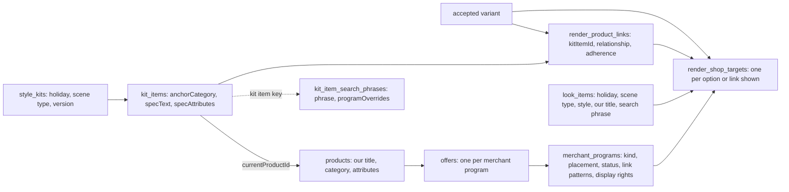
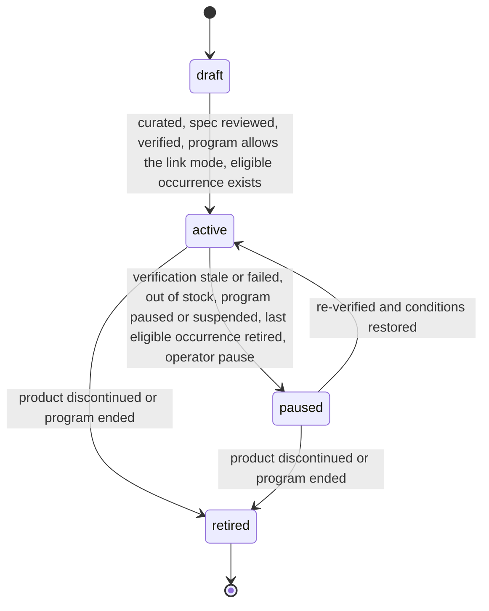

# Commerce specification

Hailiday shows people their real home decorated for a holiday and then helps them buy decorations that create the look. This document specifies that second half: the Shop the look panel under a preview, how a product may honestly be related to a rendered decoration, how style kits and the typical decorations of a look map to real products, offers and retailer search links, how merchant programs are joined, recorded and activated, the disclosures that law and merchant contracts require, how options and links are ordered, how clicks are tracked and reconciled, the seasonal calendar that decides when offers appear, the operating routine that keeps the catalog honest, and the original content a program's review expects. Affiliate commerce is the fixed revenue direction ([D-05](../decisions.md#d-05)); this document says how it is implemented without weakening the preview's honesty. The product-level summary is [PLAN.md §9](../PLAN.md#9-commerce-and-business-model); unit economics live in [economics.md](economics.md); merchant and market facts live in [commerce-and-markets.md](../research/commerce-and-markets.md) and, for Walmart, Target, The Home Depot, Lowe's, Costco and Amazon's place among them, in [retailer-catalogs.md](../research/retailer-catalogs.md); kit content lives in [holidays-and-content.md](holidays-and-content.md#style-kits).

**Owns:** Shop the look (groups, options, search links, the retailer filter, the product-side audience rule); product relationship enum; style kits (product side), search phrases and look items; offers and lifecycle; search links; merchant onboarding runbook, program record and display rights; commerce activation and served programs; disclosure wording; ranking integrity; click tracking, shop targets and attribution; seasonal commerce calendar (commerce windows and retirement dates); commerce operations; original content for program review.
**Baseline:** planning baseline 2026-11-09; external facts retrieved 2026-11-08 (retailer program facts 2026-11-17).

## Shop the look

### What the panel is

Shop the look is the only commerce surface in the US Release: a compact panel beneath an accepted variant (the preview) that lists the decorations of that preview and what can be bought for each ([D-53](../decisions.md#d-53)). The panel is made of groups, one per decoration. A group is either a kit item the plan placed (basis `placed`, from the variant's `render_product_links`) or, for a lavish plan only, a look item: a decoration typical of the look that the plan did not place (basis `typical`, [Look items](#look-items)). A placed group's match comes from the decoration plan behind the variant ([render-pipeline.md#decoration-plan](render-pipeline.md#decoration-plan)) through the style kit (see [Style kits and products](#style-kits-and-products)), so the prompt that produced the picture and the group in the panel describe the same object. The panel never claims that the exact item pictured is for sale; the wording for each relationship is fixed in [Product relationships](#product-relationships).

A group holds, in this order:

| Part | What it is |
| --- | --- |
| Options | Up to `maxOptions` product offers for the decoration (default 4, configuration), each a card with our own title, the retailer and the relationship label. Placed groups only, and only inside a commerce window ([Seasonal commerce calendar](#seasonal-commerce-calendar)). |
| Search links | One line, "Find similar at", followed by one link per served retailer, each to that retailer's own search results for the decoration ([Search links](#search-links)). |
| Separate links | One line of its own per retailer whose program is kept apart from the others (placement `separate`; Amazon, [D-54](../decisions.md#d-54)), also to that retailer's search results. |

Limits (defaults, configuration in `COMMERCE_DEFAULTS`): at most `maxGroups` placed groups (default 6) and `maxTypicalGroups` typical groups (default 9), counting only groups that have something to show; at least `minGroups` (default 1) for the panel to be `active`. A group with only search links or only a separate link still counts, because a link to the retailer is more useful than nothing; a group with nothing to show is left out. Three to six placed groups with options inside a commerce window is a catalog coverage goal, checked in the [readiness checklist](#readiness-checklist), not a condition for showing the panel.

### Placement and eligibility

| Rule | Specification |
| --- | --- |
| Position | Directly below the before/after result and its holiday, style and lighting controls, before the feedback and report entry points. Screen layout: [experience.md#result-and-comparison](experience.md#result-and-comparison). |
| Per variant | The panel belongs to the accepted variant currently shown. Switching holiday or style swaps the panel together with the variant; a cached variant shows the associations persisted for it in `render_product_links` (see [Ranking integrity](#ranking-integrity)). |
| Google imagery | Never shown on a screen that displays Google imagery (a Street View before image or a Street View-derived output) unless the evaluated AssetPermission use `commerceAdjacent` is allowed: the default `STREET_VIEW_USE_POLICY=full` allows it (owner decision 2026-11-10, so Shop the look appears on Street View results), `decorate` denies it and `display_only` leaves it `unknown`, which evaluates as denied; the panel state is then `hidden`, as it is under a recorded grant that does not cover it ([D-15](../decisions.md#d-15), Accepted as amended on 2026-11-12; the outcome matrix is in [address-and-street-view.md#licensing-outcomes-and-activation](address-and-street-view.md#licensing-outcomes-and-activation)). Google's terms bar using the Maps services to create or augment an advertising product (§3.2.3(d)(iii), https://cloud.google.com/maps-platform/terms, retrieved 2026-11-08); whether a shopping panel beside Street View-derived output is one is a question for Google, asked in the [licensing request brief](address-and-street-view.md#licensing-request-brief). In the interim address experience ([D-16](../decisions.md#d-16)) the decorated image is the user's own photo, so the result screen shows no Google imagery and the panel is allowed. |
| Activation | Shown only when at least one merchant program is served to the viewer ([Served programs](#served-programs)) and the global commerce pause is off. `GET /v1/experience` reports the same test as `capabilities.commerce`. |
| Something to show | A group shows when it has at least one option, search link or separate link. An option needs an open commerce window for the variant's holiday occurrence and an eligible offer ([Order within a group](#order-within-a-group)); a search link or separate link needs a served program with a search pattern and a phrase for the decoration, and shows outside commerce windows too while `searchLinksOffSeason` is on ([Rules](#rules)). |
| Other surfaces | Never on share pages, share cards or downloads (Proposed, [D-26](../decisions.md#d-26)). Any other surface that carries product links (the saved-project view; an "email me my preview" message if that experiment runs, see [economics.md#revenue-experiments](economics.md#revenue-experiments)) carries the same disclosure as the panel. |

### Panel states

`GET /v1/renders/:id/products` returns the panel state, the season, the disclosure, the retailers and the groups (field names: [data-and-api.md#variants-and-shop-the-look](data-and-api.md#variants-and-shop-the-look)).

| State | When | What the user sees |
| --- | --- | --- |
| `active` | Eligibility met and at least `minGroups` groups with something to show. `season` is `in_window` when a commerce window is open for the variant's holiday occurrence and `off_season` otherwise | Top to bottom: the out-of-season line (`shop.offSeasonNote`) when `season` is `off_season`; the disclosure line; the retailer filter when two or more retailers are listed; the placed groups; when typical groups exist, the heading "Typical of this look" with its note and the typical groups; the fit note |
| `no_offers` | Activation on and a commerce window open, but no group has anything to show | One short sentence that matching products are not available for this look yet; no links; the preview stays complete |
| `off_season` | No commerce window open for the variant's holiday occurrence and no group has anything to show (always so when `searchLinksOffSeason` is off) | "Plan ahead" copy without links |
| `hidden` | No program served to this viewer, Google imagery whose `commerceAdjacent` use is not allowed (the `decorate` and `display_only` use policies, or a grant that does not cover it; a Street View source's policy is first brought up to the current use policy, so a tightened policy hides the panel on the first request), or global commerce pause | Nothing rendered. When the answer arrives while the Shop the look row is open or holds keyboard focus, the row stays and shows the `commerce.noOffers` sentence, so it does not vanish under the person |

`season` is null in every state but `active`. Copy for `no_offers`, `off_season` and the panel's own lines lives in the experience copy deck under `commerce.*` and `shop.*` keys ([experience.md#copy-deck](experience.md#copy-deck)); the disclosure strings are normative in [Disclosure](#disclosure).

### Group and option content

| Element | Rule |
| --- | --- |
| Group title | Our own words: for a placed group, the `ourTitle` of the kit item's current product, or of the product the link row was created with when the kit item has no current product (never an archived product; a placed group with neither is not shown); for a typical group, the look item's `ourTitle`. Never a merchant title or merchant copy. |
| Placement line | "For the wreath on your front door": the group's anchor category in plain words, when it has one. It is disclosed as a match to the decoration plan or the look, not as recognition of the picture. |
| Option title | Our own words, derived from the kit item's spec text (for example "Pre-lit mixed-pine wreath, 30–36 in., warm-white lights"). Never a merchant title or merchant copy; a retailer's own name for the product appears only where its program's `product_name` right is `allowed` and the retailer supplied it, which no built code does. |
| Merchant | Plain text ("at Walmart"). Merchant logos only where the program's terms permit; default none. |
| Image | None in the US Release unless the program's `picture` right is `allowed` and it supplies image URLs through an approved feed or API; options and links show no picture today. An in-house illustration per product category, for an option without a permitted picture, comes with the catalog layer ([build steps](../research/retailer-catalogs.md#build-steps-and-what-each-waits-for)). Amazon product images are never stored or cached (Program Policies, https://affiliate-program.amazon.com/help/operating/policies, retrieved 2026-11-08). |
| Price | "Check price at retailer" unless the offer's `priceSource` permits display ([Price display policy](#price-display-policy)); a shown price always has an adjacent "as of" timestamp. |
| Relationship label | On every option: "Similar item" or "Similar to what's pictured" ([Product relationships](#product-relationships)). Never on a search link or separate link. |
| Ad marker | "Ad" chip on an option whose link is a tracking link and directly before a tracking search link or separate link ([Disclosure](#disclosure)). |
| Option link | The offer's tracking link in tracking mode or plain destination URL in plain mode; the click is recorded before navigation ([Click tracking and attribution](#click-tracking-and-attribution)). |
| Search links | The line "Find similar at" (`shop.find.label`), then one link per search link of the group, whose visible text is the retailer's name, each preceded by the "Ad" chip when it is a tracking link; each opens the retailer's search results in a new tab, and its accessible name is "Find similar at {merchant}" (`shop.find.linkLabel`) with the new-tab note (`shop.newTab`). No price, picture or relationship label. The links wrap onto further lines on a narrow screen. |
| Separate link | One line per separate link, under the search links: "Also at {merchant}" (`shop.separate.link`), preceded by the "Ad" chip when it is a tracking link. Its accessible name is that visible text with the new-tab note, so the name contains what the link shows. Its text must make plain that it goes to that retailer. |
| Typical heading | Above the typical groups: "Typical of this look" (`shop.typical.heading`) and the note "These decorations are typical of this look. Some may not appear in your picture." (`shop.typical.note`). A typical group has no options and no relationship label ([D-55](../decisions.md#d-55)). |
| Fit note (panel level) | Sizes, quantities, light-string lengths, electrical compatibility and installation suitability cannot be established from a photograph and are never promised. |
| Ratings and reviews | No merchant star ratings, review counts, testimonials or AI-written text framed as a review in the US Release. If ratings are ever added they must be the merchant's genuine data: the FTC rule on consumer reviews and testimonials (16 CFR Part 465) bans fake or AI-generated reviews (https://www.ftc.gov/news-events/news/press-releases/2024/08/federal-trade-commission-announces-final-rule-banning-fake-reviews-testimonials, retrieved 2026-11-08). |

A search link opens a page Hailiday does not control: the retailer's own results for our phrase, which may list items the panel would never show. Hailiday chooses the phrase ([Search phrases](#search-phrases)) and never presents the results as chosen by us.

### Retailer filter

When the panel lists two or more retailers, a group of toggle buttons sits above the groups: "All" (`shop.filter.all`) and one button per retailer, labeled together by "Show retailers" (`shop.filter.label`), each with `aria-pressed`. "All" is pressed at first, and pressing the chosen retailer again returns to "All". With one retailer chosen, the options and search links of every other program are not rendered, and a group with no option and no search link of that retailer is not shown: its separate links never keep it on their own. The groups that remain keep their separate links as they are. With "All" pressed every group shows, including one that has only a separate link. The choice is the visitor's alone: it is kept only while the panel is shown and is reset when the panel's job changes; it is never stored or sent.

The retailers listed are the programs with placement `group` that have at least one option or search link in the panel, in the rotation order of [Panel composition](#panel-composition). A program with placement `separate` is never listed and never contributes options.

### Audience rule for products

The service is not directed to children (Proposed [D-17](../decisions.md#d-17)), and that holds for everything the panel names. No product, offer, look item or search phrase is child-directed: no licensed or cartoon characters, mascots, inflatables, Santa or snowman figures, toys or child models, matching the forbidden items of the packs ([holidays-and-content.md#forbidden-items](holidays-and-content.md#forbidden-items)). A product, look item or phrase is written in our own words and passes the commerce review in [Commerce operations](#commerce-operations). An item from a retailer's catalog, once a catalog is read, shows only after an operator has approved it, so this rule never rests on a word list. A retailer's own search results are outside this rule's reach; a phrase that brings up unsuitable results there is changed ([Incidents](#incidents)).

### Mobile behavior

- The panel sits below the before/after at full width; groups and their options stack in one column at phone width, options may use two columns above the tablet breakpoint, and search links wrap; nothing scrolls horizontally ([experience.md#mobile-layout](experience.md#mobile-layout)).
- The disclosure line is the first child of the panel's content on every viewport (after the out-of-season line off-season) and is never collapsed behind a "more" control.
- No interstitial, modal or redirect page: a tap records the click and goes to the merchant in a new tab.
- Target sizes and contrast follow [experience.md#accessibility](experience.md#accessibility).

### Analytics

`shop_panel_viewed` fires once per variant per session when the panel enters the viewport with properties `panelState`, `cardCount` (the number of groups), `optionCount`, `searchLinkCount` (search links and separate links), `season`, `linkMode`, `programs` and `relationships` (of the options) (holiday, scene type and source kind are envelope dimensions). `product_clicked` fires on every click of an option, search link or separate link with `relationship` (null for a search or separate link), `rankPosition` (the group's position), `optionPosition`, `linkKind` (`product` or `search`), `groupBasis` (`placed` or `typical`), `merchantProgramId`, `linkMode` and `sponsored`. Neither carries addresses, image URLs, prices, search phrases or merchant URLs. Property schemas: [data-and-api.md#analytics-events](data-and-api.md#analytics-events).

## Product relationships

The relationship enum is Proposed ([D-24](../decisions.md#d-24)). It is the only vocabulary for how a product relates to a rendered decoration, in data, code and copy.

| Value | Meaning | Evidence required before use | Customer wording | US Release |
| --- | --- | --- | --- | --- |
| `similar` | The product matches the placement's category and style. Either the rendered item came from a generic description, or the `described` check failed or was skipped. | The kit item or plan placement category matches the product category; the offer is eligible. | "Similar item" | Yes |
| `described` | Our own text spec of this real product's public attributes was compiled into the prompt for this placement, and the post-render adherence check passed. | Placement compiled from `kit_items.specText`; an adherence record with status `pass` for this placement on this variant. | "Similar to what's pictured" | Yes |
| `reference` | A permitted merchant image of this product was an input to the placement; exact reproduction is unverified. | Offer content rights `imageAiInput` = `allowed` with written merchant permission recorded in `asset_policies`; render-pipeline support for reference inputs. | "Used as a style reference" | Later capability |
| `verified` | A reference was used and a product identity review passed. | `reference` evidence plus a recorded identity review pass. | "Product shown as an AI preview" (still no fit guarantee) | Later capability |

Rules:

1. Never upgrade without the evidence in the table. A successful provider call is not evidence of anything.
2. Downgrade or hide on failure: `described` becomes `similar` if the category still matches, otherwise the kit item is hidden from this variant's panel; `reference` becomes `similar`; `verified` becomes `reference`.
3. Associations are per variant. `render_product_links` rows are created when the render job reaches `succeeded` (after review approval in pilot review mode) and are keyed by the accepted variant and kit item. They are never recomputed when products are swapped later ([Swap and versioning rules](#swap-and-versioning-rules)).
4. Customer wording is fixed per value and used verbatim in the copy deck.
5. No wording, image or layout may imply that the exact product, its dimensions, its quantity or its fit were determined from the photograph.
6. Every option of a placed group carries the relationship of its link row. An item from a retailer's catalog, once a catalog is read, always shows as `similar`, whatever the link row says; `described` stays a hand-picked product with a recorded adherence pass.
7. A search link and a separate link carry no relationship: they lead to a retailer's search results, not to a product, and are recorded with a null relationship.
8. A look item has no relationship. Its group sits under the heading "Typical of this look" with the note that some of these decorations may not appear in the picture ([Group and option content](#group-and-option-content)); the heading is a label of that part of the panel and adds no value to the enum ([D-55](../decisions.md#d-55)).

### Adherence check for `described`

| Aspect | Specification |
| --- | --- |
| Unit | One placement in the decoration plan of one accepted variant. |
| Criteria | Category (the rendered item is the kit item's product category), color family (the spec's color family dominates the rendered item), count (within the quantity rule for the chosen style; "one wreath" means exactly one). Approximate scale against the anchor is recorded but not required. |
| Who checks, private pilot | The human reviewer in `needs_review` ([D-14](../decisions.md#d-14)) records pass or fail per placement on the review form. |
| Who checks, later | The QA judge's per-placement adherence in `JudgeResult` ([render-pipeline.md#quality-checks](render-pipeline.md#quality-checks)) once it meets the calibration target in [quality-and-benchmark.md#qa-judge-calibration](quality-and-benchmark.md#qa-judge-calibration). Until then judge output is advisory and the label defaults to `similar`. |
| Decision | All criteria pass: `described`. Any criterion fails: `similar` if the category matches, else hidden. Uncertain: `similar`. |
| Record | `render_product_links.adherence` with `status` (`pass`, `fail`, `uncertain`, `not_checked`), `checkedBy` (`human`, `judge`), `checkedAt`, `failedCriteria`. |
| Feedback to curation | Adherence rate per kit item is reported; items the renderer draws unfaithfully are replaced in the kit. The per-kit-item adherence pass rate and its 70% flag are defined in [quality-and-benchmark.md#review-rubric](quality-and-benchmark.md#review-rubric) (Placement adherence per kit item); a flagged kit item is shown only as `similar` until it is replaced or a later benchmark version passes. |

A link is also hidden (`hiddenReason` `not_present`) when the picture it belongs to had spots put back from the original ([render-pipeline.md#decision-policy](render-pipeline.md#decision-policy), the last resort) and every placement of its kit item keeps less than `lastResort.minPlacementShare` (0.6) of its region outside the restored boxes: the item is no longer in the picture. A kit item with at least one placement that survives keeps its link. This holds for a plain look, a daylight variant, a bright base, a relit look made from a restored base and a picture a reviewer approves.

## Style kits and products

### Division of ownership

Kit content (archetypes, anchor categories, spec text and attributes, per-style quantity rules) is pack content owned by [holidays-and-content.md#style-kits](holidays-and-content.md#style-kits). This section owns the mapping from kit items to real products and offers, the search phrase of each kit item, and the look items of a lavish look.

### Kit item to product

| Concept | Definition |
| --- | --- |
| Kit item | One archetype slot in the style kit for a (holiday, scene type): `anchorCategory`, `specText`, `specAttributes`, quantity rules per style, `sortOrder`, `currentProductId` and product history. Its stable text key (`kit_items.kit_item_id`, for example `christmas.house_exterior.wreath_evergreen`) also keys its search phrase. |
| Product | One real item described in our own words: our title, category, `attributes` (size range, material, color family, count, light color and type, indoor or outdoor), notes. Merchant-agnostic; holds no merchant text or images. |
| Offer | A purchasable instance of a product at one merchant program ([Offers and lifecycle](#offers-and-lifecycle)). One product can have offers at several merchants; they are the options of the product's group. |
| Sharing | One product can back kit items in several kits: warm-white micro-LED string lights in Christmas `house_exterior` and `balcony`; pillar candles in Thanksgiving and Christmas `interior`. |

### Search phrases

A search phrase is the words sent to a retailer's search for a decoration. Every kit item key has one phrase in `kit_item_search_phrases`, and every look item carries its own ([Look items](#look-items)). Either may carry per-program overrides (`programOverrides`, a map from program key to phrase) for a retailer whose search reads words differently; a search link uses the program's override when there is one and the decoration's phrase otherwise.

- **What a phrase is.** What a shopper would type into a retailer's search box for that decoration: 2 to 6 plain words, the kind of item first, then the one or two attributes that matter (size, color, lit or not, indoor or outdoor), derived from the kit item's spec text and attributes (for example `30 inch pre lit christmas wreath`, `outdoor warm white string lights`, `flameless led lantern outdoor`). No brand, no retailer name, no punctuation and nothing child-directed ([Audience rule for products](#audience-rule-for-products)). A phrase, and every override, is plain words: letters, digits, spaces, hyphens and apostrophes, starting with a letter or digit, 2 to 120 characters. The content loader and the internal tools refuse anything else.
- **Why it is commerce data.** Kits and packs are inserted once outside development and a kit change is a new version, while a phrase may need changing in the middle of a season. Phrases are therefore commerce data an operator edits through the internal tools ([Internal tools](#internal-tools)), not kit or pack content, and a phrase never reaches a prompt.
- **Coverage.** The commerce content (`content/commerce/search-phrases.json`) holds a phrase for every kit item key of the kit content and no other key; the content loader refuses a missing, unknown or duplicate key and a phrase that is not plain words of the allowed length. Outside a local environment publishing inserts each phrase once by kit item key and never changes it. A local seed brings a phrase and its overrides in line with the content until an operator edits it (its `updated_by` is set); an operator's edit is never overwritten by a seed, in any environment.

### Look items

A look item is a decoration typical of a look (holiday, scene type and style) that is not a kit item ([D-55](../decisions.md#d-55)). The lavish description of a house exterior asks for decorations no kit holds (curtain lights, net lights, trunk wraps, lit reindeer, gift boxes, path stakes, ornament clusters; [holidays-and-content.md#the-lavish-description](holidays-and-content.md#the-lavish-description)), and look items make them shoppable without touching packs, kits, plans or cached looks.

| Field | Rule |
| --- | --- |
| `lookItemKey` | Unique; lowercase letters, digits, `_`, `.` and `-`; starts with `<holidayId>.<sceneType>.<style>.` |
| `holidayId`, `sceneType`, `style` | The look; each must exist in the holiday catalog, the scene types and the styles |
| `ourTitle` | Our own words, as product titles are written; 2 to 120 characters; the group's title |
| `anchorCategory` | Optional; from the anchor vocabulary ([holidays-and-content.md#anchor-categories](holidays-and-content.md#anchor-categories)), set only where one clearly fits; drives the placement line |
| `searchPhrase`, `programOverrides` | As for a kit item ([Search phrases](#search-phrases)) |
| `sortOrder` | The order of the typical groups. Unique within the look in the content (checked by the loader); an operator's edits may tie, and tied items order by `lookItemKey` |
| `status` | `active` or `retired`; only `active` items show |

Rules:

- Look items show only when the accepted variant's plan is a lavish plan, for that variant's look: its holiday, its source's scene type and its style. A lavish plan is the `abundant` look of a scene type in `PIPELINE_DEFAULTS.lavishSceneTypes`, which holds only `house_exterior` ([D-10](../decisions.md#d-10)). If the plan cannot be read, no look item shows.
- At most `maxTypicalGroups` (default 9, configuration) typical groups, in `sortOrder`, after every placed group; positions run across both kinds.
- A typical group has search links and separate links and never options, prices or a relationship label.
- The commerce content (`content/commerce/look-items.json`) holds, for each pack whose house exterior section has a lavish description, the decorations that description asks for and no kit item of that section covers, in the order the description gives them: 5 to 9 per holiday, 28 in all for the four holidays (Christmas 9, Halloween 5, Thanksgiving 7, New Year's Eve 7; the Christmas list includes the warm-white lit wireframe reindeer its description asks for). The loader refuses a look whose holiday, scene type or style does not exist, a look whose pack section has no lavish description, a key without the look's prefix, a duplicate key, a duplicate sort order within a look and a phrase or override that is not plain words ([Search phrases](#search-phrases)). Outside a local environment publishing inserts each item once by key and never changes it; a local seed brings every content field of an item in line with the content until an operator edits it (its `updated_by` is set). An operator edits or retires an item through the internal tools, and that edit is never overwritten by a seed.
- Nothing child-directed is a look item ([Audience rule for products](#audience-rule-for-products)); the lavish descriptions' own exclusions (inflatables, Santa and snowman figures, cartoon figures) apply.

### Spec text rules

- Spec text is written in-house from the product's public attributes and expresses category, size range, material, color family, count and light type. It never contains merchant titles, bullets, descriptions, review text, images, brand names or merchant names, so no merchant content reaches the renderer and Amazon Program Content is never stored, altered or used with a model (Program Policies, https://affiliate-program.amazon.com/help/operating/policies, retrieved 2026-11-08).
- Spec text and attributes are pack content and pass content review ([holidays-and-content.md#content-authoring-and-review](holidays-and-content.md#content-authoring-and-review)).
- **Verify:** that in-house attribute descriptions written from public attributes are not merchant Program Content under Amazon's Operating Agreement (its definition covers content provided through the program, so the plain reading is that they are not). Owner: counsel, as part of the [legal deliverables](privacy-safety-legal.md#legal-deliverables).

### Swap and versioning rules

| Situation | Action | Existing previews |
| --- | --- | --- |
| An offer dies or goes out of stock but another offer exists for the same product | The panel shows the remaining offers at view time | Unchanged; the association is to the kit item, the options are chosen when the panel is served |
| Product discontinued; a replacement product has matching `specAttributes` | Set `currentProductId` on the kit item; no new kit version; no re-render | Unchanged; `described` stays truthful because the spec is identical |
| Replacement product needs different spec text or attributes | New kit version with the new spec; packs that pin the kit take the new version through a pack MINOR bump, which changes the variant key ([render-pipeline.md#variant-key-and-reuse](render-pipeline.md#variant-key-and-reuse); versioning rule in [holidays-and-content.md#holiday-packs](holidays-and-content.md#holiday-packs)) | Keep links to the old kit version; they show `similar` options from the old product's remaining offers, search links, or `no_offers` |
| Spec wording changed without changing attributes | Kit PATCH, pack PATCH | Unchanged |
| Search phrase or look item edited | Commerce data change; no kit or pack change | The next panel load uses the new phrase or item |

### Pilot catalog sizing

Three holidays by four scene types gives up to 12 kits; at 4–6 items each that is 48–72 kit items. With products shared across kits (lights, candles, ribbon, lanterns) the US Release catalog is about 30–50 active offers. Search links give every kit item a link at each served retailer without any offer, so a (holiday, scene type) pair without offers still has a working panel inside and outside its window; a pair without a kit yields `no_offers` for that scene type. Kit and offer coverage is a [readiness checklist](#readiness-checklist) item, not a blocker for rendering.

## Offers and lifecycle

A product describes the item; an offer owns where it can be bought and on what terms. Field types, constraints and indexes are in [data-and-api.md#entities](data-and-api.md#entities); this table defines the semantics.

### Offer fields

| Field | Meaning | Notes |
| --- | --- | --- |
| `merchantProgramId` | The merchant program the offer belongs to | Required; see [Merchant onboarding](#merchant-onboarding). An offer of a program with placement `separate` is never an option |
| `merchantItemId` | Merchant SKU, ASIN or item number | Used for verification and de-duplication; never displayed as a claim |
| `destinationCountry` | `US` in the US Release | Kept explicit for later markets ([architecture.md#international-extension-boundaries](../architecture.md#international-extension-boundaries)) |
| `currency` | `USD` in the US Release | Money is integer minor units plus currency |
| `price` | Nullable | Displayed only per the price display policy |
| `priceSource` | `none`, `api`, `feed`, `merchant_served_link`, `manual_non_amazon` | Drives whether a price may be displayed |
| `priceObservedAt` | When the price was obtained | Shown as the adjacent timestamp |
| `availability`, `availabilityObservedAt` | `in_stock`, `out_of_stock`, `unknown` and when observed | From verification; an `out_of_stock` offer is never an option |
| `destinationUrl` | Plain merchant URL without tracking parameters | Always present; used in plain link mode |
| `trackingUrlTemplate` | This offer's link template with `{destinationUrl}` and `{subId}` (or `{trackingId}`) placeholders; nullable | Used only in tracking link mode; when null, the program's `trackingLinkTemplate` is used ([Program record](#program-record)) |
| `contentRights` | `imageDisplay`, `imageAiInput`, `textUse`, each `unknown`, `allowed` or `denied` with an evidence reference | `unknown` behaves as `denied`; the program's [display rights](#display-rights) apply as well |
| `lifecycleStatus` | `draft`, `active`, `paused`, `retired` | See below |
| `seasonalEligibility` | Set of holiday occurrence IDs the offer may appear under | Empty set: never shown |
| `lastVerifiedAt`, `verificationMethod`, `verifiedBy` | Verification record; method `feed`, `api` or `manual` | Drives auto-pause |
| `notes` | Operator notes | Internal only |

### Search links

A search link is not an offer. It is a link to a retailer's own search results for one decoration, built when the panel is read from the program's `searchUrlTemplate` (an `https://` pattern containing `{query}`, [Program record](#program-record)) with `{query}` replaced by the URL-encoded search phrase ([Search phrases](#search-phrases)). Nothing about it is stored before the panel is read and nothing in it can go stale: it has no lifecycle, no price, no stock and no verification, and Hailiday never fetches the page it points to.

- A search link shows for every served program that has a search pattern and a phrase for the decoration: in the group's row for placement `group`, on a line of its own for placement `separate`.
- In tracking link mode the plain search URL is passed through the program's `trackingLinkTemplate` as `{destinationUrl}`, with the sub-ID or tracking ID as for an option ([Click event](#click-event)); link mode follows [Display rights](#display-rights), so a pattern that uses `{trackingId}` gives a tracking link only when the program has a tracking ID for the look's holiday and channel.
- An option or link whose plain destination or built `href` does not start with `https://` is dropped together with its shop target, and a warning is logged with the program key, never with the link's query.
- A search link is shown outside commerce windows while `searchLinksOffSeason` is on ([Rules](#rules)).

### Lifecycle

Only `active` offers verified within the freshness limit and eligible for the variant's occurrence are ever returned to a client. `retired` is terminal; the following season gets a new offer row. An offer never carries tracking parameters unless its program's status allows tracking links ([Program status model](#program-status-model)).

### Verification cadence

| Context | Cadence (default, configuration) | Freshness limit after which the offer auto-pauses |
| --- | --- | --- |
| Outside every commerce window of its eligible occurrences | Weekly | 8 days |
| Inside a commerce window | Twice weekly | 4 days |

Methods: `manual` (an operator opens `destinationUrl`, confirms the product exists, is in stock and still matches our spec, and records the check); `api` or `feed` where the program grants access. Automated checks run only through merchant or network APIs. Hailiday never fetches or scrapes merchant pages: Amazon's license excludes data-mining and scraping tools and forbids storing product images (Program Policies, retrieved 2026-11-08), Walmart's affiliate terms forbid scraping its site for content, and other programs vary ([Walmart terms](../research/retailer-catalogs.md#walmart-terms-that-reach-shop-the-look)). Search links are never verified ([Search links](#search-links)).

### Price display policy

| Program | A price may be shown when | Otherwise |
| --- | --- | --- |
| Amazon Associates | Amazon serves the link that displays the price, or the figure came from the Creators API or PA API refreshed within 24 hours, with a date/time stamp adjacent unless refreshed at least hourly (Program Policies, https://affiliate-program.amazon.com/help/operating/policies, retrieved 2026-11-08) | "Check price at retailer". A hand-entered Amazon price is never displayed. |
| Other programs | The program's feed or API supplies the price, its terms permit display (the `price` right) and storing it between refreshes is allowed (the `data_storage` right), or the program permits manually recorded prices (`manual_non_amazon`), always with the timestamp | "Check price at retailer" |

Display rule: a price is rendered only when `priceSource` is not `none` and `priceObservedAt` is within 24 hours (configuration), and always with "as of" and the observation time. Default in the US Release: every offer has `priceSource = none`, so every option reads "Check price at retailer".

### Amazon specifics

- Amazon is a links-only retailer on a line of its own ([D-54](../decisions.md#d-54)): its program has placement `separate`, contributes no options and appears in a group only as a separate link to Amazon's search results for the decoration. Amazon's license bars sending traffic to other sites "in conjunction with" its links except from parts of the site not closely associated with them, so its link never sits among other retailers' options or in a price comparison until Amazon agrees in writing ([Amazon](../research/retailer-catalogs.md#amazon)).
- No Amazon product images are stored or cached and no Amazon product text is shown; titles and phrases are our own.
- Amazon has no per-click identifier: a tracking separate link carries the tracking ID of its (holiday × channel) cell through the program's `trackingLinkTemplate` ([Sub-IDs and tracking IDs](#sub-ids-and-tracking-ids)).
- The Creators API, which replaced PA-API 5, requires enrollment plus at least 10 qualifying sales in the trailing 30 days (https://affiliate-program.amazon.com/creatorsapi/docs/en-us/introduction, retrieved 2026-11-08); PA-API 5 calls return HTTP 403 (https://affiliate-program.amazon.com/creatorsapi/docs/en-us/paapiv5-deprecation, retrieved 2026-11-08). Its license excludes a site whose principal purpose is not marketing Amazon, so API-backed data is a later capability gated on `merchant_programs.apiAccess = granted` and on Amazon's written approval.
- Program Content is never altered and never used to develop or improve models.
- Amazon's required statement appears wherever Amazon tracking links appear ([Disclosure](#disclosure)).

## Merchant onboarding

Merchant onboarding is Proposed ([D-25](../decisions.md#d-25), route amended by the owner on 2026-11-17). Every merchant relationship is a `merchant_programs` row with a kind, a placement, a status, a requirements record, display rights and dated evidence. No program is assumed approved; nothing in the product depends on approval. Product data that may be shown comes only from each program's own catalog, through the network's partner API or, for Walmart, its own affiliate API; never from a retailer's pages, a scraping service or an aggregator beside a direct account. Every retailer shown has search links as the floor ([Search links](#search-links)).

### Program status model

| Status | Meaning | Links of this program |
| --- | --- | --- |
| `planned` | Candidate program; requirements record in progress | Plain links |
| `applied` | Application submitted; no tracking links issued or usable | Plain links |
| `provisional` | Accepted into the program subject to a condition. Amazon Associates is provisional from application until three qualifying sales are referred; without them within 180 days of applying the application is withdrawn (https://affiliate-program.amazon.com/help/node/topic/G7MJTPEP9NC3YKMG, retrieved 2026-11-08) | Tracking links with full disclosure, where the [display rights](#display-rights) allow them |
| `approved` | Fully approved and in good standing | Tracking links with full disclosure, where the display rights allow them |
| `declined` | Application rejected | Plain links; contingency ladder below |
| `withdrawn` | Application withdrawn by the merchant (Amazon dormancy) or by Hailiday | Plain links; contingency ladder below |
| `suspended` | Account suspended by the merchant, or paused by Hailiday after a policy problem | Tracking links removed immediately; plain links |

A program whose links are not tracking always gets plain links; no setting hides them by status. Whether a program shows at all is decided by its activation state and the commerce mode ([Served programs](#served-programs)).

Every transition is dated, carries an evidence reference (confirmation email, dashboard screenshot stored privately, policy version) and is written to `audit_log`. A program's `disclosureText`, `attributionWindow`, `subIdCapability`, `apiAccess`, `commissionSchedule` (with effective dates), `policyVersion`, `reviewedAt`, link patterns, display rights and refresh term are recorded on the same row.

### Program record

For each program, record before any offer goes `active` or any link of it is served outside `fixture`:

- Kind and placement: `kind` is `fixture` (example data for tests and local use) or `real` (an actual retailer); the two are never served together ([Served programs](#served-programs)). `placement` is `group` (its links in a group's row of search links and its offers among the options) or `separate` (a line of its own under each group, no options); default `group`.
- Network and account: the network (Amazon is direct; others through Impact, CJ, Rakuten, Partnerize, FlexOffers or Sovrn), approved sites and channels, deep-link format, tracking identifiers, SubId capability and parameter, permitted redirect behavior.
- Link patterns: `searchUrlTemplate`, the link to the retailer's search results, which starts with `https://` and a literal host (letters, digits, dots and hyphens, with an optional port) followed by `/`, contains `{query}`, and may contain no other placeholder and no affiliate parameter (`tag`, `subid`, `sid` or `u1`); `trackingLinkTemplate`, the program's tracking link, which contains `{destinationUrl}`, starts either with `{destinationUrl}` or with `https://` and a literal host followed by `/`, and may also hold `{subId}` and `{trackingId}`. An offer's own `trackingUrlTemplate` takes precedence for that offer. The database, the content loader and the internal tools refuse a pattern that breaks these rules.
- Money: eligible categories, commission schedule, attribution window, exclusions, reversal rules, payment threshold and timing, reporting access (API, CSV export or dashboard only).
- Content: feed or API access and its prerequisites, stock and price refresh rules, permitted product descriptions, image hosting and caching terms, trademark rules, required notices and their exact text.
- Display rights, each with its evidence ([Display rights](#display-rights)).
- Refresh term: `refreshTermHours`, the longest time anything the retailer supplied may show after its last successful refresh (Walmart's terms ask for updates within 24 hours); null where none is known.
- Rights for AI use: separate permission for sending product images to an AI processor and for creating, storing and distributing modified imagery. Permission to display a thumbnail does not establish it.
- Territory: shipping coverage, currency, indoor or outdoor suitability where known.
- Site requirements at application and the re-application terms.

### Display rights

What a program's terms allow is recorded per use, as `allowed`, `denied` or `unknown`, with its evidence (the agreement's text, a written answer, or an owner decision) and the time it was recorded ([D-56](../decisions.md#d-56)). Evidence is required for every state but `unknown`; a use with no record is `unknown`, and `unknown` counts as denied.

| Use | What it allows |
| --- | --- |
| `tracked_product_links` | Tracking links to item, category or department pages |
| `tracked_search_links` | Tracking links to the retailer's search results |
| `product_name` | Showing the retailer's own name for a product |
| `picture` | Showing a product picture the retailer supplies |
| `picture_storage` | Storing that picture and serving it from Hailiday's storage |
| `price` | Showing the retailer's price |
| `data_storage` | Holding what the retailer supplied (a price, stock) in Hailiday's tables between refreshes, up to the refresh term |
| `beside_other_retailers` | Being shown in a group beside other retailers' options and links |
| `beside_ai_picture` | Being shown beside an AI-made picture of the visitor's home |
| `retailer_name` | Naming the retailer in plain text |

**Link mode.** A link is `tracking` only when all of these hold; otherwise it is `plain`:

1. The program's status is `provisional` or `approved` ([Program status model](#program-status-model)).
2. A template exists: for an option, the offer's `trackingUrlTemplate`, else the program's `trackingLinkTemplate`; for a search link or separate link, the program's `trackingLinkTemplate`.
3. The rights are `allowed` for the link's use (`tracked_product_links` for an option, `tracked_search_links` for a search or separate link), for `beside_ai_picture`, and, when the program's placement is `group`, for `beside_other_retailers`.
4. When that template uses `{trackingId}`, the program has a tracking ID for the look's holiday and channel (`direct`). Without one the link is plain: plain destination, plain disclosure, and its click is recorded as plain.

Commission, attribution window and program status beyond rule 1 play no part. The rule holds for fixture programs too, whose content carries their rights. One exported pure function computes it, so every surface applies the same rule.

**The owner's go-ahead on three uses.** For a program that has accepted Hailiday and has not answered in writing, an operator may record three uses its agreement does not address as `allowed` with the evidence `owner-decision:2026-11-17` ([D-56](../decisions.md#d-56)): `beside_ai_picture`, when the application described the pictures; `beside_other_retailers`; and `data_storage`, for its price held up to the refresh term. `product_name`, `picture` and `picture_storage` wait for a written answer. A written answer replaces the go-ahead use by use. A use the agreement's text addresses is recorded from that text, never from the go-ahead.

**Recorded rights.** No real program has a recorded right, so every use of the five real programs is `unknown` and their links are plain; their status (`planned`) would make them plain in any case. The reading of Walmart's agreement, use by use, is in the research ([per retailer](../research/retailer-catalogs.md#per-retailer)). The fixture programs whose status is `approved` or `provisional` carry `allowed` for `tracked_product_links`, `tracked_search_links`, `beside_ai_picture` and `beside_other_retailers`, evidence "Fixture data", so the fixture panel exercises both link modes.

### Runbook

| Step | Rule | Basis |
| --- | --- | --- |
| 1. Requirements record | Complete the program record above for every candidate with source URLs and check dates, each display right with its evidence or `unknown`. Items that could only be read from third-party directories are marked unverified and are read from the network dashboard after approval. | [commerce-and-markets.md#retail-affiliate-programs-and-networks](../research/commerce-and-markets.md#retail-affiliate-programs-and-networks); [retailer-catalogs.md#what-can-only-be-learned-after-acceptance](../research/retailer-catalogs.md#what-can-only-be-learned-after-acceptance) |
| 2. Site prerequisites | Apply only from a publicly reachable production site with Shop the look working in plain link mode (search links show all year while `searchLinksOffSeason` is on, so a reviewer between windows sees a working panel: Proposed [D-57](../decisions.md#d-57)), an affiliate disclosure page, Terms that state the affiliate relationship and a privacy policy ([legal deliverables](privacy-safety-legal.md#legal-deliverables)). Amazon requires the site to be publicly available (not a closed group or behind a paywall) with content recent within about 60 days (https://affiliate-program.amazon.com/help/node/topic/G8TW5AE9XL2VX9VM, retrieved 2026-11-08). Walmart's Operating Agreement treats traffic to a site that is not live at application as objectionable and accepts applications at its sole discretion (https://affiliates.walmart.com/terms and https://affiliates.walmart.com/page/faqs, retrieved 2026-11-08). The private pilot is a closed group and satisfies neither. | Primary pages cited |
| 3. Network accounts | Open one account per network actually needed: Amazon direct; Impact for Walmart, Target and The Home Depot (the last two reported by third parties: **Verify:** network, attribution window and rates in the Impact dashboard, owner: operations/commercial lead), with API access to catalogs requested and a read-only token; Rakuten for Etsy if it is ever added (https://help.etsy.com/hc/en-us/articles/360000335987, retrieved 2026-11-08). Record per network: reporting API and credentials location, SubId parameter names, payment threshold, payout timing. | Research documents |
| 4. Amazon application decision point | Submit the Amazon application once, inside a commerce window with real public traffic, after the original content of [D-58](../decisions.md#d-58) is published ([Original content for program review](#original-content-for-program-review)), and only when three qualifying sales within 180 days are plausible from live public traffic, because a dormant application is withdrawn and the Associates ID is not reinstated (Amazon's help page welcomes a fresh application once the site is established, but its Program Policies, updated 2026-04-14, bar re-joining without Amazon's advance authorization after a rejection for any reason other than unsuitable content, so the first application is treated as the only one: [re-read on 2026-11-17](../research/commerce-and-markets.md#re-read-on-2026-11-17)). The product owner records the dated decision in the [decision log](../decisions.md#decision-log). Track `appliedAt`, the 180-day limit and the qualifying-sale count on the program row. Links and reporting are reported to work during the provisional period: **Verify:** in Associates Central after applying, owner: operations/commercial lead. | https://affiliate-program.amazon.com/help/node/topic/G7MJTPEP9NC3YKMG |
| 5. Amazon without an API | Assume no Amazon catalog data: a separate search link built from our own phrase, no Amazon images or text, no options and no price. API-backed data becomes available only when `apiAccess = granted` (10 qualifying sales in the trailing 30 days) and Amazon approves the use in writing. | [Amazon specifics](#amazon-specifics) |
| 6. Network applications and acceptance | Apply to each network merchant once step 2 is met, saying plainly that the pictures are AI-made, that similar items are listed beside them and that some listed decorations are typical of the look and may not appear in the picture; expect discretionary approval; record the status and evidence. Not to Lowe's until its network and a rate above zero are confirmed; not to Costco. On each acceptance: read the agreement and record each display right with its evidence; send the [written questions](../research/retailer-catalogs.md#questions-to-put-to-each-program-in-writing) and chase the answers; record the owner's go-ahead uses where the agreement is silent ([Display rights](#display-rights)); have counsel read the terms that reach the feature. | Walmart FAQ; [D-54](../decisions.md#d-54), [D-56](../decisions.md#d-56) |
| 7. Data sources | Product data comes only from a program's own catalog ([D-25](../decisions.md#d-25)): no aggregator search API and no unofficial data service beside a direct account ([routes compared](../research/retailer-catalogs.md#routes-compared)). A link monetization service or a reseller network is a fallback only for a retailer that declines a direct application, after verifying its revenue share and coverage. Sovrn Commerce reviews sites individually and requires real human clicks before approval (https://www.sovrn.com/blog/getting-approved-for-commerce/, retrieved 2026-11-08). Skimlinks works through affiliate networks; its revenue share and its reported exclusion of Amazon are unverified (https://www.skimlinks.com/insights/how-skimlinks-works-with-merchants-faq/, retrieved 2026-11-08). | Research documents |
| 8. Specialist decor merchants | Shortlist specialists (reported examples: Balsam Hill, Christmas Lights Etc, Grandin Road, Frontgate) as a hypothesis for exterior kits. Their reported rates and attribution windows are third-party claims; read them from each dashboard before relying on them. Rates never override match quality ([Ranking integrity](#ranking-integrity)). | Research document, marked unverified |
| 9. Disclosure capture | Store each program's required wording in `disclosureText` (Amazon's exact sentence); the copy deck string that shows it (`commerce.disclosure.amazon` for Amazon) must equal that text ([Disclosure](#disclosure)). | Operating Agreement |
| 10. Declines and withdrawals | Contingency ladder, chosen by the product owner and logged: re-apply after the site is established (Amazon: its help page says "welcome to reapply", while its Program Policies require advance authorization after any rejection other than for unsuitable content; Walmart: may re-apply at any time); a different network or merchant for the same products; continue plain search links; a disclosed sponsored collection if that lever is adopted ([D-27](../decisions.md#d-27)). Never: tracking links from an unenrolled or suspended account, cloaked links, or fabricated prices. | Primary pages cited |

### Candidate programs

Facts on the five named retailers were read on 2026-11-17 ([what each retailer offers](../research/retailer-catalogs.md#what-each-retailer-offers)); the others on 2026-11-08 ([retail affiliate programs and networks](../research/commerce-and-markets.md#retail-affiliate-programs-and-networks)).

| Program | Network | Verified | Unverified (read from the dashboard or ask) | Recorded as |
| --- | --- | --- | --- | --- |
| Walmart | Impact | Program on Impact; "up to 4%"; data feeds for accepted affiliates; sole-discretion eligibility and the live-site rule; affiliate terms of June 2026 (a price only as Walmart supplies it, refreshed within 24 hours; no price tracking; no scraping; images only as provided; AI-made content truthful and matching the product) | Category rates; cookie length (3 days reported); feed fields and refresh; whether its catalog is reachable through Impact's API; the access rules and terms of its own affiliate API | `walmart_us`, in the groups |
| Target | Impact (reported) | Site terms of 2026-09-10 bar commercial use of listings, prices and images, scraping and unapproved agents | Program, data feed, rates of 1% to 8% and a 7-day cookie (agency listing); every rule on images, prices, storing and AI | `target_us`, in the groups |
| The Home Depot | Impact (reported; one tracker shows the listing removed on 2026-08-17) | None | Program, data feeds, 1% on most products and 8% on "HD Home" products, 1-day cookie, deep links | `home_depot_us`, in the groups |
| Lowe's | CJ or Impact (sources conflict) | None | Network, rate (reported cut to 0% for part of 2026), cookie, any feed | `lowes_us`, in the groups as a plain search link; no application until its network and a rate above zero are confirmed |
| Costco | None found | Terms bar automated extraction and grant no license to its marks; 5% surcharge for non-members | Whether links to product pages are permitted at all | Left out ([D-54](../decisions.md#d-54)) |
| Amazon Associates | Direct | Application and sales gates; content review (about 10 original posts) and the re-joining rule; Creators API gate; image, alteration and model clauses; traffic "in conjunction with" its links; required statement; 3% in the home categories ([commerce-and-markets.md#amazon-associates](../research/commerce-and-markets.md#amazon-associates)) | Which standard category seasonal decor falls under | `amazon_us`, a line of its own, links only |
| Etsy | Rakuten | Program runs through Rakuten; 30-day affiliate attribution | Rate; poor fit for curated items because sellers are individual makers | Not added |
| Michaels, Balsam Hill, At Home, Christmas Lights Etc, Grandin Road, Frontgate | CJ, Partnerize, FlexOffers, Sovrn (reported) | None | Everything | Not added |

The research documents' claims registers hold the per-claim sources and re-verification triggers ([commerce-and-markets.md#claims-register](../research/commerce-and-markets.md#claims-register), [retailer-catalogs.md#claims-register](../research/retailer-catalogs.md#claims-register)).

### Real programs

The real retailer programs of the US Release ([D-54](../decisions.md#d-54)) are commerce content (`content/commerce/merchant-programs.json`) beside the fixture programs, each with `kind: real`, status `planned`, link method `manual_links`, API access `none`, no tracking IDs, an empty commission schedule, no recorded display rights and no offers:

| Program key | Name shown | Network | Placement | Search pattern |
| --- | --- | --- | --- | --- |
| `walmart_us` | Walmart | `impact` | `group` | `https://www.walmart.com/search?q={query}` |
| `target_us` | Target | `impact` | `group` | `https://www.target.com/s?searchTerm={query}` |
| `home_depot_us` | The Home Depot | `impact` | `group` | `https://www.homedepot.com/s/{query}` |
| `lowes_us` | Lowe's | `unconfirmed` | `group` | `https://www.lowes.com/search?searchTerm={query}` |
| `amazon_us` | Amazon | `amazon` (program type `amazon_associates`) | `separate` | `https://www.amazon.com/s?k={query}` |

Amazon's record carries its required statement, "As an Amazon Associate I earn from qualifying purchases.", as `disclosureText`. Until a program accepts and its rights are recorded, its links are plain search links in our own words.

**Seeding.** A real program record is inserted once and never changed by a seed, in every environment and also on a local refresh, so what an operator records on it (status, link patterns, display rights) survives a re-seed; it changes only through the internal tools. A fixture program record follows the content on a local seed and is inserted once elsewhere, so in a database outside a local environment whose fixture programs were seeded before these fields existed, their new fields are set once through the program record route ([Internal tools](#internal-tools)).

## Commerce activation

Commerce activates per merchant program, independently of public rollout (Proposed, [D-25](../decisions.md#d-25)). Each program has a capability `commerce:<merchantProgramId>` (for example `commerce:amazon_us`, `commerce:walmart_us`) in `country_capabilities` ([D-47](../decisions.md#d-47)) with the activation states `fixture`, `live_private` and `live_public`, an evidence reference and `reviewedAt`. Changing a state is a configuration change, audited and effective without a deploy. A commerce capability exists only through the seed, which writes one per program of the content: unlike the base capabilities it has no default for a missing row, so a program without its row is not served.

### Served programs

A program is served to a viewer, which means its options and links may appear in that viewer's panel, only in one of two combinations:

| Program kind | Commerce mode (`COMMERCE_PROGRAMS`) | Activation state of its capability, as projected for this viewer |
| --- | --- | --- |
| `fixture` | `fixture` | `fixture` |
| `real` | `real` | live (`live_private` for a pilot, reviewer or operator account, or `live_public`) |

Nothing else is served, so fixture and real programs are never served together. With no program served the panel is `hidden`, and `GET /v1/experience` reports `capabilities.commerce` as false.

The commerce mode is configuration: `COMMERCE_PROGRAMS` takes `auto`, `fixture` or `real`. Unset, it is `auto` under `APP_ENV=development` and `fixture` everywhere else. `auto` resolves to `real` in every environment except `APP_ENV=test`, where it resolves to `fixture`; `real` under `APP_ENV=test` refuses to start, like a live provider in tests ([architecture.md#integration-matrix](../architecture.md#integration-matrix)). The seeded default of a capability is `fixture` for every program, except that in development with commerce mode `real` each real program's capability defaults to `live_public`, so a local visitor sees the real retailers' plain search links (the local-only deviation of [D-47](../decisions.md#d-47); [development.md](../development.md#shop-the-look-locally)). Staging and production never seed a live state.

### What the two records mean

Activation state decides who sees a program's options and links; program status and display rights decide what kind of link they see.

| Activation state | Who sees this program's options and links | Link mode by program status |
| --- | --- | --- |
| `fixture` | Nobody outside tests and local or staging environments, and only in commerce mode `fixture`. The six fixture programs (`fixture_decor_us` and five others, with `example.com` destinations) back contract tests for the merchant-links leg ([architecture.md#external-integrations-and-fixture-modes](../architecture.md#external-integrations-and-fixture-modes)) and exercise both link modes: three carry an `example.com` search pattern, among them the Amazon-type `fixture_marketplace_us` with placement `separate`. | As below, from their content |
| `live_private` | Internal users and private-pilot participants, in commerce mode `real` | `planned`, `applied`, `declined`, `withdrawn`: plain; `provisional`, `approved`: tracking where the [link-mode rule](#display-rights) allows; `suspended`: plain |
| `live_public` | Everyone, in commerce mode `real` | Same mapping |

Evidence to move a program to `live_public`: program status recorded with evidence; at least one `active` verified offer or, for a program with links only, its search pattern opened and checked once by an operator; the disclosure check passed for the resulting link mode; the affiliate disclosure page and Terms clause published (for tracking mode); its display rights recorded with evidence (for tracking mode); counsel sign-off on the disclosure wording recorded once per program type.

### How the circular dependency is resolved

Merchant programs require a live public site at application, and Amazon completes approval only after three qualifying sales referred from live links. Public rollout therefore cannot wait for merchant approval, and merchant approval cannot precede public rollout. The resolution:

1. The US Release ships with Shop the look complete and tested in `fixture` mode and runnable in plain link mode with the real programs: plain search links to each real retailer, plain destination URLs for any hand-picked offer, no commission, no "Ad" marker, and the plain-mode disclosure line.
2. Gate D ([backlog.md#gates](../backlog.md#gates)) passes with every `commerce:*` capability at `fixture` or at `live_public` in plain mode; no merchant status is part of its pass rule.
3. From the first public day the product owner may set programs to `live_public` with status `planned` or `applied`. Purchase intent is measured from `product_clicked` on plain links; affiliate revenue is zero by construction and is labeled as such in every economics reading ([economics.md#revenue-assumptions](economics.md#revenue-assumptions)).
4. Applications are submitted once the public site meets each program's prerequisites ([Runbook](#runbook) steps 2, 4 and 6).
5. When a program becomes `provisional` or `approved` and its rights are recorded, operations sets the status, and tracking links and the paid-mode disclosures appear on the next panel load. No release is needed.
6. The private pilot sees plain links to the real retailers (programs at `live_private`, status `planned` or `applied`) and measures intent through clicks; it cannot complete Amazon enrollment because it is a closed group ([quality-and-benchmark.md#pilot-evaluation](quality-and-benchmark.md#pilot-evaluation)).

### Switches

- Global commerce pause (internal operations API, [data-and-api.md#internal-operations-api](data-and-api.md#internal-operations-api)): the panel is `hidden` everywhere until released.
- Per-program pause: status `suspended` removes that program's tracking links immediately.
- Commerce mode: `COMMERCE_PROGRAMS` decides which kind of program can be served at all.
- Activation never overrides the Google imagery rule in [Placement and eligibility](#placement-and-eligibility).

## Disclosure

Disclosure is Proposed ([D-26](../decisions.md#d-26)). Two sources set the requirements. The FTC's Endorsement Guides require a material connection to be disclosed clearly and conspicuously, close to the recommendation; the FTC notes that "affiliate link" alone may not be understood and gives "paid link" as an adequate example (https://www.ftc.gov/business-guidance/resources/ftcs-endorsement-guides-what-people-are-asking, retrieved 2026-11-08). Amazon's Operating Agreement requires the statement "As an Amazon Associate I earn from qualifying purchases." to be displayed clearly and prominently (https://affiliate-program.amazon.com/help/operating/agreement, retrieved 2026-11-08). Deception generally is covered by the FTC Act in [privacy-safety-legal.md#us-privacy-law](privacy-safety-legal.md#us-privacy-law).

### US Release wording

These strings are normative here; the experience copy deck lists them by key and links to this table.

| Key | Text | Where | Link mode |
| --- | --- | --- | --- |
| `commerce.disclosure.paid` | Ad · Paid links. We earn a commission if you buy through these links. | First element of the panel (after the out-of-season line off-season) | Tracking (any option or link) |
| `commerce.disclosure.amazon` | As an Amazon Associate I earn from qualifying purchases. | Directly under the paid-links line, whenever any tracking option or link of a program of type `amazon_associates` is on the screen. This copy deck string must equal the program's `merchant_programs.disclosureText` | Tracking (Amazon) |
| `commerce.disclosure.plain` | These links go to the retailer. We don't earn anything from them. | First element of the panel (after the out-of-season line off-season) | Plain (every option and link) |
| `commerce.disclosure.more` | How we make money | Link at the end of the disclosure line to the affiliate disclosure page | All |
| `commerce.card.ad` | Ad | Chip on every tracking option, as part of that option's accessible name, and as text directly before every tracking search link or separate link | Tracking |
| `commerce.card.sponsored` | Sponsored | Chip on a paid placement | Sponsored only |
| `commerce.panel.fitNote` | Sizes, quantities and fit aren't guaranteed. Check the product details before you buy. | After the groups | All |

Mixed panels: if any option or link in the panel is a tracking link, the panel uses the paid line, and only tracking options and links carry the Ad chip. The response lists in `disclosure.programs` the program keys of everything shown. If Amazon-sourced text content is ever displayed (not in the US Release), Amazon's notice that content comes from Amazon is added per the Program Policies.

### Placement and accessibility

- The disclosure is real DOM text, first in the panel's reading and tab order after the out-of-season line, visible without interaction on every viewport, never a tooltip, image or collapsed section, and always before the first option or link.
- The panel is a landmark region named "Shop the look" with the disclosure among its first children; each tracking option's accessible name begins with "Ad", and the "Ad" chip of a tracking search link or separate link is the text read directly before the link. Each search link and separate link has an accessible name that names the retailer and says that it opens a new tab ([experience.md#components](experience.md#components)).
- Contrast, size and focus rules follow [experience.md#accessibility](experience.md#accessibility). Automated accessibility checks and the disclosure check assert, for each link mode, that the correct lines are present and that no Ad chip appears on a plain link.
- The same lines appear on every surface that carries tracking links (saved-project view; a preview email if that experiment runs).
- Share pages, share cards and downloads carry no product links, product names, prices, merchant logos or shopping calls to action, so they need no commerce disclosure; the only burned-in text on an image is the AI preview label ([render-pipeline.md#provenance-and-labeling](render-pipeline.md#provenance-and-labeling)).
- The affiliate disclosure page is a legal deliverable ([privacy-safety-legal.md#legal-deliverables](privacy-safety-legal.md#legal-deliverables)).

### Sponsored placements

Paid placements are not part of the US Release, and no offer is sponsored. If the sponsored-collections lever is adopted ([D-27](../decisions.md#d-27)), a sponsored option is labeled "Sponsored", never takes the place of an option the order chose, never replaces a `described` item, and its place in a group is specified with the lever; until then the panel shows every option where the order puts it.

## Ranking integrity

Relevance decides which decorations appear; within a group a fixed order of stock, a displayable price and a spread across retailers decides the rest, and money decides nothing ([D-53](../decisions.md#d-53)). This rule holds for the US Release and for every later lever.

### Panel composition

1. Served programs: the programs served to this viewer ([Served programs](#served-programs)). None: the panel is `hidden`.
2. Season: `in_window` when a commerce window is open for the variant's holiday occurrence, else `off_season`. Off-season with `searchLinksOffSeason` off: the panel is `off_season`.
3. Rotation: the served programs ordered by the SHA-256 hex of `<renderAssetId>:<programKey>`, ascending. It is stable for one rendering and differs between renderings, and it orders the search links, the separate links, the `retailers` list and the spread of options. It never reads commission, attribution window or status.
4. Placed groups: the variant's `render_product_links` rows that are not hidden, `described` items before `similar` items and, within a relationship, the kit's `sortOrder` (which encodes placement prominence: door, porch, roofline, then accents). For each row: the title ([Group and option content](#group-and-option-content)); options, only `in_window` ([Order within a group](#order-within-a-group)); a search link for each served program in rotation order that has a search pattern and a phrase (the program's override, else the kit item's phrase), placement `group` into the row of search links and `separate` onto its own line. A row with nothing to show is skipped; at most `maxGroups` groups are kept.
5. Typical groups: only when the variant's plan is a lavish plan, the active look items of the variant's look in `sortOrder`, each with search links and separate links as above and no options; at most `maxTypicalGroups`. They follow the placed groups, and the group position runs across both.
6. No group: `no_offers` when `in_window`, `off_season` otherwise.
7. Record what was shown ([Recorded metadata](#recorded-metadata)) and issue a click token per option and link ([Shop targets](#shop-targets)).

### Order within a group

The options of a placed group are offers of its product (the kit item's current product, else the product the link row was created with) that are `active`, for destination country `US`, eligible for the variant's occurrence, verified within the freshness limit, not `out_of_stock`, and of a served program whose placement is `group`. They are ordered by these criteria in turn, and the first `maxOptions` are kept:

| Order | Criterion |
| --- | --- |
| 1 | `in_stock` before `unknown` availability |
| 2 | A displayable price before none ([Price display policy](#price-display-policy)) |
| 3 | A spread across programs: the first offer of each program in rotation order, then the second of each, and so on |
| 4 | Within one program, by offer ID |

Search links and separate links follow the rotation. The criterion that decided the first option is recorded as `rankingReason`: `single_offer` (only one candidate), `in_stock`, `price_displayable`, `retailer_rotation`, `offer_id`, or `no_offer` (the group has links only).

### What commission may never do

Commission rate, attribution window and program status are not inputs to the panel's order. In particular commission may never:

- Change which decorations appear or their order.
- Change the order of options, between programs or between two offers of the same product.
- Change which retailers show a search link, the order of the links or the order of the retailer filter.
- Substitute a different product for a kit item because it pays more.
- Promote a `similar` item above a `described` item.
- Turn an out-of-stock or unverified offer into a shown option.
- Place a sponsored option where the order did not put it, or without its label.

### Recorded metadata

`render_product_links` (per accepted variant and kit item): `kitItemId`, `kitVersion`, `productId` at creation, `relationship`, `adherence`, `rankPosition`, `hidden` and `hiddenReason`. At each panel load the server records on the row the first option's offer as `chosenOfferId` (null when the group has links only), that option's `linkMode` (or null), the ordered option IDs as `candidateOfferIds`, the `rankingReason` and `rankedAt`. Every option and link shown is a shop target with its group, positions, program, offer, link mode, placement, relationship and sponsored flag ([Shop targets](#shop-targets)), and every click copies these onto the click record.

A weekly audit query reads the shop targets of the period and lists every group in which, among options with the same stock and price-display state, a program's second option sits above another served program's first, and every link row whose `rankingReason` is outside the values above; the expected count of both is zero, and any other result is an incident ([Commerce operations](#commerce-operations)). Unit tests hold the order fixed when two programs differ only in commission rate, attribution window or status.

## Click tracking and attribution

### Click event

Each option, search link and separate link is served with a pre-issued opaque `clickToken` that names its shop target (random, unguessable, bound to the viewer's session; unused tokens expire with the session). Its `href` is the final merchant URL:

| Link | Plain mode | Tracking mode |
| --- | --- | --- |
| Option | The offer's `destinationUrl` | The offer's `trackingUrlTemplate`, else the program's `trackingLinkTemplate`, filled with the destination URL, the sub-ID and the tracking ID |
| Search or separate link | The program's `searchUrlTemplate` with `{query}` replaced by the URL-encoded phrase | The program's `trackingLinkTemplate`, filled with that plain search URL as the destination, the sub-ID and the tracking ID |

An option or link whose plain destination or built `href` does not start with `https://` is dropped with its shop target, and a warning with the program key is logged ([Search links](#search-links)). On click the browser sends `POST /v1/clicks` with the token using a keep-alive request and then opens the merchant in a new tab directly; no interstitial or redirect page is used unless a program forbids direct links and permits a redirect, in which case a server redirect is used for that program only. Payload shape: [data-and-api.md#variants-and-shop-the-look](data-and-api.md#variants-and-shop-the-look).

The server records an `affiliate_clicks` row: `id`, `clickToken`, `shopTargetId`, `linkKind` (`product` or `search`), `groupBasis` (`placed` or `typical`), `groupKey` (the kit item key or look item key), `groupPosition`, `optionPosition`, `renderProductLinkId`, `offerId` (null for a search link), `merchantProgramId`, `linkMode`, `sentSubId` or `trackingId` (tracking only), `relationship` (null for a search link), `rankPosition` (the group's position), `holidayId`, `occurrenceKey`, `sceneType`, `sourceKind`, acquisition channel, `createdAt` and the hashed session reference. A click outside a commerce window is stored with the occurrence key `<holidayId>.US`, which marks it as an off-season click. The record never contains an address, place ID, project ID, image URL, prompt, search phrase, email or raw IP ([privacy-safety-legal.md#data-handling-rules](privacy-safety-legal.md#data-handling-rules)).

A token must be in its canonical form: a different spelling that decodes to the same bytes is refused. A token already used returns its first click's ID before its target is looked at, so a repeated token records one click. Otherwise the server answers `NOT_FOUND` when the token's target no longer exists, when it is an option whose offer was removed, when its rendering is not the caller's, and when its rendering was deleted or withdrawn.

### Shop targets

A shop target is one option or link as shown for one rendering (`render_shop_targets`). Its key is the group's key followed by the target: `<groupKey>|product:<offerId>` for an option and `<groupKey>|search:<programKey>` for a search or separate link. On every panel load all the options and links shown are written in one statement, inserted or updated on (rendering, key) with their current link mode, placement, relationship, group and option positions, sponsored flag, program, offer, link row or look item, group basis and key, and the time last shown. A click token is issued per shop target from its ID, as 34 bytes (the target ID, a nonce and a MAC bound to the viewer's session) encoded base64url, so a token from an earlier load of the same panel still resolves. `option_position` is 1-based within its list: options; search links; separate links continue the numbering of the search links. Shop targets are deleted with their rendering; click rows keep their own copy of every field.

### Sub-IDs and tracking IDs

| Program type | Per-click identifier | Rule |
| --- | --- | --- |
| Networks (Impact, CJ, Rakuten, others) | Per-click SubId parameter (reported names: Impact SubId1–3, CJ SID, Rakuten u1; Impact's sub-ID is alphanumeric, at most 255 characters, [RC-20](../research/retailer-catalogs.md#claims-register); **Verify:** exact parameter names and lengths in each dashboard, owner: operations/commercial lead) | Where the program has `subIdCapability`, send an opaque sub-ID derived from the click token with SHA-256, written as 64 lowercase hex characters, never the token itself. It cannot be turned back into the token or the shop target. It is what the link carries and what is stored as `sentSubId` |
| Amazon Associates | None per click. Static tracking IDs, capped at 100 per account ([CM-09](../research/commerce-and-markets.md#claims-register)); **Verify:** whether any dynamic parameter is accepted, in Associates Central, owner: operations/commercial lead | Allocate one tracking ID per (holiday × acquisition channel) cell; a tracking search link carries it in place of a sub-ID; store it as `trackingId`; a link whose template uses `{trackingId}` stays plain while its cell has no tracking ID ([Display rights](#display-rights)); accept aggregate-only attribution for Amazon |

### Reconciliation

- A scheduled worker job imports each program's reports (API where offered, otherwise CSV exports placed by the operator) into `affiliate_conversions`: `merchantProgramId`, `sentSubId` or `trackingId` (nullable), `orderAt`, `reportedAt`, `commissionAmount` in minor units, `currency`, `status` (`pending`, `approved`, `reversed`, `paid`) and a raw report reference. Network rows join to clicks by `sentSubId`; Amazon rows are aggregates per tracking ID per day and never join to a click.
- Delays are normal: network reports lag by hours to days, and reversals (returns, cancellations) arrive within the merchant's return window, often weeks later. Revenue counts when a conversion is `approved` or `paid`; `pending` is reported separately and never as revenue.
- Attribution windows bound the purchase rate and are recorded per program: Amazon's session ends 24 hours after the click, at an order, or at a click through another Associates link, with cart items qualifying if ordered within 89 days (Program Policies, https://affiliate-program.amazon.com/help/operating/policies, retrieved 2026-11-08; **Verify:** exact wording on the live page before it is quoted in user-facing material, owner: counsel); Etsy 30 days (Etsy help page cited above); others from dashboards. Purchase rate is reported per program and attribution window. A click on a search link can attribute a purchase of any item the visitor finds there, so purchases are read per link kind.

### Metrics

| Metric | Definition |
| --- | --- |
| Panel view rate | `shop_panel_viewed` with state `active` ÷ previews shown |
| Click-through rate | Panels with at least one `product_clicked` ÷ `shop_panel_viewed` with state `active` |
| Clicks per panel | `product_clicked` ÷ `shop_panel_viewed` with state `active` |
| Clicks per completing visitor | Clicks ÷ visitors with at least one preview |
| Click share by link kind | `product_clicked` with `linkKind` `product`, and with `search`, ÷ all clicks; separately for `groupBasis` `typical` |
| Click share by retailer and position | Clicks per program, per `optionPosition` and per group position, ÷ all clicks |
| Off-season clicks | Clicks on panels with `season` `off_season` |
| Attributed purchase rate | Approved or paid conversions ÷ clicks, per program, link kind and attribution window |
| Reversal rate | Reversed ÷ (approved + reversed) |
| Commission per click | Approved commission ÷ clicks, per program |
| Affiliate revenue per visitor | Approved commission ÷ visitors |
| Coverage | Previews with an `active` panel ÷ previews; and previews whose panel had at least one option ÷ previews |

Reporting dimensions: holiday, scene type, source kind, acquisition channel, program, link mode, link kind, group basis, season, attribution window. These metrics feed the unit economics model and decision rules ([economics.md#unit-economics-model](economics.md#unit-economics-model), [economics.md#decision-rules](economics.md#decision-rules)). Until programs are approved, every reading is labeled as carrying zero or partial affiliate revenue by construction.

## Seasonal commerce calendar

A holiday occurrence has a promotion window (hero and default selection, owned by [holidays-and-content.md#windows-and-selection](holidays-and-content.md#windows-and-selection)) and, separately, a commerce window and a catalog retirement date owned here. The commerce window is when the occurrence's offers may be shown as options: kits curated, offers `active` and verified, program statuses recorded. It typically opens before the promotion window (people buy decorations before they put them up) and closes before the celebration (merchant shipping cut-offs). Boundaries are evaluated server-side in America/New_York, the editorial timezone ([D-09](../decisions.md#d-09)), and are configuration per occurrence and year.

### Windows

| Holiday | Commerce window (default, to validate against merchant shipping cut-offs) | Catalog retirement (`catalogRetireAt`) |
| --- | --- | --- |
| Halloween | September 1 – October 24 | November 1 |
| Thanksgiving (US) | October 15 – three days before Thanksgiving Day | The day after Thanksgiving |
| Christmas | October 15 – December 18 | December 26 |
| New Year's Eve (optional pack, [D-08](../decisions.md#d-08)) | December 1 – December 29 | January 2 |

Worked rows for the Thanksgiving-relative dates (Thanksgiving dates computed as the fourth Thursday of November):

| Year | Thanksgiving Day | Thanksgiving commerce window | Thanksgiving retirement |
| --- | --- | --- | --- |
| 2026 | 2026-11-26 | 2026-10-15 – 2026-11-23 | 2026-11-27 |
| 2027 | 2027-11-25 | 2027-10-15 – 2027-11-22 | 2027-11-26 |
| 2028 | 2028-11-23 | 2028-10-15 – 2028-11-20 | 2028-11-24 |

Why the windows start before the promotion windows: the National Retail Federation's 2026 Halloween survey puts decorations at $4.3 billion of $13.5 billion total Halloween spending, with 49% of shoppers starting in September or earlier (https://nrf.com/media-center/press-releases/nrf-halloween-survey-shows-consumer-spending-expected-to-reach-13-5-billion, retrieved 2026-11-08), and its winter holiday survey reports that 43% of holiday shoppers start before November (https://nrf.com/media-center/press-releases/affordability-shapes-winter-holiday-shopping-according-to-nrf-holiday-survey, retrieved 2026-11-08). Demand data and its caveats: [commerce-and-markets.md#seasonal-demand](../research/commerce-and-markets.md#seasonal-demand).

### Rules

- The panel is keyed to the shown variant's holiday occurrence, not to the hero. A Christmas variant produced while the Halloween or Thanksgiving hero is up shows Christmas offers from October 15.
- Overlap is intended: during the Thanksgiving promotion window the Christmas commerce window is open, so switching a Thanksgiving result to Christmas shows a shoppable panel at once ([experience.md#changing-holiday-style-and-lighting](experience.md#changing-holiday-style-and-lighting)).
- Cross-holiday row: a Thanksgiving result during the Christmas commerce window may show a separately labeled "Get ready for Christmas" row of Christmas offers. This is configuration `crossHolidayRow`, default off; turning it on is an owner decision recorded in the [decision log](../decisions.md#decision-log) under [D-24](../decisions.md#d-24). The Thanksgiving hero and default ([D-06](../decisions.md#d-06)) are unchanged either way.
- Off-season: when no commerce window is open for the variant's occurrence, no option is shown; offers keep their status and are simply ineligible. Search links and separate links still show while `searchLinksOffSeason` is on (default true; Proposed [D-57](../decisions.md#d-57)), under the out-of-season line, and the panel is `active` with `season` `off_season`. `searchLinksOffSeason` is a constant in the API's commerce defaults (`COMMERCE_DEFAULTS`), changed by a deploy, not a runtime setting. With it off, or with nothing to show, the panel state is `off_season`. Per-season allowance and spend-ceiling configuration is owned by [economics.md#seasonality](economics.md#seasonality) and [economics.md#capacity-and-spend-ceilings](economics.md#capacity-and-spend-ceilings).
- Monetization risk of the mid-November default: the Thanksgiving pack is the default while Christmas decoration buying is already under way. Mitigations: the Christmas catalog is live from October 15, the switch to Christmas is one tap from a Thanksgiving result, and contribution is reported per holiday so the effect is measured rather than assumed. No published Thanksgiving-decoration spending figure was found ([seasonal demand](../research/commerce-and-markets.md#seasonal-demand)), so this is a risk to measure, not a known loss.

### Retirement

At `catalogRetireAt` the occurrence leaves every offer's effective eligibility. An offer whose remaining eligible occurrences are empty moves to `paused`; previews made during the window keep their `render_product_links`, but their panels show no options and follow the off-season rule above. The next year's occurrence is a new ID: offers must be re-verified and explicitly made eligible for it, so last year's offers never render by default. `retired` is reserved for discontinued products and ended programs.

### Readiness checklist

Executed by the operations/commercial lead before each occurrence's commerce window opens; the completed checklist is stored as evidence.

| Check | Evidence |
| --- | --- |
| Occurrence dates (promotion window, commerce window, retirement) entered for the year and reviewed against the holidays spec's worked calendar | Occurrence record |
| Pack version published for the holiday ([holidays-and-content.md#content-authoring-and-review](holidays-and-content.md#content-authoring-and-review)) | Pack version ID |
| Kits for every supported (holiday, scene type) pair reviewed; every required kit item has a current product | Kit versions |
| Every kit item key of the holiday's kits has a search phrase, and the look items of each lavish look are reviewed (titles, phrases, nothing child-directed) | Phrase and look item lists |
| Every served program's search pattern opened and checked by an operator with one phrase of the holiday | Program rows |
| Every required kit item has at least one `active` offer eligible for the occurrence, where options are wanted; the low-coverage alert (configuration: fewer than one eligible offer per required kit item) is clear or accepted with search links as the floor | Coverage report |
| Every eligible offer verified within 7 days | Verification log |
| Program statuses current with evidence; `apiAccess`, `disclosureText` and display rights current | Program rows |
| Disclosure check passed per link mode; Amazon statement present wherever Amazon tracking links appear | Test run |
| Activation states set per program and audience; `COMMERCE_PROGRAMS` resolves to `real` where real programs are meant to show | Capability rows; configuration record |
| Amazon tracking IDs allocated for the season's (holiday × channel) cells; SubId parameters confirmed | Program record |
| Test clicks reconciled end to end in staging (`fixture`) and, where a program is `provisional` or `approved`, in `live_private` | Reconciliation report |
| Seasonal allowance and spend ceilings configured ([economics.md#capacity-and-spend-ceilings](economics.md#capacity-and-spend-ceilings)) | Configuration record |
| Rates re-read in each program's dashboard | Program record |

## Commerce operations

### Roles

| Role | Responsibilities |
| --- | --- |
| Product owner (the user) | Owns merchant accounts and applications; decides the Amazon application timing and the contingency ladder; decides which retailers show and records go-ahead uses; accepts kits; approves cross-holiday and sponsored configuration |
| Operations/commercial lead | Curates products and offers; runs verification; keeps program records (link patterns, display rights with evidence, refresh terms), search phrases and look items; tracks program status and the Amazon 180-day limit; executes the readiness checklist and retirement; imports reports; produces the commerce reports |
| Editorial lead | Kit content with the holidays spec: archetypes, spec text, quantity rules; content review; review of look item titles and search phrases; the decorating guides ([Original content for program review](#original-content-for-program-review)) |
| Engineering | Internal tools, import and verification jobs, ranking audit query, incident fixes |
| Counsel (external) | Affiliate clause in the Terms, disclosure page, Program Content reading, review of merchant terms and of each accepted program's agreement |

### Cadence

| When | Activity |
| --- | --- |
| Weekly (twice weekly inside a commerce window) | Offer verification ([Verification cadence](#verification-cadence)) |
| Weekly during any commerce window | Metrics review; ranking audit query; pending-conversion aging; program check (Amazon qualifying sales against the 180-day limit) |
| Before each commerce window | [Readiness checklist](#readiness-checklist) |
| At each `catalogRetireAt` | Retirement run; per-holiday contribution recorded for the economics decision rules |
| On any merchant policy change or written answer | Record `policyVersion` and the affected display rights with evidence; counsel review of disclosure or content implications; re-check price display and image rules |

### Internal tools

Served by the internal operations API ([data-and-api.md#internal-operations-api](data-and-api.md#internal-operations-api)) with operator authentication, re-authentication for changes and audit logging:

- Offer management: create and edit offers, lifecycle transitions with reason, bulk pause by program, verification log entry, eligibility by occurrence.
- Kit and product management: products and attributes, kit item product assignment with the attribute-equivalence check, kit version publication (content review state comes from the holidays spec).
- Program management: status transitions with evidence; the program record (placement, search and tracking patterns, sub-ID capability and parameter, tracking IDs, API access, attribution window, commission schedule, policy version, refresh term, disclosure text, notes); display rights per use, each change replacing that use's record with its evidence and a time the server sets. The patterns are validated as the database checks them.
- Search phrases: the phrase of each kit item key and its per-program overrides; a key must belong to a published kit.
- Look items: list, create and edit (title, anchor category, phrase, overrides, sort order, status).
- Activation: per-program capability state; global commerce pause.
- Reports: SQL over the first-party event table and the commerce tables ([architecture.md#observability-and-operations](../architecture.md#observability-and-operations)); the ranking audit; coverage per occurrence; conversion import status.

### Incidents

| Incident | Response |
| --- | --- |
| Broken or redirected link, product page gone | Verification failure auto-pauses the offer and alerts; operator swaps the product (attribute-equivalent) or pauses the kit item; previews keep working through the other offers, search links or `no_offers` |
| A retailer changes its search address, so a search link lands on an error page | Edit the program's `searchUrlTemplate`, or clear it until fixed so the program shows no search link; other retailers' links keep working |
| A phrase brings up unsuitable or child-directed results at a retailer | Edit the phrase or set a per-program override; record the change |
| Product recall or safety notice | Pause every offer of the product immediately; check kit items that reference it; record the notice; replace the product |
| Program suspension or termination | Set `suspended` (or `withdrawn`); tracking links disappear on the next panel load and the program's links are plain; the Amazon statement is removed when no Amazon tracking links remain on the screen; contingency ladder |
| A program objects to a use recorded on the owner's go-ahead | Record the use as `denied` with the objection as evidence; its links become plain on the next panel load; tell the owner |
| Disclosure rendering defect (missing line, Ad chip on a plain link, Amazon statement absent beside an Amazon tracking link) | Release-blocking defect: enable the global commerce pause until fixed; record the window of exposure |
| Wrong relationship label | Downgrade the affected rows; audit the adherence records for the kit item; recalibrate the judge if it was the checker |
| Price displayed without a permitted `priceSource` | Set the program's offers to `priceSource = none`; fix the display rule; record for counsel |
| Ranking audit finds an order that money or status could have decided | Treat as a defect in composition; fix; re-run the audit over the affected period |
| Report import failure | Pending conversions flagged stale after 7 days (configuration); metrics show the gap explicitly |
| Merchant terms change | Record the new `policyVersion` and the affected rights; counsel review where content, image or disclosure rules changed; adjust offers and program record |

### Reporting

The weekly commerce report during a commerce window covers the [metrics](#metrics) by holiday, scene type, source kind, channel, program, link mode, link kind and attribution window, plus coverage, verification freshness and program status. Every figure that depends on affiliate attribution is labeled with the programs that were in tracking mode for the period. The post-season report records contribution per holiday and feeds the decision rules in [economics.md#decision-rules](economics.md#decision-rules) ([D-27](../decisions.md#d-27)). All offer, program, phrase, look item and capability changes are in `audit_log`; the report lists the changes made in the period.

## Original content for program review

Amazon's review of an application expects original content beyond the tool ("a good rule of thumb is at least 10 posts", recent within about 60 days), and the application is a single attempt ([D-58](../decisions.md#d-58); [runbook](#runbook) step 4). Before it, the public site publishes about ten short decorating guides in our own words. They are planned; backlog item K11 writes, reviews and publishes them ([backlog](../backlog.md#phase-5-pilot-and-rollout)).

| # | Title |
| --- | --- |
| 1 | How to hang outdoor Christmas lights on a roofline |
| 2 | Warm white, cool white or multicolor: choosing outdoor lights |
| 3 | How many lights does a house need? Measuring before you buy |
| 4 | Wreaths, garlands and bows: sizes that fit a door and windows |
| 5 | Five front porch looks for Christmas, from simple to lavish |
| 6 | Net lights, curtain lights and trunk wraps: what each is for |
| 7 | Halloween porch ideas that are spooky, not scary |
| 8 | A Thanksgiving harvest porch: pumpkins, corn stalks and mums |
| 9 | Decorating an apartment balcony or entry within the rules of a lease |
| 10 | Timers, smart plugs and outdoor outlets: holiday lighting safety basics |

Rules for the guides: written in-house and reviewed by the editorial lead; nothing child-directed ([Audience rule for products](#audience-rule-for-products)); no retailer's text, pictures or prices; pictures only from Hailiday's own licensed or permissioned sources and labeled as AI previews where they are; any product or retailer link carries the disclosure of [Disclosure](#disclosure); safety advice limited to general guidance with a pointer to the product's own instructions, never an electrical or installation promise.
