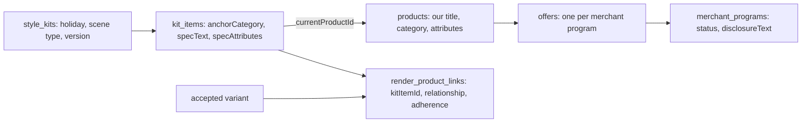
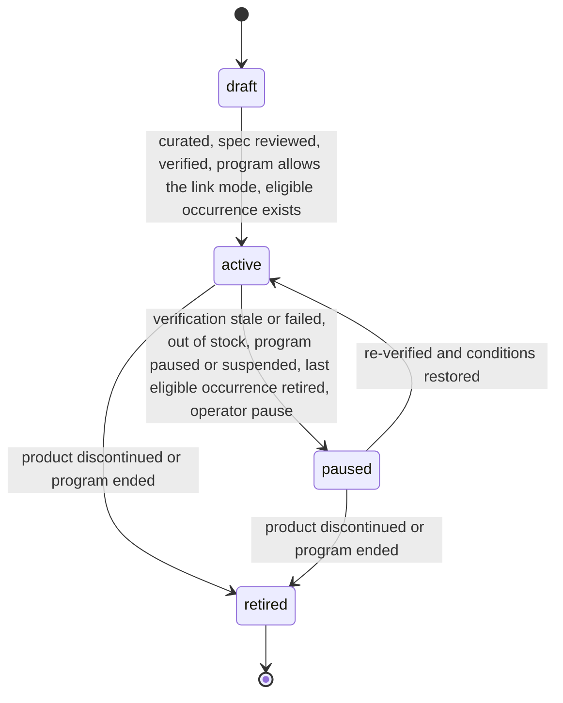

# Commerce specification

Holiday shows people their real home decorated for a holiday and then helps them buy decorations that create the look. This document specifies that second half: the Shop the look panel under a preview, how a product may honestly be related to a rendered decoration, how style kits map to real products and offers, how merchant programs are joined and activated, the disclosures that law and merchant contracts require, how offers are ranked, how clicks are tracked and reconciled, the seasonal calendar that decides when offers appear, and the operating routine that keeps the catalog honest. Affiliate commerce is the fixed revenue direction ([D-05](../decisions.md#d-05)); this document says how it is implemented without weakening the preview's honesty. The product-level summary is [PLAN.md §9](../PLAN.md#9-commerce-and-business-model); unit economics live in [economics.md](economics.md); merchant and market facts live in [commerce-and-markets.md](../research/commerce-and-markets.md); kit content lives in [holidays-and-content.md](holidays-and-content.md#style-kits).

**Owns:** Shop the look; product relationship enum; style kits (product side); offers and lifecycle; merchant onboarding runbook; commerce activation; disclosure wording; ranking integrity; click tracking and attribution; seasonal commerce calendar (commerce windows and retirement dates); commerce operations.
**Baseline:** planning baseline 2026-11-09; external facts retrieved 2026-11-08.

## Shop the look

### What the panel is

Shop the look is the only commerce surface in the US Release: a compact panel beneath an accepted variant (the preview) that lists products matched to the decorations in that preview. The match comes from the decoration plan behind the variant ([render-pipeline.md#decoration-plan](render-pipeline.md#decoration-plan)) through the style kit (see [Style kits and products](#style-kits-and-products)), so the prompt that produced the picture and the card in the panel describe the same object. The panel never claims that the exact item pictured is for sale; the wording for each relationship is fixed in [Product relationships](#product-relationships).

Design target: 3–6 cards (configuration: `maxCards` default 6). A panel with one or two eligible cards still shows them (configuration: `minCards` default 1), because one relevant product is more useful than none; the 3–6 target is a catalog coverage goal checked in the [readiness checklist](#readiness-checklist). Zero eligible cards gives the `no_offers` state.

### Placement and eligibility

| Rule | Specification |
| --- | --- |
| Position | Directly below the before/after result and its holiday, style and lighting controls, before the feedback and report entry points. Screen layout: [experience.md#result-and-comparison](experience.md#result-and-comparison). |
| Per variant | The panel belongs to the accepted variant currently shown. Switching holiday or style swaps the panel together with the variant; a cached variant shows the associations persisted for it in `render_product_links` (see [Ranking integrity](#ranking-integrity)). |
| Google imagery | Never shown on a screen that displays Google imagery (a Street View before image or a Street View-derived output) unless the recorded licensing outcome covers commerce adjacency, evaluated as the AssetPermission use `commerceAdjacent` (`unknown` evaluates as denied, and the panel state is then `hidden`) (Proposed, [D-15](../decisions.md#d-15); the outcome matrix is in [address-and-street-view.md#licensing-outcomes-and-activation](address-and-street-view.md#licensing-outcomes-and-activation)). Google's terms bar using the Maps services to create or augment an advertising product (§3.2.3(d)(iii), https://cloud.google.com/maps-platform/terms, retrieved 2026-11-08); whether a shopping panel beside Street View-derived output is one is a question for Google, asked in the [licensing request brief](address-and-street-view.md#licensing-request-brief). In the interim address experience ([D-16](../decisions.md#d-16)) the decorated image is the user's own photo, so the result screen shows no Google imagery and the panel is allowed. |
| Activation | Shown only when at least one `commerce:<merchantProgramId>` capability is at the activation state appropriate to the viewer ([Commerce activation](#commerce-activation)) and the global commerce pause is off. |
| Offers | Shown only when at least one eligible offer exists for the variant's kit items and the variant's holiday occurrence is inside a commerce window ([Seasonal commerce calendar](#seasonal-commerce-calendar)). |
| Other surfaces | Never on share pages, share cards or downloads (Proposed, [D-26](../decisions.md#d-26)). Any other surface that carries product links (the saved-project view; an "email me my preview" message if that experiment runs, see [economics.md#revenue-experiments](economics.md#revenue-experiments)) carries the same disclosure as the panel. |

### Panel states

`GET /v1/renders/:id/products` returns the cards and the panel state (field names: [data-and-api.md#http-api](data-and-api.md#http-api)).

| State | When | What the user sees |
| --- | --- | --- |
| `active` | Eligibility met and at least `minCards` eligible cards | Disclosure line, then the cards, then the fit note |
| `no_offers` | Activation on and a commerce window open, but no eligible offer for this variant | One short sentence that matching products are not available for this look yet; no links; the preview stays complete |
| `off_season` | No commerce window open for the variant's holiday occurrence | "Plan ahead" copy without links |
| `hidden` | Activation off for this viewer, Google imagery without a covering grant, or global commerce pause | Nothing rendered |

Copy for `no_offers` and `off_season` lives in the experience copy deck under `commerce.*` keys ([experience.md#copy-deck](experience.md#copy-deck)); the disclosure strings are normative in [Disclosure](#disclosure).

### Card content

| Element | Rule |
| --- | --- |
| Title | Our own words, derived from the kit item's spec text (for example "Pre-lit mixed-pine wreath, 30–36 in., warm-white lights"). Never a merchant title or merchant copy. |
| Merchant | Plain text ("at Walmart"). Merchant logos only where the program's terms permit; default none. |
| Image | None in the US Release unless the program grants image display rights and supplies image URLs through an approved feed or API. Cards use an in-house illustration per product category. Amazon product images are never stored or cached (Program Policies, https://affiliate-program.amazon.com/help/operating/policies, retrieved 2026-11-08). |
| Price | "Check price at retailer" unless the offer's `priceSource` permits display ([Price display policy](#price-display-policy)); a shown price always has an adjacent "as of" timestamp. |
| Relationship label | "Similar item" or "Similar to what's pictured" ([Product relationships](#product-relationships)). |
| Placement note | "For the wreath on your front door": the placement's anchor category in plain words. It is disclosed as a match to the decoration plan, not as recognition of the picture. |
| Ad marker | "Ad" chip when the card's link is a tracking link ([Disclosure](#disclosure)). |
| Link | The offer's tracking URL in tracking mode or plain destination URL in plain mode; the click is recorded before navigation ([Click tracking and attribution](#click-tracking-and-attribution)). |
| Fit note (panel level) | Sizes, quantities, light-string lengths, electrical compatibility and installation suitability cannot be established from a photograph and are never promised. |
| Ratings and reviews | No merchant star ratings, review counts, testimonials or AI-written text framed as a review in the US Release. If ratings are ever added they must be the merchant's genuine data: the FTC rule on consumer reviews and testimonials (16 CFR Part 465) bans fake or AI-generated reviews (https://www.ftc.gov/news-events/news/press-releases/2024/08/federal-trade-commission-announces-final-rule-banning-fake-reviews-testimonials, retrieved 2026-11-08). |

### Mobile behavior

- The panel sits below the before/after at full width; cards stack in one column at phone width and may use two columns above the tablet breakpoint ([experience.md#mobile-layout](experience.md#mobile-layout)).
- The disclosure line is the first child of the panel on every viewport and is never collapsed behind a "more" control.
- No interstitial, modal or redirect page: a tap records the click and goes to the merchant.
- Target sizes and contrast follow [experience.md#accessibility](experience.md#accessibility).

### Analytics

`shop_panel_viewed` fires once per variant per session when the panel enters the viewport with properties `panelState`, `cardCount`, `linkMode`, `programs` and `relationships` (holiday, scene type and source kind are envelope dimensions). `product_clicked` fires on every card click with `relationship`, `rankPosition`, `merchantProgramId`, `linkMode` and `sponsored`. Neither carries addresses, image URLs, prices or merchant URLs. Property schemas: [data-and-api.md#analytics-events](data-and-api.md#analytics-events).

## Product relationships

The relationship enum is Proposed ([D-24](../decisions.md#d-24)). It is the only vocabulary for how a product relates to a rendered decoration, in data, code and copy.

| Value | Meaning | Evidence required before use | Customer wording | US Release |
| --- | --- | --- | --- | --- |
| `similar` | The product matches the placement's category and style. Either the rendered item came from a generic description, or the `described` check failed or was skipped. | The kit item or plan placement category matches the product category; the offer is eligible. | "Similar item" | Yes |
| `described` | Our own text spec of this real product's public attributes was compiled into the prompt for this placement, and the post-render adherence check passed. | Placement compiled from `kit_items.specText`; an adherence record with status `pass` for this placement on this variant. | "Similar to what's pictured" | Yes |
| `reference` | A permitted merchant image of this product was an input to the placement; exact reproduction is unverified. | Offer content rights `imageAiInput` = `allowed` with written merchant permission recorded in `asset_policies`; render-pipeline support for reference inputs. | "Used as a style reference" | Later capability |
| `verified` | A reference was used and a product identity review passed. | `reference` evidence plus a recorded identity review pass. | "Product shown as an AI preview" (still no fit guarantee) | Later capability |

Rules:

1. Never upgrade without the evidence in the table. A successful provider call is not evidence of anything.
2. Downgrade or hide on failure: `described` becomes `similar` if the category still matches, otherwise the kit item is hidden from this variant's panel; `reference` becomes `similar`; `verified` becomes `reference`.
3. Associations are per variant. `render_product_links` rows are created when the render job reaches `succeeded` (after review approval in pilot review mode) and are keyed by the accepted variant and kit item. They are never recomputed when products are swapped later ([Swap and versioning rules](#swap-and-versioning-rules)).
4. Customer wording is fixed per value and used verbatim in the copy deck.
5. No wording, image or layout may imply that the exact product, its dimensions, its quantity or its fit were determined from the photograph.

### Adherence check for `described`

| Aspect | Specification |
| --- | --- |
| Unit | One placement in the decoration plan of one accepted variant. |
| Criteria | Category (the rendered item is the kit item's product category), color family (the spec's color family dominates the rendered item), count (within the quantity rule for the chosen style; "one wreath" means exactly one). Approximate scale against the anchor is recorded but not required. |
| Who checks, private pilot | The human reviewer in `needs_review` ([D-14](../decisions.md#d-14)) records pass or fail per placement on the review form. |
| Who checks, later | The QA judge's per-placement adherence in `JudgeResult` ([render-pipeline.md#quality-checks](render-pipeline.md#quality-checks)) once it meets the calibration target in [quality-and-benchmark.md#qa-judge-calibration](quality-and-benchmark.md#qa-judge-calibration). Until then judge output is advisory and the label defaults to `similar`. |
| Decision | All criteria pass: `described`. Any criterion fails: `similar` if the category matches, else hidden. Uncertain: `similar`. |
| Record | `render_product_links.adherence` with `status` (`pass`, `fail`, `uncertain`, `not_checked`), `checkedBy` (`human`, `judge`), `checkedAt`, `failedCriteria`. |
| Feedback to curation | Adherence rate per kit item is reported; items the renderer draws unfaithfully are replaced in the kit. The per-kit-item adherence pass rate and its 70% flag are defined in [quality-and-benchmark.md#review-rubric](quality-and-benchmark.md#review-rubric) (Placement adherence per kit item); a flagged kit item is shown only as `similar` until it is replaced or a later benchmark version passes. |

## Style kits and products

### Division of ownership

Kit content (archetypes, anchor categories, spec text and attributes, per-style quantity rules) is pack content owned by [holidays-and-content.md#style-kits](holidays-and-content.md#style-kits). This section owns the mapping from kit items to real products and offers.

### Kit item to product

| Concept | Definition |
| --- | --- |
| Kit item | One archetype slot in the style kit for a (holiday, scene type): `anchorCategory`, `specText`, `specAttributes`, quantity rules per style, `sortOrder`, `currentProductId` and product history. |
| Product | One real item described in our own words: our title, category, `attributes` (size range, material, color family, count, light color and type, indoor or outdoor), notes. Merchant-agnostic; holds no merchant text or images. |
| Offer | A purchasable instance of a product at one merchant program ([Offers and lifecycle](#offers-and-lifecycle)). One product can have offers at several merchants. |
| Sharing | One product can back kit items in several kits: warm-white micro-LED string lights in Christmas `house_exterior` and `balcony`; pillar candles in Thanksgiving and Christmas `interior`. |

### Spec text rules

- Spec text is written in-house from the product's public attributes and expresses category, size range, material, color family, count and light type. It never contains merchant titles, bullets, descriptions, review text, images, brand names or merchant names, so no merchant content reaches the renderer and Amazon Program Content is never stored, altered or used with a model (Program Policies, https://affiliate-program.amazon.com/help/operating/policies, retrieved 2026-11-08).
- Spec text and attributes are pack content and pass content review ([holidays-and-content.md#content-authoring-and-review](holidays-and-content.md#content-authoring-and-review)).
- **Verify:** that in-house attribute descriptions written from public attributes are not merchant Program Content under Amazon's Operating Agreement (its definition covers content provided through the program, so the plain reading is that they are not). Owner: counsel, as part of the [legal deliverables](privacy-safety-legal.md#legal-deliverables).

### Swap and versioning rules

| Situation | Action | Existing previews |
| --- | --- | --- |
| An offer dies or goes out of stock but another offer exists for the same product | Ranking selects the other offer at view time | Unchanged; the association is to the kit item, the offer is chosen when the panel is served |
| Product discontinued; a replacement product has matching `specAttributes` | Set `currentProductId` on the kit item; no new kit version; no re-render | Unchanged; `described` stays truthful because the spec is identical |
| Replacement product needs different spec text or attributes | New kit version with the new spec; packs that pin the kit take the new version through a pack MINOR bump, which changes the variant key ([render-pipeline.md#variant-key-and-reuse](render-pipeline.md#variant-key-and-reuse); versioning rule in [holidays-and-content.md#holiday-packs](holidays-and-content.md#holiday-packs)) | Keep links to the old kit version; they show `similar` items from the old product's remaining offers or `no_offers` |
| Spec wording changed without changing attributes | Kit PATCH, pack PATCH | Unchanged |

### Pilot catalog sizing

Three holidays by four scene types gives up to 12 kits; at 4–6 items each that is 48–72 kit items. With products shared across kits (lights, candles, ribbon, lanterns) the US Release catalog is about 30–50 active offers. A (holiday, scene type) pair without a kit simply yields `no_offers` for that scene type; kit coverage is a [readiness checklist](#readiness-checklist) item, not a blocker for rendering.

## Offers and lifecycle

A product describes the item; an offer owns where it can be bought and on what terms. Field types, constraints and indexes are in [data-and-api.md#entities](data-and-api.md#entities); this table defines the semantics.

### Offer fields

| Field | Meaning | Notes |
| --- | --- | --- |
| `merchantProgramId` | The merchant program the offer belongs to | Required; see [Merchant onboarding](#merchant-onboarding) |
| `merchantItemId` | Merchant SKU, ASIN or item number | Used for verification and de-duplication; never displayed as a claim |
| `destinationCountry` | `US` in the US Release | Kept explicit for later markets ([architecture.md#international-extension-boundaries](../architecture.md#international-extension-boundaries)) |
| `currency` | `USD` in the US Release | Money is integer minor units plus currency |
| `price` | Nullable | Displayed only per the price display policy |
| `priceSource` | `none`, `api`, `feed`, `merchant_served_link`, `manual_non_amazon` | Drives whether a price may be displayed |
| `priceObservedAt` | When the price was obtained | Shown as the adjacent timestamp |
| `availability`, `availabilityObservedAt` | `in_stock`, `out_of_stock`, `unknown` and when observed | From verification |
| `destinationUrl` | Plain merchant URL without tracking parameters | Always present; used in plain link mode |
| `trackingUrlTemplate` | The program's link template with `{destinationUrl}` and `{subId}` placeholders; nullable | Used only in tracking link mode |
| `contentRights` | `imageDisplay`, `imageAiInput`, `textUse`, each `unknown`, `allowed` or `denied` with an evidence reference | `unknown` behaves as `denied` |
| `lifecycleStatus` | `draft`, `active`, `paused`, `retired` | See below |
| `seasonalEligibility` | Set of holiday occurrence IDs the offer may appear under | Empty set: never shown |
| `lastVerifiedAt`, `verificationMethod`, `verifiedBy` | Verification record; method `feed`, `api` or `manual` | Drives auto-pause |
| `notes` | Operator notes | Internal only |

### Lifecycle

Only `active` offers verified within the freshness limit and eligible for the variant's occurrence are ever returned to a client. `retired` is terminal; the following season gets a new offer row. An offer never carries tracking parameters unless its program's status allows tracking links ([Program status model](#program-status-model)).

### Verification cadence

| Context | Cadence (default, configuration) | Freshness limit after which the offer auto-pauses |
| --- | --- | --- |
| Outside every commerce window of its eligible occurrences | Weekly | 8 days |
| Inside a commerce window | Twice weekly | 4 days |

Methods: `manual` (an operator opens `destinationUrl`, confirms the product exists, is in stock and still matches our spec, and records the check); `api` or `feed` where the program grants access. Automated checks run only through merchant or network APIs. Holiday never fetches or scrapes merchant pages: Amazon's license excludes data-mining and scraping tools and forbids storing product images (Program Policies, retrieved 2026-11-08), and other programs vary.

### Price display policy

| Program | A price may be shown when | Otherwise |
| --- | --- | --- |
| Amazon Associates | Amazon serves the link that displays the price, or the figure came from the Creators API or PA API refreshed within 24 hours, with a date/time stamp adjacent unless refreshed at least hourly (Program Policies, https://affiliate-program.amazon.com/help/operating/policies, retrieved 2026-11-08) | "Check price at retailer". A hand-entered Amazon price is never displayed. |
| Other programs | The program's feed or API supplies the price and its terms permit display, or the program permits manually recorded prices (`manual_non_amazon`), always with the timestamp | "Check price at retailer" |

Display rule: a price is rendered only when `priceSource` is not `none` and `priceObservedAt` is within 24 hours (configuration), and always with "as of" and the observation time. Default in the US Release: every offer has `priceSource = none`, so every card reads "Check price at retailer".

### Amazon specifics

- No Amazon product images are stored or cached and no Amazon product text is shown; titles are our own.
- Links are generated manually in Associates Central (text links) until API access exists. The Creators API, which replaced PA-API 5, requires enrollment plus at least 10 qualifying sales in the trailing 30 days (https://affiliate-program.amazon.com/creatorsapi/docs/en-us/introduction, retrieved 2026-11-08); PA-API 5 calls return HTTP 403 (https://affiliate-program.amazon.com/creatorsapi/docs/en-us/paapiv5-deprecation, retrieved 2026-11-08). API-backed refresh is a later capability gated on `merchant_programs.apiAccess = granted`.
- Program Content is never altered and never used to develop or improve models.
- Amazon's required statement appears wherever Amazon tracking links appear ([Disclosure](#disclosure)).

## Merchant onboarding

Merchant onboarding is Proposed ([D-25](../decisions.md#d-25)). Every merchant relationship is a `merchant_programs` row with a status, a requirements record and dated evidence. No program is assumed approved; nothing in the product depends on approval.

### Program status model

| Status | Meaning | Offers of this program |
| --- | --- | --- |
| `planned` | Candidate program; requirements record in progress | Plain links, or hidden (configuration `unenrolledLinkMode` default `plain`) |
| `applied` | Application submitted; no tracking links issued or usable | Plain links, or hidden |
| `provisional` | Accepted into the program subject to a condition. Amazon Associates is provisional from application until three qualifying sales are referred; without them within 180 days of applying the application is withdrawn (https://affiliate-program.amazon.com/help/node/topic/G7MJTPEP9NC3YKMG, retrieved 2026-11-08) | Tracking links with full disclosure |
| `approved` | Fully approved and in good standing | Tracking links with full disclosure |
| `declined` | Application rejected | Plain links or hidden; contingency ladder below |
| `withdrawn` | Application withdrawn by the merchant (Amazon dormancy) or by Holiday | Plain links or hidden; contingency ladder below |
| `suspended` | Account suspended by the merchant, or paused by Holiday after a policy problem | Tracking links removed immediately; plain links or hidden |

Every transition is dated, carries an evidence reference (confirmation email, dashboard screenshot stored privately, policy version) and is written to `audit_log`. A program's `disclosureText`, `attributionWindow`, `subIdCapability`, `apiAccess`, `commissionSchedule` (with effective dates), `policyVersion` and `reviewedAt` are recorded on the same row.

### Program record

For each program, record before any offer goes `active`:

- Network and account: the network (Amazon is direct; others through Impact, CJ, Rakuten, Partnerize, FlexOffers or Sovrn), approved sites and channels, deep-link format, tracking identifiers, SubId capability, permitted redirect behavior.
- Money: eligible categories, commission schedule, attribution window, exclusions, reversal rules, payment threshold and timing, reporting access (API, CSV export or dashboard only).
- Content: feed or API access and its prerequisites, stock and price refresh rules, permitted product descriptions, image hosting and caching terms, trademark rules, required notices and their exact text.
- Rights: separate permission for sending product images to an AI processor and for creating, storing and distributing modified imagery. Permission to display a thumbnail does not establish it.
- Territory: shipping coverage, currency, indoor or outdoor suitability where known.
- Site requirements at application and the re-application terms.

### Runbook

| Step | Rule | Basis |
| --- | --- | --- |
| 1. Requirements record | Complete the program record above for every candidate with source URLs and check dates. Items that could only be read from third-party directories are marked unverified and are read from the network dashboard after approval. | [commerce-and-markets.md#retail-affiliate-programs-and-networks](../research/commerce-and-markets.md#retail-affiliate-programs-and-networks) |
| 2. Site prerequisites | Apply only from a publicly reachable production site with Shop the look working in plain link mode, an affiliate disclosure page, Terms that state the affiliate relationship and a privacy policy ([legal deliverables](privacy-safety-legal.md#legal-deliverables)). Amazon requires the site to be publicly available (not a closed group or behind a paywall) with content recent within about 60 days (https://affiliate-program.amazon.com/help/node/topic/G8TW5AE9XL2VX9VM, retrieved 2026-11-08). Walmart's Operating Agreement treats traffic to a site that is not live at application as objectionable and accepts applications at its sole discretion (https://affiliates.walmart.com/terms and https://affiliates.walmart.com/page/faqs, retrieved 2026-11-08). The private pilot is a closed group and satisfies neither. | Primary pages cited |
| 3. Network accounts | Open one account per network actually needed: Amazon direct; Impact for Walmart (and Home Depot, reported by third parties because its official program page could not be read: **Verify:** network, attribution window and rates in the Impact dashboard, owner: operations/commercial lead); Rakuten for Etsy (https://help.etsy.com/hc/en-us/articles/360000335987, retrieved 2026-11-08). Record per network: reporting API and credentials location, SubId parameter names, payment threshold, payout timing. | Research document |
| 4. Amazon application decision point | Submit the Amazon application only when three qualifying sales within 180 days are plausible from live public traffic, because a dormant application is withdrawn and the Associates ID is not reinstated (a fresh application is permitted once the site is established). The product owner records the dated decision in the [decision log](../decisions.md#decision-log). Track `appliedAt`, the 180-day limit and the qualifying-sale count on the program row. Links and reporting are reported to work during the provisional period: **Verify:** in Associates Central after applying, owner: operations/commercial lead. | https://affiliate-program.amazon.com/help/node/topic/G7MJTPEP9NC3YKMG |
| 5. Catalog without an API | Assume no Amazon catalog data: hand-curated offers, manually generated links, our own titles, no Amazon images or text, `priceSource = none`. API-backed refresh becomes available only when `apiAccess = granted` (10 qualifying sales in the trailing 30 days). | [Amazon specifics](#amazon-specifics) |
| 6. Network applications | Apply to each network merchant once step 2 is met; expect discretionary approval; record the status and evidence. | Walmart FAQ |
| 7. Aggregators | Evaluate at most one aggregator for long-tail breadth only after verifying its revenue share and Amazon coverage. Sovrn Commerce reviews sites individually and requires real human clicks before approval (https://www.sovrn.com/blog/getting-approved-for-commerce/, retrieved 2026-11-08). Skimlinks works through affiliate networks; its revenue share and its reported exclusion of Amazon are unverified (https://www.skimlinks.com/insights/how-skimlinks-works-with-merchants-faq/, retrieved 2026-11-08). | Research document |
| 8. Specialist decor merchants | Shortlist specialists (reported examples: Balsam Hill, Christmas Lights Etc, Grandin Road, Frontgate) as a hypothesis for exterior kits. Their reported rates and attribution windows are third-party claims; read them from each dashboard before relying on them. Rates never override match quality ([Ranking integrity](#ranking-integrity)). | Research document, marked unverified |
| 9. Disclosure capture | Store each program's required wording in `disclosureText` (Amazon's exact sentence) and render from it ([Disclosure](#disclosure)). | Operating Agreement |
| 10. Declines and withdrawals | Contingency ladder, chosen by the product owner and logged: re-apply after the site is established (Amazon: "welcome to reapply"; Walmart: may re-apply at any time); a different network or merchant for the same products; continue plain links; a disclosed sponsored collection if that lever is adopted ([D-27](../decisions.md#d-27)). Never: tracking links from an unenrolled or suspended account, cloaked links, or fabricated prices. | Primary pages cited |

### Candidate programs

| Program | Network | Verified on 2026-11-08 | Unverified (read from dashboard) |
| --- | --- | --- | --- |
| Amazon Associates | Direct | Application and sales gates above; Creators API gate; image, alteration and model clauses; required statement; standard category rates ([commerce-and-markets.md#amazon-associates](../research/commerce-and-markets.md#amazon-associates)) | Which standard category seasonal decor falls under |
| Walmart | Impact | "Up to 4%", sole-discretion eligibility, live-site rule, re-application allowed | Attribution window, category rates |
| Home Depot | Impact (reported; official page not readable) | None | Program exists, attribution window, rates |
| Target | Impact (reported) | None | Everything |
| Etsy | Rakuten | Program runs through Rakuten; 30-day affiliate attribution | Rate; poor fit for curated items because sellers are individual makers |
| Michaels, Balsam Hill, At Home, Christmas Lights Etc, Grandin Road, Frontgate, Lowe's | CJ, Partnerize, FlexOffers, Sovrn (reported) | None | Everything |

The research document's claims register holds the per-claim sources and re-verification triggers ([commerce-and-markets.md#claims-register](../research/commerce-and-markets.md#claims-register)).

## Commerce activation

Commerce activates per merchant program, independently of public rollout (Proposed, [D-25](../decisions.md#d-25)). Each program has a capability `commerce:<merchantProgramId>` (for example `commerce:amazon_associates_us`, `commerce:walmart_impact_us`) in `country_capabilities` ([D-47](../decisions.md#d-47)) with the activation states `fixture`, `live_private` and `live_public`, an evidence reference and `reviewedAt`. Changing a state is a configuration change, audited and effective without a deploy.

### What the two records mean

Activation state decides who sees real offers; program status decides what kind of link they see.

| Activation state | Who sees this program's offers | Link mode by program status |
| --- | --- | --- |
| `fixture` | Nobody outside tests and local or staging environments. A fixture program `fixture_decor_us` with example destinations backs contract tests for the merchant-links leg ([architecture.md#external-integrations-and-fixture-modes](../architecture.md#external-integrations-and-fixture-modes)). | n/a |
| `live_private` | Internal users and private-pilot participants | `planned`, `applied`, `declined`, `withdrawn`: plain (or hidden by configuration); `provisional`, `approved`: tracking; `suspended`: plain or hidden |
| `live_public` | Everyone | Same mapping |

Evidence to move a program to `live_public`: program status recorded with evidence; at least one `active` verified offer; the disclosure check passed for the resulting link mode; the affiliate disclosure page and Terms clause published (for tracking mode); counsel sign-off on the disclosure wording recorded once per program type.

### How the circular dependency is resolved

Merchant programs require a live public site at application, and Amazon completes approval only after three qualifying sales referred from live links. Public rollout therefore cannot wait for merchant approval, and merchant approval cannot precede public rollout. The resolution:

1. The US Release ships with Shop the look complete and tested in `fixture` mode and runnable in plain link mode: real products, plain destination URLs, no commission, no "Ad" marker, and the plain-mode disclosure line.
2. Gate D ([backlog.md#gates](../backlog.md#gates)) passes with every `commerce:*` capability at `fixture` or at `live_public` in plain mode; no merchant status is part of its pass rule.
3. From the first public day the product owner may set programs to `live_public` with status `planned` or `applied`. Purchase intent is measured from `product_clicked` on plain links; affiliate revenue is zero by construction and is labeled as such in every economics reading ([economics.md#revenue-assumptions](economics.md#revenue-assumptions)).
4. Applications are submitted once the public site meets each program's prerequisites ([Runbook](#runbook) steps 2, 4 and 6).
5. When a program becomes `provisional` or `approved`, operations sets the status, and tracking links and the paid-mode disclosures appear on the next panel load. No release is needed.
6. The private pilot sees plain links to real products (programs at `live_private`, status `planned` or `applied`) and measures intent through clicks; it cannot complete Amazon enrollment because it is a closed group ([quality-and-benchmark.md#pilot-evaluation](quality-and-benchmark.md#pilot-evaluation)).

### Switches

- Global commerce pause (internal operations API, [data-and-api.md#internal-operations-api](data-and-api.md#internal-operations-api)): the panel is `hidden` everywhere until released.
- Per-program pause: status `suspended` removes that program's tracking links immediately.
- Activation never overrides the Google imagery rule in [Placement and eligibility](#placement-and-eligibility).

## Disclosure

Disclosure is Proposed ([D-26](../decisions.md#d-26)). Two sources set the requirements. The FTC's Endorsement Guides require a material connection to be disclosed clearly and conspicuously, close to the recommendation; the FTC notes that "affiliate link" alone may not be understood and gives "paid link" as an adequate example (https://www.ftc.gov/business-guidance/resources/ftcs-endorsement-guides-what-people-are-asking, retrieved 2026-11-08). Amazon's Operating Agreement requires the statement "As an Amazon Associate I earn from qualifying purchases." to be displayed clearly and prominently (https://affiliate-program.amazon.com/help/operating/agreement, retrieved 2026-11-08). Deception generally is covered by the FTC Act in [privacy-safety-legal.md#us-privacy-law](privacy-safety-legal.md#us-privacy-law).

### US Release wording

These strings are normative here; the experience copy deck lists them by key and links to this table.

| Key | Text | Where | Link mode |
| --- | --- | --- | --- |
| `commerce.disclosure.paid` | Ad · Paid links. We earn a commission if you buy through these links. | First element of the panel | Tracking (any card) |
| `commerce.disclosure.amazon` | As an Amazon Associate I earn from qualifying purchases. | Directly under the paid-links line, whenever any Amazon tracking link is on the screen; rendered from `merchant_programs.disclosureText` | Tracking (Amazon) |
| `commerce.disclosure.plain` | These links go to the retailer. We don't earn anything from them. | First element of the panel | Plain (all cards) |
| `commerce.disclosure.more` | How we make money | Link at the end of the disclosure line to the affiliate disclosure page | All |
| `commerce.card.ad` | Ad | Chip on every tracking-link card and part of that link's accessible name | Tracking |
| `commerce.card.sponsored` | Sponsored | Chip and row heading for paid placements | Sponsored only |
| `commerce.panel.fitNote` | Sizes, quantities and fit aren't guaranteed. Check the product details before you buy. | After the cards | All |

Mixed panels: if any card carries a tracking link, the panel uses the paid line, and only tracking-link cards carry the Ad chip. If Amazon-sourced text content is ever displayed (not in the US Release), Amazon's notice that content comes from Amazon is added per the Program Policies.

### Placement and accessibility

- The disclosure is real DOM text, first in the panel's reading and tab order, visible without interaction on every viewport, never a tooltip, image or collapsed section.
- The panel is a landmark region named "Shop the look" with the disclosure as its first child; each tracking-link card's accessible name begins with "Ad".
- Contrast, size and focus rules follow [experience.md#accessibility](experience.md#accessibility). Automated accessibility checks and the disclosure check assert, for each link mode, that the correct lines are present and that no Ad chip appears on a plain link.
- The same lines appear on every surface that carries tracking links (saved-project view; a preview email if that experiment runs).
- Share pages, share cards and downloads carry no product links, product names, prices, merchant logos or shopping calls to action, so they need no commerce disclosure; the only burned-in text on an image is the AI preview label ([render-pipeline.md#provenance-and-labeling](render-pipeline.md#provenance-and-labeling)).
- The affiliate disclosure page is a legal deliverable ([privacy-safety-legal.md#legal-deliverables](privacy-safety-legal.md#legal-deliverables)).

### Sponsored placements

Paid placements are not part of the US Release. If the sponsored-collections lever is adopted ([D-27](../decisions.md#d-27)), sponsored cards are labeled "Sponsored", sit in their own row after the organic cards, never occupy the organic slots and never replace a `described` item.

## Ranking integrity

Relevance decides what appears and in what order; commission can only break ties among offers for the same product. This rule holds for the US Release and for every later lever.

### Panel composition

1. Candidate kit items: the placements in the shown variant's decoration plan that survived anchor validation ([render-pipeline.md#decoration-plan](render-pipeline.md#decoration-plan)) and have a `render_product_links` row that is not hidden.
2. Candidate offers per kit item: offers of the kit item's current product (per [Swap and versioning rules](#swap-and-versioning-rules)) with `lifecycleStatus = active`, `lastVerifiedAt` within the freshness limit, `seasonalEligibility` containing the variant's occurrence, and a program whose capability is at the viewer's activation state.
3. Card order: `described` items before `similar` items; within a relationship, the kit's `sortOrder` (which encodes placement prominence: door, porch, roofline, then accents); at most `maxCards`.
4. Offer selection within a kit item: the ordered tie-break below.
5. Record what was shown ([Recorded metadata](#recorded-metadata)).

### Offer selection within a kit item

| Order | Criterion |
| --- | --- |
| 1 | Verified `in_stock` most recently |
| 2 | Program in `approved` or `provisional` status over plain-link programs, only when both offers are for the same product |
| 3 | Price within the kit item's stated range, when a displayable price is known |
| 4 | Longer attribution window |
| 5 | Higher commission rate (last tie-breaker) |
| 6 | Stable order by offer ID |

### What commission may never do

- Change which kit items appear or their order.
- Substitute a different product for a kit item because it pays more.
- Promote a `similar` item above a `described` item.
- Turn an out-of-stock or unverified offer into the shown one.
- Place a sponsored card in an organic slot or without its label.

### Recorded metadata

`render_product_links` (per accepted variant and kit item): `kitItemId`, `kitVersion`, `productId` at creation, `relationship`, `adherence`, `rankPosition`, `hidden` and `hiddenReason`. At each panel load the server records on the row the chosen `offerId`, `linkMode`, `candidateOfferIds`, `rankingReason` (which criterion decided) and `rankedAt`; every click copies these onto the click record. A weekly audit query lists cases where the chosen offer had a higher commission rate than a rejected candidate and the deciding criterion was not criterion 5; the expected count is zero, and any other result is an incident ([Commerce operations](#commerce-operations)).

## Click tracking and attribution

### Click event

Each card is served with a pre-issued opaque `clickToken` (random, unguessable, bound to the viewer's session, the `render_product_links` row and the chosen offer; unused tokens expire with the session). The card's `href` is the final merchant URL: in tracking mode the program's template with the token as the SubId where the network accepts one, in plain mode the `destinationUrl`. On click the browser sends `POST /v1/clicks` with the token using a keep-alive request and then navigates directly to the merchant; no interstitial or redirect page is used unless a program forbids direct links and permits a redirect, in which case a server redirect is used for that program only. Payload shape: [data-and-api.md#http-api](data-and-api.md#http-api).

The server records an `affiliate_clicks` row: `id`, `clickToken`, `renderProductLinkId`, `offerId`, `merchantProgramId`, `linkMode`, `sentSubId` or `trackingId`, `relationship`, `rankPosition`, `holidayId`, `occurrenceId`, `sceneType`, `sourceKind`, acquisition channel, `createdAt` and the hashed session reference. It never contains an address, place ID, project ID, image URL, prompt, email or raw IP ([privacy-safety-legal.md#data-handling-rules](privacy-safety-legal.md#data-handling-rules)).

### Sub-IDs and tracking IDs

| Program type | Per-click identifier | Rule |
| --- | --- | --- |
| Networks (Impact, CJ, Rakuten, others) | Per-click SubId parameter (reported names: Impact SubId1–3, CJ SID, Rakuten u1; **Verify:** exact parameter names and lengths in each dashboard, owner: operations/commercial lead) | Send the opaque `clickToken` only; store it as `sentSubId` |
| Amazon Associates | None per click. Static tracking IDs, capped at 100 per account ([CM-09](../research/commerce-and-markets.md#claims-register)); **Verify:** whether any dynamic parameter is accepted, in Associates Central, owner: operations/commercial lead | Allocate one tracking ID per (holiday × acquisition channel) cell; store it as `trackingId`; accept aggregate-only attribution for Amazon |

### Reconciliation

- A scheduled worker job imports each program's reports (API where offered, otherwise CSV exports placed by the operator) into `affiliate_conversions`: `merchantProgramId`, `sentSubId` or `trackingId` (nullable), `orderAt`, `reportedAt`, `commissionAmount` in minor units, `currency`, `status` (`pending`, `approved`, `reversed`, `paid`) and a raw report reference. Network rows join to clicks by `sentSubId`; Amazon rows are aggregates per tracking ID per day and never join to a click.
- Delays are normal: network reports lag by hours to days, and reversals (returns, cancellations) arrive within the merchant's return window, often weeks later. Revenue counts when a conversion is `approved` or `paid`; `pending` is reported separately and never as revenue.
- Attribution windows bound the purchase rate and are recorded per program: Amazon's session ends 24 hours after the click, at an order, or at a click through another Associates link, with cart items qualifying if ordered within 89 days (Program Policies, https://affiliate-program.amazon.com/help/operating/policies, retrieved 2026-11-08; **Verify:** exact wording on the live page before it is quoted in user-facing material, owner: counsel); Etsy 30 days (Etsy help page cited above); others from dashboards. Purchase rate is reported per program and attribution window.

### Metrics

| Metric | Definition |
| --- | --- |
| Panel view rate | `shop_panel_viewed` with state `active` ÷ previews shown |
| Click-through rate | `product_clicked` ÷ `shop_panel_viewed` with state `active` |
| Clicks per completing visitor | Clicks ÷ visitors with at least one preview |
| Attributed purchase rate | Approved or paid conversions ÷ clicks, per program and attribution window |
| Reversal rate | Reversed ÷ (approved + reversed) |
| Commission per click | Approved commission ÷ clicks, per program |
| Affiliate revenue per visitor | Approved commission ÷ visitors |
| Coverage | Previews with an `active` panel ÷ previews |

Reporting dimensions: holiday, scene type, source kind, acquisition channel, program, link mode, attribution window. These metrics feed the unit economics model and decision rules ([economics.md#unit-economics-model](economics.md#unit-economics-model), [economics.md#decision-rules](economics.md#decision-rules)). Until programs are approved, every reading is labeled as carrying zero or partial affiliate revenue by construction.

## Seasonal commerce calendar

A holiday occurrence has a promotion window (hero and default selection, owned by [holidays-and-content.md#windows-and-selection](holidays-and-content.md#windows-and-selection)) and, separately, a commerce window and a catalog retirement date owned here. The commerce window is when the occurrence's offers may be shown: kits curated, offers `active` and verified, program statuses recorded. It typically opens before the promotion window (people buy decorations before they put them up) and closes before the celebration (merchant shipping cut-offs). Boundaries are evaluated server-side in America/New_York, the editorial timezone ([D-09](../decisions.md#d-09)), and are configuration per occurrence and year.

### Windows

| Holiday | Commerce window (default, to validate against merchant shipping cut-offs) | Catalog retirement (`catalogRetireAt`) |
| --- | --- | --- |
| Halloween | September 1 – October 24 | November 1 |
| Thanksgiving (US) | October 15 – three days before Thanksgiving Day | The day after Thanksgiving |
| Christmas | October 15 – December 18 | December 26 |
| New Year's Eve (optional pack, [D-08](../decisions.md#d-08)) | December 1 – December 29 | January 2 |

Worked rows for the Thanksgiving-relative dates (Thanksgiving dates computed as the fourth Thursday of November):

| Year | Thanksgiving Day | Thanksgiving commerce window | Thanksgiving retirement |
| --- | --- | --- | --- |
| 2026 | 2026-11-26 | 2026-10-15 – 2026-11-23 | 2026-11-27 |
| 2027 | 2027-11-25 | 2027-10-15 – 2027-11-22 | 2027-11-26 |
| 2028 | 2028-11-23 | 2028-10-15 – 2028-11-20 | 2028-11-24 |

Why the windows start before the promotion windows: the National Retail Federation's 2026 Halloween survey puts decorations at $4.3 billion of $13.5 billion total Halloween spending, with 49% of shoppers starting in September or earlier (https://nrf.com/media-center/press-releases/nrf-halloween-survey-shows-consumer-spending-expected-to-reach-13-5-billion, retrieved 2026-11-08), and its winter holiday survey reports that 43% of holiday shoppers start before November (https://nrf.com/media-center/press-releases/affordability-shapes-winter-holiday-shopping-according-to-nrf-holiday-survey, retrieved 2026-11-08). Demand data and its caveats: [commerce-and-markets.md#seasonal-demand](../research/commerce-and-markets.md#seasonal-demand).

### Rules

- The panel is keyed to the shown variant's holiday occurrence, not to the hero. A Christmas variant produced while the Halloween or Thanksgiving hero is up shows Christmas offers from October 15.
- Overlap is intended: during the Thanksgiving promotion window the Christmas commerce window is open, so switching a Thanksgiving result to Christmas shows a shoppable panel at once ([experience.md#changing-holiday-style-and-lighting](experience.md#changing-holiday-style-and-lighting)).
- Cross-holiday row: a Thanksgiving result during the Christmas commerce window may show a separately labeled "Get ready for Christmas" row of Christmas offers. This is configuration `crossHolidayRow`, default off; turning it on is an owner decision recorded in the [decision log](../decisions.md#decision-log) under [D-24](../decisions.md#d-24). The Thanksgiving hero and default ([D-06](../decisions.md#d-06)) are unchanged either way.
- Off-season: when no commerce window is open for the variant's occurrence the panel state is `off_season`. Offers keep their status; they are simply ineligible. Per-season allowance and spend-ceiling configuration is owned by [economics.md#seasonality](economics.md#seasonality) and [economics.md#capacity-and-spend-ceilings](economics.md#capacity-and-spend-ceilings).
- Monetization risk of the mid-November default: the Thanksgiving pack is the default while Christmas decoration buying is already under way. Mitigations: the Christmas catalog is live from October 15, the switch to Christmas is one tap from a Thanksgiving result, and contribution is reported per holiday so the effect is measured rather than assumed. No published Thanksgiving-decoration spending figure was found ([seasonal demand](../research/commerce-and-markets.md#seasonal-demand)), so this is a risk to measure, not a known loss.

### Retirement

At `catalogRetireAt` the occurrence leaves every offer's effective eligibility. An offer whose remaining eligible occurrences are empty moves to `paused`; previews made during the window keep their `render_product_links`, but their panels resolve to `off_season`. The next year's occurrence is a new ID: offers must be re-verified and explicitly made eligible for it, so last year's links never render by default. `retired` is reserved for discontinued products and ended programs.

### Readiness checklist

Executed by the operations/commercial lead before each occurrence's commerce window opens; the completed checklist is stored as evidence.

| Check | Evidence |
| --- | --- |
| Occurrence dates (promotion window, commerce window, retirement) entered for the year and reviewed against the holidays spec's worked calendar | Occurrence record |
| Pack version published for the holiday ([holidays-and-content.md#content-authoring-and-review](holidays-and-content.md#content-authoring-and-review)) | Pack version ID |
| Kits for every supported (holiday, scene type) pair reviewed; every required kit item has a current product | Kit versions |
| Every required kit item has at least one `active` offer eligible for the occurrence; the low-coverage alert (configuration: fewer than one eligible offer per required kit item) is clear | Coverage report |
| Every eligible offer verified within 7 days | Verification log |
| Program statuses current with evidence; `apiAccess` and `disclosureText` current | Program rows |
| Disclosure check passed per link mode; Amazon statement present wherever Amazon tracking links appear | Test run |
| Activation states set per program and audience | Capability rows |
| Amazon tracking IDs allocated for the season's (holiday × channel) cells; SubId parameters confirmed | Program record |
| Test clicks reconciled end to end in staging (`fixture`) and, where a program is `provisional` or `approved`, in `live_private` | Reconciliation report |
| Seasonal allowance and spend ceilings configured ([economics.md#capacity-and-spend-ceilings](economics.md#capacity-and-spend-ceilings)) | Configuration record |

## Commerce operations

### Roles

| Role | Responsibilities |
| --- | --- |
| Product owner (the user) | Owns merchant accounts and applications; decides the Amazon application timing and the contingency ladder; accepts kits; approves cross-holiday and sponsored configuration |
| Operations/commercial lead | Curates products and offers; runs verification; tracks program status and the Amazon 180-day limit; executes the readiness checklist and retirement; imports reports; produces the commerce reports |
| Editorial lead | Kit content with the holidays spec: archetypes, spec text, quantity rules; content review |
| Engineering | Internal tools, import and verification jobs, ranking audit query, incident fixes |
| Counsel (external) | Affiliate clause in the Terms, disclosure page, Program Content reading, review of merchant terms changes |

### Cadence

| When | Activity |
| --- | --- |
| Weekly (twice weekly inside a commerce window) | Offer verification ([Verification cadence](#verification-cadence)) |
| Weekly during any commerce window | Metrics review; ranking audit query; pending-conversion aging; program check (Amazon qualifying sales against the 180-day limit) |
| Before each commerce window | [Readiness checklist](#readiness-checklist) |
| At each `catalogRetireAt` | Retirement run; per-holiday contribution recorded for the economics decision rules |
| On any merchant policy change | Record `policyVersion`; counsel review of disclosure or content implications; re-check price display and image rules |

### Internal tools

Served by the internal operations API ([data-and-api.md#internal-operations-api](data-and-api.md#internal-operations-api)) with operator authentication and audit logging:

- Offer management: create and edit offers, lifecycle transitions with reason, bulk pause by program, verification log entry, eligibility by occurrence.
- Kit and product management: products and attributes, kit item product assignment with the attribute-equivalence check, kit version publication (content review state comes from the holidays spec).
- Program management: status transitions with evidence, requirements record, disclosure text, tracking ID allocation, API access flag.
- Activation: per-program capability state; global commerce pause.
- Reports: SQL over the first-party event table and the commerce tables ([architecture.md#observability-and-operations](../architecture.md#observability-and-operations)); the ranking audit; coverage per occurrence; conversion import status.

### Incidents

| Incident | Response |
| --- | --- |
| Broken or redirected link, product page gone | Verification failure auto-pauses the offer and alerts; operator swaps the product (attribute-equivalent) or pauses the kit item; previews keep working through the other offers or `no_offers` |
| Product recall or safety notice | Pause every offer of the product immediately; check kit items that reference it; record the notice; replace the product |
| Program suspension or termination | Set `suspended` (or `withdrawn`); tracking links disappear on the next panel load; plain links or hidden per configuration; the Amazon statement is removed when no Amazon tracking links remain on the screen; contingency ladder |
| Disclosure rendering defect (missing line, Ad chip on a plain link, Amazon statement absent beside an Amazon tracking link) | Release-blocking defect: enable the global commerce pause until fixed; record the window of exposure |
| Wrong relationship label | Downgrade the affected rows; audit the adherence records for the kit item; recalibrate the judge if it was the checker |
| Price displayed without a permitted `priceSource` | Set the program's offers to `priceSource = none`; fix the display rule; record for counsel |
| Ranking audit finds commission deciding a non-tie | Treat as a defect in composition; fix; re-run the audit over the affected period |
| Report import failure | Pending conversions flagged stale after 7 days (configuration); metrics show the gap explicitly |
| Merchant terms change | Record the new `policyVersion`; counsel review where content, image or disclosure rules changed; adjust offers and program record |

### Reporting

The weekly commerce report during a commerce window covers the [metrics](#metrics) by holiday, scene type, source kind, channel, program, link mode and attribution window, plus coverage, verification freshness and program status. Every figure that depends on affiliate attribution is labeled with the programs that were in tracking mode for the period. The post-season report records contribution per holiday and feeds the decision rules in [economics.md#decision-rules](economics.md#decision-rules) ([D-27](../decisions.md#d-27)). All offer, program and capability changes are in `audit_log`; the report lists the changes made in the period.
