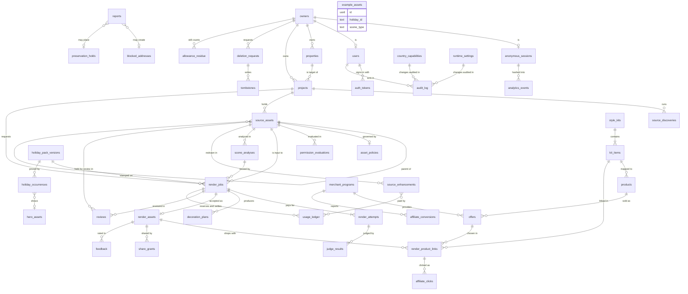

# Data model and HTTP contract

This specification defines what Hailiday stores and how clients talk to it: the persistent entities and their fields, the `/v1` HTTP API with request and response payloads, the error catalog and its mapping to interface behavior, where every allowance, quota, rate limit and spend ceiling is enforced, how concurrent and repeated requests are made safe, how the browser receives live render progress, the role-protected internal operations API, and the first-party analytics event taxonomy. It is written for the engineers and coding agents who implement `packages/core` schemas, `packages/server` tables and `apps/api` routes; semantics that belong to another specification (render lifecycle, Street View modes, retention values, limit values, copy) are linked, not restated.

**Owns:** entities and fields; ER diagram; endpoint payloads; error codes and UI mapping; allowance, quota and rate-limit enforcement points; idempotency and concurrency; server-sent events; internal operations API and its authentication contract; analytics event taxonomy.
**Baseline:** planning baseline 2026-11-09; external facts retrieved 2026-11-08.

## Conventions

### Identifiers

Every entity ID is a UUID (RFC 9562, https://www.rfc-editor.org/rfc/rfc9562.html, retrieved 2026-11-08), generated by the server as version 7 (time-ordered) and stored in `uuid` columns. Clients never choose IDs. Render job IDs equal the queue job ID so the API, the worker and the queue agree (mechanism: [architecture, jobs and queue](../architecture.md#jobs-and-queue)). Object keys in storage are opaque UUID-based paths and never contain addresses, emails or user-chosen text ([architecture, storage and media delivery](../architecture.md#storage-and-media-delivery)). Share tokens are 128-bit random values encoded base64url; only their SHA-256 hash is stored. Session cookie values are 256-bit random; only their SHA-256 hash is stored.

### Time

All timestamps are UTC: `timestamptz` columns, ISO 8601 strings with a `Z` suffix in JSON (`"2026-11-09T14:03:00.000Z"`). Dates without time (holiday windows) are `date` columns and `YYYY-MM-DD` strings interpreted in the occurrence's editorial timezone ([holidays spec, windows and selection](holidays-and-content.md#windows-and-selection)). Street View capture dates are stored as the API returns them (`YYYY-MM` or `YYYY`).

### Owners and scoping

An owner is the unit of access, allowance and retention: an anonymous session or a user account. Every owner-scoped row carries `owner_id` referencing `owners`. All reads and writes are filtered by the caller's owner; cross-owner access exists only through share grants and the internal operations API. When an anonymous session signs in (D-21), its rows are re-owned to the user's owner in one transaction (see [Accounts](#accounts)). Allowance counts are per owner across all of that owner's projects, so a new address never buys extra allowance.

### JSON and columns

JSON uses camelCase; database columns use snake_case; the two are mechanically mapped (`requested_at` ↔ `requestedAt`). Enumerations are `text` columns constrained by a `CHECK` generated from the zod enum in `@hailiday/core`, so API values and stored values are identical strings. Request and response bodies are validated against the core schemas by the Fastify zod type provider (D-32). Unknown request fields are rejected (`VALIDATION_FAILED`); unknown response fields are never emitted. Null means "not applicable or not yet known"; absent optional fields are not used to carry meaning.

### Copy keys

Fields that end in `Key` (`stageLabelKey`, `labelKey`, `altKey`, `captionKey` and the error table's copy keys) carry identifiers owned by the [experience copy deck](experience.md#copy-deck) and reproduced here verbatim; the API never returns user-facing text. Error copy keys are `error.` plus the error code verbatim (`error.RATE_LIMITED`).

### Versioning, pagination and caching

The API is served under `/v1`; breaking changes create `/v2` and `/v1` keeps working through a published sunset. Lists accept `limit` (default 20, maximum 100; configuration) and an opaque `cursor`, and return `{ "items": [...], "nextCursor": "..." | null }`; cursors encode `(created_at, id)` (the gallery and every `/internal/v1` list at microsecond precision, so rows created within one millisecond are neither repeated nor skipped; the projects list at millisecond precision) and are not stable across deletions; a cursor the server did not issue (not exactly the UTC timestamp form the server writes, years 0001 to 9999, with a UUID) answers `VALIDATION_FAILED` on `querystring.cursor`. Every `/v1` and `/internal/v1` response carries `Cache-Control: no-store` (decided on the path the router matches, so a percent-encoded path such as `/%76%31/me` is treated as `/v1/me`); only hero, example and share-card assets are cacheable, through the CDN ([architecture](../architecture.md#storage-and-media-delivery)).

### Correlation

Clients may send `X-Request-Id` (a UUID); the server generates one when absent, echoes it on every response, writes it to logs and stores it as `correlation_id` on render jobs and `request_id` on audit rows. Error bodies repeat it as `requestId` so support can match a screen to a log line without any personal data.

### Money

Customer-facing prices are integers in minor units plus an ISO 4217 code: `{ "amountMinor": 3999, "currency": "USD" }`. Provider unit prices are below one cent (per-1,000 SKUs), so the usage ledger records `unit_price_micros` and `amount_micros` (millionths of the currency unit) with a `currency` column; reports convert to minor units on output. Floating-point money is never stored.

### Deletion and tombstones

Deletion revokes access synchronously, then removes objects and rows asynchronously under a `deletion_requests` record with a per-store receipt. Every deleted owner, project, asset, object key and share token leaves a `tombstones` row holding only a SHA-256 hash of the identifier, so a restored backup or a late provider callback can be checked without retaining anything about the person or place ([privacy spec, deletion and verification](privacy-safety-legal.md#deletion-and-verification)).

### Common columns and retention classes

Every table has `id uuid primary key` and `created_at timestamptz not null`; mutable tables add `updated_at`. Owner-scoped tables have `owner_id uuid not null references owners(id)` with an index. Each table below states a retention class; durations live in the [privacy spec retention schedule](privacy-safety-legal.md#retention-schedule).

| Class | Meaning |
| --- | --- |
| `owner` | Lives with the owner: expires with an anonymous session's projects or on account deletion. |
| `project` | Lives with its project: removed on project deletion or expiry. |
| `job` | Produced by a render job or by analysis of a source; removed with the project, and earlier where a Street View derivative permission requires it ([address spec](address-and-street-view.md#street-view-source-modes)). |
| `grant` | Lives as long as a share grant and pins the shared derivative until the grant expires or is revoked. |
| `content` | Editorial and commercial content without personal data; versions are kept while referenced. |
| `ledger` | Financial, capability, audit and trust records kept for accounting and accountability; owner references are replaced by tombstone hashes when the owner is deleted. |
| `ops` | Operational, analytics, feedback and report data; kept per the privacy schedule, then aggregated or deleted. |
| `tombstone` | Hashes only; kept for the backup window plus the tombstone period. |

### Fixture and live records

Rows produced in `fixture` activation state are marked (`source_assets.kind = 'fixture'`, `usage_ledger.is_fixture = true`, `analytics_events.properties.fixture = true`; for uploads the flag is set only when both the content screener and the triage ran on fixtures, so an upload that paid for a live triage is live even while `SAFETY_PROVIDER` is fixture) and are excluded from spend ceilings and from live metrics. Fixture success never counts as live validation ([architecture, external integrations and fixture modes](../architecture.md#external-integrations-and-fixture-modes)).

## Entity relationships



Cross-owner edges: `share_grants` (read-only view of one derivative by anyone holding the token) and `reports` (anyone may report a share, render or address). Everything else is reachable only from the owner.

## Entities

Column tables list the fields beyond the common columns. "Constraints and indexes" uses: PK, FK, UQ (unique), IX (index), CK (check), NN (not null), GEN (generated column).

### Owners, sessions and accounts

#### `owners`

Retention class: `owner`. One row per anonymous session or user account; the single target of every `owner_id`.

| Column | Type | Constraints and indexes |
| --- | --- | --- |
| `kind` | text | NN; CK in (`anonymous`, `user`) |
| `deleted_at` | timestamptz | null until deletion |

#### `anonymous_sessions`

Retention class: `owner`. One row per browser session cookie. A session created before sign-in keeps its row after sign-in with `owner_id` repointed to the user's owner.

| Column | Type | Constraints and indexes |
| --- | --- | --- |
| `owner_id` | uuid | FK owners; IX |
| `token_hash` | text | NN; UQ; SHA-256 of the cookie value |
| `turnstile_verified_at` | timestamptz | null until the Turnstile token is verified |
| `device_hash` | text | IX; keyed hash of the browser's random `hailiday_device` cookie (falling back to user agent, language and IP address when the browser sends none); the key the [device backstop](#allowance-quotas-and-rate-limits) counts; a signal, never identity |
| `ip_hash` | text | IX; hash with a daily rotating salt. Both hashes are nulled by the retention sweep 7 days after the session was created |
| `timezone` | text | IANA zone reported by the client |
| `country_code` | char(2) | NN; default `US` |
| `last_seen_at` | timestamptz | NN; IX; drives expiry |
| `expires_at` | timestamptz | NN; IX; value per [privacy spec](privacy-safety-legal.md#retention-schedule): while `retention.time_based_deletion` is off, an anonymous session lasts 400 days from its last activity and each touch (at most once a minute, never from the publicly cacheable landing page) moves the expiry |
| `gpc_signaled_at` | timestamptz | when the session first arrived with `Sec-GPC: 1` ([Global Privacy Control](privacy-safety-legal.md#rights-requests)); recorded at creation or on the first later request that carries it; changes nothing functionally |

The session token (the cookie value) is rotated when the session signs in, so the value it carried while anonymous stops working; the row and its `id` stay.

#### `users`

Retention class: `owner`.

| Column | Type | Constraints and indexes |
| --- | --- | --- |
| `owner_id` | uuid | FK owners; UQ |
| `email_normalized` | text | NN; UQ; lower-cased, trimmed |
| `email_verified_at` | timestamptz | set by the first successful magic-link verification |
| `roles` | text[] | NN; CK subset of (`user`, `pilot`, `reviewer`, `operator`); default `{user}`. `operator` is effective only while the email is on the configured allowlist: every request ignores it otherwise, and each sign-in adds or removes it to match the allowlist |
| `tos_version` | text | version of the Terms accepted at first save |
| `last_login_at` | timestamptz | |
| `deleted_at` | timestamptz | |

#### `auth_tokens`

Retention class: `ops` (purged after expiry). Magic-link tokens (D-21) and operator re-authentication tokens; single use. The retention sweep deletes rows 1 day after `expires_at` (longer than the operator re-authentication window) and nulls `ip_hash` 7 days after creation ([privacy spec, retention schedule](privacy-safety-legal.md#retention-schedule)).

| Column | Type | Constraints and indexes |
| --- | --- | --- |
| `token_hash` | text | NN; UQ |
| `email_normalized` | text | NN; IX |
| `purpose` | text | NN; CK in (`magic_link`, `operator_reauth`) |
| `requested_from_session_id` | uuid | FK anonymous_sessions; the session that asked, so a link opened in that same session signs it in at once and claims its projects. It is never signed in, and its rows are never claimed, by a link opened in another session; for `operator_reauth`, set to the verifying session on consumption, and only such tokens count as a fresh re-authentication |
| `return_to` | text | relative path only; validated against an allowlist of app routes |
| `expires_at` | timestamptz | NN; IX; default 15 minutes after creation (configuration) |
| `consumed_at` | timestamptz | null until used |
| `ip_hash` | text | nulled when the token is consumed; otherwise nulled by the retention sweep 7 days after creation |

### Capabilities and runtime settings

#### `country_capabilities`

Retention class: `ledger`. One row per country and capability key (D-47); runtime-enforced on every provider leg; changes are audited and need no deploy.

| Column | Type | Constraints and indexes |
| --- | --- | --- |
| `country_code` | char(2) | NN |
| `capability` | text | NN; CK: one of `address_lookup`, `street_view_display`, `street_view_ai`, `uploads`, `image_editing`, `vision_analysis`, `content_screening`, `sharing`, or `commerce:<merchantProgramId>`; UQ (`country_code`, `capability`) |
| `state` | text | NN; CK in (`fixture`, `live_private`, `live_public`) |
| `evidence_ref` | text | NN; link or identifier of the grant, vendor agreement or validation record |
| `reviewed_at` | timestamptz | NN |
| `reviewed_by` | uuid | FK users |

Audience projection used by every check: `live_public` is enabled for all sessions; `live_private` only for sessions whose user holds `pilot`, `reviewer` or `operator`; `fixture` only outside production, where fixture adapters serve the leg. In production a `fixture` capability is unavailable to live traffic: `street_view_ai` in `fixture` yields source mode `display_only` for every live discovery ([address spec, licensing outcomes](address-and-street-view.md#licensing-outcomes-and-activation)). Under `APP_ENV=development` the seeded default (a row at version 0, which an operator write at version 1 or later replaces for good) of `street_view_ai` is `live_public` when the Street View provider and the image editor both resolve live and `STREET_VIEW_USE_POLICY` is not `display_only`; a missing row locally takes the same default in the API and the worker (`defaultCapabilityState`). Staging and production never default to a live state.

#### `runtime_settings`

Retention class: `ledger`. Operator-editable values read by the API and workers with a 30-second cache (configuration): global pause, per-provider disable flags, spend ceilings, admission-control limits, allowance and quota values, review mode. Each key's default comes from environment configuration; each change is audited.

| Column | Type | Constraints and indexes |
| --- | --- | --- |
| `key` | text | PK (replaces `id`) |
| `value` | jsonb | NN; validated against the per-key schema in core |
| `version` | integer | NN; incremented on every write; `PUT` requires the expected version |
| `updated_by` | uuid | FK users |

### Places and sources

#### `properties`

Retention class: `owner`. The address-resolved target of an address project (D-23). Rows are per owner: two owners resolving the same place hold separate rows.

| Column | Type | Constraints and indexes |
| --- | --- | --- |
| `owner_id` | uuid | FK owners; IX (`owner_id`, `place_id`) |
| `place_id` | text | NN; Google place ID (cacheable indefinitely) |
| `place_id_refreshed_at` | timestamptz | NN; refresh rule in the [address spec](address-and-street-view.md#saved-projects-and-address-storage) |
| `country_code` | char(2) | NN |
| `entry_method` | text | NN; CK in (`autocomplete`, `manual`) |
| `precision` | text | NN; CK in (`rooftop_equivalent`, `interpolated`, `low`); classes defined in the [address spec](address-and-street-view.md#property-resolution-and-precision) |
| `precision_source` | text | NN; CK in (`geocoding`, `search_destinations`, `places_types`) |
| `partial_match` | boolean | NN |
| `place_types` | text[] | NN; Geocoding or Places types |
| `multi_unit` | boolean | NN; derived from types or a unit designation |
| `unit_designation` | text | user-supplied only |
| `geometry_available` | boolean | NN; whether a building outline or entrance was available at resolve |
| `facade_width_m`, `entrance_offset_m` | numeric(6,2) | nullable; derived numbers only, never the polygon |
| `road_bearing_deg` | numeric(5,2) | nullable; derived number |
| `display_loads_issued` | smallint | NN; default 0; Static display URLs issued for this property's candidates in the current 24-hour display budget window, counted against the per-address display budget; a count whose window opened 24 hours ago or more no longer counts |
| `display_loads_window_started_at` | timestamptz | nullable; when the current display budget window opened (its first display URL); the first URL issued 24 hours or more after it opens a new window (migration `0017_display_load_window`, which opens a window at migration time for every property that had already issued display URLs) |
| `owner_blur_detected_at` | timestamptz | set when a whole-house owner blur was detected ([address spec](address-and-street-view.md#panorama-changes-blur-and-takedown)) |
| `target_lat`, `target_lng` | numeric(9,6) | nullable; cleared by the coordinate-expiry job |
| `coords_source` | text | CK in (`places`, `geocoding`) |
| `coords_expire_at` | timestamptz | IX; never later than 30 days after retrieval for Places-sourced coordinates (https://cloud.google.com/maps-platform/terms/maps-service-terms, retrieved 2026-11-08) |
| `display_address` | text | nullable; CK: null when `display_address_basis` is `autocomplete_transient`. While `retention.time_based_deletion` is on, the formatted address of an anonymous autocomplete project is returned once in the `POST /v1/addresses/resolve` response from the transient Place Details result and is never written. While it is off (the default), resolve stores the Geocoding by place ID formatted address with basis `geocoding_place_id`, which labels the gallery and Your places |
| `display_address_basis` | text | CK in (`manual_entry`, `autocomplete_transient`, `geocoding_place_id`); rules in the [address spec](address-and-street-view.md#saved-projects-and-address-storage) |
| `display_address_stored_at` | timestamptz | |
| `manual_entry` | jsonb | the typed fields of a manual entry (user data) |

Blocked status is not stored here; discovery consults `blocked_addresses` at run time so later opt-outs take effect immediately.

#### `projects`

Retention class: `owner`. One owner-scoped place being decorated ([render spec, concepts](render-pipeline.md#concepts)).

| Column | Type | Constraints and indexes |
| --- | --- | --- |
| `owner_id` | uuid | FK owners; IX (`owner_id`, `last_activity_at`) |
| `kind` | text | NN; CK in (`address`, `upload`) |
| `property_id` | uuid | FK properties; NN when `kind = 'address'` |
| `project_version` | integer | NN; default 0; increments only when the active source changes ([Project version](#project-version)) |
| `active_source_asset_id` | uuid | FK source_assets; null until a source is bound |
| `scene_type` | text | CK in (`house_exterior`, `apartment_entry`, `balcony`, `interior`) |
| `building_form` | text | CK in (`detached`, `attached`, `other`) |
| `room_type` | text | CK in (`dining_room`, `living_room`, `entryway`, `kitchen`, `bedroom`, `other`) |
| `holiday_id` | text | NN; current selection; defaults to the experience default holiday when a project is created without one |
| `style` | text | NN; CK in (`subtle`, `classic`, `abundant`); default `abundant` (migration `0012_project_look_defaults`; existing rows are unchanged) |
| `lighting_mode` | text | NN; CK in (`source`, `evening`, `bright`; migration `0013_bright_lighting`, whose down migration restores the narrower check on a table only when no stored row uses `bright`); default `source`. The API sets `style` and `lighting_mode` to the scene type's starting look (the defaults of the project's `offered` set) at upload project creation, at address resolve and whenever `PUT /v1/projects/:id/source` sets or changes the scene type; a look the person chose survives a rebind that keeps the scene type |
| `saved_at` | timestamptz | null while anonymous and unsaved |
| `last_activity_at` | timestamptz | NN; IX; anchor for anonymous expiry |
| `expires_at` | timestamptz | IX; recomputed from activity and save state per the privacy schedule; the schedule applies only while `retention.time_based_deletion` is on, and the Project DTO returns `expiresAt: null` while it is off |
| `preservation_hold_id` | uuid | FK preservation_holds; set while a hold covers the project ([`preservation_holds`](#preservation_holds)) |
| `deleted_at` | timestamptz | |

#### `source_discoveries`

Retention class: `project`. One row per discovery run; at most one per project version.

| Column | Type | Constraints and indexes |
| --- | --- | --- |
| `project_id` | uuid | FK projects; UQ (`project_id`, `project_version`) |
| `project_version` | integer | NN |
| `entry_method` | text | NN; CK in (`autocomplete`, `manual`) |
| `match_class` | text | NN; CK in (`auto_start`, `confirm`, `skip_to_upload`) |
| `reason` | text | CK in (`no_imagery`, `multi_unit`, `low_precision`, `blocked_address`, `out_of_scope`, `error`); NN when `skip_to_upload` |
| `retryable` | boolean | NN; default false; true only for reason `error` |
| `source_mode` | text | NN; CK in (`persist`, `transient`, `display_only`, `unavailable`) |
| `thresholds_version`, `algorithm_version` | text | NN |
| `candidates` | jsonb | array of up to 3 discovered candidates plus any candidates derived by `PUT /v1/projects/:id/viewpoint`, each `{candidateId, derivedFromCandidateId, isPrimary, rank, panoId, heading, headingMode, pitch, fov, width, height, distanceMeters, captureDate, captureGranularity, copyright, isGoogleImagery, estimatedFacadePx, flags[], displayUrlIssuedAt}` |
| `signals` | jsonb | the Tier A and Tier B signals from the [address spec](address-and-street-view.md#match-confidence-and-auto-start); no address text. For a place without building geometry it holds `road` `{onRoad, trackBearingDeg, trackAgreement, trackSource ('alternates' \| 'cross' \| null), crossTrackM, crossProbes}` (no coordinates) |
| `provider_calls` | jsonb | counts per SKU for the ledger |
| `duration_ms` | integer | NN |

#### `source_assets`

Retention class: `project`. One immutable source image record ([render spec, concepts](render-pipeline.md#concepts); state semantics in the [render spec lifecycle](render-pipeline.md#lifecycle-state-machines)).

| Column | Type | Constraints and indexes |
| --- | --- | --- |
| `owner_id` | uuid | FK owners; IX |
| `project_id` | uuid | FK projects; IX |
| `kind` | text | NN; CK in (`street_view`, `upload`, `fixture`) |
| `state` | text | NN; CK in (`pending_upload`, `quarantined`, `screening`, `ready`, `declined`, `failed`, `stale`, `expired`, `deleted`) |
| `derived_from_source_asset_id` | uuid | FK source_assets; set for a child asset: a people crop of an upload, or a scene type correction after a render job exists (same normalized original, new ID; rule in the [uploads spec](uploads.md#scene-type-and-photo-guidance)) |
| `object_key` | text | nullable; the normalized original; for `street_view` non-null only when the evaluated permission allows `store` (the storage client refuses other `street_view` writes) |
| `checksum_sha256` | text | identity for uploads and fixtures (checksum of the normalized original); for `street_view` in `persist` mode the checksum of the stored frame (replaced with the frame when it is fetched again), null otherwise (the checksum of transient bytes lives on `render_attempts`) |
| `content_type`, `byte_length`, `width`, `height` | text, bigint, integer, integer | NN once bytes exist; the normalized original (native size for Street View) |
| `original_format`, `original_byte_length`, `original_width`, `original_height` | text, bigint, integer, integer | uploads: lineage of what arrived (detected format); no raw bytes are kept |
| `orientation_applied` | smallint | uploads: EXIF orientation value 1–8 applied before metadata was dropped |
| `client_prepared` | boolean | uploads: whether the browser prepared the file |
| `capture_date` | text | `YYYY-MM` or `YYYY`; Street View only |
| `copyright` | text | Street View metadata copyright string |
| `is_google_imagery` | boolean | Street View only; false means contributor imagery |
| `street_view_mode` | text | CK in (`persist`, `transient`, `display_only`, `unavailable`); Street View only |
| `viewpoint` | jsonb | Street View refetch descriptor `{panoId, heading, headingMode ('geometry' \| 'point' \| 'road'), pitch, fov, width, height, source: "outdoor", captureGranularity ('month' \| 'year' \| 'none'), fetchedAt, sourceCheckedAt, framing?}`. `heading`, `pitch` and `fov` are the candidate's and stay the source's identity (the generated `viewpoint_key`). `framing` is written once, at the source's next look while none is recorded (its first look, or the next look of a place whose looks were made before the framing existed or while it was off), by the [framing step](render-pipeline.md#framing), and only while no other render job of the source is unfinished (no migration: it is part of the JSON): `{status: 'framed', heading, pitch, fov, box, zoom, promptVersion, model, framedAt, displayIssuedAt?, reason?, reaim?}` (the view the frame is fetched at, zoomed in on the home, with the home's box on the candidate's frame and the zoom over it; `displayIssuedAt` is the time the framed view's display load was counted and ledgered, set once; `reaim` `{heading, box, promptVersion}` is written only for a `road` view that was turned toward its home before the decision, and then `box` and `zoom` refer to the turned frame; `reason` `small_gain` or `refused_framed` marks a record whose view is that turned frame itself, at `zoom` 1) or `{status: 'kept', reason ('no_home' \| 'ambiguous' \| 'small_gain' \| 'refused_framed'), box \| null, promptVersion, model, framedAt}` (the wide frame stays for good; `refused_framed`: the analysis refused a framed frame, so the framing was taken back by the run that met it, never after the framed frame produced a look). `framedAt` is the database's time at the moment the framing is recorded (the clock that stamps `render_assets.created_at`): a look created before it was made from the wide frame of the candidate's view, and a look created at or after it from the recorded frame ([`lookPredatesFraming`](#shared-objects)). Every fetch of the frame and the project's `displayUrl` use the framed view when the status is `framed` (`framedViewOf`). The daily revalidation writes only `sourceCheckedAt` into the stored JSON, so a framing recorded meanwhile is never lost |
| `viewpoint_key` | text | GEN from `viewpoint` (`panoId\|heading\|pitch\|fov\|width\|height`); UQ (`project_id`, `viewpoint_key`) where `kind = 'street_view'` |
| `attestation_version`, `attested_at` | text, timestamptz | uploads: the combined age-and-rights statement version and acceptance time (D-17) |
| `scene_type`, `building_form`, `room_type` | text | detected values, then the confirmed values; same CKs as `projects`; fixed once a render job exists for the asset |
| `scene_type_confidence` | numeric(4,3) | |
| `scene_type_corrected` | boolean | NN; default false; true after a one-tap correction |
| `multi_unit_facade` | boolean | uploads: triage flag; a true value declines the upload |
| `people_detected` | boolean | NN; default false |
| `people_boxes` | jsonb | normalized `[x0, y0, x1, y1]` boxes; never face templates or age estimates (D-18) |
| `suggested_crop_box` | jsonb | normalized box excluding every people box, or null when none exists |
| `people_resolution` | text | CK in (`none`, `cropped`, `kept`); NN for uploads; default `none` |
| `crop_box` | jsonb | normalized box applied to the parent's normalized original for a people-crop child asset |
| `private_only` | boolean | NN; default false; true when `people_resolution` is `kept` |
| `quality_hints` | text[] | CK subset of (`blurry`, `dark`, `too_close`, `heavy_occlusion`, `cluttered`, `screenshot`) |
| `existing_decorations`, `season_cues` | jsonb | triage outputs passed to planning ([uploads spec](uploads.md#scene-type-and-photo-guidance)) |
| `screening` | jsonb | `{hashMatch, moderation, dwellingCheck, outcome, vendorRefs, triageMode, triageFallbackReason, triageModel, triagePromptVersion, triageUsage}` summary; no vendor payloads. `triageMode` ∈ (`live`, `fixture`); `triageFallbackReason` is null or one of `vision_unavailable`, `paused_global`, `paused_provider`, `spend_sku_ceiling`, `spend_daily_ceiling`, `spend_monthly_ceiling` (why a live-capable triage ran on the fixture); `triageModel` and `triagePromptVersion` name a live triage call; `triageUsage` is `{inputTokens, outputTokens, cacheReadInputTokens?, calls}` ([uploads spec](uploads.md#adapters-and-fixture-mode)). The summary also has `screenedLedgerEntryId` (the `screened_upload` charge's ledger entry ID, written in the same transaction as that charge; a redelivered screening that finds it charges nothing again, and the final summary keeps it), `providerMode` (`fixture` only when both the content screener and the triage ran on fixtures, else `live`), `triageLedgerEntryId` (the `vision_call` charge of a live triage or triage refusal) and, only while a screening that recorded a live triage has not finished, `liveTriage` (`{ledgerEntryId, providerId, call | null}`, which a redelivered screening reuses instead of calling again). While a held upload waits for a reviewer it also carries `reviewObjectKey`, the reduced-size reviewer copy (`reviews/{sourceAssetId}.jpg`, at most 1,024 px on the longest edge, no metadata) written by the screening job and deleted when the hold ends |
| `hold_for_review` | boolean | NN; default false; true while a held upload waits in `screening` for a reviewer |
| `declined_code` | text | CK in (`UPLOAD_DECLINED`, `UPLOAD_UNSUPPORTED_FORMAT`, `UPLOAD_TOO_LARGE`, `VALIDATION_FAILED`) |
| `declined_reason_class` | text | CK in (`guidance`, `safety`) |
| `declined_reason` | text | reason enum from the [uploads spec](uploads.md#content-admission); safety reasons are internal only |
| `provider_refused_at` | timestamptz | set when an image-edit provider refused the asset at render time |
| `ready_at` | timestamptz | entry to `ready`; copied to `render_jobs.source_ready_at` |
| `asset_policy_id` | uuid | FK asset_policies |
| `revalidated_at` | timestamptz | Street View `persist` mode metadata revalidation |
| `stale_at` | timestamptz | set when the panorama changed or was removed |
| `expires_at` | timestamptz | IX |
| `preservation_hold_id` | uuid | FK preservation_holds |
| `deleted_at` | timestamptz | |

Working-grid fields (`workingWidth`, `workingHeight`, working checksum, resampler, aspect crop and pad boxes, scale factor) describe one job's working image, not the source, so they are stored on `render_jobs`.

#### `asset_policies`

Retention class: follows its subject; evidence references are `ledger`. One row per source asset or product reference, with a three-valued state per use. `AssetPermission` is the evaluated view and is never persisted as truth; each evaluation is recorded in [`permission_evaluations`](#permission_evaluations).

| Column | Type | Constraints and indexes |
| --- | --- | --- |
| `subject_kind` | text | NN; CK in (`source_asset`, `product_reference`) |
| `subject_id` | uuid | NN; IX (`subject_kind`, `subject_id`) |
| `display`, `store`, `ai_process`, `edit`, `distribute_derivative`, `commerce_adjacent` | text | NN; CK in (`unknown`, `allowed`, `denied`); `commerce_adjacent` decides whether Shop the look may appear on a screen showing this source's imagery or its derivative |
| `train` | text | NN; CK = `denied` |
| `evidence_ref` | text | NN; attestation record, grant record or license identifier |
| `license_version` | text | |
| `territory` | text | |
| `attribution_text` | text | |
| `expires_at` | timestamptz | |
| `revoked_at` | timestamptz | |
| `created_by` | text | NN; `system`, `system:street-view-template` (a Street View row written from a template, which follows the configured `STREET_VIEW_USE_POLICY`; migration `0016_street_view_template_mark` stamps the earlier unchanged template rows written as `system`), `attestation` or an operator user ID. An operator's edit of a Street View row must record another `created_by`, or the row still counts as a template row |

#### `permission_evaluations`

Retention class: `project`. One stored `AssetPermission` evaluation, written at discovery (per candidate), at render submission and immediately before every provider call; `unknown` uses evaluate as denied for live traffic ([rights vocabulary](../glossary.md#rights-and-permissions)). Render jobs and attempts reference the evaluation they relied on.

| Column | Type | Constraints and indexes |
| --- | --- | --- |
| `source_asset_id` | uuid | FK source_assets; IX; null for a discovery candidate not yet bound |
| `asset_policy_id` | uuid | FK asset_policies; NN |
| `context` | text | NN; CK in (`discovery`, `submission`, `pre_call`) |
| `job_id`, `attempt_id` | uuid | nullable FKs render_jobs, render_attempts |
| `stage` | text | pipeline stage for `pre_call` (`preparing`, `analyzing`, `rendering`, `checking`) |
| `result` | jsonb | NN; `{display, store, aiProcess, edit, distributeDerivative, commerceAdjacent, train: false, attribution, expiresAt, territory, evidenceId}` as booleans after evaluation |
| `capability_state` | text | NN; the `country_capabilities` state applied |
| `evaluated_at` | timestamptz | NN |

### Holiday content

Content tables hold published projections of server-only content files; authoring, schema and review live in the [holidays spec](holidays-and-content.md#holiday-packs). Holiday packs are repository files validated in CI and published at deploy; rows are inserted by the deploy's publication step, never edited in place.

#### `holiday_pack_versions`

Retention class: `content`. The version stamped on a new render job is the one pinned by the enabled occurrence that contains today in the editorial timezone; outside every occurrence (off-season) it is the `published` row for (`holiday_id`, `region`). Publishing a new version does not change existing occurrence pins; the publication step repins the current occurrence explicitly.

| Column | Type | Constraints and indexes |
| --- | --- | --- |
| `holiday_id` | text | NN; CK in (`halloween`, `thanksgiving_us`, `christmas`, `new_years_eve`) |
| `region` | text | NN; `US` in the US Release |
| `version` | text | NN; `MAJOR.MINOR.PATCH`; UQ (`holiday_id`, `region`, `version`) |
| `major_minor` | text | GEN; the part that enters the variant key |
| `status` | text | NN; CK in (`draft`, `in_review`, `published`, `retired`); UQ (`holiday_id`, `region`) where `status = 'published'` |
| `content_ref` | text | NN; server-only path of the validated pack file |
| `content_sha256` | text | NN |
| `review_record` | jsonb | reviewers, checklist results, dates |
| `published_at`, `retired_at` | timestamptz | |

#### `holiday_occurrences`

Retention class: `content`. One row per holiday, region and year; dates are owned by the [holidays spec](holidays-and-content.md#worked-calendar) and the [commerce spec](commerce.md#seasonal-commerce-calendar).

| Column | Type | Constraints and indexes |
| --- | --- | --- |
| `occurrence_key` | text | NN; UQ; for example `thanksgiving_us.US.2026`; the occurrence ID used by offers and clicks |
| `holiday_id`, `region`, `year` | text, text, integer | NN; UQ (`holiday_id`, `region`, `year`) |
| `celebration_start`, `celebration_end` | date | NN |
| `promotion_start`, `promotion_end` | date | NN |
| `commerce_start`, `commerce_end`, `catalog_retire_at` | date | nullable until commerce activates |
| `editorial_priority` | smallint | NN; tie-break for overlapping windows (lower wins) |
| `editorial_timezone` | text | NN; `America/New_York` in the US Release |
| `hero_asset_id` | uuid | FK hero_assets |
| `pack_version_id` | uuid | FK holiday_pack_versions; NN when `enabled`; the pack version in force while the occurrence is current |
| `enabled` | boolean | NN; default false; a disabled occurrence is treated as absent |
| `reviewed_at` | timestamptz | NN |
| `reviewed_by` | uuid | FK users |

#### `hero_assets` and `example_assets`

Retention class: `content`. Hero art is never a customer's home; example before/afters are permissioned ([holidays spec](holidays-and-content.md#hero-and-example-art)).

| Table | Column | Type | Constraints and indexes |
| --- | --- | --- | --- |
| hero_assets | `holiday_id` | text | nullable; null is the off-season neutral hero |
| hero_assets | `scene_type` | text | CK as `projects.scene_type` |
| hero_assets | `renditions` | jsonb | NN; keyed by crop: `{landscape: {focalPoint, safeArea, renditions: [{cdnPath, width, height, format}]}, portrait: {…}}`; sizes per the [holidays spec](holidays-and-content.md#hero-and-example-art) |
| hero_assets | `alt_text_key` | text | NN; copy key |
| hero_assets | `rights` | jsonb | NN; `{sourceKind, creator, licensor, licenseRef, licenseVersion, territory, permittedUses, attribution, expiresAt, generation}` |
| hero_assets | `approved_at`, `approved_by`, `approved_crops` | timestamptz, uuid, text[] | NN; FK users |
| hero_assets | `active` | boolean | NN |
| example_assets | `holiday_id`, `scene_type`, `style`, `lighting_mode` | text | NN; UQ (`holiday_id`, `scene_type`, `style`, `lighting_mode`) where `active` |
| example_assets | `source_asset_id`, `render_asset_id`, `pack_version` | uuid, uuid, text | NN; production lineage |
| example_assets | `before_cdn_path`, `after_cdn_path` | text | NN |
| example_assets | `width`, `height` | integer | NN; identical for both images |
| example_assets | `caption_key` | text | NN |
| example_assets | `rights` | jsonb | NN; written permission record |
| example_assets | `approved_at`, `active` | timestamptz, boolean | NN |

#### `style_kits` and `kit_items`

Retention class: `content`. Content side in the [holidays spec](holidays-and-content.md#style-kits); product mapping in the [commerce spec](commerce.md#style-kits-and-products).

| Table | Column | Type | Constraints and indexes |
| --- | --- | --- | --- |
| style_kits | `kit_key` | text | NN; the pack's `kitId` (`<holidayId>.<sceneType>`) |
| style_kits | `holiday_id`, `scene_type` | text | NN |
| style_kits | `version` | text | NN; UQ (`kit_key`, `version`) |
| style_kits | `status` | text | NN; CK in (`draft`, `published`, `retired`); one `published` per `kit_key` |
| style_kits | `published_at` | timestamptz | |
| kit_items | `kit_id` | uuid | FK style_kits; IX |
| kit_items | `kit_item_id` | text | NN; the pack's `kitItemId` (for example `christmas.house_exterior.string_lights_warm_white`); UQ (`kit_id`, `kit_item_id`) |
| kit_items | `anchor_category` | text | NN; anchor vocabulary from the [holidays spec](holidays-and-content.md#pack-schema) |
| kit_items | `spec_text` | text | NN; our own words; the only product-related text a prompt may contain |
| kit_items | `spec_attributes` | jsonb | NN; category, color family, size, count |
| kit_items | `style_quantities` | jsonb | NN; `{subtle: {min, max}, classic: {...}, abundant: {...}}` |
| kit_items | `sort_order` | integer | NN |

`DecorationPlan.styleKitVersionId` is `style_kits.id` of the published row for the pack's `kitId`, and `placements[].kitItemId` is `kit_items.kit_item_id`. Kit seeding upserts by (`kit_key`, `version`) and `kit_item_id`.

### Rendering

State semantics, transitions and timestamps are normative in the [render spec](render-pipeline.md#lifecycle-state-machines); this section defines storage.

#### `render_jobs`

Retention class: `project`. One row per render job; `id` is the queue job ID.

| Column | Type | Constraints and indexes |
| --- | --- | --- |
| `owner_id` | uuid | FK owners; IX (`owner_id`, `succeeded_at`) for allowance counting |
| `project_id` | uuid | FK projects; partial UQ (`project_id`) where `state` not in (`succeeded`, `rejected`, `failed`, `canceled`, `superseded`, `expired`) |
| `project_version` | integer | NN |
| `source_asset_id` | uuid | FK source_assets; NN |
| `holiday_id`, `style`, `lighting_mode` | text | NN; CKs as `projects` |
| `holiday_pack_version` | text | NN; full `MAJOR.MINOR.PATCH` pinned at creation |
| `compiler_version` | text | NN |
| `variant_key` | text | GEN: `source_asset_id\|holiday_id\|style\|lighting_mode\|MAJOR.MINOR\|compiler_version`; IX (`owner_id`, `variant_key`) |
| `input_snapshot` | jsonb | NN; scene type and attribute, pack checksum, style kit version, model roster versions; on a companion row (below) also `relightBaseOf` `{jobId, attemptId}` |
| `permission_evaluation_id` | uuid | FK permission_evaluations; NN; the submission-time evaluation |
| `scene_analysis_id` | uuid | FK scene_analyses; set when analysis is produced or reused |
| `working_width`, `working_height` | integer | set in `preparing` |
| `working_checksum_sha256`, `resampler` | text | set in `preparing` (the frame's checksum while the job is `preparing` or `analyzing`); the checksum of the picture the attempts run on, committed with the `analyzing` → `planning` transition: the enhanced picture's when the job uses one ([`source_enhancements`](#source_enhancements)), the frame's otherwise |
| `working_crop_box`, `working_pad_box` | jsonb | uploads: aspect crop and protected padding on the working grid ([render spec](render-pipeline.md#compositing-and-resolution)) |
| `scale_factor` | numeric(5,3) | working size ÷ native size |
| `working_object_key` | text | nullable; written only for `upload`, `fixture` and `persist` sources |
| `repair_constraints` | jsonb | set when a repair is planned, and between a relit job's attempts (the base to relight with its verdict, and for a repaired base the codes and verdict that rejected its first attempt); `adjustments.ordinary` is `true` on the repair of a lavish attempt that was rejected for a critical finding, which is planned without the lavish mark ([render spec, Repair of a lavish attempt](render-pipeline.md#repair-of-a-lavish-attempt)) |
| `state` | text | NN; CK in (`queued`, `preparing`, `analyzing`, `planning`, `rendering`, `checking`, `needs_review`, `succeeded`, `rejected`, `failed`, `canceled`, `superseded`, `expired`); IX (`state`, `requested_at`) |
| `sub_stage` | text | nullable; CK in (`framing`, `enhancing`, `relight`): what the worker is doing inside the state when the state alone does not say it (`framing` in `preparing`, set from the locate call of the framing step until the job moves to `analyzing`, which clears it; `enhancing` in `analyzing`; `relight` in `planning` and `rendering` of a relight attempt). Every transition resets it to null unless its patch sets one ([UI labels](render-pipeline.md#ui-labels)); migration `0018_street_view_enhancement` created the check, and `0019_framing_sub_stage` added `framing` to it (its down migration clears any `framing` sub-stage and restores the two earlier values) |
| `enhancement` | jsonb | nullable; `{ outcome, enhancementId, reason }` with `outcome` in (`made`, `reused`, `rejected`, `failed`, `skipped`), `enhancementId` a uuid or null and `reason` a string or null; written with the `analyzing` → `planning` transition for a Street View source; null for other kinds and for jobs that never reached `planning`. A redelivered job whose outcome is `made` or `reused` loads the row by its `enhancementId` and requires it `accepted` with `enhanced_checksum_sha256` equal to `working_checksum_sha256`, else fails `source_unavailable` |
| `state_seq` | integer | NN; default 0; incremented on every transition and on every change of `sub_stage` inside a state; the SSE event ID |
| `failure_kind` | text | CK in (`provider_error`, `timeout`, `policy_denied`, `moderation_blocked`, `source_unavailable`, `source_rejected`, `unknown_outcome`, `internal_error`); NN when `failed` |
| `failure_detail` | text | CK in (`no_usable_anchors`, `house_number_mismatch`, `facade_not_in_frame`, `owner_blurred`); optional detail of `failed`. `facade_not_in_frame` also ends a job in `preparing`, within seconds, when the framing step cannot settle one home in a `road` view ([render spec](render-pipeline.md#framing)); the job has no analysis, its sub-stage is null and the source is not declined |
| `rejection_reason` | text | CK in (`qa_critical`, `qa_uncertain`, `reviewer_rejected`); NN when `rejected` |
| `failure_codes` | text[] | QA codes from the [render spec quality checks](render-pipeline.md#quality-checks) when `rejected` |
| `idempotency_key` | text | NN; UQ (`owner_id`, `idempotency_key`) |
| `request_hash` | text | NN; SHA-256 of the canonical request |
| `attempt_count` | smallint | NN; default 0; CK 0 to 3 (migration `0014_three_attempt_relights`) |
| `repair_used` | boolean | NN; default false; true when an attempt planned with repair constraints ran; a job is repaired at most once (the relight of the daylight base an evening job rendered itself is attempt 2 but not a repair; a relight of a repaired base is attempt 3 and not a second repair) |
| `review_mode` | text | NN; CK in (`pre_delivery`, `sampled_audit`); copied at creation from the `review.mode` setting for the job's scene type (D-14) |
| `superseded_by_job_id` | uuid | FK render_jobs |
| `cancel_requested_at` | timestamptz | |
| `render_asset_id` | uuid | FK render_assets; set on `succeeded` |
| `device_hash`, `ip_hash` | text | IX (`device_hash`, `requested_at`); the device/IP backstop (reads 24 hours); nulled by the retention sweep 7 days after `requested_at` |
| `correlation_id` | text | |
| `requested_at`, `source_ready_at`, `started_at`, `render_started_at`, `render_completed_at`, `qa_passed_at`, `review_completed_at`, `succeeded_at`, `terminal_at` | timestamptz | `requested_at` NN; `source_ready_at` copied from `source_assets.ready_at`; others set at the transition that defines them |

The job's spend reservation is a set of `usage_ledger` rows, not a column ([`usage_ledger`](#usage_ledger)).

**Companion rows.** `render_assets.job_id` is unique, so a job owns exactly one asset. An `evening` job that had to render its own daylight base (a `bright` job never publishes its base; it is held unpublished) (no accepted `source` variant of the key existed) and is not in `pre_delivery` review publishes that base, a second delivered variant (at once when the base passed; a base accepted with a doubt, or with spots put back, only when its relight does not arrive, so an evening look relit from such a base has no daylight companion), under a succeeded companion `render_jobs` row: `lighting_mode` `source`, `idempotency_key` `relight-base:<eveningJobId>`, `input_snapshot.relightBaseOf` `{jobId, attemptId}`, no attempts and no reservations, the evening job's working fields, and its own asset, variant key, labels, download and product links. Publishing is idempotent on redelivery. The row has no analytics event and no device or IP hash, so it does not count against the request backstops. The companion row does not count toward the variant allowance (it is identified by `input_snapshot.relightBaseOf`, which only the pipeline writes; the client-supplied idempotency key is not trusted for this) and leaves no variant residue when its project is deleted: the evening request consumed one allowance unit and delivered two variants. In `pre_delivery` review only the reviewed `evening` variant is published; the daylight base stays under the attempt's storage prefix. When the `evening` job ends without its relight (rejected for good, failed or not attempted) in `pre_delivery` review, the base is held for review as an as-photographed candidate: a companion `render_jobs` row in `source` lighting is created in `needs_review` with no attempts of its own (`idempotency_key` `relight-base:<eveningJobId>`, `input_snapshot.relightBaseOf` `{jobId, attemptId}`, the held files at `attempts/<companion job>/<base attempt>/held-delivered.jpg` and `held-download.jpg`). A reviewer's approval publishes it as the daylight variant; the evening job's `relight_fallback` record then has `deliveredAs` null and `heldJobId`.

#### `render_attempts`

Retention class: `project`; costs persist in `usage_ledger`. The row is inserted with outcome `pending` before any network call ([render spec, rendering](render-pipeline.md#rendering)).

| Column | Type | Constraints and indexes |
| --- | --- | --- |
| `job_id` | uuid | FK render_jobs; UQ (`job_id`, `attempt_no`) |
| `attempt_no` | smallint | NN; CK in (1, 2, 3) (migration `0014_three_attempt_relights`); attempt 3 exists only for a relit look that decorates its own base and is always a relight (`render_attempts_third_is_relight`: `attempt_no < 3 OR fidelity_mode = 'global_relight'`) |
| `is_repair` | boolean | NN; true when the attempt was planned with repair constraints (`CHECK (NOT is_repair OR attempt_no > 1)`: only a later attempt can be, and the unique index `render_attempts_one_repair_per_job_idx` on (`job_id`) where `is_repair` allows one repair per job); the relight of a job's own daylight base is not a repair; whether a repair ran is `render_jobs.repair_used` |
| `decoration_plan_id` | uuid | FK decoration_plans; NN |
| `scene_analysis_id` | uuid | FK scene_analyses; NN |
| `permission_evaluation_id` | uuid | FK permission_evaluations; NN; the pre-call evaluation |
| `provider`, `model_snapshot`, `prompt_version` | text | NN |
| `compiler_version`, `settings_hash` | text | NN |
| `provider_mode` | text | NN; CK in (`fixture`, `replay`, `live`) |
| `provider_operation_id` | text | IX; recorded before awaiting the provider |
| `source_checksum_sha256` | text | NN; checksum of the source bytes loaded (the only record of transient Street View bytes) |
| `working_checksum_sha256` | text | NN; checksum of the working image sent |
| `fidelity_mode` | text | CK in (`composite_additive`, `global_relight`) |
| `requested_width`, `requested_height`, `delivered_width`, `delivered_height` | integer | requested at dispatch; delivered on output |
| `composite_mask` | jsonb | `{objectKey}` for `upload`, `fixture` and `persist` sources; `{rle, width, height}` in `transient` mode; either form also records `dilationPx`, `bandDilationPx` and `featherPx`; a decorating attempt in `source` lighting also records `localization` (absent for a lavish attempt, which makes no localization call and records `keep` `{area: 'whole_frame', coverage, featherPx}` in its place: the whole frame minus the protected spots, with no `vehicles` key, and `coverage` counting the attribution rectangles as kept because they are restored after the paste; [render spec, Lavish compositing](render-pipeline.md#lavish-compositing-source-mode)) (the `LocalizationRecord`: `status` `localized` or `fallback`, `model`, `promptVersion`, `items[]` `{label, box, placementId \| null}`, `otherChanges[]` `{description, box}`, `dropped[]` (unplanned items the coverage cap removed), `dilationPx`, `coverageBeforeCap`, `coverage`, `usage`, `ledgerEntryId`, `elapsedMs` and, for a fallback, `fallbackReason`), reused on redelivery ([render spec, Localizing](render-pipeline.md#localizing)); it also records `protectedBoxes` `{tone: {sampled: 'outside_edits' | 'all', samples}, textMarks[] {kind, box, mode (grown, exact or open), changedShare, ringPixels, decorated}, restoreBoxes[] {box, applied, changedShare, ringPixels}}` (shares to 4 decimals), written in the same write as `localization`, also on the localization fallback, and written on a redelivery only when missing ([render spec, Compositing algorithm](render-pipeline.md#compositing-algorithm-source-mode)); a repair attempt records the `restoreBoxes` planned for it (judge boxes, [Repair and retries](render-pipeline.md#repair-and-retries), rule 11); an attempt whose objected or doubted spots the [last resort](render-pipeline.md#decision-policy) pasted back from the original records `restored` `{kind ('objected' \| 'doubted'), codes, boxes, keptShare, recordedMajors?}`: `kind` `objected` for a rejected attempt that went on as an accepted doubt (a lavish attempt can be a first attempt that succeeded with `repair_used` false, because objected spots that answer every objection are put back at once; such a record lists every objected box and never carries `recordedMajors`; the restored spots fade in over `keep.featherPx`) and `doubted` for a doubted attempt delivered as it stands (never written for a lavish attempt, whose doubt is delivered as the editor drew it), `codes` the verdict's codes (the doubted codes that have a box for `doubted`), `boxes` the judge's boxes, each once, in the order of the findings and as given (the restore grows them by `lastResort.growFraction`, 3% of the long edge), and `keptShare` the share of the decorations' area left outside the grown boxes, to 4 decimals, and `recordedMajors` the confident major codes without a box that an `objected` restore recorded instead of putting back (absent when there are none); it is written only when the restored picture goes on |
| `registration_transform` | jsonb | `{dx, dy, scale, rotationDeg, inliers}`, with `score`, `accepted`, `applied`, `uncoveredFraction` and a `reason` when one applies (`aspect`, `out_of_range`, `poor_fit`, `uncovered`; `poor_fit_ignored` on an accepted lavish attempt that was taken unwarped, [render spec, Registration](render-pipeline.md#registration)) |
| `dilation_fraction`, `feather_fraction` | numeric(4,3) | compositing parameters used |
| `provider_manifest_object_key` | text | nullable; captured provider C2PA manifest bytes |
| `provider_watermark` | text | CK in (`synthid`, `unknown`) |
| `provider_categories` | text[] | refusal categories on `moderation_blocked` |
| `request_sent_at`, `completed_at` | timestamptz | |
| `outcome` | text | NN; CK in (`pending`, `succeeded`, `qa_rejected`, `provider_error`, `timeout`, `moderation_blocked`, `unknown`, `canceled`) |
| `transport_retries` | smallint | NN; default 0 |
| `candidate_object_key` | text | nullable; the raw candidate before compositing, under `attempts/{renderJobId}/{attemptId}/` ([architecture](../architecture.md#storage-and-media-delivery)); an accepted candidate is promoted to the output; a rejected or failed candidate is kept for QA review and judge calibration sampling and deleted by `attempt_sweep` when the rejected-candidate period after the job's `terminal_at` ends ([privacy spec, retention schedule](privacy-safety-legal.md#retention-schedule)), unless a preservation hold applies |
| `latency_ms` | integer | |
| `reservation_entry_id` | uuid | FK usage_ledger; the attempt's reservation row |
| `ledger_entry_id` | uuid | FK usage_ledger; the settlement entry |
| `reconciled` | text | CK in (`settled`, `assumed_charged`); set by reconciliation for `unknown` outcomes |
| `error_detail` | jsonb | sanitized; never URLs, prompts or personal data; `unresolved` is `unreadable_response` when an HTTP 200 body could not be parsed (the attempt is `unknown` and settles as charged) |
| `provider_usage` | jsonb | the vendor's usage as received: tokens (`inputTokens`, `outputTokens`, and `inputTextTokens`, `inputImageTokens`, `thoughtsTokens` when reported), images, request ID and the raw usage record; the settlement amount is derived from it ([render spec, settlement](render-pipeline.md#settlement-and-release)) |
| `fallback` | jsonb | one of the core `AttemptFallbackRecord` shapes. On a relight attempt (`evening` or `bright`), the base it relit: `{kind: 'relight', base ('variant' \| 'attempt'), baseJobId, baseAttemptId, basePlanId, baseRenderAssetId}` (`baseRenderAssetId` is null while the base is unpublished). On the decorate attempt of a relight-mode job whose relight is skipped: `{kind: 'relight_skipped', reason: 'not_daylight', timeOfDay}` (an `evening` look of a dusk or night photo) or `{kind: 'relight_skipped', reason: 'already_bright', medianLuma, threshold}`. On the decorated base of a relight-mode job that was not relit: `{kind: 'relight_fallback', target ('evening' \| 'bright'), reason ('relight_rejected' \| 'relight_failed' \| 'relight_not_attempted'), deliveredAs ('result' \| 'daylight_variant' \| null), relightAttemptId, codes, failureKind?, heldJobId?}` (`heldJobId` names the companion job that holds the base for review) Rows written by earlier releases may still hold the retired deterministic-relight record (`kind` `evening_relight`) |

Migration `0014_three_attempt_relights` widens the attempt checks (`attempt_no` 1 to 3 on `render_attempts` and `decoration_plans`, `render_jobs.attempt_count` 0 to 3), replaces `render_attempts_repair_rule` with `NOT is_repair OR attempt_no > 1` and adds `render_attempts_one_repair_per_job_idx` and `render_attempts_third_is_relight`. Its down migration returns each check to its two-attempt form only when every stored row satisfies it, and otherwise keeps the wider check so stored three-attempt jobs stay updatable; it always drops the third-is-relight check and the one-repair index.

#### `source_enhancements`

Retention class: `project` (it goes with its source: `ON DELETE CASCADE` from `source_assets`, and the deletion job deletes it with the stored frame on every path that removes the frame, [removal and purge](address-and-street-view.md#removal-purge-and-takedown)). One row per (source asset, checksum of the stored frame, compiler version): the image editor's redraw of a stored Street View frame, its checks and verdict, and, when accepted, the stored picture that jobs decorate in place of the frame ([render spec, Enhancing](render-pipeline.md#enhancing)). Migration `0018_street_view_enhancement`.

| Column | Type | Constraints and indexes |
| --- | --- | --- |
| `source_asset_id` | uuid | FK source_assets on delete cascade; NN |
| `frame_checksum_sha256` | text | NN; the stored frame's checksum (`source_assets.checksum_sha256`) |
| `compiler_version` | text | NN; the job's compiler version (it contains the release and the provider, so a release or a provider switch makes a new row); UQ (`source_asset_id`, `frame_checksum_sha256`, `compiler_version`) |
| `working_width`, `working_height` | integer | NN; CK > 0; the grid |
| `status` | text | NN; CK in (`pending`, `accepted`, `rejected`, `failed`): `pending` while a job works on it, `accepted` and `rejected` are final, `failed` means no decision was reached |
| `reason` | text | `rejected`: `qa`, `not_daylight`, `protected_coverage`. `failed`: `provider_error`, `timeout`, `unknown_outcome`, `moderation_blocked`, `invalid_request`, `undecodable`, `judge_unavailable`, `aborted`, `deadline`, `paused`, `no_time`, `policy`, `frame_changed`, `object_missing`, `abandoned`, `internal_error` |
| `failure_codes` | text[] | NN; default empty; CK subset of the QA failure codes; the codes of a rejection |
| `retryable` | boolean | NN; default false; set on `failed`: true for every reason except `moderation_blocked`, `invalid_request`, `frame_changed` and `internal_error`, and false once `edit_count` reaches 2 |
| `edit_count` | smallint | NN; default 0; CK 0 to 2; edits sent to the provider for this row, incremented when the operation is recorded, before the send |
| `job_id` | uuid | no foreign key (job rows go with their project, the enhancement goes with its source); the job that made or is making the row |
| `provider`, `provider_mode`, `model_snapshot`, `settings_hash`, `request` | text, text, text, text, jsonb | the compiled enhance request and its provider; `provider_mode` CK in (`fixture`, `replay`, `live`) |
| `provider_operation_id` | text | recorded before the send |
| `edit_sent_at`, `edit_completed_at`, `edit_latency_ms` | timestamptz, timestamptz, integer | |
| `provider_usage`, `provider_watermark` | jsonb, text | as on `render_attempts`; `provider_watermark` CK in (`synthid`, `unknown`) |
| `raw_object_key` | text | `attempts/{jobId}/{id}/raw.<extension>` (the provider's output format, so `raw.jpg` for JPEG), under the attempts prefix so the existing sweeps, lifecycle rule and job deletion cover it |
| `edit_ledger_entry_id`, `judge_ledger_entry_id` | uuid | FK usage_ledger; the settlement entries of the edit and the judge call |
| `registration`, `checks` | jsonb | the registration to the frame; `{ protected: { boxes, coverage, photometric }, attribution, deterministic, tileCorrelation, textMarks, codes }`, with earlier tries' facts under `previous` |
| `judge`, `judge_usage` | jsonb | the `JudgeResult` document (its `renderAttemptId` holds the enhancement ID); null when the checks rejected before the judge |
| `object_key`, `enhanced_checksum_sha256`, `byte_length` | text, text, bigint | the accepted picture as PNG at `enhanced/{ownerId}/{sourceAssetId}/{id}.png` and the SHA-256 of those bytes (the working checksum jobs and attempts record); IX (`object_key`) where not null; CK: both NN when `status` is `accepted` |
| `decided_at` | timestamptz | |

A row is decided when `status` is `accepted` or `rejected`, or `failed` with `retryable` false or `edit_count` 2. Only an undecided `failed` row may be claimed by a job, by compare-and-set on `id`, `status` (`failed`) and `edit_count`; a `pending` row is never claimed directly: when its job is gone or in any terminal state it is first closed `failed`/`abandoned`, and only then claimed as an undecided `failed` row. Every write of a run to its row is fenced on `id`, `status = 'pending'` and `job_id` being this job's, so a canceled or superseded job that is still running cannot write to a row the next job claimed. The cost of an edit the run sent is written whether or not the row still exists: the job's open `enhancing` `image_edit_attempt` reservation is settled or a direct charge is written (owner and project from the job; no job ID when the job is gone), exactly once, and the judge call is recorded the same way. An output that does not decode closes the row `failed`/`undecodable`, deletes the stored raw output and clears `raw_object_key`, the judge fields and the registration, so the next job sends the remaining edit; a judge that would start with too little of the job's time left (`JUDGE_MIN_TIME_LEFT_MS`, 90 s) closes the row `failed`/`no_time` and keeps the stored output for the next job. Rows of another compiler version are removed, with their pictures, a day after their last write when a newer one is accepted, unless a preservation hold covers the source (its own, or one on its project, its owner or a report). IX (`status`) where `status = 'pending'` serves the reconciliation that closes abandoned rows (`abandoned`, counted in `enhancementsAbandoned` of the reconciliation result) and the daily enhancement-outcome metric ([architecture](../architecture.md#observability-and-operations)).

#### `scene_analyses`

Retention class: `project` (Street View-derived rows also follow the derivative permission, as in the `job` class). One `SceneAnalysis` per source and analysis configuration, reused across jobs and variants of the same source so placements stay on the same anchors when the holiday changes ([render spec, scene analysis](render-pipeline.md#scene-analysis)).

| Column | Type | Constraints and indexes |
| --- | --- | --- |
| `source_asset_id` | uuid | FK source_assets; NN |
| `analysis_model`, `analysis_prompt_version`, `schema_version` | text | NN |
| `working_width`, `working_height` | integer | NN |
| `working_checksum_sha256` | text | NN; UQ (`source_asset_id`, `analysis_model`, `analysis_prompt_version`, `working_width`, `working_height`, `working_checksum_sha256`) |
| `document` | jsonb | NN; `SceneAnalysis` |
| `scene_type_mismatch` | boolean | NN; default false |
| `first_job_id` | uuid | FK render_jobs on delete set null |
| `ledger_entry_id` | uuid | FK usage_ledger |
| `usage` | jsonb | the vision call's reported usage (input, output and cache-read tokens) |

#### `decoration_plans` and `judge_results`

Retention class: `job`. Each stores one document validated by its core schema ([render spec, coordinate and schema conventions](render-pipeline.md#coordinate-and-schema-conventions)).

| Table | Column | Type | Constraints and indexes |
| --- | --- | --- | --- |
| decoration_plans | `job_id`, `attempt_no` | uuid, smallint | FK render_jobs; UQ (`job_id`, `attempt_no`); `attempt_no` in (1, 2, 3) |
| decoration_plans | `scene_analysis_id` | uuid | FK scene_analyses; NN |
| decoration_plans | `pack_version`, `style_kit_id`, `compiler_version` | text, uuid, text | NN; FK style_kits |
| decoration_plans | `document` | jsonb | NN; `DecorationPlan` (an `evening` relight plan copies the base plan's placements and preserve set with `lightingMode` `evening`, `fidelityMode` `global_relight` and `relightOf` `{base, baseJobId, baseAttemptId, basePlanId, baseRenderAssetId}`; the compiled request record gains `kind` `decorate` or `relight`); `preserve.attributionRegions` lists every embedded attribution rectangle on the working grid, and `preserve.attributionRegion` keeps the first so older plans still parse |
| decoration_plans | `validator_result` | jsonb | NN |
| decoration_plans | `compiled_instruction` | text | the deterministic compiler output sent to the provider; contains kit spec text only |
| judge_results | `attempt_id` | uuid | FK render_attempts; UQ (`attempt_id`, `escalated`) |
| judge_results | `escalated` | boolean | NN; default false; true for the escalation judge's result |
| judge_results | `model_id`, `prompt_version` | text | NN |
| judge_results | `deterministic_checks` | jsonb | NN; the checks of [Quality checks](render-pipeline.md#deterministic-checks); for a lavish attempt the drift, edge-agreement and seam checks read `{ skipped: 'lavish' }` ([Checks of a lavish attempt](render-pipeline.md#checks-of-a-lavish-attempt)); `compositing.protectedRestore` `{groups, boxes, gains, modes}` records the [protected restore](render-pipeline.md#the-protected-restore-of-a-relight) of a relight (absent without people boxes and blurred regions), and each `protectedRegions.regions[]` entry it restored carries `restored: true` when its pixels outside the attribution rectangles and the padding are the recomputed restoration (each restore record lists those rectangles as `restoredAfter`); the entry's `ratio` and new-edge share are still recorded for such a box but do not decide, so a reader reads `restored` |
| judge_results | `document` | jsonb | NN; `JudgeResult` |
| judge_results | `critical_codes`, `major_codes` | text[] | NN; codes from the [render spec](render-pipeline.md#quality-checks) |
| judge_results | `decision` | text | NN; CK in (`pass`, `reject`, `uncertain`); a deterministic rejection is recorded with decision `reject` and its critical and major codes (model `deterministic-checks`, no ledger entry) |
| judge_results | `ledger_entry_id` | uuid | FK usage_ledger; written in the same transaction as the call's settlement, and a call is settled only when its row is new, so a crash between the call and its record never buys a second paid call |
| judge_results | `usage` | jsonb | the judge call's reported usage (input, output and cache-read tokens) |

#### `render_assets`

Retention class: `project`, pinned by share grants. The accepted variant.

| Column | Type | Constraints and indexes |
| --- | --- | --- |
| `owner_id` | uuid | FK owners |
| `project_id` | uuid | FK projects; IX |
| `job_id` | uuid | FK render_jobs; UQ |
| `source_asset_id` | uuid | FK source_assets; NN |
| `variant_key` | text | NN; IX (`owner_id`, `variant_key`, `created_at` desc, `id` desc) where `deleted_at is null` (migration `0015_keep_every_rendering`, which replaces the earlier unique index). An owner keeps every rendering: publishing a key again adds a row and never retires an earlier one, so a key may have several live rows. The variant-key cache, the project's variants list and the relight-base lookup use the newest (by `created_at`, then `id`). The down migration restores the unique index only when no owner holds two live rows of one key |
| `holiday_id`, `style`, `lighting_mode`, `holiday_pack_version`, `compiler_version` | text | NN; copied from the job |
| `object_key` | text | NN; composited, re-encoded output |
| `width`, `height`, `content_type`, `byte_length` | integer, integer, text, bigint | NN |
| `native_width`, `native_height` | integer | NN; the source's native size |
| `scale_factor` | numeric(5,3) | working size ÷ native size |
| `fidelity_mode` | text | NN; CK in (`composite_additive`, `global_relight`) |
| `provenance` | jsonb | NN; `{iptcDigitalSourceType, labelApplied, iptcWritten, providerManifestCaptured, providerWatermark ('synthid' \| 'unknown'), holidayManifest ('none' \| manifest hash)}` per the [render spec, provenance and labeling](render-pipeline.md#provenance-and-labeling) |
| `attribution_text` | text | Street View-origin only |
| `distributable` | boolean | NN; `AssetPermission.distributeDerivative` at creation and not `private_only`; a Street View-origin rendering is reported distributable only while the source's current evaluated policy still allows it |
| `downloadable` | boolean | NN; upload-origin and distributable, or Street View-origin when the evaluated permission allows `distributeDerivative` (D-22: the default `full` use policy does, a recorded grant may not). The API also evaluates the source's current policy at read time, so a stored flag only narrows what the policy allows |
| `download_object_key` | text | nullable; NN when `downloadable`, null otherwise; the download file under `downloads/{ownerId}/{renderAssetId}` ([architecture](../architecture.md#storage-and-media-delivery)), written by the render worker in the same job after `qa_passed_at` and before `succeeded_at`: the delivered image with the burned-in "AI preview" corner mark (D-28), IPTC digital-source-type metadata and, for Street View-origin variants, the required Google attribution band, as defined in the [render spec, provenance and labeling](render-pipeline.md#provenance-and-labeling); retention follows the variant |
| `existing_decor_conflict` | boolean | NN; default false; the source had decorations that conflict with the chosen holiday |
| `expires_at` | timestamptz | IX; copied from the project's `expires_at` only while `retention.time_based_deletion` is on, and null for renderings published while it is off. Index `render_assets_owner_created_idx` on (`owner_id`, `created_at`, `id`) serves the gallery |
| `pinned_until` | timestamptz | the latest active share grant expiry |
| `withdrawn_at` | timestamptz | set when a post-delivery audit finds a critical failure |
| `preservation_hold_id` | uuid | FK preservation_holds |
| `deleted_at` | timestamptz | |

#### `reviews`

Retention class: `ledger` (QA evidence; subject references are nulled when the project is deleted). One human decision: a pre-delivery review of a render job, a post-delivery audit sample, or a held upload.

| Column | Type | Constraints and indexes |
| --- | --- | --- |
| `subject_kind` | text | NN; CK in (`render_job`, `audit_sample`, `upload_hold`) |
| `job_id` | uuid | FK render_jobs on delete set null; IX; for `render_job` and `audit_sample` |
| `source_asset_id` | uuid | FK source_assets on delete set null; for `upload_hold` |
| `reviewer_user_id` | uuid | FK users; NN |
| `decision` | text | NN; CK in (`approve`, `reject`); for `upload_hold`, `approve` admits the asset and `reject` declines it |
| `reason_codes` | text[] | NN when `reject` |
| `notes` | text | no addresses or personal data; reviewers never see addresses |
| `requested_at`, `decided_at` | timestamptz | NN |
| `wait_ms` | integer | GEN |

### Spend

#### `usage_ledger`

Retention class: `ledger`. Append-only; one row per reservation, settlement, release or direct charge ([render spec, cost recording](render-pipeline.md#cost-recording); Google call entries per the [address spec](address-and-street-view.md#pre-render-spend-controls)).

| Column | Type | Constraints and indexes |
| --- | --- | --- |
| `owner_id` | uuid | FK owners on delete set null; IX (`owner_id`, `created_at`) |
| `owner_tombstone_hash` | text | set when `owner_id` is nulled |
| `kind` | text | NN; CK in (`reservation`, `settlement`, `release`, `charge`) |
| `category` | text | NN; CK in (`google`, `image_edit`, `vision`, `safety`, `email`, `storage`) |
| `provider`, `sku` | text | NN; IX (`sku`, `created_at`) for per-SKU daily ceilings |
| `model_id` | text | |
| `stage` | text | pipeline stage or endpoint that incurred the cost; `enhancing` marks the two lines of a Street View enhancement (one `image_edit_attempt`, one `vision_call`), and `framing` the direct charges of the step that zooms in on the home (up to four, written as `charge` with no reservation: the locate `vision_call`, the framed `street_view_static_fetch`, for a source without a stored frame one `street_view_static_display`, and one more `street_view_static_fetch` when a refused framing is taken back), which attempt lookups never take |
| `units` | numeric(12,4) | NN |
| `unit_price_micros`, `amount_micros` | bigint | NN; negative for `release` |
| `currency` | char(3) | NN |
| `reservation_id` | uuid | FK usage_ledger; set on settlement and release |
| `job_id`, `attempt_id`, `project_id`, `session_id` | uuid | nullable FKs; IX (`job_id`) |
| `is_fixture` | boolean | NN; excluded from ceilings and live metrics. A render job's reservation lines are marked per line: a leg served by a fixture adapter (for example fixture vision for a live-edit job when `vision_analysis` is `fixture`) is written `is_fixture = true` and never counts toward live ceilings, even when the job's other legs are live |
| `settled_at` | timestamptz | |

A job's reservation is one `reservation` row per expected SKU (one Street View fetch where the job will fetch pixels, one vision analysis unless a reusable analysis exists (for a Street View source with a stored frame, one created at or after the frame's `viewpoint.fetchedAt`) and no Street View fetch is reserved (a fetched frame may carry other bytes, which are analyzed again; the worker releases the analysis reservation when it reuses an analysis), one image-edit attempt, one vision judge call and one vision escalation call per attempt the job may make (two; three for a relit look that decorates its own base, which is how `POST /v1/renders` always reserves a relit look), and one vision localization call per decorating attempt (stage `localizing`; two for a daylight job and for a relit job without a base, none for a relight of an accepted daylight variant; none is made for a lavish attempt, so its reservation is released with the job's other untouched ones and no `localizing` line is settled)), each with `job_id` set. Vision lines are priced per stage at list: analysis $0.042, judge $0.040, localization $0.040 and escalation $0.045 per call (above the judge, because the two share the `checking` stage and their reservations are told apart by price); upload triage is $0.005. The localization lines are written after the judge lines. A localization settlement (`vision_call`, stage `localizing`) is written in one transaction with the attempt's localization record. Settlements and releases reference their reservation row through `reservation_id`; the job's open reservation is the sum of its unsettled reservation rows. Per-SKU daily ceilings count reservations and charges together.

SKU keys used in `sku`, `spend.sku_daily_micros.<sku>` and `skuDailyMicros`:

| Ceiling key | Covers |
| --- | --- |
| `places_autocomplete_requests` | `places_autocomplete_requests` |
| `places_details_essentials` | `places_details_essentials` |
| `geocoding` | `geocoding`, `geocoding_search_destinations` (billed under the Geocoding SKU) |
| `street_view_static` | `street_view_static_display`, `street_view_static_fetch` (a render's fetch of the frame, and the framed view fetched at the look that frames the source, stage `framing`, with one more fetch on that stage when a `road` view is re-aimed and one more when a refused framing is taken back; for a framed source without a stored frame the framed view's one display load, stage `framing` when the framing is recorded, else stage `display` the first time a project read or a look's `beforeImageUrl` falls back to the framed display URL because the stored frame may no longer be shown; `street_view_metadata` is recorded at zero price for counts) |
| `image_edit_attempt` | one row per attempt per provider, and the enhancement's edit (stage `enhancing`) |
| `vision_call` | analysis, judge, escalation and localization calls, the call that locates the home at the look that frames the source (stage `framing`; two for a `road` view that is re-aimed) and the enhancement's judge call (stage `enhancing`) |
| `screened_upload` | hash matching, moderation and triage calls for one upload (its `isFixture` is false whenever the triage ran live, so a live-triaged upload counts toward live spend and this SKU's ceiling even while the screener is a fixture) |
| `email` | one row per email sent |

Ceiling values are owned by the [economics spec](economics.md#capacity-and-spend-ceilings); Google ledger SKUs by the [address spec](address-and-street-view.md#pre-render-spend-controls).

### Commerce

Rules live in the [commerce spec](commerce.md#offers-and-lifecycle); storage is defined here.

#### `merchant_programs`

Retention class: `ledger`.

| Column | Type | Constraints and indexes |
| --- | --- | --- |
| `program_key` | text | NN; UQ; for example `amazon_associates` |
| `network` | text | NN |
| `status` | text | NN; CK in (`planned`, `applied`, `provisional`, `approved`, `declined`, `withdrawn`, `suspended`) |
| `applied_at`, `approved_at`, `ended_at` | timestamptz | |
| `required_disclosure_key` | text | copy key of the program's required statement |
| `disclosure_text` | text | the program's required statement as recorded from its terms |
| `redirect_permitted` | boolean | NN; whether an intermediate redirect is allowed |
| `link_method` | text | NN; CK in (`manual_links`, `api`) |
| `sub_id_capability` | boolean | NN; whether the program accepts a per-click SubId |
| `api_access` | text | NN; CK in (`none`, `requested`, `granted`); gates API-backed refresh |
| `attribution_window_hours` | integer | |
| `commission_schedule` | jsonb | rates by category with effective dates |
| `policy_version`, `reviewed_at` | text, timestamptz | terms version recorded and when it was reviewed |
| `capability_key` | text | GEN `commerce:` ∥ `id` |

#### `products` and `offers`

Retention class: `content`.

| Table | Column | Type | Constraints and indexes |
| --- | --- | --- | --- |
| products | `kit_item_id` | uuid | FK kit_items; IX |
| products | `our_title`, `our_description` | text | NN; written by us, never merchant text |
| products | `category` | text | NN |
| products | `spec_attributes` | jsonb | NN; public attributes in our own words |
| products | `archived_at` | timestamptz | |
| offers | `product_id` | uuid | FK products; IX |
| offers | `merchant_program_id` | uuid | FK merchant_programs |
| offers | `merchant_item_id` | text | NN; merchant SKU, ASIN or item number; UQ (`merchant_program_id`, `merchant_item_id`, `destination_country`) |
| offers | `destination_country` | char(2) | NN |
| offers | `currency` | char(3) | NN |
| offers | `price_minor` | integer | nullable |
| offers | `price_source` | text | NN; CK in (`none`, `api`, `feed`, `merchant_served_link`, `manual_non_amazon`); default `none` |
| offers | `price_observed_at` | timestamptz | required when `price_minor` is shown |
| offers | `availability`, `availability_checked_at` | text, timestamptz | CK in (`in_stock`, `unknown`, `out_of_stock`) |
| offers | `destination_url` | text | NN; plain merchant URL without tracking parameters; used in plain link mode |
| offers | `tracking_url_template` | text | nullable; the program's template with `{destinationUrl}` and `{subId}` placeholders; used only in tracking link mode |
| offers | `content_rights` | jsonb | NN; image and text permissions |
| offers | `status` | text | NN; CK in (`draft`, `active`, `paused`, `retired`); IX |
| offers | `seasonal_eligibility` | text[] | NN; `holiday_occurrences.occurrence_key` values; empty means never shown |
| offers | `sponsored` | boolean | NN; default false |
| offers | `last_verified_at`, `verification_method`, `verified_by` | timestamptz, text, uuid | method CK in (`feed`, `api`, `manual`); `verified_by` FK users |

#### `render_product_links`

Retention class: `project`. One row per accepted variant and kit item; the offer is chosen at panel load ([commerce spec, ranking integrity](commerce.md#ranking-integrity)).

| Column | Type | Constraints and indexes |
| --- | --- | --- |
| `render_asset_id` | uuid | FK render_assets; UQ (`render_asset_id`, `kit_item_id`) |
| `kit_item_id` | uuid | FK kit_items; NN |
| `product_id` | uuid | FK products; NN; the product at creation |
| `placement_ref` | text | plan placement ID when the item was described to the renderer |
| `relationship` | text | NN; CK in (`similar`, `described`, `reference`, `verified`) |
| `adherence_status` | text | NN; CK in (`pass`, `fail`, `uncertain`, `not_checked`); `pass` required for `described` |
| `adherence_check` | jsonb | evidence for the adherence status |
| `rank_position` | smallint | NN |
| `chosen_offer_id` | uuid | FK offers; nullable; recorded at each panel load |
| `link_mode` | text | CK in (`plain`, `tracking`); recorded at each panel load |
| `candidate_offer_ids` | uuid[] | recorded at each panel load |
| `ranking_reason` | text | the deciding tie-break criterion |
| `ranked_at` | timestamptz | |
| `sponsored` | boolean | NN |
| `hidden_at`, `hidden_reason` | timestamptz, text | set on downgrade or hide |

#### `affiliate_clicks`

Retention class: `ledger`. No owner, address, place ID, project ID, image or raw session identifier.

| Column | Type | Constraints and indexes |
| --- | --- | --- |
| `click_token` | text | NN; UQ; the opaque token pre-issued with the card |
| `render_product_link_id` | uuid | FK on delete set null |
| `offer_id`, `merchant_program_id` | uuid | NN; IX (`merchant_program_id`, `created_at`) |
| `link_mode` | text | NN; CK in (`plain`, `tracking`) |
| `sent_sub_id` | text | nullable; the token as sent to a network that accepts SubIds |
| `tracking_id` | text | nullable; the static Amazon tracking ID used |
| `relationship` | text | NN |
| `rank_position` | smallint | NN |
| `holiday_id`, `occurrence_key`, `scene_type`, `source_kind` | text | NN |
| `acquisition_channel` | text | |
| `session_hash` | text | NN; daily-salted hash, as in `analytics_events` |
| `country_code` | char(2) | NN |

#### `affiliate_conversions`

Retention class: `ledger`. Rows imported from program reports by the affiliate report import and reconciliation worker job ([commerce spec, click tracking and attribution](commerce.md#click-tracking-and-attribution)). Network rows join to clicks by `sent_sub_id`; Amazon rows are aggregates per tracking ID per day and never join to a click.

| Column | Type | Constraints and indexes |
| --- | --- | --- |
| `merchant_program_id` | uuid | FK merchant_programs; NN; IX (`merchant_program_id`, `order_at`) |
| `sent_sub_id`, `tracking_id` | text | nullable; IX (`sent_sub_id`) |
| `order_at`, `reported_at` | timestamptz | NN |
| `commission_amount_minor` | integer | NN |
| `currency` | char(3) | NN |
| `status` | text | NN; CK in (`pending`, `approved`, `reversed`, `paid`) |
| `report_ref` | text | NN; raw report reference; UQ (`merchant_program_id`, `report_ref`) |

### Sharing, feedback and trust

#### `share_grants`

Retention class: `grant`. Explicit, revocable, address-free (D-22).

| Column | Type | Constraints and indexes |
| --- | --- | --- |
| `owner_id` | uuid | FK owners; IX |
| `render_asset_id` | uuid | FK render_assets; IX |
| `token_hash` | text | NN; UQ |
| `include_before` | boolean | NN; true only for an upload-origin variant whose render asset is `distributable`; always false for `street_view` origin |
| `idempotency_key` | text | UQ (`owner_id`, `idempotency_key`) |
| `expires_at` | timestamptz | NN; IX; default per the privacy schedule |
| `revoked_at` | timestamptz | |
| `view_count`, `last_viewed_at` | integer, timestamptz | NN default 0 |
| `share_card_object_key` | text | 1200×630 card generated by a worker ([architecture](../architecture.md#landing-and-share-page-delivery)) |

#### `feedback`

Retention class: `ops`.

| Column | Type | Constraints and indexes |
| --- | --- | --- |
| `owner_id` | uuid | FK owners on delete set null |
| `render_asset_id`, `job_id` | uuid | FK on delete set null |
| `verdict` | text | NN; CK in (`up`, `down`) |
| `reasons` | text[] | CK subset of (`changed_home`, `decor_wrong`, `wrong_place`, `looks_fake`, `other`), matching the reason chips `feedback.changedHome` … `feedback.other` in the [experience spec](experience.md#result-and-comparison) |
| `note` | text | ≤ 500 characters; free text, treated as personal data |
| `holiday_id`, `scene_type`, `source_kind` | text | NN; kept for aggregation after the asset is gone |
| `idempotency_key` | text | UQ (`owner_id`, `idempotency_key`) |

#### `reports`

Retention class: `ops` ([privacy spec, abuse, harassment and takedown](privacy-safety-legal.md#abuse-harassment-and-takedown)). Reports are owner-independent so a share recipient can report.

| Column | Type | Constraints and indexes |
| --- | --- | --- |
| `reporter_owner_id` | uuid | FK owners on delete set null |
| `reporter_contact_email` | text | optional; needed for opt-out verification. Replaced by its SHA-256 (of the normalized email) when an opt-out is actioned |
| `target_kind` | text | NN; CK in (`share`, `render`, `project`, `address`) |
| `target_id` | uuid | render or project ID |
| `target_share_token_hash` | text | for `share` |
| `target_place_id` | text | for `address` (homeowner opt-out): the place resolved from the requester's entry |
| `address_text` | text | for `address`; the requester's typed text, user data, kept for verification only; set to null when the opt-out is actioned |
| `reason` | text | NN; CK in (`harmful_or_offensive`, `privacy`, `this_is_my_home`, `child_pictured`, `copyright`, `other`); an `address` target always has `this_is_my_home` |
| `details` | text | ≤ 2,000 characters |
| `request_opt_out` | boolean | NN; default false |
| `status` | text | NN; CK in (`open`, `triaged`, `actioned`, `dismissed`); IX (`status`, `created_at`) |
| `priority` | text | NN; CK in (`normal`, `urgent`); `child_pictured` is always `urgent` |
| `assignee_user_id` | uuid | FK users |
| `resolution` | jsonb | action taken (`takedown`, `block_address`, `preservation_hold`, `escalate_child_safety`, `dismiss`), timestamps |
| `preservation_hold_id` | uuid | FK preservation_holds |
| `acknowledged_at`, `resolved_at` | timestamptz | partial IX on `resolved_at`; the retention sweep deletes reports 12 months after resolution unless `preservation_hold_id` is set |
| `ip_hash` | text | nulled by the retention sweep 7 days after creation |

#### `blocked_addresses`

Retention class: `ledger`. The homeowner opt-out list; discovery routes a blocked place to `skip_to_upload`.

| Column | Type | Constraints and indexes |
| --- | --- | --- |
| `place_id` | text | NN; UQ |
| `normalized_address_hash` | text | IX; hash of our own normalization of the requester's text |
| `source` | text | NN; CK in (`homeowner_request`, `operator`, `google_blur_detected`) |
| `report_id` | uuid | FK reports |
| `evidence_ref` | text | NN; verification record |
| `created_by` | uuid | FK users; null for automated rows |
| `expires_at`, `removed_at` | timestamptz | |
| `requester_contact_hash` | text | CK 64 lowercase hex; SHA-256 of the homeowner's normalized email, written when the opt-out is actioned (never the email or the address) |

#### `preservation_holds`

Retention class: `ledger`; the hold itself lives until its release condition ([privacy spec, deletion and verification](privacy-safety-legal.md#deletion-and-verification)). A hold exempts the named objects from retention sweeps, lifecycle rules and deletion while user-facing access stays revoked. Every hold resolves to concrete rows (`project`: the project, its sources and variants; `source_asset`: the asset and its variants; `render_asset`: the variant; `report`: the reported variant and its source, or the reported project; `owner`: every project of the owner), and placement sets `preservation_hold_id` on each covered row that has none. Placing and releasing through the internal API require operator re-authentication and are audited; an automated child-safety signal places a `mandatory_report` hold with no operator.

| Column | Type | Constraints and indexes |
| --- | --- | --- |
| `target_kind` | text | NN; CK in (`project`, `source_asset`, `render_asset`, `report`, `owner`) |
| `target_id` | uuid | NN; IX (`target_kind`, `target_id`) |
| `reason` | text | NN; CK in (`mandatory_report`, `complaint_investigation`, `vendor_flag`, `legal_process`) |
| `authority_ref` | text | NN; report, case or process reference |
| `release_condition` | text | NN |
| `placed_by`, `released_by` | uuid | FK users; `placed_by` null only for an automated hold |
| `held_objects` | jsonb | NN; default `[]`; one entry per covered object `{bucket, originalKeyHash, heldKey, inPlace}`: `heldKey` is the copy under `held/{holdId}/`, `inPlace` marks Street View pixels protected where they are; release deletes the copies |
| `released_at`, `release_reason` | timestamptz, text | partial IX on open holds |

### Deletion

#### `deletion_requests` and `tombstones`

Retention classes: `ledger` and `tombstone`. Procedure and verification live in the [privacy spec](privacy-safety-legal.md#deletion-and-verification).

| Table | Column | Type | Constraints and indexes |
| --- | --- | --- | --- |
| deletion_requests | `owner_id` | uuid | FK owners on delete set null |
| deletion_requests | `scope` | text | NN; CK in (`project`, `account`, `asset`, `expiry_sweep`, `takedown`) |
| deletion_requests | `target_id` | uuid | NN |
| deletion_requests | `requested_by` | text | NN; CK in (`user`, `system`, `operator`) |
| deletion_requests | `access_revoked_at` | timestamptz | NN; synchronous |
| deletion_requests | `status` | text | NN; CK in (`pending`, `in_progress`, `completed`, `failed`, `held`); IX; partial IX (`created_at`) on open statuses for the deletion resume |
| deletion_requests | `receipt` | jsonb | NN; per store `{store, objectsDeleted, rowsDeleted, completedAt, verifiedAt, error}`. An account request's receipt counts rows deleted as the number of distinct projects whose row is gone among the owner's per-project deletion requests with scope `account` (the account request itself excluded), and objects deleted as the sum of those requests' object-storage entries; a completed receipt is never rewritten. For concurrent completions of one project deletion, only the completion that removed the rows writes over the receipt (rows and objects alike); the others write only while the request is not yet completed |
| deletion_requests | `provider_deletion` | jsonb | provider-side requests where an API exists |
| deletion_requests | `completed_at`, `verified_at` | timestamptz | |
| tombstones | `kind` | text | NN; CK in (`owner`, `project`, `source_asset`, `render_asset`, `object_key`, `share_token`, `declined_checksum`) |
| tombstones | `hash_sha256` | text | NN; UQ (`kind`, `hash_sha256`); hash of the ID or key, never the value; for `declined_checksum`, the declined normalized original's checksum |
| tombstones | `deleted_at` | timestamptz | NN |
| tombstones | `retain_until` | timestamptz | NN; IX; for `declined_checksum`, decline time plus the blocklist period in the [privacy spec](privacy-safety-legal.md#retention-schedule) |
| tombstones | `attestation_version`, `attested_at` | text, timestamptz | for `source_asset`: the attestation the uploader accepted, kept as the legal record |
| tombstones | `mirrored_at` | timestamptz | when the row was appended to the `tombstones/{date}/{batchId}.jsonl` mirror; partial IX on unmirrored rows |

The validation job checks `declined_checksum` before screening and declines a match with internal reason `checksum_blocklisted`, without a new screening call.

A project deletion writes `project`, `source_asset` (with attestation), `render_asset`, `object_key` (normalized original, quarantine and reviewer keys, variant and download keys) and `share_token` tombstones under its request. An `asset` request removes one variant (homeowner opt-out, whole-house blur, a removed panorama) and has `target_id` = the render asset. A `held` request completes once its holds are released, on the next retention sweep.

#### `allowance_residue`

Retention class: `ops`, kept for the [retention schedule](privacy-safety-legal.md#retention-schedule) period (24 hours). Rolling allowance windows are computed from authoritative rows, and deletion removes those rows, so every deletion path writes one residue row per counted unit it removes (an address project's `created_at`, a succeeded job's `succeeded_at`, each counted `render_attempts.created_at`: an attempt that was never sent, by the attempt quota's rule, leaves no residue) in the same transaction as the row deletion. Units already outside the rolling window leave no residue. A row holds the owner, the kind and the timestamp only: no project, place, source or job reference and no content. Sign-in claims residue rows with the owner's other rows. The retention sweep deletes rows past `expires_at`.

| Column | Type | Constraints and indexes |
| --- | --- | --- |
| `owner_id` | uuid | NN; FK owners on delete cascade |
| `kind` | text | NN; CK in (`address`, `variant`, `attempt`) |
| `counted_at` | timestamptz | NN; the counted timestamp of the deleted unit; IX (`owner_id`, `kind`, `counted_at`) |
| `expires_at` | timestamptz | NN; `counted_at` + 24 h; IX |

### Analytics and audit

#### `analytics_events`

Retention class: `ops`. First-party event table (D-45); property schemas in [Analytics events](#analytics-events).

| Column | Type | Constraints and indexes |
| --- | --- | --- |
| `event_name` | text | NN; CK in the event list; IX (`event_name`, `occurred_at`) |
| `occurred_at`, `received_at` | timestamptz | NN |
| `session_hash` | text | NN; SHA-256 of the session ID with a daily rotating salt |
| `emitter` | text | NN; CK in (`client`, `server`) |
| `properties` | jsonb | NN; validated by the per-event core schema; no addresses, place IDs, coordinates, URLs, object keys, prompts, emails or free text |
| `holiday_id`, `scene_type`, `source_kind` | text | nullable dimensions |
| `country_code` | char(2) | NN |
| `app_version` | text | NN |

#### `audit_log`

Retention class: `ledger`. Append-only (no update or delete grants).

| Column | Type | Constraints and indexes |
| --- | --- | --- |
| `actor_user_id` | uuid | FK users; null for `system` |
| `actor_kind` | text | NN; CK in (`operator`, `reviewer`, `system`, `user`) |
| `action` | text | NN; dotted verb such as `capability.update`, `pause.set`, `review.decide`, `upload_hold.decide`, `report.triage`, `blocked_address.add`, `preservation_hold.place`, `preservation_hold.release`, `offer.update`, `session.claim`, `operator.reauth_request`, `review.view`, `upload_hold.view`, `report.view`; IX (`action`, `created_at`) |
| `target_kind`, `target_id` | text, text | NN |
| `before`, `after` | jsonb | the changed fields; never image bytes or addresses except `blocked_addresses` place IDs |
| `request_id` | text | NN |
| `ip_hash` | text | |

## HTTP API

### Transport and authentication

All `/v1` endpoints accept and return `application/json; charset=utf-8` except the SSE stream and the presigned POST form upload, which goes directly to object storage. Requests are same-origin from the web app; cookie attributes, CSRF and CORS rules are in [architecture, security architecture](../architecture.md#security-architecture). Every state-changing request (`POST`, `PUT`, `PATCH`, `DELETE`) on any path, percent-encoded paths included, must carry `Origin` matching the app origin (or, without `Origin`, `Sec-Fetch-Site: same-origin`) or it is rejected with `FORBIDDEN` `reason: origin_mismatch`.

| Auth level | Meaning |
| --- | --- |
| `public` | No session required. |
| `session` | A valid session cookie (anonymous or signed in). Created by `POST /v1/sessions`. |
| `owner` | `session`, and the referenced resource belongs to the caller's owner; otherwise `NOT_FOUND` (existence is not disclosed). |
| `user` | A signed-in session (magic link verified). |
| `operator` | `user` with role `operator` (or `reviewer` for review endpoints) plus the controls in [Internal operations API](#internal-operations-api). |

Session creation verifies a Cloudflare Turnstile token server-side (`POST https://challenges.cloudflare.com/turnstile/v0/siteverify`; tokens are valid for 300 seconds and verifiable once: https://developers.cloudflare.com/turnstile/get-started/server-side-validation/, retrieved 2026-11-08). When abuse signals degrade, any endpoint may answer `VERIFICATION_REQUIRED`; the client runs the widget again and retries with the new token in the `X-Turnstile-Token` header. A request without a session that carries a verifying `X-Turnstile-Token` creates the session on the spot, under the same per-IP creation limit as `POST /v1/sessions`.

Error envelope (every non-2xx response):

```json
{
  "error": {
    "code": "ALLOWANCE_EXHAUSTED",
    "message": "Variant allowance exhausted for this owner.",
    "requestId": "0192f3b2-7c1e-7a6b-9c1d-2f6a1b3c4d5e",
    "retryable": false,
    "details": { "scope": "variants", "resetsAt": "2026-11-10T14:03:00.000Z", "permittedActions": ["view_cached_variants", "save_project", "wait_for_reset"] }
  }
}
```

`message` is developer-facing English and is never shown to users; the client maps `code` to a copy key ([Error codes](#error-codes)). `details` is code-specific and documented per code. Raw vendor errors, URLs, prompts and personal data never appear in any response.

`permittedActions` is a closed enum used by error details and render status: `retry`, `cancel`, `change_holiday`, `change_style`, `change_lighting`, `view_cached_variants`, `upload_photo`, `choose_other_view`, `confirm_place`, `save_project`, `share`, `download`, `shop`, `report`, `wait_for_reset`, `crop`, `keep`, `replace` (the last three resolve `PEOPLE_DETECTED`).

### Shared objects

In the examples below, `{ "…": "Name" }` stands for the named shared object.

`Allowance` (returned by `GET /v1/experience`, `GET /v1/me`, every render response and every project response):

```json
{
  "variants": { "limit": 3, "remaining": 2, "resetsAt": "2026-11-10T14:03:00.000Z" },
  "addresses": { "limit": 3, "remaining": 2, "resetsAt": null },
  "gate": "none"
}
```

`gate` ∈ `none`, `allowance_variants`, `allowance_addresses`, `budget_paused`, `at_capacity`; it is the state the interface shows before any tap ([experience spec, allowance and limits](experience.md#allowance-and-limits)). `resetsAt` is null when nothing is counted in the window.

`Project`:

```json
{
  "id": "0192f3b2-7c1e-7a6b-9c1d-2f6a1b3c4d5e",
  "kind": "address",
  "projectVersion": 1,
  "holidayId": "christmas", "style": "abundant", "lightingMode": "evening",
  "sceneType": "house_exterior", "buildingForm": "detached", "roomType": null,
  "property": { "id": "0192f3b2-…", "formattedAddress": null, "precision": "rooftop_equivalent", "multiUnit": false, "countryCode": "US" },
  "activeSource": { "sourceAssetId": "0192f3b2-…", "kind": "street_view", "state": "ready", "sourceMode": "persist", "displayUrl": "https://maps.googleapis.com/maps/api/streetview?pano=…&signature=…", "captureDate": "2024-06", "copyright": "© 2024 Google", "isGoogleImagery": true, "width": 640, "height": 640, "peopleDetected": false, "privateOnly": false },
  "discovery": { "matchClass": "auto_start", "reason": null, "sourceMode": "persist", "candidateCount": 3, "remainingDisplayLoads": 5 },
  "offered": { "styles": ["subtle", "classic", "abundant"], "defaultStyle": "abundant", "lightingModes": ["source", "evening"], "defaultLightingMode": "evening" },
  "activeRenderJobId": null,
  "variantCount": 2,
  "saved": false,
  "expiresAt": null,
  "lastActivityAt": "2026-11-09T14:03:00.000Z",
  "allowance": { "…": "Allowance" }
}
```

`property` is null for upload projects. `property.formattedAddress` is present in the `POST /v1/addresses/resolve` response for every address project, and on later reads only when a stored basis (`manual_entry`, `geocoding_place_id`) applies ([address spec](address-and-street-view.md#saved-projects-and-address-storage)). `activeSource.displayUrl` is a signed storage URL for uploads and a server-signed Static API URL for Street View ([address spec, before image and attribution](address-and-street-view.md#before-image-and-attribution)), at the framed view once the source is framed; a framed Street View source whose frame is stored (state not deleted) and whose policy allows storing it shows that frame, through a signed storage URL, and one without a stored frame shows the framed view's display URL, a load counted in the property's display budget and ledgered once per source, whenever it first happens: as one `street_view_static_display` charge on stage `framing` when the framing is recorded (when the budget has no room the framing is skipped and nothing is recorded), or as one on stage `display` at the first read of the project (or of a look's `beforeImageUrl`) that falls back to the framed display URL because the stored frame may no longer be shown, which sets `framing.displayIssuedAt` and, with no room in the budget or while spend is blocked (the global pause, the Street View provider's pause or a spent ceiling), is not issued and gives a null URL that a later read tries again; reading the project again records none once it is issued (the client reads it once at the job's first state after `preparing` and shows the zoomed photo; the DTO has no new field); `activeSource` is null until a source is bound. `discovery.remainingDisplayLoads` is the Static display budget left for the property in its current 24-hour window (a window that ended counts as unused); every display URL issued at discovery or by `PUT /v1/projects/:id/viewpoint` decrements it. `variantCount` is the number of live renderings of the project; it can exceed the length of the variants list, which shows one rendering per variant key.

`offered` is the set of styles and lighting modes a render request may name for this project, with the defaults the client uses for a look the person has not chosen: the pack's offered set for (`holidayId`, scene type), narrowed by the server's filters, with `defaultStyle` and `defaultLightingMode` computed after those filters. The filters: `evening` is removed for a `street_view` source whose mode is not `persist` or `transient` (the use policy and recorded permission decide the mode, [address spec](address-and-street-view.md#street-view-source-modes)), and `evening` is removed when the current source's scene analysis reports `lighting.isDaylight` false. When the pack's default lighting was filtered out, `defaultLightingMode` is `source`; a default style that is not offered falls back to `abundant`. Before any analysis exists for the source the set is the pack set with the source-kind filter only; the first `render_succeeded` on the source updates it, so after a dusk or night photo's first result `evening` disappears and `defaultLightingMode` becomes `source`, while the delivered first variant stays labeled `evening`. With no pack offer the set is `{ styles: [], defaultStyle: 'abundant', lightingModes: [], defaultLightingMode: 'source' }`. For `interior` and `apartment_entry` it is `lightingModes: ['bright']`, `defaultLightingMode: 'bright'` in every pack ([holidays spec, lighting policy](holidays-and-content.md#lighting-policy); [render spec, lighting modes](render-pipeline.md#lighting-modes)). It is null until the project has a scene type.

`Variant`:

```json
{
  "renderAssetId": "0192f3b2-…", "renderJobId": "0192f3b2-…", "sourceAssetId": "0192f3b2-…",
  "holidayId": "christmas", "style": "classic", "lightingMode": "source",
  "holidayPackVersion": "2.1.0", "compilerVersion": "3",
  "imageUrl": "https://…signed…", "beforeImageUrl": "https://…", "width": 1024, "height": 1024,
  "labelKey": "result.aiPreview",
  "attribution": { "required": true, "text": "© 2024 Google", "logo": "google_maps" },
  "distributable": true, "downloadable": true, "downloadUrl": "https://…signed…", "privateOnly": false,
  "existingDecorConflict": false, "placements": ["eaves", "front_door", "porch_rail"], "sourceState": "ready",
  "createdAt": "2026-11-09T14:04:10.000Z", "expiresAt": null
}
```

`sourceAssetId` is the source the variant was rendered from, the first component of its [variant key](render-pipeline.md#variant-key-and-reuse). A project keeps variants of earlier sources after the photo or viewpoint changes, so a client that looks for an existing variant of a look (holiday, style, lighting) matches only among variants whose `sourceAssetId` equals the project's `activeSource.sourceAssetId`; a variant of another source is never shown as the current source's look. `attribution` is null for upload-origin variants. `distributable`, `downloadable` and `downloadUrl` of a Street View-origin variant also require that the source's current evaluated policy (brought up to the current use policy) allows `distributeDerivative`. For a Street View look created before its source was zoomed in on its home (the viewpoint records a `framed` framing and the look's `created_at` is before its `framedAt`), `beforeImageUrl` is the signed display URL of the candidate's own view (`viewOf(viewpoint)`, the picture the confirm screen showed and the look was made from), never the stored or the framed frame, whatever the policy allows; this holds in the variant, in the render status and in the review queue. Looks created at or after `framedAt`, looks of a source whose framing is `kept` and looks of an unframed source follow the rule that comes next. For any other Street View look, `beforeImageUrl` is the stored frame only while the source's policy (brought up to the current use policy) still allows storing it; otherwise it is the signed display URL of the source's framed view (`framedViewOf(viewpoint)`: the zoomed view once the source is framed, else the viewpoint's own, which is the view the confirmation screen used for a source that is not framed); the first such read of a framed source counts one display load and writes one `street_view_static_display` on stage `display`, and with no room in the budget the URL is null and a later read tries again. A source framed in `transient` mode has no stored frame, so there it is always the framed view. `expiresAt` is null while `retention.time_based_deletion` is off. `downloadUrl` is a signed, short-lived URL for the variant's download file (`render_assets.download_object_key`), non-null only when `downloadable` is true and null otherwise; the client's Download action fetches it, and there is no separate download endpoint. `imageUrl` is the delivered image for display and is never offered as the download. `beforeImageUrl` is served at the same rendered size as the variant ([render spec, compositing and resolution](render-pipeline.md#compositing-and-resolution)). `existingDecorConflict` drives the existing-decorations notice and `sourceState` (`ready` or `stale`) the changed-photo notice on the result screen ([experience spec, result and comparison](experience.md#result-and-comparison)). `placements` lists the anchor categories of the variant's accepted plan (the [decoration plan](render-pipeline.md#decoration-plan) of the attempt that rendered it: the job's succeeded attempt or, for the daylight variant an evening job publishes as its relight base under a companion job, the evening job's attempt named by `input_snapshot.relightBaseOf`), each category once, in plan order; it is empty when that plan is no longer available. The client builds the generated image's alt text from it ([experience spec, accessibility](experience.md#accessibility)); it never carries kit items, regions or anything about the address.

`RenderStatus` (returned by `POST /v1/renders` 202, `GET /v1/renders/:id` and every SSE event):

```json
{
  "renderJobId": "0192f3b2-…", "projectId": "0192f3b2-…", "projectVersion": 1,
  "state": "rendering", "stageLabelKey": "stage.rendering", "seq": 4,
  "attempt": 1, "repairUsed": false, "queuePosition": null,
  "holidayId": "christmas", "style": "classic", "lightingMode": "source",
  "failureKind": null, "failureDetail": null, "rejectionReason": null, "failureCodes": [], "errorCode": null,
  "permittedActions": ["cancel"],
  "variant": null, "supersededByRenderJobId": null,
  "timestamps": { "requestedAt": "…", "sourceReadyAt": "…", "startedAt": "…", "renderStartedAt": "…", "renderCompletedAt": null, "qaPassedAt": null, "reviewCompletedAt": null, "succeededAt": null, "terminalAt": null },
  "allowance": { "…": "Allowance" }
}
```

| `state` | `stageLabelKey` | Notes |
| --- | --- | --- |
| `queued`, `preparing` | `stage.preparing` | `queuePosition` is non-null only while admission control is engaged |
| `analyzing`, `planning` | `stage.planning` | |
| `preparing` with sub-stage `framing` | `stage.framing` | the Street View frame is zoomed in on the home (the look that frames the source: its first, or the next of a place with earlier looks) |
| `analyzing` with sub-stage `enhancing` | `stage.enhancing` | the Street View enhancement runs |
| `rendering` | `stage.rendering` | |
| `checking` | `stage.checking` | |
| `planning` or `rendering` with sub-stage `relight` | `stage.eveningLight` (lighting mode `evening`) or `stage.brightLight` (`bright`) | a relight attempt is planned or its edit runs |
| `needs_review` | `stage.review` | `pre_delivery` review mode only (D-14) |
| `succeeded` | null | `variant` populated; `permittedActions` include `change_holiday`, `change_style`, `change_lighting`, `shop`, `share`, `download`, `report` as permitted |
| `rejected` | null | `rejectionReason` (`qa_critical`, `qa_uncertain`, `reviewer_rejected`) and `failureCodes` populated; `errorCode` = `RENDER_REJECTED`; `variant` is the daylight look of an `evening` job whose base attempt records `relight_fallback` with `deliveredAs` `daylight_variant`, the `source` look its companion job published from that base (`variantOfJob`; the job stays `rejected` with its codes), and null for a base held for review or no base; `permittedActions` include `retry`, `upload_photo`, `choose_other_view` |
| `failed` | null | `failureKind` populated, `failureDetail` optional; `errorCode` = `PROVIDER_UNAVAILABLE` for `provider_error`, `timeout`, `unknown_outcome` and `internal_error`, null for `policy_denied`, `moderation_blocked`, `source_unavailable` and `source_rejected`, for which the client selects copy by `failureKind` per the [render errors table](experience.md#waiting-and-progress) |
| `canceled`, `superseded`, `expired` | null | no output; `superseded` carries `supersededByRenderJobId` |

`attempt` is 0 to 3: the number of the attempt in progress or last made (0 before the first). A job makes an attempt and at most one repair, so two attempts; a relit look (`evening`, `bright`) that decorates its own base may make a third (the base, the relight and one repair of either). `repairUsed` is true once the job's repair has run.

`stageLabelKey` follows the state and the job's `sub_stage` and lighting mode (`stageLabelKeyOf`, the table above and the [UI labels](render-pipeline.md#ui-labels)); a sub-stage paired with another state means nothing and the state's own key applies. The keys are `stage.preparing`, `stage.framing`, `stage.enhancing`, `stage.planning`, `stage.rendering`, `stage.checking`, `stage.eveningLight`, `stage.brightLight` and `stage.review`. Label text for each key lives in the [experience copy deck](experience.md#copy-deck); the interface never shows percentages.

### Endpoint summary

Every endpoint may return `VALIDATION_FAILED`, `NOT_FOUND`, `FORBIDDEN`, `RATE_LIMITED` and `VERIFICATION_REQUIRED`; the Errors column lists the others. Limits name their owner in [Allowance, quotas and rate limits](#allowance-quotas-and-rate-limits).

| Method and path | Auth | Idempotency and limits | Success | Errors |
| --- | --- | --- | --- | --- |
| `GET /` | public | cached per window boundary | 200 HTML shell | |
| `GET /s/:token` | public | | 200 HTML share page | 410 page for revoked or expired |
| `POST /v1/sessions` | public | per-IP creation limit | 201 | `VERIFICATION_REQUIRED` |
| `GET /v1/experience` | session | | 200 | |
| `GET /v1/addresses/suggestions` | session | per token and per session (address spec) | 200 | `RATE_LIMITED`, `VERIFICATION_REQUIRED`, `PROVIDER_UNAVAILABLE`, `VALIDATION_FAILED`, `BUDGET_PAUSED` |
| `POST /v1/addresses/resolve` | session | 1 per session token; addresses allowance (not charged when the owner's existing project is returned) | 200 existing project, 201 new project | `ADDRESS_OUT_OF_SCOPE`, `ADDRESS_NOT_FOUND`, `ALLOWANCE_EXHAUSTED`, `PROVIDER_UNAVAILABLE`, `BUDGET_PAUSED` |
| `POST /v1/addresses/geocode` | session | per session (address spec) | 200 | `ADDRESS_OUT_OF_SCOPE`, `ADDRESS_NOT_FOUND`, `PROVIDER_UNAVAILABLE`, `BUDGET_PAUSED` |
| `POST /v1/projects` | session | per session | 201 | |
| `GET /v1/projects` | session | paginated | 200 | |
| `GET /v1/projects/:id` | owner | | 200 | |
| `DELETE /v1/projects/:id` | owner | idempotent | 202 | |
| `POST /v1/projects/:id/source-discovery` | owner | 1 per project version (replays) | 200 | `STALE_PROJECT_VERSION`, `BUDGET_PAUSED` |
| `PUT /v1/projects/:id/source` | owner | compare-and-set on `projectVersion` | 200 | `STALE_PROJECT_VERSION`, `NO_STREET_VIEW`, `PEOPLE_DETECTED`, `UPLOAD_DECLINED` |
| `PUT /v1/projects/:id/viewpoint` | owner | Static display budget per address; `projectVersion` compared, never incremented | 200 | `STALE_PROJECT_VERSION`, `NO_STREET_VIEW`, `RATE_LIMITED` (`viewpoints`), `BUDGET_PAUSED` |
| `POST /v1/uploads` | owner | per session | 201 | `UPLOAD_UNSUPPORTED_FORMAT`, `UPLOAD_TOO_LARGE` |
| `POST /v1/uploads/:id/complete` | owner | idempotent | 202 | `UPLOAD_TOO_LARGE`, `UPLOAD_UNSUPPORTED_FORMAT` |
| `GET /v1/uploads/:id` | owner | poll | 200 | |
| `POST /v1/renders` | owner | `Idempotency-Key` required; allowance, attempt cap, device backstop, budget, capacity | 200 cached or 202 queued | `STALE_PROJECT_VERSION`, `IDEMPOTENCY_CONFLICT`, `NEEDS_CONFIRMATION`, `NEEDS_PHOTO`, `SOURCE_NOT_EDITABLE`, `ALLOWANCE_EXHAUSTED`, `BUDGET_PAUSED`, `AT_CAPACITY`, `PROVIDER_UNAVAILABLE` |
| `GET /v1/renders/:id` | owner | poll | 200 | |
| `GET /v1/renders/:id/events` | owner | two streams per job and six per owner (a new one replaces the oldest); process cap answers `AT_CAPACITY` | 200 SSE | 204 when `Last-Event-ID` is at the terminal event ([Live updates](#live-updates)) |
| `POST /v1/renders/:id/cancel` | owner | idempotent | 200 | |
| `GET /v1/projects/:id/variants` | owner | | 200 (one item per look: the newest rendering of each) | |
| `GET /v1/gallery` | session (an existing session; never creates one) | cursor paging | 200 (an empty page when there is no valid session) | `VALIDATION_FAILED` for a cursor the server did not issue |
| `GET /v1/renders/:id/products` | owner | | 200 | `RENDER_REJECTED` |
| `POST /v1/clicks` | session | per session | 201 | |
| `POST /v1/shares` | owner | `Idempotency-Key` accepted; per owner per day | 201 | `RENDER_REJECTED`, `FORBIDDEN` (`distribution_not_permitted`, `private_only`), `VALIDATION_FAILED` (`source_not_exportable`) |
| `GET /v1/shares/:token` | public | per IP | 200 | `SHARE_REVOKED` |
| `DELETE /v1/shares/:token` | owner | idempotent | 204 | |
| `POST /v1/feedback` | owner | `Idempotency-Key` accepted | 201 | |
| `POST /v1/reports` | public | Turnstile token when no session; per IP | 201 | `VERIFICATION_REQUIRED` |
| `POST /v1/auth/magic-link` | session | per email and per IP | 202 | |
| `POST /v1/auth/verify` | session | per IP | 200 | |
| `POST /v1/auth/logout` | user | | 204 | |
| `GET /v1/me` | session | | 200 | |
| `DELETE /v1/me` | user | | 202 | |
| `POST /v1/analytics` | session (the web client sends it only over an existing session) | batched; per session | 202 | |

`GET /` and `GET /s/:token` are server-rendered pages, not JSON; their mechanics are in [architecture, landing and share-page delivery](../architecture.md#landing-and-share-page-delivery) and their content in the [experience spec](experience.md#landing).

### Sessions and experience

`POST /v1/sessions` body `{ "turnstileToken": "…", "timezone": "America/Chicago" }` → 201 `{ "expiresAt": "…" }` and a `Set-Cookie` for the session (`HttpOnly; SameSite=Lax; Path=/`; named `__Host-hailiday_session` wherever it is issued with `Secure`, which is every environment except local stacks, and `hailiday_session` on local stacks served over plain HTTP; the `__Host-` prefix makes the browser accept it only with `Secure`, `Path=/` and no `Domain`; a deployment never reads the other name; staging and production refuse to start unless `PUBLIC_BASE_URL` uses https, because browsers keep a `__Host-` `Secure` cookie only from a secure origin), plus a `hailiday_device` cookie (a random 128-bit value; `HttpOnly; SameSite=Lax; Path=/`, `Secure` outside local development, 400 days) when the browser has none; only a keyed hash of it is stored, as `device_hash`. Every response that re-sends the sliding session cookie also re-sends the `hailiday_device` cookie the request carried, with the same value and a fresh 400-day lifetime, so an active browser keeps its device key as long as its session. Calling it with an existing valid cookie rotates nothing and returns the current expiry; when that session has no verified bot check (the session a logout leaves behind), the call verifies `turnstileToken` and records it, answering `VERIFICATION_REQUIRED` when it fails. The landing shell inlines the experience JSON (D-36), so the web app's first API call is this one, made on the first interaction or the first call that needs a session (never for the public share read, never for analytics alone, and not for choosing a holiday on the landing page); no session-level endpoint works before it.

`GET /v1/experience?holiday=christmas` (the query is the optional deep link) → 200:

```json
{
  "defaultHolidayId": "thanksgiving_us",
  "requestedHolidayId": "christmas",
  "editorialTimezone": "America/New_York",
  "offSeason": false,
  "holidays": [
    {
      "id": "thanksgiving_us", "nameKey": "holiday.thanksgiving_us", "isDefault": true, "journeyEmphasis": "interior", "inWindow": true,
      "windowStart": "2026-11-01", "windowEnd": "2026-11-26", "packVersion": "2.1.0",
      "sceneTypes": {
        "house_exterior": { "styles": ["subtle", "classic", "abundant"], "defaultStyle": "abundant", "lightingModes": ["source", "evening"], "defaultLightingMode": "evening" },
        "interior": { "styles": ["subtle", "classic", "abundant"], "defaultStyle": "abundant", "lightingModes": ["bright"], "defaultLightingMode": "bright" }
      }
    }
  ],
  "calendar": [ { "occurrenceKey": "thanksgiving_us.US.2026", "holidayId": "thanksgiving_us", "promotionStart": "2026-11-01", "promotionEnd": "2026-11-26" } ],
  "hero": { "holidayId": "thanksgiving_us", "sceneType": "interior", "renditions": { "landscape": [ { "url": "https://cdn…/hero/…", "width": 2400, "height": 1600 } ], "portrait": [ { "url": "…", "width": 1080, "height": 1620 } ] }, "altKey": "hero.thanksgiving_us.alt" },
  "examples": [ { "holidayId": "thanksgiving_us", "sceneType": "interior", "style": "classic", "lightingMode": "bright", "beforeUrl": "…", "afterUrl": "…", "width": 1200, "height": 900, "captionKey": "example.thanksgiving_us.interior" } ],
  "capabilities": { "addressLookup": true, "streetViewAi": false, "uploads": true, "sharing": true, "commerce": false },
  "fixtureCapabilities": ["street_view_display", "image_editing", "vision_analysis"],
  "allowance": { "…": "Allowance" },
  "clientConfig": { "autocompleteMinChars": 3, "autocompleteDebounceMs": 250, "uploadMaxBytes": 26214400, "uploadAcceptedTypes": ["image/jpeg", "image/png", "image/webp"], "pollRenderMs": 3000, "pollUploadMs": 2000, "retention": { "timeBasedDeletion": false } },
  "legal": { "termsVersion": "2026-11", "ageLineKey": "landing.ageLine", "termsUrl": "/terms", "privacyUrl": "/privacy" }
}
```

`holidays[].sceneTypes` lists, per scene type, the offered styles and lighting modes from the pack (the upper bound; the per-project `offered` set narrows it). `calendar` covers the enabled occurrences of the current and next year. `hero.renditions` lists the landscape (3:2) and portrait (2:3) crops at every width the [holidays spec](holidays-and-content.md#hero-and-example-art) defines. `capabilities` is the public projection of `country_capabilities` for the caller's audience (booleans only). `fixtureCapabilities` is present only outside production (it is omitted in production): the capability keys (base keys and `commerce:<merchantProgramId>`) whose evaluated state for the caller is `fixture`, so the client can show the development "Fixture" badge on imagery those legs produce ([architecture, external integrations and fixture modes](../architecture.md#external-integrations-and-fixture-modes)). The landing shell's inline experience JSON carries the same field for the anonymous audience. `clientConfig` values are served from their owner specs' configuration so the client never hard-codes them; `retention.timeBasedDeletion` (required) is the value of the `retention.time_based_deletion` setting, and the client's retention copy follows it; `pollRenderMs` and `pollUploadMs` carry `poll.render_ms` and `poll.upload_ms` from [Live updates](#live-updates). `inWindow`, the default and the hero are resolved server-side in the editorial timezone and the client does not recompute them; `?holiday=` never changes the hero or the default and is only echoed as `requestedHolidayId` ([holidays spec](holidays-and-content.md#windows-and-selection)).

### Addresses

`GET /v1/addresses/suggestions?q=123%20main&sessionToken=<uuid v4>` → 200 `{ "sessionToken": "<uuid v4>", "suggestions": [ { "placeId": "ChIJ…", "primaryText": "123 Main St", "secondaryText": "Springfield, IL, USA" } ] }`. The server restricts results to the US. The first request of a search omits `sessionToken`; the server mints a UUID v4 bound to the session and returns it; the client echoes it on later requests of the same search and on resolve ([address spec, address entry](address-and-street-view.md#address-entry)). The token carries an HMAC of the session ID (keyed by `SESSION_SECRET`), so any API instance can verify it without shared state; a token the server did not mint, or minted for another session, answers `VALIDATION_FAILED` with `reason: unknown` on `querystring.sessionToken` (suggestions) or `body.sessionToken` (resolve), and the client starts a new search without a token. `q` is never written to any log at any hop: the request serializer logs the path without the query string, and router and CDN query logging are disabled for `/v1` ([architecture, observability and operations](../architecture.md#observability-and-operations)); an integration test sends a sentinel address through the stack and asserts its absence from captured logs ([architecture, continuous integration and testing](../architecture.md#continuous-integration-and-testing)).

`POST /v1/addresses/resolve` body, autocomplete path: `{ "placeId": "ChIJ…", "sessionToken": "<uuid v4>", "holidayId": "christmas" }`; manual path: `{ "candidateId": "<signed token>", "holidayId": "christmas" }`. → 201 `{ "project": Project }`, or 200 with the existing project when the owner already holds a non-deleted address project at the same `place_id` (and the same unit); the most recently active one is returned. The lookup runs before the allowance check, and the reuse path does no allowance check, uses no address unit and makes no Place Details call; the activity is touched and the session token's resolve count is still consumed. If no display address is stored, one Geocoding by place ID call is made (charged only when it returns) and, while `retention.time_based_deletion` is off, its result is stored with basis `geocoding_place_id`; the lookup is best effort: when the spend check refuses or the call fails, the existing project is still returned (200) with `property.formattedAddress` null. A reuse also clears the property's display count when its 24-hour window has ended. The same check repeats inside the allowance-locked transaction, so parallel resolves return one project. A reused project keeps its own holiday; the request's `holidayId` is ignored. Otherwise (a new place) the response is 201: on the autocomplete path the server terminates the session with Place Details Essentials; on both paths it makes the Geocoding by place ID and SearchDestinations calls that set precision and building geometry, applies the US-scope check, creates the `properties` and `projects` rows in one transaction (`projectVersion` 0, `activeSource` null, `style` and `lighting_mode` set to the scene type's starting look) and counts one address against the allowance. `property.formattedAddress` in this response comes from the Place Details result and is never stored; while time-based deletion is off the Geocoding by place ID formatted address is stored with basis `geocoding_place_id`, and while it is on no address is stored for an anonymous autocomplete project. Resolve never starts discovery or a render.

`POST /v1/addresses/geocode` body `{ "line1": "123 Main St", "line2": "", "city": "Springfield", "state": "IL", "postalCode": "62701" }` → 200:

```json
{ "candidates": [ { "candidateId": "<signed token>", "formattedAddress": "123 Main St, Springfield, IL 62701, USA", "precision": "rooftop_equivalent", "partialMatch": false, "multiUnit": false, "expiresAt": "2026-11-09T14:13:00.000Z" } ] }
```

`candidateId` is an HMAC-signed token bound to the session that encodes the Geocoding result for 10 minutes (configuration), so resolving a candidate makes no second Geocoding call and nothing is stored before the user chooses. Manual entries always discover with `entryMethod: "manual"` and never auto-start ([address spec, manual entry](address-and-street-view.md#manual-entry)).

### Projects, discovery and sources

`POST /v1/projects` body `{ "kind": "upload", "sceneType": "interior", "holidayId": "thanksgiving_us" }` (`sceneType` optional; detection may set it) → 201 `{ "project": Project }`. Upload-first projects have no property.

`GET /v1/projects?limit=20&cursor=` → 200 `{ "items": [Project], "nextCursor": null }`, newest activity first; anonymous sessions see their own unsaved projects, users see saved projects across devices.

`GET /v1/projects/:id` → 200 `{ "project": Project }`; the reload and recovery path.

`DELETE /v1/projects/:id` → 202 `{ "deletionRequestId": "…", "status": "in_progress" }`. Access is revoked before the response: non-terminal jobs become `canceled`, share grants are revoked, rows get `deleted_at`, tombstones are written; objects are removed asynchronously ([privacy spec](privacy-safety-legal.md#deletion-and-verification)). One deletion has one request row: concurrent first requests for the same project return the same `deletionRequestId`, and a request for a project already marked deleted joins its latest request.

`POST /v1/projects/:id/source-discovery` body `{ "projectVersion": 0 }` → 200:

```json
{
  "discovery": {
    "discoveryId": "…", "projectVersion": 0, "entryMethod": "autocomplete",
    "matchClass": "confirm", "reason": null, "retryable": false, "sourceMode": "transient",
    "thresholdsVersion": "1", "sourceAssetId": null, "remainingDisplayLoads": 5,
    "candidates": [
      { "candidateId": "…", "isPrimary": true, "rank": 1, "displayUrl": "https://maps.googleapis.com/maps/api/streetview?pano=…&signature=…", "heading": 212.4, "headingMode": "geometry", "pitch": 4, "fov": 75, "captureDate": "2024-06", "captureGranularity": "month", "copyright": "© 2024 Google", "isGoogleImagery": true, "distanceMeters": 18, "estimatedFacadePx": 310, "flags": [], "width": 640, "height": 640 },
      { "candidateId": "…", "isPrimary": false, "rank": 2, "displayUrl": null, "heading": 188.0, "headingMode": "geometry", "pitch": 3, "fov": 90, "captureDate": "2023-09", "captureGranularity": "month", "copyright": "© 2023 Google", "isGoogleImagery": true, "distanceMeters": 31, "estimatedFacadePx": 205, "flags": ["deepSetback"], "width": 640, "height": 640 }
    ],
    "attribution": { "logo": "google_maps", "required": true },
    "nextAction": "confirm_place"
  },
  "project": { "…": "Project" }
}
```

`Candidate` is one element of `candidates`; its fields follow the address spec's [candidate record](address-and-street-view.md#viewpoint-selection), with `headingMode` ∈ `geometry` (aimed at the building geometry target), `point` (aimed at the resolved point) or `road` (the target lies on the road; the view looks across or along it and its centre is not aimed at the home). Discovery is synchronous and bounded by the address spec's time budget; it makes only free Street View metadata calls (Geocoding and SearchDestinations ran at resolve) and never a Static image fetch (candidate images load in the browser from `displayUrl`). Rules:

- `displayUrl` is issued for the primary candidate at discovery, and for the second side view of a `road` discovery in `persist` or `transient` mode while the display budget lasts (the view along the road is issued on request); an alternate's URL is issued on request through `PUT /v1/projects/:id/viewpoint` (alternates load lazily). Each issued URL counts one display load against the property's Static display budget, and `remainingDisplayLoads` reports what is left.
- `nextAction` ∈ `render` (`auto_start` with `sourceMode` `persist` or `transient`: the server has bound the primary candidate as the active source, returns its `sourceAssetId`, `project.projectVersion` is now 1, and the client immediately calls `POST /v1/renders`), `confirm_place` (`confirm`, or any `auto_start` in `display_only`: the client shows candidates and calls `PUT /v1/projects/:id/source`), `upload_photo` (`skip_to_upload`, or `display_only` after confirmation).
- `retryable` is true only for `reason: "error"` (a provider error or the time budget ran out); the client may then offer to run discovery again.
- A second call with the same `projectVersion` replays the stored result and makes no provider call; the replay re-derives `sourceMode` from the current Street View policy template (the match class is kept and a mode never becomes `unavailable`), so a discovery recorded before a policy change catches up. A stored discovery made before the project's active Street View source became `stale` (its panorama replaced or removed) is not replayed: the stored row of the current project version is dropped and discovery runs again (a new `discoveryId`, new candidates; an `auto_start` binds the new primary). A discovery made after the source became stale is replayed as usual. A discovery made before algorithm version 3 whose primary is a `point` view is not replayed while the project has no look either: the row is dropped and discovery runs again, and the bound source stays bound until another view is confirmed. A call with an old version answers `STALE_PROJECT_VERSION`, also when its stored row is not replayed.
- A place on `blocked_addresses` is stored with `reason: "blocked_address"` but projected to the client as `reason: "unavailable"` (a value that exists only in this projection), shown with honest generic copy ("A street photo isn't available for this address. Upload a photo to decorate it."); the response never claims there is no imagery, and analytics keep the stored reason.
- `discovery.reason` other values and all signals follow the [address spec](address-and-street-view.md#match-confidence-and-auto-start).

`PUT /v1/projects/:id/source` body, Street View candidate: `{ "projectVersion": 0, "candidateId": "…" }`; upload: `{ "projectVersion": 1, "sourceAssetId": "…", "sceneType": "interior", "roomType": "dining_room", "buildingForm": null, "peopleResolution": { "action": "crop", "box": [0.3, 0.0, 1.0, 1.0] } }` → 200 `{ "project": Project }` with `projectVersion` incremented and `activeSource` set. Rules:

- A candidate (discovered, alternate or nudged) becomes a `source_assets` row in `ready` (`kind` `street_view`, `streetViewMode` from the discovery); a metadata recheck that finds the panorama gone, or a place on the opt-out list, answers `NO_STREET_VIEW`. Binding a different candidate after a source is bound creates a new source asset the same way. Two parallel first confirmations of the same view never answer 500: the request whose new source collides with the one the other request just created binds once more against the project as it stands now, and answers 200 with the project when that source is already the active one, else `STALE_PROJECT_VERSION`.
- An upload must be `ready` (`VALIDATION_FAILED` with `reason: "not_ready"` while it is still screening; `UPLOAD_DECLINED` when it was declined).
- `sceneType`, `roomType` and `buildingForm` carry the confirmed or corrected classification. `sceneType` is required when the asset's `sceneTypeConfidence` is below the auto-accept threshold in the [uploads spec](uploads.md#scene-type-and-photo-guidance) (`VALIDATION_FAILED`, `reason: "scene_type_required"`); omitted fields keep the detected values. Once a render job exists for the asset, a correction creates a child source asset (same bytes, new ID) and binds it, so the variant key stays well defined.
- `peopleResolution.action` ∈ `crop` (with `box`, normalized `[x0, y0, x1, y1]`, and optional `rotation`, a straighten angle in degrees from −15 to 15, clockwise positive; with a rotation the box is normalized on the straightened view, [uploads spec, people in photos](uploads.md#people-in-photos)) or `keep`. When the upload has `peopleDetected` and the body has no resolution, the response is 409 `PEOPLE_DETECTED`. `crop` creates a child source asset and re-runs people detection on it (remaining people answer `PEOPLE_DETECTED` again; a crop below the minimum size answers `VALIDATION_FAILED`, `reason: "image_too_small"`); `keep` sets `privateOnly` on the asset and its whole variant lineage (D-18 default; [uploads spec, people in photos](uploads.md#people-in-photos)).
- When the scene type is set or changes (first set, or a correction), the server also stores the starting look for the new scene type on the project (`style` and `lighting_mode` from the `offered` defaults). A rebind that keeps the scene type keeps the look the person chose.
- Binding a view that already has a source sets that source's `headingMode` to the candidate's, so a view first bound as `point` and confirmed again from a `road` discovery is treated as `road`.
- Any non-terminal render job of the project is superseded.

`PUT /v1/projects/:id/viewpoint` body `{ "projectVersion": 1, "candidateId": "…", "nudge": { "headingDelta": -15, "fov": 75 } }` → 200 `{ "candidate": Candidate, "remainingDisplayLoads": 4 }`. Omit `nudge` to request an alternate's display URL. With `nudge`, the server validates the bounds in the [address spec, viewpoint adjustment](address-and-street-view.md#viewpoint-adjustment) (heading steps within the allowed range of the base candidate's heading, fov from the allowed steps), derives a new candidate record (new `candidateId`, same `panoId`, `derivedFromCandidateId` set) with a signed display URL, and counts one display load. The endpoint creates no source asset, does not change `activeSource` and does not increment `projectVersion`; `PUT /v1/projects/:id/source` with the chosen `candidateId` binds it. It works at any `projectVersion` (the body's value must equal the current one) and in every source mode, including `display_only`. Errors: `STALE_PROJECT_VERSION`; `VALIDATION_FAILED` (bounds, or a candidate that is not in the project's latest discovery); `RATE_LIMITED` with `scope: "viewpoints"` and no `Retry-After` when the display budget is spent; `NO_STREET_VIEW` when the project has no discovery with candidates, or when the property's place is on the opt-out list (checked after the candidate is validated and before any display load is issued or charged). Requests for one project are serialized on its discovery row (`select … for update` around reading the candidates, issuing the display load and writing the candidates back), so parallel requests keep every issued candidate, and parallel requests for the same nudged view issue and charge one display load and return the same candidate.

### Uploads

`POST /v1/uploads` body:

```json
{ "projectId": "…", "contentType": "image/jpeg", "byteLength": 2457600, "clientPrepared": true, "attestation": { "accepted": true, "attestationVersion": "upload-attestation-2026-11b" } }
```

→ 201:

```json
{ "sourceAssetId": "…", "state": "pending_upload", "upload": { "method": "POST", "url": "https://<bucket endpoint>", "fields": { "key": "quarantine/…", "Content-Type": "image/jpeg", "policy": "…", "x-amz-signature": "…" }, "expiresAt": "…", "maxBytes": 26214400 } }
```

The client posts a multipart form with every entry of `fields` followed by the file. The policy constrains the key, a content-length range from 1 byte to the declared `byteLength` (`upload.maxBytes` echoes it) and the declared content type; its conditions are owned by [uploads spec, upload security](uploads.md#upload-security). `clientPrepared` records whether the browser prepared the file. `attestation.accepted` must be true (the combined age-and-rights checkbox, D-17); `attestationVersion` and `attestedAt` are recorded on the source asset and an `asset_policies` row is created with `display`, `store`, `ai_process`, `edit`, `distribute_derivative` = `allowed`, `commerce_adjacent` = `allowed` and `train` = `denied`, evidence = the attestation.

`POST /v1/uploads/:id/complete` body `{}` → 202 `{ "sourceAssetId": "…", "state": "quarantined" }`; the server verifies the object exists with the declared size and type (an object larger than the declared `byteLength` is deleted and answered `UPLOAD_TOO_LARGE`), applies the per-owner upload byte quota to verified bytes (`RATE_LIMITED` `scope: upload_bytes`; the object is deleted), moves the asset to `quarantined` and, in the same transaction, enqueues `upload_validate` (singleton per asset), which enqueues `upload_screen` after promotion of the normalized original ([architecture, jobs and queue](../architecture.md#jobs-and-queue)). Repeated calls return the current state.

`GET /v1/uploads/:id` → 200:

```json
{
  "sourceAssetId": "…", "state": "ready", "holdForReview": false,
  "sceneType": "interior", "sceneTypeConfidence": 0.91, "roomType": "dining_room", "buildingForm": null, "multiUnitFacade": false,
  "people": { "detected": true, "boxes": [[0.12, 0.30, 0.25, 0.70]], "suggestedCropBox": [0.30, 0.00, 1.00, 1.00] },
  "guidance": ["dark"],
  "detectedFormat": "jpeg", "attestationVersion": "upload-attestation-2026-11b",
  "declineCode": null, "declineReasonClass": null, "declineReason": null,
  "width": 2048, "height": 1536
}
```

Clients poll on the cadence in the [uploads spec](uploads.md#upload-flow) until `ready`, `declined` or `failed`. `holdForReview` is true while a held upload stays in `screening` for a reviewer. `guidance` lists the quality hints (`blurry`, `dark`, `too_close`, `heavy_occlusion`, `cluttered`, `screenshot`); they never block. `declined` carries `declineCode` (`UPLOAD_DECLINED`, `UPLOAD_UNSUPPORTED_FORMAT`, `UPLOAD_TOO_LARGE`, `VALIDATION_FAILED`), `declineReasonClass` (`guidance`, `safety`) and, for the guidance class only, `declineReason` from the [uploads spec](uploads.md#content-admission); the same bytes are never retried.

### Renders

`POST /v1/renders` headers `Idempotency-Key: <uuid v4>`; body:

```json
{ "projectId": "…", "projectVersion": 1, "holidayId": "christmas", "style": "classic", "lightingMode": "source" }
```

The server derives the source asset, scene type, pack version and compiler version from the project and current content; the client never sends them. Responses:

- 200 (cached): `{ "cached": true, "variant": Variant, "allowance": Allowance }` when an accepted variant with the same variant key exists for the owner; no allowance is consumed and no job is created ([render spec, variant key and reuse](render-pipeline.md#variant-key-and-reuse)).
- 202 (queued): a `RenderStatus` object (so `renderJobId`, `state` and `queuePosition` are top-level) with two added fields: `"cached": false` and `"supersededRenderJobId": "…" | null`, the in-flight job this request replaced.

Check order, each stopping at the first failure (this file owns the order; other specs link here):

1. Schema.
2. `projectVersion` (`STALE_PROJECT_VERSION`).
3. Idempotency replay.
4. Variant-key cache (200 with the newest accepted rendering of the key). Before it, a Street View source whose place is on the opt-out list (`blocked_addresses`: an entry that is not removed and not expired) answers `409 NEEDS_PHOTO` with `sourceMode: "unavailable"` and creates no job, also for a source bound before the block.
5. Source readiness: `NEEDS_CONFIRMATION` when a discovery with candidates exists but no source is bound, and also when the bound Street View source is a `point` view, the project has no look and no look in the making, and the place's latest discovery (not `skip_to_upload`) either predates algorithm version 3 with a `point` primary or now offers `road` views: the client shows the confirm screen, running discovery first when it holds no views (`candidateCount` is that discovery's count); `NEEDS_PHOTO` when the source mode is `unavailable` or the project has no Street View or upload source; otherwise `SOURCE_NOT_EDITABLE` with `details.reason` ∈ `display_only`, `permission_denied`, `permission_unknown`, `stale`, `declined` when the source is not `ready` or its evaluation is not allowed for `aiProcess` and `edit`. A stored `street_view_mode` of `display_only` no longer refuses by itself: admission refreshes a template-derived policy to the current Street View template, re-evaluates, and stores the effective mode when it is `persist` or `transient`, so `SOURCE_NOT_EDITABLE` with `reason: display_only` is returned for a Street View source whose evaluated permission lacks `aiProcess` or `edit` (the `display_only` use policy, or contributor imagery under `STREET_VIEW_CONTRIBUTOR_IMAGERY=display_only`).
6. Content cell: (`holidayId`, `style`, `lightingMode`) must be offered for the project's scene type, computed for the requested holiday exactly as the `offered` set under [Shared objects](#shared-objects) (`VALIDATION_FAILED`, `details.reason: "content_cell_not_offered"`); this refuses `source` and `evening` for `interior` and `apartment_entry` (which offer `bright` only), and `evening` once the source's analysis has reported a dusk or night photo. Before that analysis exists `evening` is offered, and the job delivers the photo as photographed when the analysis then reports it is not daylight ([render spec, lighting modes](render-pipeline.md#lighting-modes)).
7. Variants allowance (`ALLOWANCE_EXHAUSTED`).
8. Paid-attempt cap (`RATE_LIMITED`, `scope: "attempts"`).
9. Device and IP backstop. The IP dimension exhausted answers `RATE_LIMITED` (`scope: "device"`, `Retry-After` until the oldest counted job leaves the window), with or without a token. Only the device dimension exhausted answers `VERIFICATION_REQUIRED` (details `{ "scope": "device" }`) unless the request carries an `X-Turnstile-Token` that verifies, in which case it is admitted; every render beyond the device limit needs a fresh solve. A request that carries an `X-Turnstile-Token` has it verified once (tokens are single-use), before the render transaction opens, so the verifier is never called while the owner and project locks are held; the locked re-check reads that result. Each dimension is counted against its own limit (`quota.render_requests_per_device_24h` for the device, `quota.render_requests_per_ip_24h` for the IP), and the locked re-check uses the same two limits. The refusal comes before any job row exists, so the client's retry with the same `Idempotency-Key` is a new request, not a replay or an `IDEMPOTENCY_CONFLICT`. The `render_requested` outcome of a challenged request is `blocked_rate`.
10. Budget and pause (`BUDGET_PAUSED`).
11. Provider availability (`PROVIDER_UNAVAILABLE`). The vision leg is resolved with the worker's resolver (`vision_analysis` through `capabilityMode` for the caller's roles, and only when the editing leg is live). When it is unavailable to the caller (for example `live_private` for a non-operator), the API answers `PROVIDER_UNAVAILABLE` (`details.provider` names the vision provider) before any reservation.
12. Capacity (`AT_CAPACITY`).
13. The single transaction described in [Idempotency and concurrency](#idempotency-and-concurrency).

The server updates `projects.holiday_id`, `style` and `lighting_mode` to the request so the project remembers its selection; `projectVersion` does not change. Because the API cannot see whether the worker will find an accepted daylight variant to relight, a relit look (`evening`, `bright`) is always reserved as a job that decorates its own base: three edits, three judges, three escalations and two localizations; the lines the job does not use are released when it ends ([render spec, reservation](render-pipeline.md#reservation); the totals are in [economics](economics.md#measured-live-costs)). The reservation also carries one `street_view_static_fetch` for a Street View source whose job will fetch pixels: a transient source, a persist source with no stored frame, or a persist source whose stored frame is older than `STREET_VIEW_FRAME_MAX_AGE_DAYS` (default 30 days), which the worker fetches again before decorating. For a Street View source in `persist` mode with `STREET_VIEW_ENHANCE` on, it also carries the two lines of the [enhancement](render-pipeline.md#enhancing) (one `image_edit_attempt` and one `vision_call`, ledger stage `enhancing`, $0.13 and $0.04 at list price) when the job will fetch pixels or no decided enhancement exists for the stored frame's checksum and the current compiler version; they count toward the per-SKU and service-wide ceilings, raise the job's worst case by $0.17 and are released when the worker reuses or skips the enhancement. They are not a render attempt and not a look.

`GET /v1/renders/:id` → 200 `RenderStatus`.

`POST /v1/renders/:id/cancel` body `{}` → 200 `RenderStatus` with `state` `canceled` (or the existing terminal state unchanged).

### Variants and Shop the look

`GET /v1/projects/:id/variants` → 200 `{ "items": [Variant], "activeRender": RenderStatus | null, "offered": { "styles": ["subtle", "classic", "abundant"], "defaultStyle": "abundant", "lightingModes": ["source", "evening"], "defaultLightingMode": "evening" } }`, newest first, one item per variant key (the newest live rendering of each key, so a look made again never lists twice; `GET /v1/gallery` lists every rendering); switching between listed variants is instant and free. `offered` is the project's `offered` set defined under [Shared objects](#shared-objects), defaults included; the client shows the lighting control only when it lists `evening`.

`GET /v1/renders/:id/products` → 200:

```json
{
  "panelState": "active",
  "linkMode": "tracking",
  "disclosure": { "copyKeys": ["commerce.disclosure.paid", "commerce.disclosure.amazon"], "programs": ["amazon_associates"] },
  "items": [
    { "clickToken": "…", "title": "Pre-lit artificial garland, 9 ft, warm white", "merchantName": "Amazon", "relationship": "described", "relationshipLabelKey": "commerce.relationship.described", "price": { "policy": "check_at_retailer" }, "linkMode": "tracking", "sponsored": false, "href": "https://…", "rankPosition": 1 }
  ]
}
```

`panelState` ∈ `active`, `no_offers`, `off_season`, `hidden` ([commerce spec, shop the look](commerce.md#shop-the-look)); `items` is empty in every state but `active`. `hidden` is returned when the job is not `succeeded` (with `RENDER_REJECTED` for `rejected`), when no `commerce:<merchantProgramId>` capability is enabled for the audience, when the global commerce pause is on, or when the evaluated `commerceAdjacent` of a source whose imagery the result screen shows is not allowed (D-15). For a Street View source the template-derived policy is first brought up to the current `STREET_VIEW_USE_POLICY` and the source's copyright line is part of the evaluation (a fixture stand-in under a `fixture` capability follows the fixture rule), so a tightened use policy hides the panel on the first request. `disclosure.copyKeys` are `commerce.disclosure.paid` when any card carries a tracking link, plus `commerce.disclosure.amazon` when any Amazon tracking link is shown, or `commerce.disclosure.plain` when every card is a plain link; wording lives in the [commerce spec, disclosure](commerce.md#disclosure). `href` is the final merchant URL: the tracking template with the token as SubId where the network accepts one, or the plain `destinationUrl`. `price` is `{ "policy": "show", "amountMinor": 3999, "currency": "USD", "observedAt": "…" }` only when a permitted price with a timestamp exists. Each panel load records the chosen offer, link mode, candidates and ranking reason on `render_product_links`.

`POST /v1/clicks` body `{ "clickToken": "…" }` → 201 `{ "clickId": "…" }`. The client sends this request as a keep-alive request and navigates to the card's `href` without waiting, so Hailiday never interposes a redirect ([commerce spec, click tracking and attribution](commerce.md#click-tracking-and-attribution)). The token is bound to the session, the `render_product_links` row and the chosen offer; an unknown or expired token answers `NOT_FOUND`. The row stores the token, offer, link mode, rank and context only.

### Gallery

`GET /v1/gallery?cursor=<opaque>&limit=<1..100, default 60>` lists every rendering the owner holds, across projects, newest first by (stored creation time, `id`); the cursor carries the creation time at microsecond precision, so renderings created within one millisecond are neither repeated nor skipped, and the `render_assets (owner_id, created_at, id)` index serves the order and the keyset. It lists every rendering, so a look made again appears next to the earlier one (the project's variants list shows only the newest of each look). Auth is an existing session, anonymous or signed in: without a valid session it answers 200 `{ "items": [], "nextCursor": null }`, and it never creates a session or uses a Turnstile token (the client calls it without starting a session). → 200 `{ "items": [GalleryItem], "nextCursor": string | null }`.

```json
{
  "id": "<render asset id>", "projectId": "…",
  "group": { "key": "place-3f9c…", "kind": "address", "label": "14 Lantern Hill Rd, Maplebrook, VT 05341, USA" },
  "holidayId": "christmas", "style": "abundant", "lightingMode": "evening", "sceneType": "house_exterior",
  "sourceKind": "upload", "createdAt": "2026-11-10T14:04:10.000Z",
  "imageUrl": "https://…", "width": 1024, "height": 1024,
  "beforeImageUrl": null, "downloadUrl": null, "attribution": null
}
```

- `group.key` is `place-<32-hex keyed hash of place_id>` for address projects, identical for every project of the owner at that place, and `project-<projectId>` for upload projects. `group.kind` ∈ `address`, `upload`.
- `group.label` is the newest stored display address (basis `manual_entry` or `geocoding_place_id`) among the owner's properties at that place, else null; it is always null for uploads. While `retention.time_based_deletion` is on, an autocomplete address is not stored, so its label is null.
- `sceneType` is the render job's snapshot scene type, else the source's, else `house_exterior`. `sourceKind` ∈ `upload`, `street_view` (a fixture viewpoint source counts as `street_view`).
- `beforeImageUrl` is present only when a stored original exists (for a framed source, the framed frame, which is the stored frame; a Street View look created before its source's `framing.framedAt` was made from another picture and has none) for a source that is not deleted or expired and, for a Street View source, while its policy (refreshed to the current `STREET_VIEW_USE_POLICY`) still allows storing the frame; it is never a Google display URL. After a change from `full` to `decorate` or `display_only` a stored frame is no longer served, from the first read, while it waits for render admission or the daily revalidation to delete it. `downloadUrl` follows the Variant rule for downloads: for a Street View-origin rendering it is also null while the source's policy, refreshed to the current `STREET_VIEW_USE_POLICY` and evaluated for the caller, does not allow `distributeDerivative` (so after a change from `full` to `decorate` or `display_only` existing renderings stay listed without a download). Signed URLs live at most 15 minutes.
- `attribution` is `{ "text": <the rendering's stored attribution line, else "Google Maps">, "logo": "google_maps" }` exactly when `sourceKind` is `street_view` (the same rule as the Variant's attribution), and null for uploads; every screen that shows the item's pixels shows this credit.
- The list excludes deleted and withdrawn renderings and deleted projects. Renderings are not removed by age or inactivity while time-based deletion is off ([runtime settings](#allowance-quotas-and-rate-limits)).

### Shares

`POST /v1/shares` body `{ "renderAssetId": "…", "includeBefore": false }` → 201 `{ "token": "…", "url": "https://<app>/s/<token>", "expiresAt": "…", "cardUrl": "https://cdn…/cards/<token>.jpg" }`. Requires `distributable`; a Street View-origin variant is distributable only while its source's evaluated permission allows `distributeDerivative` (the default `full` use policy does; `decorate`, `display_only` and a recorded grant that does not cover it do not; D-22), and the policy is brought up to the current use policy before it is evaluated. `includeBefore` is accepted only for upload-origin variants whose render asset is `distributable`; for a `street_view`-origin variant `includeBefore: true` answers 422 `VALIDATION_FAILED` with `details.reason: "source_not_exportable"`, because the unedited Street View source is never exported ([address spec, licensing request brief](address-and-street-view.md#licensing-request-brief)). The card is generated asynchronously; `cardUrl` returns 404 until ready.

`GET /v1/shares/:token` → 200:

```json
{ "holidayId": "christmas", "style": "classic", "imageUrl": "https://…", "beforeImageUrl": null, "width": 1024, "height": 1024, "labelKey": "result.aiPreview", "attribution": null, "createdAt": "…", "expiresAt": "…", "report": { "targetKind": "share" } }
```

No address, no owner, no products. `beforeImageUrl` is always null for Street View-origin shares. Revoked, expired or deleted → 410 `SHARE_REVOKED` with `details.reason` ∈ `revoked`, `expired`, `deleted`. A Street View-origin share whose source's policy (brought up to the current use policy) no longer allows distribution also answers `revoked` on the read that finds it: the grant is revoked and its public copies are deleted, so the link stays revoked even if the use policy is widened again. Each successful read increments `view_count` and emits `share_viewed`.

`DELETE /v1/shares/:token` → 204; sets `revoked_at`, purges the card from the CDN and makes `GET /s/:token` return 410.

### Feedback and reports

`POST /v1/feedback` body `{ "renderAssetId": "…", "verdict": "down", "reasons": ["changed_home"], "note": "The porch railing moved." }` → 201 `{ "feedbackId": "…" }`.

`POST /v1/reports` body:

```json
{ "target": { "kind": "share", "token": "…" }, "reason": "this_is_my_home", "details": "…", "contactEmail": "owner@example.com", "requestOptOut": true, "turnstileToken": "…" }
```

`target.kind` ∈ `share` (`token`), `render` or `project` (`id`), `address` (`placeId` resolved through the suggestions endpoint, plus optional `addressText`). The homeowner opt-out ("Don't decorate my home") uses this endpoint with `target.kind: "address"` and `reason: "this_is_my_home"`; there is no separate endpoint. → 201 `{ "reportId": "…", "acknowledgementKey": "report.thanks" }` (`optout.thanks` for an `address` target). `turnstileToken` is required when the caller has no session. `child_pictured` sets `priority` `urgent` and starts the [child safety procedure](privacy-safety-legal.md#child-safety-reporting). Operators triage through the internal API; an actioned opt-out becomes a `blocked_addresses` row.

### Accounts

`POST /v1/auth/magic-link` body `{ "email": "person@example.com", "returnTo": "/projects/…" }` → 202 `{}` regardless of whether the email exists (no account enumeration). The email carries a link whose token is single use and expires per `auth_tokens.expires_at` ([email provider, D-48](../decisions.md#d-48)).

`POST /v1/auth/verify` body `{ "token": "…", "confirm": true }` (`confirm` optional) → 200 with one of two shapes. Signed in: `{ "user": { "id": "…", "email": "person@example.com", "roles": ["user"] }, "claimedProjects": 2, "returnTo": "/projects/…" }`. Confirmation required: `{ "confirmationRequired": true, "emailHint": "t•••@example.com" }` (the first character of the email, a run of bullets, then the full domain), returned when the link is opened in a session other than the one that requested it and `confirm` is not `true`; nothing changes and the token stays unused until the client repeats the call with `confirm: true`. Only the verifying session is ever signed in, and only its own rows are claimed: a link opened in the session that requested it (`auth_tokens.requested_from_session_id`) signs in at once; opened in any other session (or with no requesting session) the first call answers the confirmation shape, and `confirm: true` then signs in the verifying session only, while the requesting session stays anonymous and signed out and keeps its own projects and allowance use (otherwise anyone who typed a victim's email would be signed in as the victim, or could plant projects and spent allowance in the victim's account, once the victim opened the link). To save the places of the browser that asked, that browser opens its own link. `confirm: true` on a same-session link is accepted and behaves like the same-session case. In one transaction the server creates the user and its owner if new, marks the token consumed, repoints the verifying session's `owner_id` (that one row only) to the user's owner and rotates its session token (a new cookie value is set; the anonymous value stops working, and the `X-CSRF-Token` header is computed from the new token), re-owns the rows (`properties`, `projects`, `source_assets`, `render_jobs`, `render_assets`, `usage_ledger`, `share_grants`, `feedback`, `allowance_residue`) of the verifying session's previous anonymous owner, and audits `session.claim` for that owner. Allowance after sign-in counts the union of the account's and the claimed owner's windows, including the residue of units deleted inside the window, so a sign-in never resets the allowance. `returnTo` is echoed unless it names a project (`/p/…`) the account does not own after the claim, which answers `/places` instead. Invalid or expired tokens answer `VALIDATION_FAILED` with `details.reason` ∈ `expired`, `consumed`, `unknown`.

`POST /v1/auth/logout` → 204; the session row is expired and a fresh anonymous session cookie is set. The new session is a new owner with no verified bot check, so its first session-level call answers `VERIFICATION_REQUIRED` until the client sends a Turnstile token (`X-Turnstile-Token`, or `POST /v1/sessions`).

`GET /v1/me` → 200 `{ "user": { "…" } | null, "allowance": Allowance, "savedProjects": 3 }`; `user.roles` lists the effective roles (`operator` only while the email is allowlisted).

`DELETE /v1/me` → 202 `{ "deletionRequestId": "…" }`; account-scope deletion of every project, grant and asset; the session ends. Before the address is removed the server sends one confirmation email to it (tag `account_deleted`; a delivery failure is logged and never blocks the deletion), and the same transaction that revokes access deletes every `auth_tokens` row for the address. The owner tombstone is mirrored to the append-only store right after the transaction commits (a storage failure is logged and left to the retention sweep's mirror run). The account-level deletion request ends `held` when any project deletion returned `held` (the deletion resume settles it once the holds are released), `failed` when a project deletion failed, and `completed` otherwise; its receipt counts only projects actually deleted.

### Analytics ingestion

`POST /v1/analytics` body `{ "events": [ { "name": "compare_used", "occurredAt": "…", "properties": { "mode": "slider" } } ] }` → 202 `{}`. Only events marked client-emitted in [Analytics events](#analytics-events) are accepted; properties are validated against the per-event schema and anything else is dropped. Batches hold at most 20 events (configuration). The endpoint exists because some events (viewport visibility, comparison use, web vitals, experiment exposure) are observable only in the browser. It requires a session like the other session endpoints, but the web client never starts a session to send analytics: batches wait in memory until the page has a session for another reason, then go out in batches, and they are dropped if the page closes first (the queue keeps only the newest 100 while it waits). The client sends the batch with `session: false`, so an analytics request can never create a session or trigger the bot check.

## Error codes

Status codes follow their HTTP meaning; `retryable` says whether the same request may succeed later without a change. Copy text for every key lives in the [experience copy deck](experience.md#copy-deck); interface behavior per state is in the [experience spec](experience.md#screen-and-state-inventory).

| Code | HTTP | Retryable | Client behavior | Copy key | `details` |
| --- | --- | --- | --- | --- | --- |
| `VALIDATION_FAILED` | 400 | no | Show the field message; fix input. | `error.VALIDATION_FAILED` | `fields: [{path, reason}]`, `reason` (below) |
| `VERIFICATION_REQUIRED` | 403 | after challenge | Run the Turnstile widget, retry with `X-Turnstile-Token`. | `error.VERIFICATION_REQUIRED` | `scope` (optional): `device` when the render backstop's device dimension asks for a fresh bot check; the session, sharing and logout challenges send no scope |
| `RATE_LIMITED` | 429 | after `Retry-After` | Passive notice; retry after the header; never loop. Without `Retry-After` (display budget spent) the action is not retried. | `error.RATE_LIMITED` | `scope`, `retryAfterSeconds` |
| `ALLOWANCE_EXHAUSTED` | 429 | after `resetsAt` | Keep current result and controls usable; show the allowance-reached state (D-13 default). | `error.ALLOWANCE_EXHAUSTED` | `scope` (`variants`, `addresses`), `resetsAt`, `permittedActions` |
| `BUDGET_PAUSED` | 503 | later | "Paused for today" state; existing results viewable; no retry loop. | `error.BUDGET_PAUSED` | `reason` (`daily_ceiling`, `monthly_ceiling`, `sku_ceiling`, `paused`), `resumesAt` |
| `AT_CAPACITY` | 503 | after `Retry-After` | Show the capacity sheet with a countdown from `Retry-After`; enable Try again when it reaches zero; never retry automatically ([experience spec, allowance and limits](experience.md#allowance-and-limits)). | `error.AT_CAPACITY` | `retryAfterSeconds`, `queueDepth` |
| `ADDRESS_OUT_OF_SCOPE` | 422 | no | Keep the typed text; explain US scope; offer manual entry or upload. | `error.ADDRESS_OUT_OF_SCOPE` | `countryCode` |
| `ADDRESS_NOT_FOUND` | 404 | no | Offer manual entry or upload. | `error.ADDRESS_NOT_FOUND` | |
| `NO_STREET_VIEW` | 404 | no | No Street View screen; offer upload. | `error.NO_STREET_VIEW` | |
| `NEEDS_CONFIRMATION` | 409 | after action | Show the confirm-place screen. | `error.NEEDS_CONFIRMATION` | `candidateCount` |
| `NEEDS_PHOTO` | 409 | after action | The project has no editable source path: source mode `unavailable`, or no Street View or upload source. Show the photo prompt. | `error.NEEDS_PHOTO` | `sourceMode` |
| `SOURCE_NOT_EDITABLE` | 409 | no | The bound source cannot be decorated. For `display_only` show the interim photo prompt (D-16); otherwise offer another view or a photo. | `error.SOURCE_NOT_EDITABLE` | `reason` (`display_only`, `permission_denied`, `permission_unknown`, `stale`, `declined`) |
| `UPLOAD_UNSUPPORTED_FORMAT` | 415 | no | Explain accepted formats; offer another photo. | `error.UPLOAD_UNSUPPORTED_FORMAT` | `acceptedTypes`, `detectedFormat` |
| `UPLOAD_TOO_LARGE` | 413 | no | Explain the limit; client resizes or picks another photo. | `error.UPLOAD_TOO_LARGE` | `maxBytes`, `maxPixels` |
| `UPLOAD_DECLINED` | 422 | no | Neutral explanation; offer another photo; never resend the same bytes. | `error.UPLOAD_DECLINED` | `reasonClass` (`guidance`, `safety`); `reason` for the guidance class only (uploads spec enum) |
| `PEOPLE_DETECTED` | 409 | after action | Offer the one-tap crop, keeping the photo private-only, or another photo. | `error.PEOPLE_DETECTED` | `boxes`, `suggestedCropBox`, `permittedActions` (`crop`, `keep`, `replace`) |
| `STALE_PROJECT_VERSION` | 409 | after refresh | `GET /v1/projects/:id`, re-render, retry with the current version. | `error.STALE_PROJECT_VERSION` | `currentProjectVersion` |
| `IDEMPOTENCY_CONFLICT` | 422 | no | Client defect: mint a new key for a new request. | `error.IDEMPOTENCY_CONFLICT` | `idempotencyKey` |
| `PROVIDER_UNAVAILABLE` | 503 | later | Honest status; offer retry later; no automatic loop. | `error.PROVIDER_UNAVAILABLE` | `provider` |
| `RENDER_REJECTED` | 409 | no | Rejected-result state; offer a new render or another photo. | `error.RENDER_REJECTED` | `rejectionReason`, `failureCodes` |
| `NOT_FOUND` | 404 | no | Generic not-found state. | `error.NOT_FOUND` | |
| `FORBIDDEN` | 403 | no | Depends on `reason`. | `error.FORBIDDEN` | `reason` (`not_owner`, `distribution_not_permitted`, `private_only`, `operator_required`, `reauth_required`, `origin_mismatch`, `csrf`, `upload_blocked`) |
| `SHARE_REVOKED` | 410 | no | Share-gone page. | `error.SHARE_REVOKED` | `reason` (`revoked`, `expired`, `deleted`) |

`VALIDATION_FAILED` `details.reason` values defined in this file and the specs it serves: `not_ready`, `scene_type_required`, `content_cell_not_offered`, `source_not_exportable`, `upload_incomplete`, `image_too_small`, `unreadable`, `version_conflict`, and for magic links `expired`, `consumed`, `unknown`.

`IDEMPOTENCY_CONFLICT` uses 422 as recommended by the Idempotency-Key header draft (https://datatracker.ietf.org/doc/draft-ietf-httpapi-idempotency-key-header/, draft 08, retrieved 2026-11-08). Terminal render states are not HTTP errors: `GET /v1/renders/:id` returns 200 with `errorCode` set as in the `RenderStatus` table.

## Allowance, quotas and rate limits

Four different controls share this section and must never be conflated ([glossary](../glossary.md#allowance-limits-and-spend)): the user-facing **allowance** (D-12), **abuse quotas** (signals, never identity), **rate limits** on request frequency, and **spend ceilings and capacity** (service-wide). Each has its own error code and interface state. Values are configuration with defaults owned by the [economics spec](economics.md#capacity-and-spend-ceilings) (guest allowance and abuse limits, spend ceilings, capacity) and, for address-path limits, the [address spec](address-and-street-view.md#pre-render-spend-controls); this section defines where and how each is enforced.

| Control | Scope and window | Counted when | Enforced at | Error | Value owner |
| --- | --- | --- | --- | --- | --- |
| Accepted variants allowance | per owner, rolling 24 h | a job enters `succeeded` (`succeeded_at`); available = limit − succeeded in window − non-terminal jobs; cached variants, `rejected`, `failed`, `canceled`, `superseded` and `expired` never count | `POST /v1/renders`, before the reservation | `ALLOWANCE_EXHAUSTED` `scope: variants` | economics |
| New addresses allowance | per owner, rolling 24 h | an address project is created | `POST /v1/addresses/resolve`, before the Place Details call | `ALLOWANCE_EXHAUSTED` `scope: addresses` | economics |
| Paid attempts cap | per owner, rolling 24 h | a `render_attempts` row is created (a Street View enhancement is not one: it has its own row in `source_enhancements`, is bounded at one per job and two edits per frame and release, and counts toward neither this cap nor the allowance) | `POST /v1/renders` (projected: attempts in window + 2 for every job, relit looks included: the first attempt and its repair or relight must both fit) and the worker before each further attempt (projected + 1), which is where a relit look's third attempt (a repair of its base or of its relight) is checked; with the production cap of 8 a third look is admitted after two relit looks used three attempts each, and may then be delivered without its relight or repair if the cap is reached | `RATE_LIMITED` `scope: attempts` | economics |
| Device and IP backstop | per `device_hash` (limit `quota.render_requests_per_device_24h`) (the browser's `hailiday_device` cookie, or user agent, language and IP address when it sends none, so headers alone never merge unrelated browsers) and per `ip_hash` (limit `quota.render_requests_per_ip_24h`; counting the current and the previous UTC day's salted hash of the address, so the count does not restart when the daily salt rotates), rolling 24 h | a render job is created (202) | `POST /v1/renders` | device dimension: `VERIFICATION_REQUIRED` (admitted after a fresh Turnstile solve); IP dimension: `RATE_LIMITED` `scope: device` | economics |
| Suggestion requests | per Places session token; per session per 10 minutes | each `GET /v1/addresses/suggestions` | that endpoint, before the Google call | `RATE_LIMITED` `scope: suggestions` | address spec |
| Session tokens | per session per 10 minutes | a token is minted (a suggestions request without `sessionToken`); client-chosen tokens are refused with `VALIDATION_FAILED`, so every token passes this count | `GET /v1/addresses/suggestions` | `RATE_LIMITED` `scope: session_tokens` | address spec |
| Resolve per token | per Places session token | `POST /v1/addresses/resolve` | that endpoint | `RATE_LIMITED` `scope: resolve` | address spec |
| Manual geocodes | per session per 10 minutes | each `POST /v1/addresses/geocode` | that endpoint, before the Google call | `RATE_LIMITED` `scope: geocode` | address spec |
| Discovery per project version | per project version | `POST /v1/projects/:id/source-discovery` | replays instead of erroring | none | address spec |
| Static display loads per address | per property, rolling 24-hour window opened by the first display URL | each display URL issued (primary, alternates and nudges, two at discovery for a place on the road, and the framed view of a source without a stored frame, counted once per source by the render job when it records the framing or by the first project read or `beforeImageUrl` that falls back to it while spend is allowed) | discovery and `PUT /v1/projects/:id/viewpoint`; `remainingDisplayLoads` reports the rest | `RATE_LIMITED` `scope: viewpoints`, no `Retry-After` | address spec |
| Session creation | per IP hash, 10 minutes (`rate.sessions_per_ip_10m`, default 20) | each anonymous session created, by `POST /v1/sessions` or on the spot from `X-Turnstile-Token` | both creation points | `RATE_LIMITED` `scope: sessions` | architecture (rate-limit middleware) |
| Magic links, reports, shares, uploads, clicks, analytics | per IP hash, email or session; sliding minutes | each request | the endpoint | `RATE_LIMITED` `scope: <endpoint>` | architecture (rate-limit middleware) |
| Per-SKU daily ceilings | per SKU (Google SKUs and `image_edit_attempt`), calendar day UTC | each ledger `reservation` and `charge` | reservation time in `POST /v1/renders` and before every Google call (suggestions, resolve, geocode, discovery, viewpoint) | `BUDGET_PAUSED` `reason: sku_ceiling` | economics |
| Service-wide daily and monthly ceilings | all providers, UTC day and month | reservations and charges | reservation time in `POST /v1/renders` and before every Google call | `BUDGET_PAUSED` | economics |
| Global pause and per-provider disable | service-wide | `runtime_settings` | `POST /v1/renders` and the worker before each provider call (Street View fetch, analysis, the attempt row of each attempt, each transport retry, each judge call; fixture jobs honor the global pause too) | `BUDGET_PAUSED` `reason: paused`; `PROVIDER_UNAVAILABLE`; in the worker the job ends `failed`/`provider_error` without the call and its unused reservations are released | this file (keys), operators (state) |
| Capacity | queue depth, projected wait, render lanes (the smaller of the worker concurrency and `admission.provider_concurrency.<routed image-edit provider>`) | at admission | `POST /v1/renders`, after allowance and budget | `AT_CAPACITY` when the depth reaches the cap or (queue depth + 1) × observed p50 job duration ÷ lanes exceeds `admission.max_wait_s`, with `Retry-After` = that predicted wait rounded up to 30 s, between 30 s and 300 s | economics (values), [architecture](../architecture.md#capacity-and-admission-control) (mechanics) |

Rolling windows are computed from authoritative rows, not cached counters: variants from `render_jobs.succeeded_at`, addresses from `projects.created_at`, attempts from `render_attempts.created_at` (except attempts never sent to the provider: outcome `canceled` or `timeout` with no `provider_operation_id`, no `request_sent_at` and no `ledger_entry_id`, stopped by a pause or a deadline before dispatch, nothing billed), all over `(now − 24 h, now]`. Deleting a project or an account never refunds: a deleted unit keeps counting through its [`allowance_residue`](#allowance_residue) row until it leaves the window, and `resetsAt` (the oldest counted timestamp plus 24 hours) considers live and residue rows alike. The checks at `POST /v1/renders` and `POST /v1/addresses/resolve` run first as cheap pre-checks, then again inside the request's transaction after it takes a transaction-scoped advisory lock on the owner (one lock namespace for allowance work), so parallel requests of one owner are admitted one at a time and never exceed a limit; the resolve's paid lookups can still run for a request the locked re-check refuses. Abuse quotas and rate limits may use in-memory or cached counters because a miss costs little. Fixture rows never count toward ceilings.

Responses from limited endpoints carry the IETF `RateLimit-Policy` and `RateLimit` structured fields (https://datatracker.ietf.org/doc/draft-ietf-httpapi-ratelimit-headers/, draft 11, retrieved 2026-11-08) and `Retry-After` on 429 and 503. **Verify:** the draft's field syntax before publication as an RFC; engineering lead re-checks the header names when scaffolding `apps/api`.

Configuration keys (stored in `runtime_settings`, defaults from the environment):

| Key | Controls | Value owner |
| --- | --- | --- |
| `allowance.variants_per_24h`, `allowance.addresses_per_24h` (local development defaults 30 and 30, see below) | the two allowance limits | economics (D-12) |
| `quota.attempts_per_owner_24h` (local development default 60), `quota.render_requests_per_device_24h` (the device dimension of the render backstop; local development default 300), `quota.render_requests_per_ip_24h` (the IP dimension; default 6, local development default 300; a non-negative integer) | abuse quotas | economics (D-12, D-38) |
| `rate.suggestions_per_token`, `rate.suggestions_per_session_10m`, `rate.session_tokens_per_10m`, `rate.resolve_per_token`, `rate.geocode_per_session_10m`, `rate.static_display_loads_per_address` | address-path limits | address spec |
| `rate.sessions_per_ip_10m` (default 20; local development default 200) | anonymous sessions created per IP hash per 10 minutes | architecture (rate-limit middleware) |
| `spend.daily_micros`, `spend.monthly_micros`, `spend.sku_daily_micros.<sku>` (SKU keys under [`usage_ledger`](#usage_ledger)) | spend ceilings | economics |
| `admission.max_queue_depth`, `admission.max_wait_s`, `admission.provider_concurrency.<provider>` | capacity | economics, architecture |
| `pause.global`, `pause.provider.<provider>` | kill switches | operators |
| `discovery.autostart_paused` (boolean; default false) | step 2 of the [degradation ladder](../architecture.md#capacity-and-admission-control): while true, discovery reports `auto_start` as `confirm` and logs `autostartPaused: true`, so the address path needs an explicit tap before a render is enqueued | operators (state) |
| `allowance.new_owner_variants_per_24h` (integer or null; default null) | step 3 of the [degradation ladder](../architecture.md#capacity-and-admission-control): null means the step is inactive; while it holds a value, owners created after it was set get this accepted variants allowance instead of `allowance.variants_per_24h`, enforced at the same point as the variants allowance; clearing it ends the step | economics (value, D-12); operators (state) |
| `review.mode` (per scene type: `pre_delivery` or `sampled_audit`; default `pre_delivery` in staging and production, `sampled_audit` in development and test) | review mode (D-14), switched per scene type once its criteria are met | [render spec](render-pipeline.md#lifecycle-state-machines), [quality spec](quality-and-benchmark.md#pilot-evaluation) |
| `review.audit_sample_rate` | share of delivered variants sampled for post-delivery audit in `sampled_audit` | [quality spec](quality-and-benchmark.md#pilot-evaluation) |
| `retention.time_based_deletion` (boolean; default false; environment `RETENTION_TIME_BASED_DELETION=true` turns it on) | While false, nothing expires by age or inactivity: the retention sweep skips project expiry, the variant cache ignores a stored `render_assets.expires_at`, new render assets store a null `expires_at`, the Project DTO returns `expiresAt: null`, and anonymous sessions last 400 days after their last activity. Deletions that are not time-based are unchanged | privacy spec (D-20) |
| `idempotency.retention_h`, `sse.heartbeat_s`, `poll.render_ms`, `poll.upload_ms` | API behavior | this file |

Local development defaults: when `APP_ENV=development` and no explicit value is configured, six keys default to values generous enough for one person to test locally: `allowance.variants_per_24h` 30, `allowance.addresses_per_24h` 30, `quota.attempts_per_owner_24h` 60, `quota.render_requests_per_device_24h` 300, `quota.render_requests_per_ip_24h` 300 and `rate.sessions_per_ip_10m` 200. Staging, production and test use the owners' values above; [economics](economics.md#capacity-and-spend-ceilings) (guest allowance and abuse limits) and [D-12](../decisions.md#d-12) record the same profile. An explicit environment value (`ALLOWANCE_VARIANTS_PER_24H`, `ALLOWANCE_ADDRESSES_PER_24H`, `QUOTA_ATTEMPTS_PER_OWNER_24H`, `QUOTA_RENDER_REQUESTS_PER_DEVICE_24H`, `QUOTA_RENDER_REQUESTS_PER_IP_24H`, `RATE_SESSIONS_PER_IP_10M`) always wins, and so does an operator-written `runtime_settings` row; the browser-test stack pins the specified allowance and attempts values this way and raises the device and IP render-request limits (`QUOTA_RENDER_REQUESTS_PER_DEVICE_24H`, `QUOTA_RENDER_REQUESTS_PER_IP_24H`) and the session creation limit (`RATE_SESSIONS_PER_IP_10M`) to 1000.

## Idempotency and concurrency

### Idempotency-Key

`POST /v1/renders` requires `Idempotency-Key`; `POST /v1/shares` and `POST /v1/feedback` accept it. The key is a client-minted UUID v4 (at most 64 characters), scoped per owner and retained 24 hours (`idempotency.retention_h`, configuration). The server stores the key and `request_hash` (SHA-256 of the method, path and canonical JSON body with sorted keys) on the row it creates. Same key and same hash → the original response is replayed with its original status (200 or 202) and the header `Idempotent-Replayed: true`; a replayed render response carries the job's current `RenderStatus`. Same key and different hash → 422 `IDEMPOTENCY_CONFLICT`. Two concurrent requests with the same key serialize on the unique index; the loser replays the winner. Because the client always issues `POST /v1/renders` (also on `auto_start`), no server-minted key is needed.

### Project version

`projectVersion` is optimistic concurrency for the project's source, nothing more. It increments only when the active source changes: `PUT /v1/projects/:id/source`, discovery's binding of the primary candidate on `auto_start`, and the server's own replacement of a `stale` Street View asset. `PUT /v1/projects/:id/viewpoint` compares it but never increments it. Holiday, style and lighting changes never increment it, so toggling Thanksgiving → Christmas → Thanksgiving hits the variant-key cache instead of a stale error or a second paid render. Every request that carries `projectVersion` is applied with a compare-and-set (`UPDATE projects SET project_version = project_version + 1 WHERE id = $1 AND project_version = $2`); zero rows updated → 409 `STALE_PROJECT_VERSION` with `currentProjectVersion`, and the client reloads the project.

### One non-terminal job per project

Two mechanisms enforce it: the partial unique index on `render_jobs(project_id)` for non-terminal states, and the queue singleton key per project ([architecture, jobs and queue](../architecture.md#jobs-and-queue)). A new render request or a source change for a project with a non-terminal job supersedes it inside the same transaction: the old job becomes `superseded` with `superseded_by_job_id`, its unsettled reservation is released (an in-flight provider attempt is settled when its outcome is known), then the new job is inserted. Clients debounce rapid control changes ([experience spec](experience.md#changing-holiday-style-and-lighting)); the server supersedes whatever still arrives, and a request for the in-flight job's own variant returns that job instead. The project row lock serializes concurrent requests on one project; a request that still meets the unique index or the queue singleton is retried once and then answered `AT_CAPACITY` with `Retry-After`, never a server error. Completed variants are never invalidated by holiday, style or lighting changes; only a source change, source expiry or deletion invalidates them ([render spec, variant key and reuse](render-pipeline.md#variant-key-and-reuse)).

### The render transaction

`POST /v1/renders` commits one transaction that first takes the owner's allowance lock, locks the project row (`FOR UPDATE`) and re-checks `projectVersion` and the active source (`STALE_PROJECT_VERSION` on a change), returns the project's non-terminal job with `202` when its variant key equals the request's (no new job, reservation or queue entry), and re-runs the variants allowance, paid-attempt cap and device backstop on the transaction; it then (1) supersedes any non-terminal job of the project, (2) inserts the `render_jobs` row with its input snapshot, (3) inserts the worst-case `usage_ledger` reservation rows, one per expected SKU as listed under [`usage_ledger`](#usage_ledger), at current unit prices ([render spec, cost recording](render-pipeline.md#cost-recording)), (4) enqueues the queue job through the Kysely adapter with the same ID (D-34), and (5) issues `NOTIFY`. If anything fails, nothing is enqueued and no reservation exists; if the commit succeeds, the job is durable before the 202 is sent.

### Cancellation and late-result suppression

`POST /v1/renders/:id/cancel` sets `cancel_requested_at`, transitions the job to `canceled` (terminal) in the API transaction, cancels the queue job and signals the worker's abort ([architecture](../architecture.md#jobs-and-queue)); cost already incurred is settled, not refunded. Every worker stage re-reads `state` before starting and before calling a provider; a job no longer in the state the stage expects stops without side effects. Publication is a guarded update: `UPDATE render_jobs SET state = 'succeeded', render_asset_id = $2, … WHERE id = $1 AND state IN ('checking', 'needs_review')`; zero rows → the output object and any download file are deleted and nothing is published. The same guard protects provider callbacks and transport retries, which must first query the recorded `provider_operation_id` and never create a new attempt ([render spec, repair and retries](render-pipeline.md#repair-and-retries)). Deleting a project cancels its jobs first, so a late result finds a `canceled` job and is discarded.

### Other idempotent operations

`POST /v1/uploads/:id/complete` and `POST /v1/projects/:id/source-discovery` replay their stored outcome on repeat. `upload_validate`, `upload_screen` and share-card jobs use the asset or grant ID as the queue singleton key. `DELETE` endpoints return success on repeat. Capability, pause and setting writes on the internal API carry the expected `version`; a mismatch answers `VALIDATION_FAILED` with `details.reason: "version_conflict"` and `details.currentVersion`, and the operator console reloads before retrying.

## Live updates

`GET /v1/renders/:id/events` returns `text/event-stream`. The server sends the current `RenderStatus` immediately, then one event per state transition and one when the sub-stage changes inside a state (so the label follows the work: "Sharpening your street photo" and the relight labels), then closes after the terminal event.

```text
retry: 3000
id: 4
event: render
data: {"renderJobId":"…","state":"rendering","stageLabelKey":"stage.rendering","seq":4, …}

: heartbeat

id: 7
event: render
data: {"renderJobId":"…","state":"succeeded","seq":7,"variant":{…}, …}
```

- `id` is `render_jobs.state_seq`. On reconnect the browser sends `Last-Event-ID` (https://html.spec.whatwg.org/multipage/server-sent-events.html, retrieved 2026-11-08); the server replies with the snapshot only if the job's `state_seq` is greater, otherwise it holds the stream open. A connection whose `Last-Event-ID` is at or beyond the job's terminal `state_seq` receives 204, which stops `EventSource` from reconnecting; any other connection, including a first connection to a job that is already terminal, receives the snapshot event and the stream then closes.
- A heartbeat comment is sent every 15 seconds (`sse.heartbeat_s`, configuration) so proxies keep the connection open. `retry` tells the browser to wait 3 seconds before reconnecting.
- Fan-out: every state transition and every sub-stage change runs `NOTIFY render_job_changed, '{"jobId":"…","seq":7}'` inside the same transaction as the update; Postgres delivers it only after commit and the payload must stay under 8,000 bytes (https://www.postgresql.org/docs/current/sql-notify.html, retrieved 2026-11-08), so the payload carries IDs only and the API process re-reads the row before emitting. Each API instance holds one `LISTEN` connection and routes notifications to its open streams.
- Stream bounds: each API instance holds at most two streams per owner and job (two tabs) and six per owner; a new stream beyond either bound ends the owner's oldest one, which reconnects after `retry` if it is still wanted. An instance that already holds its process-wide maximum (default 2,000) answers `AT_CAPACITY` with `Retry-After` before the stream starts, and the client falls back to polling.
- Shutdown: on `SIGTERM` the API ends every open stream before the HTTP server stops, so the process exits promptly; browsers reconnect after `retry` and reach another instance. New streams are refused with `AT_CAPACITY` while the instance stops.
- Polling fallback: when `EventSource` is unavailable or two reconnects fail, the client polls `GET /v1/renders/:id` every 3 seconds (`poll.render_ms`), backing off to 5 seconds after 60 seconds, and stops at a terminal state. Upload screening is polled every 2 seconds (`poll.upload_ms`); it has no stream.

## Internal operations API

All routes live under `/internal/v1`, require auth level `operator`, and require an account on the configured operator email allowlist ([architecture, security architecture](../architecture.md#security-architecture)). Mutating calls carry `X-CSRF-Token` (issued at sign-in and bound to the session); a missing or mismatched token answers `FORBIDDEN` with `reason: "csrf"`. Mutating calls additionally require a fresh re-authentication: an `operator_reauth` magic link verified by this session within the last 15 minutes (configuration), otherwise `FORBIDDEN` with `reason: "reauth_required"`; a sign-in (`magic_link`) token never counts. `POST /internal/v1/reauth` (CSRF required, re-authentication not) emails that link and is audited as `operator.reauth_request`. Every mutating call writes an `audit_log` row with before and after values in the same transaction as its database change, so a failed audit write rolls the change back (object deletions and a takedown's project deletion, which keeps its own deletion request, follow the commit). Every image view through these tools is audited too: `GET /internal/v1/reviews` writes one `review.view` row per job shown and `GET /internal/v1/upload-holds` one `upload_hold.view` row per held image shown (target only, never the URL). Reporter contact details are audited the same way: `GET /internal/v1/reports` writes one `report.view` row per report it returns with a reporter contact email (target only, never the email). Every list is paginated by the precise `(created_at, id)` keyset, including `GET /internal/v1/preservation-holds` and `GET /internal/v1/blocked-addresses` (newest first). Responses never include addresses or image bytes; media is delivered through short-lived signed URLs. Review endpoints accept the `reviewer` role; everything else needs `operator`.

| Method and path | Body or query | Effect |
| --- | --- | --- |
| `GET /internal/v1/capabilities` | | All `country_capabilities` rows. |
| `PUT /internal/v1/capabilities/:countryCode/:capability` | `{ "state": "live_private", "evidenceRef": "…", "reviewedAt": "…", "version": 3, "confirm": true }` | Changes activation; `live_public` requires `confirm: true`; audited (D-47). |
| `GET` / `PUT /internal/v1/pause` | `{ "global": false, "providers": { "openai": true }, "reason": "…", "version": 9 }` | Global pause and per-provider disable; takes effect within the settings cache interval. |
| `GET` / `PUT /internal/v1/ceilings` | `{ "dailyMicros": 0, "monthlyMicros": 0, "skuDailyMicros": { "street_view_static": 0 }, "version": 2 }` | Spend ceilings keyed by the SKU keys under [`usage_ledger`](#usage_ledger); values owned by the economics spec. |
| `GET` / `PUT /internal/v1/settings/:key` | `{ "value": {…}, "version": 5 }` | Any `runtime_settings` key, including allowance values and `review.mode` (per scene type, `pre_delivery` or `sampled_audit`). |
| `GET /internal/v1/reviews?state=needs_review&cursor=` | | Queue items (pre-delivery reviews and post-delivery audit samples): job, signed URLs for source, candidate, plan and judge result, wait time; no address. For a Street View job that decorated an enhanced picture, `enhancedSourceUrl` (a signed URL of the accepted enhancement when the job's `enhancement.outcome` is `made` or `reused`, else null) and `enhancement` (the job's record) come with it, because `sourceUrl` stays Google's frame and a reviewer must be able to tell a sharpened photo from a changed home. Each item shows the attempt whose candidate is held (the attempt whose `candidate_object_key` is its held-delivered file, else the latest; for a companion that holds an evening job's daylight base, the evening job's base attempt named by `input_snapshot.relightBaseOf`), with that attempt's plan, judge decision and held file. The `sourceUrl` of a Street View look made before its source was framed (judged by the held attempt's creation time, else the job's render start, else its creation) is the display URL of the candidate's own view, as for a variant's `beforeImageUrl`. For a source with no stored frame the `sourceUrl` is the display URL of its framed view, whose load is counted and ledgered once per source, whenever it first happens, as for a variant's `beforeImageUrl`. |
| `POST /internal/v1/reviews/:renderJobId/decision` | `{ "decision": "approve", "reasonCodes": [], "notes": "…" }` | Pre-delivery: transitions `needs_review` → `succeeded` or `rejected`. Audit sample: `reject` withdraws the variant (hidden, share grants revoked). Writes `reviews`. |
| `GET /internal/v1/upload-holds?cursor=` | | Held uploads (`screening` with `holdForReview`): reduced-size signed URL of the flagged image only, flags, time held. |
| `POST /internal/v1/upload-holds/:sourceAssetId/decision` | `{ "decision": "approve", "reasonCode": "…" }` | `approve` moves the asset to `ready`; `reject` moves it to `declined` with reason `review_declined`. Writes `reviews` (`upload_hold`). |
| `GET /internal/v1/reports?status=open&priority=urgent&cursor=` | | Report triage list. |
| `POST /internal/v1/reports/:id/triage` | `{ "status": "actioned", "assigneeUserId": "…", "resolution": { "action": "block_address", "placeId": "ChIJ…", "evidenceRef": "…" } }` | Applies the action: `takedown` (deletion request scope `takedown`), `block_address` (inserts `blocked_addresses`, or lists the place's existing row again with `removed_at` and `expires_at` cleared, `report_id` set to this report, `source` set to `homeowner_request` for a `this_is_my_home` report and `operator` otherwise, `evidence_ref` set to the resolution's `evidenceRef` or `report:<id>`, `created_by` set to the triaging operator, and `requester_contact_hash` replaced when the report has a contact), `preservation_hold` (places a hold as below), `escalate_child_safety` ([privacy spec](privacy-safety-legal.md#child-safety-reporting)), `dismiss`. |
| `GET` / `POST /internal/v1/preservation-holds` | `{ "targetKind": "project", "targetId": "…", "reason": "legal_process", "authorityRef": "…", "releaseCondition": "…" }` | Places a hold on the target and every object it covers ([`preservation_holds`](#preservation_holds)). |
| `POST /internal/v1/preservation-holds/:id/release` | `{ "releaseReason": "…" }` | Releases the hold; held objects then follow the ordinary retention and deletion order. |
| `GET` / `POST` / `DELETE /internal/v1/blocked-addresses[/:id]` | `{ "placeId": "ChIJ…", "normalizedAddressHash": "…", "source": "homeowner_request", "evidenceRef": "…", "expiresAt": null }` | Opt-out list; `DELETE` sets `removed_at`. `POST` for a place already listed (removed or expired) lists it again: `removed_at` cleared, `expires_at` set to the request's `expiresAt` (null when absent), `evidence_ref` and `source` replaced. |
| `GET` / `POST` / `PUT /internal/v1/merchant-programs[/:id]` | program fields | Program status (`planned` … `suspended`). |
| `GET` / `POST` / `PUT /internal/v1/products[/:id]`, `…/offers[/:id]` | product and offer fields; `PUT /offers/:id/status { "status": "paused" }` | Catalog management; verification timestamps. |
| `GET` / `POST /internal/v1/kits`, `…/kits/:id/items`, `POST …/kits/:id/publish` | kit and item fields | Style kit versions; publishing retires the previous version. |
| `GET /internal/v1/audit-log?cursor=&action=` | | Read-only audit trail. |
| `GET /internal/v1/ledger/summary?from=&to=&groupBy=sku` | | Spend by SKU, provider and day for the cost panel ([architecture, observability](../architecture.md#observability-and-operations)). |

## Analytics events

Events are first-party rows in `analytics_events` (D-45). Every event carries the common envelope `{ name, occurredAt, sessionHash, emitter, countryCode, appVersion, holidayId?, sceneType?, sourceKind?, fixture? }`. Properties never contain addresses, place IDs, coordinates, image URLs, object keys, prompts, emails, free text or raw identifiers; they are enums, counts, durations and error codes validated by the per-event schema in `@hailiday/core`. Server-emitted events are written in the same transaction as the action they describe; client-emitted events arrive through `POST /v1/analytics`.

| Event | Emitter | Properties beyond the envelope |
| --- | --- | --- |
| `landing_viewed` | server (shell render) | `defaultHolidayId`, `inWindow`, `offSeason`, `referrerClass` (`direct`, `share`, `search`, `social`, `other`) |
| `holiday_changed` | client | `fromHolidayId`, `toHolidayId`, `surface` (`landing`, `result`, `deep_link`) |
| `address_selected` | server | `entryMethod` (`autocomplete`), `suggestionRank`, `precision`, `multiUnit` |
| `address_manual_submitted` | server | `candidateCount`, `precision`, `partialMatch` |
| `source_discovery_completed` | server | `matchClass`, `reason` (stored value), `sourceMode`, `candidateCount`, `durationMs`, `isGoogleImagery`, `distanceBucket` |
| `source_confirmed` | server | `sourceKind`, `candidateRank`, `nudged`, `cropApplied`, `privateOnly` |
| `source_unavailable` | server | `reason` |
| `photo_prompt_shown` | server | `context` (`display_only`, `skip_to_upload`, `no_imagery`) |
| `upload_started` | server | `captureMethod` (`camera`, `library`, `desktop`), `contentType`, `byteBucket` |
| `upload_accepted` | server | `sceneType`, `roomType`, `peopleDetected`, `screeningMs` (`properties.fixture` only when the screener and the triage both ran on fixtures) |
| `upload_declined` | server | `declineCode`, `declineReason` (`properties.fixture` as for `upload_accepted`) |
| `render_requested` | server | `style`, `lightingMode`, `isFirstRender`, `outcome` (`queued`, `cached`, `blocked_allowance`, `blocked_rate`, `blocked_budget`, `blocked_capacity`, `needs_photo`, `needs_confirmation`, `source_not_editable`) |
| `render_succeeded` | server | `latencyMs` (`qaPassedAt − max(requestedAt, sourceReadyAt)`, D-14), `attempts` (1 to 3: every attempt the job made), `repaired` (true when the job used its repair or the delivered attempt was planned with repair constraints), `reviewMode`, `reviewWaitMs`, `style`, `lightingMode`, `fidelityMode` |
| `render_rejected` | server | `rejectionReason`, `failureCodes`, `attempts` (0 to 3) |
| `render_failed` | server | `failureKind`, `failureDetail`, `attempts` (0 to 3) |
| `render_canceled` | server | `stateAtCancel`, `elapsedMs` |
| `render_superseded` | server | `stateAtSupersede`, `elapsedMs`, `attemptInFlight` |
| `render_expired` | server | `stateAtExpiry`, `elapsedMs` |
| `variant_viewed` | client | `cached`, `style`, `lightingMode` |
| `compare_used` | client | `mode` (`slider`, `toggle`, `keyboard`) |
| `allowance_reached` | server | `scope`, `gateVariant` (D-13 option shown) |
| `shop_panel_viewed` | client | `panelState`, `cardCount`, `linkMode`, `programs`, `relationships` |
| `product_clicked` | server (`POST /v1/clicks`) | `relationship`, `rankPosition`, `merchantProgramId`, `linkMode`, `sponsored` |
| `project_saved` | server | `newAccount` |
| `share_created` | server | `includeBefore` |
| `share_viewed` | server | `referrerClass`, `viewerHasSession` |
| `project_deleted` | server | `scope` (`project`, `account`), `variantCount`; emitted once per deletion request: by the request whose completion removed the rows, including a repeated `DELETE` that completes an interrupted deletion; a deletion that ends `held` is reported by the request that found it held. The event ID derives from the deletion request, so concurrent requests that both find the deletion held record one event. `variantCount` is the number of variants the project had when the deletion revoked access. |
| `feedback_submitted` | server | `verdict`, `reasons` |
| `report_submitted` | server | `reason`, `targetKind`, `requestOptOut` |
| `web_vitals` | client | `lcpMs`, `inpMs`, `cls`, `page` (`landing`, `project`, `share`), `navigationType` |
| `experiment_shown` | client | `experimentId`, `arm` |
| `experiment_clicked` | client | `experimentId`, `arm` |
| `lead_submitted` | client | `experimentId`, `sceneType` |

Retention and aggregation follow the [privacy spec](privacy-safety-legal.md#retention-schedule). Derived metrics are SQL views over `analytics_events`, `render_jobs` and `usage_ledger` ([architecture, observability and operations](../architecture.md#observability-and-operations)):

| Metric | Definition |
| --- | --- |
| Funnel | `landing_viewed` → (`address_selected` or `upload_started`) → (`source_confirmed` or `upload_accepted`) → `render_requested` → `render_succeeded` → `shop_panel_viewed` → `product_clicked`, per `sessionHash` and day, by holiday, scene type and source kind. |
| Accepted variants per completing visitor | `render_succeeded` count ÷ sessions with at least one `render_succeeded`, per day; the pilot input to D-12. |
| Renders per visitor | `render_requested` with `outcome: queued` ÷ sessions with `landing_viewed`. |
| Allowance-blocked rate | `render_requested` with `outcome: blocked_allowance` ÷ all `render_requested`. |
| Cost per accepted variant | settled `usage_ledger` amounts (non-fixture) ÷ `render_jobs` in `succeeded`, by holiday, scene type, source kind and provider ([economics spec](economics.md#unit-economics-model)). |
| Latency | p50 and p90 of `render_succeeded.latencyMs` (`qaPassedAt − max(requestedAt, sourceReadyAt)`) on the automated path; review wait reported separately (D-14). |
| Rejection and failure rates | `render_rejected` and `render_failed` ÷ `render_requested` queued, by code and kind. |
| Coverage | `source_discovery_completed` distribution of `matchClass`, `reason`, `isGoogleImagery` and `distanceBucket` ([address spec, coverage probe](address-and-street-view.md#coverage-probe)). |
| Share loop | `share_viewed` ÷ `share_created`; sessions whose `landing_viewed.referrerClass` is `share` that reach `render_succeeded`. |
| Trust signals | `report_submitted` by reason; `feedback_submitted` thumbs-down share and reasons by holiday and scene type. |
