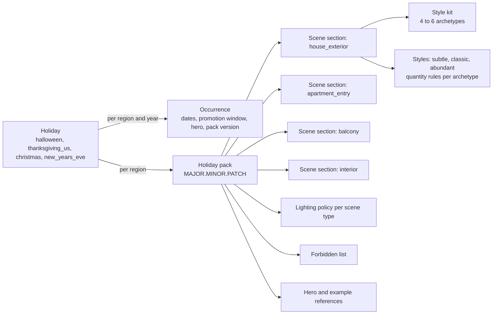

# Holidays and content

This specification defines what Hailiday knows about holidays and what it is allowed to draw: the holiday, occurrence and pack model; the US Release catalog; how the default holiday is chosen on any date in any timezone; the versioned holiday packs that turn a photo and a choice into a decoration plan; the style kits behind the shop panel; lighting policy; climate, culture and existing-decoration rules; hero and example art; and how content is authored, reviewed and released. Engineers and coding agents implement from it; editorial staff author to it. Rendering mechanics live in [render-pipeline.md](render-pipeline.md), product mapping in [commerce.md](commerce.md), and the screens that show this content in [experience.md](experience.md).

**Owns:** holiday, occurrence and pack model; US holiday catalog; promotion windows and selection; worked calendar; off-season behavior; pack schema and example packs; style kits (content side); lighting policy per holiday; climate, culture and existing-decoration rules; hero and example art; content authoring and review.

**Baseline:** planning baseline 2026-11-09; external facts retrieved 2026-11-08.

## Holiday model

### Terms

| Term | Definition | Identifier and values |
| --- | --- | --- |
| Holiday | A tradition, independent of year and place. | `holidayId` ∈ `halloween`, `thanksgiving_us`, `christmas`, `new_years_eve` in the US Release. |
| Occurrence | One holiday in one region and one year: celebration date(s), promotion window, commerce window, hero assignment, pack version in force. | `occurrenceId` = `<holidayId>.<region>.<year>`, for example `thanksgiving_us.US.2026`. `region` is an ISO 3166-1 alpha-2 country code; a later subdivision suffix (`US-TX`) is allowed by the schema but unused in the US Release. |
| Holiday pack | Versioned, reviewed content for one holiday and region: scene sections, styles, lighting policy, kit archetypes, prompt fragments, forbidden list, hero and example references, review record. | `packId` = `<holidayId>.<region>`, for example `christmas.US`; `version` is `MAJOR.MINOR.PATCH` ([Holiday packs](#holiday-packs)). |
| Scene section | A pack's rules for one scene type: allowed anchor categories, placement rules, access and preserve rules, styles with quantity rules, kit, prompt fragments. | Keyed by scene type. |
| Scene type | What kind of place the source photo shows. | `house_exterior` (attribute `buildingForm`: `detached`, `attached`, `other`), `apartment_entry` (unit door, stoop or hallway), `balcony` (balcony, patio or terrace), `interior` (attribute `roomType`: `dining_room`, `living_room`, `entryway`, `kitchen`, `bedroom`, `other`). |
| Style | How much decor a scene section places; a tier inside the section, not a separate pack. `abundant` is the lavish tier: on a house exterior it is described as a whole by the section's lavish description ([The lavish description](#the-lavish-description)). | `subtle`, `classic`, `abundant`; default `abundant` in every pack and scene type (owner decisions 2026-11-10 and 2026-11-16, [D-10](../decisions.md#d-10); core `DEFAULT_STYLE`). |
| Lighting mode | Whether the photo keeps its own light or is relit. | `source` (UI label "As photographed"), `evening` (UI label "Evening"), `bright` (UI label "Bright"); defaults per [Lighting policy](#lighting-policy). |
| Style kit | The set of product archetypes a scene section can place, each with an in-house spec; styles select subsets. On a house exterior in `abundant` the placements it yields are an advisory list of typical items, not the instruction. | `kitId` = `<holidayId>.<sceneType>`; archetypes are `kitItemId`s ([Style kits](#style-kits)). |
| Content cell | One combination (holiday, scene type, style, lighting mode) that a pack offers. A request for a combination the pack does not offer fails validation. | Derived from the pack; no stored identifier. |
| Brief | Editorial prose that precedes a pack (subject, mood, coverage, climate guidance, forbidden symbols). | Never consumed by code. |

Multi-unit building facades are never decorated as "your home"; the address path routes them to the user's own photo ([address-and-street-view.md](address-and-street-view.md#match-confidence-and-auto-start)). The glossary carries one-line definitions of every term above ([glossary.md](../glossary.md#holidays-and-decoration-controls)).

### Relationships



Rules that follow from the model:

- Tradition is separate from occurrence. Adding Canadian Thanksgiving later means a new occurrence set and pack keyed `thanksgiving_ca.CA`; the US definition does not change ([architecture.md](../architecture.md#international-extension-boundaries)).
- Religion is never inferred from an address, a name or an image. People select traditions explicitly; US Release packs are secular by default ([US holiday catalog](#us-holiday-catalog)).
- The selected holiday is stored on the project independently of the address. Changing the address never erases a deliberate holiday choice ([Windows and selection](#windows-and-selection)).
- The pack version in force is snapshotted into every render job as `holidayPackVersion` (MAJOR.MINOR) and is part of the variant key ([render-pipeline.md](render-pipeline.md#variant-key-and-reuse)).
- Persistence of occurrences and published pack versions (columns, indexes) is defined in [data-and-api.md](data-and-api.md#entities); this file defines the content and its meaning.

## US holiday catalog

Proposed ([D-08](../decisions.md#d-08)): three packs are in the US Release; New Year's Eve ships only if its pack passes review. Everything else is later expansion. The product owner and the design and editorial lead settle the catalog before pack authoring starts.

| `holidayId` | Display name | Status in the US Release | Tradition notes (secular by default) | Scene types with sections | Journey emphasis | Exterior expectation |
| --- | --- | --- | --- | --- | --- | --- |
| `halloween` | Halloween | In the US Release | Playful and autumnal: pumpkins and jack-o'-lanterns, cobwebs, bats, lanterns, harvest plants, orange and purple light. No gore, no realistic weapons or corpses, no cartoon or licensed characters. | all four | `exterior` | Lit jack-o'-lanterns and cobwebs on the porch; a clear change in `source`, strongest in `evening`. |
| `thanksgiving_us` | Thanksgiving | In the US Release | Harvest and gathering: wreaths of autumn leaves, garland, pumpkins and gourds, chrysanthemums, a set table with candlelight indoors. No Pilgrim, Native American or other costume or caricature imagery; no electric lights outdoors except the warm-white lights of the `abundant` description of a house exterior. | all four | `interior` (dining room; the hero scene) | A harvest porch in daylight: wreath, rail garland, pumpkin groups, mums. `classic` is a modest, tasteful change and the example gallery sets that expectation ([Hero and example art](#hero-and-example-art)); `abundant` is, on a house exterior, a lavish harvest display with warm-white lights. |
| `christmas` | Christmas | In the US Release | Evergreen and light: wreaths, garland, warm-white string lights, bows, lanterns, a decorated tree indoors. No religious symbols (nativity, crosses, angels), no Santa or snowman figures, no inflatables; warm-white lit wireframe reindeer only in the `abundant` description. | all four | `balanced` | Warm-white lights on eaves and rail, door wreath, garland; strongest in `evening`; on a house exterior in `abundant`, every roof edge and window outlined in lights. |
| `new_years_eve` | New Year's Eve | Optional: enabled only if the pack passes the review checklist | Celebration in gold, silver and white: string lights, metallic garland, lanterns, a set table. No fireworks or sky effects, no alcohol branding, no clocks or numerals (text). | `house_exterior`, `balcony`, `interior` (no `apartment_entry`) | `balanced` | Warm-white and gold string lights with metallic accents; strongest in `evening`. |

Religious sub-traditions (for example a Christmas pack with a nativity scene, or Hanukkah) are later packs that a user selects explicitly; the catalog never attaches them to a region or infers them. Other candidates for later expansion, in no committed order: Hanukkah, Diwali, Lunar New Year, Eid, Canadian Thanksgiving, Valentine's Day, Easter, Independence Day. Each needs its own occurrence rules (some depend on lunar or announced dates and need an annually reviewed calendar), its own pack and its own review before it is selectable.

`journeyEmphasis` is published in the experience projection so the landing and result screens can invite the stronger path for the current holiday (Proposed, [D-11](../decisions.md#d-11)): during the Thanksgiving window the dining-room photo invitation is stronger, while the hero and the address input stay as fixed in [D-06](../decisions.md#d-06). Screen behavior is specified in [experience.md](experience.md#landing).

Content policy at the product level (what Hailiday declines to decorate, Halloween content limits, no free-text prompts) is owned by [privacy-safety-legal.md](privacy-safety-legal.md#content-policy-and-admission); the pack forbidden lists in this file are its enforceable form.

## Windows and selection

Proposed ([D-09](../decisions.md#d-09)). All dates are inclusive calendar dates in the timezone described below. Window boundaries are configuration on the occurrence; the values here are the defaults.

### Promotion windows

| Holiday | Promotion window (default) | Celebration date | Hero shown | Auto-start holiday on the address path |
| --- | --- | --- | --- | --- |
| `halloween` | September 15 – October 31 | October 31 | Halloween hero | `halloween` |
| `thanksgiving_us` | November 1 – Thanksgiving Day | Fourth Thursday of November | Thanksgiving hero (dining room) | `thanksgiving_us` |
| `christmas` | Day after Thanksgiving – December 25 | December 25 | Christmas hero | `christmas` |
| `new_years_eve` (optional) | December 26 – January 1 | December 31 (evening) and January 1 | New Year's Eve hero | `new_years_eve` |
| Off-season | Every other date, including December 26 – January 1 when the New Year's Eve pack is not enabled | — | Neutral hero | None: no render starts until a holiday is chosen ([Off-season behavior](#off-season-behavior)) |

The windows are adjacent by construction and never overlap. If a later pack introduces an overlap, the occurrence with the lower `editorialPriority` value wins (lower is more important) and the nearer celebration date breaks ties. The Halloween window opens in mid-September because Halloween decor shopping starts early: 49% of US Halloween shoppers start in September or earlier, and decorations are a $4.3B category (NRF 2026 Halloween survey, https://nrf.com/media-center/press-releases/nrf-halloween-survey-shows-consumer-spending-expected-to-reach-13-5-billion, retrieved 2026-11-08). Thanksgiving Day is the fourth Thursday of November (5 U.S.C. § 6103, https://www.law.cornell.edu/uscode/text/5/6103, retrieved 2026-11-08).

Commerce windows (when offers are live) are different from promotion windows and may open earlier; they are owned by [commerce.md](commerce.md#seasonal-commerce-calendar). Demand seasonality and its capacity consequences are in [economics.md](economics.md#seasonality).

### Occurrence record

The content-side contract for one occurrence. Column-level persistence is in [data-and-api.md](data-and-api.md#entities).

| Field | Meaning | Example (`thanksgiving_us.US.2026`) |
| --- | --- | --- |
| `occurrenceId`, `holidayId`, `region`, `year` | Identity | `thanksgiving_us.US.2026`, `thanksgiving_us`, `US`, `2026` |
| `celebrationStart`, `celebrationEnd` | Calendar dates of the celebration itself | `2026-11-26`, `2026-11-26` |
| `promotionStart`, `promotionEnd` | Default hero and default holiday | `2026-11-01`, `2026-11-26` |
| `commerceStart`, `commerceEnd`, `catalogRetireAt` | Offer eligibility; values and semantics owned by [commerce.md](commerce.md#seasonal-commerce-calendar) | per commerce spec |
| `editorialPriority` | Tie-break for overlapping windows (lower wins) | `10` |
| `heroAssetId` | Hero for this occurrence ([Hero and example art](#hero-and-example-art)) | `hero.thanksgiving_us.dining_room.v2` |
| `packId`, `packVersion` | Pack in force while this occurrence is current | `thanksgiving_us.US`, `2.1.0` |
| `enabled` | False until the pack and hero pass review; a disabled occurrence is treated as absent | `true` |
| `reviewedAt`, `reviewedBy` | Annual calendar review ([Content authoring and review](#content-authoring-and-review)) | `2026-08-20`, design and editorial lead |

Occurrences are generated by code for each year (fixed dates, or the fourth-Thursday rule for Thanksgiving) and then reviewed and enabled; the computed dates are never edited by hand without a recorded reason.

### Selection precedence

1. **Explicit choice.** A holiday chosen in this session (picker, or a valid `?holiday=` deep link) or stored on the saved project being viewed. An explicit choice persists across address changes, viewpoint changes and photo replacement within the project and session.
2. **In-window default.** The enabled occurrence whose promotion window contains today's date in the resolved timezone.
3. **Off-season.** No occurrence in window: neutral hero, picker visible, no auto-start.

Only step 2 depends on the clock. The server renders the landing shell with the default resolved in the editorial timezone **America/New_York** (the hero image, headline and inline experience JSON). The client does not recompute step 2: there is no client-side timezone swap, so the hero and the default holiday are the editorial-timezone ones for every visitor and never change after the shell paints (the shell is identical for everyone). `GET /v1/experience` ignores `?holiday=` for the hero and the default; it only echoes a valid, enabled requested holiday as `requestedHolidayId`, and the client applies a deep link as an explicit choice. Choosing a holiday in the picker sends no request: it changes the project's selection, not the hero. Window containment is evaluated on the calendar date in the editorial timezone, never on UTC. Saved projects and shares carry the explicit holiday, not a timezone.

`GET /v1/experience` returns the server-resolved default and the full occurrence calendar for the current and next year, which the picker uses to order holidays and show windows (payload in [data-and-api.md](data-and-api.md#http-api)).

### Picker contents and order

- The picker lists every holiday with an enabled occurrence in the current or next calendar year: Halloween, Thanksgiving, Christmas and, if enabled, New Year's Eve. Disabled packs never appear.
- Order: the current default first (in window), then the remaining holidays by next celebration date ascending. Off-season: all by next celebration date ascending.
- Selecting a holiday is an explicit choice (precedence step 1) and emits `holiday_changed`. It applies to the current project immediately: a cached accepted variant is shown at once; otherwise the client asks for a new variant ([experience.md](experience.md#changing-holiday-style-and-lighting)).
- Changing the address creates a new project and carries the explicit holiday choice forward; the in-window default is used only when no explicit choice exists.

### Deep links

`GET /?holiday=<holidayId>` sets an explicit choice for the session when `holidayId` names an enabled holiday; unknown or disabled values are ignored and the default applies. Share pages, example pages and seasonal landing variants use this parameter in their calls to action. The parameter never carries an address or a project.

## Worked calendar

Thanksgiving dates are computed by the occurrence generator (fourth Thursday of November): 2026-11-26, 2027-11-25, 2028-11-23; the unit tests below assert them. The rows below are the expected outputs of the occurrence generator for the default windows; they are the fixture for the unit tests that [architecture.md](../architecture.md#continuous-integration-and-testing) requires for window and timezone boundaries.

### Window boundaries by year

| Year | Halloween | Thanksgiving | Christmas | New Year's Eve (if enabled) | Off-season |
| --- | --- | --- | --- | --- | --- |
| 2026 | 2026-09-15 – 2026-10-31 (Sat) | 2026-11-01 – 2026-11-26 (Thu) | 2026-11-27 – 2026-12-25 (Fri) | 2026-12-26 – 2027-01-01 | 2027-01-02 – 2027-09-14 |
| 2027 | 2027-09-15 – 2027-10-31 (Sun) | 2027-11-01 – 2027-11-25 (Thu) | 2027-11-26 – 2027-12-25 (Sat) | 2027-12-26 – 2028-01-01 | 2028-01-02 – 2028-09-14 |
| 2028 | 2028-09-15 – 2028-10-31 (Tue) | 2028-11-01 – 2028-11-23 (Thu) | 2028-11-24 – 2028-12-25 (Mon) | 2028-12-26 – 2029-01-01 | 2029-01-02 – 2029-09-14 |

When the New Year's Eve pack is not enabled, December 26 – January 1 belongs to the off-season row.

### Test vectors

Each row is one unit test: the instant and timezone are the input, the default is the expected output of precedence step 2 (or step 1 where an explicit choice is given). The product evaluates step 2 only in the editorial timezone (America/New_York); rows in other timezones exercise the function, which takes the timezone as an argument.

| Local date and time | Timezone | Expected default | Why |
| --- | --- | --- | --- |
| 2026-11-15 12:00 | America/Chicago | `thanksgiving_us` | The owner's mid-November example. |
| 2026-12-15 12:00 | America/Los_Angeles | `christmas` | The owner's mid-December example. |
| 2027-11-15 12:00 and 2028-11-15 12:00 | America/New_York | `thanksgiving_us` | The example holds every year because the window starts November 1 and Thanksgiving is never before November 22. |
| 2026-09-14 23:59 | America/New_York | off-season | Last off-season minute before Halloween. |
| 2026-09-15 00:00 | America/New_York | `halloween` | Window opens at local midnight. |
| 2026-10-31 21:00 | America/Los_Angeles | `halloween` | The same instant is 2026-11-01 04:00 UTC; evaluating on UTC would wrongly return Thanksgiving. (The product evaluates in New York, where this instant is 2026-11-01 00:00 and the default is Thanksgiving.) |
| 2026-11-01 00:30 | America/New_York | `thanksgiving_us` (server shell) | The same instant is 2026-10-31 21:30 in Los Angeles, where the function returns `halloween`; the product still shows Thanksgiving to a Los Angeles visitor, because it does not swap by visitor timezone. |
| 2026-11-26 19:30 | Pacific/Honolulu | `thanksgiving_us` | The same instant is 2026-11-27 00:30 in New York, where the server shell already shows Christmas; the function returns `thanksgiving_us` for Honolulu, but the product shows the New York default. |
| 2026-11-27 00:00 | America/New_York | `christmas` | Day after Thanksgiving. |
| 2026-12-25 23:59 | America/New_York | `christmas` | Last minute of the Christmas window. |
| 2026-12-26 00:00 | America/New_York | `new_years_eve` if enabled, else off-season | The optional pack decides what follows Christmas. |
| 2026-12-25 20:00 | Pacific/Honolulu | `christmas` | The same instant is 2026-12-26 01:00 in New York, where the server shell already shows New Year's Eve or the neutral hero; the function returns `christmas` for Honolulu, but the product shows the New York default. |
| 2027-01-02 12:00 | America/New_York | off-season | Start of the long off-season. |
| 2027-03-28 12:00 | America/New_York | off-season | Easter is not in the catalog; nothing special happens. |
| 2027-07-04 12:00, `?holiday=christmas` | any | `christmas` | Explicit choice wins in any season. |
| 2026-12-15 12:00, saved project with `holidayId: halloween` | any | `halloween` | A saved project's choice wins over the in-window default. |
| 2028-11-24 12:00 | America/New_York | `christmas` | Day after Thanksgiving 2028 (2028-11-23). |

## Off-season behavior

Proposed ([D-09](../decisions.md#d-09)). Off-season is every date outside a promotion window, and in the US Release that is most of the year (January 2 to September 14, plus December 26 to January 1 when New Year's Eve is not enabled).

| Element | Off-season behavior |
| --- | --- |
| Hero | The neutral hero: a bright, uncluttered real-home scene with no holiday decor (art direction in [Hero and example art](#hero-and-example-art)), with the holiday picker visible beside the headline. |
| Picker | All enabled holidays, ordered by next celebration date; no holiday is preselected. |
| Address path | Discovery and confirmation run as usual. On `auto_start` the client does not call `POST /v1/renders` until the visitor picks a holiday; the confirmed place is shown with the picker in focus. On `confirm` the holiday is asked for on the same confirmation step. |
| Upload path | The holiday is chosen before or with the upload; the render request requires a `holidayId`, so nothing changes mechanically. |
| Copy | Headline unchanged ("Imagine your place for the holidays."). The subhead invites a choice ("Pick a holiday to see your place decorated."). The waiting screen and result screen do not mention an upcoming holiday. Final strings and keys are in the [copy deck](experience.md#copy-deck). |
| Shop the look | Follows the commerce windows: hidden or "Plan ahead" copy when no offer is in an active commerce window ([commerce.md](commerce.md#seasonal-commerce-calendar)). |
| Allowance and spend | Unchanged mechanics; per-season values, if any, are configuration owned by [economics.md](economics.md#capacity-and-spend-ceilings). |
| Analytics | `landing_viewed` carries the resolved default (none off-season) so off-season traffic is measurable; event schemas are in [data-and-api.md](data-and-api.md#analytics-events). |

Every enabled holiday can be rendered off-season by explicit choice; packs do not turn off outside their window. Only the default and the hero change.

## Holiday packs

A holiday pack is the only place decoration content lives. The scene analysis finds anchors in the photo; the pack says what may go on each anchor, how much per style, what must stay untouched and what is forbidden; the plan builder and compiler in [render-pipeline.md](render-pipeline.md#decoration-plan) turn pack plus analysis into provider instructions. There are no free-text prompts and no per-render editorial decisions.

### Contents

| Part | What it holds | Consumed by |
| --- | --- | --- |
| Identity and metadata | `id`, `version`, `holidayId`, `region`, `displayName`, `journeyEmphasis`, `traditionNotes` | Experience projection, catalog |
| Lighting policy | Default and offered lighting modes per scene type; evening guidance text | Experience projection, plan builder, compiler |
| Climate rule | Source precedence for climate, snow rule, cold-climate-only items | Plan builder |
| Existing-decoration policy | `preserve_and_complement` and the notice trigger | Plan builder, experience |
| Forbidden list | Enumerated items the plan may never place and the compiler always negates | Plan validator, compiler, QA judge |
| Scene sections | Per scene type: allowed anchor categories, form or room rules, preserve and keep-clear rules, placement limits, kit archetypes with placement rule, priority and quantity rules per style, prompt fragments (with the optional lavish description) | Plan builder, validator, compiler, shop panel |
| Hero and example references | Which hero assets and example before/after pairs belong to the pack | Experience projection |
| Review record | Checklist version, approvers, approval date, golden run reference | Release process only |

### Versioning

`version` is `MAJOR.MINOR.PATCH`. The variant key carries `holidayPackVersion` as `MAJOR.MINOR` ([render-pipeline.md](render-pipeline.md#variant-key-and-reuse)), so MAJOR and MINOR bumps invalidate cached variants and PATCH bumps do not.

| Bump | When | Cached variants |
| --- | --- | --- |
| MAJOR | A scene section, style, kit archetype or anchor category is removed or renamed; the forbidden list changes; a lighting default changes | Invalidated |
| MINOR | Placement rules (`placementRule`, `priority`, `limits`, form and room rules), quantity rules, kit spec text or attributes, prompt fragments, offered lighting modes, climate or existing-decoration rules change; a scene section, style or kit archetype is added | Invalidated |
| PATCH | `displayName`, `traditionNotes`, `journeyEmphasis`, hero or example references, review record, comments | Kept |

Rule of thumb: anything that can change a decoration plan or a compiled instruction is at least MINOR. The golden-file test for prompt compilation ([render-pipeline.md](render-pipeline.md#prompt-compilation)) enforces it: if golden output changes under a PATCH-only bump, the build fails.

### Storage, validation and publication

- **Files.** One directory per pack in the server package (`@hailiday/server`), holding `pack.yaml`; large scene sections may be split into one file per scene type and merged at load. Pack files never ship in `@hailiday/core` or in the browser bundle ([architecture.md](../architecture.md#packages-and-boundaries)).
- **Schema.** A zod schema in `@hailiday/core` (`HolidayPack`, with the enums `HolidayId`, `SceneType`, `BuildingForm`, `RoomType`, `Style`, `LightingMode`, `AnchorCategory`, `AttachmentIntent`, `PlacementRule`, `ForbiddenItem`), including each kit archetype's `placementRule` and `priority` and each scene section's `limits`. Core exports the enums so the web app, the scene-analysis schema and the pack share one vocabulary.
- **Validation.** Every pack file is validated in CI and again at server start; an invalid pack stops the process. Cross-field rules: scene section keys are scene types; every anchor named in a section is allowed for that scene type ([Anchor categories](#anchor-categories)); every kit archetype anchor is in the section's anchor list; every `formRules` and `roomRules` anchor is in the section's anchor list; every kit archetype has a `placementRule`, and `priority` values are unique within a section; quantity minimums are not above maximums; `required` styles have a minimum of at least 1; `limits.maxPlacements` never decreases from `subtle` to `classic` to `abundant` and, for each style, is at least the number of archetypes that list the style in `required`; the forbidden list contains the baseline set; `lightingPolicy.bySceneType.<sceneType>.default` is in `offered`; `heroRefs` and `exampleRefs` resolve to approved assets; `kitId` equals `<holidayId>.<sceneType>`; a lavish description is within its limits and passes the text scans ([The lavish description](#the-lavish-description)), and so does every kit item's `specText` and every section's `scene` fragment against the pack's own forbidden list.
- **Publication.** A version is published by deploying the file, inserting a `holiday_pack_versions` row (`holidayId`, `region`, `version`, `contentRef`, `contentSha256`, `reviewRecord`) and setting its `status` to `published` (`publishedAt`); the previously published row becomes `retired` (columns in [data-and-api.md](data-and-api.md#entities)). The API resolves the published version for (`holidayId`, `region`) on the server, and each enabled occurrence pins the version it uses. Rollback sets the previous row back to `published` and retires the current one, so previous MAJOR.MINOR files stay in the repository until no occurrence references them. Packs are not editable in a database without a deploy: they change rarely, and schema validation plus golden renders are the safety net.
- **Kit seeding.** On publication the kit archetypes of each scene section are upserted into `style_kits` and `kit_items` by `kitItemId`, so the commerce side can map products to them ([commerce.md](commerce.md#style-kits-and-products)). Product columns on those rows are owned by the commerce spec. Seeding adds rows and does not overwrite them: a kit item already published keeps its stored `spec_text` until the seed runs with a refresh or the kit version is bumped, while the plan always reads the pack's own text.
- **Public projection.** `GET /v1/experience` exposes, per holiday: `holidayId`, `displayName`, `isDefault`, `journeyEmphasis`, hero, examples and, per scene type, `styles`, `defaultStyle`, `lightingModes` (offered) and `defaultLightingMode`. It never exposes prompt fragments, forbidden lists, kit spec text, quantity rules or review records (payload in [data-and-api.md](data-and-api.md#http-api)).
- **Request validation.** A render request whose (`holidayId`, `style`, `lightingMode`) is not an offered content cell for the project's scene type fails with `VALIDATION_FAILED` ([data-and-api.md](data-and-api.md#error-codes)).

## Pack schema

### Schema by example

The annotated skeleton below is the normative shape; the zod schema in core mirrors it field for field. Compact notations used in this file: `quantity: { <style>: [min, max] }` counts instances (runs, for string lights and garland) per style, and `required: [<styles>]` lists the styles in which the archetype must appear whenever one of its anchors is visible. `priority` is optional and omitted in the example packs because list order is the default. How the plan builder uses these fields is in [Placement fields](#placement-fields).

```yaml
id: christmas.US                      # <holidayId>.<region>
version: 2.1.0                        # MAJOR.MINOR.PATCH, see Versioning
holidayId: christmas                  # HolidayId enum
region: US                            # ISO 3166-1 alpha-2, optional subdivision suffix later
displayName: Christmas
journeyEmphasis: balanced             # exterior | interior | balanced
traditionNotes: >                     # shown to editors and in the catalog; secular by default
  Evergreen, light and warmth. No religious symbols: a user selects a religious
  sub-tradition pack explicitly when one exists.
lightingPolicy:
  bySceneType:                        # keys are scene types; values from the Lighting policy section
    house_exterior: { default: evening, offered: [source, evening] }
    apartment_entry: { default: bright, offered: [bright] }
    balcony: { default: evening, offered: [source, evening] }
    interior: { default: bright, offered: [bright] }
  eveningGuidance: >                  # compiled only when lightingMode is evening
    Early dusk: darkened sky and lowered ambient light with the structure still legible;
    string lights and lanterns glow warm white with soft bloom; windows that exist may show a
    soft warm glow; no light source that is not a placed decoration.
climateRule:
  sourcePrecedence: [scene_analysis, address_region, neutral]
  snow: only_if_visible_in_source     # the only allowed value
  coldClimateOnlyItems: []            # kitItemIds allowed only when climate class is cold
existingDecorPolicy: preserve_and_complement   # the only allowed value; notice rules in Climate, culture and existing decorations
forbidden:                            # ForbiddenItem enum; must include the baseline set
  - people
  - pets
  - text_or_signage
  - house_number_changes
  - new_structures
  - structural_changes
  - landscaping_changes
  - neighbor_decor
  - blocked_access
  - brand_logos
  - cartoon_or_licensed_characters
  - mascots_and_inflatables
  - snow_or_frost_unless_visible
  - sky_effects
  - religious_symbols               # pack-specific additions follow the baseline
  - open_flame_indoors
sceneSections:
  house_exterior:
    buildingForms: [detached, attached, other]
    formRules:                        # tighten the section for a building form
      attached: { excludeAnchors: [lawn], note: placements stay within the target unit's facade span }
      other: { excludeAnchors: [roofline, eaves, lawn] }
    anchors: [front_door, door_frame, porch_rail, porch_steps, roofline, eaves, window_frame, column, walkway_edge, planter, lawn]
    preserve: [roofline shape, window and door positions, siding and trim color, steps, landscaping, sky, neighbors, house numbers, existing blur regions]
    keepClear: [door swing, step treads, walkway surface, driveway, mailbox face]
    limits:                           # optional; the values shown are the schema defaults, see Placement fields
      maxPlacements: { subtle: 3, classic: 6, abundant: 10 }
      overlapTolerance: 0.10          # share of a placement region allowed over preserve and access regions
      groundMarginFraction: 0.03      # exteriors only
      edgeMarginFraction: 0.02        # exteriors only
    kitId: christmas.house_exterior
    kit:                              # 4 to 6 archetypes; attributes in the Style kits section
      - kitItemId: christmas.house_exterior.string_lights_warm_white
        archetype: string_lights
        anchors: [eaves, roofline, porch_rail]
        attachment: strung
        placementRule: along          # PlacementRule enum
        priority: 1                   # optional; list order is the default (1 = placed first)
        specText: outdoor warm-white LED string lights with evenly spaced bulbs, following the eave line or rail
        quantity: { subtle: [0, 1], classic: [1, 2], abundant: [2, 3] }
        required: [classic, abundant]
    promptFragments:
      scene: a tasteful US Christmas display added to the confirmed target home
      preserve: keep the same camera position, crop, roof outline, doors, windows, siding color, steps, landscaping, sky, time of day and neighboring buildings
      negative: no snow or frost unless present in the source, no Santa, snowman or reindeer figures, no inflatables, no religious symbols, no text, no people, no new structures
      lavish:
        scene: >-
          a lavish, over-the-top American Christmas display covering the target home and its
          yard: the house that wins the neighborhood lighting contest and looks like the set of
          a holiday movie
        decorations: >-
          Decorate only what this photo shows of the house: each sentence below applies only where
          the photo already shows the thing it names, and is skipped where it does not. Outline
          every roof edge, gable, eave and ridge of the target house with warm-white C9 bulb string
          lights, closely and evenly spaced, and hang drop-string curtain lights along the eaves.
          Outline every window with warm-white mini lights and hang an evergreen wreath with a red
          bow in every window. If a front door is visible, outline its frame with mini lights and
          hang a large evergreen wreath with a big red velvet bow on it, leaving the door itself as
          it is. On railings, posts and columns that are already there, swag thick evergreen garland
          woven with warm-white lights and red bows. Lay warm-white net lights over shrubs and
          bushes that are already there, and wrap the trunks of trees that are already in its yard
          with warm-white string lights. On open lawn or bare ground of its own yard, stand a group
          of warm-white lit wireframe reindeer and several oversized lit gift boxes; along a path
          that is already there, line both sides with lit candy-cane stakes. Beside steps and an
          entry that are already there, set clusters of large red and gold ornament balls, lit
          potted evergreen trees and tall lanterns, without hiding or replacing what stands there.
          Add no door, steps, railing, porch, path, wall, window, shrub, hedge or tree of your own:
          only decorations.
        negative: >-
          no snow or frost unless present, no Santa or snowman figures, no inflatables, no
          cartoon figures, no religious symbols, no text, no people, no new structures, nothing
          on neighboring homes, on the sidewalk, on the street or in the sky
        lit: true   # optional; the description of the `abundant` style, see The lavish description
  interior:
    roomTypes: [dining_room, living_room, entryway, kitchen, bedroom, other]
    anchors: [mantel, dining_table, sideboard, interior_window, wall, floor_area, shelf, banister]
    roomRules:                        # replace the section's anchors for a room type
      dining_room: { anchors: [dining_table, sideboard, interior_window, wall, shelf] }
      living_room: { anchors: [mantel, floor_area, interior_window, wall, shelf] }
      entryway: { anchors: [banister, floor_area, wall, shelf] }
      kitchen: { anchors: [dining_table, interior_window, shelf] }
      bedroom: { anchors: [interior_window, wall, shelf] }
      other: { anchors: [interior_window, wall, shelf] }
    preserve: [walls, windows, doors, flooring, ceiling, furniture positions, existing light fixtures, artwork and photographs, existing blur regions]
    keepClear: [doorways, circulation paths, stair treads, stove and sink, seating surfaces]
    kitId: christmas.interior
    kit: []                           # see Example packs
    promptFragments: { scene: ..., preserve: ..., negative: ..., lavish: ... }
heroRefs:
  - { heroAssetId: hero.christmas.exterior.v1, orientation: landscape }
  - { heroAssetId: hero.christmas.exterior.v1, orientation: portrait }
exampleRefs:
  - { exampleAssetId: example.christmas.house_exterior.classic.source.v1, sceneType: house_exterior, style: classic, lightingMode: source }
review:
  checklistVersion: 1
  approvedBy: [editorial_lead, second_approver]
  approvedAt: null                    # set at approval
  goldenRunId: null                   # set when the golden renders are approved
```

### Placement fields

These fields give the plan builder in [render-pipeline.md](render-pipeline.md#decoration-plan) everything it needs to turn eligible anchors into placements deterministically.

**Eligible anchors for a section.** The section's `anchors` list is the full set. `formRules.<buildingForm>.excludeAnchors` removes anchors for that building form; `roomRules.<roomType>.anchors` replaces the list for that room type. A building form or room type with no entry uses the section's `anchors` unchanged. An anchor detected by scene analysis is eligible for an archetype when its category is in both the archetype's `anchors` and the resulting section list and it passes the analysis checks in the render spec.

**Placement rule.** Each archetype names one `placementRule`, which sets how its placement region is derived from the anchor box:

| `placementRule` | Placement region | Example archetypes |
| --- | --- | --- |
| `centered_on` | Centered on the anchor box, sized to the archetype's size range relative to the anchor | Door wreath, window wreath |
| `along` | Follows the anchor's long edge for its visible length | String lights on eaves, garland on a rail or window top, cobweb across a rail corner |
| `beside` | Next to the anchor on the ground, outside its access region; inside the anchor for area anchors (`lawn`, `planter`) | Pumpkin groups and lanterns beside the steps, potted mums |
| `on_surface` | On the anchor's top surface, inside its outline | Table runner, centerpiece, candles, sideboard arrangement |
| `cluster_at` | Inside an area anchor (`floor_area`, `balcony_floor`, `wall`, `planter`) as one standing item or a compact grouping | Tree, wrapped gifts, bat silhouettes, small jack-o'-lanterns on a balcony floor |
| `hang_from` | Hanging below the anchor's front edge | Stockings from a mantel |

**Priority.** Archetypes are placed in ascending `priority` (1 first); when `priority` is omitted, list order is the priority. The compiler writes placements in the same order.

**Count.** For a style, an archetype whose `quantity` maximum is 0 is not placed. Otherwise `count` = clamp(number of eligible anchors, min, max), so every included archetype, and in particular one that lists the style in `required`, gets at least 1 whenever any of its anchors is eligible; `required` additionally protects the archetype from the placement cap below. Instances go to eligible anchors in descending analysis confidence, one per anchor in turn, until `count` is reached; each anchor used yields one placement whose `count` is the number of instances assigned to it (four candles on one table is one placement with `count` 4).

**Section limits.** `limits` is optional; omitted fields take the defaults below (configuration in the pack file).

| Field | Default | Meaning |
| --- | --- | --- |
| `maxPlacements` | `subtle` 3, `classic` 6, `abundant` 10 | Maximum placements in one plan for the style. When the plan exceeds it, placements are removed from the lowest-priority archetype upward, lowest-confidence anchor first. An archetype that lists the style in `required` keeps at least one placement, and its instances move to that placement so its `count` stays at least `min`. |
| `overlapTolerance` | 0.10 | Largest share of a placement region that may overlap preserve and access regions before the validator shrinks or removes it. Protected blur regions and people boxes always have zero tolerance. |
| `groundMarginFraction` | 0.03 | Exteriors: how far below the bottom edge of the `targetFacade` box placements on `porch_steps`, `walkway_edge`, `planter` and `lawn` anchors may extend, as a fraction of image height. |
| `edgeMarginFraction` | 0.02 | Exteriors: placements are clipped to stay at least this fraction of image width inside the side edges of the `targetFacade` box; a placement with nothing left is removed, so nothing lands on the boundary with a neighbor. |

When existing decoration density is high, the next-lower style's quantities and `maxPlacements` apply ([Existing decorations](#existing-decorations)).

### Anchor categories

The fixed vocabulary shared by packs, scene analysis ([render-pipeline.md](render-pipeline.md#scene-analysis)) and the commerce kit tables. Analysis emits only these categories; a pack may use only the categories allowed for the scene type.

| Category | Scene types | Meaning | Typical placements |
| --- | --- | --- | --- |
| `front_door` | `house_exterior` | The target's main entry door | Wreath |
| `door_frame` | `house_exterior`, `apartment_entry`, `balcony` | Trim around the entry, unit or balcony door | Garland, string lights |
| `porch_rail` | `house_exterior` | Porch or stoop railing | Garland, lights, cobwebs |
| `porch_steps` | `house_exterior` | Sides of the entry steps, never the treads | Pumpkin groups, potted plants, lanterns |
| `roofline` | `house_exterior` | One roof section of the target facade, boxed from its eave line up to its ridge (a front-facing gable from its eave corners up to the apex) | String lights along the eave line, or along both gable edges |
| `eaves` | `house_exterior` | Eave or gutter line, boxed tightly | String lights, icicle lights |
| `window_frame` | `house_exterior` | Exterior window trim | Window wreaths, electric window candles |
| `column` | `house_exterior` | Porch posts and columns | Garland wrap, lights |
| `walkway_edge` | `house_exterior` | Edges of the path to the door, never its surface | Stake lights, luminaria |
| `planter` | `house_exterior`, `balcony`, `apartment_entry` | Existing planters and urns | Seasonal plants, small pumpkins |
| `lawn` | `house_exterior` | Lawn in front of the target facade | Ground-standing items only; landscaping unchanged |
| `balcony_railing` | `balcony` | The user's own railing | Lights, garland; never onto a neighbor's railing |
| `balcony_floor` | `balcony` | Floor area clear of the door swing | Pumpkins, potted plants, lanterns |
| `unit_door` | `apartment_entry` | The user's unit door | Wreath |
| `banister` | `apartment_entry`, `interior` (entryway) | Stair handrail | Garland |
| `mantel` | `interior` | Fireplace mantel | Garland, stockings, candles |
| `dining_table` | `interior` (dining room, kitchen) | Dining or kitchen table; the box top is the far edge of the tabletop | Runner, centerpiece, candles, place accents (`on_surface`; Thanksgiving runner and centerpiece, Christmas centerpiece along the table center) |
| `sideboard` | `interior` | Sideboard, buffet or console top | Arrangement |
| `interior_window` | `interior` | Interior window frame or sill | Garland, wreath, electric candles |
| `wall` | `interior`, `apartment_entry`, `balcony` | Wall area free of fixtures, art and photographs | Hung wreath, silhouettes |
| `floor_area` | `interior`, `apartment_entry` | Open floor beside a wall or window, outside circulation | Tree, lanterns, gifts, potted evergreen |
| `shelf` | `interior` | Open shelf top | Small arrangement |

Attachment intents: `hung`, `wrapped`, `draped`, `strung`, `standing`, `placed`, `stretched` (cobwebs). Pixel regions in plans describe the image, not real-world dimensions.

**One vocabulary, three consumers.** The scene-analysis prompt lists exactly the categories allowed for the scene type, each with the box extent above (the [render spec's placement geometry](render-pipeline.md#placement-geometry) reads those extents: lights follow the bottom edge of `eaves` and `roofline` boxes, garlands the top edge of rails, frames, mantels and shelves, `on_surface` items the top of tables, sideboards, mantels and shelves). Every pack section's `anchors`, `roomRules` lists and archetype `anchors` use only categories allowed for the scene type, every archetype anchor appears in its section's list, and a test checks the three agree. For the surface anchors (`dining_table`, `sideboard`, `mantel`, `shelf`) analysis reports occlusion of the top surface only, and the planner accepts up to 0.6 occlusion for `on_surface` placements on them, because chairs in front of a table hide its sides, not its top.

### The lavish description

`abundant` is the lavish tier (owner decision of 2026-11-16, [D-10](../decisions.md#d-10)): a home that looks like the set of a holiday film, with the number of lights and decorations to match. The tier is described as a whole instead of item by item. A scene section may carry `promptFragments.lavish`, a description of the entire display in prose, and the image model receives that description in place of one sentence per placement ([render-pipeline.md](render-pipeline.md#prompt-compilation) owns how it is compiled). `subtle` and `classic` are unchanged, and so are the kit, the quantities and `maxPlacements` of `abundant`: they still produce the plan's placements, but in a lavish plan those placements are an advisory list of typical items of the look. The judge reads them as examples, none of them is required, the last resort measures what is left of the decoration against the spots they mark and the shop panel lists their kit items ([commerce.md](commerce.md#style-kits-and-products)); the relight request names none of them.

**Which scene types use it.** The descriptions exist for all 15 sections of the four packs, but the pipeline applies them to house exteriors only, for now: `PIPELINE_DEFAULTS.lavishSceneTypes` is `['house_exterior']`. The `abundant` look of a room, an apartment entry or a balcony is planned, compiled, localized and pasted back the ordinary way, with the placements of its kit, exactly as before the tier existed; the descriptions of those 11 sections are kept in the packs and are not used yet. The reason is a measurement on real photos. The image model kept the home intact in 6 of 9 house exteriors and in none of 4 rooms, entries and balconies (furniture replaced, a door blocked, a wall rebuilt), and a stricter instruction and the higher quality setting did not change that. The judge catches what it is confident of, and a repair re-rolls the same dice, so the tier is limited to the scene type where it holds up. Adding a scene type to the constant turns its description on; no pack text changes.

| Field | What it is for | Limit (`LAVISH_TEXT_LIMITS` in core) |
| --- | --- | --- |
| `scene` | What the picture shows. It stands in the request's scope sentence in place of the section's `scene` fragment. | 1 to 300 characters |
| `decorations` | The paragraph, in full sentences, that says what is added and where: the roof edges and windows outlined in lights, the wreaths, garland, shrubs and trunks, the yard and the path, the entry. For a house exterior it follows the rule for authors below. | 200 to 2,000 characters |
| `negative` | What must not appear. It stands in place of the section's `negative` fragment in the request and in the plan's list of what must not appear. | 1 to 600 characters |
| `lit` | Whether the description asks for electric lights. It decides the lighting sentences of the request and of the relight ([Lighting policy](#lighting-policy)). | `true` or `false`; required |

The block is optional and strict: an unknown key, a missing or non-boolean `lit` and a text over or under its limit each stop the load. A section without it compiles `abundant` as before, with the plan's placements and one sentence each, and so does a section whose scene type is not in `lavishSceneTypes`. All 15 sections of the four packs carry one, and all 15 are `lit: true`; the Christmas house exterior's reads:

```yaml
      lavish:
        scene: >-
          a lavish, over-the-top American Christmas display covering the target home and its
          yard: the house that wins the neighborhood lighting contest and looks like the set of
          a holiday movie
        decorations: >-
          Decorate only what this photo shows of the house: each sentence below applies only where
          the photo already shows the thing it names, and is skipped where it does not. Outline
          every roof edge, gable, eave and ridge of the target house with warm-white C9 bulb string
          lights, closely and evenly spaced, and hang drop-string curtain lights along the eaves.
          Outline every window with warm-white mini lights and hang an evergreen wreath with a red
          bow in every window. If a front door is visible, outline its frame with mini lights and
          hang a large evergreen wreath with a big red velvet bow on it, leaving the door itself as
          it is. On railings, posts and columns that are already there, swag thick evergreen garland
          woven with warm-white lights and red bows. Lay warm-white net lights over shrubs and
          bushes that are already there, and wrap the trunks of trees that are already in its yard
          with warm-white string lights. On open lawn or bare ground of its own yard, stand a group
          of warm-white lit wireframe reindeer and several oversized lit gift boxes; along a path
          that is already there, line both sides with lit candy-cane stakes. Beside steps and an
          entry that are already there, set clusters of large red and gold ornament balls, lit
          potted evergreen trees and tall lanterns, without hiding or replacing what stands there.
          Add no door, steps, railing, porch, path, wall, window, shrub, hedge or tree of your own:
          only decorations.
        negative: >-
          no snow or frost unless present, no Santa or snowman figures, no inflatables, no
          cartoon figures, no religious symbols, no text, no people, no new structures, nothing
          on neighboring homes, on the sidewalk, on the street or in the sky
        lit: true
```

**A rule for authors of a house-exterior description.** The image model reads the description as a list of things to add, and it will add what the description names even where the photo has none of it. Measured on real photos, a description that named a front door, steps, a railing and shrubs unconditionally made the model invent them: a side view of a house got an entrance with steps, and a lawn got hedges. Written conditionally, the same photos came out lavish with the home intact. So every house-exterior description opens "Decorate only what this photo shows of the house: each sentence below applies only where the photo already shows the thing it names, and is skipped where it does not.", names doors, railings, posts, columns, shrubs, trees, steps, paths and lawn only conditionally ("If a front door is visible", "On railings, posts and columns that are already there", "On open lawn or bare ground of its own yard", "Beside steps and an entry that are already there"), and ends "Add no door, steps, railing, porch, path, wall, window, shrub, hedge or tree of your own: only decorations." The four house-exterior descriptions are written this way, in the pack version `2.1.0` that had not been published before. The 11 descriptions of the other scene types are unchanged; they are not used yet, and a description that is turned on for its scene type follows the same rule.

**When it applies.** All four hold: the plan's scene type is in `lavishSceneTypes` (the plan builder takes this as `options.lavish`, which the render job and the example renderer set from the constant; it defaults to true), the plan's effective style is `abundant`, the section has the description, and the plan is decorated as photographed. The effective style steps down for a home that already shows many decorations ([Existing decorations](#existing-decorations)): the plan then uses `classic` quantities and the ordinary `classic` prompt, and keeps `style: abundant` on the plan document. An `evening` look decorates as photographed and is relit afterwards, so its decorate step is lavish and its relight is worded for a lavish base. The plan carries a mark (`lavish: { lit }`) when the description applies, and every later stage reads the mark from the stored plan, never from the style. A plan without the mark is the ordinary one in every stage. One more case plans without the mark: the repair of a lavish attempt that the judge rejected for a critical finding is planned the ordinary way ([render-pipeline.md](render-pipeline.md#decision-policy)).

**What the load scans.** `scene` and `decorations` reach the model as written, so a pack with a text that names anything on its own forbidden list, or snow, frost or icicles, stops the load and a read by reference, with the file, section, field and forbidden item in the message. The texts are scanned with whitespace collapsed, so an item split across a line break is found, against the same pattern list the plan validator uses and against the snow words. `negative` lists what must not appear and is not scanned. The load also scans every kit item's `specText` and every section's `scene` fragment against the forbidden list (no snow rule for these: a kit item is left out of a plan for a photo without snow), because a text that matches fails every plan that places the item or states the fragment. At plan time a lavish text that names a forbidden item, or a snow word on a photo that shows no snow, fails the plan (`forbidden_list`, [render-pipeline.md](render-pipeline.md#validator-rules)). The scans are word checks against the pattern list, not a guarantee: a text can pass and still describe something the list does not name (a snowman by name, lettering written as a "message", a character called by its name, a sky effect, a decoration on a neighbor's fence), so the review checklist reads every lavish text ([Review checklist](#review-checklist)).

### Forbidden items

| Item | Baseline (every pack) | Meaning for the plan and the QA judge |
| --- | --- | --- |
| `people`, `pets` | yes | Never added, moved, removed or altered; existing people and pets stay as photographed (`people_altered`). |
| `text_or_signage` | yes | No lettering, numerals, banners or signs (`text_added`); includes "Merry Christmas" lettering, countdown clocks and doormat text. |
| `house_number_changes` | yes | House numbers and nameplates stay legible and unchanged. |
| `new_structures`, `structural_changes` | yes | No added porches, pergolas, arches or changed roofs, windows, doors (`structure_changed`). |
| `landscaping_changes` | yes | No new or removed plants, trees, lawns or paving (`unrequested_change`). |
| `neighbor_decor` | yes | Nothing on any building, balcony, door or railing that is not the target (`neighbor_decorated`). |
| `blocked_access` | yes | Doors, steps, walkways, corridors, balcony doors and stairs stay passable (`access_blocked`). |
| `brand_logos` | yes | No recognizable brand products, logos or packaging. |
| `cartoon_or_licensed_characters`, `mascots_and_inflatables` | yes | Not-directed-to-children guardrail ([Climate, culture and existing decorations](#climate-culture-and-existing-decorations)). |
| `snow_or_frost_unless_visible` | yes | No snow, frost or icicles unless the source shows them. |
| `sky_effects` | yes | No fireworks, auroras or added celestial objects; the sky changes only under `evening` relighting rules. |
| `religious_symbols` | per pack | Required in every US Release pack; a religious sub-tradition pack omits it deliberately. |
| `open_flame_indoors` | per pack | Required for every `interior` section: candles are enclosed or flameless. |
| `gore`, `realistic_weapons`, `costume_caricature` | per pack | Halloween (`gore`, `realistic_weapons`) and Thanksgiving (`costume_caricature`). |

The QA codes in parentheses are the failure codes in [render-pipeline.md](render-pipeline.md#quality-checks) that each item maps to.

The list is the same in every style, the lavish tier included. One thing is new and allowed, only in the Christmas `abundant` description: warm-white lit wireframe reindeer (a sculpture of light on the lawn or the balcony floor, never a character). Still out of every look: inflatables, cartoon or licensed characters, Santa and snowman figures, text, snow unless the source shows it, sky effects, religious symbols and anything on a neighboring home. The ordinary `classic` and `subtle` Christmas fragments name reindeer figures among what is left out; only the `abundant` description of the house exterior asks for the lit wireframe ones. A lavish description may be as dense as it likes but never names an item of the list; the Halloween house exterior's stylized skeleton item reads "clean and undamaged" for that reason (an earlier wording matched the gore pattern and failed every plan that placed it).

## Example packs

Excerpts of the US Release packs. They show real content at the level the pack files carry; attributes for each archetype are in [Style kits](#style-kits). All excerpts assume the baseline forbidden list and the preserve and keep-clear rules shown in the schema. Every `lavish` block shown is copied from the pack; the house-exterior blocks are the ones the pipeline uses, and the interior, apartment-entry and balcony blocks are descriptions that are kept for later and not used yet ([The lavish description](#the-lavish-description)).

### Christmas, `house_exterior` (detached)

```yaml
sceneSections:
  house_exterior:
    buildingForms: [detached, attached, other]
    formRules:
      attached: { excludeAnchors: [lawn], note: placements stay within the target unit's facade span }
      other: { excludeAnchors: [roofline, eaves, lawn] }
    anchors: [front_door, door_frame, porch_rail, porch_steps, roofline, eaves, window_frame, column, walkway_edge, planter]
    kitId: christmas.house_exterior
    kit:
      - { kitItemId: christmas.house_exterior.string_lights_warm_white, anchors: [eaves, roofline, porch_rail], attachment: strung, placementRule: along,
          specText: outdoor warm-white LED string lights with evenly spaced bulbs following the eave line or rail,
          quantity: { subtle: [0, 1], classic: [1, 2], abundant: [2, 3] }, required: [classic, abundant] }
      - { kitItemId: christmas.house_exterior.wreath_evergreen, anchors: [front_door], attachment: hung, placementRule: centered_on,
          specText: a 24 to 30 inch mixed evergreen wreath with a red velvet bow, centered on the existing front door,
          quantity: { subtle: [1, 1], classic: [1, 1], abundant: [1, 1] }, required: [subtle, classic, abundant] }
      - { kitItemId: christmas.house_exterior.garland_evergreen, anchors: [door_frame, porch_rail, column], attachment: draped, placementRule: along,
          specText: mixed evergreen garland with pinecones following the door frame or rail,
          quantity: { subtle: [0, 1], classic: [1, 2], abundant: [2, 3] }, required: [classic] }
      - { kitItemId: christmas.house_exterior.potted_evergreen_pair, anchors: [porch_steps, planter], attachment: standing, placementRule: beside,
          specText: a pair of potted evergreens three to four feet tall with warm-white lights flanking the entry beside the steps,
          quantity: { subtle: [0, 0], classic: [0, 1], abundant: [1, 1] }, required: [] }
      - { kitItemId: christmas.house_exterior.lantern_flameless, anchors: [porch_steps, planter], attachment: placed, placementRule: beside,
          specText: a black metal lantern with a flameless pillar candle beside the entry, not on a step tread,
          quantity: { subtle: [0, 1], classic: [0, 2], abundant: [1, 2] }, required: [] }
      - { kitItemId: christmas.house_exterior.window_wreath, anchors: [window_frame], attachment: hung, placementRule: centered_on,
          specText: a small evergreen wreath with a red bow centered on each front window,
          quantity: { subtle: [0, 0], classic: [0, 0], abundant: [1, 4] }, required: [] }
    promptFragments:
      scene: a tasteful US Christmas display added to the confirmed target home
      preserve: keep the same camera position, crop, roof outline, doors, windows, siding color, steps, landscaping, sky, time of day and neighboring buildings
      negative: no snow or frost unless present, no Santa, snowman or reindeer figures, no inflatables, no religious symbols, no text, no people, no new structures, nothing on neighboring homes
      lavish:
        scene: >-
          a lavish, over-the-top American Christmas display covering the target home and its
          yard: the house that wins the neighborhood lighting contest and looks like the set of
          a holiday movie
        decorations: >-
          Decorate only what this photo shows of the house: each sentence below applies only where
          the photo already shows the thing it names, and is skipped where it does not. Outline
          every roof edge, gable, eave and ridge of the target house with warm-white C9 bulb string
          lights, closely and evenly spaced, and hang drop-string curtain lights along the eaves.
          Outline every window with warm-white mini lights and hang an evergreen wreath with a red
          bow in every window. If a front door is visible, outline its frame with mini lights and
          hang a large evergreen wreath with a big red velvet bow on it, leaving the door itself as
          it is. On railings, posts and columns that are already there, swag thick evergreen garland
          woven with warm-white lights and red bows. Lay warm-white net lights over shrubs and
          bushes that are already there, and wrap the trunks of trees that are already in its yard
          with warm-white string lights. On open lawn or bare ground of its own yard, stand a group
          of warm-white lit wireframe reindeer and several oversized lit gift boxes; along a path
          that is already there, line both sides with lit candy-cane stakes. Beside steps and an
          entry that are already there, set clusters of large red and gold ornament balls, lit
          potted evergreen trees and tall lanterns, without hiding or replacing what stands there.
          Add no door, steps, railing, porch, path, wall, window, shrub, hedge or tree of your own:
          only decorations.
        negative: >-
          no snow or frost unless present, no Santa or snowman figures, no inflatables, no
          cartoon figures, no religious symbols, no text, no people, no new structures, nothing
          on neighboring homes, on the sidewalk, on the street or in the sky
        lit: true
```

The 640×640 input size of Street View sources ([render-pipeline.md](render-pipeline.md#compositing-and-resolution)) is why exterior archetypes are large, high-contrast items (light runs, a full wreath, garland) rather than small ornaments.

### Christmas, `interior` (dining room and living room)

```yaml
sceneSections:
  interior:
    roomRules:
      dining_room: { anchors: [dining_table, sideboard, interior_window, wall, shelf] }
      living_room: { anchors: [mantel, floor_area, interior_window, wall, shelf] }
      entryway: { anchors: [banister, floor_area, wall, shelf] }
    kitId: christmas.interior
    kit:
      - { kitItemId: christmas.interior.tree_prelit, anchors: [floor_area], attachment: standing, placementRule: cluster_at,
          specText: a pre-lit artificial evergreen tree with warm-white lights, red and gold ornaments and a simple topper, scaled to the visible ceiling height, standing on open floor beside a wall or window with circulation clear,
          quantity: { subtle: [0, 1], classic: [1, 1], abundant: [1, 1] }, required: [classic, abundant] }
      - { kitItemId: christmas.interior.mantel_garland_lit, anchors: [mantel, interior_window], attachment: draped, placementRule: along,
          specText: mixed evergreen garland with warm-white lights and pinecones along the mantel or window top,
          quantity: { subtle: [1, 1], classic: [1, 2], abundant: [2, 3] }, required: [subtle, classic, abundant] }
      - { kitItemId: christmas.interior.stockings, anchors: [mantel], attachment: hung, placementRule: hang_from,
          specText: three to four knit stockings in red, cream and green hung from the mantel edge,
          quantity: { subtle: [0, 0], classic: [1, 1], abundant: [1, 1] }, required: [] }
      - { kitItemId: christmas.interior.table_centerpiece, anchors: [dining_table], attachment: placed, placementRule: on_surface,
          specText: a low evergreen centerpiece with pinecones, red berries and flameless pillar candles along the table center,
          quantity: { subtle: [1, 1], classic: [1, 1], abundant: [1, 2] }, required: [subtle, classic, abundant] }
      - { kitItemId: christmas.interior.sideboard_arrangement, anchors: [sideboard, shelf], attachment: placed, placementRule: on_surface,
          specText: a small evergreen arrangement with gold ornaments and a flameless candle on the sideboard,
          quantity: { subtle: [0, 1], classic: [1, 1], abundant: [1, 2] }, required: [] }
      - { kitItemId: christmas.interior.wrapped_gifts, anchors: [floor_area], attachment: placed, placementRule: cluster_at,
          specText: a few wrapped gifts in red, gold and cream paper under the tree,
          quantity: { subtle: [0, 0], classic: [0, 3], abundant: [3, 6] }, required: [] }
    promptFragments:
      scene: a tasteful US Christmas interior added to the room in the photo
      preserve: keep walls, windows, doors, flooring, ceiling, furniture positions, artwork, photographs and existing light fixtures unchanged
      negative: no religious figures, no cartoon characters or toys, no text, no people or pets, no open flames, no new furniture, no changed wall color
      lavish:
        scene: >-
          a lavish, over-the-top American Christmas interior, the room dressed like the set of a
          holiday movie
        decorations: >-
          Where there is open floor, stand a tall, full Christmas tree covered in warm-white lights,
          red and gold ornaments and ribbon, with a generous pile of wrapped gifts under it. Drape
          thick evergreen garland woven with warm-white lights, red bows and ornaments along the
          mantel, the shelves, the window frames, the door frames and any stair rail. Hang a row of
          knit stockings on the mantel and a wreath with a red bow in each window and on free wall
          space. Set flameless candles, lanterns, small lit tabletop trees, nutcracker figures and
          bowls of ornaments on the mantel, the sideboard, the shelves and the side tables. Dress
          any dining table with a long evergreen runner, a full centerpiece and flameless candles,
          and add red and green pillows and throws to the seating. Use what this room has and skip
          what it has no place for; every piece of furniture stays where it is and in view, and
          floor pieces go only on free floor.
        negative: >-
          no religious figures, no Santa or snowman figures, no cartoon figures or toys, no text, no
          people or pets, no open flames, no new furniture, no changed wall color, nothing blocking
          a doorway
        lit: true
```

The tree appears only when analysis reports a `floor_area` anchor large enough for its footprint with circulation clear; a living room without one gets the mantel and window placements only. In the dining room the table centerpiece is the lead item and there is no tree.

### Thanksgiving, `house_exterior` (harvest porch, no electric lights in the kit)

```yaml
sceneSections:
  house_exterior:
    buildingForms: [detached, attached, other]
    formRules:
      attached: { excludeAnchors: [lawn] }
      other: { excludeAnchors: [roofline, eaves, lawn] }
    anchors: [front_door, door_frame, porch_rail, porch_steps, column, planter, walkway_edge]
    kitId: thanksgiving_us.house_exterior
    kit:
      - { kitItemId: thanksgiving_us.house_exterior.wreath_autumn, anchors: [front_door], attachment: hung, placementRule: centered_on,
          specText: a 22 to 26 inch wreath of orange and russet maple leaves with small pinecones and wheat, centered on the existing front door,
          quantity: { subtle: [1, 1], classic: [1, 1], abundant: [1, 1] }, required: [subtle, classic, abundant] }
      - { kitItemId: thanksgiving_us.house_exterior.garland_harvest, anchors: [porch_rail, door_frame, column], attachment: draped, placementRule: along,
          specText: amber and rust leaf garland with small gourds following the visible rail or door frame,
          quantity: { subtle: [0, 1], classic: [1, 1], abundant: [1, 3] }, required: [classic] }
      - { kitItemId: thanksgiving_us.house_exterior.pumpkin_group, anchors: [porch_steps, planter], attachment: placed, placementRule: beside,
          specText: a group of two to four uncarved orange and white pumpkins and gourds beside the entry, not on a step tread,
          quantity: { subtle: [1, 1], classic: [1, 2], abundant: [2, 3] }, required: [classic, abundant] }
      - { kitItemId: thanksgiving_us.house_exterior.mums_potted, anchors: [porch_steps, planter, walkway_edge], attachment: standing, placementRule: beside,
          specText: potted chrysanthemums in rust, gold and burgundy beside the steps or in existing planters,
          quantity: { subtle: [0, 1], classic: [1, 2], abundant: [2, 4] }, required: [] }
      - { kitItemId: thanksgiving_us.house_exterior.corn_stalks, anchors: [column, porch_rail], attachment: wrapped, placementRule: beside,
          specText: a bundle of dried corn stalks tied to a porch post,
          quantity: { subtle: [0, 0], classic: [0, 0], abundant: [1, 2] }, required: [] }
    promptFragments:
      scene: a tasteful US Thanksgiving harvest display added to the confirmed target home in its existing daylight
      preserve: keep the same camera position, crop, roof outline, doors, windows, siding color, steps, landscaping, sky, time of day and neighboring buildings
      negative: no electric lights, no Christmas or Halloween items, no Pilgrim or Native American figures or costume imagery, no text, no people, no snow, no new structures
      lavish:
        scene: >-
          a lavish, over-the-top American Thanksgiving harvest display covering the target home and
          its yard, glowing with warm light
        decorations: >-
          Decorate only what this photo shows of the house: each sentence below applies only where
          the photo already shows the thing it names, and is skipped where it does not. Outline the
          roof edges and eaves of the target house with warm-white string lights, and swag thick
          garlands of autumn leaves, berries and wheat, woven with warm-white lights, around every
          window, with a small wreath of autumn leaves, wheat and small gourds in every window. If a
          front door is visible, swag the same garland around its frame and hang a large matching
          wreath on it, leaving the door itself as it is. On railings, posts and columns that are
          already there, swag the garland, wrap warm-white lights and tie tall corn stalks. Beside
          steps, a porch and a path that are already there, crowd heaps of pumpkins and gourds in
          orange, white and green, hay bales, baskets of apples, pots of bronze, yellow and rust
          chrysanthemums and tall lanterns with flameless candles, without hiding or replacing what
          stands there. On open lawn or bare ground of its own yard, build more harvest groups
          around hay bales and wheat sheaves, and lay warm-white net lights over shrubs that are
          already there. Add no door, steps, railing, porch, path, wall, window, shrub, hedge or
          tree of your own: only decorations.
        negative: >-
          no Christmas or Halloween items, no carved or glowing pumpkin faces, no Pilgrim or Native
          American figures or costume imagery, no text, no people, no snow unless present, no new
          structures, nothing on neighboring homes, on the sidewalk or on the street
        lit: true
```

The kit adds no electric lights, and the placements of a Thanksgiving exterior stay unlit in every style. The `abundant` description is the exception: it asks for warm-white string lights on the roof edges and eaves, warm-white lights woven into the garlands and wrapped on the posts and columns, and net lights on shrubs that are already there, and is `lit: true`. `lightingPolicy.bySceneType.house_exterior` is `{ default: evening, offered: [source, evening] }` like every pack ([Lighting policy](#lighting-policy)): in `classic` and `subtle` the `evening` look is carried by the existing porch light, the glow in the existing windows and any lanterns and flameless candles named in the placements; in `abundant` the warm-white lights of the description glow as well.

### Thanksgiving, `interior` (dining room, the hero scene)

```yaml
sceneSections:
  interior:
    roomRules:
      dining_room: { anchors: [dining_table, sideboard, interior_window, wall, shelf] }
      kitchen: { anchors: [dining_table, interior_window, shelf] }
      living_room: { anchors: [mantel, interior_window, shelf] }
    kitId: thanksgiving_us.interior
    kit:
      - { kitItemId: thanksgiving_us.interior.table_runner, anchors: [dining_table], attachment: draped, placementRule: on_surface,
          specText: a woven linen table runner in rust or mustard along the center of the existing table,
          quantity: { subtle: [1, 1], classic: [1, 1], abundant: [1, 1] }, required: [subtle, classic, abundant] }
      - { kitItemId: thanksgiving_us.interior.centerpiece_low, anchors: [dining_table], attachment: placed, placementRule: on_surface,
          specText: a low centerpiece of small pumpkins, gourds, eucalyptus and autumn leaves that keeps sightlines across the table,
          quantity: { subtle: [1, 1], classic: [1, 1], abundant: [1, 2] }, required: [subtle, classic, abundant] }
      - { kitItemId: thanksgiving_us.interior.candles_flameless, anchors: [dining_table, sideboard, mantel], attachment: placed, placementRule: on_surface,
          specText: a set of flameless taper and pillar candles in brass or glass holders with a warm glow,
          quantity: { subtle: [0, 2], classic: [2, 4], abundant: [4, 8] }, required: [classic, abundant] }
      - { kitItemId: thanksgiving_us.interior.place_accents, anchors: [dining_table], attachment: placed, placementRule: on_surface,
          specText: cloth napkins in autumn tones with simple rings at each existing place setting,
          quantity: { subtle: [0, 0], classic: [1, 1], abundant: [1, 1] }, required: [] }
      - { kitItemId: thanksgiving_us.interior.sideboard_harvest, anchors: [sideboard, shelf, mantel], attachment: placed, placementRule: on_surface,
          specText: a harvest arrangement of leaves, small pumpkins and wheat on the sideboard,
          quantity: { subtle: [0, 1], classic: [1, 1], abundant: [1, 2] }, required: [] }
      - { kitItemId: thanksgiving_us.interior.window_garland, anchors: [interior_window], attachment: draped, placementRule: along,
          specText: autumn leaf garland along the window top,
          quantity: { subtle: [0, 0], classic: [0, 1], abundant: [1, 2] }, required: [] }
    promptFragments:
      scene: a warm US Thanksgiving table and room added to the existing dining room
      preserve: keep walls, windows, doors, flooring, ceiling, furniture positions, chairs, artwork, photographs and existing light fixtures unchanged
      negative: no open flames, no Christmas items, no text, no people or pets, no new furniture, no food unless already on the table
      lavish:
        scene: >-
          a lavish, over-the-top American Thanksgiving setting for the room in the photo, warm and
          abundant
        decorations: >-
          Dress any dining table for a feast without food: a long runner, a full centerpiece of
          pumpkins, gourds, autumn leaves, wheat and berries running the length of the table, many
          flameless candles of different heights, and a place setting with a folded napkin and a
          small gourd at every seat. Drape thick garlands of autumn leaves woven with warm-white
          lights along the mantel, the shelves, the window frames and any stair rail, and hang
          autumn wreaths in the windows and on free wall space. Fill the mantel, the sideboard, the
          shelves and the side tables with heaps of pumpkins and gourds, vases of wheat and
          branches, lanterns and flameless candles, and stand tall pumpkins and baskets of leaves on
          open floor where there is room. Use what this room has and skip what it has no place for;
          every piece of furniture stays where it is and in view, and floor pieces go only on free
          floor.
        negative: >-
          no open flames, no Christmas or Halloween items, no Pilgrim or Native American figures or
          costume imagery, no text, no people or pets, no new furniture, no food unless already on
          the table, no changed wall color, nothing blocking a doorway
        lit: true
```

`lightingPolicy.bySceneType.interior` is `{ default: bright, offered: [bright] }` ([Lighting policy](#lighting-policy)): the decorated room is relit to a bright, airy version of itself, with the lit decorations (flameless candles, lamps) staying lit.

### Halloween, `house_exterior`

```yaml
sceneSections:
  house_exterior:
    buildingForms: [detached, attached, other]
    formRules:
      attached: { excludeAnchors: [lawn] }
      other: { excludeAnchors: [roofline, eaves, lawn] }
    anchors: [front_door, door_frame, porch_rail, porch_steps, eaves, column, planter, walkway_edge, lawn]
    kitId: halloween.house_exterior
    kit:
      - { kitItemId: halloween.house_exterior.jack_o_lanterns, anchors: [porch_steps, planter, walkway_edge], attachment: placed, placementRule: beside,
          specText: two to four carved pumpkins with simple friendly or classic faces lit from inside by flameless candles, beside the steps or path, not on a tread,
          quantity: { subtle: [1, 1], classic: [1, 2], abundant: [2, 3] }, required: [subtle, classic, abundant] }
      - { kitItemId: halloween.house_exterior.pumpkin_group, anchors: [porch_steps, planter], attachment: placed, placementRule: beside,
          specText: a group of uncarved orange and white pumpkins and gourds beside the entry,
          quantity: { subtle: [0, 1], classic: [1, 1], abundant: [1, 2] }, required: [] }
      - { kitItemId: halloween.house_exterior.cobwebs, anchors: [porch_rail, column, door_frame], attachment: stretched, placementRule: along,
          specText: stretched white synthetic cobweb across a railing corner or around a porch post,
          quantity: { subtle: [0, 0], classic: [1, 2], abundant: [2, 3] }, required: [] }
      - { kitItemId: halloween.house_exterior.string_lights_orange_purple, anchors: [eaves, porch_rail, door_frame], attachment: strung, placementRule: along,
          specText: outdoor LED string lights in orange and purple following the eave line or rail,
          quantity: { subtle: [0, 0], classic: [0, 1], abundant: [1, 2] }, required: [] }
      - { kitItemId: halloween.house_exterior.mums_and_corn, anchors: [porch_steps, planter, column], attachment: standing, placementRule: beside,
          specText: potted chrysanthemums in rust and gold with a bundle of dried corn stalks,
          quantity: { subtle: [0, 1], classic: [1, 1], abundant: [1, 2] }, required: [] }
      - { kitItemId: halloween.house_exterior.skeleton_stylized, anchors: [lawn, porch_steps], attachment: standing, placementRule: beside,
          specText: one stylized bone-white plastic skeleton seated or standing beside the steps or on the lawn, clean and undamaged,
          quantity: { subtle: [0, 0], classic: [0, 0], abundant: [0, 1] }, required: [] }
    promptFragments:
      scene: a playful, tasteful US Halloween display added to the confirmed target home
      preserve: keep the same camera position, crop, roof outline, doors, windows, siding color, steps, landscaping, sky, time of day and neighboring buildings
      negative: no gore, blood, weapons or corpses, no cartoon or licensed characters, no inflatables, no text, no people, no fog or sky effects, no new structures, nothing on neighboring homes
      lavish:
        scene: >-
          a lavish, over-the-top American Halloween display covering the target home and its yard:
          the house the whole neighborhood comes to see
        decorations: >-
          Decorate only what this photo shows of the house: each sentence below applies only where
          the photo already shows the thing it names, and is skipped where it does not. Outline
          every roof edge, eave and gable of the target house and every window with orange and
          purple string lights, closely spaced. Stretch thick white cobwebs with large black spiders
          across the corners of the windows and the walls, and across a porch, railings, columns and
          shrubs that are already there, and set one giant black spider on the wall or roof. If a
          front door is visible, outline its frame with the lights and hang a black wreath with an
          orange bow on it, leaving the door itself as it is, with flocks of black bat silhouettes
          on the walls around it. Beside steps, a porch and a path that are already there, crowd
          carved jack-o'-lanterns of many sizes, all glowing from inside, with piles of pumpkins and
          gourds, hay bales, corn stalks tied to columns that are already there and pots of orange
          and purple mums, without hiding or replacing what stands there. On open lawn or bare
          ground of its own yard, stand several posed plastic skeletons and a few white sheet ghosts
          on stakes among more glowing pumpkins, and hang small ghosts and lanterns from the
          branches of trees that are already there. Add no door, steps, railing, porch, path, wall,
          window, shrub, hedge or tree of your own: only decorations.
        negative: >-
          no gore, blood, weapons, corpses or tombstones, no cartoon or licensed characters, no
          inflatables, no sugar skulls, no text, no people, no fog or sky effects, no snow unless
          present, no new structures, nothing on neighboring homes, on the sidewalk or on the street
        lit: true
```

Halloween content stays within the limits in [privacy-safety-legal.md](privacy-safety-legal.md#content-policy-and-admission): friendly or classic jack-o'-lantern faces, no frightening figures below `abundant`, and the skeleton only as an optional `abundant` item. The `abundant` description of the exterior adds posed plastic skeletons and sheet ghosts on stakes where the home has open lawn or bare ground of its own, still without gore, blood, weapons, corpses or tombstones; the balcony description, which seats one posed skeleton in a corner, is not used yet.

### Halloween, `balcony`

```yaml
sceneSections:
  balcony:
    anchors: [balcony_railing, balcony_floor, door_frame, planter, wall]
    preserve: [railing structure, floor, balcony door, exterior wall, neighboring balconies and units, view beyond the railing]
    keepClear: [balcony door swing, the path from the door to the railing, the railing top edge]
    kitId: halloween.balcony
    kit:
      - { kitItemId: halloween.balcony.railing_lights, anchors: [balcony_railing], attachment: strung, placementRule: along,
          specText: battery LED string lights in orange or warm white woven along the inside of the railing, ending at the balcony's own edge,
          quantity: { subtle: [0, 1], classic: [1, 1], abundant: [1, 1] }, required: [classic, abundant] }
      - { kitItemId: halloween.balcony.jack_o_lanterns_small, anchors: [balcony_floor, planter], attachment: placed, placementRule: cluster_at,
          specText: one to three small carved pumpkins with friendly faces lit by flameless candles on the floor near a railing corner,
          quantity: { subtle: [1, 1], classic: [1, 2], abundant: [2, 3] }, required: [subtle, classic, abundant] }
      - { kitItemId: halloween.balcony.cobwebs, anchors: [balcony_railing, door_frame], attachment: stretched, placementRule: along,
          specText: stretched white synthetic cobweb across one railing corner or the top of the door frame,
          quantity: { subtle: [0, 0], classic: [0, 1], abundant: [1, 2] }, required: [] }
      - { kitItemId: halloween.balcony.door_wreath, anchors: [door_frame], attachment: hung, placementRule: centered_on,
          specText: a small wreath of black and orange leaves with mini pumpkins hung on the balcony door frame,
          quantity: { subtle: [0, 1], classic: [1, 1], abundant: [1, 1] }, required: [] }
      - { kitItemId: halloween.balcony.mums_potted, anchors: [balcony_floor, planter], attachment: standing, placementRule: cluster_at,
          specText: a potted chrysanthemum in rust or gold on the floor or in an existing planter,
          quantity: { subtle: [0, 1], classic: [1, 1], abundant: [1, 2] }, required: [] }
      - { kitItemId: halloween.balcony.bat_silhouettes, anchors: [wall], attachment: hung, placementRule: cluster_at,
          specText: a small cluster of flat black paper bat silhouettes on the wall beside the door,
          quantity: { subtle: [0, 0], classic: [0, 0], abundant: [1, 1] }, required: [] }
    promptFragments:
      scene: a playful, tasteful US Halloween display on the user's own balcony
      preserve: keep the railing, floor, door, wall, the view beyond the railing and every neighboring balcony exactly as photographed
      negative: no items on the railing top edge, nothing on neighboring balconies or railings, no gore or weapons, no cartoon characters, no text, no people
      lavish:
        scene: >-
          a lavish, over-the-top American Halloween display filling the user's own balcony
        decorations: >-
          Wrap the whole balcony railing in orange and purple string lights and stretch thick white
          cobwebs with large black spiders across its face and up the wall. Hang a black wreath with
          an orange bow on the balcony door or the wall beside it and flocks of black bat
          silhouettes on the wall and the door glass. Crowd the balcony floor with glowing
          jack-o'-lanterns of many sizes, pumpkins and gourds, pots of orange and purple mums, corn
          stalks in the corners and lanterns with flameless candles, and sit one posed plastic
          skeleton in a corner where there is room.
        negative: >-
          no items on the railing top edge, nothing on neighboring balconies or railings, no gore or
          weapons, no cartoon characters, no inflatables, no text, no people, no sky effects
        lit: true
```

Nothing may sit on the railing top edge (fall hazard) and nothing crosses to a neighbor's railing; both are keep-clear rules the validator enforces with the analysis regions.

### Christmas, `apartment_entry`

```yaml
sceneSections:
  apartment_entry:
    anchors: [unit_door, door_frame, floor_area, planter, banister, wall]
    preserve: [the door and its hardware, unit numbers and nameplates, corridor walls and floor, neighboring doors, lighting fixtures, signage]
    keepClear: [the door swing, the corridor or stair path, neighboring doors, fire equipment]
    kitId: christmas.apartment_entry
    kit:
      - { kitItemId: christmas.apartment_entry.door_wreath, anchors: [unit_door], attachment: hung, placementRule: centered_on,
          specText: an 18 to 24 inch evergreen wreath with a red bow centered on the unit door below any number plate,
          quantity: { subtle: [1, 1], classic: [1, 1], abundant: [1, 1] }, required: [subtle, classic, abundant] }
      - { kitItemId: christmas.apartment_entry.frame_garland_lit, anchors: [door_frame], attachment: draped, placementRule: along,
          specText: evergreen garland with battery warm-white lights along the top and sides of the door frame,
          quantity: { subtle: [0, 1], classic: [1, 1], abundant: [1, 1] }, required: [classic, abundant] }
      - { kitItemId: christmas.apartment_entry.lantern_pair, anchors: [floor_area], attachment: placed, placementRule: cluster_at,
          specText: a pair of small lanterns with flameless candles on the floor in the door's own alcove, clear of the corridor,
          quantity: { subtle: [0, 0], classic: [0, 1], abundant: [1, 1] }, required: [] }
      - { kitItemId: christmas.apartment_entry.potted_evergreen_small, anchors: [floor_area, planter], attachment: standing, placementRule: cluster_at,
          specText: a small potted evergreen with warm-white lights beside the door, clear of the corridor,
          quantity: { subtle: [0, 0], classic: [0, 1], abundant: [1, 1] }, required: [] }
      - { kitItemId: christmas.apartment_entry.banister_garland, anchors: [banister], attachment: wrapped, placementRule: along,
          specText: evergreen garland wrapped along the stair handrail of the user's stoop or entry stairs,
          quantity: { subtle: [0, 0], classic: [0, 1], abundant: [1, 1] }, required: [] }
    promptFragments:
      scene: a tasteful Christmas welcome at the user's own apartment door
      preserve: keep the door, its number and hardware, the corridor, neighboring doors, lighting and signage exactly as photographed
      negative: nothing on neighboring doors, nothing in the corridor path, no religious symbols, no text, no people, no inflatables
      lavish:
        scene: >-
          a lavish, over-the-top Christmas welcome at the user's own apartment door, as festive as a
          door can be
        decorations: >-
          Hang a large, full evergreen wreath with a big red velvet bow, pinecones and warm-white
          lights on the door. Frame the whole door with thick evergreen garland woven with
          warm-white lights, red bows and red and gold ornaments, running up both sides and across
          the top of the door frame. Stand a lit potted evergreen tree with red bows on each side of
          the door, close to the wall, with a tall lantern holding a flameless candle and a stack of
          wrapped gift boxes beside each. Lay a plain red and green doormat at the door, and wind
          lit garland along the banister where there is one. Keep everything tight to this door and
          its wall so the corridor stays clear.
        negative: >-
          nothing on neighboring doors, nothing in the corridor path, nothing on light fixtures,
          signage or fire equipment, no religious symbols, no Santa or snowman figures, no
          inflatables, no cartoon figures, no text, no people
        lit: true
```

Floor items appear only when analysis reports a `floor_area` in the door's own alcove; a flat corridor wall with no alcove gets the wreath and frame garland only. `apartment_entry` offers `bright` lighting only.

## Style kits

A style kit is the content side of Shop the look (Proposed, [D-24](../decisions.md#d-24)): the archetypes a scene section can place, each described in our own words so that the rendered item and the product shown beside the result describe the same object. Mapping archetypes to real products and offers, the `described` versus `similar` labels and the adherence check, and product swap rules are owned by [commerce.md](commerce.md#style-kits-and-products).

### Rules

- One kit per (holiday, scene type): `kitId` = `<holidayId>.<sceneType>`, 4 to 6 archetypes, authored inside the pack's scene section and seeded into `style_kits` and `kit_items` at publication ([Holiday packs](#holiday-packs)). Styles are subsets of the same kit through `quantity` and `required`, so the catalog stays small.
- Spec text and attributes are written in-house from a product's public attributes. Merchant titles, bullets, descriptions and images never appear in prompts, spec text or pack files.
- An archetype whose anchors are absent from the analysis is dropped from the plan and from the shop panel for that render; the panel never shows an item the plan did not place. In a lavish plan (a house exterior in `abundant`) the plan's placements are the advisory list of typical items ([The lavish description](#the-lavish-description)), and the panel still lists exactly those.
- Changing an archetype's spec text or attributes is a pack MINOR bump; replacing the product behind an unchanged archetype is a commerce operation that does not touch the pack.
- The same real product may back archetypes in several kits (warm-white string lights in the Christmas and New Year's Eve exterior kits); each kit keeps its own `kitItemId`.
- Spec attributes are the structured fields the adherence check and product matching use: `category`, `sizeRange`, `material`, `colorFamily`, `lit` (and `lightColor` when lit), `indoorOutdoor`, `countRange`. The quality rubric's plan-adherence score judges renders against the same spec text ([quality-and-benchmark.md](quality-and-benchmark.md#review-rubric)).

### Kit coverage

| Kit | Archetypes | Where defined |
| --- | --- | --- |
| `christmas.house_exterior` | warm-white string lights, evergreen wreath, evergreen garland, potted evergreen pair, flameless lantern, window wreaths | [Example packs](#example-packs) |
| `christmas.interior` | pre-lit tree, lit mantel or window garland, stockings, table centerpiece, sideboard arrangement, wrapped gifts | Example packs |
| `christmas.apartment_entry` | door wreath, lit frame garland, lantern pair, small potted evergreen, banister garland | Example packs |
| `christmas.balcony` | railing lights (warm white), door-frame garland, small potted evergreen, lantern, door wreath | Pack file; same pattern as the Halloween balcony kit |
| `thanksgiving_us.house_exterior` | autumn wreath, harvest garland, pumpkin group, potted mums, corn stalks | Example packs |
| `thanksgiving_us.interior` | table runner, low centerpiece, flameless candles, place accents, sideboard harvest arrangement, window garland | Example packs |
| `thanksgiving_us.apartment_entry` | autumn door wreath, harvest frame garland, pumpkin group in the alcove, potted mum | Pack file |
| `thanksgiving_us.balcony` | autumn door wreath, pumpkin and gourd group, potted mums, harvest garland along the inside of the railing | Pack file |
| `halloween.house_exterior` | jack-o'-lanterns, pumpkin group, cobwebs, orange and purple string lights, mums and corn stalks, stylized skeleton (`abundant` only) | Example packs |
| `halloween.balcony` | railing lights, small jack-o'-lanterns, cobwebs, door wreath, potted mum, bat silhouettes | Example packs |
| `halloween.apartment_entry` | black and orange door wreath, small jack-o'-lantern pair in the alcove, cobweb on the frame, bat silhouettes beside the door | Pack file |
| `halloween.interior` | mantel or table garland in black and orange, small pumpkin and gourd grouping, flameless candles in dark holders, bat silhouettes on a wall, cobweb on a shelf (`abundant` only) | Pack file |
| `new_years_eve.house_exterior`, `.balcony`, `.interior` (optional pack) | warm-white and gold string lights, metallic garland, lanterns, a set table with flameless candles, gold and silver ornament bowls | Pack file, only if the pack passes review |

### Spec attributes for the example kits

| Kit | Archetype (`kitItemId` suffix) | Category | Size range | Material | Color family | Lit | Use |
| --- | --- | --- | --- | --- | --- | --- | --- |
| `christmas.house_exterior` | `string_lights_warm_white` | string lights | 25–100 ft run | LED on green wire | warm white | yes, warm white | outdoor |
| | `wreath_evergreen` | wreath | 24–30 in | artificial mixed evergreen, velvet bow | green, red | no | outdoor |
| | `garland_evergreen` | garland | 6–9 ft | artificial evergreen, pinecones | green, brown | no | outdoor |
| | `potted_evergreen_pair` | potted tree | 3–4 ft | artificial evergreen in pot, lights | green, warm white | yes | outdoor |
| | `lantern_flameless` | lantern | 12–20 in | black metal, glass, flameless pillar | black, warm white | yes, flameless | outdoor |
| | `window_wreath` | wreath | 12–16 in | artificial evergreen, bow | green, red | no | outdoor |
| `christmas.interior` | `tree_prelit` | tree | 6–7.5 ft | artificial evergreen, pre-lit | green, warm white, red, gold | yes | indoor |
| | `mantel_garland_lit` | garland | 6–9 ft | artificial evergreen, pinecones, lights | green, warm white | yes | indoor |
| | `stockings` | stocking | 18–20 in | knit | red, cream, green | no | indoor |
| | `table_centerpiece` | centerpiece | 24–36 in | artificial evergreen, berries, flameless candles | green, red, white | yes, flameless | indoor |
| | `sideboard_arrangement` | arrangement | 12–18 in | artificial evergreen, ornaments, flameless candle | green, gold | yes, flameless | indoor |
| | `wrapped_gifts` | gift wrap | boxes 6–14 in | paper, ribbon | red, gold, cream | no | indoor |
| `thanksgiving_us.house_exterior` | `wreath_autumn` | wreath | 22–26 in | artificial maple leaves, pinecones, wheat | orange, russet | no | outdoor |
| | `garland_harvest` | garland | 6–9 ft | artificial leaves, small gourds | amber, rust | no | outdoor |
| | `pumpkin_group` | pumpkins | 6–14 in each | real or foam pumpkins and gourds | orange, white | no | outdoor |
| | `mums_potted` | potted plant | 10–14 in pot | chrysanthemum | rust, gold, burgundy | no | outdoor |
| | `corn_stalks` | stalk bundle | 5–7 ft | dried corn stalks, twine | tan | no | outdoor |
| `thanksgiving_us.interior` | `table_runner` | table linen | 72–108 in | woven linen or cotton | rust, mustard | no | indoor |
| | `centerpiece_low` | centerpiece | 24–36 in, under 10 in tall | small pumpkins, gourds, eucalyptus, leaves | orange, green, cream | no | indoor |
| | `candles_flameless` | candles | tapers 10–12 in, pillars 4–8 in | flameless LED, brass or glass holders | ivory, brass | yes, flameless | indoor |
| | `place_accents` | napkins | 20 in napkins with rings | cloth, metal or wood rings | rust, olive, mustard | no | indoor |
| | `sideboard_harvest` | arrangement | 12–24 in | leaves, small pumpkins, wheat | orange, tan | no | indoor |
| | `window_garland` | garland | about 6 ft | artificial autumn leaves | orange, russet | no | indoor |
| `halloween.house_exterior` | `jack_o_lanterns` | carved pumpkins | 8–14 in | real or foam, flameless candles | orange, warm glow | yes, flameless | outdoor |
| | `pumpkin_group` | pumpkins | 6–14 in | pumpkins and gourds | orange, white | no | outdoor |
| | `cobwebs` | cobweb | 1–2 stretched packs | synthetic fiber | white | no | outdoor |
| | `string_lights_orange_purple` | string lights | 25–50 ft | LED on black wire | orange, purple | yes | outdoor |
| | `mums_and_corn` | potted plant and stalks | 10–14 in pot, 5–7 ft stalks | chrysanthemum, dried stalks | rust, gold, tan | no | outdoor |
| | `skeleton_stylized` | figure | about 5 ft | plastic | bone white | no | outdoor |
| `halloween.balcony` | `railing_lights` | string lights | 10–25 ft | battery LED | orange or warm white | yes | outdoor |
| | `jack_o_lanterns_small` | carved pumpkins | 5–8 in | foam or real, flameless tea lights | orange, warm glow | yes, flameless | outdoor |
| | `cobwebs` | cobweb | 1 pack | synthetic fiber | white | no | outdoor |
| | `door_wreath` | wreath | 14–18 in | artificial leaves, mini pumpkins | black, orange | no | outdoor |
| | `mums_potted` | potted plant | 10–12 in pot | chrysanthemum | rust, gold | no | outdoor |
| | `bat_silhouettes` | wall decal | 3–6 in each, 12–20 pieces | paper or vinyl | black | no | outdoor |
| `christmas.apartment_entry` | `door_wreath` | wreath | 18–24 in | artificial evergreen, bow | green, red | no | indoor or outdoor |
| | `frame_garland_lit` | garland | about 9 ft | artificial evergreen, battery lights | green, warm white | yes | indoor or outdoor |
| | `lantern_pair` | lantern | 10–14 in | metal, glass, flameless candle | black, warm white | yes, flameless | indoor or outdoor |
| | `potted_evergreen_small` | potted tree | 2–3 ft | artificial evergreen, battery lights | green, warm white | yes | indoor or outdoor |
| | `banister_garland` | garland | about 9 ft | artificial evergreen | green | no | indoor or outdoor |

## Lighting policy

Owner decision 2026-11-10 ([D-10](../decisions.md#d-10)). Three modes exist. `source` keeps the photo's own light and renders electric decor switched on with a modest glow consistent with the existing exposure (in a lavish house exterior every light of the description is on and visibly glowing, still in the photo's own light). `evening` relights the decorated scene to dusk so lit decor reads clearly. `bright` relights the decorated scene to a bright, airy, cheerful version of the same room. Definitions, the relight instructions, why compositing is disabled in the relit modes and how QA judges a relit image are in [render-pipeline.md](render-pipeline.md#lighting-modes). This section says which modes each content cell offers and what `evening` means for each holiday.

### Defaults and offered modes

The policy is the same in every pack. Exteriors start in `evening` and offer `source` as the alternative; interiors and apartment entries offer `bright` only, so no lighting choice is shown for them.

| Holiday | `house_exterior` | `apartment_entry` | `balcony` | `interior` |
| --- | --- | --- | --- | --- |
| `halloween` | default `evening`; offered `source`, `evening` | default `bright`; offered `bright` | default `evening`; offered `source`, `evening` | default `bright`; offered `bright` |
| `thanksgiving_us` | default `evening`; offered `source`, `evening` (the kit adds no electric lights; the `abundant` description adds warm-white lights) | default `bright`; offered `bright` | default `evening`; offered `source`, `evening` | default `bright`; offered `bright` |
| `christmas` | default `evening`; offered `source`, `evening` | default `bright`; offered `bright` | default `evening`; offered `source`, `evening` | default `bright`; offered `bright` |
| `new_years_eve` (optional) | default `evening`; offered `source`, `evening` | not offered (no section) | default `evening`; offered `source`, `evening` | default `bright`; offered `bright` |

Rules:

- The pack's default is the first look. The server stores the default style and lighting on the project whenever the scene type is set or changes, and the project's `offered` set carries `defaultStyle` and `defaultLightingMode` computed after the server's filters; when the pack's default lighting was filtered out the default is `source` ([data-and-api.md](data-and-api.md#http-api)). A look the person chose survives a source rebind while the scene type stays the same.
- `bright` is a relit mode, with no lighting control. A request for `source` or `evening` on an `interior` or `apartment_entry` is refused with `VALIDATION_FAILED` (`content_cell_not_offered`).
- `evening` is offered from the first render for exteriors and balconies. It is dropped from the project's offered set (and the default becomes `source`) only after scene analysis judges the source not to be daylight, and for a Street View source whose mode is display-only. An `evening` request for a photo already at dusk or night does not fail: the photo is decorated as photographed and delivered as the evening result ([render-pipeline.md](render-pipeline.md#lighting-modes)).
- A bright look of a photo that is already bright is not relit; the decorated photo is the result ([render-pipeline.md](render-pipeline.md#lighting-modes)).
- The table is the upper bound. A mode that fails golden-render approval ([Pack testing](#pack-testing)) is removed from the pack's `offered` list, which is a MINOR bump; a changed default is a MAJOR bump ([Versioning](#versioning)). The 2026-11-10 change of every default made the packs version `2.0.0`, and the lavish descriptions of 2026-11-16 made them `2.1.0`; every kit's `packVersion` and every `examples.json` entry follow the pack.
- The benchmark lighting arm and the interior lighting check ([quality-and-benchmark.md](quality-and-benchmark.md#statistics-and-decision-rules)) still measure the relit modes, but the defaults above are an owner decision, not a result of that arm. Reason for the evening default: the Christmas exterior kit centers on string lights, and a daylight render of unlit strings reads weakly. The cost is that an evening look relights every pixel and raises structural risk, which the checks in the render spec contain.
- For Street View-origin sources, `evening` is offered when the source mode allows decoration (`persist` or `transient`; see [address-and-street-view.md](address-and-street-view.md#street-view-source-modes)).

### Evening guidance per holiday

The `lightingPolicy.eveningGuidance` fragment each pack compiles when `lightingMode` is `evening`. All variants share: early dusk, not night, written for exteriors and balconies (interiors use `bright`, which has no pack text); the sky darkens to blue hour and ambient light lowers while the structure, materials, colors, neighbors and camera stay identical in shape and position; light comes only from placed decorations and from windows that exist in the source; nothing is added to the sky.

| Holiday | Evening guidance |
| --- | --- |
| `christmas` | Electric decorations named in the placements glow warm white with soft bloom and contact light on the surfaces they touch; nothing else is lit or added; existing windows may show a soft warm interior glow. |
| `halloween` | Jack-o'-lanterns glow from inside; orange and purple string lights cast a restrained colored glow on railings and walls; cooler ambient than Christmas; no fog, no colored sky. |
| `new_years_eve` | Warm-white and gold string lights with gentle sparkle; metallic garland catches the light; no fireworks or sky effects. |
| `thanksgiving_us` | Early dusk falls on the home: the existing porch light and a soft amber glow in the existing windows carry the scene, and any lanterns and flameless candles named in the placements are lit with warm, low light; the wreath, garland, pumpkins and mums take only that light; no electric lights are added and nothing is added to the sky. |

**Lavish looks.** A lavish look ([The lavish description](#the-lavish-description)), which today means a house exterior in `abundant`, takes its lights from the description, not from these texts or from the placements' lit flags. When `lit` is true the request says every light on the decorations is switched on and visibly glowing, also where the holiday's ordinary kit has no electric lights outdoors (the Thanksgiving exterior: warm-white lights on the roof edges, in the harvest garland, on the columns and on the shrubs). When `lit` is false the request has no such sentence and, where the holiday allows no electric lights, says so. The `evening` look relights the decorated photo to a deep, luminous dusk in which the decorated home is the brightest thing in the picture: every bulb glows brightly and together they wash the surfaces around them, so the home stays clearly readable and not dark; the guidance texts above are compiled only by a combined evening plan, which the render job does not build (it decorates as photographed and relights), so a lavish look never uses them. A lavish base is relit with the lavish relight wording only while the base is lavish: when the judge rejects a lavish attempt for a critical finding and its repair is planned the ordinary way, the relight of that repair is the ordinary one and names the lit decorations of the placements again. The `bright` look is offered only for rooms and apartment entries, which are not lavish, so its relight keeps the ordinary wording; the compiler still has the lavish `bright` sentence, and the golden file covers it. The sentences are owned by [render-pipeline.md](render-pipeline.md#prompt-compilation).

## Climate, culture and existing decorations

### Climate

- **Snow.** Snow, frost and icicles are never added unless the source shows them (`snow_or_frost_unless_visible`, baseline forbidden item; QA `unrequested_change`). A warm-climate home never becomes a snowy scene, and a Christmas pack has no "snowy" variant.
- **Climate class.** `cold`, `mild`, `warm`, resolved in the order the pack's `climateRule.sourcePrecedence` gives: season cues from scene analysis (visible snow, bare or leafy foliage, lawn state; [render-pipeline.md](render-pipeline.md#scene-analysis)), then the address region on the address path (a US state to climate class table kept beside the packs in the content directory, authored as a content item in the [backlog](../backlog.md) with the design and editorial lead accountable, and looked up at planning time from the state in the property's address components), then `neutral`. The resolved class and its source are recorded on the decoration plan ([render-pipeline.md](render-pipeline.md#decoration-plan)); nothing else about climate is stored. Upload-first projects without an address stop at scene analysis.
- **What the class changes.** Only kit eligibility through `coldClimateOnlyItems` (the US Release packs list none) and the `neutral` fallback's conservative choices. Decor plants such as chrysanthemums and artificial evergreens are placed in every climate; existing foliage, lawns and planting beds are never changed (`landscaping_changes`).
- **Heroes are climate-neutral.** The Christmas hero shows no snow, so a visitor in a warm climate is not promised a scene the product will not draw ([Hero and example art](#hero-and-example-art)).

### Culture

- Religion is never inferred from an address, a name or an image, and the US Release packs are secular by default ([US holiday catalog](#us-holiday-catalog)). Religious sub-traditions are later packs that a user selects explicitly.
- Thanksgiving packs use harvest imagery only: no Pilgrim, Native American or other costume or caricature imagery (`costume_caricature`).
- Halloween packs contain no religious imagery and no imagery from other traditions: Día de los Muertos motifs (sugar skulls, ofrendas) are a distinct tradition and are not Halloween decor; no derogatory costumes or effigies.
- Christmas packs contain no religious symbols and no Santa or snowman figures; evergreen, light, bows and ornaments carry the look. The one figure allowed is the warm-white lit wireframe reindeer, only in the `abundant` description: a sculpture of light, not a character.
- **Not directed to children** (Proposed, [D-17](../decisions.md#d-17)). No child-oriented characters, cartoon or animated figures, mascots, inflatables, toys, child models or child-targeted advertising appear in heroes, packs, kits, example art or copy. Animated characters, child models and child-oriented subject matter are among the factors the FTC lists for deciding whether a service is directed to children (FTC COPPA FAQ, https://www.ftc.gov/business-guidance/resources/complying-coppa-frequently-asked-questions, retrieved 2026-11-08). The audience policy and counsel review live in [privacy-safety-legal.md](privacy-safety-legal.md#audience-and-age); the content checklist applies the guardrail to every pack, hero and example.

### Existing decorations

- Scene analysis reports existing decorations (likely holiday, density) and the plan builder reads them ([render-pipeline.md](render-pipeline.md#scene-analysis)). The only policy in the US Release is `preserve_and_complement`: existing decorations are kept and complemented, and new items go on anchors that are still free. Indoors, in apartment entries and on balconies an existing decoration is never removed, moved or covered. Outside a house (`house_exterior`) a decoration of the chosen holiday may take the place of a removable seasonal item at its spot: an existing wreath or door hanger, a potted plant, flower pot, planter or urn, a hanging basket, a seasonal flag, a doormat. Furniture, fixtures, mailboxes, anything built, vehicles, bins and plants growing in the ground stay as they are, a removable item is never taken away with nothing in its place, a relight changes light only, and house numbers, signs and logos are never covered by a decoration or redrawn ([render-pipeline.md](render-pipeline.md#validator-rules); decision of 2026-11-11 in the [decision log](../decisions.md#d-07)).
- When the existing decorations belong to the chosen holiday, the plan fills the free anchors and skips occupied ones.
- When they belong to a different holiday (Halloween decor in an October Street View capture while Christmas is chosen), the render proceeds and the result screen shows a non-blocking notice that the photo already shows other decorations and that a current photo gives a cleaner result; the mixed result is honest, removal would not be (outside a house the chosen holiday's wreath may hang where the other holiday's wreath hung: that is a swap at the same spot, not a removal). Copy and placement are in [experience.md](experience.md#result-and-comparison).
- When existing decoration density is high, the plan uses the quantities of the next-lower style (an `abundant` request places `classic` quantities and placement limits; [Placement fields](#placement-fields)) so the scene does not become cluttered. The request is then the ordinary `classic` one, not the lavish description ([The lavish description](#the-lavish-description)).

### Neighbors, access and occluders

- Nothing is placed on a building, balcony, door or railing that is not the target; the plan validator rejects placement regions outside the target facade or unit (`neighbor_decorated`). Attached houses are decorated within the target unit's facade span only.
- Doors, steps, walkways, corridors, balcony doors, stairs and fire equipment stay passable (`access_blocked`); keep-clear rules per scene section are the enforceable form.
- Occluders such as parked vehicles, bins and foliage are never removed and nothing is invented behind them; when a Street View view is badly occluded the address path offers an alternate view or the user's own photo ([address-and-street-view.md](address-and-street-view.md#viewpoint-selection)).

## Hero and example art

### Heroes

One approved hero per occurrence plus one neutral hero for the off-season. Heroes are editorial art, produced separately from property edits.

| Rule | Requirement |
| --- | --- |
| Sources | Every hero and example is a real photograph or indistinguishable from one: real homes, dining rooms and landscapes, hyperrealistic and professionally lit (Fixed [D-49](../decisions.md#d-49)). Illustration, cartoon, painterly or 3D-render looks and animation are never used. Commissioned or licensed photography is preferred. Photorealistic generated imagery is allowed with a complete rights record (model ID, prompt version, vendor terms reference) and IPTC digital source type metadata per [render-pipeline.md](render-pipeline.md#provenance-and-labeling); it is never captioned as a customer's result. Never a real customer's home, never a Street View image, never a listing or stock photo without AI-display rights. |
| People | No identifiable people and no children in any hero. |
| Climate | Climate-neutral: no snow in the Christmas hero; nothing that only one US region could show. |
| Composition | The subject survives both crops; a quiet area for the headline is reserved (the lower left of the landscape crop and the top of the portrait crop, where the landing's content block rests) and recorded as a focal point and safe area per crop; the photograph fills the whole first viewport, and contrast for the headline comes from the image plus a light local scrim ([scrims](experience.md#scrims)), not a heavy dark overlay; still images only. |
| Approval | Approved at desktop and mobile sizes by the content checklist ([Content authoring and review](#content-authoring-and-review)) before an occurrence that uses it can be enabled. |

Art direction per holiday. It governs the commissioned heroes and the example art only, not the looks the pipeline makes: the lavish tier changes the `abundant` renders of a visitor's own house exterior and leaves the heroes and the example pairs as they are.

| Holiday | Art direction |
| --- | --- |
| `thanksgiving_us` | An expansive dining room, warm candlelight, a beautifully set dinner table, natural autumn color, rich but restrained styling, bright readable detail. The user's own words: "a table with full Thanksgiving dinner in a candlelit big dining room". |
| `christmas` | Architectural warmth, tasteful evergreen decorations, luminous warm-white lights, professional editorial photography. Not dark, oversaturated or cluttered; no snow. |
| `halloween` | A porch or entry at early dusk with glowing jack-o'-lanterns, pumpkins, mums and restrained cobwebs; playful and elegant, not gory, no characters. |
| `new_years_eve` (optional) | An elegant table or balcony with warm-white and gold string lights and metallic accents; sparkle without fireworks; no branded bottles or text. |
| Neutral (off-season) | A bright, uncluttered real-home scene with no holiday decor, for example a sunlit living room or a front porch with plants; climate-neutral; leaves room for the picker. |

Sizes and formats (defaults; delivery mechanics in [architecture.md](../architecture.md#landing-and-share-page-delivery)):

| Asset | Specification |
| --- | --- |
| Master | At least 3000 px on the long edge, sRGB, lossless or highest-quality source kept in object storage |
| Landscape crop (3:2) | Renditions 2400, 1600, 1200 and 800 px wide in AVIF, WebP and JPEG; explicit width and height recorded |
| Portrait crop (2:3) | Renditions 1080×1620 and 720×1080 in the same formats; art-directed, not a center crop |
| Social and share card background | 1200×630 derived from the landscape crop |
| Byte budget | The rendition a phone loads first is at most about 200 KB (default, configuration), so the mobile web-vitals targets in [PLAN.md](../PLAN.md#10-quality-bar-and-release-criteria) hold |
| Focal point and safe area | `focalPoint` (x, y in 0–1) and `safeArea` (box in 0–1) per crop |

Rights record (one per hero, stored as `hero_assets` with an `asset_policies` row; columns in [data-and-api.md](data-and-api.md#entities)):

| Field | Meaning |
| --- | --- |
| `heroAssetId`, `holidayId` or `neutral`, `orientation` | Identity |
| `sourceKind` | `commissioned`, `licensed` or `generated` |
| `creator`, `licensor`, `licenseRef`, `licenseVersion`, `territory` | Who made it and under what terms |
| `permittedUses` | `landing`, `share_card`, `example_pages`, `marketing` (marketing is a separate opt-in) |
| `attribution`, `expiresAt` | Required credit, if any, and license expiry |
| `generation` | For generated art: model ID, prompt version, vendor terms reference, provenance metadata written |
| `approvedAt`, `approvedBy`, `approvedCrops` | Approval record for landscape and portrait |

Switching is data-driven: each occurrence names its `heroAssetId`, the server shell resolves the hero for the default in America/New_York, and the client never swaps it ([Windows and selection](#windows-and-selection)). Changing a hero is a configuration change, not a deploy. An occurrence without an approved hero cannot be enabled.

### Example before/after pairs

Proposed ([D-11](../decisions.md#d-11)): one permissioned before/after example per holiday and scene type, so a visitor can see what the product makes before any spend and so the Thanksgiving exterior's modest harvest porch is expected rather than a disappointment.

| Rule | Requirement |
| --- | --- |
| Coverage | 12 pairs in the US Release (3 holidays × 4 scene types), 3 more if New Year's Eve is enabled; style `classic`. Exterior and balcony pairs use lighting `source`; interior and apartment-entry pairs use lighting `bright` (ids `example.<holiday>.<scene>.classic.bright.v1`; a bright example is relit unless its photo is already bright). Two `evening` pairs (Christmas and Halloween exteriors) are added. A removed or renamed example is deactivated in `example_assets` by the seed's example step. |
| Source photos | From the permissioned corpus ([quality-and-benchmark.md](quality-and-benchmark.md#permissioned-corpus)) and only assets whose release permits example and marketing use. Never a customer project, never a Street View image. |
| Production | Rendered by the production pipeline with the active pack version, never hand-edited, so examples represent current output. Regenerated when the pack's MAJOR.MINOR changes or the pipeline is re-benchmarked; each regeneration passes the content checklist. |
| Labeling | Shown with the "AI preview" label and an "Example" caption wherever they appear: behind "See an example" on the landing and during waits ([experience.md](experience.md#waiting-and-progress)). |
| Record | `exampleId`, `holidayId`, `sceneType`, `style`, `lightingMode`, `sourceAssetId`, `renderAssetId`, `packVersion`, rights evidence, `approvedAt`; stored as `example_assets` ([data-and-api.md](data-and-api.md#entities)). |

## Content authoring and review

### Roles

| Role | Responsibility in this specification |
| --- | --- |
| Product owner (the user) | Settles the catalog ([D-08](../decisions.md#d-08)), windows ([D-09](../decisions.md#d-09)) and any lighting default change ([D-10](../decisions.md#d-10)); approves briefs. |
| Design and editorial lead | Accountable for briefs, packs, kit archetypes, the US state to climate class table, heroes and example pairs; first approver. |
| Second approver | An independent editorial or design approver for every pack version, hero and example; never the author. |
| AI pipeline engineer | Keeps the pack schema and enums in core, compiles packs, runs golden renders, loads the climate table at planning time and maintains the occurrence generator. |
| Commercial lead | Maps products to archetypes and maintains offers ([commerce.md](commerce.md#commerce-operations)). |
| Counsel (external) | Applies the not-directed-to-children factors to the landing and the Halloween pack as part of the audience policy ([privacy-safety-legal.md](privacy-safety-legal.md#audience-and-age)). |
| Operations | Rights records, asset publication, occurrence enablement. |

Production work is tracked as the content items in the [backlog](../backlog.md) (permissioned corpus, holiday packs per holiday, style kits, hero art, example before/afters).

### Authoring sequence

1. **Brief.** Subject, mood, scene types covered, climate guidance, forbidden symbols and the lighting policy for the holiday; approved by the product owner and the design and editorial lead. Not consumed by code.
2. **Pack draft.** A schema-valid pack with every scene section the holiday offers, kit archetypes with spec text and attributes, quantity rules per style and prompt fragments. The draft passes CI validation before anyone renders with it.
3. **Golden renders.** Each offered content cell is rendered through the production pipeline on the tuning set ([quality-and-benchmark.md](quality-and-benchmark.md#exploratory-spike); never the held-out set or the formal benchmark photos). The `classic` cell in each scene type's base lighting comes first (`source` for exteriors, whose `evening` look relights the approved `source` render; `bright` for interiors and apartment entries); `subtle`, `abundant` and `evening` cells are approved separately.
4. **Review.** Both approvers walk the checklist below over the pack text and the golden renders and record the result in the pack's `review` block.
5. **Publication.** The pack version is published ([Holiday packs](#holiday-packs)); its kit archetypes are seeded for commerce; the occurrence pins the version.
6. **Enablement.** An occurrence is enabled only when its pack version is approved, its hero is approved, and every scene type the pack offers has an approved `classic` cell in its offered base lighting (`source`, or `bright` for interiors and apartment entries). A holiday with no enabled occurrence never appears in the picker.

### Review checklist

Applied to every pack version (text and golden renders), every hero and every example pair. A single failed item blocks approval.

1. Symbolism: secular by default; no religious symbols unless the pack is an explicitly selected sub-tradition; no caricature or costume imagery; nothing from another tradition.
2. Spelling and signage: display names and tradition notes are correct; no lettering, numerals or signs appear in any rendered item or hero.
3. Placement plausibility: attachments look secure, scale matches the scene, nothing floats, nothing sits on step treads, railing tops or seating.
4. Child-appeal guardrails: no characters, mascots, inflatables, toys, child models or child-targeted framing.
5. Climate: no snow, frost or icicles unless the source shows them; heroes are climate-neutral.
6. Access and egress: doors, steps, walkways, corridors, balcony doors and fire equipment stay clear in every golden render.
7. Flame safety: indoor candles are enclosed or flameless; no open flame near fabric or foliage.
8. Brand and trademark: no logos, packaging or merchant text; spec text is in our own words.
9. Neighbors and people: nothing on neighboring property; people and pets unchanged.
10. Inspectability: the result stays bright enough to inspect; `evening` and `bright` renders keep the structure legible.
11. Street View sources: attribution and any burned-in logo remain visible and unaltered (`attribution_altered`); existing blur regions are untouched ([address-and-street-view.md](address-and-street-view.md#before-image-and-attribution)).
12. Consistency: the forbidden list contains the baseline; quantity rules never decrease from `subtle` to `classic` to `abundant`; prompt fragments agree with the forbidden list; every kit has 4 to 6 archetypes; lighting defaults match [Lighting policy](#lighting-policy).
13. Lavish descriptions: every section's `lavish` text is read in full, because the load scans are word checks; it names no item of the forbidden list in any wording, no snowman or Santa figure, no lettering however phrased, no character by name, nothing on a neighbor, and no reindeer outside the Christmas description; it keeps the way to the door clear, tells the model to leave furniture where it is indoors, and asks for lights (`lit`) exactly where the pack's lighting policy allows them. A house-exterior description also follows the rule for authors: it opens with the sentence that limits it to what the photo shows, names doors, railings, posts, columns, shrubs, trees, steps, paths and lawn only conditionally, and ends with the sentence that adds no structure or plant of its own. The descriptions of the other scene types are read too, so that they are right when their scene type is turned on.

### Pack testing

- **Schema and cross-field validation** in CI for every pack file; unknown anchor categories, forbidden items or scene types fail the build.
- **Golden compiled instructions**: the render spec's golden-file test compiles a fixed set of synthetic scene analyses against every offered content cell, the lavish request of every section, the relights of a lavish base and the repairs of a lavish Christmas house exterior included; pack changes update the golden files deliberately in the same change ([render-pipeline.md](render-pipeline.md#prompt-compilation)).
- **Content scans**: for every cell of the four packs, in `abundant`, the plan of the first attempt and the repair plans pass validation on the golden analysis and on a sparse house, so no kit text or lavish text fails a plan with `forbidden_list`.
- **Golden renders** on the tuning set for every MAJOR or MINOR change, limited to the affected cells; approvers compare the previous and new renders side by side and record `goldenRunId`. Cost is recorded like any other render ([economics.md](economics.md#cost-worksheet)).
- **Benchmark relationship**: the formal benchmark measures the `classic`/`source` cells, the lighting arm and the interior lighting check ([quality-and-benchmark.md](quality-and-benchmark.md#formal-benchmark)); every other cell is offered on golden-render approval, not assumed from the benchmark.
- **Calendar tests**: the worked-calendar rows and test vectors in this file are unit tests, re-run with each new year's occurrences.

### Release and cache invalidation

1. Merge the pack change with its golden-file updates and approval record.
2. Deploy; the server validates the file at start.
3. Insert the `holiday_pack_versions` row and set its `status` to `published` (the previous row becomes `retired`); occurrences that should use it pin the new version.
4. The experience projection changes immediately; the cached landing shell keys roll ([architecture.md](../architecture.md#landing-and-share-page-delivery)).
5. MAJOR or MINOR: cached variants with the previous `holidayPackVersion` are no longer returned; the next request renders anew ([render-pipeline.md](render-pipeline.md#variant-key-and-reuse)). PATCH: nothing is invalidated.
6. Rollback: set the previous row back to `published` and retire the current one; the previous MAJOR.MINOR file is still deployed because files are kept until no occurrence references them.
7. The release of 2026-11-16 (packs `2.1.0`, with the compiler release raised in the same change; the house-exterior descriptions are the conditional ones above) retired the cached looks of every style, not only `abundant`: the variant key carries both versions, so every look is made again at its next request, and every stored Street View enhancement is made once more because that is keyed by the compiler version too ([render-pipeline.md](render-pipeline.md#variant-key-and-reuse)). A job stamped with `2.0.0` that is still running at the deploy ends as an internal error (pack content unavailable). `examples.json` names `2.1.0` and no example picture is rendered again: the examples are `classic` and keep their pictures.

Changes that touch a decision (catalog, windows, lighting defaults) are also recorded as dated entries in the [decision log](../decisions.md#decision-log). Pack releases themselves are content releases and are recorded only in `holiday_pack_versions`.

### Annual calendar review

Before the Halloween promotion window opens each year (so, by early September), the design and editorial lead and the AI pipeline engineer:

1. Generate the next calendar year's occurrences (fixed dates; fourth Thursday for Thanksgiving) and add the year's rows to the worked calendar and test vectors.
2. Confirm promotion windows, `editorialPriority`, hero assignments and pack versions per occurrence; decide whether the New Year's Eve pack is enabled.
3. Confirm commerce windows with the commercial lead ([commerce.md](commerce.md#seasonal-commerce-calendar)).
4. Re-run the calendar unit tests and the example-pair regeneration if a pack changed.
5. Enable the occurrences and record `reviewedAt` and `reviewedBy`.

The same review runs whenever the catalog changes (a holiday added or retired) or a decision changes a window.
