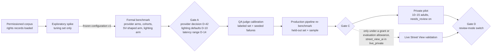

# Quality evaluation and benchmark specification

This specification defines how Holiday measures the quality of AI-decorated previews and how those measurements feed the gates: what "good" means, which photographs may be used to measure it, how the exploratory spike and the formal benchmark are run, how human reviewers score outputs, how the numbers are read, how the image-edit provider is chosen, how the automated QA judge is calibrated, and how the built pipeline, the live Street View path and the private pilot are evaluated. Engineers and coding agents build the benchmark harness and the review tooling from this document; the product owner reads the decision rules to understand what each gate requires.

**Owns:** quality goals; permissioned corpus; exploratory spike; formal benchmark (arms, cohorts); review rubric; statistics and decision rules; provider comparison; QA judge calibration; production re-benchmark; live Street View validation; pilot evaluation.
**Baseline:** planning baseline 2026-11-09; external facts retrieved 2026-11-08.

## Quality goals

Holiday decorates real photographs. Every quality goal below is therefore a statement about the relationship between a source image and its accepted variant. The goals are measured by human review (this document), approximated by the automated QA judge ([render pipeline: quality checks](render-pipeline.md#quality-checks)), and summarized for the product owner in [PLAN §10](../PLAN.md#10-quality-bar-and-release-criteria).

### Definitions

| Goal | Definition | Measured by | Used for |
| --- | --- | --- | --- |
| Structural fidelity | The variant preserves the geometry, openings, materials, surroundings and framing of the source: no critical failure code is raised (the codes are listed in [Review rubric](#review-rubric)). A render with no critical code is **critical-free**. | Critical codes from two blinded reviewers after adjudication | Gate A pass rules; provider selection; QA judge recall target |
| Property correctness | The decorated building or room is the place the user selected, and only that place. Violations are `wrong_property` (another building decorated as the user's) and `neighbor_decorated` (decor spilling onto adjacent properties or units). | Critical codes; in live Street View validation also a comparison of the rendered facade with the confirmed property | Live Street View validation; the `auto_start` decision |
| Privacy preservation | Nothing that was obscured, blurred or unidentifiable in the source becomes clearer, and no person is altered, added or removed: no `privacy_regression` and no `people_altered`. | Critical codes; deterministic region checks in the pipeline | Gate A; live validation; QA judge per-code recall |
| Acceptability | A render the product may deliver: critical-free and free of major defects, with realism, plan adherence and appeal at least adequate. The exact rule is the [Acceptability rule](#acceptability-rule). | Rubric codes and scales | Gate A pass rules (first attempt and after repair); pilot review decisions |
| Appeal | How much a viewer likes the decorated result. Reported as the share of acceptable renders scoring 4 or higher from both reviewers; never as a mean of the ordinal scale. | Appeal scale | Gate A appeal rule; lighting-mode decision ([D-10](../decisions.md#d-10)); journey emphasis per holiday ([D-11](../decisions.md#d-11)) |
| Plan adherence | The render contains the planned placements, in about the planned counts, matching the kit item spec text. A planned item in a different natural spot and extra decorations of the requested holiday and style in sensible places are not misses. Partial adherence is scored on the 1–5 scale; a clear miss is `plan_not_followed`. | Plan adherence scale, `plan_not_followed`; per-placement judge output | Gate A (through acceptability); the `described` product relationship check ([commerce: product relationships](commerce.md#product-relationships)) |
| Transformation magnitude | How much the scene visibly changed, independent of whether the change is good. A 1–5 scale from "barely noticeable" to "dramatic". Not a pass rule. | Transformation scale | Choosing journey emphasis and example art per holiday and scene type (D-11; [holidays: hero and example art](holidays-and-content.md#hero-and-example-art)) |

Two goals are measured outside human review and reported beside the rubric results: **latency** (the [D-14](../decisions.md#d-14) metric, automated-path p90 of `qaPassedAt − max(requestedAt, sourceReadyAt)`; its budget lives in [render pipeline: latency budget](render-pipeline.md#latency-budget)) and **cost per accepted variant** (all paid attempts, analysis and judging divided by accepted variants; the ceiling lives in [economics: decision rules](economics.md#decision-rules)).

### What quality evaluation cannot do

No judge, metric or reviewer can prove a property unchanged. Evaluation estimates failure rates with intervals on finite samples, so no document in this plan claims 100% fidelity. The product's safeguards are layered: the pipeline rejects what the judge catches, the pilot adds pre-delivery human review (D-14), the public rollout adds a post-delivery audit sample, and users can report a result ([experience: reporting and feedback](experience.md#reporting-and-feedback)).

### Evaluation sequence



Evidence from fixtures and permissioned photos is always labeled as such. It never counts as live validation (see the activation and completion vocabulary in [glossary: scope and delivery terms](../glossary.md#scope-and-delivery-terms)).

## Permissioned corpus

The corpus is the set of photographs Holiday may process, store and evaluate under written permission. It is the only image input to the exploratory spike, the formal benchmark, judge calibration and the production re-benchmark. Customer uploads and production outputs never enter it.

### Composition

| Set | Photos | Cohort split | Purpose | Reuse rule |
| --- | --- | --- | --- | --- |
| Tuning set | 12 | 3 detached houses, 3 attached houses (row or townhome), 3 apartment entries or balconies, 3 interiors | Exploratory spike only | Never rendered in the formal benchmark, judge calibration or re-benchmark |
| Formal set | 40 | 10 detached houses, 10 attached houses, 10 apartment entries and balconies, 10 interiors | Formal benchmark; source of the judge calibration labels; sampled in the re-benchmark | Never used for tuning after the exploratory spike |
| SV-shaped additions | 10 | 10 further house exteriors photographed from the curb | Street View-shaped arm only (with SV-shaped copies of the 20 formal house exteriors) | As the formal set |
| Held-out set | 8 | 2 per cohort | Production pipeline re-benchmark before Gate C | Never rendered before the re-benchmark; never used for tuning or calibration |

Totals: 70 photographs: 40 house exteriors (6 tuning, 20 formal, 10 additional, 4 held-out), 15 apartment entries and balconies, 15 interiors. Cohort membership follows the scene type recorded on the source asset:

| Scene type and attribute | Cohort |
| --- | --- |
| `house_exterior`, `buildingForm: detached` | Detached houses |
| `house_exterior`, `buildingForm: attached` or `other` | Attached houses |
| `apartment_entry`; `balcony` | Apartment entries and balconies |
| `interior` (any `roomType`) | Interiors |

Within the interiors cohort at least 4 of the 10 formal photos are dining rooms (the Thanksgiving hero scene), at least 2 are living rooms with a mantel, and at least 1 each is an entryway and a kitchen. Within apartment entries and balconies, at least 4 are balconies with visible railings and at least 4 are unit doors or stoops.

### Sourcing

Three routes are allowed. Each produces a rights record before the photo is stored.

1. **Owner-supplied with written consent.** Homeowners, renters and their guests photograph their own place and sign the release. This is the primary route for interiors, apartment entries and balconies.
2. **Commissioned photography.** A photographer hired under a contract that assigns the rights listed in the release, used mainly for house exteriors photographed from the curb, with the occupant's consent recorded as well.
3. **Licensed stock with AI-processing rights.** Only where the license expressly permits AI processing, derivative creation and transfer to named processors; used sparingly for architectural and climate variety that the first two routes cannot reach.

Never used: Street View images (standard terms prohibit storing or analyzing them; see [address spec: licensing outcomes](address-and-street-view.md#licensing-outcomes-and-activation)), real-estate listing photos, social media images, screenshots, customer uploads, or any image of a person who has not consented. No minors appear in any corpus photo.

### Capture protocol

- **House exteriors (formal, additional and held-out).** Photograph from the public street at curb distance (8–30 m from the facade) with the phone's main camera, horizontal, the whole target facade in frame and whatever cars, poles and trees are actually present. Camera height about 2.5 m on a pole or monopod where practical, otherwise eye level. Record the focal length and the distance estimate. The same photo serves the upload path as taken and, after processing, the Street View path.
- **Apartment entries and balconies.** Photograph as a resident would: unit door or stoop from the hallway or walkway; balcony from inside or from the doorway with the railing and the view in frame.
- **Interiors.** Photograph from a doorway or corner with the main surfaces (table, mantel, windows) in frame, in the room's ordinary daytime light. Remove documents, screens showing content and personal photographs before capture.

### Diversity requirements

The formal set as a whole must satisfy every row; the exploratory spike checks the tuning set against the same rows informally.

| Dimension | Requirement |
| --- | --- |
| Light | Direct sun, overcast and deep shade each represented in at least 5 exterior photos; at least 3 interiors in low light |
| Occlusion | At least 6 exteriors with a parked car, tree or fence partly covering the facade |
| Season | Summer foliage, autumn foliage and bare trees each represented; at least 2 exteriors with snow visible in the source (to test the no-added-snow rule) |
| Climate and region | At least 4 US Census regions; at least 3 warm-climate exteriors (stucco, palms, no lawn) |
| Architecture | Siding, brick, stucco and stone facades; porches with and without rails; attached garages; row houses and townhomes with shared walls |
| Existing decorations | At least 3 photos with existing decorations of any holiday |
| People and vehicles | At least 10 of the 30 SV-shaped photos include a legible license plate or a consenting adult at distance, so blur-preservation can be scored |
| Image quality | Phone cameras of at least two generations; at least 4 photos below 3 megapixels; both orientations |
| Interiors | Dining rooms, living rooms with mantel, entryway, kitchen as in [Composition](#composition) |

### Rights record

Each photo has one rights record, loaded as `asset_policies` rows for a source asset of kind `fixture` ([data model: entities](data-and-api.md#entities)) so that the benchmark harness and the pipeline evaluate real policy, not a bypass. The record has these fields.

| Field | Content |
| --- | --- |
| `assetId`, `set` | Opaque ID; tuning, formal, sv_additional or held_out |
| Consenter | Name and contact, stored separately from the image and never in the harness output |
| Capture | Date; city and state; focal length; distance estimate; camera height; photographer |
| Scene | Scene type and attribute; existing decorations; people or plates present |
| Grants (one state per use: `allowed`, `denied`) | Internal display; storage in private object storage; storage in the repository and CI as a fixture; AI processing by each named provider (listed individually; a provider whose terms permit training is granted only by an explicit line); provider-side retention acknowledged; retention of outputs, failure examples and calibration labels for the benchmark period; use as an engineering fixture; use as a public example or hero (separate opt-in; see [holidays: hero and example art](holidays-and-content.md#hero-and-example-art)); address lookup and live Street View validation of the pictured property (exteriors only; separate opt-in) |
| License | Release version; signature evidence reference; expiry; revocation procedure |
| Attribution | Required credit text, if any |

An asset is sent only to providers its record names. Revocation triggers deletion of the photo, its derived SV-shaped copy and all renders and labels within the deletion service level in [privacy: deletion and verification](privacy-safety-legal.md#deletion-and-verification); aggregate statistics already published in a gate record are kept.

### Street View-shaped processing recipe

Live Street View pixels cannot be benchmarked before a grant, so the exterior path is approximated with **SV-shaped photos**: permissioned curb-distance exteriors processed to mimic Street View Static API output. The Static API ceiling is 640×640 and the viewpoint algorithm clamps fov to 60–90 ([address spec: viewpoint selection](address-and-street-view.md#viewpoint-selection); facts in [research: Street View Static API facts](../research/address-and-imagery.md#street-view-static-api-facts)). At 640 pixels that is roughly 7 pixels per degree at fov 90 and 11 at fov 60, so a 12 m facade seen from 20 m spans about 240–360 pixels.

1. **Crop** the curb-distance photo to a square whose horizontal field of view, computed from the recorded focal length and the crop fraction, lies between 60° and 90°, framing the facade as the viewpoint algorithm would. Record the equivalent fov and the facade pixel width in the result.
2. **Resample** to 640×640 with a conventional resampler (Lanczos). No generative upscaling or sharpening.
3. **Re-encode** as JPEG at the quality observed on live Static API responses. Default quality 75 (configuration) until measured. **Verify:** JPEG quality and byte size of live Static API responses, measured during the Phase 1 live attribution test in [address spec: before image and attribution](address-and-street-view.md#before-image-and-attribution); owner: engineering lead.
4. **Blur** every face and license plate with the pipeline's own blur step, approximating Google's automatic blurring (https://www.google.com/streetview/privacy/, retrieved 2026-11-08), and record the blurred boxes so `privacy_regression` can be scored.
5. **Record** the derived image as a new source asset of kind `fixture` that inherits the original's rights record, with fields: original asset, crop box, equivalent fov, facade pixel width, JPEG quality, byte size, blur boxes.

The recipe cannot reproduce two Street View-only properties: whether a logo is burned into returned images, and Google's exact compression. Both are measured in the Phase 1 live test linked above and re-checked in [Live Street View validation](#live-street-view-validation).

### Storage and retention

Corpus photos, SV-shaped copies, renders, labels and the failure bank live under the fixture prefix of the private bucket ([architecture: storage and media delivery](../architecture.md#storage-and-media-delivery)), never in the browser bundle and never under customer prefixes. Retention follows the rights record, not the customer retention schedule: assets stay for the benchmark period the release names and are deleted on expiry or revocation. Photos whose record allows fixture use may also live in the repository's fixture package in their SV-shaped or downscaled form only.

## Exploratory spike

The exploratory spike is the tuning activity that precedes the formal benchmark. It exists so that the formal benchmark measures a frozen configuration instead of becoming the place where prompts, sizes and masks are first adjusted.

### Purpose and inputs

- Inputs: the 12-photo tuning set only; SV-shaped copies of its 6 house exteriors; the draft holiday packs for Halloween, Thanksgiving and Christmas at `classic` style ([holidays: holiday packs](holidays-and-content.md#holiday-packs)); the provider shortlist from [research: candidate shortlist](../research/image-ai-providers.md#candidate-shortlist).
- Render matrix: every tuning photo × 3 holidays × each shortlisted provider × at least two provider settings (size and quality tier), plus `evening` for Christmas and Halloween on the exteriors and the SV-shaped copies, plus `subtle` and `abundant` on at least 2 photos per cohort to check that styles separate visibly.
- Repeat at least 3 cases per provider 3 times with identical inputs to observe run-to-run variance (there are no seeds; see [render pipeline: moderation and model-behavior risks](render-pipeline.md#moderation-and-model-behavior-risks)).

### Outputs

| Output | Content |
| --- | --- |
| Frozen benchmark configuration v1 | Per provider: model ID, request size, the quality tiers that become arms, thinking level where the model exposes one, output format, mask or markup use, output-size handling under test ([render pipeline: compositing and resolution](render-pipeline.md#compositing-and-resolution)); `compilerVersion`; pack versions (MAJOR.MINOR) for the three packs; scene analysis and judge model IDs and prompt versions; all tagged in the repository |
| Per-stage timings | Median and p90 per stage (preparing, analyzing, planning, rendering, checking) per provider and setting, feeding the latency budget placeholders |
| Variance observations | Qualitative and counted differences between identical runs: placement drift, alignment drift, refusals |
| Refusal observations | Refusal and moderation-block counts by holiday, scene type and provider, so pack content (for example Halloween limits) can be adjusted before freezing |
| Failure bank seed | At least 20 renders exhibiting distinct critical or major codes, captioned, for rubric anchors and reviewer training |
| Compositing and QA parameters | Alignment tolerance, feathering, blur-region check thresholds as first values for the deterministic checks |

Exploratory-spike results are never gate evidence and are reported as "tuning set, not representative".

### Entry criteria for the formal benchmark

All of the following hold before the first formal render:

1. Frozen configuration v1 is tagged; any later change starts a new benchmark version.
2. The formal set, SV-shaped additions and SV-shaped copies exist with rights records loaded; the held-out set is quarantined (stored, listed, not rendered).
3. Rubric anchors are written with failure-bank examples; the two reviewers and the adjudicator completed the training round in [Reviewer training](#reviewer-training) with Cohen's kappa on critical flags at least 0.6.
4. The harness records every field in [Harness records](#harness-records) and writes a ledger entry for every paid call.
5. The spend reservation for the benchmark is approved against [economics: cost worksheet, Phase 1 evaluation spend reservations](economics.md#cost-worksheet).
6. Each provider arm's hard criteria from D-42 are checked on paper (no training on inputs, acceptable retention terms, age terms compatible with D-17, US processing, commercial output rights); a provider that fails a hard criterion is not rendered.

### Model bake-off

The model bake-off (`pnpm models:bakeoff`, [development](../development.md#model-bake-off)) renders the eight curated example photos from the licensed photo library with several live image models and settings through the production example path, and scores each output with the live QA judge (an `evening` example relights the arm's own daylight example of the same photo and is judged in `relight` mode against it). It runs only on those curated photos, never on user photos or corpus photos. Its outputs are labeled `live`, but they are neither exploratory-spike nor formal-benchmark evidence: the sample is eight photos with no corpus manifest, no blinded reviewers, no Wilson intervals and an uncalibrated judge. It informs provisional budget defaults only, and those are recorded as decision log entries (the 2026-11-09 entries under [D-42](../decisions.md#d-42) and [D-43](../decisions.md#d-43)); it never settles D-42 or D-43 and never counts toward a gate.

## Formal benchmark

The formal benchmark compares provider arms on identical inputs under the frozen configuration and produces the evidence for Gate A: provider selection ([D-42](../decisions.md#d-42)), lighting defaults ([D-10](../decisions.md#d-10)), the latency range ([D-14](../decisions.md#d-14)) and the cost check.

### Arms, cohorts and cases

A **provider arm** is one image-edit model at one frozen settings profile (quality tier, size, output format, thinking level; recorded as the attempt's `settingsHash` in [render pipeline: model roster](render-pipeline.md#model-roster)). Candidates come from [research: candidate shortlist](../research/image-ai-providers.md#candidate-shortlist). Separate models from one vendor are separate arms, and a model offered at several quality tiers runs each tier under consideration as its own arm: OpenAI candidates run at `medium` and `high` (configuration; the exploratory spike may substitute `max`), Gemini candidates at their fixed thinking level and 1K. Every arm renders the same cases, so each additional tier adds about 730 paid attempts ([Runs, repairs and variance](#runs-repairs-and-variance)).

| Component | Photos | Holiday packs | Cases per arm (first run) |
| --- | --- | --- | --- |
| Formal set | 40 (10 per cohort) | Halloween, Thanksgiving, Christmas packs at `classic`, lighting `source` | 120 |
| Street View-shaped arm | 30 (SV-shaped copies of the 20 formal house exteriors plus the 10 additional curb-distance exteriors) | Same three packs, `source` | 90 |
| Lighting arm | The 50 exterior photos above (20 formal house exteriors as taken and the 30 SV-shaped photos) | Christmas and Halloween at `classic`, lighting `evening` | 100 |
| Interior lighting check | The 10 formal interiors | Thanksgiving and Christmas at `classic`, lighting `evening` | 20 |
| Total | | | 330 |

Case identity is (source asset, holiday, style, lighting mode); a case's `source` and `evening` renders are paired for the lighting rule. The apartment entries and balconies cohort is rendered in `source` only: `apartment_entry` offers no `evening` in the US Release, and the `evening` cells the benchmark does not cover (balconies, Halloween interiors) are offered on golden-render approval under [holidays: lighting policy](holidays-and-content.md#lighting-policy).

### Runs, repairs and variance

- **Run 1** is the gate run: one attempt per case through the frozen configuration. All gate statistics come from run 1.
- **Repair trials.** Every run-1 render that is not acceptable and whose failure codes are repairable executes the product's repair policy exactly as the pipeline will ([render pipeline: repair and retries](render-pipeline.md#repair-and-retries)): re-plan from the original source with failure-informed constraints, render once. A non-acceptable render with only terminal codes receives no repair and counts as not acceptable after repair. "Acceptable after at most one repair" is computed over all cases, never over repaired cases alone.
- **Run 2** repeats every run-1 case with identical inputs. It measures run-to-run variance (share of cases whose critical-free status differs between runs; placement and alignment drift) and enlarges the judge calibration set. Run 2 is never a gate denominator, because a second render of the same case is not an independent observation.

Approximate paid image-edit attempts per provider arm: 330 (run 1) + 330 (run 2) + repairs (at most the number of repairable run-1 failures, typically under 70) ≈ 730. Scene analysis is computed once per source photo and shared across arms; one judge call accompanies every attempt. Multiply by the unit costs in [economics: cost worksheet](economics.md#cost-worksheet) for the spend reservation.

### Blinding and randomization

- Reviewers never see provider, run, lighting mode or arm labels; renders are presented by case ID with the original.
- Case order is randomized per reviewer; left/right position is randomized in paired comparisons.
- Outputs are shown at matched pixel dimensions with the source (the output resampled to the source size for identity judgments; the native output available for inspecting invented detail), as the product displays before and after at identical rendered size ([render pipeline: compositing and resolution](render-pipeline.md#compositing-and-resolution)).
- The review tool presents each pair side by side, with a flicker toggle (source and output alternating in place) and with a 50% overlay, each at fit-to-screen and at 100% zoom. Reviewers use the flicker view before recording `structure_changed`, `camera_changed` or `privacy_regression` as absent, because small structural drift (a shifted mullion, a changed window proportion) is easy to miss side by side.
- The reviewers and adjudicator are not the authors of the packs, prompts or compiler.

### Harness records

Per attempt: case ID; arm; run; attempt number (1 or repair); provider request parameters; `compilerVersion`; pack version; input dimensions; requested and delivered output dimensions; upscale factor; provider operation ID; stage timings; provider latency; refusal or moderation block with provider code; ledger entries (image edit, analysis, judge) with unit prices; deterministic check results; JudgeResult; adjudicated human labels; `placementAdherence[]` (`kitItemId`, `placementId`, category, color family, count, reviewer ID; see [Placement adherence per kit item](#placement-adherence-per-kit-item)); reviewer IDs. Per SV-shaped case additionally: equivalent fov, facade pixel width, JPEG quality, blur boxes. The harness exports one CSV per arm and a reproducibility manifest (configuration tag, corpus manifest, model IDs).

### Reporting dimensions

Every rate is reported with its denominator and Wilson 95% interval by: arm; cohort; holiday; scene type and attribute; lighting mode; input source class (as taken versus SV-shaped) and input resolution; run; first attempt versus after repair; kit item (placement adherence only). Additional tables: appeal and transformation magnitude by holiday × scene type (the input to D-11); refusal rate by holiday and scene type; run-to-run disagreement rate; latency per stage; cost per accepted variant per arm.

### Held-out set

The 8 held-out photos are not rendered during the formal benchmark by any arm. They are first rendered in the [Production pipeline re-benchmark](#production-pipeline-re-benchmark), so tuning optimism in the formal results can be measured.

## Review rubric

The rubric is shared by human reviewers and the automated QA judge: the same failure codes, the same definitions. Reviewers apply it to every attempt in the formal benchmark, the re-benchmark, live validation and pilot review; the judge emits the same codes in its JudgeResult ([render pipeline: quality checks](render-pipeline.md#quality-checks)).

### Critical failure codes

Any critical code makes a render not critical-free and therefore not deliverable. Reviewers flag every code that applies.

| Code | Definition | Flag when, for example | Do not flag when |
| --- | --- | --- | --- |
| `structure_changed` | An architectural or layout element of the target is altered, added or removed: roof line, wall, window or door count, position, size or style, mullions, columns, steps, railings, chimneys, garage, siding or cladding type, or (interiors) walls, openings, built-ins, large furniture position | A window gains a mullion grid; a porch rail appears where none existed; brick becomes siding; a sofa moves | Decor hides part of an element without changing it; fine texture is sharper but the material and pattern are the same (note it under realism) |
| `wrong_property` | The decorated building, unit or room is not the user's selected place, or decorations sit on a different structure in frame while the target is left alone | The neighbor's house is decorated and the target is not; a different facade is synthesized | The right property is decorated with low plan adherence (use `plan_not_followed`) |
| `neighbor_decorated` | Decorations, lights or glow appear on an adjacent property, unit, balcony or shared element that is not the target | Garland continues onto the attached neighbor's railing; lights on the next-door roofline | Spill of cast light onto the ground or a shared sidewalk |
| `access_blocked` | A door, step, walkway, driveway, stair, hallway, exit or circulation path is obstructed by decor | Pumpkins across the full width of the steps; a tree in front of the unit door; a garland across a hallway at head height | Decor beside the path leaves clear passage |
| `privacy_regression` | A region blurred or unidentifiable in the source becomes clearer, or a face, plate, person or house number is reconstructed or sharpened | A blurred plate shows characters; a blurred face gains features; a distant figure becomes recognizable | Blur remains at least as strong as in the source |
| `people_altered` | A person in the source is moved, removed, re-posed, re-dressed or added, or a new person appears | A standing figure vanishes; a child is added at the table; a passer-by changes clothes | Decor partially occludes a person without changing them |
| `text_added` | Legible text, signage, numbers or logos are added or altered, including house numbers and existing signs | A "Merry Christmas" banner; a changed house number; a brand name on a box | Illegible marks on decor |
| `unsafe_or_offensive` | Content beyond the pack's limits: gore beyond the Halloween pack limit, sexual content, hateful or extremist symbols, weapons, religious symbols not selected, content that appeals to children in a way the packs forbid | Realistic severed limbs; a religious symbol in a secular pack | Pack-approved spooky content within limits |
| `camera_changed` | Framing, crop, zoom, rotation or perspective differs from the source beyond the pipeline's alignment threshold ([render pipeline: quality checks](render-pipeline.md#quality-checks)) | The output is zoomed so the eaves leave the frame; the horizon tilts | Identical framing with a changed sky in `evening` mode |
| `attribution_altered` | Street View-origin outputs only: attribution burned into the source image, or attribution the product must show with it, is cropped, covered or altered ([address spec: before image and attribution](address-and-street-view.md#before-image-and-attribution)) | Garland drawn across an embedded logo strip; the copyright text is smeared or rewritten | Uploads and as-taken corpus photos (the code does not apply); attribution unchanged under an `evening` relight |

### Major failure codes

Major codes count against acceptability, not against structural fidelity. One major code from either reviewer makes a render not acceptable.

| Code | Definition | Flag when, for example | Do not flag when |
| --- | --- | --- | --- |
| `unrequested_change` | A visible change to what belongs to the home or the scene, outside what the lighting mode requires: an object removed, replaced, moved or restyled (including an object replaced by a decoration), repainting, new landscaping, added or removed snow, season change, removed or changed cars or bins, changed sky or weather in `source` mode, changed furniture finish, or any addition that is not a decoration | Lawn turns green in a winter photo; snow appears on a clear roof; a parked car disappears | The sky darkens in an `evening` render (expected); shadows and glow from placed lights; extra decorations of the requested holiday and style in sensible places |
| `plan_not_followed` | Planned placements missing, of a different kind, holiday or style than the plan specifies, or clearly fewer than planned. Extra decorations of the requested holiday and style in sensible places, and a planned item in a different natural spot, are not `plan_not_followed` | Plan says one wreath on the front door; render has no wreath and no garland | Minor count deviation on repeated small items (string lights, small pumpkins) when the look matches |
| `implausible_decor` | Decor floats, passes through objects, is at the wrong scale, has impossible attachment or missing contact shadows | A wreath hovers in front of the door; a 3 m pumpkin; garland that penetrates a column | Stylized but physically possible placement |
| `lighting_implausible` | Light behavior is wrong for the mode: lit bulbs with no glow, glow with no source, shadows contradicting the scene, daylight-bright lights in `evening`, facade illegible in `evening` | Window glow with no window; roofline lights casting no light in `evening` mode | `source` mode shows unlit or faintly lit decor by day |

### Scales

Each scale is anchored at 1, 3 and 5; reviewers may use 2 and 4 between anchors.

| Scale | 1 | 3 | 5 |
| --- | --- | --- | --- |
| Realism | Obviously synthetic: painted-on decor, wrong materials, no shadows | Believable at a glance; one or two tells on inspection (soft edges, slightly off shadow) | Indistinguishable from a photograph of real decorations |
| Plan adherence | Most planned placements missing or elsewhere | All anchors used; one deviation in count or kind | Every placement at its anchor, in count, matching the spec text |
| Appeal | Unattractive or distracting; a user would not want to share it | Pleasant; a user would consider it a fair result | Striking; a user would want to share or buy the look |
| Transformation magnitude | Barely noticeable change | Clearly decorated; the scene reads as the holiday | Dramatic; the scene's mood is transformed |

Property identity is captured by the critical codes rather than a scale: a render is either critical-free or not. Realism is scored on the output at matched dimensions with the source; reviewers then inspect the native output and note invented specifics (siding seams, brick courses, mullions, numbers) which, where they alter an element, become `structure_changed`.

#### Placement adherence per kit item

The plan adherence scale scores a whole render; curation also needs to know which kit items the renderer draws unfaithfully ([commerce: product relationships](commerce.md#product-relationships)). For every placement in the run-1 plan, each reviewer records, keyed by `kitItemId` and `placementId`:

| Field | Values | Pass when |
| --- | --- | --- |
| Category | pass, fail | The rendered item is the kit item's category |
| Color family | pass, fail | The spec's color family dominates the rendered item |
| Count | pass, under, over | The count meets the style's quantity rule for that kit item |

Category disagreements are adjudicated; any other disagreement counts as a fail. The **per-kit-item adherence pass rate** is placements with all three fields passing ÷ placements of that kit item across run-1 cases, reported with its Wilson interval per holiday pack and scene type. It is not a Gate A rule. Kit items below 70% (default, configuration) are flagged to curation for replacement in the style kit (K04) before the packs are approved (K08). The same fields are the human labels against which `JudgeResult.placements[].adherence` is calibrated ([Labeled set](#labeled-set)).

### Acceptability rule

Applied after adjudication: a render is **acceptable** when (a) no critical code remains, (b) neither reviewer raised any major code, and (c) both reviewers scored realism, plan adherence and appeal at 3 or higher. A render is **critical-free** when (a) alone holds. The share of acceptable renders with appeal 4 or higher from both reviewers is the appeal indicator. These three words (critical-free, acceptable, appeal indicator) are used unchanged in every gate rule and in PLAN §10.

### Review procedure

- **Two reviewers** score every attempt independently (codes, scales, a free-text note on anything unusual). They are blinded as described in [Blinding and randomization](#blinding-and-randomization).
- **Adjudication.** A third person resolves every disagreement on a critical code and every case where realism or plan adherence scores differ by 2 or more. Adjudicated labels are the ground truth for gates and for judge calibration. Major-code and appeal disagreements are not adjudicated: a major code from either reviewer counts, and appeal is reported from both.
- **Agreement.** Cohen's kappa on the critical flag (any critical code versus none) is computed per arm before scores are used. Below 0.6, the reviewers re-anchor with the adjudicator on the disagreements and re-review the arm; scores from a round below 0.6 do not count toward any gate or calibration set. Per-code kappa is reported for information.
- **Paired preference pass.** After single-render scoring, each reviewer sees the same case rendered by two arms (left/right randomized, original above) and records a preference or a tie, considering fidelity first and appeal second. This feeds [Provider comparison](#provider-comparison).
- **Failure bank.** Every render with a critical code is captioned with its codes and kept (within the rights record) as an example for training, calibration and pack review.

### Reviewer training

Before the formal benchmark: reviewers read the rubric, review the failure bank seed from the exploratory spike, then score a 20-render training round with the adjudicator and discuss every disagreement. The round repeats until kappa on critical flags reaches at least 0.6. The same reviewers score every arm; a replacement reviewer repeats the training round first.

## Statistics and decision rules

### Units

| Unit | Definition | Count in the formal benchmark (per arm) | Used for |
| --- | --- | --- | --- |
| Photo | One source photograph (or its SV-shaped copy) | 40 formal; 30 SV-shaped | Photo-level fidelity (all three packs critical-free); clustering unit |
| Case | Photo × holiday × style × lighting mode | 120 formal; 90 SV-shaped; 100 lighting; 20 interior lighting | Gate denominators |
| Attempt | One paid image-edit call for a case: run-1 attempt, repair attempt, run-2 attempt | About 730 | Cost and latency; variance; calibration labels; never a gate denominator |
| Run | A complete pass over all cases | 2 | Run 1 for gates; run 2 for variance |

### Intervals

Every proportion in a gate record is written as `k/n = p% [lo%, hi%]` with a Wilson 95% score interval:

```text
centre = (p + z²/2n) / (1 + z²/n)
half   = z · sqrt(p(1 − p)/n + z²/4n²) / (1 + z²/n)
lo, hi = centre ∓ half,   z = 1.96
```

(Wilson, E. B., 1927, "Probable inference, the law of succession, and statistical inference", Journal of the American Statistical Association 22(158), 209–212, https://doi.org/10.2307/2276774.) Wilson intervals are used because they behave sensibly for small n and for rates near 0% or 100%.

**Do not read any percentage in this document without its interval.** 108 of 120 is consistent with any true rate between 83% and 94%; no figure from fewer than 30 cases demonstrates anything beyond gross breakage.

Bounds at the benchmark's denominators (computed with the formula above; the harness recomputes them from the actual counts):

| Observation | Rate | Wilson 95% interval | Reading |
| --- | --- | --- | --- |
| 108/120 formal cases critical-free | 90.0% | [83.3%, 94.2%] | Pooled formal fidelity at the 90% floor |
| 96/120 formal cases acceptable | 80.0% | [72.0%, 86.2%] | First-attempt acceptability at the 80% floor |
| 114/120 formal cases acceptable after repair | 95.0% | [89.5%, 97.7%] | After-repair acceptability at the 95% floor |
| 34/40 formal photos critical-free on all three packs | 85.0% | [70.9%, 92.9%] | Photo-level floor |
| 81/90 SV-shaped cases critical-free | 90.0% | [82.1%, 94.6%] | Street View-shaped fidelity at the 90% floor |
| 72/90 and 86/90 SV-shaped cases acceptable | 80.0%, 95.6% | [70.6%, 87.0%], [89.1%, 98.3%] | SV-shaped acceptability floors |
| 27/30 cohort cases critical-free | 90.0% | [74.4%, 96.5%] | A cohort at the floor: wide; smoke test only |
| 30/30 cohort cases critical-free | 100% | [88.6%, 100%] | Even a perfect cohort cannot show more than 88.6% |
| 45/50 lighting cases critical-free | 90.0% | [78.6%, 95.7%] | `evening` fidelity per holiday |
| 180/200 | 90.0% | [85.1%, 93.4%] | Smallest n at which an observed 90% has a lower bound of 85% |

Two consequences shape the rules below. First, a rule "observed ≥ 90%" at n = 120 passes a provider whose true rate is exactly 90% only about 58% of the time and still passes one at a true 88% about 31% of the time (binomial, computed); the benchmark can separate good from broken, not 88% from 92%. Second, a cohort of 30 cases flags a true pass rate of 80% about 88% of the time and a true 90% about 35% of the time when the flag rule is "more than 3 critical failures", so cohort checks are reported as smoke tests for gross breakage, never as cohort-level 90% claims.

### Clustering

Three holiday packs share one photo, so a hard photo (deep shade, occluding tree, complex roofline) fails all three. With an intraclass correlation of 0.3 the 120 formal cases carry the information of about 75 independent cases; at 0.5, about 60. The gate rules therefore include a photo-level rule, and run-2 attempts are never pooled with run 1 (they are more correlated still).

### Inconclusive results

A rule has three outcomes. **Pass:** observed rate at or above its floor and lower bound at or above its bound. **Fail:** observed rate below its floor. **Inconclusive:** observed rate at or above the floor but lower bound below its bound (this happens when the denominator shrank through refusals or excluded cases). Inconclusive means "extend the corpus and re-run the affected cases", not pass or fail. The gate record states which outcome each rule reached.

### Gate A pass rules

All rules use run 1, first attempt unless a rule says "after repair", adjudicated labels, and the provider arm under consideration. The Street View path uses the SV-shaped arm; the upload path uses the formal set. Floors and bounds are defaults (configuration); changing one is an owner decision recorded in the decision log.

| ID | Rule | Denominator | Floor | Lower bound at least | Bounds at the floor |
| --- | --- | --- | --- | --- | --- |
| QA-1 | Pooled critical-free rate, formal set | 120 cases | 90% (108/120) | 83% | [83.3%, 94.2%] |
| QA-2 | Cohort smoke test: at most 3 critical failures in each of the four cohorts | 30 cases each | 90% (27/30) | none (smoke test) | [74.4%, 96.5%] |
| QA-3 | Photo-level critical-free rate (all three packs critical-free) | 40 photos | 85% (34/40) | 70% | [70.9%, 92.9%] |
| QA-4 | Critical-free rate, Street View-shaped arm | 90 cases | 90% (81/90) | 82% | [82.1%, 94.6%] |
| QA-5 | Privacy: `privacy_regression` and `people_altered` count across the SV-shaped arm and the formal cases with people or plates | all such cases | 0 occurrences | upper bound reported | 0/90 → [0%, 4.1%] |
| QA-6 | First-attempt acceptable rate, formal set | 120 cases | 80% (96/120) | 72% | [72.0%, 86.2%] |
| QA-7 | Acceptable after at most one repair, formal set | 120 cases | 95% (114/120) | 89% | [89.5%, 97.7%] |
| QA-8 | First-attempt acceptable rate, SV-shaped arm | 90 cases | 80% (72/90) | 70% | [70.6%, 87.0%] |
| QA-9 | Acceptable after at most one repair, SV-shaped arm | 90 cases | 95% (86/90) | 89% | [89.1%, 98.3%] |
| QA-10 | Appeal indicator: acceptable first-attempt renders with appeal 4 or higher from both reviewers, formal set and SV-shaped arm pooled | acceptable renders | 50% | 40% | 48/96 → [40.2%, 59.8%] |
| QA-11 | Cost per accepted variant (all attempts, analysis and judging over acceptable variants after repair) | ledger | within the ceiling in [economics: decision rules](economics.md#decision-rules) | n/a | n/a |
| QA-12 | Latency: harness-predicted automated-path p90 within the D-14 decision range | run-1 attempts | at most 120 s | n/a | see [Latency](#latency-and-the-d-14-range) |

A provider passes Gate A for a path when every rule for that path passes (QA-1, QA-2, QA-3, QA-5, QA-6, QA-7, QA-10, QA-11, QA-12 for uploads; QA-4, QA-5, QA-8, QA-9, QA-10, QA-11, QA-12 for the Street View path). The product owner, advised by the engineering lead, may accept an inconclusive rule with a recorded reason; a failed rule is never accepted. Where no provider passes, the failure branch is in [backlog: gates](../backlog.md#gates).

Cohorts and the apartment, balcony and interior scope ([D-04](../decisions.md#d-04)): QA-2 catches gross breakage in these cohorts but cannot support a 90% claim for them. Those scene types therefore stay under pre-delivery review (`needs_review`) through the pilot and switch to automated delivery only under the per-scene-type criteria in [Review-mode switch criteria](#review-mode-switch-criteria), while remaining in scope.

### Lighting rule (D-10)

Applied per holiday (Christmas, Halloween) on the lighting arm, pairing each case's `source` and `evening` renders. The paired difference in critical rate is `(b − c)/n`, where `b` is the number of cases critical-free in `source` but not in `evening` and `c` the reverse, with a Newcombe paired-proportions interval (Newcombe, R. G., 1998, "Improved confidence intervals for the difference between binomial proportions based on paired data", Statistics in Medicine 17, 2635–2650, https://www.site.uottawa.ca/~nat/Courses/csi5388/Newcombe.1998.pdf).

| Decision | Rule |
| --- | --- |
| `evening` is **offered** for the holiday's exteriors (the control appears after the first result) | `evening` critical-free rate observed ≥ 90% (45/50 → [78.6%, 95.7%]) **and** the paired excess critical rate of `evening` over `source` is at most 5 percentage points |
| `evening` becomes the **default** for the holiday's exteriors | The offer rule passes **and** the appeal indicator for `evening` exceeds that for `source` by a paired difference whose 95% interval excludes zero **and** `evening` acceptability after repair meets the QA-7 floor on the lighting cases |
| `evening` is **withheld** for the holiday's exteriors | The offer rule fails; the control is hidden for that holiday until a later benchmark version passes |
| Interiors (`evening` for Thanksgiving and Christmas) | Offered when the interior lighting check is critical-free on at least 18 of 20 cases ([69.9%, 97.2%]: a smoke test); default stays `source` |
| Default for Thanksgiving exteriors | `source` with no electric lights; not benchmarked in `evening` ([holidays: lighting policy](holidays-and-content.md#lighting-policy)) |

Default rule when the lighting arm is inconclusive: `source` remains the default and `evening` is offered only where the offer rule passed. New Year's Eve inherits the Christmas decision until its pack is benchmarked.

### Latency and the D-14 range

The D-14 metric is the automated-path p90 of `qaPassedAt − max(requestedAt, sourceReadyAt)` in production. The formal benchmark cannot measure queue wait, so the harness predicts it: for each run-1 case, the sum of the measured stage durations (preparing, analyzing, planning, rendering, checking, plus the repair attempt where one occurred), with zero queue wait. Gate A records, per provider arm: provider request latency (median, p90) by size and quality tier; analysis and judge latency; the predicted p90. The decision range is 60–120 s (aspiration 60 s): Gate A fixes the production target as the smallest multiple of 10 s at or above the predicted p90 of the selected arm plus the queue allowance in [render pipeline: latency budget](render-pipeline.md#latency-budget). A provider whose predicted p90 exceeds 120 s fails QA-12 unless a frozen-configuration lever (size, quality tier) brings it under in a new benchmark version. Human-review wait in the pilot is a separate metric ([Pilot evaluation](#pilot-evaluation)) and is never added to the D-14 figure.

### Cost per accepted variant

Computed from the harness ledger per arm: `(Σ image-edit attempts + Σ analysis calls + Σ judge calls, at list prices) / acceptable variants after repair`, reported overall and by cohort and input source class. Attempts per accepted variant is reported beside it so the economics model can be updated ([economics: unit economics model](economics.md#unit-economics-model)).

## Provider comparison

Provider selection is a paired comparison, because every arm renders the same cases.

### Measures

| Measure | Computation |
| --- | --- |
| Win/loss/tie | From the paired preference pass: per case, each reviewer's preference between the two arms; counts of wins, losses and ties per arm pair, reported by cohort and input source class |
| Paired difference in critical rate | `(b − c)/n` with the Newcombe interval, where `b` = cases critical-free in arm A only and `c` = critical-free in arm B only; computed on run 1 for the formal set and the SV-shaped arm separately |
| Paired difference in acceptability | Same construction on the acceptable flag, first attempt and after repair |
| Cost and latency | QA-11 and QA-12 per arm |
| Terms | The D-42 hard criteria, checked from [research: data, training and age terms](../research/image-ai-providers.md#data-training-and-age-terms) |

### Selection order

1. Exclude any arm that fails a D-42 hard criterion (no training on inputs; acceptable retention or zero-data-retention terms; age terms compatible with D-17; US processing; commercial output rights).
2. Keep the arms that pass the Gate A rules for the path in question. If none passes, the failure branch in [backlog: gates](../backlog.md#gates) applies.
3. Among passing arms, prefer the arm whose paired critical-rate difference against each other arm is favorable with an interval excluding zero. If the interval includes zero, there is no fidelity evidence between them: choose on cost per accepted variant, then terms (zero data retention available; retention period), then predicted latency, then the paired preference count. Tiers of one model are compared as arms, so the cheapest passing tier is identifiable for [economics: decision rules](economics.md#decision-rules).
4. The Street View path and the upload path may select different arms (per-source-kind routing, allowed by D-42) when their rules select differently or a license requires a specific processor.
5. Record the result as the D-42 decision with the gate record attached: arms, counts, intervals, the rule outcomes, and the selected arm per path. The selection for the Street View path is marked **provisional until live validation** ([Live Street View validation](#live-street-view-validation)); the re-evaluation trigger is a live critical-free rate below QA-4's floor.

A second arm that passed is kept as a benchmarked alternative for resilience; switching to it in production still requires compiler and pack re-tuning and a re-benchmark ([render pipeline: rendering](render-pipeline.md#rendering)).

## QA judge calibration

The automated quality check has two parts: deterministic checks (alignment, out-of-region difference, blur and face/plate region preservation, dimensions, text detection) and a vision-language judge that returns a JudgeResult with critical and major codes, per-placement adherence and a confidence ([render pipeline: quality checks](render-pipeline.md#quality-checks)). The pipeline owns the decision policy; this section owns the calibration protocol and the targets the judge must meet before it gates delivery.

### Labeled set

- **Benchmark labels.** Every adjudicated attempt from the formal benchmark (run 1, repairs and run 2, all arms) with its human codes. At a 10% critical rate this yields on the order of 200 critical positives across three arms, unevenly spread over codes.
- **Seeded failures.** Deliberately produced failures that enlarge the critical class to at least 150 positives in total and at least 15 per critical code. Sources: adversarial plans (instructions that invite the editor to change a roof color, add a window, decorate the neighbor, add signage, shift the camera); synthetic edits applied to real renders (3% zoom or crop for `camera_changed`; a neighbor's railing decorated by compositing; a blurred plate or face region replaced by the consenting original's unblurred pixels for `privacy_regression`; a pasted house number for `text_added`; the embedded-attribution fixture variant with its strip covered or altered for `attribution_altered`); outputs from provider settings rejected in the exploratory spike. Seeded items are labeled `seeded`, reviewed by one reviewer to confirm the code, and excluded from every fidelity rate.
- **Placement adherence labels.** The run-1 per-placement records from [Placement adherence per kit item](#placement-adherence-per-kit-item) (category, color family, count, keyed by `kitItemId` and `placementId`), against which `JudgeResult.placements[].adherence` is scored for agreement per field.
- **Lighting and input classes.** The set includes `evening` renders and SV-shaped inputs in proportion to the benchmark, so thresholds are not tuned on daylight, full-resolution photos alone.
- **Split.** Two thirds for threshold selection, one third held back for the reported metrics; photos, not cases, are assigned to a split so that the same house never appears in both.

### Metrics and targets

| Metric | Definition | Target (default, configuration) | Required denominator |
| --- | --- | --- | --- |
| Critical recall | Share of human-labeled critical renders the quality checks reject (a deterministic critical code, a judge critical code at confidence ≥ `Tc`, or a verdict still uncertain after escalation, which automated mode rejects) | observed ≥ 0.95 with Wilson lower bound ≥ 0.90 (143/150 → [90.7%, 97.7%]) | at least 150 critical positives |
| Per-code recall | Recall for each critical code | ≥ 0.90 for every code with at least 15 positives; codes with fewer are reported, not gated | 15 per code |
| Precision | Share of judge rejections that humans also labeled not acceptable (critical or major) | ≥ 0.70 | all rejections in the held-back third |
| Deterministic checks | Recall of `camera_changed`, `privacy_regression`, `text_added` and `attribution_altered` on seeded failures | ≥ 0.95 each | seeded set |
| Uncertain share | Share of outputs with a critical code whose confidence falls in [`Tu`, `Tc`) | ≤ 15%, reported as a cost figure | all outputs |
| Code agreement | Share of judge rejections naming the same code as the human label (drives repair routing) | reported per code | |
| Placement adherence agreement | Share of labeled placements where the judge's all-three-pass verdict equals the adjudicated human one; also the false-pass share (judge passes, humans fail) | agreement ≥ 0.90 and false-pass share ≤ 5%; until both are met the judge's adherence output is advisory | all labeled placements in the held-back third |

Recall is the gating metric because a missed critical failure reaches a user, while a false rejection costs a repair attempt. Precision bounds that cost.

### Uncertainty band

The judge's per-code confidence is split by the thresholds of the render spec's decision policy ([render pipeline: quality checks](render-pipeline.md#quality-checks)): a critical code at or above `Tc` rejects, a critical code in [`Tu`, `Tc`) is **uncertain**, a critical code below `Tu` is recorded and ignored, and `Tm` is the reject threshold for major codes. Calibration chooses, on the selection split, the (`Tc`, `Tu`) pair that meets the recall target with the smallest uncertain share, checks `Tm` against the precision target, and records the three values as configuration in place of the seeded defaults. The decision policy, not this section, says what happens to an uncertain verdict (one escalation, then `needs_review` in `pre_delivery` mode or a rejection in `sampled_audit` mode). The thresholds are recalibrated whenever a trigger below fires.

### Judge model selection (D-43)

Candidates ([D-43](../decisions.md#d-43): the default Claude Opus 5.5 for analysis and judging with escalation at a higher effort setting, the cheaper Claude Sonnet 5.5, and Claude Haiku 5.5 for triage, compared with comparable OpenAI and Google vision models; [render pipeline: model roster](render-pipeline.md#model-roster)) are run on the identical labeled set with the same JudgeResult schema and prompt version. Selection order: meets the recall and precision targets; then cost per judgment and latency; then uncertain share. A two-tier configuration (triage model, escalation to a stronger model in the uncertain band) is evaluated as its own candidate. The result is recorded as D-43 with the metric table attached.

### Scene analysis validation

The same decision selects the analysis model. All 70 corpus photos are human-annotated once (scene type and attribute, anchor boxes by category from the pack vocabulary, people boxes, blurred regions, access regions). Targets (defaults, configuration): scene type and attribute accuracy ≥ 95% (67/70); anchor recall ≥ 0.90 and precision ≥ 0.85 at intersection-over-union ≥ 0.5 for categories the packs use (a hallucinated anchor produces floating decor, so precision matters as much as recall); people-box and blurred-region recall ≥ 0.95 (these feed `people_altered` and `privacy_regression` checks); access-region recall ≥ 0.90.

### Recalibration triggers

| Trigger | Action |
| --- | --- |
| Image-edit model or provider setting changes | Full recalibration on a new benchmark version |
| Pack MAJOR change, `compilerVersion` change, judge model or prompt version change | Recalibration on the affected subset (at least 60 attempts plus the seeded set) |
| Post-delivery audit finds judge-accepted outputs with a critical code at a rate whose Wilson lower bound exceeds 2% | Re-enable `needs_review` for the affected scene type; recalibrate |
| New scene type, holiday pack or style kit | Extend the labeled set with at least 30 adjudicated attempts of the new class before it is delivered automatically |
| Live Street View validation shows a per-code recall below target on live inputs | Recalibrate on live-labeled outputs before `street_view_ai` reaches `live_public` |

## Production pipeline re-benchmark

The formal benchmark runs in a harness. Before Gate C, the built pipeline (`POST /v1/renders` through the worker, compositing, deterministic checks, the calibrated judge, repair policy) is measured on the same kind of inputs so that regressions introduced by engineering are caught before any user sees them.

### Inputs

| Set | Cases | Purpose |
| --- | --- | --- |
| Held-out set | 8 photos × 3 packs = 24, `source`, `classic` | First render of these photos anywhere: estimates how optimistic the formal results were |
| Formal sample | 40 cases stratified 10 per cohort, chosen by a seeded random draw recorded in the gate record | Paired comparison with the same cases' Gate A renders |
| SV-shaped sample | 30 cases (10 photos × 3 packs) | Paired comparison for the Street View path |
| Lighting sample | 20 `evening` cases from the lighting arm, if `evening` is offered | Checks the compositing disablement and lighting-aware checks in the real pipeline |

Sources enter as source assets of kind `fixture`; `image_editing` and `vision_analysis` run in `live_private` on the selected provider; `street_view_ai` is not involved. Every output is scored by the two benchmark reviewers under the same rubric and blinding, and the pipeline's JudgeResult is recorded before reviewers see the render.

### Measures and block rules

| Measure | Rule | Outcome if violated |
| --- | --- | --- |
| Held-out critical-free and acceptable rates (24 cases) | Reported with intervals (22/24 → [74.2%, 97.7%]); a held-out point estimate below the Gate A pooled lower bound is investigated for tuning optimism | Investigation recorded; blocks only if a regression below is also found |
| Paired regression, formal sample and SV-shaped sample | Paired difference in critical rate (pipeline minus harness) with its interval; **regression** = interval excludes zero in the worse direction, or any critical code appears in 3 or more cases where the harness render had none | Blocks Gate C until fixed and re-run |
| Deterministic checks | All seeded regression fixtures (alignment, blur preservation, text, dimensions, embedded attribution) are caught | Blocks Gate C |
| Judge agreement | Judge recall and precision on the re-benchmark outputs meet the calibration targets | Blocks automated delivery; pilot proceeds in `needs_review` |
| Compositing parity | Before and after delivered at identical rendered size; `source` mode restores pixels outside the keep-mask (plan shapes and localized decorations); `evening` mode skips paste-back and relights the daylight variant as specified | Blocks Gate C |
| Latency | Production D-14 metric on these jobs without queue wait is within the Gate A target; the loaded figure comes from the capacity test in [architecture: capacity and admission control](../architecture.md#capacity-and-admission-control) | Blocks Gate C if the unloaded p90 exceeds the target |
| Cost | Cost per accepted variant from the real ledger within the economics ceiling | Blocks Gate C |
| Provenance | Delivered files carry the label and metadata required by D-28 ([render pipeline: provenance and labeling](render-pipeline.md#provenance-and-labeling)) | Blocks Gate C |

A subset re-benchmark (the formal sample and SV-shaped sample only) is repeated whenever a pack MAJOR.MINOR, `compilerVersion`, provider setting or judge version changes after Gate C; its outcome is attached to the release record.

## Live Street View validation

The formal benchmark approximates Street View inputs; it cannot measure them. Live validation runs only when `street_view_ai` is `live_private` under a recorded grant or a written evaluation allowance recorded under [D-15](../decisions.md#d-15), in the source mode the record allows ([address spec: licensing outcomes and activation](address-and-street-view.md#licensing-outcomes-and-activation)). Before that, the exterior path's quality evidence is the SV-shaped arm, labeled as a proxy. Fixture evidence is never counted as live.

### Sample

- **Locations.** Addresses of corpus exterior owners who opted in to address lookup in their rights record, plus the home addresses of team members and pilot participants who consent in writing. Stratified like the coverage probe (urban, suburban, rural, new-build; [address spec: coverage probe](address-and-street-view.md#coverage-probe)). Multi-unit buildings route to `skip_to_upload` by design and are excluded.
- **Size.** At least 30 locations whose discovery returns `auto_start` or `confirm`, each rendered for the three packs at `classic`, `source` = 90 cases, plus `evening` for Christmas and Halloween where `evening` is offered (60 cases). Locations returning `skip_to_upload` are counted in the match-class distribution and not rendered.
- **Path.** The production pipeline end to end: `POST /v1/addresses/resolve`, `POST /v1/projects/:id/source-discovery`, confirmation, `POST /v1/renders`; the Static image is fetched by the worker in the grant's mode and never written to the corpus.

### Measures

| Measure | How | Rule |
| --- | --- | --- |
| Property correctness | For each location a reviewer compares the discovered viewpoint and the render with the owner's reference photo of the property | Zero `wrong_property` among `auto_start` cases (0/30 → upper bound 11.4%; 0/60 → 6.0%); the match-class distribution and the Tier A signals of every miss are recorded for threshold tuning ([address spec: match confidence and auto-start](address-and-street-view.md#match-confidence-and-auto-start)) |
| Structural fidelity | QA-4 on the 90 live cases, scored by the benchmark reviewers | Pass as QA-4; the live rate is compared with the SV-shaped prediction and the recipe is adjusted for later benchmark versions |
| Acceptability | QA-8 and QA-9 on the live cases | Pass as QA-8 and QA-9 |
| Privacy preservation | `privacy_regression` and `people_altered` codes; deterministic blur-region check against the fetched source | Zero occurrences; any occurrence is a stop condition for `live_public` |
| Attribution | Deterministic check that any burned-in attribution in the fetched image is unaltered in the output (`attribution_altered` otherwise), and that the displayed attribution follows [address spec: before image and attribution](address-and-street-view.md#before-image-and-attribution) | 100%; zero `attribution_altered` among delivered outputs |
| Blur propagation | **Verify:** that panoramas with owner-requested whole-house blur appear blurred in Static API responses (Google states blurs apply to all copies of published imagery, https://www.google.com/streetview/privacy/, retrieved 2026-11-08, without naming the Static API); owner: engineering lead, during this validation | A blurred-house location, if one is found, must end before any paid edit as the address spec requires (`failureKind` `source_rejected`, `failureDetail` `owner_blurred`; [address spec: panorama changes, blur and takedown](address-and-street-view.md#panorama-changes-blur-and-takedown)) and render nothing identifiable |
| Latency | Production D-14 metric on these jobs; discovery time (`sourceReadyAt` − address selection) reported separately | Within the Gate A target |
| Cost | Google SKU charges per location (metadata, Static fetches, Geocoding) and attempts per accepted variant | Reported against [economics: cost worksheet](economics.md#cost-worksheet) |
| Facade pixel width and fov | Distribution of chosen fov and estimated facade pixel width across locations | Updates the SV-shaped recipe parameters |

### Decision rules

- `auto_start` rendering on the public address path (`street_view_ai` = `live_public` with automatic start for `auto_start` matches) is enabled only when property correctness, structural fidelity, acceptability and privacy preservation all pass on the live sample.
- Otherwise the address path operates **confirm-first**: every match is treated as `confirm`, the quality notice and the photo-upload alternative are shown before rendering, and the product owner records in the decision log whether to keep confirm-first or to accept a relaxed, labeled threshold. Street View stays in the product in either branch; the mechanism is the match-class thresholds in the address spec.
- The provisional provider selection for the Street View path (D-42) is confirmed or re-opened by this result.

## Pilot evaluation

The private pilot (Phase 5) tests the complete product with real people under `live_private`, with pre-delivery human review on (`needs_review`, [D-14](../decisions.md#d-14)). It produces the usability evidence for Gate D and the per-scene-type evidence for the review-mode switch. It is also the first test of the product thesis (Fixed [D-49](../decisions.md#d-49)): that real people find the experience simple, beautiful and emotional when they see their own places decorated.

### Participants and setup

- 10–15 adults (18 or older, D-17) who are not team members: homeowners and renters, including at least 3 apartment dwellers, across at least 3 US regions; mostly on their own phones; at least one participant who navigates by keyboard only or with a screen reader.
- Written consent for session recording and for pre-delivery review of their renders. Participants' photos and renders are customer data under the [retention schedule](privacy-safety-legal.md#retention-schedule); they never enter the corpus or the calibration sets.
- Capabilities: `uploads`, `image_editing`, `vision_analysis`, `content_screening` and `sharing` in `live_private`; `address_lookup` and `street_view_display` in `live_private`; `street_view_ai` in whatever state the grant allows (if not `live_private`, the address path runs the interim experience, D-16); at least one `commerce:<merchantProgramId>` in `live_private` with curated offers so the shopping tasks can run. If no merchant program is active, the product-relationship questions are asked over a clearly labeled prototype panel and that criterion is re-tested in capped rollout.
- Allowance at the D-12 defaults; the allowance-reached experience at the D-13 default.

### Tasks

Moderated think-aloud sessions. The facilitator follows a script and intervenes only when a participant has been stuck for 60 seconds (default, configuration); any intervention beyond the script is recorded as **coaching**.

| Task | What the participant does | What is observed |
| --- | --- | --- |
| T1 First preview from an address | Enters their own address (or a provided consenting address) and gets to a first preview, through `auto_start`, `confirm` or the interim photo prompt depending on activation | Completion without coaching; time to first preview; reaction to the confirmation screen and to the waiting stages |
| T2 First preview from a photo | Photographs or chooses a photo of their room, entry or balcony and gets to a preview | Completion without coaching; understanding of the age-and-rights checkbox; reaction to people-detected or declined outcomes if they occur |
| T3 Change the look | Switches holiday, style and (where offered) lighting; compares before and after | Discoverability of the controls; understanding of the "N more looks today" counter; use of the slider by touch and keyboard |
| T4 Shop the look | Opens the panel, reads the labels, follows one link | Interpretation of "Similar item" and "Similar to what's pictured"; notice of the ad disclosure |
| T5 Save and share | Saves with the email magic link, creates a share link, opens it as a stranger would | Expectations about what the share shows; notice of the AI preview label; understanding that the address is absent |
| T6 Report or opt out | Finds how to report a result and how a homeowner would opt out | Discoverability only |

### Questions

Asked after the relevant task, in the participant's words, never leading:

| Topic | Question |
| --- | --- |
| Emotional response | Right after the first preview, before any other question: "What's your reaction?" (open), then "How much would you like your place to look like this for the holiday?" (1 = not at all, 3 = somewhat, 5 = very much) |
| Appeal | "How good does the decorated picture look?" (1 = poor, 3 = fine, 5 = like a professional photo) |
| Desire to act | After T3: "Would you do anything with this picture?" (open; the facilitator records any mention of sharing, saving, decorating or buying without prompting it) |
| Source authenticity | "Is the before picture a real photo of this place? Where do you think it came from, and when was it taken?" |
| AI preview meaning | "What does the 'AI preview' label tell you?" |
| Added detail | "Does the after picture show the house more clearly than the before? Did anything about the house itself change?" |
| Product relationships | "Is this product the exact item in the picture? What does 'Similar item' mean to you?" |
| Lighting | (if `evening` shown) "What changed between these two versions?" |
| Sharing | "If you sent this link to a friend, what would they see? Would they see your address?" |
| Allowance | "What happens when you reach the limit of looks for today?" |
| Age line | "Did you notice anything about who may use this?" |

### Measures and success criteria

| Measure | Definition | Pass rule (defaults, configuration) |
| --- | --- | --- |
| First-preview completion | Participants who reach a first preview on T1 or T2 without coaching; reported pooled and split by the path exercised on T1 (`auto_start`, `confirm`, interim photo prompt), with the interim cohort's completion, time to first preview and coaching listed separately so the D-16 experience is read on its own | At least 80% (8 of 10, 12 of 15; intervals [49.0%, 94.3%] and [54.8%, 93.0%] show this is a usability threshold, not a population estimate) |
| Effort to first preview (simple) | Median taps and median seconds of the participant's own effort from landing to the first render request, excluding the render wait, per path | Reported; any blocking step beyond the [friction budget](experience.md#friction-budget) is a defect fixed before Gate D |
| Participant appeal (beautiful) | Participants' rating of "How good does the decorated picture look?" for their first preview | Median at least 4 (default, configuration) |
| Emotional response (emotional) | Participants' rating of "How much would you like your place to look like this for the holiday?" after their first preview, with the open reaction coded positive, neutral or negative by two team members | Median at least 4 and at least 70% rating 4 or 5; no more than 2 negative reactions (defaults, configuration) |
| Desire to act | Participants who, unprompted, mention sharing, saving, decorating or buying, cross-checked with their share, save and Shop the look actions in the session | Reported with the funnel; an input to D-27 |
| Exact-item belief | Participants who, after T4, believe a `similar` or `described` item is the exact item pictured | Not recurring: fewer than 2 participants |
| Source belief | Participants who believe the before image is synthesized or not a photo of the place | 0 |
| AI preview comprehension | Participants who explain the label as "made by AI, not real decorations" in substance | At least 80% |
| Added-detail belief | Participants who read a sharper after image as a change to the house | Fewer than 2; otherwise the output-size handling in the render spec is revisited |
| Misunderstanding log | Every misunderstanding with severity (blocking, misleading, cosmetic) and the fix made | No blocking item open at Gate D |
| Review wait | Median and p90 of `reviewCompletedAt − qaPassedAt` during scheduled sessions | Reviewed within 15 minutes during sessions (pilot operating target; separate from the D-14 metric) |
| Delivered-output rule | Every delivered pilot output passed the judge and a reviewer | 100% |
| Funnel and allowance | The analytics events for the pilot cohort ([data model: analytics events](data-and-api.md#analytics-events)): renders per visitor, cached-variant reuse, allowance reached, shop panel views and clicks; reported pooled and split by address path (`auto_start`, `confirm`, interim photo prompt) and upload path | Reported; these are the inputs to the D-12, D-13 and D-27 decisions |
| Incidents | Safety, privacy or rights incidents during the pilot | 0 unresolved |

### Review-mode switch criteria

The switch from pre-delivery review to automated QA with a post-delivery audit (D-14) is decided per scene type by the product owner at Gate D, and later for any scene type that lags, with the outcome in the decision log. A scene type qualifies when all of the following hold:

1. The judge meets the calibration targets in [Metrics and targets](#metrics-and-targets), including on live inputs for the Street View path.
2. At least 100 reviewed outputs of that scene type (pilot plus capped rollout) exist where the JudgeResult was recorded before the reviewer's decision.
3. Among judge-accepted outputs, reviewers found a critical code in at most 1 per 100 (1/100 → [0.2%, 5.4%]).
4. Reviewer agreement is maintained: a 10% double-reviewed sample keeps kappa on critical flags at or above 0.6.

Until a scene type qualifies it stays in `needs_review` through capped rollout. After the switch, a post-delivery audit samples 5% of delivered outputs (default, configuration), stratified by scene type and source kind, with the escaped-critical rate and its interval reported per promotion window; a lower bound above 2% re-enables `needs_review` for that scene type.

### Gate D evidence

- Pilot report: participants, tasks, every measure with denominator and interval, the misunderstanding log and the fixes made.
- Review-mode decision per scene type with the four criteria's values.
- Live Street View validation report, or the statement that `street_view_ai` remains below `live_public` and the address path runs the interim experience.
- Judge and reviewer agreement statistics from the pilot.
- Allowance and funnel observations for D-12, D-13 and D-27.
- Incident log and resolutions.
- The dated entries to be written in the decision log for D-13, D-14 and, where applicable, D-42.
