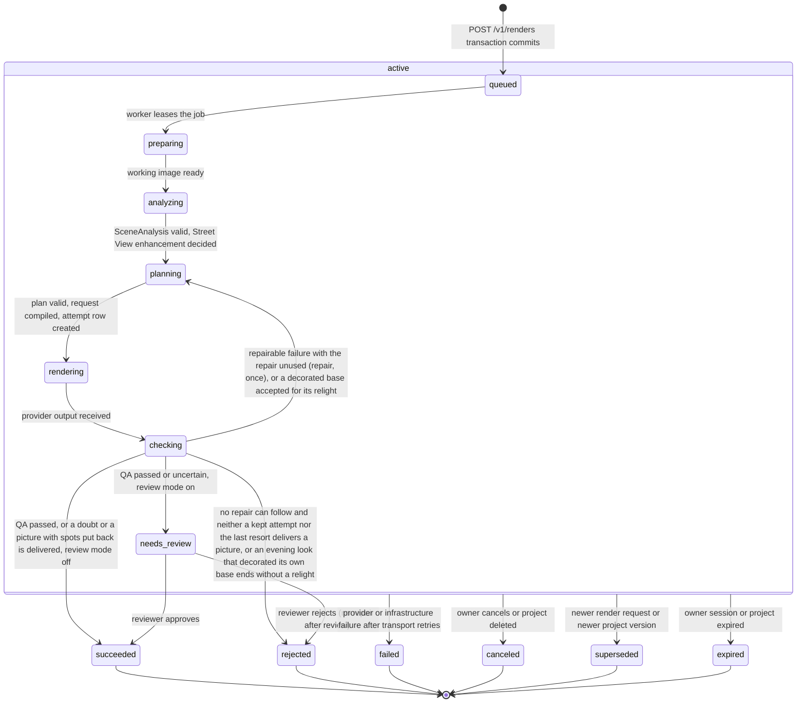

# Render pipeline specification

This specification defines how Hailiday turns one source image and one set of user choices (holiday, style, lighting mode) into one accepted variant: the concepts, the normative lifecycle state machines, the contract of every pipeline stage, the models used, the schemas exchanged between stages, the quality gates, the single repair, compositing and resolution rules, lighting modes, the latency budget, model-behavior risks, provenance mechanics and cost recording. It is written for the engineers and AI coding agents who implement `apps/workers`, `@hailiday/core` and `@hailiday/server`; where another document owns a topic, this one states one sentence and links to it.

**Owns:** concepts (project, source asset, variant, job, attempt, repair); variant key and reuse; all lifecycle state machines; stage contracts; model roster; coordinate and schema conventions; scene analysis, decoration plan, prompt compilation, rendering, quality checks and repair; compositing and resolution; lighting modes; latency budget; moderation and model-behavior risks; provenance and labeling mechanics; cost recording.
**Baseline:** planning baseline 2026-11-09; external facts retrieved 2026-11-08.

## Concepts

The nouns below are used with exactly these meanings in every Hailiday document, in code, in database columns and in analytics. One-sentence definitions of every term are also in the [glossary](../glossary.md#rendering-terms); this section is the normative home for their semantics.

### Project and source model

| Term | Definition | Identity and cardinality |
| --- | --- | --- |
| Project | One owner-scoped place being decorated: one resolved property, or one address-free upload subject. It holds the project's source assets, the current selections (`activeSourceAssetId`, `holidayId`, `style`, `lightingMode`) and `projectVersion`. A different address creates a new project; replacing the photo or the Street View viewpoint of the same place stays inside the project. | `projectId`; `projectVersion` increments on every change to the active source or viewpoint. At most one non-terminal render job per project. |
| Property | The address-resolved target location of a project: place ID, target point, precision, multi-unit flag. Address mechanics are in the [address spec](address-and-street-view.md#property-resolution-and-precision). | One per address-path project; none for upload-first projects. |
| Source asset | One source image record of kind `street_view`, `upload` or `fixture`, with the states in [Lifecycle state machines](#lifecycle-state-machines). A Street View source asset is identified by (panorama ID, heading, pitch, fov, size); the viewpoint can also record a `framing` (the view zoomed in on the home that the source's frame is fetched at, [Framing](#framing)), which is not part of the identity; a stored frame that is fetched again replaces the stored copy under the same record, and a panorama that metadata revalidation finds replaced by newer imagery labels the source `stale` ([address spec](address-and-street-view.md#panorama-changes-blur-and-takedown)). The confirmed scene type (`sceneType` and its attribute) belongs to the source asset and is fixed once a render job exists on it; a later correction creates a child source asset (same bytes, new ID). | `sourceAssetId`; a project holds zero or more; at most one is active. Pixels of a `street_view` asset may live only in worker memory depending on the [source mode](address-and-street-view.md#street-view-source-modes). |
| Working image | The normalized raster derived from the source asset for one job (orientation applied, sRGB, resampled to the working grid in [Compositing and resolution](#compositing-and-resolution)). For a Street View source whose [enhancement](#enhancing) was accepted, the working image the attempts run on is the enhanced picture; the frame on the grid stays the reference for the analysis, the registration of the enhancement and every "Before". The source asset and the stored frame are never modified. | Not an entity; its width, height, checksum and resampler are recorded on the job and copied to each attempt. The job's `working_checksum_sha256` is the checksum of the picture the attempts run on (the enhanced picture's when one is used). |
| Enhancement | The one global edit of a stored Street View frame by the image editor that redraws it sharper and cleaner as a picture of the same place before any decoration is planned, with the checks and the verdict that accept or reject it ([Enhancing](#enhancing)). An accepted enhancement is the working image of that source for every look; a rejected one is remembered, and the job goes on with the frame. Uploads and sources whose frame is not stored are never enhanced. | Table `source_enhancements`: one row per (source asset, checksum of the stored frame, compiler version). Not a render attempt, a look or an allowance unit. |
| Scene analysis | The structured description of what is visible in the working image (anchors, preserve and access regions, people, blur regions, lighting, season cues, quality flags). Holiday-independent. | `sceneAnalysisId`; keyed by (`sourceAssetId`, `analysisModel`, `analysisPromptVersion`, working grid) and reused across variants of the same source. |
| Decoration plan | The validated, deterministic list of placements and preserve instructions for one attempt, built from the scene analysis, the holiday pack's scene section, the style, the style kit and the lighting mode. | One per render attempt (`planVersion` equals the attempt number, 1 to 3). |
| Compiled request | The provider-specific edit request (image, instruction text, mask, parameters) produced from a decoration plan by deterministic code. | One per attempt; its hash and `compilerVersion` are recorded. |
| Render request | A user action that asks for a variant: `POST /v1/renders` with `{projectId, projectVersion, holidayId, style, lightingMode}` ([payload](data-and-api.md#http-api)). | May be served from cache (no job) or create one job. |
| Render job | One attempt to produce one variant. Owns the lifecycle state, the input snapshot (variant-key fields frozen at creation), the timestamps and the spend reservation. | `renderJobId` equals the queue job ID ([architecture](../architecture.md#jobs-and-queue)). At most one non-terminal job per project. |
| Render attempt | One paid image-edit provider call that decorates or relights inside a job (an enhancement is not an attempt), with its own row, provider operation ID, source checksum, reserved and settled cost and outcome. | `attemptNumber` 1, 2 or 3; at most 2 per job (initial plus one repair), or 3 for a relit job that decorates its own base (the base, the relight, and one repair of either; [Repair and retries](#repair-and-retries), rule 10). |
| Repair | The single re-plan after a QA rejection that a repair can follow, with failure-informed constraints: of a decorate attempt, starting again from the original source and the same scene analysis, or of a relight, starting again from the same decorated base. It creates the next attempt. | At most one per job (database: unique index `render_attempts_one_repair_per_job_idx`). |
| Transport retry | Infrastructure re-dispatch of the same attempt after a lease loss, connection failure or timeout. It must query the recorded provider operation first and never creates a new paid attempt. | Bounded per attempt (default 2, configuration). |
| User retry | A new render job on the same project, created by a new render request after `rejected` or `failed`. | Subject to allowance and attempt caps ([data-and-api](data-and-api.md#allowance-quotas-and-rate-limits)). |
| Judge result | The structured verdict of the quality checks on one attempt: critical and major failure codes, per-placement adherence, scores, confidence. | One per attempt (plus one escalation result when escalated). |
| Accepted variant | The output of a job that reached `succeeded`: a render asset with the composited (or relit) image, its provenance metadata and its variant key. **Preview** is the user-facing word for an accepted variant shown with the "AI preview" label. | At most one per variant key per owner. |
| Variant key | (`sourceAssetId`, `holidayId`, `style`, `lightingMode`, `holidayPackVersion` as MAJOR.MINOR, `compilerVersion`). | The cache key for reuse; see [Variant key and reuse](#variant-key-and-reuse). |

Content terms used by the pipeline (holiday, occurrence, holiday pack, scene section, scene type, style, lighting mode, style kit, brief) are owned by the [holidays spec](holidays-and-content.md#holiday-model); the product side of style kits is owned by the [commerce spec](commerce.md#style-kits-and-products).

### Invariants

1. Every variant starts from the original source asset, never from a previous output. A failed or rejected output is never used as an edit input. For a Street View source the original is the stored frame, and a variant starts from the accepted [enhancement](#enhancing) of that frame when one exists (the enhancement is made from the frame, never from a look); a rejected or failed enhancement is never used, and the variant then starts from the frame itself.
2. There are no free-text prompts in the US Release. Users choose holiday, style and lighting mode; everything the model receives is compiled from reviewed pack content, the scene analysis and the kit specs.
3. The pipeline never presents a synthesized building, a neighboring building or a placeholder as the user's place. Discovery and confirmation rules that enforce this before a job exists are in the [address spec](address-and-street-view.md#match-confidence-and-auto-start).
4. No address, place name, unit, resident or user-typed text ever reaches a model, a prompt, a log line or an analytics event. The compiler's input type has no such fields by construction.
5. `AssetPermission` is evaluated at submission and again immediately before any provider call; `unknown` evaluates as denied for live traffic ([rights vocabulary](../glossary.md#rights-and-permissions)). Each evaluation is stored in `permission_evaluations`, and the job, each plan and each attempt carry the `permissionEvaluationId` they relied on.
6. A job in any terminal state other than `succeeded`, and any job whose project was deleted, never publishes an output, even if a late provider response arrives.
7. Stages are states, not necessarily separate provider calls; analysis and triage may be one call, and deterministic checks run alongside the judge.
8. Fixture-mode runs are labeled as fixtures everywhere (ledger, metrics, evidence) and never count as live validation.

## Variant key and reuse

### The key

A variant is identified by (`sourceAssetId`, `holidayId`, `style`, `lightingMode`, `holidayPackVersion` MAJOR.MINOR, `compilerVersion`). The server stamps `holidayPackVersion` and `compilerVersion` from current configuration when it creates the job; the client never sends content versions. `compilerVersion` identifies the deterministic planning-and-compilation code as a whole (plan builder, validator and the per-provider compiler with its templates), so a change to placement logic, prompt templates, the selected provider or its pinned model snapshot that alters compiled output bumps it. The full `MAJOR.MINOR.PATCH` pack version is recorded on the job for audit; only MAJOR.MINOR participates in the key because PATCH versions are copy fixes that do not change rendering ([pack versioning](holidays-and-content.md#holiday-packs)).

### Cache lookup at `POST /v1/renders`

1. Resolve the owner (anonymous session or user), the project and its active source asset; check `projectVersion` (`STALE_PROJECT_VERSION` on mismatch).
2. Compute the variant key. If the owner already holds an accepted variant for that key whose render asset is not deleted (and, only while `retention.time_based_deletion` is on, not expired: while it is off the stored `expiresAt` is ignored), whose source asset is `ready` (not `stale`, `expired` or `deleted`) and whose evaluated permission still allows `display`, return `200` with the newest such variant. No job is created and no allowance is consumed. The request still emits `render_requested` (property schema in [analytics events](data-and-api.md#analytics-events)); the display emits `variant_viewed`.
3. Otherwise run the pre-job checks in the order owned by [data-and-api](data-and-api.md#http-api) (source readiness and permission, content cell, allowance, attempt cap, device backstop, budget, provider availability, capacity). Values are in the [economics spec](economics.md#capacity-and-spend-ceilings).
4. In one database transaction: supersede any non-terminal job on the project (unless its key equals the new key, in which case return `202` with the in-flight job), insert the job with its input snapshot, reserve worst-case spend ([Cost recording](#cost-recording)) and enqueue with the project as singleton key ([architecture](../architecture.md#jobs-and-queue)). Return `202` with `{renderJobId, state, queuePosition}`.

Variants are never shared across owners. Two owners who decorate the same address each get their own render; this keeps private-address outputs private and makes deletion per owner exact.

Every published rendering is kept. Publishing a rendering under a key the owner already holds (a repeat of a look, or a daylight base published again) adds a row and never retires the earlier one, so a key may have several live renderings; they are removed only by deletion, withdrawal or retention. The cache lookup, the project's list of looks (one item per key) and the relight base use the newest rendering of the key; the gallery lists every rendering ([data-and-api](data-and-api.md#gallery)).

### Invalidation

| Change | Effect on existing accepted variants | Effect on new requests |
| --- | --- | --- |
| Pack PATCH release | None. | None (same key). |
| Pack MAJOR.MINOR release | Remain viewable (until retention expiry, when time-based deletion is on). | New key: a new job renders with the new pack. |
| Style kit version published without a pack bump | None. | None (same key). The plan builder uses the kit version seeded from the stamped pack version, and kit content that changes a plan is a pack MINOR bump, which changes the key ([style kits](holidays-and-content.md#style-kits)). |
| `compilerVersion` change (templates, placement logic, provider or snapshot change) | Remain viewable. | New key: every style's looks are made again at their next request, and so is every stored Street View [enhancement](#enhancing), which is keyed by the compiler version too. |
| Source asset replaced (new upload, new viewpoint) | Remain viewable under the old source while permitted; the project's active source changes and `projectVersion` increments. | New key. |
| Source asset `stale`, `expired` or `deleted`, or permission revoked | Hidden immediately; purged per the [retention schedule](privacy-safety-legal.md#retention-schedule) and the address spec's purge rules. | Cache miss; a `stale` Street View source first goes through revalidation ([address spec](address-and-street-view.md#panorama-changes-blur-and-takedown)). |
| Render asset retention expiry (only while `retention.time_based_deletion` is on; new render assets store a null `expires_at` while it is off) | Removed. | Cache miss; a new job renders again. |

A pack MAJOR.MINOR release and a compiler release are independent keys of the same variant, so a release that changes both (the lavish tier: pack `2.1.0`, `COMPILER_RELEASE` `2026.11.16`) retires every cached look once. A job stamped with the previous pack version that is still running at a deploy ends as an `internal_error` (pack content unavailable).

### Superseding and coalescing rapid switches

- Client: while a look is being made the page locks the controls that would start another, so it sends one render request per look, at once, and shows a cached variant instantly when the key already exists locally. Before a request it reads the project's looks and running job, so a look another tab or device is already making is joined instead of replaced ([experience spec](experience.md#changing-holiday-style-and-lighting)).
- Server: a new render request on a project with a non-terminal job supersedes that job (`superseded`) unless the keys are equal (the in-flight job is returned). A `projectVersion` increment (source or viewpoint change) supersedes any non-terminal job.
- A superseded job's in-flight paid attempt may still bill; its cost is settled and counts toward the owner's paid-attempt cap, but no allowance is consumed because no variant is accepted.
- One non-terminal job per project is enforced twice: by the queue singleton key and by a partial unique index ([idempotency and concurrency](data-and-api.md#idempotency-and-concurrency)).
- Idempotency: `POST /v1/renders` carries an `Idempotency-Key`; same key and same request hash returns the existing job, same key and different hash returns `IDEMPOTENCY_CONFLICT` ([data-and-api](data-and-api.md#idempotency-and-concurrency)).

## Lifecycle state machines

### Render job



Non-terminal states: `queued`, `preparing`, `analyzing`, `planning`, `rendering`, `checking`, `needs_review`. Terminal states: `succeeded`, `rejected`, `failed`, `canceled`, `superseded`, `expired`. `needs_review` exists only when review mode is `pre_delivery` ([Review mode](#review-mode)).

- `rejected` means an output existed and was not accepted: a QA rejection with no repair remaining (the job's repair was used and the next attempt failed, or an attempt failed with a non-repairable code) that neither a kept attempt nor the last resort turns into a picture, a reviewer rejection, or an `evening` look that decorated its own base and ended without a relight to deliver (the daylight look exists; [Repair and retries](#repair-and-retries), rule 10). It carries `rejectionReason` ∈ {`qa_critical`, `qa_uncertain`, `reviewer_rejected`} and the final judge result's codes, and is surfaced as `RENDER_REJECTED`.
- `failed` covers every non-QA reason a job cannot produce an output. It carries `failureKind` ∈ {`provider_error`, `timeout`, `policy_denied`, `moderation_blocked`, `source_unavailable`, `source_rejected`, `unknown_outcome`, `internal_error`}. `source_rejected` means the source was found unsuitable before any paid edit and carries `failureDetail` ∈ {`no_usable_anchors`, `house_number_mismatch`, `facade_not_in_frame`, `owner_blurred`}. `internal_error` is a Hailiday defect (a compiled request the provider rejects as invalid, a missing scene section, a worker exception outside a provider call) and alerts operations.

| Transition | Trigger | Guard | Side effects | Timestamp written | UI label after | Analytics event |
| --- | --- | --- | --- | --- | --- | --- |
| (none) → `queued` | `POST /v1/renders` passes the pre-job checks and is a cache miss | Owner matches; `projectVersion` current; source `ready`; permission allows `aiProcess` and `edit`; allowance, attempt cap, ceilings and capacity pass | One transaction: supersede prior non-terminal job; store the permission evaluation; insert job with input snapshot and `permissionEvaluationId`; ledger reservation; enqueue with project singleton key | `requestedAt`; `sourceReadyAt` copied from the source asset | "Getting your photo ready" | `render_requested` |
| `queued` → `preparing` | Worker fetches the job from the queue | Job still `queued`; project not deleted; `projectVersion` unchanged | Heartbeat starts; abort signal registered | `startedAt` | "Getting your photo ready" | none |
| `preparing` → `analyzing` | Working image produced | Permission re-evaluated and allowed; source still `ready`; decode and dimension checks pass | Working image in memory (and in storage only where `store` is allowed); checksum recorded; for a Street View source whose viewpoint records no framing the [framing](#framing) step ran first, with the sub-stage `framing` ([UI labels](#ui-labels)) | none | "Planning the decorations" | none |
| `analyzing` → `planning` | `SceneAnalysis` parsed and validated (or reused), and, for a stored Street View frame, the [enhancement](#enhancing) decided (accepted, reused, rejected, failed or skipped; it never ends the job) | Schema valid; confidence floors applied; the owner-blur and facade-in-frame refusals come first, so a refused frame is never sent to the editor | `scene_analyses` row written or reused; analysis ledger entry settled; the job's `working_checksum_sha256` becomes the enhanced picture's when one is used, and `enhancement` records the outcome; while the enhancement runs the job stays in `analyzing` with `sub_stage` `enhancing` ([UI labels](#ui-labels)) | none | "Planning the decorations" | none |
| `planning` → `rendering` | Plan built, validated and compiled | At least one placement survives validation; remaining time budget allows an attempt; owner paid-attempt cap not exceeded | `decoration_plans` row; `render_attempts` row created before dispatch | `renderStartedAt` (attempt dispatched) | "Decorating" | none |
| `rendering` → `checking` | Provider returns an image | Image decodes; dimensions recorded | Attempt outcome `succeeded`; attempt cost settled; raw output held in memory (stored only as the delivered derivative) | `renderCompletedAt` | "Checking the details" | none |
| `checking` → `succeeded` | QA passed, or the verdict is a doubt delivered as it stands or a picture with its objected spots put back ([Decision policy](#decision-policy)), and review mode is `sampled_audit` | No critical code; majors within policy; confidence above threshold; or, for a doubt, only critical codes about a detail of the home | Render asset published; download file produced before `succeededAt` when the variant is `downloadable` ([Provenance and labeling](#provenance-and-labeling)); allowance consumed; reservation released; variant cached | `qaPassedAt`, `succeededAt`, `terminalAt` | Result shown | `render_succeeded` |
| `checking` → `needs_review` | QA passed or uncertain and review mode is `pre_delivery` | As above, or uncertain | Review queue item created; output held unpublished; download file produced and held unpublished when the variant is `downloadable` | `qaPassedAt` only when QA passed | "A person is checking your preview" | none |
| `checking` → `planning` | An attempt failed QA with at least one repairable code and no terminal code while the job's repair is unused (a repair); or, for a relit job that decorates its own base, its decorated base was accepted and is relit next ([Repair and retries](#repair-and-retries), rule 10) | An attempt is left (at most 2 attempts per job, 3 for a relit job that decorates its own base); a repair also needs the job's repair unused; `maxJobDuration − elapsed > repairBudgetS` ([Latency budget](#latency-budget)); owner paid-attempt cap allows another attempt | Repair constraints (or the relight base) recorded on the job; the next plan (`planVersion` = the next attempt number) built from the original source and the same analysis, or, for a relight, from the decorated base | none | "Planning the decorations" | none |
| `checking` → `rejected` | QA failed on an attempt with no repair after it that neither a kept attempt nor the last resort delivers, or an attempt failed with a terminal code, or the verdict is uncertain in `sampled_audit` mode and is not a doubt that is delivered ([Decision policy](#decision-policy)), or an `evening` look that decorated its own base ends without a relight to deliver ([Repair and retries](#repair-and-retries), rule 10) | — | `rejectionReason` = `qa_critical` or `qa_uncertain`; reservation settled to actual spend; no allowance consumed; `RENDER_REJECTED` returned to the client | `terminalAt` | Rejected state (copy in the [experience spec](experience.md#copy-deck)) | `render_rejected` |
| `planning` → `failed` | Validator leaves zero placements | — | `failureKind` = `source_rejected`, `failureDetail` = `no_usable_anchors`; no attempt is made; reservation released | `terminalAt` | Failed state; the UI offers another viewpoint or photo | `render_failed` |
| `needs_review` → `succeeded` | Reviewer approves | Reviewer role; decision recorded in `reviews` | As `checking` → `succeeded` | `reviewCompletedAt`, `succeededAt`, `terminalAt` | Result shown | `render_succeeded` |
| `needs_review` → `rejected` | Reviewer rejects | Reason recorded | No repair after review; as `checking` → `rejected` with `rejectionReason` = `reviewer_rejected`; held output and download file deleted | `reviewCompletedAt`, `terminalAt` | Rejected state | `render_rejected` |
| non-terminal → `canceled` | `POST /v1/renders/:id/cancel` by the owner, or project deletion | Job non-terminal | Abort signal; provider cancel where supported; in-flight attempt may still bill; settle on late response | `terminalAt` | Canceled state | `render_canceled` |
| non-terminal → `superseded` | Newer render request on the project, or `projectVersion` increment | Job non-terminal | As canceled; the newer job's labels are shown instead | `terminalAt` | none (new job shown) | `render_superseded` |
| non-terminal → `expired` | Owner session or project expiry sweep reaches a non-terminal job | Job non-terminal | Abort; settle; release | `terminalAt` | none | `render_expired` |
| non-terminal → `failed` | Provider or infrastructure failure after transport retries (`provider_error`), `maxJobDuration` exceeded (`timeout`), permission denied at re-evaluation (`policy_denied`), provider safety refusal (`moderation_blocked`), source missing or stale (`source_unavailable`), source unsuitable before any paid edit (`source_rejected` with its `failureDetail`), unresolved outcome (`unknown_outcome`), or a Hailiday defect (`internal_error`) | — | Reservation settled or left for reconciliation (`unknown_outcome`); `PROVIDER_UNAVAILABLE` or the mapped error returned ([error codes](data-and-api.md#error-codes)) | `terminalAt` | Failed state | `render_failed` |

Rules that apply to every transition:

- State changes are compare-and-set updates on the job row (`WHERE state = <expected>`); a lost race means another actor terminated the job and the worker stops.
- The worker re-reads the job state before every stage and before writing a render asset. A terminal job never publishes.
- Dead-lettered queue jobs are settled by the dead-letter consumer as `failed` with `failureKind` `unknown_outcome` when an attempt was in flight and its status could not be recovered, otherwise `provider_error`, `timeout` or `internal_error` according to the last recorded cause ([architecture](../architecture.md#jobs-and-queue)). Worker exceptions outside a provider call end `failed`/`internal_error` and record the error class on the job.
- No percentages are ever shown. The UI labels are exactly the strings in the table below; the [experience spec](experience.md#waiting-and-progress) owns their copy keys and the waiting screen.

#### UI labels

The label follows the state and, where the state alone does not say what the worker is doing, the job's sub-stage. `render_jobs.sub_stage` is null or one of `framing` (state `preparing`, while the Street View frame is zoomed in on the home), `enhancing` (state `analyzing`, while the Street View enhancement runs) and `relight` (states `planning` and `rendering` of a relight attempt, from the moment the job turns to the relight, so the label does not fall back to "Planning the decorations" between the base's check and the relight). Every transition clears the sub-stage unless its patch sets one; a change of the sub-stage alone increments `state_seq` and notifies, like a transition. A sub-stage paired with another state means nothing, and the state's own label applies.

| State | Sub-stage | UI stage label | Copy key |
| --- | --- | --- | --- |
| `queued`, `preparing` | none | Getting your photo ready | `stage.preparing` |
| `preparing` | `framing` | Zooming in on your home | `stage.framing` |
| `analyzing`, `planning` | none | Planning the decorations | `stage.planning` |
| `analyzing` | `enhancing` | Sharpening your street photo | `stage.enhancing` |
| `rendering` | none | Decorating | `stage.rendering` |
| `checking` | none | Checking the details | `stage.checking` |
| `planning`, `rendering` | `relight`, lighting mode `evening` | Setting the evening light | `stage.eveningLight` |
| `planning`, `rendering` | `relight`, lighting mode `bright` | Brightening the room | `stage.brightLight` |
| `needs_review` | none | A person is checking your preview | `stage.review` |

The first evening look of a Street View address therefore reads Getting your photo ready, Zooming in on your home, Planning the decorations (the analysis), Sharpening your street photo, Planning the decorations for under a second, Decorating, Checking the details, Setting the evening light, Checking the details. A look of an address whose enhancement is already decided skips the sharpening label, and a source whose framing is recorded, or that is not a Street View exterior, skips the zooming label: the framing runs once per source, at the first look that finds none recorded (a place with earlier looks is zoomed in at its next look that runs a job). Terminal states carry no label. `RenderStatus.stageLabelKey` carries the key ([data-and-api](data-and-api.md#shared-objects)).

Timestamps on a render job (UTC, nullable until written):

| Field | Meaning |
| --- | --- |
| `requestedAt` | `POST /v1/renders` transaction committed. |
| `sourceReadyAt` | The instant the job's source asset reached `ready` and became the project's active source (Street View and fixture assets: at confirmation; uploads: when screening passed). Copied onto the job. |
| `startedAt` | Worker lease; entry to `preparing`. |
| `renderStartedAt` | Latest attempt dispatched to the provider (each attempt row carries its own). |
| `renderCompletedAt` | Latest attempt's output received. |
| `qaPassedAt` | Automated quality checks passed. |
| `reviewCompletedAt` | Human review decision recorded (`pre_delivery` mode only). |
| `succeededAt` | Entry to `succeeded`. |
| `terminalAt` | Entry to any terminal state. |

The latency metric fixed by [D-14](../decisions.md#d-14) is the automated-path p90 of `qaPassedAt − max(requestedAt, sourceReadyAt)`. Taking the later of the two instants measures the wait the user experiences once both a render was asked for and the source was ready, for a first job and for later variants of the same source alike. Discovery and screening time before that, and review wait (`reviewCompletedAt − qaPassedAt`), are reported separately and never inside the metric ([Latency budget](#latency-budget)).

### Source asset

| State | Meaning | Entered by | Exits to |
| --- | --- | --- | --- |
| `pending_upload` | Upload URL issued; bytes not yet received. | `POST /v1/uploads` | `quarantined`, `expired` |
| `quarantined` | Bytes received into the quarantine prefix; not yet validated. | `POST /v1/uploads/:id/complete` | `screening`, `failed` |
| `screening` | Server-side validation and content admission running ([uploads spec](uploads.md#content-admission)). An upload held for human review stays here with `holdForReview` until a reviewer decides or the hold window ends. | Validation job start | `ready`, `declined`, `failed` |
| `ready` | Usable as a job source: validated, admitted, permission evaluable. Street View and fixture assets are created directly in `ready` at confirmation. | Screening pass; `PUT /v1/projects/:id/source` for Street View | `declined`, `stale`, `expired`, `deleted` |
| `declined` | Refused for use; terminal for that input. Reasons: content admission or validation (`UPLOAD_DECLINED` and the other upload codes), a render-time provider refusal (internal reason `provider_refused`; [uploads spec](uploads.md#content-admission)), or for `street_view` an owner-blurred facade ([address spec](address-and-street-view.md#panorama-changes-blur-and-takedown)) or a Tier B mismatch ([address spec](address-and-street-view.md#match-confidence-and-auto-start)). | Screening job; reviewer; render job | `deleted` |
| `failed` | Validation or infrastructure failure. | Screening | `deleted` |
| `stale` | Street View revalidation found the panorama replaced by newer imagery or removed; variants hidden pending purge ([address spec](address-and-street-view.md#panorama-changes-blur-and-takedown)). A stale source whose own panorama still resolves at its next check becomes `ready` again. | Revalidation job | `ready`, `deleted` |
| `expired` | Retention reached ([retention schedule](privacy-safety-legal.md#retention-schedule)). | Retention sweep | `deleted` |
| `deleted` | Tombstoned; objects removed. | Deletion job | — |

A render job may be created only on a `ready` source. `preparing` re-checks the state; a source that became `declined`, `stale`, `expired` or `deleted` fails the job with `source_unavailable`. A scene-type correction on a source that already has a render job creates a child source asset (same bytes, new ID, `derivedFromSourceAssetId` set) directly in `ready`; the original keeps its scene type, so existing analyses and variants stay valid.

### Discovery outcome

Discovery runs before any job exists and never enqueues a render; on `auto_start` the client immediately calls `POST /v1/renders` so allowance, verification and spend checks are uniform. The algorithm, signals and thresholds are in the [address spec](address-and-street-view.md#match-confidence-and-auto-start).

| `matchClass` | Meaning for the pipeline | What follows |
| --- | --- | --- |
| `auto_start` | Primary candidate is confident; source asset created in `ready` at confirmation. | Client calls `POST /v1/renders` at once (in `display_only` source mode the photo prompt follows instead). |
| `confirm` | Ambiguous; up to 3 candidates (1 primary plus up to 2 alternates) shown. | User confirms a candidate (`PUT /v1/projects/:id/source`), then the client requests a render. |
| `skip_to_upload` | No usable imagery; `reason` ∈ {`no_imagery`, `multi_unit`, `low_precision`, `blocked_address`, `out_of_scope`, `error`}. | Photo prompt; the upload path produces the source asset. |

### Review mode

Review mode is a configuration value set per scene type, `reviewMode` ∈ {`pre_delivery`, `sampled_audit`}, changeable without a deploy and audited, and copied onto each job at creation; the decision is [D-14](../decisions.md#d-14) and the per-scene-type switch criteria are in the [quality spec](quality-and-benchmark.md#pilot-evaluation). A scene type that has not met them stays in `pre_delivery` during capped rollout. In development and test the default is `sampled_audit` for every scene type (configuration, `review.mode`), so local renders deliver without a reviewer; staging and production default to `pre_delivery`.

- `pre_delivery` (private pilot): every attempt that passes automated QA, and every uncertain verdict, enters `needs_review`. A reviewer approves or rejects in the internal review queue ([internal operations API](data-and-api.md#internal-operations-api)); the decision, reviewer and reason are stored in `reviews`. A Street View look held before its source's policy stopped allowing edits (a tightened `STREET_VIEW_USE_POLICY`, or `STREET_VIEW_CONTRIBUTOR_IMAGERY=display_only` for imagery credited to someone other than Google) is never published: its approval is refused (`ReviewStateError` "the street photo may no longer be decorated", answered as `VALIDATION_FAILED` with reason `not_reviewable`) before anything is recorded, the job stays in the review queue and the reviewer can reject it. On approval the source's Street View policy row is first brought up to the template of the configured `STREET_VIEW_USE_POLICY`, as revalidation and the owner's reads do (a row recorded by hand is never changed), so a look held before the use policy was tightened is refused even when nothing else refreshed the row; through the review endpoint the refresh rolls back with the refusal. There is no repair after review. The user sees "A person is checking your preview". An `evening` job's own daylight base is never published in this mode: only the reviewed `evening` variant is. When the `evening` job ends without a relight to review (the relight was rejected for good, failed or was not attempted), its base is held for review as an as-photographed candidate under a companion job; approval publishes it as the daylight variant ([Repair and retries](#repair-and-retries), rule 10).
- `sampled_audit` (public rollout): automated QA gates delivery; an uncertain verdict is escalated once, and one that is only a doubt about a detail of the home is delivered when no repair can follow, or when the base of a relit look is short on time, while any other is repaired while a repair is open and otherwise rejected unless the last resort or a kept attempt delivers a picture ([Decision policy](#decision-policy)); a sample of delivered variants (default 5%, configuration; owned by the [quality spec](quality-and-benchmark.md#pilot-evaluation)) is queued for post-delivery audit, and audit misses feed judge recalibration ([quality spec](quality-and-benchmark.md#qa-judge-calibration)). An audited variant found to have a critical failure is withdrawn (hidden, share grants revoked) and the owner is notified by the experience spec's copy.

### Cancellation and late-result suppression

1. `POST /v1/renders/:id/cancel` sets `canceled` by compare-and-set, publishes the queue cancellation and fires the worker's abort signal. The adapter calls the provider's cancel method where one exists.
2. An in-flight paid attempt may still complete at the provider; cancellation is not a refund. Its cost is settled when the response or the reconciliation job observes it. Every termination path (cancel, supersede, expiry, project deletion; `terminateRenderJob`) marks each sent attempt still `pending` (one with a provider operation ID) as `unknown` in its transition transaction, and each attempt still `pending` that was never sent (no provider operation ID, because the editors report the operation before they send) as `canceled`. The editors record the operation ID before they send, and that write succeeds only on an attempt still `pending` whose job is not terminal. The single exception is the re-dispatch of an operation the provider never saw (`unknown_operation`, idempotent provider), which accepts an attempt a stopped delivery left `unknown` and reopens it as `pending`. An attempt a termination has already closed stops the run before the send, so nothing is sent; a transport retry is refused before the send once a termination has marked the sent attempt `unknown` or ended the job. A sent attempt's reservation stays open until the late response or reconciliation settles it; the reservation of an attempt that was never sent is released with the job's other untouched ones, and that attempt counts toward no attempt quota. The enhancement's edit ([Enhancing](#enhancing)) follows the same rules without an attempt row: a cancel while it is in flight writes a direct charge at the list price against the job (or settles its open enhancement reservation), closes the enhancement row `aborted` and publishes nothing.
3. Any late provider response for a job that is `canceled`, `superseded`, `expired`, `failed` or whose project was deleted settles cost and discards pixels. Transient Street View pixels are dropped from memory immediately.
4. The render asset write is guarded by the job state (`WHERE state = 'checking'` or `'needs_review'` as appropriate) so that a stale worker cannot publish.
5. SSE consumers receive the terminal event and stop ([live updates](data-and-api.md#live-updates)).

## Stage contracts


Upload screening (format validation, re-encoding, content admission, people detection) happens before the job and is owned by the [uploads spec](uploads.md#content-admission). Street View discovery, confirmation and the copyright gate happen before the job and are owned by the [address spec](address-and-street-view.md#end-to-end-sequence). Code placement: zod schemas live in `@hailiday/core`; pure plan building, validation and compilation live in `@hailiday/server` (`packages/server/src/pipeline/plan` and `packages/server/src/pipeline/compile`; no I/O, pack content is passed in as data); provider adapters, storage, ledger and persistence live in `@hailiday/server`; the stage orchestration is the render job in `apps/workers` ([architecture](../architecture.md#packages-and-boundaries)).

At the next look of a Street View source whose viewpoint records no framing (its first look, or the next look of a place whose looks were made before), `preparing` makes the picture the rest of the job works on: the frame is fetched again, zoomed in on the home, so that the picture shows just the home ([Framing](#framing)). Every later stage, and every later look of the source, works on that frame; a look made before it keeps its wide picture.

For a Street View frame that is stored, `analyzing` ends with the [enhancement](#enhancing): the image editor redraws the frame once, sharper and cleaner, the result is checked, and the decorations are planned and composited on that picture. It is the only stage between the analysis and the first plan.

A relit job (`evening` or `bright`) changes the chain after `analyzing`: it does not decorate and relight in one edit. An `evening` job relights the accepted `source` variant of the same variant key (a relight attempt and, at most, its repair, each registered to, checked against and judged against that daylight image) when one exists. Otherwise, and always for `bright`, it first decorates the photo as photographed through the full chain above and then relights that decorated base, unless the relight is skipped or falls back as described under [Lighting modes](#lighting-modes) and [Repair and retries](#repair-and-retries). A job that decorates its own base makes up to three attempts: the base, its relight and one repair of either.

### Preparing

| Item | Contract |
| --- | --- |
| Input | Job input snapshot (`sourceAssetId`, kind, source mode, viewpoint descriptor or object key, variant-key fields); current `AssetPermission` evaluation. |
| Steps | (1) Re-evaluate `AssetPermission`; deny → `failed`/`policy_denied`. For a Street View source the worker next fails the job `source_rejected` when the property's place is on the opt-out list (also a job queued before the block), and fails it `policy_denied` before any metadata call when its Street View leg cannot judge the panorama (the fixture adapter and real imagery, or the live provider and a fixture stand-in), so such a leg never returns the missing verdict that purges looks. (2) Load pixels: `upload` → normalized original (the re-encoded, metadata-stripped upload) from storage; `street_view` in `persist` mode → the stored object (fetched again first when it is older than `STREET_VIEW_FRAME_MAX_AGE_DAYS`, default 30 days, or missing or damaged; [Street View privacy](privacy-safety-legal.md#street-view-privacy)), or, on the source's first render, a Static fetch by panorama ID and view parameters that is then stored privately; `street_view` in `transient` mode → fetch the Static image by panorama ID and view parameters into memory ([source modes](address-and-street-view.md#street-view-source-modes)); every fetch of the frame, here and in the refetches below, uses the view `framedViewOf` returns: the viewpoint's own heading, pitch and field of view, or the framed ones once the [framing](#framing) recorded them; the mode the worker uses is the one the current permission evaluation derives, except that a source recorded as `transient` stays transient; `fixture` → fixture file. (3) Compute the checksum (recorded on the attempts as `source_checksum_sha256`). A Street View frame is never rejected for its bytes, because the burned-in credit carries the current year: in `transient` mode the fetched frame is used; in `persist` mode a stored frame that is past its maximum age, missing, or whose bytes differ from its row (after one fresh read of the row, since another job may have just replaced it) is fetched again, other bytes replace the stored copy and the row's checksum, byte length and fetch times and drop the source's [enhancements](#enhancing) with their pictures (the replaced frame's enhancement describes pixels that no longer exist) unless a preservation hold covers the source (then the held copy, its row and its enhancement stay as they are, and the job's frame is not the stored one, so no enhancement runs), the same bytes restart its age, and the job goes on with the fetched frame either way. Either write is one transaction that locks the source row and happens only while the row still holds the object key and checksum the frame was read against; when another run changed the row meanwhile nothing is written (the age is not restarted either), and the job goes on with the frame the row holds now, read from storage and checked against the row's checksum (when the row keeps no intact frame, the fetched frame is used while it shows the row's current view, and otherwise the job fails `source_unavailable`). The fetch is settled against its reservation, or recorded as a direct charge when admission reserved none. Scene analyses are keyed by the working image's checksum, so a frame with other bytes is analyzed again and the owner-blur and house-number checks see the current image. A removed, blurred or replaced panorama is found by the metadata revalidation that precedes the fetch, not by bytes. (3a) For a Street View exterior whose viewpoint records no framing (its first look, or the next look of a place whose looks were made before), the frame just loaded is replaced by one zoomed in on the home ([Framing](#framing)); the job goes on with that frame, its checksum and the source row as it then stands. (4) Normalize to the working grid ([Compositing and resolution](#compositing-and-resolution)): decode, apply orientation, convert to sRGB, resample with the recorded resampler, record width, height and checksum. (5) Write the working image to storage only for `upload`, `fixture` and `persist` sources; the storage client refuses `street_view` writes when `store` is not allowed ([storage](../architecture.md#storage-and-media-delivery)). |
| Output | Working image in worker memory; `workingWidth`, `workingHeight`, `workingChecksum`, `resampler` on the job. |
| Component | `apps/workers` render job; `@hailiday/server` storage client and `google-street-view` adapter. |
| Model or provider | None (Street View Static fetch in `transient` mode, and in `persist` mode on the first render); at the look that frames a source the [framing](#framing) step adds a vision call and a second fetch. |
| Validation | Source state `ready`; decode success; short edge at or above the minimum in the uploads spec; dimensions within limits. |
| Failure handling | Permission denied → `failed`/`policy_denied`. Source missing, stale or deleted → `failed`/`source_unavailable`. Static fetch error → transport retry, then `failed`/`source_unavailable`. |
| Cost recorded | One ledger entry (SKU `street_view_static_fetch`) per Static fetch: every `transient` job, and the first render of a `persist` source (later renders read the stored frame and record none); none otherwise. The framing step's charges at the look that frames the source are listed under [Framing](#framing). |

### Framing

Runs inside the state `preparing`, right after the frame is loaded and before it is normalized, at the next look of a Street View source whose viewpoint records no framing: its first look, or the next look of a place whose looks were made before the framing existed or while it was off. Looks made earlier do not stop it. The street photo the confirm step showed is aimed at the property but shows a third to a half of the frame as lawn, trees and neighbors; the step fetches the same panorama again at the view that fills the picture with just the home, so that the looks show the home and nothing else. The decision and its evidence are in the [decision log](../decisions.md#d-07) (entries of 2026-11-11 and 2026-11-13).

| Item | Contract |
| --- | --- |
| Input | The frame the load returned (the fetched JPEG, 640×640) and the source row; the viewpoint, which records no framing yet; the permission evaluated in `preparing`; the job. |
| Steps | 1. Eligibility, no writes: the source is `street_view` with scene type `house_exterior`; `STREET_VIEW_FRAMING` is on; the job is still in `preparing` (a job redelivered after it committed its working checksum must not get another frame); the worker's mode is `persist` or `transient` (a job in any mode other than `persist` while the source row still has a stored object skips the step before any paid call: a stored frame the job may not store is neither replaced nor framed around); the viewpoint records no framing; no preservation hold covers the source (its own, or one on its project, its owner or a report: a held frame is evidence and is never replaced); the permission evaluated in `preparing` allows `aiProcess`; the vision provider is not paused; and a source without a stored frame has room in its property's display budget for the framed view the browser will load (checked before the locate call, so no paid call is wasted). Otherwise the job goes on with the frame as loaded. Another unfinished job of the source does not stop the locate call; it stops the record (step 7). Uploads and fixture-kind sources are never framed: they keep the person's own framing. 2. The sub-stage `framing` is set (after these checks, so a skip never shows the label) and stays set from the locate call until the job moves to `analyzing`, which clears it. 3. Locate: `VisionModel.locateHome` is called on the fetched frame (prompt `frame-2026.11.0`, effort `low`, timeout `locateTimeoutMs` 20 s, one try: neither the pipeline nor the SDK sends the call again, `maxRetries` 0). It returns `{ home, ambiguous, confidence }`: `home` is one tight box around the whole visible building of the target home, from the top of its roof (chimney included) to where it meets the ground, with its porch, entry steps and an attached garage, and not the lawn, driveway, trees, fences, vehicles or neighbors; which home is the target follows the Street View facade rule of the analysis ([Scene analysis](#scene-analysis), rule 4a). `ambiguous` is true only for a boundary between two attached or closely neighboring homes or two about equally near and prominent ones; a frame with no home gives `home` null and `ambiguous` false. For a viewpoint whose heading mode is `road` the first locate call uses its own prompt (`frame-road-2026.11.0`): the camera stood on the road and was not aimed at a building, so the target is the residential building that contains the frame's horizontal center or is nearest to it and, when no residential building is at or near the center, the most prominent one anywhere in the frame (the largest and least hidden one), also when the left or right edge of the frame cuts it (its box then ends at that edge). It is ambiguous only when the center falls on the boundary between two attached or closely neighboring facades, or when two residential buildings are about equally near the center and about equally prominent, and it has no home only when no residential building is in frame. The box rule, the coordinates sentence and the output are those of the ordinary prompt, which the road prompt is built from. Views of mode `geometry` and `point` send the unchanged prompt `frame-2026.11.0`. An answer is settled as a direct charge. 3a. Road frames. A `road` view goes on only with one home settled in it. No home, or an ambiguous answer: the look ends at once (see Failure handling). A home that does not reach the frame's horizontal middle third, or that exactly one of the two side edges cuts (a side within `edgeCutFraction`, 2%, of the edge), is re-aimed first, whatever the first answer's confidence: the same panorama is fetched again at the viewpoint's pitch and field of view with the heading turned to the angular middle of the box (`aimAt`; the fetch is charged directly), the home is located again in that frame with the ordinary prompt, and steps 4 to 7 apply to that frame. A turn under `reaimMinTurnDeg` (3°) and a box that both edges cut are not re-aimed. A home in the middle third that no edge cuts takes steps 4 to 7 on the frame as loaded. One re-aim at most. 4. Decide: the wide frame is kept (`kept`) when the answer is ambiguous (`ambiguous`), has no home (`no_home`), has a confidence under `minConfidence` (0.5; recorded as `ambiguous`) when the located box does not reach the frame's horizontal middle third (its right side at or left of 1/3 or its left side at or right of 2/3: a box off to one side is more likely a neighbor than the home asked for; recorded as `ambiguous`) or when the framed view would zoom in less than `minZoom` (1.15×; `small_gain`). Otherwise the view is computed. In a `road` view the wide frame is never kept for an unsettled home: a decision that would keep it for any reason but `small_gain` (ambiguous, too little confidence, outside the middle third), whether on the first answer or on the one after a re-aim, ends the look at once with nothing recorded. A home that already fills the frame (`small_gain`) is kept as above, or, after a re-aim, recorded as in step 7. 5. The framed view: aimed at the middle of the box's horizontal extent; a field of view that leaves `marginFraction` (8%) of the frame free on each side of the home's larger angular extent, never under `minFovDeg` (20°; 640 px at 20° is about the panorama's own resolution) and never wider than the candidate's; the four corners of the box are projected into the framed view (heading, pitch and field of view rounded as recorded) and the field of view is widened, the pitch recomputed each time, until every corner lies at least half the margin (4%) inside the frame, never beyond the candidate's (the recorded Wilmette case is heading 355.2, pitch 5.1, fov 26.9 and zoom 2.414; Levittown stays 266.7, 4.2, 31.1); pitched so that `slackBelowShare` (60%) of the vertical room the home leaves lies under it. The heading is in [0, 360) and the pitch within [-90, 90], all three rounded to one decimal; `zoom` is the ratio of the focal lengths of the candidate's view and the framed one. The panorama has far more pixels than a 640 px frame at 60°, so the framed frame is real optical zoom, not an upscale. 6. The framed view is fetched from the same panorama (with the Google or fixture leg not paused), decoded, and settled as a direct charge. 7. Record. The record is built first and parsed with `ViewpointFramingSchema` before anything is written (for `framed`, before the framed fetch); one that does not parse is not written, a warning is logged and the job goes on with the wide frame. The write is one transaction. It locks the project row `FOR KEY SHARE` first, so a request for another look or the deletion of the project waits for the record instead of deadlocking with it, then the source row, then the job row and, for a display charge, the property; it updates the source only while the viewpoint has no `framing`, the row is not deleted and it is still `ready`; under those locks the job's row is read `FOR SHARE`, and the framing is recorded only while the job is still in `preparing` and no other render job of the source is unfinished (`otherJobUnfinished`: a job in any state that is not final, a look held for pre-delivery review included, because such a job works on, or will publish a look made from, the frame the source has now). Otherwise nothing is recorded, and so for a canceled or superseded run; the row is read again as for a framing another job recorded, and the job goes on with the frame it loaded when none is. `framedAt` is the database's clock (`clock_timestamp()`), read under the lock once those checks passed, the clock that stamps a look's `created_at`. A `persist` source with a stored object first has the framed bytes written under its existing object key, then its checksum, byte length and `revalidated_at` and the viewpoint (`framing`, `fetchedAt`, `sourceCheckedAt`) updated, and its enhancements dropped as for any replaced frame (a place with earlier looks may have one; the framed frame has none, so it is enhanced again, and it is analyzed again because analyses are keyed by the working image); a `framed` record for a source without a stored frame (`transient`) updates only the viewpoint, and in the same transaction, under a lock on the property, counts the framed view the browser will load against the property's display budget (`rate.static_display_loads_per_address`) and ledgers it once as one `street_view_static_display` charge on stage `framing` (provider `google`, or `fixture-street-view` for a fixture leg) and sets `framing.displayIssuedAt` to `framedAt`; with no room left, checked again under the property's lock, nothing is recorded. A `kept` decision records only the viewpoint's `framing`. After a re-aim, a decision of `small_gain` records `framed` at the re-aimed heading with the viewpoint's pitch and field of view, `zoom` 1, `reason` `small_gain` and `reaim`, and the re-aimed frame, already fetched, becomes the source's frame (there is no further fetch). 8. The step returns the frame the job goes on with and the source row as it now stands; the fixture hints and every later stage read that row's viewpoint. |
| Output | `viewpoint.framing` on the source row: `{ status: 'framed', heading, pitch, fov, box, zoom, promptVersion, model, framedAt, displayIssuedAt?, reason?, reaim? }` or `{ status: 'kept', reason ('no_home' \| 'ambiguous' \| 'small_gain' \| 'refused_framed'), box (or null), promptVersion, model, framedAt }`. `displayIssuedAt` is set once the framed view's display load has been counted and ledgered (see below). `reaim: { heading, box, promptVersion }` appears only on `framed` records of a `road` view that was turned toward its home: `box` is the home as first located on the viewpoint's own frame, `heading` is that of the re-aimed frame (the viewpoint's panorama, pitch and field of view) and `promptVersion` that of the first call; with it the record's own `box` and `zoom` refer to the re-aimed frame. A `framed` record with `zoom` 1 and a `reason` (`small_gain` or `refused_framed`) is the re-aimed frame itself. Both are final: a source is never asked again. `framedAt` is the database's time at the moment the framing is recorded: a look created before it was made from the wide frame of the candidate's view, and a look created at or after it from the recorded frame. The viewpoint's own `heading`, `pitch` and `fov` stay the candidate's and remain its identity (`viewpoint_key` and `viewpointMatches`), so confirming the same view again binds the same source. Every later fetch of the frame (an aged or missing stored copy, a `transient` job, the fixture hints), the fallback "Before" and, when no stored frame is shown, the project's source picture use the framed view (`framedViewOf`); a framed source whose frame is stored shows the stored frame as the project's picture, through a signed URL, while its policy allows storing it ([data and API](data-and-api.md#http-api)). |
| Component | `apps/workers` render job and `@hailiday/server` `pipeline/render/framing.ts` (`frameStreetViewSource`); the geometry in `providers/street-view/framing.ts`; the `vision` adapter (`VisionModel.locateHome`); the `street-view` adapter for the second fetch. |
| Model or provider | The vision model of the [Model roster](#model-roster) at effort `low`; the fixture vision model answers with the `targetFacade` the fixture analysis reports for the same frame, with confidence 0.9 ([Fixture mode](#fixture-mode)). The Static fetch is Google's or the fixture provider's. |
| Validation | zod parse of the locate answer; the corners are ordered and a degenerate box counts as no home; the framed frame must decode. |
| Failure handling | The step never fails a look except in three cases. A `road` frame in which no single home can be settled ends the look at once: no residential building, an ambiguous answer, a home located with too little confidence or outside the middle third, and a second answer on the re-aimed frame that has no home, is ambiguous, is under `minConfidence` or is outside the middle third. The job fails `source_rejected` / `facade_not_in_frame` while still in `preparing`, within seconds, before the working image, the analysis and the enhancement; nothing is recorded on the viewpoint and the source is not declined, so asking for the same view again runs the step again and the confirm screen never answers that there is no street photo. The job's sub-stage is null once it has failed. A provider error or refusal, a pause before any of the calls, a failed fetch or an unreadable frame (the first locate call, the re-aim fetch, the second locate call, the framed fetch) records nothing and is logged at warn, and the source's next look tries again. For a `geometry` or `point` view the job goes on with the wide frame, which is aimed at the home. A `road` view is not, so once the step has started there it does not go on un-aimed: a failed first or second locate call, a re-aim fetch that is not made or not usable (a pause, a failed fetch, a frame that does not decode), the vision provider paused before the second call, or a framed fetch that fails after a re-aim ends the look as a provider failure (`failed` / `provider_error` while still in `preparing`, within seconds, the charges made staying charged, the source not declined and its stored frame untouched), which the page tries once more by itself. The exception is a `road` view whose home needed no re-aim: when only its framed fetch fails, the job goes on with the confirmed frame, whose home is already in the middle. And a source that already has a look (a variant made from it, neither deleted nor withdrawn) is never ended by the step, neither refused nor failed: the job goes on with the frame it loaded, from which those looks were made. An abort of the job propagates as everywhere else in `preparing`. A source deleted or no longer `ready` when the framing is recorded fails the job `source_unavailable`. A framing that cannot be recorded because the display budget has no room is skipped and nothing is recorded. When another job recorded a framing first, or a hold now covers the source, the row is read again and, if it is `framed`, its frame is loaded instead (that frame is the truth). A record refused because another render job of the source is unfinished writes nothing: the job goes on with the frame it loaded, the calls it made stay charged, and the source's next look tries again. A recorded `kept` is final. The refusal after the analysis ([Analyzing](#analyzing)) and the take-back keep their own rules. |
| Cost recorded | Up to three direct ledger charges (`charge`, no reservation: nothing is reserved at admission) with the stage `framing`: one `vision_call` settled from the call's usage (list price $0.02; about $0.003 measured), when a framed view is fetched one `street_view_static_fetch` ($0.007) and, for a framed source without a stored frame, one `street_view_static_display` for the framed view the browser loads ([economics](economics.md)); a frame taken back (below) adds one more `street_view_static_fetch` on the same stage. A `road` look that is re-aimed makes up to two `vision_call` charges and two `street_view_static_fetch` charges (one call and one fetch more than an aimed view). The step is not a look and not a paid attempt: it counts toward neither the paid-attempt cap nor the allowance. About 4 to 5 s, once per source, at the look that frames it, and about 4 to 5 s more for a re-aim. The new analysis and the new enhancement of the look that frames a place with earlier looks are charged directly too: admission saw an analysis and a decided enhancement of the stored frame and reserved neither ([economics](economics.md)). |

A framed frame the analysis refuses is taken back. If an analysis of a framed frame finds no single home (`facade_not_in_frame`, or an ambiguous facade for a house exterior), the job does not decline the source at once. Whichever run meets the refused frame takes it back: the job that framed it, a redelivery of that job, or a later job (for example after the wide fetch failed once). The decision comes from the source row, not from the run's memory: the framing is `framed`, the frame the run analyzed is that framed frame (in `persist` mode the stored checksum is the one the run analyzed), and no look of the source (a deleted look included) was created at or after `framedAt`; a framed frame that has produced a look is declined as before. The job checks this, the preservation hold and the pause, fetches the candidate's own view once (charged directly on stage `framing`) and then, under the project, source and job locks, checks the decision again, that no hold covers the source, that the job is still `analyzing` and that no other job of the source is unfinished. Then the fetched wide frame replaces the stored one (its enhancements dropped), the framing becomes `kept` with reason `refused_framed` and the located box, with the database's time as `framedAt`, and the look is made from the wide frame: the analysis runs again on it. A `transient` source stores nothing and goes on with the fetched frame in memory. A run whose job is no longer active (canceled or superseded) neither fetches the wide view nor declines the source for this refusal: it stops, and the job that replaced it decides. This is the only refusal that declines a source solely while the run's job is still active, because a later run can answer it by taking a framing back. A refusal that holds for every run of the source declines it whatever became of the run's job: `owner_blurred` (the blur is in the panorama, so the wide frame is refused the same way; the place is listed as well, see the [address spec](address-and-street-view.md#owner-blurred-homes)) and a provider's refusal of the picture (`provider_refused`). The source is declined for the missing home only if the wide frame is refused too. The take-back of a re-aimed framing fetches the re-aimed frame, not the candidate's own view, and records `framed` at that view with `zoom` 1 and `reason` `refused_framed` (the `reaim` stays; no display load is counted until the view is first shown); a recorded frame that already is the frame the framing was decided on has nothing to take back and the source is declined as for any refused frame. A take-back that cannot be made fails the job without declining the source, so the source stays as it was and the next look tries the take-back again: a paused provider (`provider_error`), a failed or unreadable wide fetch, a preservation hold, a framing or stored frame that another run changed, and another unfinished job of the source (all `source_unavailable`).

The framed view the browser loads from the provider's display URL is counted against the property's display budget and ledgered once per source, whenever it first happens: when the framing is recorded for a source without a stored frame, or the first time the project's picture or a look's "Before" falls back to the framed display URL because the stored frame may no longer be shown (the policy denies storing, or the stored copy was deleted). The first of these sets `framing.displayIssuedAt`. The fallback runs in one transaction that locks the project row `FOR KEY SHARE`, then the source row `FOR UPDATE`, then the property `FOR UPDATE`, re-checks that the framing is unchanged and not yet issued and that the budget has room, consumes the load, writes one `street_view_static_display` line on stage `display` and sets `displayIssuedAt`. The load is issued only while spend is allowed, checked before the transaction: under the global pause, the Street View provider's pause or a spent ceiling the fallback is not issued, so a project read never fails `BUDGET_PAUSED` and the picture is null. When the budget has no room the fallback shows no picture either, as a confirm candidate whose load could not be issued gets no `displayUrl`, and a later read tries again.

A source whose framing is `kept` keeps its wide frame for good. A place whose looks were made before the framing is zoomed in at its next look that runs a job: asking again for a look that already exists returns the stored look and runs no job ([Cache lookup](#cache-lookup-at-post-v1renders)), so the zoom arrives with the next look that needs one. Earlier looks keep their wide picture and a true "Before": a look created before `framedAt` shows as its "Before" the provider's display URL of the candidate's own view, the picture the confirm screen showed, in the variant, the render status and the review queue, and has no before image in the gallery ([data and API](data-and-api.md#shared-objects)). A look made on a framed source shows just the home, zoomed in; the enhancement then sharpens that frame ([Enhancing](#enhancing)), so its input is the framed frame, and its row is keyed by the framed frame's checksum.

### Analyzing

| Item | Contract |
| --- | --- |
| Input | Working image; the confirmed `sceneType` and attribute (`buildingForm` or `roomType`) of the source asset (Street View sources are `house_exterior`; upload scene type comes from detection with the user's correction, [uploads spec](uploads.md#scene-type-and-photo-guidance)); the source kind (it selects the target facade rule); the analysis prompt version. No holiday, address or user text. |
| Steps | Look up a reusable analysis by (`sourceAssetId`, `analysisModel`, `analysisPromptVersion`, working grid); if absent, call the vision model with the `SceneAnalysis` JSON schema as the structured-output format; parse with zod; apply confidence floors; persist. |
| Output | `SceneAnalysis` ([schema](#scene-analysis)) in `scene_analyses` with `analysisModel`, `analysisPromptVersion`, `schemaVersion`, token usage, elapsed time. |
| Component | `apps/workers` render job; `@hailiday/server` `vision` adapter (`VisionModel.analyzeScene(image, sceneType)`). |
| Model or provider | Vision model per the [Model roster](#model-roster) ([D-43](../decisions.md#d-43)). |
| Validation | zod parse; every box inside 0–1 with `x0 < x1`, `y0 < y1`; required fields present; the model's `sceneType` recorded alongside the confirmed value, with `sceneTypeMismatch` set by the server when they differ (the confirmed value wins for planning). One re-ask with the validation errors appended (default 1, configuration) on schema failure. |
| Failure handling | Model error after transport retries → `failed`/`provider_error`. Provider safety refusal → `failed`/`moderation_blocked` (terminal; [Moderation and model-behavior risks](#moderation-and-model-behavior-risks)). Persistent schema failure → `failed`/`provider_error`. For `street_view` sources, a Tier B demotion ([address spec](address-and-street-view.md#match-confidence-and-auto-start)) or an owner-blurred target facade ([address spec](address-and-street-view.md#panorama-changes-blur-and-takedown)) sets the source asset `declined` and ends the job `failed`/`source_rejected` with `failureDetail` `house_number_mismatch`, `facade_not_in_frame` or `owner_blurred`, before any paid edit and without consuming allowance. |
| Cost recorded | One ledger entry (stage `analyzing`, provider, model, input and output tokens, unit price); zero when reused. |

Analysis of a Street View-sourced image is itself inside the Street View licensing track ([licensing outcomes and activation](address-and-street-view.md#licensing-outcomes-and-activation)), so live analysis of `street_view` sources is gated by the `street_view_ai` activation state and by `aiProcess`, exactly like editing. Uploads are unaffected.

### Enhancing

Runs inside the state `analyzing`, after the scene analysis of Google's frame and after the Street View refusals, before the first plan. It exists only for a Street View frame the system stores; the decision and its consequences are in the [decision log](../decisions.md#d-07) (entry of 2026-11-11).

| Item | Contract |
| --- | --- |
| Input | The frame on the working grid (the working image after `preparing`, Google's pixels, 1024×1024); the scene analysis of that frame (people boxes, blurred regions, house numbers, signs and logos, lighting); the checksum of the stored frame; the compiler version; the attribution rectangles; the job's remaining time. |
| Steps | 1. Eligibility, no writes: `STREET_VIEW_ENHANCE` is on, the source is `street_view`, the worker's mode is `persist`, and the source row still holds the stored object whose recorded checksum equals the loaded frame's; the current permission allows `store`, `aiProcess` and `edit`. Otherwise the job records `enhancement` `skipped` (reason `disabled`, `not_stored`, `policy` or `busy`) and goes on with the frame. Uploads and fixture-kind sources are never enhanced and keep `enhancement` null. A `transient` frame is never enhanced: nothing derived from Google's pixels may be written there, so "once per source" cannot hold. 2. Look up `source_enhancements` by (source, frame checksum, compiler version). An `accepted` row: the PNG is read, its SHA-256 must equal the row's and its decoded width and height the frame's working grid, and it is the working image (`reused`; no label, no call, no charge); a picture that is missing, has other bytes or another size makes the row `failed`/`object_missing`, retryable, and it is made again. A decided `rejected` row, or a `failed` row that is final, ends the step with the frame. An undecided `failed` row (no decision was reached and either fewer than `maxEdits` edits were sent or a raw output is stored and has no judge answer, so that a row that spent its edits is still resumable and the next job judges that output without sending an edit) is claimed by compare-and-set on its `id`, `status` (`failed`) and `edit_count`, becomes `pending` for this job and is tried again. A `pending` row is never claimed directly: one of this job (a redelivery) is continued; one whose job is gone or is in any terminal state is closed `failed`/`abandoned` at once, with no waiting (a sent edit of that job is charged to it), and the step then claims it as an undecided `failed` row. The row of another job that is still active is not expected (a project has at most one active job and a source belongs to one project); should it occur it is awaited for `pendingWaitMs` (10 s, polled every 0.5 s), then the job goes on with the frame (`skipped`, `busy`). No row: one is inserted `pending`. 3. Two rejections are decided before any call and cost nothing: the analysis says the photo is not in daylight (`not_daylight`; the instruction asks for daylight) and the protected boxes cover more than `maxProtectedCoverage` (0.35) of the frame (`protected_coverage`; the result would be a patchwork of soft rectangles). 4. Resume or send. A raw output already stored for the row is used with no new edit. Otherwise the guards each close the row `failed` and retryable with nothing sent: less than `minJobTimeLeftMs` (170 s) of the job's time left (`no_time`: on a first look the sharpening gives way to the look itself when time is short, and runs on the place's next look), the image editor paused (`paused`), the permission no longer allowing the edit (`policy`). Then the job sets the sub-stage `enhancing`, writes a fresh permission evaluation (another before the judge call), records the provider operation on the row (only on a row still `pending` for this job whose job is not terminal) and sends one edit: the frame as the only image, no mask, the [enhance instruction](#prompt-compilation), the provider's usual parameters, a timeout of `editTimeoutMs` (45 s). A job redelivered after a send asks `getOperation` first: a completed answer is used, anything else closes the row `unknown_outcome` with the edit assumed charged. When the row was removed meanwhile (the frame was dropped) nothing is sent and the job goes on with the frame. 5. The raw output is stored under `attempts/{job}/{enhancement}/raw.<extension>` (the provider's format, so `raw.jpg` for JPEG), the edit is settled, and the output is decoded and registered to the frame (the whole-frame rules of an evening relight: nothing is pasted back, so the uncovered-strip limit applies). Protected pixels go back: the frame's own pixels, tone-matched to the enhanced picture over a ring of 3% of the long edge and blended over 6 px, replace the enhanced ones inside every box of a person and of a blurred region (face, plate, house, area) as the analysis recorded it, and inside every box of a house number, a sign and a logo, each grown by the text-mark margin; the two attribution rectangles are restored by stroke restoration with the frame as the base ([Compositing and resolution](#compositing-and-resolution)). Vehicles are not restored: a vehicle's body is sharpened with the rest of the scene. Bytes that do not decode as an image close the row `undecodable`, delete the stored raw output and clear it from the row with the judge fields and the registration, so the next job sends the one remaining edit instead of resuming from bytes it cannot read; only that failure is `undecodable`, and any other exception of the checks takes the `internal_error` path below. 6. The deterministic checks ([Quality checks](#quality-checks)). Any code rejects the enhancement without a judge call. 7. The judge in `enhance` mode ([Judge](#judge)), called only with at least `JUDGE_MIN_TIME_LEFT_MS` (90 s) of the job's time left: what the look still needs after the enhancement (the two edits of an evening look, about 47 s and 29 s, with the repair guard open) and a judge answer (7 to 12 s). With less, the row is closed `failed`/`no_time`, retryable, with its stored output and checks kept, and the next job resumes from that output and pays only the judge. Any critical or uncertain code at or above the uncertainty floor (0.4) and any major code at or above 0.7 rejects; there is no escalation and no reviewer. 8. Accept: the picture is encoded as PNG, stored at `enhanced/{owner}/{source}/{enhancement}.png` (private, written with the frame's own storage rule) and the row is accepted in a transaction that first locks the source row and checks that the frame is still the stored one (otherwise the picture is deleted and the row ends `failed`, `frame_changed`). Rows of another compiler version older than a day are then removed, with their pictures, so a job in flight across a deploy keeps its picture, unless a preservation hold covers the source: its own, or one on its project, its owner or a report. Every write of the run to its row (the answer, the judge, a decision, the accept, every close) is fenced on the row being this job's `pending` row (`id`, `status` and `job_id`). |
| Output | The job's working image: the accepted picture on the working grid, which every attempt of the job decorates, relights, registers to and checks against, and whose checksum is written as `working_checksum_sha256` with the transition to `planning`; or the frame, unchanged. `render_jobs.enhancement` = `{ outcome, enhancementId, reason }` with `outcome` ∈ {`made`, `reused`, `rejected`, `failed`, `skipped`} (null for jobs that are not Street View). `source_enhancements` holds the row: status `pending`, `accepted`, `rejected` or `failed`, the reason, the failure codes, the registration, the checks, the judge document and its usage, the raw and accepted object keys and the picture's checksum. The frame is never modified, and "Before" stays Google's frame. |
| Component | `apps/workers` render job and `@hailiday/server` `pipeline/enhance` (`resolveEnhancement`, the checks, the store); the `image-editors` adapter (`ImageEditor.edit`); the `vision` adapter (`VisionModel.judgeEnhancement`). |
| Model or provider | The image editor of the [Model roster](#model-roster) with the enhance instruction, and the enhancement judge. The fixture editor answers an enhance request deterministically ([Fixture mode](#fixture-mode)) and the fixture judge passes it. |
| Validation | Registration inside its limits; the protected pixels back; the attribution strokes unchanged; edge agreement; the tile correlation; the text marks; then the judge ([Quality checks](#quality-checks)). |
| Failure handling | An enhancement never fails, rejects or delays a look beyond its own time. Rejected, failed or skipped: the job goes on with the frame exactly as without the feature, the visitor sees no error, and the reason is recorded on the row and the job. A rejection is final for the frame and the release. A refusal of the edit by the provider (`moderation_blocked`) and a rejected request (`invalid_request`) are final too; a failure with no decision (`provider_error`, `timeout`, `unknown_outcome`, `undecodable`, `judge_unavailable`, `aborted`, `deadline`, `paused`, `no_time`, `policy`, `abandoned`, `object_missing`) leaves the row retryable until `maxEdits` (2) edits were sent, so one later job tries once more; an edit whose output was stored is resumed from that output and pays only the judge. A cancel, a supersede, a project deletion or the job's deadline during the step aborts the run: a sent edit with no answer is charged at the list price, the row is closed `aborted` (or `deadline`) and retryable, nothing is published. A worker shutdown that ends the run without a domain decision closes the row `aborted` the same way and settles a sent edit against its open reservation. An editor answer `pending` (an asynchronous provider) is closed `unknown_outcome` and charged at the list price; the enhancement has no transport retry and no polling. Any other exception is logged, closes the row `failed`/`internal_error` (final) and the job goes on with the frame. The storage reconciliation closes `pending` rows whose job is gone or has been terminal for over an hour (`abandoned`). A canceled or superseded job keeps running until its next heartbeat, so its answer can arrive after the next job has claimed the row, and the row can also be gone (the project was deleted, the frame dropped, an opt-out, a revalidation or a tightened policy during the edit). A run never writes to a row that is not its own: the cost of a sent edit is recorded whatever happened to its row (the job's open `enhancing` `image_edit_attempt` reservation is settled, or a direct charge is written with the owner and project while their rows exist and no job ID when the job is gone, exactly once; the judge call the same), the stored output is deleted unless the row names it, the picture of a failed accept is deleted unless another job's accepted row holds that key, the row is left as it is and the job goes on with the frame (recorded `abandoned` while the row exists, `frame_changed` when it is gone). |
| Cost recorded | Two ledger lines with the stage `enhancing`: one `image_edit_attempt` (settled from the editor's usage, about $0.022 on the measured edits, $0.13 at list price) and one `vision_call` for the judge (about $0.035 to $0.04, $0.04 at list price), both reserved at admission and settled or released like any paid call ([Cost recording](#cost-recording)). An enhancement is not a render attempt and not a look: it counts toward neither the paid-attempt cap nor the allowance. About 30 s and about $0.06 on an address's first look of a release; none on later looks. |

An enhanced picture is a redrawn picture: every pixel of every Street View look made on it, the daylight look included, is the model's rendering of the photo, checked to show the same place, apart from the protected boxes and the two attribution rectangles. Small things can differ from "Before" (leaf and brick patterns, cloud shapes, road markings). The visitor is told in the AI disclosure ([privacy spec](privacy-safety-legal.md#ai-disclosure-and-provenance)).

### Planning

| Item | Contract |
| --- | --- |
| Input | `SceneAnalysis`; the pack's scene section for (`holidayId`, `sceneType`, attribute) at the stamped `holidayPackVersion` ([pack schema](holidays-and-content.md#pack-schema)); `style`; `lightingMode`; the style kit version for (holiday, scene type) seeded from that pack version ([style kits](holidays-and-content.md#style-kits)); repair constraints when the plan is a repair. |
| Steps | Build ([Decoration plan](#decoration-plan)) → validate → compile ([Prompt compilation](#prompt-compilation)). All three are deterministic, pure functions in `@hailiday/server` (`pipeline/plan`, `pipeline/compile`). |
| Output | `DecorationPlan` in `decoration_plans` (with `planVersion`, `compilerVersion`, `holidayPackVersion`, `styleKitVersionId`, compiled request hash and text); `render_attempts` row created with reserved cost before dispatch. |
| Component | `@hailiday/server` plan builder, validator and compiler (`pipeline/plan`, `pipeline/compile`); `apps/workers` orchestration. |
| Model or provider | None. |
| Validation | The validator rules table in [Decoration plan](#decoration-plan); golden-file tests for compilation. |
| Failure handling | Zero placements → `failed`/`source_rejected` with `failureDetail` `no_usable_anchors` (no attempt is made; the UI offers another viewpoint or photo). Missing scene section is an invariant violation (the API refuses unoffered content cells before a job exists) → `failed`/`internal_error`, operations alerted. |
| Cost recorded | None. |

### Render stage

| Item | Contract |
| --- | --- |
| Input | `CompiledRequest`; working image; optional mask; `attemptNumber`. |
| Steps | Check the owner's paid-attempt cap and the remaining time budget (the cap is read and the `render_attempts` row inserted in one transaction under the owner's allowance lock, see [Dispatch sequence](#dispatch-sequence), step 1; a relight edit with too little time left is never sent, see [Latency budget](#latency-budget)); dispatch through `ImageEditor.edit` with the attempt ID as the provider idempotency key where supported; record the provider operation ID as soon as it is returned; await with the per-call timeout; on loss of connection or timeout run status recovery through `ImageEditor.getOperation` before any re-dispatch ([Rendering](#rendering)). |
| Output | Raw output image (bytes, width, height, format), provider usage, provider metadata (including any embedded provenance manifest), model snapshot; attempt outcome. |
| Component | `@hailiday/server` `image-editors` adapters; `apps/workers`. |
| Model or provider | Image-edit provider per [D-42](../decisions.md#d-42) and the per-source-kind routing table. |
| Validation | Response contains exactly one decodable image at the requested dimensions; otherwise the attempt fails QA with `camera_changed` ([Quality checks](#quality-checks)). |
| Failure handling | Provider error after transport retries → `failed`/`provider_error`; timeout after status recovery → `failed`/`timeout`; safety refusal → `failed`/`moderation_blocked`, never retried; status unknown after recovery → attempt outcome `unknown`, job `failed`/`unknown_outcome`, reconciliation job settles cost. |
| Cost recorded | Attempt ledger entry reserved at creation and settled from the provider's usage response (tokens or images). |

### Localizing

| Item | Contract |
| --- | --- |
| Input | The working image; the registered raw output (the candidate on the working grid); the plan's placements as hints (`id`, `kitItemId`, `specText`, region as position words); the localization prompt version. No holiday, address or user text. |
| Steps | Runs at the start of `checking`, after registration, for a decorating attempt in `source` lighting (both attempts of a daylight job, and the base attempt and the base's repair of a relit job) whose output registered, except an attempt of a lavish plan, which makes no localization call (see below). The worker re-evaluates `AssetPermission`, reads the kill switches ([Repair and retries](#repair-and-retries), rule 5), and calls `VisionModel.localizeAdditions` with two images in this order, the working image and the aligned candidate, under the job's vision retry policy and a 45 s timeout (`localizationTimeoutMs`; the adapter's own default is 30 s). The model returns `added[]` (`label`, `box` normalized to the candidate, `placementId` or null) with one box per decoration (an item that turns a corner, such as a garland that rounds a column, is split into several boxes that repeat the label and `placementId`), and `otherChanges[]` (`description`, `box`) for every other visible difference: an object moved, removed or restyled. The adapter orders each box's corners, drops degenerate boxes, nulls a `placementId` that names no planned placement and caps each list at 48; the job clamps the boxes to the frame. |
| Output | The `LocalizationRecord` stored in `render_attempts.composite_mask.localization` ([data-and-api](data-and-api.md#entities)): `status` (`localized` or `fallback`), model, prompt version, `items`, `otherChanges`, the items the coverage cap `dropped`, `dilationPx`, `coverageBeforeCap`, `coverage`, usage, ledger entry and `elapsedMs`. An `otherChanges` entry whose box lies less than 25% inside the hard keep-mask (`restoredHintMaxKeptShare`, 0.25) reaches the judge as the hint `restored from the original: <description> (<position>)`, because the paste-back put it back. One whose box lies 25% or more inside reaches it as `unrequested change inside the kept decorations: <description> (<position>)`, which the judge must inspect. The localized items decide the protected boxes ([Compositing algorithm](#compositing-algorithm-source-mode), step 4) before the record is written; the record and `protectedBoxes` are written together. Every house number, sign or logo left `open` reaches the judge as the hint `<kind words> (<position>) keeps the edited pixels: compare its text with image 1`, where the kind words are the judge's protected-spot words (`a house number`, `a sign`, `a logo or burned-in mark`) and the position words are the image thirds. The hint names kind and position only, never text. |
| Component | `@hailiday/server` `vision` adapter (`VisionModel.localizeAdditions`); the render job in `apps/workers`. |
| Model or provider | The vision model per the [Model roster](#model-roster) (prompt `localize-2026.11.0`, structured output, effort `medium`). The fixture vision model returns every planned placement's region as an added item with its `placementId` and no other changes, deterministically. |
| Validation | zod parse of the model output with the shared one re-ask; boxes inside 0–1 with `x0 < x1` and `y0 < y1`. |
| Lavish attempt | A decorate attempt of a lavish plan makes no localization call: the kept area is the whole frame and does not depend on the call, and on real lavish pictures the call returned 1 to 43 items in 12 to 49 seconds. No `composite_mask.localization` is written, no localizer hint reaches the judge, the protected boxes are decided with no decoration boxes (so a text mark is never `open`), `composite_mask.keep` is written in the localization's place, and the restores measure their shares on the plan's advisory regions. No permission evaluation and no pause check is made for a call that is not made, and the attempt's localization reservation is released with the job's other untouched reservations at its end (no ledger line of stage `localizing`). A redelivered job rebuilds the same decisions and the same picture. The example renderer follows the same rule. Every attempt of a plan without the mark localizes as above: the `abundant` look of a room, an apartment entry or a balcony, and the ordinary repair of a lavish attempt, included. |
| Failure handling | A call that fails after its retries, a refusal or unparseable output, a pause or a denied permission is never a job failure: the record has `status` `fallback` with a `fallbackReason` and the plan-only mask is used (the paste-back keeps only the plan's tight shapes; the protected boxes are then decided with the plan's shapes as the decoration boxes). A recorded localization is reused on redelivery, so a redelivered job never pays a second call. |
| Cost recorded | One `vision_call` ledger entry (stage `localizing`, priced from the reported usage, list price $0.02 otherwise) settled against the attempt's localization reservation in the same transaction that writes the record; a fallback that never reached the model settles nothing. |

### Compositing

| Item | Contract |
| --- | --- |
| Input | Working image (for a Street View source with an accepted [enhancement](#enhancing), the enhanced picture); raw output; the plan's placements (regions and mask shapes); the attempt's localization ([Localizing](#localizing)); `lightingMode`; for an evening relight, the daylight base image it started from. |
| Steps | Runs in `checking`. (1) Registration: a same-aspect output of another size is resampled to the working grid; the similarity transform to the working image (to the daylight base in a relight) is estimated over pixels outside the placement shapes; within the limits and with a good fit the output is warped into alignment, otherwise `camera_changed`, no paste-back ([Registration](#registration)). (2) In `source` lighting mode, after [localization](#localizing) (a lavish attempt has its own whole-frame keep, see [Lavish compositing](#lavish-compositing-source-mode); the rest of this step is the other attempts): build the keep-mask (the union of the placements' mask shapes, boxes and bands dilated by their own amounts, and the localized boxes dilated by 1% of the long edge, minus the privacy and legal exclusions, then feathered; capped at 50% coverage), match the output's color and brightness to the working image over the unedited ring around the mask (photometric alignment), paste back original pixels outside the mask. (3) In `evening` mode (a relight): no paste-back; the aligned output is the candidate, and an output whose warp would leave an uncovered strip deeper than 1% of the long edge is `camera_changed` (reason `uncovered`). (4) In `source` mode the embedded Street View attribution rectangles, when configured, are restored verbatim from the working image. In a relight (`evening`, `bright`) each rectangle keeps the daylight base's logo and copyright strokes byte for byte while the ground behind them follows the new light (stroke restoration, see [Compositing and resolution](#compositing-and-resolution)); a rectangle whose strokes are not found reliably is restored verbatim from the base. Details in [Compositing and resolution](#compositing-and-resolution). The example renderer runs the same path with the same configured request settings. |
| Output | Candidate image; composite mask PNG; registration transform; `fidelityMode` ∈ {`composite_additive`, `global_relight`} recorded on the attempt. |
| Component | `@hailiday/server` imaging utilities (sharp plus gradient-correlation registration); `apps/workers`. |
| Model or provider | None. |
| Validation | Fixture tests: pixels outside the mask are byte-identical to the working image (not in a lavish attempt, whose kept area is the whole frame); synthetic shifted, zoomed and resampled outputs are aligned with no seam; reframing beyond the limits is rejected; a deliberately mismatched exposure trips the seam check, and photometric alignment removes it (globally and for a local tone shift); an `evening` output shifted 31 px is rejected as `uncovered` while a 2 px shift is kept; a decoration the editor drew away from its planned spot survives paste-back when it is localized, and a localized item is cut only by the privacy and legal exclusions, never by a window, door or access protection. |
| Failure handling | Alignment failure is a QA code, not an infrastructure failure. |
| Cost recorded | None (the localization call is recorded under [Localizing](#localizing)). |

### Checking

| Item | Contract |
| --- | --- |
| Input | Working image (the enhanced picture when the job uses one); candidate (the paste-back composite in `source` mode; the registered relit output in `evening` mode, together with the daylight base image it must match); raw output (for drift metrics); `DecorationPlan`; `SceneAnalysis`; `lightingMode`; the hints from localization. |
| Steps | Deterministic checks → judge call → decision policy ([Quality checks](#quality-checks)). Escalation judge when the verdict is uncertain. An `evening` relight is checked against the daylight base, not the original photograph, and is judged in `relight` mode ([Judge](#judge)). |
| Output | `JudgeResult` in `judge_results` (and an escalation result when escalated); attempt QA outcome; failure codes. |
| Component | `@hailiday/server` `vision` adapter (`VisionModel.judge(original, candidate, plan)`); deterministic checks in `@hailiday/server` imaging utilities. |
| Model or provider | The judge model and its escalation setting per the [Model roster](#model-roster). |
| Validation | zod parse of `JudgeResult`; codes restricted to the canonical enum; one re-ask on schema failure. |
| Failure handling | Judge unavailable after transport retries → `failed`/`provider_error` (never deliver unchecked); safety refusal on the candidate → treated as `unsafe_or_offensive` and `rejected`. |
| Cost recorded | One ledger entry per judge call (and per escalation). |

### Repair

| Item | Contract |
| --- | --- |
| Input | The job's original working image and `SceneAnalysis`; the failed attempt's `JudgeResult`, deterministic codes and plan (for a relight, also the decorated base it relit). |
| Steps | Build repair constraints from the failure codes ([Repair and retries](#repair-and-retries)); re-enter `planning` with `planVersion` = the next attempt number; compile; create the next attempt. Never edits the failed attempt's output. |
| Output | The repair's plan; the next attempt (2, or 3 for the repair of a relight). |
| Component | `@hailiday/server` (`pipeline/plan`; the constraint builder is part of the plan builder); `apps/workers`. |
| Model or provider | None beyond the second attempt's render and judge calls. |
| Validation | The job's repair is unused and an attempt is left; at least one repairable code and no terminal code; `maxJobDuration − elapsed > repairBudgetS` ([Latency budget](#latency-budget)); owner paid-attempt cap allows it. |
| Failure handling | Any guard fails → the attempt has no repair after it: a kept attempt or the last resort delivers a picture when it can, otherwise `rejected` with the failed attempt's codes (a relit job that decorates its own base falls back as in [Repair and retries](#repair-and-retries), rule 10). |
| Cost recorded | The repair's attempt and judge entries, within the job's original reservation. |

## Model roster

The roster names every model-dependent stage, its default candidate, what it must output, which version fields are recorded, and how it is validated. Provider selection is open: the image-edit provider is [D-42](../decisions.md#d-42) (decided at Gate A from the formal benchmark) and the vision model is [D-43](../decisions.md#d-43). Candidate facts, terms and prices live in the [provider research](../research/image-ai-providers.md#candidate-shortlist); unit costs live in the [cost worksheet](economics.md#cost-worksheet); validation protocols live in the [quality spec](quality-and-benchmark.md#formal-benchmark).

| Stage | Purpose | Default candidate | Compared with | Output contract | Recorded version fields | Validation target and corpus |
| --- | --- | --- | --- | --- | --- | --- |
| Source triage (inside `analyzing`) | Cheap pass for Street View sources: quality flags, people present, blurred regions, multiple buildings, single centered facade, low light. Uploads receive this from the content-admission triage call, which follows the vision leg ([uploads spec](uploads.md#adapters-and-fixture-mode)). | Claude Haiku 5.5 (`claude-haiku-5-5`) | Merged into the analysis call if measurements show no saving | `SceneAnalysis.qualityFlags`, `peopleBoxes`, `protectedBlurRegions`, `lighting` | `triageModel`, `triagePromptVersion` | Flag precision and recall against human labels on the permissioned corpus ([quality spec](quality-and-benchmark.md#permissioned-corpus)) |
| Scene analysis | Anchors, preserve and access regions, hazards, existing decorations, season cues, target facade | Claude Opus 5.5 (`claude-opus-5-5`, `ANTHROPIC_VISION_MODEL`) with structured output, effort `medium` | Claude Sonnet 5.5 (`claude-sonnet-5-5`, the cheaper candidate); comparable OpenAI and Google vision models | `SceneAnalysis` ([schema](#scene-analysis)) | `analysisModel`, `analysisPromptVersion`, `schemaVersion` | Anchor precision and recall per cohort against human boxes; hallucinated-anchor rate ([quality spec](quality-and-benchmark.md#formal-benchmark)) |
| Plan builder and validator | Deterministic placements from pack, kit, style and anchors | Code in `@hailiday/server` (`pipeline/plan`); no model | — | `DecorationPlan` | `compilerVersion`, `holidayPackVersion`, `styleKitVersionId` | Unit test per validator rule; rule-check pass rate on benchmark analyses |
| Prompt compiler | Provider-specific request from the plan | Code in `@hailiday/server` (`pipeline/compile`); no model | — | `CompiledRequest` | `compilerVersion` | Golden files per provider; no-address assertion |
| Home location (framing) | Boxes the target home in a Street View frame at the look that frames the source, so the frame can be fetched again showing just the home ([Framing](#framing)) | Claude Opus 5.5 (`claude-opus-5-5`, `ANTHROPIC_VISION_MODEL`) with structured output, effort `low` (`effort.locate`), timeout 20 s | Any vision model of the roster; no framing | `LocateHomeResult`: `home` (a box or null), `ambiguous`, `confidence` | `model` and `promptVersion` (`frame-2026.11.0`, or `frame-road-2026.11.0` for a `road` view) on `viewpoint.framing` | Measured live on two addresses (2026-11-11): the framed fields of view were 26 and 31 degrees from 60; about $0.003 per call, and about 4 to 5 s for the call and the second fetch together, and up to 10 s for a `road` view that is re-aimed. Two prompts: `frame-2026.11.0` for views aimed at the property and `frame-road-2026.11.0` for `road` views. Live prompt quality over many addresses is unmeasured |
| Street View enhancement | One global edit of a stored Street View frame: the same place, sharper, cleaner and better exposed, before any decoration ([Enhancing](#enhancing)) | The image editor of the row below, with the enhance instruction ([Prompt compilation](#prompt-compilation)), no mask, one source image, 1024×1024 | Other editors; no enhancement | Image at the working grid plus usage and provenance metadata | `provider`, `modelSnapshot`, `settingsHash` and `request` on `source_enhancements` | On three recorded frames (live, 2026-11-11, `medium`): 19.1, 19.3 and 20.6 s, about $0.022 per edit, the same house, neighbors, trees, cars and framing; it removes Google's corner marks and faint watermarks and redraws small text. Acceptance rate of the judge is unmeasured |
| Image editor | Produce the decorated image | Open ([D-42](../decisions.md#d-42)); candidates in the research. Until the decision, the provisional live default is GPT image 2.5 Flare (`gpt-image-2.5-flare`, `OPENAI_IMAGE_MODEL`) at `medium`, with Gemini Nano Banana 2.1 (`gemini-nano-banana-2.1`, `GEMINI_IMAGE_MODEL`) as the configured fallback: with both editor keys set `IMAGE_EDITOR_PREFERENCE` picks (default `openai`), otherwise the editor whose key is set; settings in [Provider parameters](#provider-parameters) | Benchmark arms in the quality spec | Image at the requested size plus usage and provenance metadata | `provider`, `modelSnapshot`, `settingsHash` on each attempt | Structural fidelity, acceptability and appeal gates ([statistics and decision rules](quality-and-benchmark.md#statistics-and-decision-rules)) |
| QA judge | Critical and major codes, per-placement adherence, scores | Claude Opus 5.5 (`claude-opus-5-5`) with structured output, effort `medium` | Claude Sonnet 5.5 (the cheaper candidate); comparable OpenAI and Google vision models | `JudgeResult` ([schema](#quality-checks)) | `judgeModel`, `judgePromptVersion`, `schemaVersion` | Critical-failure recall and precision against reviewer labels; per-code metrics ([judge calibration](quality-and-benchmark.md#qa-judge-calibration)) |
| Enhancement judge | Compares the enhanced picture with the frame: the same place with only its image quality improved ([Judge](#judge), `enhance` mode) | Claude Opus 5.5 (`claude-opus-5-5`) with structured output, effort `medium`, two images (the frame, the candidate), prompt `judge-2026.11.10` | The decorate and relight modes' model; Claude Sonnet 5.5 | `JudgeResult` with an empty placements list, stored on `source_enhancements.judge` | `judgeModel`, `judgePromptVersion` on the judge document | Acceptance and rejection of the first live enhancements read by hand ([quality spec](quality-and-benchmark.md#live-street-view-validation)); no escalation |
| Escalated judge | Second opinion on uncertain verdicts | The judge model at effort `high` (a separate escalation model is a candidate configuration, evaluated as its own candidate in [judge model selection](quality-and-benchmark.md#qa-judge-calibration)) | — | `JudgeResult` with `escalated: true` | `judgeModel`, `judgePromptVersion`, `escalated: true` on the escalated `judge_results` row | Same labeled set; escalation rate tracked |
| Addition localization | Finds where the editor drew each added decoration, so the paste-back keeps what the editor added wherever it placed it; not called for a lavish attempt, which keeps the whole frame ([Localizing](#localizing)) | Claude Opus 5.5 (`claude-opus-5-5`, `ANTHROPIC_VISION_MODEL`) with structured output, effort `medium` | The judge model; Claude Sonnet 5.5 as the cheaper candidate | `LocalizeAdditionsResult`: `added[]` (`label`, `box`, `placementId` or null) and `otherChanges[]` (`description`, `box`) | `model`, `promptVersion` (`localize-2026.11.0`) on `render_attempts.composite_mask.localization` | Box tightness and recall of added decorations against hand-labeled boxes; unintended changes found; on the 2026-11-09 live bungalow render it boxed all six added decorations and listed the one unintended change (a rocking chair shifted left) in about 9 s for about $0.034 |
| Described-item adherence | Confirms category, color family and count per placement for the `described` relationship ([commerce spec](commerce.md#product-relationships)) | Human in the private pilot; the judge's per-placement adherence once calibrated | — | `JudgeResult.placements[]` | As judge | Agreement with human adherence labels |
| Street View match confidence, Tier B signals | Optional image signals that can only demote a match (house-number reading, facade in frame, occlusion, existing decor), computed inside `analyzing` as part of scene analysis, only when `aiProcess` is allowed and never required | The scene analysis model | — | Owned by the [address spec](address-and-street-view.md#match-confidence-and-auto-start) | `analysisModel`, prompt version | Discovery sample ([address spec](address-and-street-view.md#coverage-probe)) |
| Pilot reviewer | Pre-delivery approval in `pre_delivery` review mode | Human | — | `reviews` row | Reviewer ID | Agreement with the judge; review wait |

Roster rules:

- Structured outputs: Claude requests use `output_config.format` with the JSON schema generated from the zod schema (Anthropic model table cached 2026-10-06, https://platform.claude.com/docs). Adapters for other vendors use their equivalent structured-output mechanism; the zod parse is the only accepted truth.
- Image token cost: an image of about 1024×1024 is roughly 1,400 input tokens on Claude (estimate from the same source; **Verify:** with the token-counting endpoint during the exploratory spike, owner engineering lead). Analysis and judge system prompts are pack-independent so they are prompt-cacheable; the per-call estimates are in the [cost worksheet](economics.md#cost-worksheet).
- Pinning and change control: every call records the model snapshot ID and prompt version; every attempt records `provider`, `modelSnapshot` and `settingsHash` (quality or complexity, thinking level, output size, output format, mask use, reference order). Any change to a model, snapshot, prompt version, `compilerVersion`, pack MAJOR.MINOR or settings is a new configuration that must pass the held-out re-run in the [production pipeline re-benchmark](quality-and-benchmark.md#production-pipeline-re-benchmark) before it serves users.
- The Street View enhancement runs with whichever image editor is configured; only OpenAI was tried live. It is not gated on the editor.
- Vendor terms travel with the roster: Gemini API terms bar API clients directed at or likely to be accessed by people under 18 and this applies to analysis and judging as much as to editing; OpenAI zero-data-retention eligibility is model-specific; details and citations are in the [provider research](../research/image-ai-providers.md#data-training-and-age-terms). **Verify:** Anthropic API data-retention and training terms for the chosen tier before Gate A (owner engineering lead).
- Every roster vendor is an AI subprocessor that must appear in the subprocessor list ([data-handling rules](privacy-safety-legal.md#data-handling-rules)) and passes the same `aiProcess` gate before each call.
- Street View-sourced analysis and judging are fixture-first and activation-gated ([Analyzing](#analyzing)).

## Coordinate and schema conventions

- Boxes are `[x0, y0, x1, y1]`, normalized to 0–1 on the working image, origin top-left, x to the right, y down, with `x0 < x1` and `y0 < y1`. The working image's `width` and `height` are stored beside every record that contains boxes. Pixel conversion: `px = round(x × width)`, `py = round(y × height)`.
- Adapters convert vendor formats at the boundary. Gemini documents bounding boxes as `[ymin, xmin, ymax, xmax]` normalized to 0–1000 (https://aistudio.google.com/docs/image-understanding, retrieved 2026-11-08); OpenAI documents no localization output and states its models struggle with precise spatial localization (https://developers.openai.com/api/docs/guides/images-vision, retrieved 2026-11-08). Claude structured outputs return the canonical format directly. Localization accuracy is measured in the benchmark, never assumed.
- Regions are arrays of boxes; polygons are not used in the US Release.
- Masks are single-channel 8-bit PNGs at the working grid; 255 marks editable pixels. The OpenAI adapter converts to the alpha-channel mask the API requires; the Gemini adapter omits the mask (no mask parameter exists) and the compiler expresses regions in words instead.
- IDs inside records (`a1`, `p1`) are stable within one analysis or plan; cross-record references use the record ID plus the inner ID.
- Confidence values are 0–1; thresholds are configuration with defaults stated here and calibrated per the [quality spec](quality-and-benchmark.md#qa-judge-calibration).
- Enumerations are the canonical ones: `sceneType` ∈ {`house_exterior`, `apartment_entry`, `balcony`, `interior`} with `buildingForm` ∈ {`detached`, `attached`, `other`} and `roomType` ∈ {`dining_room`, `living_room`, `entryway`, `kitchen`, `bedroom`, `other`}; `style` ∈ {`subtle`, `classic`, `abundant`}; `lightingMode` ∈ {`source`, `evening`}; failure codes as in [Quality checks](#quality-checks). Anchor categories are the pack vocabulary owned by the [pack schema](holidays-and-content.md#pack-schema) (for example `front_door`, `porch_rail`, `porch_steps`, `roofline`, `window_frame`, `balcony_railing`, `unit_door`, `mantel`, `dining_table`).
- Schemas: `SceneAnalysis`, `DecorationPlan`, `CompiledRequest` and `JudgeResult` are zod schemas in `@hailiday/core` with a `schemaVersion` field; JSON Schema for model structured outputs is generated from them. Records store the schema version they were written with.
- Timestamps are UTC ISO 8601; customer-facing money is integer minor units plus currency, and usage ledger amounts are integer micros (millionths of the currency unit) because provider SKUs are sub-cent ([data-and-api conventions](data-and-api.md#conventions)).

## Scene analysis

### Output schema

```ts
type Box = [number, number, number, number]; // x0, y0, x1, y1 in 0–1 on the working image

interface SceneAnalysis {
  schemaVersion: string;
  sourceAssetId: string;
  workingImage: { width: number; height: number; checksum: string };
  sceneType: 'house_exterior' | 'apartment_entry' | 'balcony' | 'interior';
  sceneTypeConfidence: number;
  sceneTypeMismatch: boolean;               // set by the server after parsing (not a model output): the model's sceneType differs from the confirmed one
  buildingForm?: 'detached' | 'attached' | 'other';
  roomType?: 'dining_room' | 'living_room' | 'entryway' | 'kitchen' | 'bedroom' | 'other';
  targetFacade?: Box;                       // exteriors: the facade the plan may decorate (rule 4a)
  targetFacadeAmbiguous: boolean;           // exteriors: no single target facade could be chosen (rule 4a); false for interiors
  anchors: Array<{
    id: string; category: string;           // category from the pack vocabulary
    box: Box; confidence: number;
    occluded: boolean; occlusionFraction?: number;
    note?: string;                          // short visible-evidence note, no speculation
  }>;
  preserveRegions: Array<{ kind: 'house_number' | 'sign' | 'logo' | 'existing_decor' | 'vehicle' | 'other'; box: Box }>;
  accessRegions: Array<{ kind: 'door' | 'walkway' | 'steps' | 'driveway' | 'gate' | 'hallway'; box: Box }>;
  hazards: Array<{ kind: 'power_line' | 'open_flame' | 'water' | 'fragile' | 'other'; box: Box }>;
  existingDecorations: { present: boolean; holidayGuess?: string; density: 'none' | 'low' | 'medium' | 'high'; boxes: Box[] };
  peopleBoxes: Box[];
  protectedBlurRegions: Array<{ kind: 'face' | 'plate' | 'house' | 'other'; box: Box }>;
  lighting: { timeOfDay: 'day' | 'dusk' | 'night' | 'unknown'; isDaylight: boolean; exposure: 'under' | 'normal' | 'over' };
  seasonCues: { snowVisible: boolean; foliage: 'bare' | 'leafy' | 'evergreen' | 'mixed' | 'unknown' };
  qualityFlags: { blur: boolean; lowLight: boolean; heavyOcclusion: boolean; multipleBuildings: boolean; embeddedPhoto: boolean; tooClose: boolean; tooFar: boolean };
  model: { analysisModel: string; analysisPromptVersion: string; triageModel?: string };
  elapsedMs: number;
}
```

### Rules

1. Never invent anchors. The analysis prompt asks only for elements with visible evidence; an anchor whose category is implied but not visible (a porch rail hidden behind a hedge) is omitted. The hallucinated-anchor rate is a benchmark metric.
2. Confidence floors: an anchor is eligible for placement only at `confidence ≥ 0.6` and `occlusionFraction ≤ 0.3` (defaults, configuration). Lower-confidence anchors are kept in the record, flagged ineligible, and never receive a placement.
3. Scene type: the source asset's confirmed scene type wins for planning. A mismatch is recorded (`sceneTypeMismatch`) and, for uploads, surfaced as a one-tap correction offer by the [uploads spec](uploads.md#scene-type-and-photo-guidance); accepting it creates a child source asset ([Source asset](#source-asset)).
4. Exteriors must contain a `targetFacade`; without one the plan has no eligible anchors and the job ends `failed`/`source_rejected` with `failureDetail` `no_usable_anchors` (for `street_view` sources with an ambiguous target, `facade_not_in_frame`; rule 4a).
   - 4a. Target facade selection. A `road` viewpoint is not aimed at the property; the framing step turns its frame to the home before the analysis, so the rule below is unchanged: the frame the analysis reads has its home at or near the center. When the framing step does not run for such a view (it is switched off, a preservation hold covers the source, a provider is paused, or one of its calls or fetches fails), the confirmed frame is analyzed as it is, by the same rule. For `upload` and `fixture` sources the target is the single dwelling the photo is of: the largest residential facade in frame (interiors have no `targetFacade`). For `street_view` sources of mode `geometry` or `point` the viewpoint heading aims at the property's target point ([address spec](address-and-street-view.md#viewpoint-selection)), so the target is the residential facade that contains the horizontal center of the frame at mid-height; the analysis prompt states this rule, and the [framing](#framing) step's locate prompt shares its wording. A framed frame is aimed at the middle of the home, so the home is the facade at the center. An address without a building outline is aimed at its lot, not at its building, so the center often falls beside the home (on its driveway, yard, fence or garage): the target is then the residential facade nearest to the center, as long as it is clearly the main building in the frame (analysis prompt `analysis-2026.11.2`; before, such a frame was declined, which refused plain suburban addresses, measured live on 2026-11-11). The analysis omits `targetFacade` and sets `targetFacadeAmbiguous: true` only when no residential facade is in frame, when the center falls on the boundary between two attached or closely neighboring facades, or when two facades are about equally near the center and about equally prominent; `qualityFlags.multipleBuildings` alone does not make a frame ambiguous. For `street_view` sources that is the Tier B facade-in-frame demotion ([address spec](address-and-street-view.md#match-confidence-and-auto-start)): the source asset becomes `declined`, the job ends `failed`/`source_rejected` with `failureDetail` `facade_not_in_frame`, and the client shows the confirmation screen with alternates and the photo prompt. Attached houses: `targetFacade` spans only the unit nearest the center, bounded by party walls, downspouts or roofline breaks; anchors outside it are ineligible.
5. Protected regions: `peopleBoxes` and `protectedBlurRegions` (faces, plates and owner-blurred houses in Street View imagery) are protected: placements never overlap them and the compiler emits the protect instruction. For Street View, the blur policy and the refusal of owner-blurred facades are in the [address spec](address-and-street-view.md#panorama-changes-blur-and-takedown); for uploads, people detection runs before the job ([uploads spec](uploads.md#people-in-photos)) and the analysis repeats detection only to place boxes for planning (detection only; no face templates and no age estimation).
6. Existing decorations are preserved and complemented: indoors, in apartment entries and on balconies they are never removed, moved or covered; outside a house (`house_exterior`) a decoration of the chosen holiday may take the place of a removable seasonal item at its spot, and everything else there stays ([Validator rules](#validator-rules)). `holidayGuess` and `density` drive the conflict notice defined in the [holidays spec](holidays-and-content.md#climate-culture-and-existing-decorations).
7. Season cues gate snow: no placement or instruction may add snow unless `snowVisible` is true.
8. `lighting.isDaylight` decides whether an `evening` job relights: for a dusk or night photo the job delivers the photo decorated as photographed as its `evening` result ([Lighting modes](#lighting-modes)).
9. Quality flags do not by themselves block a job (an ambiguous target is governed by rule 4a; content admission already declined unusable uploads); they are recorded and shown as hints by the uploads spec.
10. Reuse: an analysis is reused across variants of the same source so that a wreath stays on the same door when the holiday changes. A new `analysisPromptVersion` or model produces a new analysis and leaves old variants untouched.

The analysis prompt contains the schema, the visible-evidence rule, the target facade rule for the source kind, the scene type hint and the image. It contains no holiday, address, pack text or user text, which keeps the system prompt cacheable and the analysis holiday-independent.

## Decoration plan

### Builder inputs

- `SceneAnalysis`.
- The pack's scene section for (`holidayId`, `sceneType`, attribute): allowed anchor categories, placement rules, access and preserve rules, per-style quantity rules, prompt fragments and the forbidden list ([pack schema](holidays-and-content.md#pack-schema), [example packs](holidays-and-content.md#example-packs)).
- The style kit version for (holiday, scene type) seeded from the stamped pack version: kit items with `anchorCategory`, `specText`, `specAttributes`, per-style inclusion and quantity rules ([style kits](holidays-and-content.md#style-kits)); the product behind each kit item is the commerce spec's concern ([style kits and products](commerce.md#style-kits-and-products)).
- `style`, `lightingMode`, the pack's lighting policy ([lighting policy](holidays-and-content.md#lighting-policy)).
- Repair constraints when the plan is a repair.

### Algorithm

1. Select the scene section; apply the pack's fallback when the attribute (`buildingForm`, `roomType`) has no dedicated rules.
2. Take the kit items included for the `style`, in the kit's priority order.
3. For each kit archetype in `priority` order, find eligible anchors of its anchor categories (confidence floor met, not over-occluded, not overlapping any protected region); apply the archetype's `placementRule` (`centered_on`, `along`, `beside`, `on_surface`, `cluster_at`, `hang_from`) to derive the region from the anchor box; set `count` by the pack's count rule; respect the section's `limits` (`maxPlacements`, `overlapTolerance`, margins) ([pack schema, placement fields](holidays-and-content.md#pack-schema)).
4. Drop a kit item that has no eligible anchor. Dropped items are absent from both the prompt and Shop the look, which reads the plan's placements.
5. Attach the lighting instruction for `lightingMode` and the pack's lighting policy; mark each placement `lit` when the kit item is electric and the policy allows it.
6. Build the preserve set: `targetFacade` boundary (exteriors) or room envelope (interiors), `preserveRegions`, `protectedBlurRegions`, `peopleBoxes`, `accessRegions`, existing decorations, neighbors (everything outside the target facade), sky and time of day (in `source` mode), snow rule, climate rule, and for `street_view` sources the embedded attribution rectangle when the recorded attribution test found one ([Compositing and resolution](#compositing-and-resolution)).
7. Validate (table below). Remove any placement that fails a per-placement rule; fail the plan when a plan-level rule fails.
8. Compile ([Prompt compilation](#prompt-compilation)) and persist.

### Placement geometry

A placement keeps its bounding `region` (compiled position words and the validator's overlap checks use it) and, when the decoration covers only part of it, gains `maskShapes`: the tight boxes and convex polygons used only to build the composite mask ([Compositing algorithm](#compositing-algorithm-source-mode)). A placement without shapes is editable over its whole region. Bands are measured in fractions of the image height (`lightsHalfBand` 0.015, `garlandDrape` 0.06); a garland across a window top (`window_frame`, `interior_window`) drapes the deeper of `garlandDrape` and `windowDrapeShare` (0.25) of the window's height, so a close interior window holds the garland's real thickness and swag; `strung` items (lights) use the thin band, every other attachment drapes.

| Rule and anchor | Mask shapes | Region |
| --- | --- | --- |
| `along` on eave-type anchors (`roofline`, `eaves`) | A band at the anchor's bottom edge (the eave or gutter line): lights from 1.5% above to 1.5% below the edge; garland from 1.5% above to 6% below (drape). An `eaves` box at most 8% of the image height tall hugs the eave line, so its band spans the whole box (plus the same margins) | The anchor's long edge with room for a drape (`[x0, y0 − h/4, x1, y1 + h/4]` for a wide anchor, `[x0 − w/4, y0, x1 + w/4, y1]` for a tall one), grown to bound the shapes |
| `along` on a `roofline` box whose height ≥ 0.35 × its width (normalized units): a gable | Two sloped bands (polygons) from the bottom corners to the apex at the top center, 1.5% above and below each edge, plus the bottom-edge band | As above |
| `along` on frames (`window_frame`, `interior_window`, `door_frame`), whatever their aspect | A band at the top edge (lights ±1.5%; garland 1.5% above to 6% below, or on a window to a quarter of the window's height below when that is deeper; the source-mode budget scales this drape like any other). A `door_frame` also gets both jambs: vertical bands centered on its side edges, as wide in pixels as the lights band (lights) or half the garland band (garland), so a garland that follows the frame down its sides survives while the opening stays protected | As above |
| `along` on other wide anchors (width ≥ height: rails, `banister`, `mantel`, `shelf`) | A band at the top edge, as for frames | As above |
| `along` on tall anchors (`column`, and any other anchor taller than wide) | The anchor box widened by 15% of its width on each side (the garland wraps it) | As above |
| `centered_on`, `beside`, `cluster_at` | One box, by the pack's box rule | The box |
| `hang_from` | One box below the anchor's front edge, at most 12% of the image height deep | The box |
| `on_surface` | One box on the top surface, at most 15% of the image height tall (centered on the band the box rule gives) | The box |

The validator clips and shrinks the region (on-target margins, preserve and access tolerances, existing decorations); the shapes are then clipped to the final region. A placement whose shapes vanish is dropped (validator event `on_target`, detail `no_mask_shape`).

**Source-mode mask budget.** In `source` lighting the union of all mask shapes before dilation covers at most 25% of the image (`sourceMaskCap`). Above it the builder first shortens garland drapes (half, then to the lights band), then drops the lowest-priority optional placements until under the cap; a placement is optional when its archetype is not required for the style or another placement of the archetype remains. The plan records `maskBudget` (`cap`, `coverage`, `drapeScale`, `dropped` kit item and anchor pairs) and the validator records `mask_cap` events. `evening` plans have no paste-back and no budget. In a lavish plan the budget still shapes the advisory placements and the plan mask that registration excludes, but it no longer decides what is kept ([Lavish compositing](#lavish-compositing-source-mode)).

Measured on the real Christmas bungalow analysis (1536 × 1024): the union of shapes covers 9% of the frame and the composite mask after the band dilation (1.25% of the long edge for band shapes, 4% or 61 px for boxes) and exclusions 17% (≤ 25%), in the production render job as well as in the example renderer; with the single box dilation (4%) on every shape it would be 28%, against 36% to 49% in the bake-off with whole-roof regions. The other example analyses land between 4% and 25%. The exterior figures are unchanged by the window drape because every exterior window in the real analyses is at most 0.195 of the image height tall; the living-room (`christmas.interior`) `window_left` garland band is now 0.158 to 0.3047 of the height (it was 0.158 to 0.233). The dilation, not the shapes, dominates the composite; it also absorbs analysis boxes that sit a few percent off the true roof edge.

### Validator rules

| Rule | Check | Outcome on failure |
| --- | --- | --- |
| Anchor exists | Every placement references an anchor in the analysis with `confidence ≥ 0.6` and `occlusionFraction ≤ 0.3` (defaults, configuration). `on_surface` placements on surface anchors (`dining_table`, `sideboard`, `mantel`, `shelf`) allow `occlusionFraction ≤ 0.6`: chairs and objects in front of the furniture hide its sides, not the top the decoration stands on. | Placement removed. |
| Protected regions | Placement region overlaps no `protectedBlurRegions` or `peopleBoxes` (0% tolerance). | Placement removed. |
| House numbers, signs and logos | No placement comes within `TEXT_MARK_CLEARANCE` (1% of the image on every side) of a `house_number`, `sign` or `logo` preserve region: zero tolerance, on every scene type. | The region is shrunk clear of the mark's clearance box when it keeps at least `TEXT_MARK_MIN_KEEP` (60%) of itself, else the placement is removed (a garland on the column that carries the number would lose more and goes). A placement with a mark at each end (a garland between a house number and a sign) is cut twice, once clear of each mark, and keeps its free middle when that middle is at least `TEXT_MARK_MIN_KEEP` of it; a middle that is too narrow is removed. |
| Preserve and access regions | Placement region overlaps `accessRegions` and the other `preserveRegions` (vehicles and the like) by at most the pack's tolerance (default 10% of the placement region, configuration); doors, steps and walkways stay passable by rule. | Placement shrunk to the allowed area or removed. |
| On target | Exterior placements lie inside `targetFacade` (plus the pack's ground margin for steps and walkway edges); interior placements lie inside the image. Never on a neighbor. | Placement removed. |
| Forbidden list | No placement or fragment introduces people, pets, text or signage, house numbers, religious symbols (US Release packs are secular; sub-traditions are later packs a user selects explicitly), gore beyond the pack's limits, or snow. A lavish plan's description (`scene` and `decorations`) is scanned too, with the section's `scene` fragment and the placements' spec text; a snow word in the description on a photo that shows no snow fails the same way. The scan is a word check against the pack's pattern list, not a guarantee. | Plan fails validation (`forbidden_list`, job `failed`/`internal_error`); configuration error alerted. |
| Snow | No snow instruction unless `seasonCues.snowVisible`. | Instruction removed. |
| Lighting policy | Electric items are `lit` only where the pack's lighting policy allows; the kit placements of a Thanksgiving exterior carry no electric lights, whatever the style ([lighting policy](holidays-and-content.md#lighting-policy)); the lights of a lavish description are decided by its `lit` flag, not by this rule. | Item removed or marked unlit per policy. |
| Existing decorations | Indoors, in an apartment entry and on a balcony: no placement replaces or covers an existing decoration (overlap at most the pack's tolerance). Outside a house (`house_exterior`): existing decorations do not move a placement (`existingDecorationsConstrain` is false), because a decoration may take the place of a removable seasonal item at its spot (see below). In every scene, when `existingDecorations.holidayGuess` conflicts with `holidayId` at density `medium` or `high`, set `existingDecorConflict` for the notice in the [holidays spec](holidays-and-content.md#climate-culture-and-existing-decorations). | Where it constrains: placement shrunk clear of the decoration (a runner keeps the free part of a table beside a vase) or removed; flag set. Outside a house: no shrinking for an existing decoration; flag set. |
| Quantity | `count` within the style's quantity rule; total placements within the section's cap. | Count clamped. |
| Mask budget (`source`) | The union of mask shapes covers at most 25% of the image ([Placement geometry](#placement-geometry)). | Drapes shortened, then optional placements dropped and recorded in `maskBudget`. |
| Non-empty | At least one placement remains. | Job `failed`/`source_rejected` (`failureDetail` `no_usable_anchors`). |

Outside a house the rule is: a decoration of the requested holiday may take the place of a removable seasonal item at its spot (an existing wreath or door hanger, a potted plant, flower pot, planter or urn, a hanging basket, a seasonal flag, a doormat), because a zoomed street frame makes small existing things visible and the editor puts a wreath where a wreath hangs and a planter where a planter stands whether or not the plan avoided them, which the judge had rejected; the compiled instruction says so and the judge allows it ([Prompt compilation](#prompt-compilation), [Judge](#judge)). Furniture, fixtures, mailboxes, anything built, vehicles, bins and plants growing in the ground stay protected, and house numbers, signs and logos are protected without exception (the row above). The decision and its evidence are in the [decision log](../decisions.md#d-07) (entry of 2026-11-11).

Every rule has a unit test with a fixture analysis; the rule-check pass rate over benchmark analyses is reported by the quality spec.

### Lavish plan

`abundant` is the lavish tier ([holidays spec](holidays-and-content.md#the-lavish-description)), applied to house exteriors only, for now. The builder marks a plan `lavish: { lit }`, with `lit` from the section's description, when all of these hold: the effective style is `abundant`, the section has `promptFragments.lavish`, the plan's lighting is not `evening` (the job decorates every look as photographed and relights afterwards; the combined evening plan is never marked), the caller allows it (`BuildPlanInput.options.lavish`, default true) and the plan is not the ordinary repair of a lavish attempt (`adjustments.ordinary`, see [Repair of a lavish attempt](#repair-of-a-lavish-attempt)). The render job and the example renderer pass `options.lavish` as `PIPELINE_DEFAULTS.lavishSceneTypes.includes(sceneType)`, and the constant is `['house_exterior']`. Where the option is false the plan is built exactly as for a section without a description: the plan of an `abundant` room, apartment entry or balcony equals the plan of the same pack without its description, compiles one placement sentence per placement, localizes and is pasted back, as before the tier existed; those sections carry descriptions that are not used yet. A home with high existing-decoration density steps an `abundant` request down to the `classic` quantities: that plan has no mark, compiles the ordinary `classic` request, is judged with the ordinary lines and keeps `style: abundant` on the document. The mark is stored on the plan, and every later stage (the compiler, the checks, the judge prompt, a relight, a repair, a redelivered job) reads it from the stored plan, never from the style, so a redelivery rebuilds the same picture.

The rest of the plan is built as for any `abundant` plan: the kit, the quantities, `maxPlacements`, the anchors, the validator and the mask budget still yield the placements, but in a lavish plan they are the advisory list. The judge reads them as typical items of the look and records for each whether it is present; the last resort measures the decorations' area against their regions; the shop panel lists their kit items; the plan mask they make is what registration excludes. None of them is the instruction, and none is required. A plan still needs at least one placement (`non_empty`). Three details differ: the lighting instruction is "Keep the lighting, sky and time of day of the original photograph." and, only when the description is not lit and the holiday allows no electric lights, "No electric lights." (it never says the lit decorations glow softly: the sentence about the lights comes from the mark); the plan's `negatives` leave out what the description's own `negative` already says; and the forbidden-list rule above also reads the description.

### Plan record

```ts
interface DecorationPlan {
  schemaVersion: string;
  renderJobId: string; planVersion: 1 | 2 | 3; attemptNumber: 1 | 2 | 3;
  sourceAssetId: string; sceneAnalysisId: string;
  countryCode: string; locale: string;
  sceneType: SceneAnalysis['sceneType']; buildingForm?: string; roomType?: string;
  holidayId: string; holidayPackVersion: string;      // full MAJOR.MINOR.PATCH recorded
  styleKitVersionId: string; style: 'subtle' | 'classic' | 'abundant';
  lightingMode: 'source' | 'evening' | 'bright'; fidelityMode: 'composite_additive' | 'global_relight';
  relightOf?: { base: 'variant' | 'attempt'; baseJobId: string; baseAttemptId: string;
                basePlanId: string; baseRenderAssetId: string | null };   // a relight plan (evening or bright): the base it relights
  compilerVersion: string;
  placements: Array<{
    id: string; kitItemId: string; anchorId: string; anchorCategory: string;
    region: Box; placementRule: string; count: number;
    maskShapes?: Array<{ kind: 'box'; box: Box } | { kind: 'polygon'; points: [number, number][] }>; // tight mask geometry inside region
    specText: string; specAttributes: Record<string, string | number>;
    lit: boolean; priority: number;
  }>;
  maskBudget?: { cap: number; coverage: number; drapeScale: number; dropped: Array<{ kitItemId: string; anchorId: string }> }; // source mode
  preserve: {
    targetFacade?: Box; regions: SceneAnalysis['preserveRegions'];
    protectedBlurRegions: SceneAnalysis['protectedBlurRegions']; peopleBoxes: Box[];
    accessRegions: SceneAnalysis['accessRegions']; existingDecorations: Box[];
    keepSkyAndTimeOfDay: boolean; neighborsUnchanged: boolean; noSnow: boolean;
    attributionRegions?: Box[];                        // every embedded Street View attribution rectangle on the working grid (a Street View source's, or a whole Street View frame uploaded as a photo), restored verbatim in source mode; in a relight the validated strokes are kept and the ground relit (verbatim when no stroke is validated, when something rejected may be a stroke, or when the share is out of bounds)
    attributionRegion?: Box;                           // the first entry of attributionRegions, kept so stored plans still parse
  };
  negatives: string[];                                 // compiled from the pack's forbidden list
  lightingInstruction: { mode: 'source' | 'evening' | 'bright'; text: string };
  repairConstraints?: Array<{ code: string; instruction: string; placementIds: string[] }>;
  lavish?: { lit: boolean };                           // present when the decorate request states the section's lavish description (see Lavish plan); `isLavishPlan(plan)`
  existingDecorConflict: boolean;
  permissionEvaluationId: string;                      // the stored AssetPermission evaluation used (permission_evaluations)
  referenceAssetIds: string[];                         // always empty in the US Release
  compositeMask?: { objectKey?: string; dilationFraction: number; featherFraction: number };
  compiled: { provider: string; modelSnapshot: string; instructionText: string; parameters: Record<string, unknown>; hash: string };
}
```

### Worked example

Thanksgiving, detached house exterior, `classic`, `source`, attempt 1. Kit item IDs are illustrative; the [example packs](holidays-and-content.md#example-packs) are authoritative. Boxes refer to a 1024×1024 working image.

```json
{
  "schemaVersion": "1.0",
  "renderJobId": "rj_01JCDX4P8Q2M7N9R3S5T7V9W1X",
  "planVersion": 1,
  "attemptNumber": 1,
  "sourceAssetId": "sa_01JCDX3K2A8B4C6D8E0F2G4H6J",
  "sceneAnalysisId": "an_01JCDX4A1B2C3D4E5F6G7H8J9K",
  "countryCode": "US",
  "locale": "en-US",
  "sceneType": "house_exterior",
  "buildingForm": "detached",
  "holidayId": "thanksgiving_us",
  "holidayPackVersion": "1.0.0",
  "styleKitVersionId": "kit_thanksgiving_us_house_exterior_v1",
  "style": "classic",
  "lightingMode": "source",
  "fidelityMode": "composite_additive",
  "compilerVersion": "2026.11.2-openai",
  "placements": [
    { "id": "p1", "kitItemId": "thx_ext_wreath_autumn", "anchorId": "a1", "anchorCategory": "front_door",
      "region": [0.46, 0.56, 0.54, 0.66], "placementRule": "centered_on", "count": 1,
      "specText": "24-to-30-inch autumn-leaf wreath with orange and russet maple leaves and small pinecones",
      "specAttributes": { "diameterInches": "24-30", "colorFamily": "orange-russet", "material": "faux leaves" },
      "lit": false, "priority": 1 },
    { "id": "p2", "kitItemId": "thx_ext_garland_harvest", "anchorId": "a2", "anchorCategory": "porch_rail",
      "region": [0.22, 0.64, 0.78, 0.74], "placementRule": "along", "count": 1,
      "specText": "restrained harvest garland of amber and rust leaves with small gourds",
      "specAttributes": { "lengthFeet": "9", "colorFamily": "amber-rust", "material": "faux leaves" },
      "lit": false, "priority": 2 },
    { "id": "p3", "kitItemId": "thx_ext_pumpkin_cluster", "anchorId": "a3", "anchorCategory": "porch_steps",
      "region": [0.36, 0.80, 0.64, 0.92], "placementRule": "beside", "count": 2,
      "specText": "group of three to four orange and cream pumpkins of mixed sizes",
      "specAttributes": { "count": "3-4", "colorFamily": "orange-cream", "material": "faux pumpkins" },
      "lit": false, "priority": 3 }
  ],
  "preserve": {
    "targetFacade": [0.14, 0.18, 0.86, 0.95],
    "regions": [ { "kind": "house_number", "box": [0.58, 0.60, 0.62, 0.64] } ],
    "protectedBlurRegions": [ { "kind": "plate", "box": [0.88, 0.86, 0.94, 0.89] } ],
    "peopleBoxes": [],
    "accessRegions": [ { "kind": "steps", "box": [0.40, 0.84, 0.60, 0.95] }, { "kind": "walkway", "box": [0.42, 0.95, 0.58, 1.0] } ],
    "existingDecorations": [],
    "keepSkyAndTimeOfDay": true,
    "neighborsUnchanged": true,
    "noSnow": true
  },
  "negatives": ["people", "pets", "text or signage", "house number changes", "religious symbols", "Christmas items", "Halloween items", "snow", "new structures"],
  "lightingInstruction": { "mode": "source", "text": "Keep the lighting, sky and time of day of the original photograph. No electric lights." },
  "existingDecorConflict": false,
  "permissionEvaluationId": "perm_01JCDX3M4N6P8Q0R2S4T6V8W0X",
  "referenceAssetIds": [],
  "compositeMask": { "dilationFraction": 0.04, "featherFraction": 0.02 },
  "compiled": { "provider": "openai", "modelSnapshot": "gpt-image-2.5-sunburst-2026-09-08", "instructionText": "<see Prompt compilation>", "parameters": { "size": "1024x1024", "quality": "high", "output_format": "jpeg" }, "hash": "sha256:…" }
}
```

## Prompt compilation

### Compiler contract

The compiler is deterministic code in `@hailiday/server` (`packages/server/src/pipeline/compile`), one variant per provider, selected by the routing table. Its input type is the `DecorationPlan` alone; it has no access to the project, property, user or merchant records, so an address or merchant text cannot reach a prompt by construction.

```ts
interface CompiledRequest {
  schemaVersion: string; compilerVersion: string;
  kind?: 'decorate' | 'relight' | 'enhance';                                           // absent on requests written before relights existed
  provider: string; modelSnapshot: string;
  images: Array<{ role: 'source'; width: number; height: number; checksum: string }>; // exactly one in the US Release
  mask?: { width: number; height: number; checksum: string };                        // only when the provider supports masks and fidelityMode is composite_additive; a relight request never has one
  instructionText: string;
  parameters: Record<string, string | number | boolean>;                             // explicit size, quality or thinking level, output format
  settingsHash: string;
}
```

`instructionText` is assembled from fixed blocks in this order; each block is built from pack prompt fragments, kit `specText` and analysis-derived position words, never from free text:

1. Scope: what may change ("Edit only the target house in the attached photo to show …"), the holiday in plain words (in a lavish request the section's `scene` description), and the lighting mode's scope clause ("in the lighting of the original photograph" for `source`; "shifted to early dusk" for `evening`).
2. Preserve: camera position, crop and perspective; roofline, doors, windows, siding color and texture, steps, railings, landscaping; sky and time of day (in `source` mode); neighboring buildings; existing decorations; house numbers and signs. In `evening` mode the block ends with a keep clause: "Every existing door, window, piece of furniture and object stays exactly as it is, in the same place, with the same shape, material and color; nothing is removed, replaced, moved or restyled. Only the lighting changes, and only the planned decorations below are added."
3. Placements: one sentence per placement, in priority order, compiled from `specText`, `count`, the anchor's category name and position words derived from the region (horizontal third and vertical third of the image, plus the relation from the placement rule, for example "centered on the existing front door in the center of the image"). Coordinates are never written into text; masks are guidance only, so position words carry the location.
4. Lighting: the compiled lighting block ([Lighting modes](#lighting-modes)), followed in `evening` mode by the pack's `eveningGuidance` fragment ([lighting policy](holidays-and-content.md#lighting-policy)); electric items are described as switched on only when `lit`.
5. Protect: "Leave any blurred or pixelated areas, people, vehicles and license plates exactly as they appear; do not sharpen, reconstruct or replace them."
6. Negatives: the pack's negative fragment, the plan's `negatives`, a fixed keep sentence, one sentence for each recorded house number (at most two, in the analysis order) and, on a repair, the repair constraints' instructions. Indoors, in an apartment entry and on a balcony the keep sentence is `KEEP_MARKS`: "Do not alter or cover house numbers, signs, logos or existing decorations." For the exterior of a house it is `KEEP_MARKS_EXTERIOR`: "Do not alter or cover house numbers, signs or logos. A listed decoration may replace an existing wreath, planter or hanging basket at its spot." (the Christmas wreath where a spring wreath hangs reads better than both crowded together). A house number's sentence says where it is, in the image thirds of its box: "The house number <position> stays fully visible: put no decoration on or in front of it." (an editor that is only told not to cover house numbers still wraps a garland around the column or post that carries one).
7. Output: "Return the same photograph with only these decorations added." In `evening` mode the sentence ends "…added and the light shifted to early dusk; everything else in the photograph stays as it is."

Block text comes from the pack's prompt fragments where the pack supplies them and from the compiler's templates otherwise; the total length of a request compiled from placements is capped (defaults 6,000 characters in `source` mode and 5,000 in `evening` mode, whose lighting block and `eveningGuidance` add fixed text; both far below the vendors' prompt limits and large enough for every planned placement of the `subtle` and `classic` styles and of an `abundant` section without a lavish description; `PIPELINE_DEFAULTS.instructionCaps`, configuration) so that lower-priority placements are dropped before preserve or protect text is shortened. A lavish request is not subject to the cap.

**Lavish request.** A decorate request of a plan with the `lavish` mark states the section's description in place of the placement sentences. Its blocks, in order, and nothing else:

1. Scope: "Edit only the target {subject} in the attached photo to show {scene}, in the lighting of the original photograph." The subject word is the ordinary one for the scene type (`apartment entry`, `balcony`, `room`; the compiler words the descriptions of those scene types, which are not used yet, this way, and the golden file holds them); for a house exterior it is "house, the building {position words of the plan's target facade}, and its own yard" (for example "the building in the center of the image", the same words a placement uses), or "house and its own yard" when the plan has no target facade. Without placement sentences nothing else tells the model which building of a photo with several is meant.
2. Preserve: the pack's `preserve` fragment, as in any `source` request.
3. "Only decorations are added, and there are a great many of them." followed by the description's `decorations`.
4. When the description is lit: "Every light on the decorations is switched on and visibly glowing."
5. Realism: "Use believable real-world scale, secure attachments and contact shadows that match the existing light, so that it looks like a real photograph of real, professionally installed decorations."
6. Lighting: the plan's lighting instruction (Lavish plan above).
7. Protect: as in every request.
8. Negatives: the description's `negative`; "Also add no …" with the plan's remaining negatives; the keep sentence (`KEEP_MARKS_EXTERIOR` for a house exterior, `KEEP_MARKS` otherwise); one sentence per recorded house number (at most two); the repair constraints' instructions; and last the access sentence, "Keep the doors, the steps and the paths clear to walk on." for a house exterior and a balcony, "Keep every doorway and walking route clear." for an apartment entry and a room.
9. Output: "Return the same photograph with these decorations added."

The request never has a placement sentence, is never cut and never drops a placement (`droppedPlacementIds` is empty). Its length is bounded by the limits of the description ([holidays spec](holidays-and-content.md#the-lavish-description)): the longest golden request of a shipped pack is 3,080 characters, and a test compiles all 45 pack cells with two house numbers and the repair constraints of the major codes and holds each within the 6,000-character `source` cap; at the limits of every field, with two house numbers and every repair constraint, a request is at most 5,770 characters. No provider mask is sent with a lavish request, also under the `tight` provider mask policy, and the settings hash then records no mask. The compiler refuses a plan with the mark whose section has no description.

The compiled request for the Christmas house exterior (a target facade in the center of the image, no repair; 3,080 characters, the same for every provider; the golden file case `christmas.house_exterior.abundant.source.openai`):

> Edit only the target house, the building in the center of the image, and its own yard in the attached photo to show a lavish, over-the-top American Christmas display covering the target home and its yard: the house that wins the neighborhood lighting contest and looks like the set of a holiday movie, in the lighting of the original photograph. Keep the same camera position, crop, perspective and lens, the roof outline, doors, windows, siding color and texture, trim, steps, railings, landscaping, sky, time of day, parked vehicles and every neighboring building exactly as photographed. Only decorations are added, and there are a great many of them. Decorate only what this photo shows of the house: each sentence below applies only where the photo already shows the thing it names, and is skipped where it does not. Outline every roof edge, gable, eave and ridge of the target house with warm-white C9 bulb string lights, closely and evenly spaced, and hang drop-string curtain lights along the eaves. Outline every window with warm-white mini lights and hang an evergreen wreath with a red bow in every window. If a front door is visible, outline its frame with mini lights and hang a large evergreen wreath with a big red velvet bow on it, leaving the door itself as it is. On railings, posts and columns that are already there, swag thick evergreen garland woven with warm-white lights and red bows. Lay warm-white net lights over shrubs and bushes that are already there, and wrap the trunks of trees that are already in its yard with warm-white string lights. On open lawn or bare ground of its own yard, stand a group of warm-white lit wireframe reindeer and several oversized lit gift boxes; along a path that is already there, line both sides with lit candy-cane stakes. Beside steps and an entry that are already there, set clusters of large red and gold ornament balls, lit potted evergreen trees and tall lanterns, without hiding or replacing what stands there. Add no door, steps, railing, porch, path, wall, window, shrub, hedge or tree of your own: only decorations. Every light on the decorations is switched on and visibly glowing. Use believable real-world scale, secure attachments and contact shadows that match the existing light, so that it looks like a real photograph of real, professionally installed decorations. Keep the lighting, sky and time of day of the original photograph. Leave any blurred or pixelated areas, people, vehicles and license plates exactly as they appear; do not sharpen, reconstruct or replace them. No snow or frost unless present, no Santa or snowman figures, no inflatables, no cartoon figures, no religious symbols, no text, no people, no new structures, nothing on neighboring homes, on the sidewalk, on the street or in the sky. Also add no pets or brand logos. Do not alter or cover house numbers, signs or logos. A listed decoration may replace an existing wreath, planter or hanging basket at its spot. Keep the doors, the steps and the paths clear to walk on. Return the same photograph with these decorations added.

**Relight of a lavish base.** A relight never names a decoration of a lavish base, evening or bright: its lights are everywhere, and a list of at most six would misdescribe it. *Evening*, when the base's description is lit and the scene is not a room, replaces three blocks of the request below: the ambient light reads "Only the lighting changes: the sky becomes a deep, luminous dusk blue and the ambient light falls, and the decorated home becomes the brightest thing in the picture.", the decorations block "Every light on its decorations is switched on and glows brightly, and together the many bulbs wash the surfaces around them with their glow, so the home stays bright and clearly readable, not dark." and the photorealism sentence "Photorealistic, as photographed with a good camera at dusk, with a bright festive glow, crisp bulbs, no haze and no lens flares."; every other block is as in any evening relight (1,289 characters for the Christmas house exterior). A lavish base that is not lit, or a room relit to evening, gets the ordinary evening wording with a sentence that names no decoration ("Any bulbs, candles and lanterns already on the decorations glow warmly and cast soft light on nearby surfaces."); no pack offers either case today. *Bright* (offered only for rooms and apartment entries, which are not lavish, so the job never relights a lavish base to bright; the compiler and the golden file cover it) keeps the scope, light, keep and exposure blocks and states the decorations as "The lights on the holiday decorations stay on and glow; any other bulbs, candles and lanterns on the decorations stay lit too." A repair adds its sentence as for any base.

**Relight request.** An `evening` or `bright` job never sends a combined decorate-and-relight instruction. Its relight attempt is compiled from the base's plan by a separate function, `compileRelightRequest`, which takes the relight target (`evening` or `bright`) and records it as `parameters.relight_target` (read back by `relightTargetOf`; live adapters ignore it). The request has `kind` `relight` and `parameters.relight` true (a marker only; live adapters send the vendor parameters alone), the configured provider parameters for the image, **no mask**, and the base variant's delivered image on the working grid as its single source image. Its blocks, in order: (1) scope ("Relight this exact photograph to early evening at blue hour, about twenty minutes after sunset.", or for an interior "Relight this exact photograph of a room to early evening: dusk outside the windows and the room lit warmly by its own lamps."); (2) the relight keep clause: every existing object, decoration, architectural detail, plant and piece of furniture stays exactly as it is, in the same place, with the same shape, material and color; nothing is added, removed, moved, replaced or restyled, and the camera position, lens and framing do not change; (3) on a repair only, the repair sentence: after a rejection for a change to the photograph, a stronger keep clause ("change nothing but the light: every edge, object, decoration, window and door must line up exactly with the input photograph"), and after `lighting_implausible`, a natural-light sentence (soft ambient blue light, a warm glow only from the existing bulbs, lamps and windows, no glowing outlines or flat colored areas), a combination of the two when both kinds of code rejected it; (4) the ambient light (a deep dusk blue and a darker scene, or a warm dim lamp-lit evening with deep dusk blue in the windows); (5) the base plan's lit decorations named by decoration and anchor (at most six, in priority order) as glowing warmly and casting soft light on nearby surfaces, and any other bulbs, candles and lanterns on the decorations glowing too; (6) for an exterior, "On the decorated home the existing porch and entry lights are on and warm interior light shows through its existing windows. Other buildings in the photograph get no new light: their windows and lamps stay as they are." (the judge counts a lit neighbor as `lighting_implausible`, so the instruction says so), or "The existing lamps and ceiling fixtures are on." for a room; (7) a photorealism sentence, the protect block, and the output sentence "Return the same photograph with only the light changed." The `lowerQuality` setting after `camera_changed` applies as for any request. The relight request records the same `settingsHash` fields as any request, with its kind.

**Enhance request.** The [enhancement](#enhancing) of a Street View frame is compiled by a third function, `compileEnhanceRequest`, from no plan: its input has no holiday, style, placement or user text. The request has `kind` `enhance` and `parameters.enhance` true (a marker only; live adapters send the vendor parameters alone, as for `relight`), the configured provider parameters for the image (for OpenAI `size` 1024×1024, `quality` from `OPENAI_IMAGE_QUALITY`, `output_format` `jpeg`), **no mask**, and the frame on the working grid as its single source image. Its `instructionText` is five fixed sentences joined with one space, in this order: scope (`ENHANCE_SCOPE`: "Re-photograph this exact scene with a professional full-frame camera and a sharp lens."); keep (`ENHANCE_KEEP`: the same house and every other building, the same windows, doors, roofline, siding, colors and materials, the same trees, plants, vehicles, objects, signs and text, in the same places, and the same camera position, framing, perspective, season, weather and time of day; nothing is added, removed, moved, replaced or restyled); quality (`ENHANCE_QUALITY`: only the image quality changes: crisp fine detail, clean natural color with gentle contrast, balanced exposure with detail in the highlights and the shadows, soft pleasant daylight, and no haze, blur, noise, compression artifacts, stitching seams or lens smear); style (`ENHANCE_STYLE`: "Photorealistic, like a well-exposed real-estate photograph."); and protect (`ENHANCE_PROTECT`: faces, people and license plates, and every area that is blurred or pixelated in the photograph, stay exactly as blurred as they are, with no sharpening, reconstruction or replacement; lettering that cannot be read in the photograph, such as house numbers, street signs and plates, stays as it is, with no redrawing and no invented characters). The first four sentences are the instruction tested live on three recorded frames; the fifth was added afterwards and has not been run live. The `settingsHash` covers `{ provider, modelSnapshot, compilerVersion, kind: 'enhance', parameters, mask: false, referenceOrder: [] }`. `isEnhanceRequest(request)` is true for `kind` `enhance` or `parameters.enhance` true.

The `bright` target compiles these blocks instead, in order: (1) scope (`BRIGHT_RELIGHT_SCOPE`: "Relight this exact photograph so the space is bright, airy and cheerful, as on a sunny day with every light on."); (2) light (`BRIGHT_RELIGHT_LIGHT`: fuller, soft natural daylight; the existing ceiling lights, lamps and fixtures switched on with a clean warm glow; shadows lifted; fresh, natural white balance and true colors); (3) "The lights on the holiday decorations stay on and glow" followed by the base plan's lit decorations named as in the evening request (at most six) and any other bulbs, candles and lanterns on the decorations; (4) the keep clause (`BRIGHT_RELIGHT_KEEP`: every existing object, decoration, door, wall, floor, fixture and architectural detail stays exactly as it is, and only the lighting changes); (5) on a repair, the repair sentence, where a rejection for implausible light uses `RELIGHT_REPAIR_BRIGHT_LIGHT` (keep the light natural and believable: soft daylight and the clean warm glow of the existing lamps and fixtures, no haze, no blown-out highlights, no flat or painted-looking areas); (6) the exposure sentence (`BRIGHT_RELIGHT_EXPOSURE`: photorealistic, natural exposure as photographed with a good camera; no haze, no blown-out highlights); (7) the protect block and the output sentence "Return the same photograph with only the light changed." The scope text is the instruction tested live on 2026-11-10 on a dim decorated hallway, where both GPT image 2.5 models kept every object and decoration and brightened the room (about $0.025 per edit at `medium`, 11 to 15 s). Decorate requests are always compiled as photographed (`source` lighting), except for the legacy combined `evening` plan the golden files still cover. `COMPILER_RELEASE` is `2026.11.16` (the lavish tier of the `abundant` style, described above: its request, the relights of a lavish base, the 6,000-character `source` cap and the pack's `2.1.0`; `2026.11.10` had made the plan validator's two-sided cut of a placement with a house number, sign or logo at each end, which keeps its free middle, and the delivery rules of the [decision policy](#decision-policy): the doubt delivered, the objected spots put back; `2026.11.9` had rebuilt the rule that keeps the provider's corner marks in a relit or sharpened picture, see [Compositing and resolution](#compositing-and-resolution); `2026.11.8` had made it so that outside a house a listed decoration may take the place of an existing removable item, every placement keeps clear of house numbers, signs and logos, and the instruction names where each recorded house number is, and shipped the zoom; every `compilerVersion` is `2026.11.16-<provider>`, and the variant keys, the stored looks and the rejections of earlier compilations, uploads included, are not reused, and an enhancement is keyed by the compiler version, so a new release makes a new one; `2026.11.7` had made Street View pictures enhanced before decoration, so that every look of a Street View source is made on another picture; `2026.11.6` had changed the evening exterior fixtures sentence and the relight compositing).

### Provider parameters

| Provider family | Parameters set by the compiler | Mask handling | Facts the adapter relies on |
| --- | --- | --- | --- |
| OpenAI image edits | `size` (explicit, never `auto`), `quality` (`OPENAI_IMAGE_QUALITY`), `output_format` `jpeg`. `input_fidelity` is never sent: the GPT image 2.5 models reject it (HTTP 400 `invalid_input_fidelity_model`, live run 2026-11-09) | Sent only under the `tight` provider mask policy, as an RGBA PNG at the source image size whose fully transparent pixels mark the editable area: the adapter converts the pipeline mask (255 = editable) to black with alpha = 255 − value, because a single-channel mask is rejected (HTTP 400 `invalid_mask_image_format`, live run 2026-11-09); markup is never combined with a mask | The mask is prompt-based guidance that the model may not follow exactly; the mask must match the image size and format; JPEG output is faster than PNG (https://developers.openai.com/api/docs/guides/image-generation, retrieved 2026-11-08) |
| Google Gemini image models | `image_size` (`GEMINI_IMAGE_SIZE`, explicit), `aspect_ratio` matching the working image, `thinking_level` (`GEMINI_THINKING_LEVEL`) | No mask parameter exists; regions are carried by position words only | Thinking is enabled by default and cannot be disabled; Gemini Nano Banana 2.1 accepts the levels `minimal`, `medium` and `high` and rejects `low` (HTTP 400, live run 2026-11-09); the model matches the input size by default, so the size is always set explicitly (https://aistudio.google.com/docs/image-generation, retrieved 2026-11-08). A reply without an image, text-only or ending `NO_IMAGE`, `IMAGE_OTHER`, `IMAGE_RECITATION` or `RECITATION`, is `no_image`; safety finish reasons and `promptFeedback` blocks are `moderation_blocked` ([Repair and retries](#repair-and-retries), rule 3). Usage is settled from tokens, thinking tokens at the output price ([Settlement and release](#settlement-and-release)) |
| Fixture | Fixture ID and injected behavior | Recorded but unused (sent under the same policy as a live provider) | — |

Capability facts, limits and prices for each candidate are in the [provider research](../research/image-ai-providers.md#candidate-shortlist). The settings are frozen in configuration per provider and hashed into `settingsHash`; the compiler takes them from the configuration below, and a change of any of them is a new configuration under the roster's change control.

| Variable | Values | Default | Effect |
| --- | --- | --- | --- |
| `OPENAI_IMAGE_MODEL` | an OpenAI image model ID | `gpt-image-2.5-flare` | The OpenAI model. In the 2026-11-09 [model bake-off](quality-and-benchmark.md#exploratory-spike) 2.5 Flare at `medium` cost about $0.025 per edit, less than half of 2.5 Sunburst at `high` (about $0.057), with equal quality in the evening tests; measured costs are owned by the [cost worksheet](economics.md#cost-worksheet) |
| `OPENAI_IMAGE_QUALITY` | `low`, `medium`, `high`, `auto` | `medium` | OpenAI `quality` |
| `GEMINI_IMAGE_SIZE` | `1K`, `2K` | `1K` | Gemini `image_size` (1K minimal about $0.050 per edit, 2K medium about $0.069) |
| `GEMINI_THINKING_LEVEL` | `minimal`, `medium`, `high` | `minimal` | Gemini `thinking_level` |
| `IMAGE_EDIT_PROVIDER_MASK` | `none`, `tight` | `none` | Whether the composite mask is sent to the provider at all: `none` sends no mask (the provider edits the whole frame from the instruction), `tight` sends the placement mask to providers that take one when the plan is `composite_additive` and not lavish (a lavish request never carries a mask). The local paste-back in `source` lighting always uses the tight mask ([Compositing and resolution](#compositing-and-resolution)) |
| `IMAGE_EDITOR_PREFERENCE` | `gemini`, `openai` | `openai` | The live editor `IMAGE_EDITOR_PROVIDER=auto` selects when both the OpenAI and the Gemini key are set: the provisional default of [D-42](../decisions.md#d-42) (its decision log entry of 2026-11-09 carries the [model bake-off](quality-and-benchmark.md#exploratory-spike) evidence); with one key, `auto` selects that editor, and an explicit `IMAGE_EDITOR_PROVIDER=openai` or `gemini` is never overridden |

The repair after `camera_changed` (`lowerQuality`) lowers the setting one step and never below the budget floor: OpenAI `high` or `auto` becomes `medium`, `medium` and `low` stay; Gemini `high` becomes `medium`, `medium` becomes `minimal`, `minimal` stays `minimal`.

Diagnostics: every live adapter keeps the vendor's error code, its message (with configured secrets and anything key-like removed, at most 500 characters) and the request parameter the vendor named as the cause: on a failed `EditOutcome` as `providerCode`, `providerMessage`, `providerParam` and `httpStatus`, and on a thrown `ProviderError` as the same fields. It logs them at `warn` through the redacting logger. The attempt record stores the provider code in `errorDetail`; the message never reaches a client.

### Golden-file tests

- For every example pack scene section × style × lighting mode, and for each repair constraint type, a fixture plan compiles to a stored golden instruction and parameter set per provider; for every cell that offers `evening` or `bright`, in `classic` and in `abundant`, and for each relight repair code set, the relight request of the base plan has its own golden instruction per provider, and the enhance request has its own golden cases (`compiler.golden.json`, 390 cases). Any difference fails CI until the golden file is updated together with a `compilerVersion` bump.
- The lavish part of the golden file, 57 cases that record the `lavish` mark: the decorate request of every section's description (15 sections × 3 providers, 45 cases: the four house exteriors, which the job uses, and the 11 sections of the other scene types, which it does not use yet); the 12 repair cases of the lavish Christmas house exterior after a major code (`plan_not_followed`, `unrequested_change`, `implausible_decor`, `lighting_implausible`), which carry the description and the repair sentence. Beside them stand the 45 relights of an `abundant` base (24 `evening`, 21 `bright`), which the lavish wording shapes, and the 21 repair cases of the Christmas house exterior after a critical code (`structure_changed`, `neighbor_decorated`, `access_blocked`, `privacy_regression`, `people_altered`, `text_added`, `camera_changed`), which are the ordinary placement request with the ordinary constraint wording and no mark. The golden file compiles its `abundant` cells without the caller's `options.lavish`, so the cells of a room, an apartment entry and a balcony show what the compiler does with a lavish plan of that scene type, not what the job sends for it.
- A negative test compiles plans built from fixtures that carry a denylist (address components, unit numbers, resident names, user strings, merchant titles) in surrounding records and asserts that none of the tokens appears in the compiled text. The type system already prevents these fields from reaching the compiler; the test guards against future regressions.
- A length test asserts the cap and the drop order.
- A determinism test compiles the same plan twice and asserts byte-identical output.

### Worked example

Compiled instruction for the worked plan above (OpenAI compiler, `source` lighting, attempt 1):

> Edit only the target house in the attached photo to show a tasteful United States Thanksgiving display, in the lighting of the original photograph. Keep the camera position, crop and perspective, and keep the roofline, doors, windows, siding color and texture, steps, railings, landscaping, sky, time of day and all neighboring buildings exactly as they are. Place one 24-to-30-inch autumn-leaf wreath with orange and russet maple leaves and small pinecones centered on the existing front door, in the center of the image below the porch roof. Drape one restrained harvest garland of amber and rust leaves with small gourds along the full length of the visible porch railing in the lower middle of the image, following the rail without covering it. Place two groups of three to four orange and cream pumpkins of mixed sizes beside the entry at the top of the steps, leaving the steps and the walkway completely clear. Use believable scale, secure-looking attachments, realistic materials and contact shadows consistent with the existing light. No electric lights. Leave any blurred or pixelated areas, people, vehicles and license plates exactly as they appear; do not sharpen, reconstruct or replace them. Do not add people, pets, text or signage, religious symbols, Christmas or Halloween items, snow or new structures. Do not alter or cover house numbers, signs or logos. A listed decoration may replace an existing wreath, planter or hanging basket at its spot. Return the same photograph with only these decorations added.

The combined `evening` form below is what the plan compiler produces for a plan whose lighting is `evening` (the golden files cover it); the render job does not send it, because an `evening` job relights the daylight base instead (the relight request described above). Compiled instruction for Christmas, detached `house_exterior`, `classic`, `evening`, attempt 1 (OpenAI compiler), with three placements from the [Christmas example pack](holidays-and-content.md#example-packs): warm-white string lights on the eaves (`lit`), the evergreen wreath on the front door and the evergreen garland on the porch rail:

> Edit only the target house in the attached photo to show a tasteful US Christmas display, shifted to early dusk. Keep the camera position, crop and perspective, and keep the roofline, doors, windows, siding, steps, railings, landscaping and all neighboring buildings exactly as they are in shape and position. Every existing door, window, piece of furniture and object stays exactly as it is, in the same place, with the same shape, material and color; nothing is removed, replaced, moved or restyled. Only the lighting changes, and only the planned decorations below are added. String one run of warm-white LED string lights with evenly spaced bulbs along the eave line across the upper part of the image, switched on so they glow warm white with soft bloom and contact light on the eaves. Hang one 24 to 30 inch mixed evergreen wreath with a red velvet bow centered on the existing front door in the center of the image. Drape one mixed evergreen garland with pinecones along the visible porch railing in the lower middle of the image, following the rail without covering it. Use believable scale, secure-looking attachments, realistic materials and contact shadows consistent with the dusk light. Shift the whole scene to early dusk: deepen the sky and lower the ambient light moderately so the lit decorations read clearly. Keep every roof line, window, door, wall, material and color, and every neighboring building identical in shape and position. Windows that already exist may show a soft warm interior glow. Add no light sources other than the decorations. Warm-white string lights, lit garland and lanterns glow with soft bloom and contact light on the surfaces they touch; existing windows may show a soft warm interior glow. Leave any blurred or pixelated areas, people, vehicles and license plates exactly as they appear; do not sharpen, reconstruct or replace them. Do not add people, pets, text or signage, religious symbols, Santa or snowman figures, inflatables, snow, fireworks or other sky effects, or new structures. Do not alter or cover house numbers, signs or logos. A listed decoration may replace an existing wreath, planter or hanging basket at its spot. Return the same photograph with only these decorations added and the light shifted to early dusk; everything else in the photograph stays as it is.

Differences from the `source` example: the scope clause names the dusk shift; the preserve block drops sky and time of day and keeps shape and position (a relight changes exposure, not structure); the lit placement is described switched on; the lighting block from [Lighting modes](#lighting-modes) is followed verbatim by the Christmas `eveningGuidance` fragment; the preserve block carries the keep clause (nothing existing is removed, replaced, moved or restyled; only the lighting changes and only the planned decorations are added) ahead of the placements; the output sentence names the dusk shift and ends "everything else in the photograph stays as it is". The plan's `fidelityMode` is `global_relight`, so no mask is sent and no paste-back follows ([Compositing and resolution](#compositing-and-resolution)). The text is 2,312 characters, inside the `evening` cap.

## Rendering

### Adapter interface

```ts
interface ImageEditorCapabilities {
  supportsMask: boolean; supportsMarkup: boolean; maxReferenceImages: number;
  supportedOutputSizes: Array<{ width: number; height: number }>;
  asyncOperations: boolean; supportsIdempotencyKey: boolean; supportsCancel: boolean;
  qualityLevels?: string[]; thinkingLevels?: string[];
}

type ProviderUsage = { inputTokens?: number; outputTokens?: number; images?: number; raw: Record<string, unknown> };

type EditOutcome =
  | { status: 'completed'; operationId: string; image: Uint8Array; width: number; height: number;
      format: 'jpeg' | 'png' | 'webp'; usage: ProviderUsage; modelSnapshot: string;
      provenance: { c2paManifest?: Uint8Array; watermark?: 'synthid' | 'unknown' } }
  | { status: 'pending'; operationId: string }
  | { status: 'failed'; operationId?: string; kind: 'provider_error' | 'timeout' | 'moderation_blocked' | 'invalid_request';
      providerCode?: string; providerCategories?: string[]; retryable: boolean };

interface ImageEditor {
  readonly providerId: string;
  readonly capabilities: ImageEditorCapabilities;
  edit(request: CompiledRequest, input: { image: Uint8Array; mask?: Uint8Array },
       options: { attemptId: string; timeoutMs: number; signal: AbortSignal }): Promise<EditOutcome>;
  getOperation(operationId: string): Promise<EditOutcome>;
  cancel?(operationId: string): Promise<void>;
}
```

`invalid_request` is a Hailiday bug (a compiled request the provider rejects); it ends the job `failed`/`internal_error` and alerts operations. The `VisionModel.analyzeScene`, `VisionModel.judge` and `VisionModel.classifyUpload` methods follow the same shape with structured-output requests instead of images out.

### Dispatch sequence

1. Guard: the owner's paid-attempt cap and the remaining `maxJobDuration` budget allow an attempt. The kill-switch (pause) check runs just before the cap check. The cap is read and the `render_attempts` row inserted in one transaction that first takes the owner's allowance lock (`lockOwnerAllowance`, the advisory lock `POST /v1/renders` takes), so two jobs of one owner, or a job and an admission, cannot both take the owner's last attempt. A refused attempt fails the job `policy_denied`, except a relight of a base the job decorated itself (a `bright` job, or an `evening` job with no accepted daylight variant to relight): that job ends with its base as when the cap closes the relight before it is planned (rule 10, flow 2(a), under [Repair and retries](#repair-and-retries)): a `bright` job delivers the base as its result, and an `evening` job ends `rejected` with the base as its daylight variant (held for a reviewer in `pre_delivery` review). It records `relight_not_attempted` with the codes that rejected a repaired base's first attempt (none after an accepted first base), or `relight_rejected` with the rejected relight's attempt ID and codes when the refused attempt was that relight's repair. No attempt row is written; the job moves from `planning` through `rendering` to `checking` in one transaction and delivers or holds the base from there. A job with no accepted base of its own (a decorate attempt or its repair, or the relight of a variant another job published, or that relight's repair) still fails `policy_denied`. A relight edit not yet sent has a further guard, see [Latency budget](#latency-budget).
2. Insert the `render_attempts` row (`attemptNumber`, `provider`, `providerMode` ∈ {`fixture`, `replay`, `live`}, `modelSnapshot`, `compilerVersion`, `settingsHash`, `decorationPlanId`, `permissionEvaluationId`, source and working checksums, reserved cost, outcome `pending`) before any network call.
3. Call `edit` with `attemptId` as the provider idempotency key where `supportsIdempotencyKey` is true.
4. As soon as an operation ID is known (a `pending` result, or the completed result), persist it on the attempt row before doing anything else. The operation ID is recorded only on an attempt still `pending` whose job is not terminal. The single exception is the re-dispatch of an operation the provider never saw (`unknown_operation`, idempotent provider), which accepts an attempt a stopped delivery left `unknown` and reopens it as `pending`. If a termination closed the attempt in the meantime (an unsent attempt `canceled`, its reservation released), the run stops before the send and nothing is sent; a transport retry is refused the same way once a termination has marked the sent attempt `unknown` or ended the job, and the reservation stays open for reconciliation.
5. Await completion within `timeoutMs`; on `completed`, persist dimensions, usage, model snapshot and provenance, settle the attempt's ledger entry, and continue to `checking`.
6. On timeout or connection loss: if an operation ID is known, poll `getOperation` with backoff until the per-call timeout; `completed` is used as if it had arrived normally (no new attempt); `failed` is handled as a provider failure; still `pending` at `maxJobDuration` → attempt outcome `unknown`, job `failed`/`unknown_outcome`, reconciliation continues to poll ([Cost recording](#cost-recording)). If no operation ID is known and the provider supports idempotency keys, re-dispatch the same attempt with the same key (a transport retry); if it does not, the outcome is `unknown` and the job fails `unknown_outcome`, because a charge may exist.
7. Transport retries: at most 2 per attempt (configuration) with exponential backoff (default base 2 s, cap 10 s), only for `retryable` failures and only after status recovery shows no completed or in-flight operation. A transport retry never creates a new attempt row or a new reservation.
8. Safety refusals (`moderation_blocked`) are terminal for the input: no transport retry, no repair, job `failed`/`moderation_blocked`, categories recorded, source asset set to `declined` with internal reason `provider_refused` ([uploads spec](uploads.md#content-admission); [Moderation and model-behavior risks](#moderation-and-model-behavior-risks)).

### Per-source-kind routing

| Source kind | Default route | Constraints |
| --- | --- | --- |
| `upload` | The provider selected at Gate A ([D-42](../decisions.md#d-42)) | Vendor terms (zero data retention, age clauses) per the provider research. |
| `street_view` | The same provider unless the licensing outcome requires a specific processor | The asset policy may carry a processor constraint (for example a Google-hosted processor); routing honors it or fails `policy_denied`. Live routing requires `street_view_ai` to be active for the environment ([licensing outcomes](address-and-street-view.md#licensing-outcomes-and-activation)). |
| `fixture` | Fixture adapter | Never a live provider. |

The routing table, the pinned snapshot per provider and the settings are configuration, changeable without a deploy and audited.

### Fixture mode

The fixture `ImageEditor` returns pre-rendered outputs from the permissioned corpus keyed by fixture ID, with a configurable latency distribution and failure injection: `provider_error`, `moderation_blocked`, `timeout` with a later `completed` on `getOperation` (to exercise status recovery), permanent `pending` (to exercise `unknown_outcome`), a shifted output (to exercise the alignment check) and an output with altered dimensions. Fixture runs record `providerMode` `fixture` on the attempt (recorded replays of real responses record `replay`), write ledger entries with `isFixture: true` and never count as live validation ([fixture matrix](../architecture.md#external-integrations-and-fixture-modes)).

In development the fixture `ImageEditor` draws the edit with a deterministic compositor (its version is the attempt's `modelSnapshot`) under the same photographic bar as live output: every decoration is a real photograph cut out of its background (Unsplash, Pexels or CC0 only, with photographer, source, license, real-world size, attach point and light emission recorded in `content/photos/manifest.json`), placed at real-world scale, graded to the scene's exposure, white balance, saturation, sharpness and grain, with contact and backdrop shadows and foliage in front kept in front. Light strings run only along measured eaves, gutters, fascia and rails and never across windows, door glass, access openings or preserve regions; bulbs are drawn at C9 size (never under three pixels across) so they read in daylight at street distance; garlands are dense greenery swagged along rails with natural sag, framing a door casing with rounded corners, along mantels and curtain rods or wound around porch posts, and a Christmas garland carries red velvet bows at its swag points, post tops and casing corners in the classic and abundant styles. A door wreath fills the region the plan centers on the door (a fir and holly wreath with a red velvet bow at Christmas, a ring of photographed autumn leaves for Thanksgiving). Standing items stand on measured spots whose surface (a wall cap, a step end, the porch floor, the lawn beside the walk) is measured too: the style sets the group (subtle one object, classic a pair, abundant a cluster of several sizes, such as pumpkins with gourds or a jack-o'-lantern with pumpkins, and mums with a pumpkin at their foot), groups are thinned or overlapped until they fit both the surface and the area the pipeline keeps in `source` lighting (whose dilation band never covers steps, walkways or the door), and a group that finds its spot full moves to the nearest other spot the plan lets change. Placement uses measured geometry only: a fixture Street View frame is recognized as a crop of its library house photo (from its front door) and an upload as a shipped library photo, and each placement is drawn on the measured line or spot inside its planned region. An image whose geometry is unknown gets no objects at all, only a string of out-of-focus warm lights near the lens inside the planned regions and, in `evening`, a candle-warm grade indoors or the dusk relight outdoors; windows and fixtures glow only where they are known. Archetypes without a convincing cutout (trees, gifts, figures, cobwebs, decals, corn stalks) are left undrawn rather than drawn badly; a potted evergreen is a photographed dwarf spruce in its pot.

The fixture editor answers a relight request (a `CompiledRequest` of kind `relight`, or with `parameters.relight` true) with the deterministic relight of its input image ([Lighting modes](#lighting-modes)) at the requested size: the decoration mask is the lit placements' regions dilated by 2%, the attribution rectangles are restored by stroke restoration and padding verbatim, and the bulbs bloom only when the fixture context carries the undecorated working image. A relight whose target is `bright` gets the deterministic bright grade instead (`relightToBright` and `BRIGHT_GRADE` in the imaging utilities): a per-channel lookup of `v^0.72` with warm gains 1.03, 1 and 0.96, which lifts shadows and midtones without clipping, restores the attribution rectangles by stroke restoration and padding verbatim and is deterministic. These deterministic relights are the fixture editor's answer only: a live editor's relight is never replaced by them.

The fixture editor answers an enhance request (a `CompiledRequest` of kind `enhance`, or with `parameters.enhance` true) before any scenario or relight handling, with `enhanceDeterministic` of its input image: per channel a 3×3 box blur and an unsharp mask of amount 0.8, then a gentle S-curve of strength 0.12 (`FIXTURE_ENHANCE`). The answer is deterministic, ignores the render scenario, keeps every fixture frame recognized (worst thumbnail distance 5.4 against 9) and registered as the identity, and takes 1 to 2 s, during which the label is "Sharpening your street photo". The fixture judge passes it (scores 4, 4 and 5, confidence 0.9, no code), the ledger lines are written with `isFixture`, and the row's `providerMode` is `fixture`. The browser-test stack pins `STREET_VIEW_ENHANCE` on; the server test configuration turns it off by default and the enhancement's own tests turn it on.

The fixture vision model answers `locateHome` with the `targetFacade` (and `targetFacadeAmbiguous`) of the fixture analysis of the same frame, with confidence 0.9, and the fixture Street View provider pans and zooms its stand-in photographs by heading, field of view and pitch, so a framed fixture frame differs from the wide one and its geometry follows the view. For a `road` target the fixture vision model answers from the residential buildings the frame shows (the target facade and the neighbor facades): among those reaching the frame's horizontal middle third, the one nearest the center, else the largest; two about equally near the center and about equally large are ambiguous; none gives no home. A fixture panorama that has a `home` shows its photograph at the home's bearing and angular size, so a view turned away from it shows the home at the side, cut by the edge, or not at all ([fixtures README](../../packages/server/fixtures/README.md)). Most fixture photographs already fill the frame, so their first look records `kept` (`small_gain`) and the label shows only briefly; a few fixture places frame (Old Quarry Road about 1.3×, the second Larch Street view about 1.2×). The browser-test stack pins `STREET_VIEW_FRAMING` on; the server test configuration turns it off by default and the framing's own tests turn it on.

### Switching vendors

The adapter isolates transport, operation tracking and capability flags, so a provider switch changes no job states, API contracts or UI. It does not isolate quality: pack prompt fragments, the compiler variant, settings and thresholds are provider-specific, so a switch requires recompiling the packs for the new provider, bumping `compilerVersion` (which invalidates cached variants) and passing the held-out re-run in the [production pipeline re-benchmark](quality-and-benchmark.md#production-pipeline-re-benchmark) before serving users. A second provider is kept benchmarked and terms-cleared so that failover is realistic; automatic failover happens only between providers that the source's asset policy allows and that are listed as subprocessors.

### Streamed partial images

OpenAI's edits endpoint supports `stream` and `partial_images` (https://developers.openai.com/api/reference/resources/images/methods/edit, retrieved 2026-11-08). Partial images bypass QA, so the US Release does not show them; the waiting screen uses the stage labels instead ([experience spec](experience.md#waiting-and-progress)).

### Concurrency

Per-provider concurrency and queue-depth limits are enforced by the worker and the admission control described in the [architecture](../architecture.md#capacity-and-admission-control); values are in the [economics spec](economics.md#capacity-and-spend-ceilings).

## Quality checks

Quality checks run in `checking` on every attempt. Wherever this section says `evening` relight or relight mode, the same rule applies to a `bright` relight, which has one more check (brightness). Deterministic checks run first and are cheap; the vision-model judge then classifies the candidate using the same failure codes as the human review rubric, so human labels and judge output are directly comparable ([review rubric](quality-and-benchmark.md#review-rubric)). Calibration targets, labeled sets and recalibration triggers are owned by the [quality spec](quality-and-benchmark.md#qa-judge-calibration).

### Failure codes

Critical (any one rejects the attempt; ten codes): `structure_changed`, `wrong_property`, `neighbor_decorated`, `access_blocked`, `privacy_regression` (a Google blur, face, plate or person made clearer or reconstructed), `people_altered`, `text_added` (new or altered text, including house numbers; in an enhancement, lettering that reads differently than in the frame, new lettering, or readable characters where the frame cannot be read), `unsafe_or_offensive`, `camera_changed`, `attribution_altered` (Street View-origin outputs only: burned-in or required attribution cropped, covered or altered; in a relight the ground behind the logo and text following the new light is expected and is not this failure, and neither is the loss of a faint semi-transparent provider watermark elsewhere in the picture, which a relight repaints).
Major (count against "acceptable", not against structural fidelity): `unrequested_change` (any change to what belongs to the home or the scene: an object removed, replaced, moved or restyled, repainting, landscaping, added snow or a season change, a changed sky, vehicles or bins changed, or any addition that is not a decoration; additional decorations of the requested holiday and style in sensible places are not `unrequested_change`, and in a lavish look neither are lights on the home's own shrubs and tree trunks or decorations on its lawn and along its paths, [Judge](#judge)), `plan_not_followed` (in a lavish look only a picture that is not richly decorated or shows the wrong holiday), `implausible_decor` (floating, wrong scale, unsupported attachment), `lighting_implausible`.

### Deterministic checks

| Check | Method | Default threshold (configuration; calibrated per the quality spec) | Code on failure | Modes |
| --- | --- | --- | --- | --- |
| Output dimensions | Candidate aspect equals the requested aspect; an output of another size with the same aspect (Gemini's 1K 3:2 tier returns 1264 × 848 for a 1536 × 1024 request) is resampled to the working grid before registration | Aspect within 2% | `camera_changed` | both |
| Alignment | [Registration](#registration) before compositing (a lavish decorate attempt takes a poor fit unwarped, reason `poor_fit_ignored`): similarity transform over pixels outside the placement shapes (the keep-mask's plan shapes in `source`; in an `evening` relight, against the daylight base image, outside the dilated shapes and glowing windows); the output is warped into alignment when accepted | Scale within ±8%, translation ≤ 6% of the long edge, rotation ≤ 2°, gradient correlation ≥ 0.5; a smaller transform than 0.3% of the long edge passes unwarped whatever its fit | `camera_changed` (reason `out_of_range`, `poor_fit` or `aspect`; reason `uncovered` in `evening` mode when the accepted warp leaves an uncovered strip deeper than `checks.maxUncoveredInsetFraction`, default 0.01 of the long edge) | both |
| Out-of-mask drift | Per-tile SSIM between the working image and the raw output outside the dilated mask, before paste-back; recorded as the provider drift metric | More than 25% of out-of-mask tiles below SSIM 0.85 marks a `structure_changed` hint for the judge (paste-back still restores those pixels) | hint only | `source`; skipped for a lavish attempt |
| Edge agreement | Edge or line-segment maps of the working image (the daylight base in a relight) and the candidate inside the target facade, excluding placement regions and localized items; F1 of edge pixels within 2 px | F1 ≥ 0.85 | `structure_changed` | `evening`; mask bands in `source` |
| Protected-region preservation | Per protected box: exposure-invariant relative sharpness ratio candidate/working (Laplacian variance above a noise floor, divided by gray variance, so a darker or lighter relight of a blurred area does not move it; the Laplacian is taken over the pixels whose four neighbors are inside the box, so changed pixels around a box restored verbatim, such as padding next to a relit photo, are not read as new sharpness); in `evening` mode also the share of the box's pixels where the candidate has an edge the working image lacks (gradient scaled by the box's exposure ratio, no working gradient of half that size within the edge tolerance). A box restored from the base by the [protected restore](#the-protected-restore-of-a-relight) passes with `restored: true` when every pixel of it outside the attribution rectangles and the padding is the recomputed restoration within one level (those rectangles and the padding are restored afterwards by their own rules and checked by theirs, so their pixels are not compared); a box with no pixel left outside them is decided by the ratio and new-edge tests. For a restored box the ratio and the new-edge share are still recorded but do not decide, so a reader of `protectedRegions.regions[]` reads `restored`. A face, plate or text detector on the candidate box is not built: see the tracked gap below | Ratio ≤ 1.2 (noise floor 4) and, in `evening`, new-edge share ≤ 0.02 | `privacy_regression` (people boxes: `people_altered`) | both (passes by construction outside the mask in `source`) |
| Text detection | House-number crops (the analysis boxes) compared with the working image by mean SSIM (no text detector is built: the check records `detector: not_available`). In `source` mode a house number left `open` (25% or more of its ring changed and a decoration box overlaps its grown box, see [Compositing algorithm](#compositing-algorithm-source-mode)) keeps the editor's pixels, so it is not compared; the judge is told so by a hint; it is counted in `textDetection.covered` and the judge's `text_added` code covers it. In a relight (`evening`, `bright`) the light legitimately changes those pixels, so the comparison is skipped and the judge's `text_added` code covers house numbers and new lettering. Record in `source` mode: `deterministic_checks.textDetection = { detector: 'not_available', houseNumbers: [{ ssim, passed }] (the compared ones), covered }`, with `covered` the number of open house numbers (0 when none); in a relight `houseNumbers` is `'delegated_to_judge'` | Mean SSIM ≥ `houseNumberSsim` | `text_added` | `source` (deterministic); `evening` (judge) |
| Seam check | Mean color difference across the feather band (128 ≤ α < 255, where the blend is mostly the output) between pasted original and composited output | ΔE ≤ 6 | `implausible_decor` | `source` |
| Brightness (bright relight only) | Median luma (Rec. 709 weights on the encoded values, 256-bin histogram, over the content area with padding excluded) of the candidate against the base | Candidate median ≥ base median | `lighting_implausible`, which is decisive: it fails the attempt on any attempt number and is recorded in the judge's place without a judge call | `bright` |
| Attribution region | After restoration, for each embedded attribution rectangle (`street_view` sources where the attribution test found one, and uploads that are a whole Street View frame). `source` mode: SSIM of the rectangle in the candidate against the working image. Relight: the strokes of the reference (the daylight base) are found and validated again for each rectangle (the rule of [stroke restoration](#compositing-algorithm-source-mode)); when its stroke share is inside the bounds of stroke restoration (adapted), the candidate's pixels where the stroke matte is at least 0.9 must equal the reference's, otherwise (verbatim) the SSIM rule applies. Recorded as `checks.attribution`: `source` mode `{ssim, regions?, passed}`; relight `{passed, regions: [{mode, share, strokeDifference, ssim?, passed}]}` (`strokeDifference` is `{pixels, mean, closeShare}`, or null when verbatim) | `source` and verbatim: SSIM ≥ 0.98. Adapted relight: mean absolute difference over the three channels ≤ 2 sRGB levels, and at least 98% of the compared pixels within 6 levels on every channel | `attribution_altered` | both |
| Tile structure (enhancement only) | Pearson correlation of the box-averaged luma (`structure.downscale` 4, which removes the texture an enhancement adds; the frame's real detail is at 1.6 px and above) of the frame and the candidate, per tile of `tileFraction` 0.125 of the long edge (128 px at 1024) with a stride of half a tile; a tile counts when at least half of its samples lie outside the attribution rectangles, the pasted boxes and the padding and the frame's luma varies by at least `minTileStdDev` 12 over them (sky and plain wall carry no structure) | Lowest counted tile ≥ `minTileCorrelation` 0.35 (lowest tile on three good enhancements 0.569, 0.715 and 0.869; a replaced porch 0.089, replaced dormers -0.029) | `structure_changed` | `enhance` |
| Text marks after the paste (enhancement only) | Each recorded house number, sign and logo box compared with the frame by mean SSIM of the gray planes at `houseNumberSsim`; it holds by construction after the paste and guards the paste | Mean SSIM ≥ `houseNumberSsim` (0.9) | `text_added` | `enhance` |
| Encoding sanity | Decodable, sRGB, no alpha, within size limits | — | Attempt failure (`provider_error`) | both |

#### Checks of a lavish attempt

Dense decorations follow every architectural line, so the checks that compare edges or seams around a mask cannot be right for them. A decorate attempt of a lavish plan and a relight of a lavish base run the checks as follows; every other attempt runs the table above unchanged, and every critical code is as before.

| Check | Lavish decorate attempt | Relight of a lavish base |
| --- | --- | --- |
| Output dimensions (`camera_changed`) | Applies. | Applies. |
| Alignment | Applies, the plan mask excluded; a poor fit is taken unwarped (`poor_fit_ignored`, hint `camera_changed`; nothing then measured the camera, so a doubted `camera_changed` is not a deliverable doubt, see [Decision policy](#decision-policy)); `out_of_range`, `aspect` and a dimension mismatch still reject. | Applies as for any relight (a poor fit rejects), against the base without its localized boxes: a lavish base has none. |
| Uncovered strip | Not applicable. | Applies. |
| Out-of-mask drift (hint) | Skipped: `{ skipped: 'lavish', hint: false }`. | Not applicable. |
| Edge agreement (`structure_changed`) | Skipped: `{ passed: true, skipped: 'lavish' }`; the judge decides structure. | Skipped the same way. |
| Seam (`implausible_decor`) | Skipped the same way. | Not applicable. |
| Protected regions (`privacy_regression`, `people_altered`) | Applies; the boxes hold the original through the keep-mask and are copied back verbatim after the attribution restore, so a box that overlaps an attribution rectangle is still the original's pixels. | Applies; boxes restored from the base pass by the sufficient condition on the pixels the protected restore owns, others (and a box wholly inside an attribution rectangle or the padding) by the ratio and new-edge tests. |
| House numbers (`text_added`) | Applies to every house number (none is `open`, `covered` is 0). | Delegated to the judge, as in any relight. |
| Attribution (`attribution_altered`) | Applies: strokes compared (adapted) or SSIM (verbatim). | Applies as for any relight. |
| Brightness (`lighting_implausible`) | Not applicable. | Applies to `bright`. |
| Photometric alignment (not a check) | Off. | Not applicable. |
| Protected restore (not a check) | Not run in a decorate attempt. | Runs, as in every relight. |

An enhancement is checked in its own form of the relight checks, on the frame on the working grid: registration to the frame with the attribution rectangles and padding excluded, under the whole-frame rules (nothing is pasted back, so the uncovered-strip limit applies; `camera_changed` otherwise); the frame's own pixels put back inside the protected boxes (people, blurred regions, house numbers, signs, logos); the attribution rectangles restored by stroke restoration; then, over the whole frame outside the pasted boxes, edge agreement at F1 ≥ 0.85 (`structure_changed`), the relative sharpness and new-edge share of every people and blur box and the attribution strokes, and the two rows above. Measured on the three recorded pairs: no code, edge agreement 0.955 to 0.964, registration scores 0.70 to 0.82 with scale within 0.2% and shift under 1 px, the protected box's relative sharpness 1.01 to 1.03 after the paste (1.7 to 1.9 in the editor's raw output of a blurred plate and a bin), and attribution strokes identical on all six marks. The deterministic part takes about 1 s.

### Tracked gap: face, plate and text detectors

No face, license-plate or general text detector exists in the pipeline. Until one is built, protected-region preservation is the relative-sharpness and new-edge test above, house numbers are the SSIM comparison in `source` mode (except the ones a decoration covers, which the judge guards), and the judge's protected-spots block covers the rest. The detectors are tracked in the [backlog](../backlog.md) and are a precondition for relying on the automated checks alone for blurred faces and plates. The gap matters more for an enhancement, which redraws the whole frame: text and plates the analysis did not record are not protected by pixels, and only the last sentence of the enhance instruction and the enhancement judge stand against an editor that reads them and writes them out more sharply than it can know.

### Judge

Inputs: a base image and the candidate at identical dimensions (the working image in `decorate` mode, the daylight base in `relight` mode); the plan's placements (position words, `specText`, `count`, `lit`), preserve set and negatives; `lightingMode`; `sceneType`; deterministic hints. Judge prompt version `judge-2026.11.16` (the lines for a lavish look, below, are new in it; everything else is that of `judge-2026.11.10`: the relight text is that of `judge-2026.11.6` with the attribution wording that follows; the decorate text is that of `judge-2026.11.6` with the swap rule of `judge-2026.11.8` (its protected-spot line as worded in `judge-2026.11.10`) and the step-edge rule of `judge-2026.11.9`, both described under the decorate mode below, and the enhance text is that of `judge-2026.11.7`; the relight mode follows the relight plan's target; in relight mode only, for both targets, the attribution spot line reads "the map provider's logo and copyright text here must stay exactly as in image 1 (same letters, shape and position, still bright and legible); the ground behind them follows the new light, which is expected; report attribution_altered only if the logo or the text is missing, illegible, covered, cropped, moved or redrawn", and both relight system prompts define "attribution_altered (the map provider's logo or copyright text at a listed attribution spot missing, illegible, covered, cropped, moved or redrawn; the background behind it following the new light is expected; a faint, semi-transparent watermark of the provider elsewhere in the picture, for example in the sky, is not attribution: a relight repaints it and its loss is never reported)", while decorate mode is unchanged (there the picture outside the decorations is pasted back bit for bit, except in a lavish look); it carries the "Protected spots to inspect" block of `judge-2026.11.1` and the plan-adherence rule and relight mode of `judge-2026.11.2`, joins the hints with `; `, adds the decorate-mode rule for extra decorations below, the broader `unrequested_change` definition, a `Requested decorations: <holiday>, <style> style.` line in the decorate user prompt, the "inside the kept decorations" hint wording, and a relight user prompt that states the requested light, early evening at dusk or bright, from the plan's target) has a "Protected spots to inspect" block that lists each protected item by kind and thirds position words, with the code to report if it changed: people (`people_altered`), blurred faces, plates, houses and areas (`privacy_regression`), house numbers, signs and logos (`text_added`; wording below), existing decorations and vehicles (`unrequested_change`), access regions (`access_blocked`) and every attribution rectangle (`attribution_altered`). The block carries no address or user text. In `decorate` mode the line of a house number, a sign and a logo reads "its text must stay exactly as in image 1, and readable wherever it is readable there; a decoration beside or around it and the light or shadow the decorations cast on it are expected; report text_added if readable text is altered, replaced, covered or missing; a mark too small to read in image 1 may be covered by a decoration", because the compositor leaves a mark that a decoration surrounds as the editor drew it and the judge is the guard of its text (on a Street View source a house number is never left that way: its analysis box always keeps the original, [Compositing algorithm](#compositing-algorithm-source-mode)). In `relight` mode it reads "must stay unchanged; report text_added if not"; the other kinds keep their wording in both modes. The prompt restricts codes to the enum, requires an evidence sentence and a confidence per code, states that an exposure and sky change is expected in `evening` mode, and contains no address or user text.

The judge runs in one of three modes:

- `decorate` (the default; every `source` attempt): image 1 is the original photograph, image 2 the candidate. `plan_not_followed` means a key planned item is missing, the decorations are of the wrong kind, holiday or style, or there are clearly fewer than planned. Additional decorations of the requested holiday and style in sensible places are neither `unrequested_change` nor `plan_not_followed` (they are judged only for `implausible_decor` and `access_blocked`); a decoration that replaces or covers up an object of the home is still `unrequested_change`. A planned item in a different natural spot (for example two potted trees flanking the door instead of beside the steps) is present and is not `plan_not_followed`: placement follows the editor's composition ([Compositing algorithm](#compositing-algorithm-source-mode)). The hints tell the judge that changes described as "restored from the original" were already put back by the paste-back and are not failures; a change described as inside the kept decorations is still in the candidate and must be inspected. Two rules refine it. (1) Swaps outside a house (`judge-2026.11.8`; the user prompt of a `house_exterior` decorate attempt carries it as `OUTDOOR_SWAPS`, and the system prompt's sentence about a decoration that replaces or covers an object of the home ends "unless the instructions for this photo allow that swap"): a decoration of the requested holiday may take the place of a removable seasonal item at the same spot, an existing wreath or door hanger, a potted plant, flower pot, planter or urn, a hanging basket, a seasonal flag or a doormat; that swap is expected and is not `unrequested_change`, also for an item the protected spots list as an existing decoration (there the line, `OUTDOOR_EXISTING_DECOR_SPOT`, reads "if it is such an item (one of the removable seasonal items named above), a decoration of the requested holiday may take its place and that swap is expected; otherwise it must stay unchanged; report unrequested_change if it is gone with no decoration in its place, or changed in any other way", so a listed decoration that is not one of those items must stay as it is). Furniture, fixtures, mailboxes, anything built, vehicles, bins and plants growing in the ground are still `unrequested_change` when removed, replaced, moved or covered, and so is a removable item taken away with no decoration in its place. The rule applies to house exteriors only. Indoors, in apartment entries and on balconies nothing covers or replaces an existing decoration: the protected-spot line for one reads "must stay unchanged; report unrequested_change if not". (2) Access at the edge (`judge-2026.11.9`, `ACCESS_EDGE_RULE` in the system prompt): a decoration standing at the outer edge of a step, landing or path is `access_blocked` only when it leaves less than about two thirds of the width clear or stands in the walking line or in front of a door; at the edge with the middle clear it is not, because people set lanterns and planters at the edges of their steps.
- `enhance` (the [enhancement](#enhancing) of a Street View frame): image 1 is the frame, image 2 the restored candidate, under its own system prompt and a user prompt that lists the protected spots, and no plan: the placements list is empty. Sharper detail, texture where image 1 is smeared, cleaner and more natural color, contrast and exposure, less haze, blur, noise and compression artifacts, capture seams removed and a clearer sky of the same weather and time of day (a washed-out or overexposed sky may turn blue) are expected and never reported; nothing else may change. The judge is told to judge things, not pixels: leaves, grass, gravel, shingles, bricks and cloud wisps are drawn anew by any enhancement and are never a failure, while a thing has changed when a person comparing the two pictures would name it (present in one and not the other, in another place, a window with another shape or number of panes, another door, another roof line, another color or material, a sign that reads differently). Codes: `structure_changed` (a building, window, door, roof, wall, material or color changed, or any object, plant, tree, vehicle, piece of furniture or existing decoration added, removed, moved, replaced or restyled), `wrong_property`, `camera_changed`, `privacy_regression` (a blurred or pixelated face, plate, house or area made clearer or reconstructed), `people_altered`, `text_added` (lettering that reads differently than in image 1, new lettering, or readable characters where image 1 cannot be read), `unsafe_or_offensive`, `attribution_altered` (the logo or copyright text missing, illegible, covered, cropped, moved or redrawn; the ground following the new tone is expected; a faint provider watermark elsewhere in the picture is repainted by an enhancement and its loss is never reported), and, as major codes, `unrequested_change` (another season, weather or time of day; snow, fog, rain, leaves or flowers added or removed; a sky of another kind) and `lighting_implausible` (sunlight from another direction, shadows removed or invented, an over-processed or painted look). The user prompt names the scene type and the requested change ("image quality only") and lists each protected spot by kind and position in the image thirds, never text, an address or a user string: a person, a blurred face, plate, house or area, a house number, sign or logo (each "shows image 1's own pixels again" and carries the code to report if it was changed, redrawn or made clearer), an existing decoration or a vehicle (it must stay the same thing in the same place), and the attribution rectangles; a `logo` or `sign` region more than half inside an attribution rectangle gets no line of its own, and access and other regions get none. The block closes with "Spots that show image 1's own pixels again look softer than their surroundings; that is expected and is not a failure." The decision rule differs from the decision policy below: there is no escalation, no reviewer and no repair, so a critical code at or above the uncertainty floor (0.4) rejects the enhancement and so does a major code at or above 0.7 (`Tm`). A safety refusal of the candidate counts as `unsafe_or_offensive`. The judge call takes the judge's 30 s timeout and the job's vision retry policy; when it stays unavailable the row ends `failed`/`judge_unavailable` with the raw output kept.
- `relight` (an `evening` or `bright` attempt): image 1 is the decorated base, image 2 the candidate, under its own system prompt and a user prompt that lists the base plan's decorations, each of which must remain. Any change other than light (geometry, materials or paint, any object, plant or decoration added, removed, moved or restyled) is `structure_changed` (critical); a change of framing is `camera_changed`; implausible light is `lighting_implausible`; decorations that are lit in the base but do not glow are `plan_not_followed`; snow or a season change is `unrequested_change`. The map provider's logo and copyright text in an attribution rectangle must stay as in image 1 (same letters, shape and position, still bright and legible); the ground behind them following the new light is expected, and `attribution_altered` is reported only if the logo or the text is missing, illegible, covered, cropped, moved or redrawn. In relight mode a preserve region of kind `logo` or `sign` that lies more than half (by its own area) inside an attribution rectangle gets no protected-spot line of its own; the attribution line governs that spot, so a burned-in logo the analysis recorded as a logo is not also judged under "must stay unchanged; report text_added if not". Decorate mode keeps both lines. For `bright`, the system prompt states that brighter light, lamps and fixtures switched on, daylight in the windows (the view outside may turn from night to day) and lifted shadows are expected; any change to an object, decoration, furniture, door, wall, floor, fixture or architecture is `structure_changed`, a framing or lens change is `camera_changed`, and blown highlights, haze, a flat or painted look, or a result that is not brighter than the base is `lighting_implausible`.

**The judge of a lavish look.** The judge is told, per job, that the lavish style was asked for. The user prompt of a decorate attempt of a lavish plan has these lines after "Requested decorations", in this order (the third only for a house exterior), and the placements are introduced as examples:

- "The lavish style was asked for: the home is meant to be covered in a great many lights and decorations, far more than the placements listed below."
- "The number, density and brightness of the lights and decorations are never a failure in themselves: report no code only because there are many of them, because they are close together or because their lights are bright."
- "Lights laid over or wrapped around the home's own shrubs, hedges and tree trunks, and decorations standing on its lawn and along its paths, are decorations: they are not landscaping changes, not a plant covered or replaced, and not unrequested_change."
- "Report plan_not_followed only when the picture is not richly decorated or shows the wrong holiday; a listed placement that is missing, in another spot or in another count is not plan_not_followed."
- "Every other rule applies unchanged: structure_changed, wrong_property, neighbor_decorated, access_blocked, privacy_regression, people_altered, text_added, unsafe_or_offensive, camera_changed and attribution_altered are reported exactly as for any other photo."
- The placements header: "Listed placements (typical items of this look; report for each whether it is present, as a record only: none of them is required, and decorations beyond them are expected):".

The relight judges of a lavish base are told: "Image 1 is decorated in the lavish style: its lights and decorations are many and bright by design. Every decoration in image 1 must still be there, unchanged, whether it is listed below or not."; for the evening look of a lit base, "In the evening light the decorated home is meant to be the brightest thing in the picture: many bulbs glowing brightly, and their glow washing the walls, the ground and the plants around them, are expected and are not lighting_implausible. Glow without a source, lit windows that do not exist and neighbors lit still are."; and the decorations header "Listed decorations (typical items of this look; report for each whether it is still where it is in image 1; an item that is not in image 1 is reported as not present and is not a failure):". A plan without the mark, `subtle` and `classic` included, gets none of these lines, and a plan that stepped down gets the ordinary ones. The protected spots, the swap rule, the hints and everything from "Must not appear" on are unchanged. No localizer hint reaches the judge of a lavish attempt (it makes no call); the only hint specific to it is `camera_changed` after a poor fit taken unwarped. A known limit: the description's `negative` does not reach the judge's "Must not appear" line, which carries the plan's own negatives (for the Christmas exterior, "pets, brand logos").

```ts
interface JudgeResult {
  schemaVersion: string; renderAttemptId: string;
  judgeModel: string; judgePromptVersion: string; escalated: boolean;
  critical: Array<{ code: CriticalCode; confidence: number; evidence: string; box?: Box }>;
  major: Array<{ code: MajorCode; confidence: number; evidence: string; box?: Box }>;
  placements: Array<{
    placementId: string; present: boolean; confidence: number;
    adherence: { category: boolean; colorFamily: boolean; count: 'pass' | 'under' | 'over'; scale: 'ok' | 'too_small' | 'too_large' };
  }>;
  scores: { realism: 1 | 2 | 3 | 4 | 5; appeal: 1 | 2 | 3 | 4 | 5; planAdherence: 1 | 2 | 3 | 4 | 5 };
  overallConfidence: number;
  elapsedMs: number;
}
```

### Decision policy

Thresholds are configuration with these defaults: critical confidence `Tc` = 0.7, uncertainty floor `Tu` = 0.4, major confidence `Tm` = 0.7.

| Condition | An attempt a repair can follow | An attempt with no repair after it |
| --- | --- | --- |
| Any deterministic critical code | Fail; repair if the code is repairable | `rejected` (`qa_critical`) |
| Judge critical code with confidence ≥ `Tc` | Fail; repair if repairable | The last resort below, else `rejected` (`qa_critical`) |
| Judge critical code with confidence in [`Tu`, `Tc`) | Uncertain: escalate once to the escalation judge and apply its verdict with the same thresholds; still uncertain → `needs_review` in `pre_delivery` mode; otherwise a doubt that is only about a detail of the home is delivered when the attempt is the base of a relit look and a repair would leave under `uncertainRepairWithRelightMs` (150 s) of the job's time for the relight (see below), and any other doubt fails (repair if repairable) | Same escalation; still uncertain → `needs_review` in `pre_delivery` mode; otherwise delivered when every critical code is a doubt about a detail of the home, else the last resort below, else `rejected` (`qa_uncertain`) |
| Judge critical code with confidence < `Tu` | Recorded, ignored | Recorded, ignored |
| Any major code with confidence ≥ `Tm`, no critical | Fail; repair (all majors are repairable), except on the decorated base of a relit look checked with under `uncertainRepairWithRelightMs` (150 s) of the job's time left: pass with the majors recorded, and the base goes to its relight | Pass with the majors recorded (they count against acceptability metrics, not delivery) |
| No critical, no major at or above `Tm` | Pass → `succeeded` or `needs_review` | Pass |

A repair can follow an attempt while the job's repair is unused, an attempt is left (the first attempt of a job; also the first relight of a base the job decorated itself, attempt 2 of 3), and the time guard and the owner's paid-attempt cap allow one ([Repair and retries](#repair-and-retries), rule 2). A confident major finding therefore rejects an attempt only while a repair can actually run; otherwise the attempt is accepted with the major recorded. This applies to decorate and relight checks alike. The decorated base of a relit look that is checked with less than `uncertainRepairWithRelightMs` (150 s) of the job's time left keeps that time for its relight: its confident major findings are recorded, as on an attempt with no repair after it, and the base goes to its relight. A critical finding is still repaired while a repair is open. An attempt that fails only because a repair is open, with no critical finding, is kept through that repair with the verdict it would have with no repair after it, and is delivered when the repair yields no picture (below). Evidence: on 2026-11-11 one judge call took 86 s instead of about 12 s, the job then repaired a major finding and had no time left for the evening light; the same address came back as an evening look in 117 s afterwards.

**A doubt is delivered rather than shown as a failure.** A visitor who has waited gets a picture. An uncertain verdict (a critical finding under `Tc`, still uncertain after the escalation) is delivered as it stands, outside `pre_delivery` review where a reviewer decides, when its critical codes are all in `UNCERTAIN_DELIVERABLE_CODES` (`structure_changed`, `access_blocked`, `text_added`, `camera_changed`: doubts about a detail of the home, such as window panes behind a new wreath) and either no repair can follow (`deliversUncertain`: the repair is used, no attempt is left, or the time guard or the paid-attempt cap forbids one) or the attempt is the base of a look that is to be relit and a repair would leave too little time for the relight (`maxJobDuration − elapsed < uncertainRepairWithRelightMs`, 150 s: a repair with its checks took 75 s live on 2026-11-11 and the relight with its checks takes about 60 s). With time for both, the doubt is repaired as before. A doubt about the camera (`camera_changed`) is deliverable only when the registration measured the camera: the doubt predicate (`deliverableDoubt` in `render/quality.ts`) is an uncertain verdict whose critical codes are all in `UNCERTAIN_DELIVERABLE_CODES` and that is not marked `cameraUnmeasured`, and `decideAttempt` marks it so when the verdict is uncertain, its uncertain codes include `camera_changed` and the attempt's registration was a poor fit taken unwarped (`poor_fit_ignored`, a lavish decorate attempt only). Then nothing measured the camera, and a lavish output taken unwarped is not aligned to the original: the people boxes, blurred regions, text marks and restore boxes are pasted at the original's positions into a picture that may be moved by up to the registration limits, so the doubt is not delivered and not kept through a repair. It is repaired while a repair is open and otherwise the job is rejected (`qa_uncertain`, `camera_changed`), as the classic `poor_fit` is rejected (`qa_critical`). A judge that reports no camera change delivers the unwarped picture. A doubt about people (`people_altered`), privacy (`privacy_regression`), safety (`unsafe_or_offensive`), the attribution (`attribution_altered`), which home it is (`wrong_property`) or a neighboring home (`neighbor_decorated`) is never delivered. A confident critical code and every deterministic code reject as before. An accepted base that carries a doubt is relit like any base, and when its relight does not arrive it is published as the daylight look ([Repair and retries](#repair-and-retries), rule 10). The trade is that a look may be delivered with a detail the checker only doubted.

**The last resort: the objected spots put back.** A decorate attempt that failed the checks with no repair to follow (the repair is used, no attempt is left, the time guard or the paid-attempt cap forbids one, or its codes are not repairable; the attempt of a repair included) is not rejected at once when every objection is about a spot. The findings behind its verdict are the judge's critical findings at or above the uncertainty floor, its major findings at or above `Tm` whose code the verdict counts, and the deterministic codes. When every critical finding at or above the uncertainty floor carries a box (a deterministic code never does, so one ends the step), none of the findings is of a code about the picture as a whole (`wrong_property`, `camera_changed`, `unsafe_or_offensive`, `attribution_altered`: another home, a moved camera, unsafe content and an altered attribution are not answered by putting spots back, and they block the step also when the judge only doubted them) and the output was registered, the attempt is composited again ([Compositing algorithm](#compositing-algorithm-source-mode), step 4): each judge box, grown by `PIPELINE_DEFAULTS.lastResort.growFraction` (0.03 of the long edge) on every side and clamped to the frame, is pasted back from the original, and people, blurred areas, text marks, padding and attribution are restored as always. A confident major finding with a box is put back too, unless that would leave too little of the decorations (the shares below): then only the boxes of the critical findings are put back, when there is one and that leaves enough, and the boxed majors are recorded like the ones without a box. A confident major finding without a box does not block the step: it is recorded on the restored attempt (`composite_mask.restored.recordedMajors`) and the picture goes on with it noted. With no box at all there is nothing to put back and the step does not apply. The margin is larger than a repair's (1%) because the judge gives its boxes to two decimals and no judge sees the restored picture. The judge is not called again and no paid call is added.

The restored picture goes on as an attempt accepted with a doubt (verdict `uncertain`, its codes kept) only when at least `lastResort.minKeptShare` (0.4) of the decorations' area lies outside the restored boxes (the boxes of the critical findings alone, when the boxed majors' were left out as above) (the decorations are the localized items, or the planned placements' regions when localization found none), at least one planned placement keeps `lastResort.minPlacementShare` (0.6) of its region, and its deterministic checks report no code. Otherwise the attempt is rejected as before. Such a picture is delivered like any accepted doubt: as a plain look; as the base of a relit look it is relit while the time budget and the attempt cap allow, and otherwise the bright job delivers it and the evening job ends `rejected` with it as its daylight look ([Repair and retries](#repair-and-retries), rule 10); in `pre_delivery` review it is held for the reviewer. The restore is recorded on the attempt (`composite_mask.restored`, [data and API](data-and-api.md#entities)).

**A doubted attempt that goes on as it stands keeps its doubt small.** Outside `pre_delivery` review, a doubted decorate attempt that is delivered or goes on as the base of a relit look first has the boxes of its doubted critical findings (confidence from `Tu` up to `Tc`, with a box, none of the four codes above) pasted back the same way, provided at least `lastResort.minKeptShareDoubt` (0.85) of the decorations remain and the deterministic checks of the restored picture report no code; otherwise it goes on unchanged. An attempt that goes to repair is kept in memory for the rest of that run, never across a redelivery, as one of three kinds, tried in this order: `doubt`, when its verdict is a deliverable doubt; `passing`, when the verdict it would have with no repair after it is a pass (it failed only because a repair was open: confident majors and no critical finding), kept with that passing verdict and its confident majors recorded; `objected`, when it was rejected with objected spots that qualify for the last resort. While the job keeps such an attempt, the repair's edit gets the smaller of the 120 s render timeout and the job's time left minus 15 s (1 s floor), like a relight's edit, so a slow repair ends as an attempt `timeout` and the kept attempt is delivered; an edit that would have under 20 s (`relightMinDispatchMs`) is not sent: the attempt is recorded `canceled`, its reservation is released and the kept attempt goes on. When the repair is rejected, the job goes on with, in order: the kept doubt (its doubted spots put back when that costs little) or the kept passing attempt as it stands; the repair with its objected spots put back; the kept objected attempt with its objected spots put back. When the repair's planning, edit or check fails (the attempt cap, a pause, the time guard or the deadline during planning, no usable anchors, a provider error or timeout, or the deadline after the edit settled), the job goes on with the kept doubt or the kept passing attempt, or else the kept objected attempt with its objected spots put back; when that restore leaves too little or fails its checks the original failure stands. What the job goes on with is delivered as the plain look, as the bright result, or as the evening job's daylight look without a relight (`relight_not_attempted`). A kept passing attempt goes on as an attempt that passed: a plain look delivers it; after a rejected repair a relit look relights it while the time and the paid-attempt cap allow (an evening look publishes it as the daylight look first); after a failed repair a bright job delivers it with the verdict `pass`, and an evening job ends `rejected` with it published as the daylight look, not relit (`relight_not_attempted`, codes `[]`). A relight the judge only doubts for `camera_changed` is still delivered, because the registration before the judge measures the camera itself; a relight whose registration finds the camera moved carries a deterministic `camera_changed` and is never delivered.

**A lavish attempt.** A lavish decorate attempt that the judge objects to is handled in this order, which differs from the order above because its kept area is the whole frame and a repair draws the whole picture again for another minute. Every attempt without the mark keeps the order above.

1. A deliverable doubt is delivered at once, as the editor drew it, with no repair, whether or not a repair is open, when the verdict holds no confident major finding (`pre_delivery` review is unchanged: the reviewer decides). A repair would re-roll the whole picture and its result would be delivered either way. A doubt beside a confident major finding is not delivered this way: the attempt goes on to the steps below, as any attempt with a confident major and a repair open does. There is no doubt restore: putting a doubted box back would cut a rectangle of the undecorated photograph, in the photograph's own tone, out of a fully decorated picture for a finding the judge is not sure of, so no `composite_mask.restored` of kind `doubted` is written for a lavish attempt. An uncertain `camera_changed` after `poor_fit_ignored` is not a deliverable doubt (above) and goes on to the steps below.
2. A rejected attempt (a confident finding, a deterministic code, a doubt that is not deliverable, or a doubt beside a confident major finding) while a repair is open, outside `pre_delivery` review: its objected spots are put back from the photograph at once, and the attempt goes on as a doubt with no repair, only when that answers every objection. That is the case when every critical finding at or above the uncertainty floor is about a detail of the home (`structure_changed`, `access_blocked` or `text_added`) and has a box, every confident major finding has a box, all the boxes can be put back with enough of the decorations left (the last resort's shares; the variant that puts back the critical findings' boxes alone and records the majors is not used here), and the restored picture's deterministic checks report no code. The attempt is then delivered, or relit when it is the base of an `evening` look, with `repair_used` false and `composite_mask.restored` of kind `objected` on a first attempt that succeeded. The restored spots fade in: the hard mask is cleared inside each grown box as above and the alpha rises from 0 at the box edge to its former value across the keep's feather width (`composite_mask.keep.featherPx`) outside it, never above the former alpha, so the original is only ever added and there is no hard step at the box edge. A finding about privacy, people or a neighbouring home (`privacy_regression`, `people_altered`, `neighbor_decorated`), doubted or confident, with or without a box, is never answered this way: only the judge's box would be put back into a picture that keeps the editor's whole frame, and no judge sees the result, so the attempt is repaired the ordinary way (step 3), whose paste-back keeps the photograph everywhere outside its decorations. In `pre_delivery` review a rejected lavish attempt is repaired first, as any attempt is.
3. Otherwise the attempt is repaired. The repair is the ordinary look when any finding it is given has a critical code, doubted ones included: its plan has no lavish mark and states placement sentences, it is localized and pasted back, runs every check, is judged with the ordinary lines and, as an `evening` look, is relit the ordinary way ([Repair of a lavish attempt](#repair-of-a-lavish-attempt)). It is the lavish look again, with the three reworded sentences, when the findings are major codes only. An uncertain camera after `poor_fit_ignored` is a critical code, so its repair is ordinary: it has no poor-fit tolerance, so a camera that is still moved fails registration with a deterministic `camera_changed` and the job ends `rejected` as `qa_critical`.

A lavish attempt that goes to repair is kept for the job's fallback as for any attempt: one rejected for major codes only is kept as `passing` before its lavish repair, one whose verdict is a deliverable doubt beside a confident major as a `doubt`, and one whose objected spots qualify for the last resort as `objected` (a boxed finding about a neighbouring home, people or privacy included: after a rejected ordinary repair the last resort may put its spots back, as it does for any attempt).

An `evening` look whose lavish base went on with a doubt, or with its objected spots put back, is relit and delivered as the evening look alone: only a base that passed is also published as the daylight look ([data and API](data-and-api.md#entities), companion rows), so asking for the daylight look afterwards makes a new look.

When a picture with spots put back is published (or relit, or approved in review), the product link of a kit item is hidden as `not_present` when every placement of that item keeps less than `lastResort.minPlacementShare` of its region outside the restored boxes, measured on the job's working grid ([commerce](commerce.md#adherence-check-for-described)). The trade: a picture may be delivered that no judge saw after its objected spots were put back. At those spots the home is exactly as photographed and the decorations are gone; the rest is what the judge saw, with its doubts recorded. The four codes above are never delivered this way: a picture of another home, a moved camera, unsafe content or an altered attribution is rejected as before.

Rules:

- Per-placement adherence feeds the `described` product relationship: a placement whose `adherence` passes keeps `described`; a failing one is downgraded to `similar` or hidden by the [commerce spec](commerce.md#product-relationships). During the private pilot the adherence decision is human.
- A placement reported `present: false` on an otherwise passing attempt is removed from the variant's Shop the look.
- The judge never proves a property unchanged; the delivered-output rule in [PLAN §10](../PLAN.md#10-quality-bar-and-release-criteria) makes no 100% claim, and the judge's recall and precision targets are measured, not assumed.
- Judge unavailability never delivers an unchecked candidate.
- A deterministic rejection is recorded as a `judge_results` row for the attempt with decision `reject` and its critical and major codes (model `deterministic-checks`); a paid judge call is settled in the same transaction that writes its row, and only when the row is new, so a crash between them never buys a second call ([data-and-api](data-and-api.md#entities)).

## Repair and retries

### Code classes

| Code | Class | Repairable (while the job's repair is unused) | Repair constraint added to the repair's plan | Terminal handling |
| --- | --- | --- | --- | --- |
| `structure_changed` | critical | yes | Preserve block names the elements in the judge's evidence; the lowest-priority placement nearest them is dropped; dilation reduced one step | `rejected` after the repair |
| `wrong_property` | critical | no | — | `rejected`; the UI offers another viewpoint or the user's own photo ([address spec](address-and-street-view.md#viewpoint-adjustment)) |
| `neighbor_decorated` | critical | yes | Explicit "no change to the buildings to the left and right" with position words; placements within the pack's edge margin of the facade boundary removed | `rejected` after the repair |
| `access_blocked` | critical | yes | Placements overlapping access regions removed or shrunk; negative for doors, steps and walkways | `rejected` after the repair |
| `privacy_regression` | critical | yes in `evening`; in `source` any overlapping placement is removed and the attempt re-runs once | Protect block strengthened with position words | `rejected` after the repair |
| `people_altered` | critical | yes | As `privacy_regression` | `rejected` after the repair |
| `text_added` | critical | yes | "Do not add any text, lettering, signage or numbers. Keep every house number and sign exactly as it is and fully visible, with no decoration over it."; the judge's small evidence box is restored from the original when its surroundings are untouched (rule 11) | `rejected` after the repair |
| `unsafe_or_offensive` | critical | no | — | `rejected`; attempt flagged for content review ([privacy spec](privacy-safety-legal.md#content-policy-and-admission)) |
| `camera_changed` | critical | yes | "Identical framing, crop and perspective" emphasis; a lower complexity or quality setting where the provider offers one (configuration) | `rejected` after the repair |
| `attribution_altered` | critical | no | — (restoration is deterministic, so a failure is a pipeline defect, not a model behavior; in a relight the ground behind the logo and text following the new light is expected and is not this failure, and the loss of a faint semi-transparent provider watermark elsewhere in the picture is not reported, because a relight repaints it) | `rejected`; output never delivered; operations alerted |
| `unrequested_change` | major | yes | Changed items named as preserve | Recorded on an attempt with no repair after it |
| `plan_not_followed` | major | yes | Missing placements restated first; counts reduced to the style's minimum | Recorded on an attempt with no repair after it |
| `implausible_decor` | major | yes | Placement rule or count changed; scale and attachment emphasized | Recorded on an attempt with no repair after it |
| `lighting_implausible` | major | yes | Lighting block strengthened | Recorded on an attempt with no repair after it; a relight that still fails a critical check after its repair ends the job `rejected` (rule 10), and the page shows the `source` variant as the result ([experience spec](experience.md#render-errors)) |
| `no_usable_anchors` (a `failureDetail`, not a QA code) | planning | — | — | `failed`/`source_rejected` before any attempt |

#### Repair of a lavish attempt

When the failed attempt's plan is lavish and the findings it is repaired for are major codes only, three constraint instructions are worded for the description: `plan_not_followed` reads "Decorate far more richly: follow the whole description."; `unrequested_change` reads "Change nothing except adding decorations: no repainting, no landscaping changes, no added snow, no removed objects."; `lighting_implausible` reads "Only the lights on the decorations may glow; add no other light sources and do not light neighboring buildings." Every other instruction and every adjustment is as in the table, so the placement adjustments still thin the advisory list but do not change a lavish request, which has no placement sentences.

When any finding has a critical code (`isCriticalFailureCode`; the ten critical codes, a doubted one included), the repair is planned the ordinary way: `deriveRepair` sets `adjustments.ordinary` (`RepairAdjustments.ordinary?: boolean`, recorded in `render_jobs.repair_constraints.adjustments`, [data and API](data-and-api.md#entities)), words every constraint as for a plan without the mark (the three lavish sentences are used only when `ordinary` is not set), and the plan builder plans without the mark when it is set. Everything downstream follows the stored plan's mark: the repair compiles placement sentences, localizes, is pasted back, runs every check and gets the ordinary judge lines, and the relight of an `evening` look is the ordinary relight, which names the lit decorations of the placements again. The flag is never set for a plan without the mark. The reason is that a repair after a critical finding is a request to change the home less, and the placement request, which names where each decoration goes and whose paste-back leaves everything else as photographed, is the one that can do it; the lavish description cannot.

### Rules

1. Repair is one re-plan with `repairConstraints` recorded on the repair's plan (`planVersion` is the attempt number). A decorate repair starts again from the original source and the same scene analysis and never edits the failed attempt's output; a relight repair starts again from the same decorated base with the stronger keep clause.
2. Repair runs only when the job's repair is unused, an attempt is left, the failed attempt had at least one repairable code and no terminal code, `maxJobDuration − elapsed > repairBudgetS` ([Latency budget](#latency-budget)), and the owner's paid-attempt cap allows another attempt. A relit job that decorates its own base applies the same time and cap guards before the relight that follows its accepted base (rule 10).
3. Transport retries re-dispatch the same attempt after status recovery and never create a new paid attempt ([Dispatch sequence](#dispatch-sequence)). A failed call is re-dispatched only when the vendor answered it (an HTTP status such as 429, 5xx, 408 or 504, nothing billed) or when the provider deduplicates by the attempt ID (`supportsIdempotencyKey`). A sent request that got no answer (connection lost, body unreadable, client timeout) to a provider with neither a status API nor idempotency keys, as both live editors are, is never sent again: the attempt becomes `unknown`, the job `failed`/`unknown_outcome`, the reservation stays open and reconciliation settles it as charged; a client timeout without an answer ends `timeout`, settled as charged. A bounded edit (a relight's, or a repair's while the job keeps an attempt) is re-dispatched only while enough of the job's time is left ([Latency budget](#latency-budget)). A 200 reply that carries no image (`no_image`) was answered and not billed as an image, so it is re-dispatched once. For Gemini that covers a text-only reply and a reply ending `NO_IMAGE`, `IMAGE_OTHER`, `IMAGE_RECITATION` or `RECITATION`; the safety finish reasons and a `promptFeedback` block stay `moderation_blocked`. The model's reply text is kept redacted and capped at 500 characters as the provider message in the failure log line (it is not stored on the attempt). A 200 reply whose body cannot be parsed (`invalid_json`) is not a $0 `provider_error`: the attempt becomes `unknown` (`error_detail.unresolved` `unreadable_response`), its reservation stays open, the job ends `failed`/`unknown_outcome` and reconciliation settles it as charged (`assumed_charged`).
4. Redelivery of a queue job never buys a second call for an attempt whose outcome is recorded or may have been billed. The recorded attempt row decides: `succeeded` continues to `checking` from the stored raw output; `timeout`, `provider_error` and `moderation_blocked` (already settled) end the job with that failure; a sent attempt (`pending`, `canceled` or `unknown` with an operation ID) runs status recovery only, a `completed` answer is used, a provider that deduplicates by attempt ID and never saw the request is re-dispatched with the same key, and any other answer (`no_status_api` included) makes the attempt `unknown` and the job `failed`/`unknown_outcome`; only an attempt never sent is dispatched. A relight attempt recorded `timeout`, `provider_error` or `canceled` without an operation ID (never sent: a paused provider, or too little time left for the edit), found by a redelivery of a job already in `checking` (its fallback to its base had begun), ends with that failure again (`provider_error` for a paused one, `timeout` otherwise), so the job falls back to its base again; no edit is sent. A judge result already recorded for the attempt (a `judge_results` row, initial or escalated, other than a stand-in the deterministic checks wrote) is reused on redelivery: no second judge call is made or paid, and a recorded `refusal` counts as refused. When the queue stops a running job without a domain decision (a worker shutdown), a sent attempt is recorded `unknown` (not `canceled`) so the retry, the dead-letter consumer and reconciliation all treat it as possibly billed; an attempt never sent stays `pending` with its reservation.
5. Kill switches ([data-and-api](data-and-api.md#allowance-quotas-and-rate-limits)): the worker reads `pause.global` and `pause.provider.<provider>` before the Street View fetch, the analysis call, each attempt row, each re-dispatch and each judge call (the provider is the leg's: `openai` or `gemini` for the editor, the vision provider, `google`, or `fixture` for fixture legs; fixture jobs honor the global pause). A paused job stops before the call and ends `failed`/`provider_error`; its unused reservations are released.
6. A user retry is a new render job created by a new render request after `rejected` or `failed`. Rejected and failed jobs consume no allowance, but every paid attempt counts toward the owner's paid-attempt cap; values are in the [economics spec](economics.md#capacity-and-spend-ceilings) and enforcement in [data-and-api](data-and-api.md#allowance-quotas-and-rate-limits).
7. Attempt caps: at most 2 attempts per job, except a relit job (evening or bright) that decorates its own base: at most 3 (the base, the relight, and one repair of either). A job is repaired at most once (database: unique index `render_attempts_one_repair_per_job_idx`). The owner-level paid-attempt cap is counted from `render_attempts` rows in the rolling window. `POST /v1/renders` projects two attempts for every job, relit looks included, and the worker checks the cap again, projecting one more attempt, before each further attempt, which is where a relit look's third attempt is checked.
8. Provider safety refusals and `unsafe_or_offensive` verdicts are terminal for that input and are never retried with the same image. The one exception is the refusal of the [enhancement](#enhancing) edit, which is final for the enhancement only: it is remembered on the enhancement row, the job goes on with the frame and the source is not declined; the decorate edit then sends the same frame with another instruction, as it would have without the feature. Treating that refusal like a decorate refusal would make an address unusable because of an instruction that was never sent before.
9. The repair rate (jobs that used their repair divided by jobs with at least one attempt) and the attempts per accepted variant are reported per holiday, scene type and source kind ([Cost recording](#cost-recording)); the measured attempts per accepted variant replace the assumption in the [unit economics model](economics.md#unit-economics-model).
10. Relit jobs (`evening` and `bright`). The first decorate attempt of every job, a relit job's base included, is repaired once for repairable codes. A relit job with an accepted `source` variant to relight has at most two attempts (the relight and its repair); one that decorates its own base has at most three: the base, the relight and one repair of either. A repair, and the relight that follows an accepted base, start only while `maxJobDuration − elapsed > repairBudgetS` and the owner's paid-attempt cap allows another attempt. Flows:
    1. **`evening` with an accepted `source` variant of the same variant key** (same source asset, holiday, style, pack and compiler versions, working grid and working image, by checksum, so that after a place is zoomed in or its frame is sharpened an evening look never relights a daylight look made on the earlier picture and decorates its own base instead): attempt 1 sends the relight request ([Prompt compilation](#prompt-compilation)) with that variant's delivered image on the working grid as its source image and no mask; attempt 2 is its repair, with the stronger keep clause (or the bright or natural-light sentence for `lighting_implausible`, and lower quality after `camera_changed`). A relight that fails QA after its repair, or with a code that is not repairable, ends the job `rejected` (`qa_critical` or `qa_uncertain`); no substitute image is delivered. `bright` never looks up a base: it always decorates its own.
    2. **No base yet**, so attempt 1 decorates the photo as photographed through the full chain above (edit, [localization](#localizing), paste-back, checks and judge).
       - **(a) Base accepted.** If the relight is skipped (see [Lighting modes](#lighting-modes): an `evening` job on a photo the analysis calls dusk or night, a `bright` job on a photo that is already bright), the base is delivered as the job's result through the ordinary delivery path, with no relight, no companion variant and the skip recorded on the attempt. Otherwise an `evening` job publishes the base as the `source` variant of the key under a companion job row at once only when the base passed (outside pre-delivery review; in `pre_delivery` review the base is not published while the job runs); a base accepted with a doubt, or with spots put back, is kept unpublished at `attempts/<job>/<attempt>/relight-base.png` and is published only when its relight does not arrive, so an evening look relit from such a base has no daylight companion; and a `bright` job keeps its base unpublished at `attempts/<job>/<attempt>/relight-base.png` (`source` is not an offered cell for the interior and apartment-entry scene types). Attempt 2 relights the base, registered to, checked against and judged against it; the attribution rectangles are restored from it by stroke restoration (the logo and copyright strokes byte for byte, the ground behind them relit, verbatim when the strokes are not found reliably; see [Compositing and resolution](#compositing-and-resolution)) and padding verbatim. A relight that passes is published as the job's variant with `fidelityMode` `global_relight`, the same labels and download file as any variant, and the product links of the base. A relight rejected with repairable codes is repaired once, on attempt 3 (stronger keep clause, the bright or natural-light sentence for `lighting_implausible`, lower quality after `camera_changed`); a relight rejected after that repair, or not repairable, is rejected for good. A relight also ends without a QA decision when its edit fails (`provider_error`, `timeout`), its output cannot be decoded, its judge is unavailable, or the job's deadline passes while it is checked (a deadline that passes while the edit may still be in flight fails the job, because the call may still bill); it is not attempted when no time or paid attempt is left for it, including when the paid-attempt cap, checked again under the owner's allowance lock as the relight's attempt row is written, refuses it because another job of the owner took the last attempt. In each of these cases a `bright` job delivers its decorated base as the result, because an interior never fails because brightening failed, and an `evening` job ends `rejected` with its base as the daylight variant (the daylight companion exists, and the job's status carries it as its `variant`, [data and API](data-and-api.md#shared-objects); the page shows it as the result with one line and an action to try the evening light again, [experience](experience.md#render-errors)). Not covered: a relight stopped before its attempt row is written (a kill switch, a permission change) still fails the job.
       - **(b) Base rejected with repairable codes** and a repair allowed: attempt 2 repairs the base (as photographed, with the repair constraints) instead of relighting. If the repaired base passes, an `evening` job publishes it as the `source` variant (outside pre-delivery review) and attempt 3 relights it with no repair left; a `bright` job keeps it unpublished and attempt 3 relights it. A relight that passes is delivered; one that fails takes the flow 2(a) fallback (an `evening` job ends `rejected`, a `bright` job delivers the repaired base, recorded as `relight_rejected`). Only when the time budget or the paid-attempt cap allows no third attempt does the job take the earlier path: a `bright` job delivers the repaired base, an `evening` job publishes it and ends `rejected` with the first attempt's codes, and both record `relight_not_attempted`. This includes the cap's locked check refusing attempt 3; the job keeps the first attempt's codes and verdict for this (in `repair_constraints`, beside the relight base). A repaired base that fails goes on, in order, as the kept doubt (the first attempt was a deliverable doubt) or the kept passing attempt (the first attempt would have passed with no repair after it; it is relit as a base that passed), else through the last resort on the repair, else as the kept objected attempt with its objected spots put back (the first attempt's objected spots qualified for the last resort) ([Decision policy](#decision-policy), rule 13), and ends the job `rejected` only when none delivers a picture.
       - **(c) Base rejected and not repairable**: the last resort ([Decision policy](#decision-policy)) puts the objected spots back and the restored picture goes on as an accepted doubt (relit while the time and the attempt cap allow); where it does not apply the job is `rejected`.
    A base that fails QA reaches the person only with every spot the judge objected to put back from the original, so a home whose structure changed is as photographed where the judge saw the change; a base rejected for another home, a moved camera, unsafe content or an altered attribution is never delivered.
    How a relit job that decorates its own base ends:
    - *Delivered:* the relight passes on attempt 2, or on attempt 3 after the base was repaired or after the relight was repaired (`succeeded`, `global_relight`). A skipped relight delivers the base the same way.
    - *Rejected with the daylight look:* an `evening` job whose base was accepted (a base accepted with a doubt that is delivered, a base with its objected spots put back, and a kept doubted or passing base whose repair ended without a QA decision, as above, included) and whose relight was rejected for good, ended without a QA decision or was not attempted (`endEveningWithoutRelight`). The job is `rejected`; the base is its `source` (daylight, as-photographed) variant, published outside pre-delivery review, and the page shows it as the result.
    - *Held for review:* the same `evening` outcome in `pre_delivery` review. The base is held for a reviewer as an as-photographed candidate: a companion render job of the project in `source` lighting is created in `needs_review` with no attempts of its own (idempotency key `relight-base:<eveningJobId>`, `input_snapshot.relightBaseOf` { `jobId`, `attemptId` }, held files `attempts/<companion>/<baseAttempt>/held-delivered.jpg` and `held-download.jpg`). Approval publishes it as the daylight variant; the fallback record then has `deliveredAs` null and `heldJobId`. The `relight_fallback` record is written in the transaction that rejects the job. The held files are written first; the companion job is inserted in the same transaction that ends the evening job `rejected` (after the evening row's update, so the one-active-job-per-project index allows it). A worker that stops before that transaction commits leaves the evening job non-terminal for its redelivery, and a failed transaction deletes the held files. If another job of the project is active, no companion is inserted, the held files are deleted, and the evening job still ends rejected.
    - *Delivered as the decorated base:* a `bright` job whose relight was rejected for good, ended without a QA decision or was not attempted delivers the decorated base as its result (`relight_fallback`).
    - *Not attempted:* no time (`maxJobDuration − elapsed ≤ repairBudgetS`) or no paid attempt (the owner's cap, also when its locked check at the attempt row refuses a relight) is left for the next attempt; the base ends the job as in the two outcomes above, with reason `relight_not_attempted` (a refused repair of a rejected relight records `relight_rejected` instead). A kept doubted or passing attempt delivered after its repair's edit or check failed (`provider_error`, `timeout`) or after the deadline records `relight_not_attempted` too, with the doubted codes (none for a passing attempt) and a null `relightAttemptId`.
    - *Rejected without a look:* the base was rejected with a code that is not repairable or with no repair possible, or the repaired base failed, and neither a kept attempt nor the last resort could deliver a picture.
    - *Failed:* the base's edit or judge fails, the relight of an accepted daylight variant fails, the job's time limit passes while an edit may still be in flight, or the job stops before an attempt row is written (a kill switch, a permission change).
    Every skip and fallback is recorded on the attempt in `render_attempts.fallback` ([data-and-api](data-and-api.md#entities)): `relight` (the base a relight used: `base` `variant` or `attempt`, the base job, attempt, plan and render asset), `relight_skipped` (`reason` `not_daylight` with `timeOfDay`, or `already_bright` with `medianLuma` and `threshold`), or `relight_fallback` (`target`, `reason` `relight_rejected`, `relight_failed` or `relight_not_attempted`, `deliveredAs` `result`, `daylight_variant` or null, `relightAttemptId`, the codes, for a failed edit `failureKind`, and `heldJobId` when the base is held for review). Costs settle as incurred, and unused reservation lines are released. The deterministic evening relight (`relightSourceToEvening`) and the deterministic bright grade (`relightToBright`) are never delivered for a live editor: they are the fixture editor's answers to a relight request ([Fixture mode](#fixture-mode)). `unsafe_or_offensive` and `attribution_altered` are terminal as in any attempt.

11. Restore on repair. A repair of a decorate step pastes the judge's small evidence boxes back from the original. Findings of attempt 1 with code `text_added`, `people_altered`, `privacy_regression`, `unrequested_change` or `structure_changed` that carry a box whose area is at most 3% of the frame (`restoreBoxMaxArea` 0.03) become `restoreBoxes` in the repair's adjustments (at most 32 of them, `MAX_RESTORE_BOXES` in `@hailiday/core`, the plan schema's limit on `compositeMask.restoreBoxes`: the first 32 distinct boxes in the order of the findings); larger boxes and boxless findings only add prompt constraints. When attempt 1 was rejected as uncertain, the boxes of its critical findings at or above the uncertainty floor (0.4) are carried. A relight step never gets restore boxes, because it has no keep-mask. A restore box is excluded from the repair attempt's mask and keep-mask, grown by 1% of the long edge (`restoreBoxGrowFraction` 0.01, clamped), only when the editor left its surroundings alone: it is applied when less than 25% of the ring around the grown box changed (measured through the tone curves and the light blur of [Compositing algorithm](#compositing-algorithm-source-mode), step 4), and skipped otherwise, because pasting the original back into a decoration the editor drew around the evidence would cut a window into it ([Compositing algorithm](#compositing-algorithm-source-mode), step 4). A skipped box is recorded `applied: false`; the prompt constraint of its code is then the remedy. The mask sent to the editor excludes every restore box. The boxes are recorded in the plan's `compositeMask.restoreBoxes`, in `render_attempts.composite_mask.restoreBoxes` and in `render_jobs.repair_constraints.adjustments.restoreBoxes`; their decisions are in `composite_mask.protectedBoxes.restoreBoxes`.
12. The enhancement of a Street View frame has no repair and is not an attempt. One edit is decided per (source, stored frame, compiler version): a rejection and a final failure are remembered and never tried again on later looks; a failure with no decision (provider error, timeout, unknown outcome, undecodable output, judge unavailable, cancel, deadline, pause, too little time left) leaves the row retryable until `maxEdits` (2) edits were sent, so one later job tries once more, and a `failed` row whose raw output is stored and has no judge answer stays retryable whatever its edit count (unless the output was dropped), so the next job judges that output with no edit; an edit whose output was stored is resumed from that output without a second edit. The edit has its own timeout (45 s) and no transport retry: both live editors have neither a status API nor idempotency keys, so a sent edit with no usable answer is settled as charged at the list price at once. Kill switches apply as in rule 5: a paused editor or a global pause skips the enhancement without a call and the job goes on with the frame. A redelivered job never buys a second edit for a row whose output is stored or whose edit may have been billed (rule 4).
13. The end of a decorate attempt that failed or was doubted, in order: a verdict that passes, or a doubt that is delivered, goes on (a doubt first has its doubted spots put back when that costs little); a rejection or a doubt that is not delivered, with a repair open and a repairable code, is repaired, the attempt kept in memory when its verdict was a deliverable doubt, when it would pass with no repair after it, or when its objected spots qualify for the last resort (kept as `doubt`, `passing` or `objected`, in that order); a repair that is rejected hands the job, in order, to the kept doubt (as an accepted doubt, its doubted spots put back when that costs little) or the kept passing attempt (as it stands, its confident majors recorded), then to the repair with its objected spots put back by the last resort (every objected spot is put back and the restored picture goes on as an accepted doubt when enough of the decorations remain), then to the kept objected attempt with its objected spots put back the same way; only then is the job `rejected`. A repair whose planning, edit or check fails (see [Decision policy](#decision-policy)), or whose job passes its deadline during the repair's planning or after the edit settled, hands the job to the kept doubt or the kept passing attempt, or else to the kept objected attempt with its objected spots put back; a repair that failed at planning moves the job `planning`, `rendering`, `checking` in one transaction and goes on with the kept attempt. A redelivered job already in `checking` whose repair's edit had failed ends with the failure the repair recorded. A relight's check has no restore: a relit picture that fails is repaired once and then falls back to its base (rule 10). The shares and the box margin are `PIPELINE_DEFAULTS.lastResort` ([Decision policy](#decision-policy)).

## Compositing and resolution

### Resolution and aspect policy

| Source class | Native | Working image | Provider request | Output | Comparison and delivery | Stored fields |
| --- | --- | --- | --- | --- | --- | --- |
| Street View | At most 640×640 (the Static API maximum; no scale parameter; https://developers.google.com/maps/documentation/streetview/usage-and-billing, retrieved 2026-11-08), requested at 640×640 per the [address spec](address-and-street-view.md#viewpoint-selection) | Lanczos3 resample to 1024×1024 (1:1 maps to every candidate's 1K tier); scale factor 1.6 recorded. For a stored frame, the [enhancement](#enhancing) then redraws that picture at 1024×1024 and the accepted result is the working image the looks are made on; the resampled frame stays the reference for the analysis and registration | Explicit 1024×1024 | 1024×1024 | Before is Google's frame on the working grid, after is the decorated enhanced picture; both at 1024×1024, displayed at the same rendered size | `nativeWidth`, `nativeHeight`, `workingWidth`, `workingHeight`, `resampler`, `scaleFactor`; the enhanced picture's checksum as `working_checksum_sha256` |
| Upload | Up to 2,048 px on the long edge after client preparation, short edge ≥ 640 ([uploads spec](uploads.md#limits-and-client-side-preparation)) | Center-crop by at most 10% to the nearest supported aspect (1:1, 3:2 or 2:3); when more cropping would be needed, pad to the aspect with a neutral color and mark the padding protected; Lanczos3 resample to the provider's 1K dimensions for that aspect (OpenAI: 1024×1024, 1536×1024, 1024×1536; the Gemini adapter maps to its 1K dimensions for the same aspect) | Explicit size | Same as working | Both at the working grid; padding cropped out of both before delivery | `nativeWidth`, `nativeHeight`, `cropBox`, `padBox`, `workingWidth`, `workingHeight`, `resampler` |
| Fixture | As the fixture file | As upload | As upload | — | — | As upload |

Why a 1:1 request for Street View: fov is the horizontal field of view, so pixels per degree equal 640 divided by fov regardless of height; a wider aspect only discards rows. Facade detail is therefore controlled by fov, which the address spec clamps and derives from building geometry. Only the Map Tiles route offers more Street View pixels and its policy forbids image analysis, so 640 px is the ceiling for AI input ([address research](../research/address-and-imagery.md#street-view-static-api-facts)).

Why 1024 and not the source grid: no shortlisted editor returns a 640 px image (OpenAI recommends 1024×1024, 1536×1024 or 1024×1536 and custom sizes require at least 655,360 pixels; Gemini's smallest tier is 512 px on one model and 1K otherwise; details in the [provider research](../research/image-ai-providers.md#candidate-shortlist)). Resampling the source to the working grid before the edit gives masks, alignment, paste-back and the before/after one common grid. For an upload, and for a Street View frame that is not enhanced, in `source` mode (a lavish look excepted, see [Lavish compositing](#lavish-compositing-source-mode)) every pixel outside the decoration mask is the resampled original, so no texture outside the mask is generated, and the before image is served from the same resampled working image, so before and after share identical sharpness outside the decorations (a lavish look is the exception: outside the protected spots its sharpness and tone are the editor's). For a Street View frame that is stored, the working image is the [enhanced picture](#enhancing): the image editor redraws the 640 px frame once at 1024×1024, sharper and cleaner, the result is checked, and in `source` mode every pixel outside the decoration mask is that enhanced picture (except in a lavish look). Before stays Google's frame, so Before and the AI preview differ in sharpness, tone and small detail by design; protected boxes and the two attribution rectangles keep the frame's own pixels. Apart from the enhancement of Street View frames, no AI upscaling is used in the US Release; a later higher-resolution variant is a re-render from the original at a provider's 2K or 4K tier with its own provenance record, never an edit of the 1K output, and offering it for Street View sources is a separate decision inside the licensing scope.

If the [production pipeline re-benchmark](quality-and-benchmark.md#production-pipeline-re-benchmark) shows generated texture in `evening` outputs of Street View sources above the quality spec's drift threshold, `evening` delivery for `street_view` sources switches to the 640 grid for both images (configuration `deliveredGrid` ∈ {`working`, `source`}, default `working`).

### Compositing algorithm (`source` mode)

The steps below are those of every attempt except a decorate attempt of a lavish plan, which keeps the whole frame ([Lavish compositing](#lavish-compositing-source-mode)).

1. Registration ([Registration](#registration)); an output that cannot be aligned → `camera_changed`, no paste-back.
2. Keep-mask: after registration the attempt is [localized](#localizing) and the mask is the union of two sets. The plan's tight shapes ([Placement geometry](#placement-geometry)) are each dilated by their class's fraction of the long edge to leave room for contact shadows, glow and analysis boxes slightly off the true edge: boxes (the box rules, and the whole region of a placement without shapes) by `dilationFraction` (default 0.04, configuration); band shapes, the tight shapes of `along` placements (eave, rail and frame bands, sloped gable bands, jambs, column wraps), by `bandDilationFraction` (default 0.0125, configuration, never more than `dilationFraction`), because the band already carries its lights margin and garland drape. The render job and the example renderer build the mask the same way: band dilation never exceeds the box dilation, including after a repair lowers the box dilation, and a window's own-garland hang uses the band dilation. The localized boxes (`added[]`, planned or not) are each dilated by `localizedDilationFraction` (default 0.01 of the long edge). The plan's shapes keep full alpha on themselves and fade to 0 by the outer edge of their own dilation band (boxes over the box dilation, band shapes over the band dilation). Each class's shapes are grown by their dilation less the ramp's reach, then blurred by two box passes of radius min(`featherFraction`/2 of the long edge, a quarter of the band); `featherFraction` defaults to 0.02. At 1536 × 1024 the box ramp spans the 61 px band and the band ramp the 19 px band, so there is no alpha step where the hard mask ends. Exclusions, access cut-outs and padding are 0; the hard mask and its coverage are unchanged, and `featherFraction` 0 gives no ramp. Each localized box keeps full alpha on itself and fades to 0 across its 1% band (the box grown by half the band, blurred by two box passes that reach the other half), so the keep-mask has no alpha step at a localized item's band edge. Where both apply the larger alpha wins; excluded pixels are 0 in both. If the hard coverage of the union exceeds `localizedMaskCap` (0.5), the unplanned localized boxes are dropped largest first until it fits; planned items are never dropped. A failed localization leaves the plan's shapes alone (the plan-only mask). On the real example analyses (1536 × 1024, `classic`) the plan's band dilation brings the plan mask from 5–30% of the frame to 4–25%; the Christmas bungalow drops from 28% to 17% (at most 25%) in the production render job as well as in the example renderer. On the live bungalow render of 2026-11-09 the plan-only mask kept the wreath and two garland fragments of the six decorations the editor drew (the plan had put the potted trees at the foot of the steps and the editor flanked the door), while the localized mask kept all six and restored the rocking chair the editor had shifted.
3. Exclusions, subtracted from the mask. Privacy and legal exclusions cut every part of it, localized items included: people boxes, protected blur regions including padding, house numbers, signs and logos (each decided on the edited output, step 4), the restore boxes of a repair attempt (rule 11 of [Repair and retries](#repair-and-retries), decided in step 4), the attribution rectangles (if the Phase 1 live test shows a burned-in Google logo or copyright, its measured rectangles are recorded in `STREET_VIEW_ATTRIBUTION_REGIONS`, mapped onto the working grid, and those regions are protected and never covered; [attribution rules](address-and-street-view.md#before-image-and-attribution)) and padding. The remaining protections cut only the plan's own shapes: window interiors below their top band (the window's garland drape: the deeper of `garlandDrape` and a quarter of the window's height). A window carrying its own `along` decoration keeps a top band deeper by the band dilation, so its garland may hang into it; a window carrying anything else (a wreath on the glass) is not excluded. Keep-outs, subtracted from the plan's dilation band but not from its shapes: access regions and existing decorations. Window, door and access protections never cut a localized item: if the editor drew a garland across a window or a wreath on a door, the item is what the editor drew and the judge checks that it blocks nothing.
4. Protected surroundings. After registration and [localization](#localizing), and before the keep-mask is built, the pipeline measures how much the aligned output changed the surroundings of each house number, sign and logo and of each restore box (`decideProtectedBoxes` and `protectedCompositing` in `render/mask.ts`; `toneCurves` and `ringChange` in `imaging/surround.ts`).
    - Edited area: the plan mask (every mark grown, every restore box excluded) united with every localized box dilated by `localizedDilationFraction`; when localization fell back, the plan mask alone.
    - Tone curves: per channel, over every 4th pixel in x and y outside padding, the attribution rectangles, every text mark's grown box, every restore box's grown box and the edited area, each output level v with at least 12 samples gets the offset median(working level) − v. A level with fewer samples takes the offset of the nearest level that has one (the lower level on a tie; 0 when none has), and curve[v] = clamp(v + offset, 0, 255). When fewer than 2000 pixels lie outside the edited area, every pixel outside padding, attribution and those boxes is sampled instead (recorded `sampled: 'all'`). The curves take out exposure, white-balance, gamma and contrast changes.
    - Ring share: the output is mapped through the curves, then both images are box-blurred with a square window of 2 × `blurPx` + 1 pixels, where `blurPx` = max(1, round(0.002 × long edge)) (3 px on 1536 × 1024, 2 px on 1024). The window keeps only pixels inside the frame, outside the inner box and outside padding and attribution, so the box's own pixels never bleed into its ring. The ring share is the share of the ring's pixels (inside the outer box, outside the inner box, outside padding and attribution, all rounded to pixels like the masks) whose largest channel difference between the two blurred images exceeds 41 levels. The blur takes out re-rendered fine texture (foliage, grass, asphalt, plaster) that keeps its look but not its exact pixels. A ring of fewer than 16 pixels measures 0, so a box without measurable surroundings keeps its protection.
    - Text marks: the inner box is the analysis box; the outer box is the analysis box grown on every side by the larger of 1% of the long edge and half its own short side, clamped to the frame, so a whole plaque is covered when the analysis box is a sliver of it. A mark is decorated when one decoration box holds at least `decoratedShare` (0.5) of the mark's own box (the analysis box), so that a decoration that only stands beside a mark, or touches its grown box, does not count. The decoration boxes are the localized items' boxes or, when localization fell back, the bounding box of each placement's mask shape (the placement's region when it has no shapes).
        - A share of 0.25 or more on a decorated mark is `open`: a decoration covers or surrounds the mark, nothing is pasted back, the editor's pixels stay wherever the keep-mask keeps them, and the judge guards the text (it gets a hint for every open mark, see [Localizing](#localizing)).
        - Otherwise a share of 0.05 or more is `exact`: only the analysis box is pasted back. This covers a mark whose own plate the editor redrew, whose surroundings a glow lit, or beside which a decoration stands, with no decoration on it: the mark's analysis box is pasted back from the original, so the editor cannot redraw its digits.
        - Otherwise the mark is `grown`: the grown box is pasted back from the original.
    - Restore boxes: the inner box is the judge box grown by 1% of the long edge (clamped); the outer box is that grown by the larger of 4 px and 1% of the long edge. The box is applied (excluded) when the share is under 0.25 and skipped otherwise.
    - The restore of the last resort ([Decision policy](#decision-policy)) composites the attempt a second time with the judge's boxes cleared from the hard mask and the alpha, each grown by `lastResort.growFraction` (3% of the long edge) on every side and clamped to the frame, cleared after the feathering as every exclusion is, so the paste-back keeps the original there byte for byte. It makes no ring decision: the picture is not judged again, so the boxes are restored whatever the editor did around them. People, blurred regions, text marks, padding and attribution are decided as in the first composite, and the restored picture goes through the deterministic checks again.
    - The decision compares the share rounded to 4 decimals. When any mark is not `grown` or any restore box is skipped, the plan mask used for compositing, and the plan-mask fallback when localization fails, is rebuilt with the decisions and the applied restore boxes only; otherwise it is the plan mask itself. The keep-mask is built from that mask with the same decisions. The mask sent to the editor and used for registration never changes: it excludes every mark grown and every restore box. People, blurred regions, attribution and padding are not decided: they stay hard exclusions. A rejected registration skips the decision, and a relight has no keep-mask. The render job and the example renderer decide through one helper (`protectedCompositing`), so both composite alike.
    - On a Street View source a house number is never left `open` (the render job passes `keepHouseNumbers` to `protectedCompositing`): a decoration the editor laid on it gets a window the size of the number's analysis box, decided `exact`, so its digits are always the original's; uploads keep the rule above. The constants are `PIPELINE_DEFAULTS.protectedSurround`: `changeLevel` 41, `cleanShare` 0.05, `coveredShare` 0.25, `decoratedShare` 0.5, `restoreRingFraction` 0.01, `minRingPx` 4, `minRingPixels` 16, `toneStride` 4, `blurFraction` 0.002, `minBlurPx` 1, `minLevelSamples` 12, `minToneSamples` 2000. The margins are `textMarkMarginFraction` 0.01 and `textMarkMarginShortSideShare` 0.5.
5. Photometric alignment, before paste-back. Editors often return the whole frame a little brighter, darker or tinted, or relight one part of it (a shadowed wall rendered lighter); once original pixels surround the edit that shows as a pasted rectangle. The aligned output's color and brightness are therefore matched to the working image over the unedited ring outside the composite mask (`photometric.ringFraction` of the long edge wide, default 0.03; padding and attribution rectangles left out, and so are holes and gaps the mask encloses, such as a door between two jamb bands, which the editor may have repainted): first a per-channel affine map from robust distribution statistics (gain from the interquartile ranges, within 0.67–1.5 and only when the ring spans at least 20 levels; offset from the medians), fitted on the ring samples whose difference is typical (samples far from the median difference are structure the editor changed or drew beyond the mask, not tone); then a smooth residual field, the median residual per block of half the ring width interpolated into the mask by pull-push and a 3 × 3 block smoothing, so a local tone shift is matched too. The correction is skipped when the ring already agrees within `photometric.toleranceDeltaE` (median ΔE76, default 1; an output that kept the original tones is pasted as is) unless the seam check would otherwise fail, and it is kept only when it lowers the median ΔE across the feather band (the part of the mask's feathered edge where the blend is mostly the output, 128 ≤ α < 255; the seam check, this comparison and source-mode edge agreement are measured there). On the bake-off hallway it brought the Gemini output's seam from ΔE 9.7 to 6.6; the edge that remains there is structural (the editor replaced the door), which the judge rejects. The record (`applied`, ring size, ring ΔE before and after, gains, offsets, seam ΔE without and with the correction, or why it was skipped) is stored with the compositing checks.
6. Paste-back of the aligned, photometrically aligned output: `candidate = working × (1 − α) + output × α`. Pixels the editor changed outside the keep-mask, such as a chair it shifted, are therefore the working image's pixels again (the homeowner's original pixels for an upload, the enhanced picture's for an enhanced Street View frame): the fidelity guarantee is unchanged while placement follows the editor's composition.
7. Record on the attempt: mask PNG object key (for `upload`, `fixture` and `persist` sources; in `transient` mode the mask is kept as a compact run-length record because it reveals nothing about the source), the registration transform, `dilationFraction` and `bandDilationFraction` as pixels (`dilationPx`, `bandDilationPx`) with `featherPx` (in the attempt's `composite_mask` record beside the run-length data or object key), the protected-box decisions (`composite_mask.protectedBoxes`: `tone` (where the tone curves were sampled, `outside_edits` or `all`, and how many pixels) and, per house number, sign and logo, its kind, analysis box, mode, changed share, ring pixels and whether a decoration box holds at least `decoratedShare` of the mark's own box (`decorated`), and per restore box its judge box, whether it was applied, changed share and ring pixels; written in the same write as the localization, also on the localization fallback, and computed again with the same values on a redelivery), the localization record (`composite_mask.localization`: items, other changes, dropped items, the localized dilation in pixels, coverage before and after the cap, model, prompt version, usage, ledger entry and elapsed time), the restore of the last resort when the restored picture went on (`composite_mask.restored`: `kind` `objected` or `doubted`, the verdict's `codes` (for `doubted`, the doubted codes that have a box), the judge's `boxes` as given, not grown, `keptShare`, the share of the decorations' area left, to 4 decimals, and, only when an `objected` restore recorded some, `recordedMajors`: the confident major codes without a box that were recorded instead of put back), `fidelityMode` = `composite_additive`.
8. Fixture tests without a provider call: pixels outside the mask are byte-identical to the working image; synthetic shifted, zoomed and resampled outputs are aligned so the out-of-mask difference and the feather-band seam vanish; reframing beyond the limits is rejected; a deliberately mismatched exposure trips the seam check, and photometric alignment brings the seam across the mask edge below ΔE 1.5 (a whole-frame exposure and white-balance shift) or 2 (one side of the edit brighter); a repainted hole inside the mask does not steer the correction.

Outside a lavish look, compositing guarantees by construction that nothing changes outside the keep-mask (the dilated plan shapes and the dilated localized boxes). The guarantee is relative to the working image: for an upload it is the homeowner's own pixels, for a Street View frame with an accepted enhancement it is the enhanced picture, which the enhancement's checks and judge hold to the same place as the frame but which is the model's rendering of it, not Google's pixels. Structure checks still run inside the mask bands, because light strings and garlands sit on the very edges to be preserved.

### Lavish compositing (`source` mode)

A decorate attempt of a lavish plan ([Lavish plan](#lavish-plan); today a house exterior in `abundant`) is registered, protected and checked as any other, but nothing is pasted back around the decorations, because the decorations follow every roof edge, window and door and cover most of the frame. It is composited only with a registration made over the plan mask: `compositeAndCheck` with `lavish`, `source` mode and no registration throws.

- **Kept area.** The whole frame minus what the paste-back always excludes: people boxes, protected blurred regions including padding, the house numbers, signs and logos as decided in step 4 above (grown or exact, never `open`, because there are no decoration boxes), the applied restore boxes of a repair and padding. Everything else is the editor's pixels. The hard mask and the alpha are 255 outside the exclusions and 0 inside; around people and blurred regions the alpha rises from the box edge to 255 across `featherPx` (`round(0.02 × long edge)`, 20 px at 1024 and 31 at 1536), every other exclusion has a hard edge. There is no dilation, no `localizedMaskCap` and no localization call (the whole frame is kept whatever the localizer would report, so the call is not made, see [Localizing](#localizing)); the plan's shapes only exclude pixels from registration.
- **The protected spots are the original's pixels exactly.** The people boxes and protected blurred regions are copied back verbatim from the working image after the attribution restore, so a box that overlaps an attribution rectangle (a blurred plate that reaches into the copyright strip, a person over the logo) holds the original's pixels and not the relit ground the attribution restore wrote there; the attribution rectangles keep their strokes around it. Text marks as decided in step 4 are the original's too.
- **Vehicles are not put back.** A vehicle's box can cover a third of a facade, and a rectangle of the undecorated original in a decorated picture is worse than leaving the car to the request text and the judge; a blurred licence plate is its own blurred region and is put back.
- **Attribution rectangles** stay in the kept area and are always restored after the paste, the way a relight restores them: the working image's logo and copyright strokes over the picture's own ground, verbatim from the working image when the strokes are not found (stroke restoration, [above](#why-paste-back-is-disabled-in-relit-modes)). The editor's picture differs in tone from the original even where nothing was decorated (ΔE 6 to 12 measured), so a verbatim rectangle would show as a patch in every Street View look. The attribution check compares strokes (adapted) or SSIM (verbatim).
- **No photometric alignment.** The editor's tone is the picture's tone; matching it to the original over a ring would pull a decorated picture toward the undecorated one (`compositing.photometric` is null).
- **Records.** `composite_mask.keep = { area: 'whole_frame', coverage, featherPx }` (coverage about 0.95 to 0.99: one minus people, blurred regions, text marks, applied restore boxes and padding; the attribution rectangles count as kept, because they are restored after the paste; no `vehicles` key), `composite_mask.protectedBoxes` as for any attempt (a text mark is never `open`), no `composite_mask.localization`, `fidelityMode` `composite_additive`.

**What a lavish look no longer guarantees.** Outside the protected spots its pixels are the image model's rendering of the photograph, not the photograph's own pixels (for an enhanced Street View frame, a rendering of the enhanced picture). What protects the home there is the request text, the camera checks ([Quality checks](#checks-of-a-lavish-attempt)) and the judge (`structure_changed`, `unrequested_change`, `wrong_property`, `neighbor_decorated`), not a paste-back. What holds in every look, lavish or not, is the protected spots: people, blurred regions, text marks as decided, attribution and padding are the working image's pixels (the attribution rectangles' ground follows the picture's own tone in a lavish look, as in a relight). A lavish output that registration took unwarped (`poor_fit_ignored`) is not aligned to the original, so the people boxes, blurred regions, text marks and restore boxes are pasted at the original's positions into a picture that may be moved by up to the registration limits (6% shift, 8% scale, 2°); this is why a judge's doubt about the camera is not delivered then ([Decision policy](#decision-policy)).

**What a lavish look can still get wrong.** The image model may restyle or drop a detail of the home (a door's style, porch furniture, plants) and shifts the daylight tone toward dusk. On live photos it kept the home intact in 6 of 9 house exteriors; in the others glazed French doors became a solid door, porch furniture vanished, hedges appeared or a tree stood in front of a lower door, mostly as findings the judge only doubted. The judge rejects what it is confident of and records what it only doubts, and a doubted change is delivered as the editor drew it ([Decision policy](#decision-policy)): a visitor may get a lavish picture in which a detail of the home differs from the photograph. Whether doubted lavish looks should be repaired instead, which costs about a minute more per look, is an open owner decision ([decision log](../decisions.md#d-10)).

### Registration

Image editors sometimes shift, zoom or slightly rotate the framing (measured on Gemini 2.1 outputs; one OpenAI output was shifted 31 px vertically), and some return another size of the same aspect. Pasting original pixels back onto a misaligned output leaves a visible seam, so every output is registered to the working image before compositing, in the render job and in the example renderer alike.

1. Size: an output of another size whose aspect is within 2% of the working grid's is resampled to the working grid (Lanczos3); another aspect is `camera_changed`.
2. Estimate: a transform from working-image pixels to output pixels, `q = R(θ) · diag(s·√a, s/√a) · (p − c) + c + t` (scale `s`, rotation `θ`, translation `t`, image center `c`; the aspect term `a`, within ±2%, is estimated only for resampled outputs and absorbs the stretch resampling leaves). It maximizes the normalized correlation of gradient-magnitude maps over reference pixels outside the placement shapes (the plan's composite mask in `source`; the shapes dilated by `dilationFraction` plus glowing windows in `evening`, where the reference is the daylight base, not the original photograph): an exhaustive search over scale (1% steps within ±8%) and translation (within 6% of the long edge) on a pyramid level about 64–128 px on the long edge, then a pattern search over translation, scale, rotation (and aspect) refined level by level to 1/8 px at full resolution. Ties resolve toward the identity, so an unchanged output registers exactly.
3. Decide: a transform moving no pixel more than 0.5 px is the identity (no warp; fixture outputs stay byte for byte). Otherwise, scale within ±8%, translation within 6% of the long edge, rotation within 2° and a gradient correlation of at least 0.5 accept it, and the output is warped (bilinear) into alignment; working pixels the warped output does not cover sample the output mirrored at its border (a thin strip continues the texture instead of smearing the outermost row into streaks) and are recorded as `uncoveredFraction`, with the depth of the deepest uncovered strip as `uncoveredInsetPx`. In `source` mode those pixels lie outside the mask and are restored. In `evening` mode nothing is pasted back, so an accepted warp whose uncovered strip is deeper than `checks.maxUncoveredInsetFraction` of the long edge (default 0.01, about 15 px at 1536) is rejected as `camera_changed` with reason `uncovered` (repairable: the repair asks for identical framing); a thinner strip, such as the 0.3% per side that Gemini's 1K aspect stretch leaves, is kept with its mirrored fill. A transform smaller than the legacy tolerance (0.3% of the long edge) with a poorer fit passes unwarped. Anything else is `camera_changed` (repairable, as before). One exception: a decorate attempt of a lavish plan whose registration is rejected only for its score (`poor_fit`: under the floor with a shift over the legacy tolerance) is taken unwarped, because dense decorations lower the gradient correlation (0.577 measured against the floor of 0.5) and a false `camera_changed` would cost the visitor the look; the record says so (`accepted: true`, `applied: false`, reason `poor_fit_ignored`) and the judge gets the hint `camera_changed`, the channel the drift hint uses. `out_of_range`, `aspect`, a dimension mismatch and every relight keep the rule above. Taking the output unwarped means nothing measured the camera, so a judge's doubt about `camera_changed` is repaired or rejected, not delivered (a judge that reports no camera change delivers the unwarped picture), and the output is not aligned to the original, so the pixels put back around the protected spots sit at the original's positions ([Decision policy](#decision-policy)). The repair of such an attempt after the doubt is the ordinary one, which has no poor-fit tolerance.
4. Record `registration_transform` on the attempt: `dx`, `dy` (working pixels), `scale`, `rotationDeg`, `aspect`, `score`, `inliers`, `accepted`, `applied`, `uncoveredFraction`, and `uncoveredInsetPx`, `resampledFrom` and `reason` (`aspect`, `out_of_range`, `poor_fit`, `uncovered`, and `poor_fit_ignored` on an accepted lavish attempt) when they apply.

On the bake-off outputs, Gemini 1K outputs (1264 × 848) registered with scale about 1.003, aspect about 1.0065 and a correlation of 0.67 to 0.89 against the masks; outputs reframed beyond the limits (zooms of 6% to 21% with shifts of up to 180 px) were rejected. Registration takes about 0.5 s at 1536 × 1024.

### Why paste-back is disabled in relit modes

An evening relight legitimately changes sky, exposure and shadows across the whole frame, so restoring original pixels outside the mask would produce a daytime house with night-lit decorations; a bright relight lifts the light of the whole room in the same way. `evening` and `bright` therefore run as `global_relight`: no paste-back, edge-agreement and alignment checks on the full frame against the daylight base the relight started from (which already holds every decoration, so nothing is localized again), the relight-mode judge, the "Evening" label (a `bright` look carries no lighting label), and a separate acceptance target in the quality spec's lighting arm. The fidelity guarantee of the relight is the daylight base's: the base is the composite that kept the homeowner's pixels outside the decorations (the editor's pixels, with the protected spots restored, when the base is lavish, see [Lavish compositing](#lavish-compositing-source-mode)), and the relight is checked to change nothing but the light.

### The protected restore of a relight

A relight re-renders every pixel, so its noise in a small blurred box (a licence plate) can read as new sharpness and a person's box can be redrawn. Before the checks, in every relight (evening and bright, every style), the people boxes and the blurred regions are put back from the relight's base, with the exposure adapted to the relit picture around them. The pixels of a protected box are therefore the base's, never the model's, and the privacy rule holds by construction.

- **Where.** Whenever a relight candidate from an image editor gets its attribution rectangles restored, the protected restore runs first, so attribution and padding win where they overlap. The deterministic grades (`relightSourceToEvening`, `relightToBright`) keep their own handling, the Street View enhancement does not use it (it passes no boxes and pastes its protected boxes itself), and the example renderer applies it as the render job does. Padding boxes are not part of it.
- **Groups.** The boxes of people and blurred regions are pixel rectangles (the check's own), each grown by 2 px on every side and clipped to the frame; rectangles that overlap or touch form one group whose region is their union.
- **Gain.** One gain per group and channel, in linear light: the median of the candidate over the base (the base floored at 0.001) over a ring around the group's bounding rectangle of `max(8, round(0.02 × long edge))` px, leaving out every protected rectangle of every group, the attribution rectangles and the padding; clamped to [0.02, 4] and rounded to 3 decimals before it is applied. With fewer than 64 ring pixels the gain is [1, 1, 1] and the mode `verbatim`, which leaves the base's exposure in the box, otherwise `adapted`.
- **Pixels.** In two passes over all groups: first a feather band of `max(3, round(0.004 × long edge))` px around each group's region, the weight falling linearly from 1 at the region to 0 at the band's outer edge, blends the gain-scaled base with the relit candidate in linear light; then every group's region itself is written as exactly `round(toSrgb(min(1, linear(base) × gain)))` per channel, so no feather of another group is left inside a region. The constants are `PROTECTED_RESTORE` in the imaging utilities.
- **Check.** The protected-region check ([Quality checks](#deterministic-checks)) has one new sufficient condition: a box with a restore record whose every pixel outside the attribution rectangles and the padding equals that recomputation from the working image within one level is reported `{ restored: true, passed: true }`. Each restore record lists those rectangles (`restoredAfter`): the attribution rectangles and the padding are restored after the boxes by their own rules and checked by theirs, so their pixels are not compared. A box with no pixel left outside them (wholly inside a rectangle or the padding) is decided by the ratio and edge tests, as is a box without a record or whose pixels are not the recomputation. For a restored box the ratio and the new-edge share are still measured and recorded but do not decide. The condition is needed because the ratio test alone does not hold under a gain: its noise floor and its additive term make the ratio move with the gain, and rounding a scaled box adds variance, so a restored box would fail it (measured: a smooth box at a gain of 1.8, a blurred, textured and smooth box at 3.6 and above). A box whose pixels are provably the working image's under one gain per channel shows nothing the working image did not show.
- **Record.** `deterministic_checks.compositing.protectedRestore = { groups, boxes, gains: [[r, g, b], …], modes: […] }`, absent when there are no people boxes and no blurred regions (the relight is then byte for byte what it would have been); `protectedRegions.regions[].restored` marks the boxes that passed by the condition, so a reader of the regions reads `restored` and not the ratio.
- **Consequence.** A lit decoration drawn across a person or a blurred plate in a relight is replaced inside that box by the base's pixels under the gain.

One exception applies in every mode. The attribution rectangles of a source are decided once, in `preparing` (`attributionRegionsOf`): for a live Street View frame, the rectangles configured for its requested size mapped through the crop and padding (for a frame not attributed to Google the copyright label's rectangle is first widened to the frame's own credit: 9 px per character of the stored copyright line plus 16 px from the frame's right edge, never narrower than the configured rectangle and never left of half the frame, `copyrightLabelRegions`); for a fixture Street View frame, the one its renderer drew; for an `upload` (or a `fixture` source with no viewpoint) that is a whole Street View Static frame carrying both marks, the rectangles configured for its native size (`embeddedAttributionRegions`; it qualifies only when rectangles are configured for its native size, its working image is the whole frame with no padding and no crop into a rectangle, and the stroke rule finds both marks in the picture itself with a reliable share; the same pixels always give the same answer, so a redelivered job decides alike, and the source row stays an upload with no Street View credit, policy, sharpening or zoom; [uploads](uploads.md#an-upload-that-carries-a-map-providers-marks)); any other source has none. If the Phase 1 attribution test finds embedded attribution in Static API images ([address spec](address-and-street-view.md#before-image-and-attribution)), its rectangles (`preserve.attributionRegions`, every rectangle on the working grid, with `preserve.attributionRegion` kept as the first entry so stored plans still parse; configuration `STREET_VIEW_ATTRIBUTION_REGIONS` per requested image size, a JSON map from `"<width>x<height>"` to `[x0,y0,x1,y1]` boxes normalized to that frame, default `{"640x640": [[0, 0.955, 0.11, 1], [0.80, 0.965, 1, 1]]}`, the rectangles measured on live 640×640 frames (set `{}` for none), and invalid JSON, a bad key or a bad box refuses startup; a logo corner and a copyright corner are two rectangles, and compositing, the mask exclusions and the check take one or several) are restored from the working image after the edit, and `attributionRestored: true` is recorded on the attempt. In `source` mode a rectangle is copied verbatim. In a relight (`evening`, `bright`; the working image is the daylight base) it is restored by stroke restoration (`restoreAttributionRelit`, imaging utilities): (1) Strokes: on a window of the rectangle grown by r + 1 pixels on every side, not clamped to the frame (beyond a frame edge the nearest edge pixel is repeated, so ground trapped between a stroke and the frame edge is as wide as the structuring element), the luma (Rec. 709 weights on the encoded values, 0 to 1), its 3 × 3 mean L and the morphological opening of L (a min then a max filter, square window 2r + 1, r = max(3, round(0.006 × long edge))) are computed; pixels where L minus the opening exceeds 0.14 and whose chroma, (max − min of the pixel's R, G, B) / 255, is at most 0.25 (the logo and copyright strokes are white or light grey, at most 0.19 measured on six live frames; a saturated bright pixel such as a yellow road marking, 0.28 and above, is ground) form 8-connected components over the window; only pixels inside the frame count for any measure below. Each mark has a place, and only strong response inside its place can be a stroke or join a stroke's component. The logo's place is fixed (`logoPlace`: its letters, x 11 to 97 and rows 992 down to the frame's bottom edge at a 1024 working size, with no margin beyond their soft edges); a rectangle that holds it is the logo's. A rectangle that reaches the frame's right and bottom edges is the copyright label's, whose place is the inside of its dark box, found from the picture (`labelBoxOf`): the box passes about 0.30 of the ground behind it and reaches the frame's right and bottom edges, so the rule looks for the step at its top and left edges (the mean of the `boxBandPx` 3 rows or columns inside an edge is at most `boxStepRatio` 0.55 of the brightest of the `boxOutsidePx` 4 beyond a `boxGapPx` 1 px gap, on ground of at least `boxMinGround` 0.05), takes the top edge where the step is seen on `boxEdgeShare` 0.75 of the box's columns (the `boxProbePx` 48 at the frame's right edge first) and the left edge where it is seen on 0.75 of the box's rows and on `boxCornerShare` 0.6 of the `boxCornerRows` 3 rows under the top edge, with the top edge seen on 0.6 of the `boxCornerPx` 12 columns right of it and on less than `boxInsideShare` 0.4 of those left of it, requires the passing columns to form one run (gaps of up to 5 px), and starts the place `boxInsetPx` 2 px inside both edges. Any other rectangle (the credit strip fixture frames draw exactly around their rectangle) is its own place. (2) Validation. A set of pixels (a component or a part of one) is measured by its fill (the 90th percentile of its unblurred luma), its contrast (the fill minus the median unblurred luma of its surround: the pixels within `surroundPx`, 2 px at 1024 and scaled with the long edge, Chebyshev, in the frame and not of strong response), the contrast it needs, max(`minContrast` 0.34, `contrastOfFill` 0.5 × fill), and its thickness (the side of the largest square of its pixels whose luma is at least `thicknessLevel` 0.7 of the way from the surround's median to the fill). A stroke sits on the logo's dark translucent outline or the label's dark translucent box, which pass about 0.40 and 0.30 of the ground behind them, so its surround stays under about half its fill on any ground, whereas a sunlit leaf or pebble sits on mixed ground and is thick. A component is a stroke candidate when its area inside the frame is from `minStrokeArea` (max(6, round(24 × (long edge / 1024)²)) pixels; a smaller one is speckle such as asphalt glitter) to `maxStrokeArea` (1600 px at 1024, scaled with the square of the long edge), all its pixels inside the frame lie inside the mark's place, it has the contrast it needs, and it is at most `maxStrokeThickness` 4 px thick (scaled with the long edge; the logo and copyright measured at most 3 px at 1024, 4 px when overexposed, and painted leaves, pebbles and lines 4 to 9 px). A component that is larger than the maximum area, crosses the rectangle's inner edge (a road marking or kerb is scenery) or has the contrast but is too thick is not thrown away whole: it is split into its bright parts, the 8-connected pixels at or above its 90th-percentile luma minus `fillLow` 0.38, and each part of `minStrokeArea` to `maxStrokeArea` wholly inside the rectangle is tested like a component. The parts that pass are grouped by fill (a new group when a part is more than `fillTolerance` dimmer than the brightest in its group), and each group is one candidate. One mark is one line. The candidates whose fill is within max(`fillTolerance` 0.05, `fillSpread` 0.4 × (1 − fill)) of a candidate's own (0.05 for the opaque logo, about 0.14 to 0.18 for the copyright, whose translucent glyphs vary with the ground under the box), whose rows lie within its rows grown by `lineSlack` 0.3 of its height above and `lineSlackBelow` 0.45 below (descenders; at least 2 px), that are at least `minHeightShare` 0.45 of its height tall (a glyph is at least x-height tall; gravel measured 6 to 7 px against an 18 px line), and that are reached from it through such candidates with no horizontal gap wider than `runGap` 1.5 heights, are its run. The run of the largest total area is the mark, and its largest member is the anchor; the line and the run are rebuilt from the anchor. The accepted components' pixels at or above the anchor's fill minus `fillLow` are then joined 8-connected into bright parts. A part is kept as a stroke only if it has at least `minStrokeArea` pixels, passes the same contrast rule with its surround being the pixels not in any bright part (so bright ground joined to a stroke only through the logo's dark outline is not kept), and is no thicker than min(`maxStrokeThickness`, the anchor's thickness + `thicknessAllowance` 1). In an opaque mark (anchor fill at least `opaqueFill` 0.9: the logo, whose letters measured 0.975 to 1) a part must also be within the fill tolerance of the anchor's fill, because sunlit litter beside the logo measured 0.88 to 0.92. A bright part under `minStrokeArea` is kept only within the rows of the larger parts, and of two kept parts one above the other the one farther from the middle of the line is dropped. The accepted components are returned left to right with their boxes, areas, fills and contrasts. All or nothing: when something rejected may be one of the mark's strokes, the rule finds no strokes (share 0, no components) and the rectangle is restored verbatim, because a mark restored without one of its strokes would be damaged and a mark copied verbatim is not. Rejected means doubtful when its fill is within the tolerance plus `doubtfulFillMargin` 0.05 of the anchor's, it lies in the line and the run, it shares rows with a kept stroke and is not above or below one (litter above or below the letters does not count), and one of these holds: the contrast rule missed it by less than 20% of the contrast needed (`doubtfulContrastShare` 0.8); the thickness rule rejected it at no more than `doubtfulThicknessFactor` 1.2 × `maxStrokeThickness`, 4.8 px (thicker is a blob); the height rule kept a candidate out of the run; re-anchoring left a member of the best run out; or a bright part of at least `minStrokeArea` was rejected by contrast, thickness, height or opaque fill. The constants are validated at a 1024 px long edge only, the Street View working size: lengths scale with the long edge and areas with its square, but the rule has not been measured on real marks at other sizes. (3) The keep matte, on the kept parts grown by one pixel, is smoothstep(`keepLow` 0.06, `keepHigh` 0.18, luma minus opening) × smoothstep(fill − `fillLow`, fill − `fillHigh` 0.2, luma) with the anchor's fill, so ground that merged into a stroke's component and is darker than the stroke follows the relight; the share is the pixels of the rectangle with a matte above 0.5 over its area. Measured on ten recorded Street View frames: all twenty marks are adapted with share 0.091 to 0.137 (the owner's logo 0.1081, copyright 0.0958); the logo is one component (two on one frame) of 765 to 1170 px with fill 0.98 to 0.99, and the copyright's glyph groups have fill 0.55 to 0.71. On the verifier's Monte Carlo sets (more than 34,000 placements of modelled marks over real ground, old and fresh seeds) no result is a partial mark. On plain outdoor ground the logo is adapted in about 99% of placements and the copyright in about 96%; over vehicles and interiors the copyright is restored verbatim in about 47% of placements, and over house fronts, fences and cars in about 30%. On built two-tone grounds 13 of about 30,000 results lose part of a glyph: 3 from a pattern aligned with the label's box or with the logo's letters, and 10 where a glyph over a hard light/dark edge is kept at 0.45 to 0.49 of its matte. No stroke pixel is kept outside a mark's place; the keep matte reaches one pixel past its edge. (4) When no stroke is validated or the rule finds none (share 0) because something rejected may be a stroke, because the label's box cannot be seen, because a look-alike of the mark in its line and run lies beside its place, because a kept stroke runs out of its place or is cut by its edge (at least `placeCutPx` 4 pixels of about the mark's fill outside the place joined to it), because the strokes stop more than `markLeadPx` 4 px short of a side of the place, because bright pixels inside the label's box are not strokes (more than `boxStrayPx` 8, or one brighter than the glyphs' fill by more than `boxPeakMargin` 0.3), or because letter-bright parts in the logo's place may be a letter the rules lost (parts of at least `looseMinPx` 4 pixels, in no accepted component, of about the letters' fill, sharing rows with the kept letters and not stacked over them, that add up to `minStrokeArea` 24 px), when the share is outside [`minShare` 0.04, `maxShare` 0.40], or when the ring below holds fewer than 16 pixels, the strokes were not found reliably and the rectangle is copied verbatim from the base, so the attribution is never dimmed or lost and the worst case is a pale patch. A verbatim rectangle in a relit candidate is a daylight patch on a relit picture, which the attribution check ([Quality checks](#quality-checks)) and the relight judge are likely to reject; the relit look is then likely rejected, and the visitor gets the daylight look, delivered with the line that says the evening light did not come out ([experience](experience.md)). (5) Otherwise the gain per channel is the median of linear(candidate) / max(0.001, linear(base)) over a ring round(0.03 × long edge) wide around the rectangle (the other attribution rectangles and padding left out), clamped to [0.02, 4]. Per pixel and channel in linear light, out = keep × base + (1 − keep) × (edge × base × gain + (1 − edge) × candidate), where edge = min(1, (d + 1) / (feather + 1)), d is the distance to the nearest side of the rectangle that is not a frame edge and feather = max(2, round(0.004 × long edge)); a pixel whose matte is at least 0.9 (a solid stroke pixel) is copied from the base byte for byte. The logo and copyright strokes therefore keep the base's pixels, the ground behind them takes the relight's light and the rectangle's inner edge blends into the relit image. Each rectangle's `{mode: adapted or verbatim, share, gain}` is recorded in `checks.compositing.attribution`. The constants are `PIPELINE_DEFAULTS.attributionRelight` (including `maxStrokeChroma` 0.25, the validation settings above and the place settings: `logoPlace` [11/1024, 992/1024, 98/1024, 1], `boxStepRatio` 0.55, `boxEdgeShare` 0.75, `boxInsetPx` 2, `boxStrayPx` 8, `boxPeakMargin` 0.3, `labelGlyphShare` 0.6, `placeCutPx` 4, `markLeadPx` 4 and `looseMinPx` 4). The rule is validated for 640 × 640 Street View frames at a 1024 px working size only: the label's box is found at the places [903, 1002) on eight of the ten recorded frames, [908, 1002) on one and [848, 1002) on another, and the rule has not been measured on any other frame size. A rectangle that holds neither mark's place and does not reach the frame's corner is its own place. Padding stays verbatim in every mode. The configured rectangles are normalized on the Static image as fetched and, for live `street_view` frames, are mapped onto the working grid through its crop and padding (`nativeBoxesOnWorkingGrid`); fixture frames use their drawn rectangle. They are excluded from the mask and from placements in every mode. Placements may not overlap them, and the attribution-region check in [Quality checks](#quality-checks) compares each with the working image (SSIM in `source` mode, the lowest deciding; in a relight the solid stroke pixels, see Quality checks); a failure is `attribution_altered` and the output is not delivered. Whether restoring an embedded attribution's strokes after editing, with the ground behind them relit in an evening or bright look, is acceptable to Google is a question in the [licensing request brief](address-and-street-view.md#licensing-request-brief) (row 9).

The same restore serves the [enhancement](#enhancing): the enhanced candidate is registered to the frame and each rectangle is restored by stroke restoration with the frame as the base (the strokes from the frame, the ground following the enhanced tone, verbatim when the strokes are not found reliably), and the check compares the strokes with the frame's. On the three recorded frames both marks were adapted (stroke share 0.09 to 0.11) and the stroke pixels were identical to the frame's. An enhancement repaints the faint, semi-transparent provider watermarks elsewhere in the picture (the sky, the road), so they are gone from every look made on an enhanced picture, the daylight look included (today they are gone only from relit looks), and the judge does not report their loss. Looks made before the enhancement existed keep them. The enhanced picture is a stored derivative of Street View imagery ([licensing request brief](address-and-street-view.md#licensing-request-brief)).

### Encoding and color

- Delivered images: JPEG, quality 90 (default, configuration), sRGB, no alpha, progressive; a WebP rendition may be added by the delivery layer ([media delivery](../architecture.md#storage-and-media-delivery)).
- Inputs are converted to sRGB during preparation; provider outputs are assumed sRGB and converted if tagged otherwise.
- Provenance metadata is written at encoding time ([Provenance and labeling](#provenance-and-labeling)); all other metadata is absent.

## Lighting modes

| Mode | UI label | Definition | Fidelity mode | Compiled lighting block |
| --- | --- | --- | --- | --- |
| `source` | As photographed | Keep the photo's sky, exposure and time of day. Electric decorations that the pack allows are rendered switched on with a modest glow consistent with the ambient light. | `composite_additive` | "Keep the lighting, sky and time of day of the original photograph." plus, when lit items exist, "The string lights are switched on and glow softly in the existing light."; in a lavish request the lights come from the description's `lit` flag ("Every light on the decorations is switched on and visibly glowing."), never "glow softly" |
| `evening` | Evening | A dusk or early-evening relight of the decorated photo (the accepted `source` variant of the key when one exists): a darkened sky and lowered ambient exposure with the facade or room still clearly legible; warm bloom and contact glow from the decorations' own lights; interior glow only in windows of the decorated home that exist in the source; no new light sources other than the decorations, and no new light on neighboring buildings; every structure, material, color, decoration, neighbor and the camera unchanged. The editor changes only the light. | `global_relight` | The relight request's scope, ambient and decoration blocks ([Prompt compilation](#prompt-compilation)). The combined form compiled for an `evening` plan reads: "Shift the whole scene to early dusk: deepen the sky and lower the ambient light moderately so the lit decorations read clearly. Keep every roof line, window, door, wall, material and color, and every neighboring building identical in shape and position. Windows that already exist may show a soft warm interior glow. Add no light sources other than the decorations." |
| `bright` | (none; no lighting label is shown) | The decorated photo relit to a bright, airy, cheerful version of the same room: fuller natural daylight, the existing ceiling lights, lamps and fixtures on with a clean warm glow, lifted shadows, true colors, the lights on the decorations still glowing; every object, decoration, door, wall, floor, fixture and architectural detail, and the camera, unchanged. The view through a window may change from night to day, which is light, not structure. The editor changes only the light. | `global_relight` | The bright relight request ([Prompt compilation](#prompt-compilation)): scope, light, lit decorations, keep clause and exposure sentence. A decorate attempt of a `bright` job is compiled as photographed. |

Rules:

- Defaults are governed by [D-10](../decisions.md#d-10) and the pack's per-scene-type lighting policy ([holidays spec](holidays-and-content.md#lighting-policy)): the default is `evening` for `house_exterior` and `balcony`, and `bright` for `interior` and `apartment_entry`, where it is also the only offered mode. `source` is offered for exteriors and balconies as the alternative. The kit of a Thanksgiving exterior carries no electric lights, so in `classic` and `subtle` its evening is the existing porch light, window glow and lit lanterns and candles; the `abundant` description adds warm-white lights, which the lavish look switches on ([holidays spec](holidays-and-content.md#lighting-policy)).
- Before any analysis exists, `evening` is offered by policy. An `evening` job whose analysis reports `isDaylight: false` does not fail: it decorates the photo in its own light (one decorate attempt, `composite_additive`, repairable like a `source` job) and delivers that as its `evening` result. There is no relight and no companion `source` variant. The attempt's `render_attempts.fallback` records `{ kind: 'relight_skipped', reason: 'not_daylight', timeOfDay }`. The reservation shape is unchanged (a relit look without a base reserves three edits and two localizations); one edit is settled and the others are released. Once that analysis exists, the project's offered set drops `evening` (the default becomes `source`), and a later `evening` request returns `VALIDATION_FAILED`. The variants response carries the availability ([data-and-api](data-and-api.md#http-api)).
- A `bright` job whose photo is already bright is not relit. "Already bright" is a deterministic measure on the working image's content area, padding excluded: the median luma (Rec. 709 weights on the encoded sRGB values, from a 256-bin histogram) is at or above `PIPELINE_DEFAULTS.brightMedianLuma`, default 0.60. The decorated photo is then delivered as the `bright` result (`composite_additive`; it is still the bright look) and the attempt records `{ kind: 'relight_skipped', reason: 'already_bright', medianLuma, threshold }`. Measured on the sample photos: living room 0.742 and dining room 0.627 (bright, not relit), kitchen 0.569 and apartment hallway 0.474 (dim, relit).
- A relit mode is never the cause of an interior failure: the fallbacks in [Repair and retries](#repair-and-retries), rule 10, deliver the decorated base when brightening is rejected or fails.
- `evening` variants carry the "AI preview" label plus an "Evening" chip so the exposure change is not read as a structural change ([result screen](experience.md#result-and-comparison)); a `bright` variant carries the "AI preview" label only, and no caption names its lighting.
- The relight-mode judge ([Judge](#judge)) is told, for `evening`, that the exposure and sky shift is expected and that nothing else may differ from the base (for `bright`, see the Judge section); `lighting_implausible` covers glow without a source, lit windows that do not exist, or neighbors lit.
- An `evening` job relights the accepted `source` variant of the same key when one exists (and otherwise decorates and relights in one job): the `evening` variant shows the same decorations as the daylight variant and the editor changes only the light ([Repair and retries](#repair-and-retries), rule 10). An experiment on the live porch on 2026-11-09 relit the decorated daylight image with a relight-only instruction and no mask: every object and decoration was preserved, bulbs glowed, windows were warm and the porch light was on, with both GPT image 2.5 Flare (about $0.025 per edit at `medium`) and Sunburst (settled at $0.0225 to $0.0250 per edit in later live runs), where the earlier combined decorate-and-relight edit had been rejected for `structure_changed`.
- The combined `evening` instruction compiled from an `evening` plan carries a keep clause in its preserve block, ahead of the placements, because in the 2026-11-09 bake-off both editors replaced a front door or removed porch furniture while relighting: "Every existing door, window, piece of furniture and object stays exactly as it is, in the same place, with the same shape, material and color; nothing is removed, replaced, moved or restyled. Only the lighting changes, and only the planned decorations below are added." Its output sentence ends "…and the light shifted to early dusk; everything else in the photograph stays as it is." (compiler release `2026.11.2`); the relight request has its own keep clause ([Prompt compilation](#prompt-compilation)).
- Deterministic evening relight (`relightSourceToEvening` in the imaging utilities): the fixture editor's answer to a relight request, and never delivered for a live editor (the earlier fallback to it produced flat orange rectangles over windows and across a column, darkened decorations and sparkle noise on white flowers on a real porch, 2026-11-09). It turns the relight's input image (the accepted `source` composite) into the evening look without a model call, so nothing in the photograph can be removed or replaced, and keeps offline mode working. It is the photographic grade the fixture compositor uses, shared by both: exposure lowered about three stops with a cooler white balance (exteriors; interiors dim warmly to lamp light), more contrast and less saturation, a gentle vignette; above the target facade's top edge the bright, neutral or blue sky becomes a deep dusk gradient that keeps its cloud texture; existing window anchors glow warm from inside (about three in four, seeded per variant; interior windows turn to dusk blue) with a soft warm spill around them, and existing light fixtures glow. Decoration lights stay lit: inside the decoration mask (the lit placements' regions dilated by 2%), compact sources much brighter than their surroundings that the decorations added (absent from the undecorated working image, when it is supplied; pale blue sky between leaves never counts) keep their own color at full brightness and bloom with a tight and a wide halo in linear light. The attribution rectangles are passed as their own list and restored by stroke restoration ([Compositing and resolution](#compositing-and-resolution)); padding is copied verbatim from the input. Same input, same bytes; about 0.5 s at 1536 × 1024.
- For `street_view` sources a whole-frame relight is a more extensive transformation of Google imagery than additive decoration. Under the default Street View use policy it is allowed like any decoration; `evening` is dropped from the offered set only when the source's mode does not allow decoration ([address spec](address-and-street-view.md#street-view-source-modes)).
- For an enhanced Street View frame, "As photographed" means the photo's own daylight, sky and time of day as redrawn by the enhancement, not Google's pixels; the label of the `source` mode is unchanged.
- `night` is not a mode in the US Release.

## Latency budget

The latency metric and its decision range are fixed by [D-14](../decisions.md#d-14): automated-path p90 of `qaPassedAt − max(requestedAt, sourceReadyAt)`, aspiration 60 s, decision range 60–120 s set at Gate A from measurements, with a first-attempt median of about 40 s or less needed for a 60 s p90 at the target acceptance rates. A default look is two attempts (a decorating attempt and its relight), which live measurements of 2026-11-10 put at 72 to 105 s; the range is to be re-fixed from them. The per-stage budgets below are placeholders that sum to that median; the exploratory spike replaces them with measurements ([quality spec](quality-and-benchmark.md#exploratory-spike)).

| Stage | State | Budget p50 (s) | Budget p90 (s) | Levers and notes |
| --- | --- | --- | --- | --- |
| Queue wait | `queued` | 1 | 3 | Admission control keeps the queue short; `AT_CAPACITY` rather than long waits. |
| Prepare | `preparing` | 2 | 4 | A Street View fetch (every transient job, the first persist render) adds 1–2 s. |
| Frame | `preparing` (sub-stage `framing`) | 5 | — | The first job of a Street View source with no framing recorded (its first, or the next of a place with earlier looks), once per source; later jobs read the framed frame. One low-effort vision call and a second Static fetch: about 4 to 5 s measured live on 2026-11-11; up to 10 s for a `road` view, which may add a re-aim fetch and a second call (a locate call took 2.0 to 2.4 s, live on 2026-11-13). |
| Analyze | `analyzing` | 6 | 10 | Skipped when a reusable analysis exists (holiday or style switch). Triage merged into the call when measurements allow. |
| Enhance | `analyzing` (sub-stage `enhancing`) | 30 | 36 | The first job of a stored Street View frame and compiler release only; later jobs read the stored picture and take under 1 s. Edit 19 to 21 s (three live frames, `medium`), deterministic checks about 1 s, PNG and storage about 1 s, judge 7 to 12 s (36 s total on a slow judge). The first live address was sharpened and accepted in 26 s on 2026-11-11 (edit 20 s, registration score 0.82, both corner marks adapted, judge with no finding). |
| Plan and compile | `planning` | 0.5 | 1 | Deterministic. |
| Render | `rendering` | 20 | 35 | OpenAI: `quality`, `complexity` where offered, `size`, `output_format` (JPEG is faster than PNG; complex prompts may take up to 2 minutes; https://developers.openai.com/api/docs/guides/image-generation, retrieved 2026-11-08). Gemini: `thinking_level` and `image_size`; thinking cannot be disabled and interim images add time (https://aistudio.google.com/docs/image-generation, retrieved 2026-11-08). |
| Localize | `checking` | 9 | 15 | One vision call on a decorating attempt (measured about 9 s live on 2026-11-09); it precedes the composite because the keep-mask needs its boxes, and the judge needs its hints. A relight attempt has none, and neither has a decorate attempt of a lavish plan, which keeps the whole frame (the call took 12 to 49 s on real lavish pictures); its first attempt is about 9 s shorter. |
| Composite and deterministic checks | `checking` | 1 | 2 | Runs in parallel with the judge request where possible. |
| Judge | `checking` | 7 | 12 | Escalation adds one more call. |
| First attempt total | — | about 47 | — | The placeholders sum to about 38 s without the localization stage; the measured localization call adds about 9 s, so the 40 s median from D-14 is re-measured at the exploratory spike and Gate A rather than assumed. |
| Repair increment | `planning` → `checking` | +28 | +48 | Plan, render and check again; no new analysis. |
| Relight increment | `planning` → `checking` | +29 | — | Plan, relight edit, checks and judge, with no localization and no new analysis, so it is no longer than the repair increment (a relight of an existing base took 29 s live on 2026-11-10). |
| Default look | — | about 80 | — | Two edits: the decorating attempt and its relight (72 s with a reused analysis, 78 s with a new one and 93 s for a repaired Street View job, live on 2026-11-10). A third attempt brings it to about 125 s. The first look of a Street View address adds the framing, about 5 s once per source, and the enhancement, about 30 s: 102 to 141 s for two attempts and 155 to 166 s for three, by the measured parts; the first live evening look of an address took 124 s end to end on 2026-11-11 (94 to 126 s before the enhancement). |

Rules:

- Per-call timeouts (configuration): analysis 30 s, render 120 s, enhancement edit 45 s (`PIPELINE_DEFAULTS.enhance.editTimeoutMs`; the measured edits took 19 to 21 s, and a longer wait would use up the job), judge 30 s, escalation 45 s, localization 45 s (`localizationTimeoutMs`, the render job's value; the vision adapter's own default is 30 s). A relight edit's timeout is the smaller of the render timeout and `maxJobDuration − elapsed − 15 s` (`relightDeadlineGuardMs` 15 000), so a slow relight ends as an attempt timeout with time left to fall back to its base. A relight edit not yet sent (no provider operation recorded) is sent only when `maxJobDuration − elapsed − 15 s` is at least 20 s (`PIPELINE_DEFAULTS.relightMinDispatchMs` 20 000; measured relight edits take 17 to 24 s). Otherwise it is never sent: the attempt is recorded `canceled` with `error_detail` `{ notDispatched: "deadline", timeLeftMs }`, its reservation is released (nothing is billed, and an unsent canceled attempt does not count toward the paid-attempt cap), and the job falls back to its base exactly as for a relight timeout (fallback record `reason: relight_failed`, `failureKind: timeout`, `relightAttemptId` the canceled attempt). The 1 s floor (`relightMinTimeoutMs` 1 000) applies only to an operation already recorded. A repair's edit is bounded the same way (`maxJobDuration − elapsed − 15 s`, 1 s floor) while the job keeps an attempt to fall back on (a doubt, a passing attempt or an objected one; [Decision policy](#decision-policy)), and is not sent under 20 s. A bounded edit whose call failed in a way the transport retries is sent again only if, after the retry's delay (`RENDER_RETRY_DELAY_S`), at least 20 s would be left of the job's time minus the 15 s guard; otherwise the attempt ends with that failure (a timeout settles as charged) and the job falls back to its base or its kept attempt, whatever `RENDER_TRANSPORT_RETRY_LIMIT` and the delay are set to.
- `maxJobDuration` default 240 s (configuration, `RENDER_MAX_JOB_DURATION_S`, and also its floor: a lower value is raised to 240 s, `MIN_RENDER_MAX_JOB_DURATION_S`, because the stages of a relit look that needs a repair fit in no less; the queue expires a render job 30 s after it, `RENDER_QUEUE_EXPIRY_MARGIN_S`, so the job's own deadline, counted from its start, always fires first and the fallbacks that run at the deadline can still deliver the picture the job has), so a repair or a relight that starts by 192 s can finish. The enhancement starts only with at least 170 s of the job's time left (`PIPELINE_DEFAULTS.enhance.minJobTimeLeftMs`: about 30 s for itself and room for an evening look that needs its repair, a decorate edit, a repair and the relight, each with its checks, about 140 s); a redelivered or long-queued job with less goes on with the frame (`no_time`). `repairBudgetS` default 48 s (configuration, `RENDER_REPAIR_BUDGET_S`): the repair increment p90 placeholder in the table above, replaced by the exploratory spike measurement. The repair guard is `maxJobDuration − elapsed > repairBudgetS`, where `elapsed` is measured from `startedAt`; it guards every repair and every relight that follows a base the job decorated itself. A relit job that decorates its own base may therefore run a third attempt (a relight increment, no longer than the repair increment); live evidence of 2026-11-10: two-attempt jobs ended at 72 to 105 s and relight edits took 18 to 24 s, so a three-attempt job ends at about 125 s. With the enhancement on the first look of an address, the moment the third attempt is decided moves from about 96 to 101 s to 126 to 137 s, and the repair guard needs it before `maxJobDuration − repairBudgetS`: with the default of 240 s (guard at 192 s) it fits with about 55 s to spare, with the limit of 180 s (guard at 132 s) that an early `.env.example` left in an owner's environment it fitted in the typical case and not on a slow run, where the job took the fallback (an `evening` job ends `rejected` with its decorated base as the daylight look), which is why the setting has a floor. The guards are unchanged by the enhancement. At the limit the job is aborted and ends `failed`/`timeout`, the reservation settles, a late result cannot publish, and the user sees the long-wait copy with cancel and retry-later actions ([experience spec](experience.md#waiting-and-progress)); the exceptions are a relight whose edit has settled, which falls back to its base as in [Repair and retries](#repair-and-retries), rule 10, and a repair of a kept attempt whose planning is under way or whose edit has settled, which delivers the kept attempt as in rule 13.
- Stages are states, not mandatory separate calls: triage and analysis may be one structured call; deterministic checks run alongside the judge.
- Recorded series: per-stage timings from the job timestamps and attempt rows; first-attempt versus repaired distributions; review wait; discovery time (address selection to `sourceReadyAt`, owned by the address spec); screening time for uploads. Dashboards are in [observability](../architecture.md#observability-and-operations).
- No authoritative public latency figures exist for the shortlisted editors; the exploratory spike measures them and sweeps the levers above.

## Moderation and model-behavior risks

| Risk | Mechanism | Handling | Measured by |
| --- | --- | --- | --- |
| Provider safety refusal | OpenAI returns `moderation_blocked` with coarse categories and says not to retry without changing the prompt or input (https://developers.openai.com/api/docs/guides/image-generation, retrieved 2026-11-08); Gemini returns HTTP 400 with `safety` or `prohibited_content`, and child-safety protections cannot be adjusted (https://aistudio.google.com/docs/safety-settings, retrieved 2026-11-08) | Terminal for that input: `failed`/`moderation_blocked`, categories recorded, no transport retry or repair, source asset set to `declined` (internal reason `provider_refused`), operations notified, neutral user copy without filter details. A refusal of the enhancement edit is the exception: it is recorded on the enhancement row, the source is not declined and the job goes on with the frame ([Repair and retries](#repair-and-retries), rule 8). Child-safety signals follow the [reporting procedure](privacy-safety-legal.md#child-safety-reporting); OpenAI retains images flagged by its child-safety classifier even under zero data retention (https://developers.openai.com/api/docs/guides/your-data, retrieved 2026-11-08). Uploads are screened before any paid call ([content admission](uploads.md#content-admission)) so refusals are rare. | Refusal rate by holiday, scene type and source kind |
| Halloween content | Packs limit gore and horror; refusals or `unsafe_or_offensive` verdicts concentrate here | Pack review adjusts fragments ([content review](holidays-and-content.md#content-authoring-and-review)) | Refusal and `unsafe_or_offensive` rate per pack |
| Run-to-run variance | No shortlisted API is documented here as deterministic; no seed is relied upon | Variance is measured with two runs per case in the formal benchmark; the variant key caches accepted variants so switching back never re-renders | Variance between runs ([formal benchmark](quality-and-benchmark.md#formal-benchmark)) |
| Beautification drift | Models remove bins, cars and clutter, green the lawn, change the season or sky | `unrequested_change` major; paste-back prevents it outside the mask in `source` mode (not in a lavish look, where the request text, the camera checks and the judge stand against it); preserve and negative blocks. In the [enhancement](#enhancing), which redraws the whole frame, the instruction's keep sentence, registration, edge agreement, the tile correlation and the enhancement judge stand against it: on the first three live frames the editor enlarged and shifted a satellite dish, deepened a hazy sky to clear blue, drew a lane line through a capture smear and continued a power line, so a strict judge rejects some enhancements, and what the checks do not catch (a door, a dish, a bin) is the judge's work alone | Out-of-mask drift metric; `unrequested_change` rate; enhancement outcomes per day |
| Alignment and crop drift | Models re-render the whole frame slightly shifted or zoomed | Alignment check → `camera_changed`; repair with framing emphasis | Alignment-rejection rate per provider |
| Hallucinated anchors | Analysis invents a porch rail or mantel | Visible-evidence rule; validator requires existing anchors; never decorate what is not there | Hallucinated-anchor rate against human boxes |
| Text artifacts | Models add signage, lettering or change house numbers | Text detection → `text_added`; negatives | `text_added` rate |
| People | Models add people or alter existing ones | Never add people (negatives); existing people protected; `people_altered`; upload handling before the job ([uploads spec](uploads.md#people-in-photos)); Street View people prefer alternate candidates ([address spec](address-and-street-view.md#viewpoint-selection)) | `people_altered` rate |
| Blur reconstruction | Masks are guidance only, so nothing stops a model from re-synthesizing a blurred face, plate or owner-blurred house | Protected regions excluded from placements; protect block; `privacy_regression` check; owner-blurred facades are refused before any job ([Street View privacy](privacy-safety-legal.md#street-view-privacy)). In the [enhancement](#enhancing) a global edit sees every blurred area, so the frame's own pixels are put back inside every recorded person, blurred region, house number, sign and logo after the edit (the raw output of a blurred plate measured 1.7 to 1.9 times the frame's sharpness; after the paste 1.0), the protect sentence tells the editor to leave them, and the sharpness and new-edge checks and the judge's protected spots guard the result; unrecorded blurred areas and unreadable text are guarded by the instruction and the judge alone | `privacy_regression` rate; seeded failures in the labeled set |
| Provider thinking and interim images | Gemini 3-series image models think by default and may generate interim images | Fixed `thinking_level`; accounted in the render budget | Render p50 and p90 |
| Model churn | Vendors retire snapshots within months | Pinned snapshots; change control and held-out re-run ([Model roster](#model-roster)) | Forced re-benchmarks per year |
| Cross-holiday inconsistency | A wreath moves to another door when the holiday changes | Analysis reuse and anchor IDs keep placements on the same anchors | Anchor reuse rate |
| Low-light sources | A dusk or night upload | An `evening` look is delivered as photographed in its own light; `source` mode still works; `lowLight` flag shown as a hint | Share of low-light sources |
| Source conditions | Existing decorations, snow, foliage, parked vehicles, stale imagery | Existing decorations preserved with the conflict notice (outside a house a removable seasonal item may be replaced by a decoration of the chosen holiday); snow never added unless visible; occluders never removed or invented behind; capture-date display and alternates for stale imagery ([holidays spec](holidays-and-content.md#climate-culture-and-existing-decorations), [address spec](address-and-street-view.md#viewpoint-selection)) | `existingDecorConflict` rate; occlusion flags |
| Vendor terms | Age clauses and retention differ by vendor and model | Roster vendor-terms rule; routing honors asset policy constraints; subprocessor list | Terms review before Gate A |

## Provenance and labeling

[D-28](../decisions.md#d-28) sets the policy: a visible "AI preview" label on results, share pages and share cards; IPTC digital source type metadata on delivered files; and a Hailiday-signed C2PA manifest in Phase 4 with the provider manifest as an ingredient where present. This section defines the mechanics; the legal context is in the [privacy spec](privacy-safety-legal.md#ai-disclosure-and-provenance).

| Surface | Mechanism |
| --- | --- |
| Result screen, saved projects, share page | The UI renders the "AI preview" label over every generated image; placement and copy belong to the [experience spec](experience.md#result-and-comparison). The before image is labeled "Before" and carries Google attribution where required ([attribution rules](address-and-street-view.md#before-image-and-attribution)). |
| Share card (1200×630) | The worker that composes the card burns the "AI preview" label into a corner of the image itself (not the padding around a pillarboxed or letterboxed image): lower right, or upper left on Street View-origin images, whose burned-in Google logo (lower left) and copyright (lower right) hold both lower corners; the label never overlaps the measured attribution rectangles ([badge placement](experience.md#ai-preview-badge-placement)); and, for Street View-origin variants, the required attribution where distribution is permitted ([share delivery](../architecture.md#landing-and-share-page-delivery)). |
| Downloads | Permitted only where [D-22](../decisions.md#d-22) allows. When an accepted variant is `downloadable`, the render worker produces its download file in the same job at acceptance, after `qaPassedAt` and before `succeededAt` (in `pre_delivery` review mode the worker produces it at the same point, before the job enters `needs_review`, and holds it unpublished with the candidate; reviewer approval publishes it and reviewer rejection deletes it): the delivered image with a small corner "AI preview" mark burned in (default on, configuration; lower right, or upper left on Street View-origin images, whose burned-in logo and copyright hold both lower corners; the mark never overlaps the measured attribution rectangles), the IPTC metadata below, and for Street View-origin variants the required Google attribution band where distribution is permitted. The file is stored under the downloads prefix in [storage](../architecture.md#storage-and-media-delivery) and follows the variant's retention. Clients reach it only through the `Variant` payload's `downloadUrl` (signed, short-lived, present only when `downloadable` is true; [HTTP API](data-and-api.md#http-api)); there is no separate download endpoint. |
| Delivered file metadata | XMP `Iptc4xmpExt:DigitalSourceType` = `http://cv.iptc.org/newscodes/digitalsourcetype/compositeWithTrainedAlgorithmicMedia` ("Edited using Generative AI", the IPTC term for media edited or enhanced with a generative model; https://cv.iptc.org/newscodes/digitalsourcetype/, retrieved 2026-11-09), applied to both `source` and `evening` outputs; `photoshop:Credit` = "AI preview by Hailiday"; no location, device or personal metadata. |
| Provider provenance | OpenAI and Google outputs can carry C2PA Content Credentials and SynthID watermarks; editing, converting or re-encoding a file removes C2PA metadata, and SynthID may survive some transformations without guarantee (https://developers.openai.com/api/docs/guides/content-provenance.md and https://docs.cloud.google.com/gemini-enterprise-agent-platform/models/content-credentials, retrieved 2026-11-08). Compositing and re-encoding therefore strip the vendor manifest from the delivered file; the adapter captures the raw output's manifest bytes before compositing and stores them with the attempt. **Verify:** whether edit-endpoint outputs of the selected provider carry a manifest, by test in the exploratory spike (owner engineering lead). |
| Hailiday C2PA manifest (Phase 4) | Hailiday signs a manifest on the delivered file with `c2pa.actions` (edited, composited), the digital source type above, the software agent and version, and the captured provider manifest as an ingredient when present. Until Phase 4 the visible label and IPTC metadata are the disclosure. |
| Record | `render_assets` stores `labelApplied`, `iptcWritten`, `providerManifestCaptured`, `providerWatermark` (`synthid` or `unknown`), `holidayManifest` (`none` or the manifest hash) so that provenance handling is auditable ([entities](data-and-api.md#entities)). |

Inputs are stripped of all metadata before processing ([server-side validation](uploads.md#server-side-validation)); outputs receive only the metadata above.

## Cost recording

### Ledger entries

Every billable call writes `usage_ledger` entries with the entity's fields: `{ kind ∈ {reservation, settlement, release, charge}, category, provider, sku, modelId?, stage, units (input tokens, output tokens, images or requests), unitPriceMicros, amountMicros, currency, reservationId?, jobId, attemptId?, isFixture, createdAt }`; column definitions are in [data-and-api](data-and-api.md#entities). Ledger amounts are integer micros because provider SKUs are sub-cent ([data-and-api conventions](data-and-api.md#conventions)). A `reservation` holds worst-case spend, a `settlement` records the actual cost against it, a `release` (negative amount) returns the unused remainder, and a `charge` records a cost with no reservation (for example Google calls on the address path, and the two calls of the [framing](#framing) step, stage `framing`). The provider operation ID lives on the attempt row. Unit prices come from the dated [cost worksheet](economics.md#cost-worksheet); fixture entries carry list prices with `isFixture: true` and are excluded from spend ceilings but included in dashboards so the path is exercised.

### Reservation

In the same transaction that creates the job, the ledger reserves the worst case for the job: one `street_view_static_fetch` whenever the job will fetch pixels (always for a `transient` source, for a `persist` source that has no stored frame yet, and for one whose stored frame is older than `STREET_VIEW_FRAME_MAX_AGE_DAYS`), one analysis call (zero when a reusable analysis exists (for a Street View source with a stored frame, one made at or after the frame's `viewpoint.fetchedAt`) and no Street View fetch is reserved, because a fetched frame may carry other bytes, which are analyzed again; the worker releases the analysis reservation when it reuses an analysis), and, per attempt the job may make, one render attempt at the routed provider's configured settings, one judge call and one escalation call. A job may make two attempts (a daylight job, or a relit job that relights an accepted daylight variant) or three (a relit job that decorates its own base, which is how `POST /v1/renders` always reserves a relit look, because the API cannot know the worker's working-image checksum and so whether an accepted daylight variant exists). One localization call (`vision_call`, ledger stage `localizing`) is reserved per decorating attempt: two for a daylight job and for a relit job without a base, none for a relight of an accepted daylight variant. A request that does not state a lighting mode reserves the daylight shape. The reservation does not depend on the look: a decorate attempt of a lavish plan makes no localization call, and its localization reservation is released with the job's other untouched ones at its end (no ledger line of stage `localizing`), so every job still reserves two localizations and a lavish job releases both; the ordinary repair of a lavish attempt localizes and settles its own. Unused lines (the edits, judges and localizations of a relight that is skipped or of a repair that is not needed, for example) are released with the job's other untouched ones, and a localization that was not reserved is recorded as a direct charge. List prices of the vision lines: analysis $0.042, judge $0.040, localization $0.040 and escalation $0.045 (above the judge, because the two share the `checking` stage and a vision reservation is found by its stage and price); upload triage $0.005. With an image edit at $0.13 (OpenAI; $0.134 for Gemini), the worst case at list prices is $0.552 for a daylight job ($0.510 with a reusable analysis), $0.430 for a relight of an accepted daylight variant (with a reusable analysis; $0.472 without one) and $0.767 for a relit job that decorates its own base ($0.725 with a reusable analysis), each plus $0.007 when the job fetches Street View pixels. For a Street View source in `persist` mode with the switch on, two more lines are reserved last, with the ledger stage `enhancing` and the same SKUs as the job's other lines: one `image_edit_attempt` ($0.13 at list price) and one `vision_call` for the enhancement judge ($0.04), when the job will fetch pixels (no stored frame yet, or one past its maximum age, whose bytes may change) or no decided enhancement exists for (source, stored checksum, compiler version) (`enhancementReservationExpected`). That raises the worst case of such a job by $0.17 ($0.944 for a relit job that decorates its own base, fetches pixels and enhances, with a reusable analysis excluded). The worker releases both lines when it reuses or skips the enhancement, and writes a direct charge when it must enhance without a reservation (the frame was replaced after admission). The lines count toward the per-SKU and the service-wide ceilings like the job's other lines, and a request whose worst case no longer fits answers `BUDGET_PAUSED`. They do not count toward the owner's paid-attempt cap: an enhancement is not a `render_attempts` row and is bounded elsewhere (at most one per job, at most `maxEdits` per frame and release), so counting it would make the first evening look of an address take three or four of the daily attempts. Admission counts two of the owner's daily paid attempts for every job; the worker checks a third before it is made. The localization lines are written after the judge lines; a vision reservation is found by its stage and price. Reservations count toward the service-wide and per-SKU ceilings; a reservation that would exceed a ceiling fails the request with `BUDGET_PAUSED` ([spend ceilings](economics.md#capacity-and-spend-ceilings), [enforcement](data-and-api.md#allowance-quotas-and-rate-limits)). Google calls made before the job (autocomplete, resolution, discovery, display URLs) are recorded by the address path and are not part of the job reservation ([pre-render spend controls](address-and-street-view.md#pre-render-spend-controls)).

### Settlement and release

- The enhancement's edit settles from the editor's usage (on the three live edits 178, 1,024 and 439 tokens gave $0.0223) and otherwise at the list price; its judge call settles from token usage, else at $0.04. A sent edit with no usable answer (a client timeout, a lost connection, an unreadable 200 reply, an asynchronous `pending` answer) is settled as charged at the list price at once, because neither live editor has a status API or an idempotency key, so reconciliation could only reach the same conclusion later; a refusal, a rejected request and an answered error settle at 0. A cancel after a sent edit writes a direct charge at the list price when the reservation was already released. The enhancement's lines are always released at the end of the step. The edit of a run whose row is gone or was taken by another job is settled or charged against the run's own job all the same ([Enhancing](#enhancing)).
- Each call settles its own entry from the provider's usage response as soon as it completes; unused reservation is released when the job reaches a terminal state. The reported usage is stored as received (`render_attempts.provider_usage`: tokens, images and the raw usage with any request ID; `scene_analyses.usage` and `judge_results.usage`: input, output and cache-read tokens). The amount comes from the usage where the [cost worksheet](economics.md#cost-worksheet) prices it: Claude vision calls from input, output and cache-read tokens at the worksheet's token prices (Opus 5.5 $4 / $20, cache reads $0.20; Sonnet 5.5 $2 / $10; Haiku 5.5 $0.10 / $0.50 per million); GPT image 2, 2.5 and 2.6 edits from input and output tokens, input split $5 per million for text and $8 for image tokens when the usage carries `input_tokens_details` and all input at $8 otherwise, output at $30 (on the metered bake-off edit, 1,964 and 1,372 tokens, all input at the image rate, this gives $0.0569); Nano Banana 2.1 edits from the usage tokens (prompt tokens $0.50 per million; candidate tokens plus thinking tokens at $30 per million, because Gemini bills thinking at the output price), which settles a 1K `minimal` edit at about $0.046 to $0.050 and a Flare `medium` edit at about $0.024 to $0.025; the per-image size tier ($0.0336 at 1K, $0.0504 at 2K) is only the fallback when a reply reports no tokens. The ledger's token price table (`TOKEN_PRICES`) is the single price source for settlement and for the model bake-off, which carries no tables of its own. `render_attempts.provider_usage` may carry `inputTextTokens`, `inputImageTokens` and `thoughtsTokens` besides the totals. Models without a worksheet price, and usage without the figures, settle at the per-call or per-image list price; the reservation (list prices, $0.134 Gemini and $0.13 OpenAI worst case) is unchanged.
- A render job's reservation lines are marked per line: a leg served by a fixture adapter (for example fixture vision for a live-edit job when `vision_analysis` is `fixture`) is written `is_fixture = true` and never counts toward live ceilings, even when the job's other legs are live.
- Spend ceilings count reservations and charges net of releases, each release in the period of the reservation it returns (not its own timestamp), so a job reserved before a UTC day or month boundary and settled after it never lowers the new period's spend.
- A canceled or superseded job with an in-flight attempt keeps that attempt's reservation until its late response or the reconciliation job settles it; so does a job whose sent attempt became `unknown` ([Repair and retries](#repair-and-retries), rules 3 and 4).
- Attempts with outcome `unknown` are polled by the reconciliation worker through `getOperation` for up to 24 h (configuration); if the provider offers no status API or the polling window passes, the attempt is settled as charged (conservative) and marked `reconciled: assumed_charged`. Reconciliation results are visible in the cost and failure panel ([observability](../architecture.md#observability-and-operations)).
- Settled analysis, judge and attempt costs remain attached to the job even when it ends `rejected`, `failed`, `canceled`, `superseded` or `expired`; they are part of the cost per accepted variant.

### Metrics

| Metric | Definition |
| --- | --- |
| Cost per accepted variant | Sum of settled job costs in the window (all jobs, including those that did not succeed) divided by the number of variants accepted in the window; reported by holiday, scene type, source kind, provider and lighting mode. |
| Attempts per accepted variant | `render_attempts` rows divided by accepted variants in the window. |
| Repair rate | Jobs that used their repair (`render_jobs.repair_used`) divided by jobs with at least one attempt. |
| Reconciliation backlog | Attempts in `unknown` outcome older than one hour. |
| Fixture share | Fixture entries as a share of all entries, per environment (must be 100% in `fixture` activation state). |

The cost per accepted variant is the figure the [economics decision rules](economics.md#decision-rules) consume; the pipeline reports it, the economics spec decides on it.
