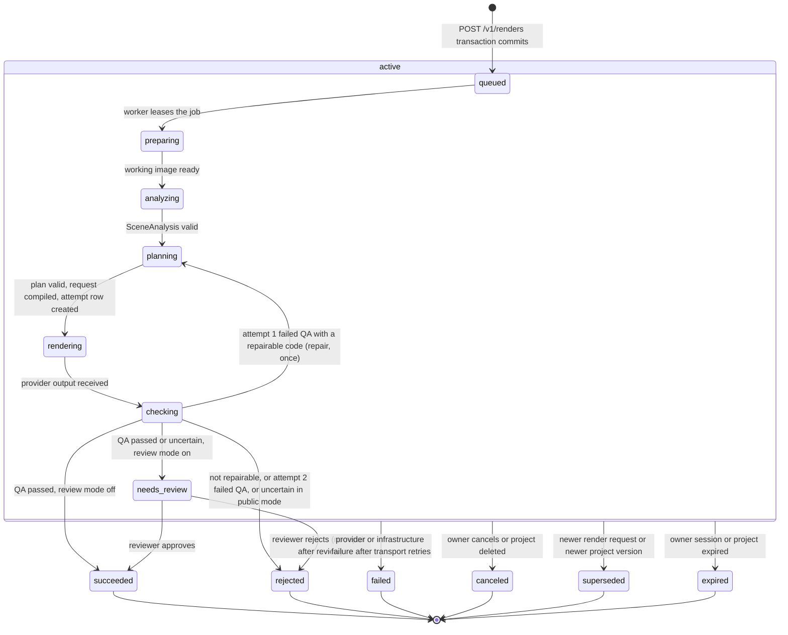

# Render pipeline specification

This specification defines how Holiday turns one source image and one set of user choices (holiday, style, lighting mode) into one accepted variant: the concepts, the normative lifecycle state machines, the contract of every pipeline stage, the models used, the schemas exchanged between stages, the quality gates, the single repair, compositing and resolution rules, lighting modes, the latency budget, model-behavior risks, provenance mechanics and cost recording. It is written for the engineers and AI coding agents who implement `apps/workers`, `@holiday/core` and `@holiday/server`; where another document owns a topic, this one states one sentence and links to it.

**Owns:** concepts (project, source asset, variant, job, attempt, repair); variant key and reuse; all lifecycle state machines; stage contracts; model roster; coordinate and schema conventions; scene analysis, decoration plan, prompt compilation, rendering, quality checks and repair; compositing and resolution; lighting modes; latency budget; moderation and model-behavior risks; provenance and labeling mechanics; cost recording.
**Baseline:** planning baseline 2026-11-09; external facts retrieved 2026-11-08.

## Concepts

The nouns below are used with exactly these meanings in every Holiday document, in code, in database columns and in analytics. One-sentence definitions of every term are also in the [glossary](../glossary.md#rendering-terms); this section is the normative home for their semantics.

### Project and source model

| Term | Definition | Identity and cardinality |
| --- | --- | --- |
| Project | One owner-scoped place being decorated: one resolved property, or one address-free upload subject. It holds the project's source assets, the current selections (`activeSourceAssetId`, `holidayId`, `style`, `lightingMode`) and `projectVersion`. A different address creates a new project; replacing the photo or the Street View viewpoint of the same place stays inside the project. | `projectId`; `projectVersion` increments on every change to the active source or viewpoint. At most one non-terminal render job per project. |
| Property | The address-resolved target location of a project: place ID, target point, precision, multi-unit flag. Address mechanics are in the [address spec](address-and-street-view.md#property-resolution-and-precision). | One per address-path project; none for upload-first projects. |
| Source asset | One immutable source image record of kind `street_view`, `upload` or `fixture`, with the states in [Lifecycle state machines](#lifecycle-state-machines). A Street View source asset is identified by (panorama ID, heading, pitch, fov, size); if a refetch shows the panorama changed, a new source asset is created and the user is told ([address spec](address-and-street-view.md#panorama-changes-blur-and-takedown)). The confirmed scene type (`sceneType` and its attribute) belongs to the source asset and is fixed once a render job exists on it; a later correction creates a child source asset (same bytes, new ID). | `sourceAssetId`; a project holds zero or more; at most one is active. Pixels of a `street_view` asset may live only in worker memory depending on the [source mode](address-and-street-view.md#street-view-source-modes). |
| Working image | The normalized raster derived from the source asset for one job (orientation applied, sRGB, resampled to the working grid in [Compositing and resolution](#compositing-and-resolution)). The source asset is never modified. | Not an entity; its width, height, checksum and resampler are recorded on the job and copied to each attempt. |
| Scene analysis | The structured description of what is visible in the working image (anchors, preserve and access regions, people, blur regions, lighting, season cues, quality flags). Holiday-independent. | `sceneAnalysisId`; keyed by (`sourceAssetId`, `analysisModel`, `analysisPromptVersion`, working grid) and reused across variants of the same source. |
| Decoration plan | The validated, deterministic list of placements and preserve instructions for one attempt, built from the scene analysis, the holiday pack's scene section, the style, the style kit and the lighting mode. | One per render attempt (`planVersion` 1 for the initial attempt, 2 for the repair). |
| Compiled request | The provider-specific edit request (image, instruction text, mask, parameters) produced from a decoration plan by deterministic code. | One per attempt; its hash and `compilerVersion` are recorded. |
| Render request | A user action that asks for a variant: `POST /v1/renders` with `{projectId, projectVersion, holidayId, style, lightingMode}` ([payload](data-and-api.md#http-api)). | May be served from cache (no job) or create one job. |
| Render job | One attempt to produce one variant. Owns the lifecycle state, the input snapshot (variant-key fields frozen at creation), the timestamps and the spend reservation. | `renderJobId` equals the queue job ID ([architecture](../architecture.md#jobs-and-queue)). At most one non-terminal job per project. |
| Render attempt | One paid image-edit provider call inside a job, with its own row, provider operation ID, source checksum, reserved and settled cost and outcome. | `attemptNumber` 1 or 2; at most 2 per job (initial plus one repair). |
| Repair | The single re-plan after a QA rejection of attempt 1, always from the original source and the same scene analysis, with failure-informed constraints; it creates attempt 2 and is the only way a job has two attempts. | At most one per job. |
| Transport retry | Infrastructure re-dispatch of the same attempt after a lease loss, connection failure or timeout. It must query the recorded provider operation first and never creates a new paid attempt. | Bounded per attempt (default 2, configuration). |
| User retry | A new render job on the same project, created by a new render request after `rejected` or `failed`. | Subject to allowance and attempt caps ([data-and-api](data-and-api.md#allowance-quotas-and-rate-limits)). |
| Judge result | The structured verdict of the quality checks on one attempt: critical and major failure codes, per-placement adherence, scores, confidence. | One per attempt (plus one escalation result when escalated). |
| Accepted variant | The output of a job that reached `succeeded`: a render asset with the composited (or relit) image, its provenance metadata and its variant key. **Preview** is the user-facing word for an accepted variant shown with the "AI preview" label. | At most one per variant key per owner. |
| Variant key | (`sourceAssetId`, `holidayId`, `style`, `lightingMode`, `holidayPackVersion` as MAJOR.MINOR, `compilerVersion`). | The cache key for reuse; see [Variant key and reuse](#variant-key-and-reuse). |

Content terms used by the pipeline (holiday, occurrence, holiday pack, scene section, scene type, style, lighting mode, style kit, brief) are owned by the [holidays spec](holidays-and-content.md#holiday-model); the product side of style kits is owned by the [commerce spec](commerce.md#style-kits-and-products).

### Invariants

1. Every variant starts from the original source asset, never from a previous output. A failed or rejected output is never used as an edit input.
2. There are no free-text prompts in the US Release. Users choose holiday, style and lighting mode; everything the model receives is compiled from reviewed pack content, the scene analysis and the kit specs.
3. The pipeline never presents a synthesized building, a neighboring building or a placeholder as the user's place. Discovery and confirmation rules that enforce this before a job exists are in the [address spec](address-and-street-view.md#match-confidence-and-auto-start).
4. No address, place name, unit, resident or user-typed text ever reaches a model, a prompt, a log line or an analytics event. The compiler's input type has no such fields by construction.
5. `AssetPermission` is evaluated at submission and again immediately before any provider call; `unknown` evaluates as denied for live traffic ([rights vocabulary](../glossary.md#rights-and-permissions)). Each evaluation is stored in `permission_evaluations`, and the job, each plan and each attempt carry the `permissionEvaluationId` they relied on.
6. A job in any terminal state other than `succeeded`, and any job whose project was deleted, never publishes an output, even if a late provider response arrives.
7. Stages are states, not necessarily separate provider calls; analysis and triage may be one call, and deterministic checks run alongside the judge.
8. Fixture-mode runs are labeled as fixtures everywhere (ledger, metrics, evidence) and never count as live validation.

## Variant key and reuse

### The key

A variant is identified by (`sourceAssetId`, `holidayId`, `style`, `lightingMode`, `holidayPackVersion` MAJOR.MINOR, `compilerVersion`). The server stamps `holidayPackVersion` and `compilerVersion` from current configuration when it creates the job; the client never sends content versions. `compilerVersion` identifies the deterministic planning-and-compilation code as a whole (plan builder, validator and the per-provider compiler with its templates), so a change to placement logic, prompt templates, the selected provider or its pinned model snapshot that alters compiled output bumps it. The full `MAJOR.MINOR.PATCH` pack version is recorded on the job for audit; only MAJOR.MINOR participates in the key because PATCH versions are copy fixes that do not change rendering ([pack versioning](holidays-and-content.md#holiday-packs)).

### Cache lookup at `POST /v1/renders`

1. Resolve the owner (anonymous session or user), the project and its active source asset; check `projectVersion` (`STALE_PROJECT_VERSION` on mismatch).
2. Compute the variant key. If the owner already holds an accepted variant for that key whose render asset is not expired or deleted, whose source asset is `ready` (not `stale`, `expired` or `deleted`) and whose evaluated permission still allows `display`, return `200` with the variant. No job is created and no allowance is consumed. The request still emits `render_requested` (property schema in [analytics events](data-and-api.md#analytics-events)); the display emits `variant_viewed`.
3. Otherwise run the pre-job checks in the order owned by [data-and-api](data-and-api.md#http-api) (source readiness and permission, content cell, allowance, attempt cap, device backstop, budget, provider availability, capacity). Values are in the [economics spec](economics.md#capacity-and-spend-ceilings).
4. In one database transaction: supersede any non-terminal job on the project (unless its key equals the new key, in which case return `202` with the in-flight job), insert the job with its input snapshot, reserve worst-case spend ([Cost recording](#cost-recording)) and enqueue with the project as singleton key ([architecture](../architecture.md#jobs-and-queue)). Return `202` with `{renderJobId, state, queuePosition}`.

Variants are never shared across owners. Two owners who decorate the same address each get their own render; this keeps private-address outputs private and makes deletion per owner exact.

### Invalidation

| Change | Effect on existing accepted variants | Effect on new requests |
| --- | --- | --- |
| Pack PATCH release | None. | None (same key). |
| Pack MAJOR.MINOR release | Remain viewable until retention expiry. | New key: a new job renders with the new pack. |
| Style kit version published without a pack bump | None. | None (same key). The plan builder uses the kit version seeded from the stamped pack version, and kit content that changes a plan is a pack MINOR bump, which changes the key ([style kits](holidays-and-content.md#style-kits)). |
| `compilerVersion` change (templates, placement logic, provider or snapshot change) | Remain viewable. | New key. |
| Source asset replaced (new upload, new viewpoint, Street View refetch mismatch creating a new asset) | Remain viewable under the old source while permitted; the project's active source changes and `projectVersion` increments. | New key. |
| Source asset `stale`, `expired` or `deleted`, or permission revoked | Hidden immediately; purged per the [retention schedule](privacy-safety-legal.md#retention-schedule) and the address spec's purge rules. | Cache miss; a `stale` Street View source first goes through revalidation ([address spec](address-and-street-view.md#panorama-changes-blur-and-takedown)). |
| Render asset retention expiry | Removed. | Cache miss; a new job renders again. |

### Superseding and coalescing rapid switches

- Client: control changes (holiday, style, lighting mode) are debounced; the client waits a short quiet period (default 400 ms, configuration) after the last change before calling `POST /v1/renders`, and shows a cached variant instantly when the key already exists locally ([experience spec](experience.md#changing-holiday-style-and-lighting)).
- Server: a new render request on a project with a non-terminal job supersedes that job (`superseded`) unless the keys are equal (the in-flight job is returned). A `projectVersion` increment (source or viewpoint change) supersedes any non-terminal job.
- A superseded job's in-flight paid attempt may still bill; its cost is settled and counts toward the owner's paid-attempt cap, but no allowance is consumed because no variant is accepted.
- One non-terminal job per project is enforced twice: by the queue singleton key and by a partial unique index ([idempotency and concurrency](data-and-api.md#idempotency-and-concurrency)).
- Idempotency: `POST /v1/renders` carries an `Idempotency-Key`; same key and same request hash returns the existing job, same key and different hash returns `IDEMPOTENCY_CONFLICT` ([data-and-api](data-and-api.md#idempotency-and-concurrency)).

## Lifecycle state machines

### Render job



Non-terminal states: `queued`, `preparing`, `analyzing`, `planning`, `rendering`, `checking`, `needs_review`. Terminal states: `succeeded`, `rejected`, `failed`, `canceled`, `superseded`, `expired`. `needs_review` exists only when review mode is `pre_delivery` ([Review mode](#review-mode)).

- `rejected` means an output existed and was not accepted: a QA rejection with no repair remaining (attempt 2 failed, or attempt 1 failed with a non-repairable code) or a reviewer rejection. It carries `rejectionReason` ∈ {`qa_critical`, `qa_uncertain`, `reviewer_rejected`} and the final judge result's codes, and is surfaced as `RENDER_REJECTED`.
- `failed` covers every non-QA reason a job cannot produce an output. It carries `failureKind` ∈ {`provider_error`, `timeout`, `policy_denied`, `moderation_blocked`, `source_unavailable`, `source_rejected`, `unknown_outcome`, `internal_error`}. `source_rejected` means the source was found unsuitable before any paid edit and carries `failureDetail` ∈ {`no_usable_anchors`, `house_number_mismatch`, `facade_not_in_frame`, `owner_blurred`}. `internal_error` is a Holiday defect (a compiled request the provider rejects as invalid, a missing scene section, a worker exception outside a provider call) and alerts operations.

| Transition | Trigger | Guard | Side effects | Timestamp written | UI label after | Analytics event |
| --- | --- | --- | --- | --- | --- | --- |
| (none) → `queued` | `POST /v1/renders` passes the pre-job checks and is a cache miss | Owner matches; `projectVersion` current; source `ready`; permission allows `aiProcess` and `edit`; allowance, attempt cap, ceilings and capacity pass | One transaction: supersede prior non-terminal job; store the permission evaluation; insert job with input snapshot and `permissionEvaluationId`; ledger reservation; enqueue with project singleton key | `requestedAt`; `sourceReadyAt` copied from the source asset | "Getting your photo ready" | `render_requested` |
| `queued` → `preparing` | Worker fetches the job from the queue | Job still `queued`; project not deleted; `projectVersion` unchanged | Heartbeat starts; abort signal registered | `startedAt` | "Getting your photo ready" | none |
| `preparing` → `analyzing` | Working image produced | Permission re-evaluated and allowed; source still `ready`; decode and dimension checks pass | Working image in memory (and in storage only where `store` is allowed); checksum recorded | none | "Planning the decorations" | none |
| `analyzing` → `planning` | `SceneAnalysis` parsed and validated (or reused) | Schema valid; confidence floors applied | `scene_analyses` row written or reused; analysis ledger entry settled | none | "Planning the decorations" | none |
| `planning` → `rendering` | Plan built, validated and compiled | At least one placement survives validation; remaining time budget allows an attempt; owner paid-attempt cap not exceeded | `decoration_plans` row; `render_attempts` row created before dispatch | `renderStartedAt` (attempt dispatched) | "Decorating" | none |
| `rendering` → `checking` | Provider returns an image | Image decodes; dimensions recorded | Attempt outcome `succeeded`; attempt cost settled; raw output held in memory (stored only as the delivered derivative) | `renderCompletedAt` | "Checking the details" | none |
| `checking` → `succeeded` | QA passed and review mode is `sampled_audit` | No critical code; majors within policy; confidence above threshold | Render asset published; download file produced before `succeededAt` when the variant is `downloadable` ([Provenance and labeling](#provenance-and-labeling)); allowance consumed; reservation released; variant cached | `qaPassedAt`, `succeededAt`, `terminalAt` | Result shown | `render_succeeded` |
| `checking` → `needs_review` | QA passed or uncertain and review mode is `pre_delivery` | As above, or uncertain | Review queue item created; output held unpublished; download file produced and held unpublished when the variant is `downloadable` | `qaPassedAt` only when QA passed | "A person is checking your preview" | none |
| `checking` → `planning` | Attempt 1 failed QA with at least one repairable code and no terminal code | `attemptNumber` = 1; `maxJobDuration − elapsed > repairBudgetS` ([Latency budget](#latency-budget)); owner paid-attempt cap allows a second attempt | Repair constraints recorded on the job; plan version 2 built from the original source and the same analysis | none | "Planning the decorations" | none |
| `checking` → `rejected` | QA failed on attempt 2, or attempt 1 failed with a terminal code, or the verdict is uncertain in `sampled_audit` mode | — | `rejectionReason` = `qa_critical` or `qa_uncertain`; reservation settled to actual spend; no allowance consumed; `RENDER_REJECTED` returned to the client | `terminalAt` | Rejected state (copy in the [experience spec](experience.md#copy-deck)) | `render_rejected` |
| `planning` → `failed` | Validator leaves zero placements | — | `failureKind` = `source_rejected`, `failureDetail` = `no_usable_anchors`; no attempt is made; reservation released | `terminalAt` | Failed state; the UI offers another viewpoint or photo | `render_failed` |
| `needs_review` → `succeeded` | Reviewer approves | Reviewer role; decision recorded in `reviews` | As `checking` → `succeeded` | `reviewCompletedAt`, `succeededAt`, `terminalAt` | Result shown | `render_succeeded` |
| `needs_review` → `rejected` | Reviewer rejects | Reason recorded | No repair after review; as `checking` → `rejected` with `rejectionReason` = `reviewer_rejected`; held output and download file deleted | `reviewCompletedAt`, `terminalAt` | Rejected state | `render_rejected` |
| non-terminal → `canceled` | `POST /v1/renders/:id/cancel` by the owner, or project deletion | Job non-terminal | Abort signal; provider cancel where supported; in-flight attempt may still bill; settle on late response | `terminalAt` | Canceled state | `render_canceled` |
| non-terminal → `superseded` | Newer render request on the project, or `projectVersion` increment | Job non-terminal | As canceled; the newer job's labels are shown instead | `terminalAt` | none (new job shown) | `render_superseded` |
| non-terminal → `expired` | Owner session or project expiry sweep reaches a non-terminal job | Job non-terminal | Abort; settle; release | `terminalAt` | none | `render_expired` |
| non-terminal → `failed` | Provider or infrastructure failure after transport retries (`provider_error`), `maxJobDuration` exceeded (`timeout`), permission denied at re-evaluation (`policy_denied`), provider safety refusal (`moderation_blocked`), source missing or stale (`source_unavailable`), source unsuitable before any paid edit (`source_rejected` with its `failureDetail`), unresolved outcome (`unknown_outcome`), or a Holiday defect (`internal_error`) | — | Reservation settled or left for reconciliation (`unknown_outcome`); `PROVIDER_UNAVAILABLE` or the mapped error returned ([error codes](data-and-api.md#error-codes)) | `terminalAt` | Failed state | `render_failed` |

Rules that apply to every transition:

- State changes are compare-and-set updates on the job row (`WHERE state = <expected>`); a lost race means another actor terminated the job and the worker stops.
- The worker re-reads the job state before every stage and before writing a render asset. A terminal job never publishes.
- Dead-lettered queue jobs are settled by the dead-letter consumer as `failed` with `failureKind` `unknown_outcome` when an attempt was in flight and its status could not be recovered, otherwise `provider_error`, `timeout` or `internal_error` according to the last recorded cause ([architecture](../architecture.md#jobs-and-queue)). Worker exceptions outside a provider call end `failed`/`internal_error` and record the error class on the job.
- No percentages are ever shown. The UI labels are exactly the strings in the table below; the [experience spec](experience.md#waiting-and-progress) owns their copy keys and the waiting screen.

| State | UI stage label |
| --- | --- |
| `queued`, `preparing` | Getting your photo ready |
| `analyzing`, `planning` | Planning the decorations |
| `rendering` | Decorating |
| `checking` | Checking the details |
| `needs_review` | A person is checking your preview |

Timestamps on a render job (UTC, nullable until written):

| Field | Meaning |
| --- | --- |
| `requestedAt` | `POST /v1/renders` transaction committed. |
| `sourceReadyAt` | The instant the job's source asset reached `ready` and became the project's active source (Street View and fixture assets: at confirmation; uploads: when screening passed). Copied onto the job. |
| `startedAt` | Worker lease; entry to `preparing`. |
| `renderStartedAt` | Latest attempt dispatched to the provider (each attempt row carries its own). |
| `renderCompletedAt` | Latest attempt's output received. |
| `qaPassedAt` | Automated quality checks passed. |
| `reviewCompletedAt` | Human review decision recorded (`pre_delivery` mode only). |
| `succeededAt` | Entry to `succeeded`. |
| `terminalAt` | Entry to any terminal state. |

The latency metric fixed by [D-14](../decisions.md#d-14) is the automated-path p90 of `qaPassedAt − max(requestedAt, sourceReadyAt)`. Taking the later of the two instants measures the wait the user experiences once both a render was asked for and the source was ready, for a first job and for later variants of the same source alike. Discovery and screening time before that, and review wait (`reviewCompletedAt − qaPassedAt`), are reported separately and never inside the metric ([Latency budget](#latency-budget)).

### Source asset

| State | Meaning | Entered by | Exits to |
| --- | --- | --- | --- |
| `pending_upload` | Upload URL issued; bytes not yet received. | `POST /v1/uploads` | `quarantined`, `expired` |
| `quarantined` | Bytes received into the quarantine prefix; not yet validated. | `POST /v1/uploads/:id/complete` | `screening`, `failed` |
| `screening` | Server-side validation and content admission running ([uploads spec](uploads.md#content-admission)). An upload held for human review stays here with `holdForReview` until a reviewer decides or the hold window ends. | Validation job start | `ready`, `declined`, `failed` |
| `ready` | Usable as a job source: validated, admitted, permission evaluable. Street View and fixture assets are created directly in `ready` at confirmation. | Screening pass; `PUT /v1/projects/:id/source` for Street View | `declined`, `stale`, `expired`, `deleted` |
| `declined` | Refused for use; terminal for that input. Reasons: content admission or validation (`UPLOAD_DECLINED` and the other upload codes), a render-time provider refusal (internal reason `provider_refused`; [uploads spec](uploads.md#content-admission)), or for `street_view` an owner-blurred facade ([address spec](address-and-street-view.md#panorama-changes-blur-and-takedown)) or a Tier B mismatch ([address spec](address-and-street-view.md#match-confidence-and-auto-start)). | Screening job; reviewer; render job | `deleted` |
| `failed` | Validation or infrastructure failure. | Screening | `deleted` |
| `stale` | Street View revalidation found the panorama changed or removed; variants hidden pending purge ([address spec](address-and-street-view.md#panorama-changes-blur-and-takedown)). | Revalidation job | `deleted` |
| `expired` | Retention reached ([retention schedule](privacy-safety-legal.md#retention-schedule)). | Retention sweep | `deleted` |
| `deleted` | Tombstoned; objects removed. | Deletion job | — |

A render job may be created only on a `ready` source. `preparing` re-checks the state; a source that became `declined`, `stale`, `expired` or `deleted` fails the job with `source_unavailable`. A scene-type correction on a source that already has a render job creates a child source asset (same bytes, new ID, `derivedFromSourceAssetId` set) directly in `ready`; the original keeps its scene type, so existing analyses and variants stay valid.

### Discovery outcome

Discovery runs before any job exists and never enqueues a render; on `auto_start` the client immediately calls `POST /v1/renders` so allowance, verification and spend checks are uniform. The algorithm, signals and thresholds are in the [address spec](address-and-street-view.md#match-confidence-and-auto-start).

| `matchClass` | Meaning for the pipeline | What follows |
| --- | --- | --- |
| `auto_start` | Primary candidate is confident; source asset created in `ready` at confirmation. | Client calls `POST /v1/renders` at once (in `display_only` source mode the photo prompt follows instead). |
| `confirm` | Ambiguous; up to 3 candidates (1 primary plus up to 2 alternates) shown. | User confirms a candidate (`PUT /v1/projects/:id/source`), then the client requests a render. |
| `skip_to_upload` | No usable imagery; `reason` ∈ {`no_imagery`, `multi_unit`, `low_precision`, `blocked_address`, `out_of_scope`, `error`}. | Photo prompt; the upload path produces the source asset. |

### Review mode

Review mode is a configuration value set per scene type, `reviewMode` ∈ {`pre_delivery`, `sampled_audit`}, changeable without a deploy and audited, and copied onto each job at creation; the decision is [D-14](../decisions.md#d-14) and the per-scene-type switch criteria are in the [quality spec](quality-and-benchmark.md#pilot-evaluation). A scene type that has not met them stays in `pre_delivery` during capped rollout. In development and test the default is `sampled_audit` for every scene type (configuration, `review.mode`), so local renders deliver without a reviewer; staging and production default to `pre_delivery`.

- `pre_delivery` (private pilot): every attempt that passes automated QA, and every uncertain verdict, enters `needs_review`. A reviewer approves or rejects in the internal review queue ([internal operations API](data-and-api.md#internal-operations-api)); the decision, reviewer and reason are stored in `reviews`. There is no repair after review. The user sees "A person is checking your preview". An `evening` job's own daylight base is never published in this mode: only the reviewed `evening` variant is ([Repair and retries](#repair-and-retries), rule 10).
- `sampled_audit` (public rollout): automated QA gates delivery; uncertain verdicts are rejected after one escalation; a sample of delivered variants (default 5%, configuration; owned by the [quality spec](quality-and-benchmark.md#pilot-evaluation)) is queued for post-delivery audit, and audit misses feed judge recalibration ([quality spec](quality-and-benchmark.md#qa-judge-calibration)). An audited variant found to have a critical failure is withdrawn (hidden, share grants revoked) and the owner is notified by the experience spec's copy.

### Cancellation and late-result suppression

1. `POST /v1/renders/:id/cancel` sets `canceled` by compare-and-set, publishes the queue cancellation and fires the worker's abort signal. The adapter calls the provider's cancel method where one exists.
2. An in-flight paid attempt may still complete at the provider; cancellation is not a refund. Its cost is settled when the response or the reconciliation job observes it. Every termination path (cancel, supersede, expiry, project deletion; `terminateRenderJob`) marks each sent attempt still `pending` (one with a provider operation ID) as `unknown` in its transition transaction, and each attempt still `pending` that was never sent (no provider operation ID, because the editors report the operation before they send) as `canceled`. The editors record the operation ID before they send, and that write succeeds only on an attempt still `pending` whose job is not terminal. The single exception is the re-dispatch of an operation the provider never saw (`unknown_operation`, idempotent provider), which accepts an attempt a stopped delivery left `unknown` and reopens it as `pending`. An attempt a termination has already closed stops the run before the send, so nothing is sent; a transport retry is refused before the send once a termination has marked the sent attempt `unknown` or ended the job. A sent attempt's reservation stays open until the late response or reconciliation settles it; the reservation of an attempt that was never sent is released with the job's other untouched ones, and that attempt counts toward no attempt quota.
3. Any late provider response for a job that is `canceled`, `superseded`, `expired`, `failed` or whose project was deleted settles cost and discards pixels. Transient Street View pixels are dropped from memory immediately.
4. The render asset write is guarded by the job state (`WHERE state = 'checking'` or `'needs_review'` as appropriate) so that a stale worker cannot publish.
5. SSE consumers receive the terminal event and stop ([live updates](data-and-api.md#live-updates)).

## Stage contracts


Upload screening (format validation, re-encoding, content admission, people detection) happens before the job and is owned by the [uploads spec](uploads.md#content-admission). Street View discovery, confirmation and the copyright gate happen before the job and are owned by the [address spec](address-and-street-view.md#end-to-end-sequence). Code placement: zod schemas, pure plan building, validation and compilation live in `@holiday/core` (no I/O; pack content is passed in as data); provider adapters, storage, ledger and persistence live in `@holiday/server`; the stage orchestration is the render job in `apps/workers` ([architecture](../architecture.md#packages-and-boundaries)).

An `evening` job changes the chain after `analyzing`: it does not decorate and relight in one edit. It relights the accepted `source` variant of the same variant key (a relight attempt and, at most, its repair, each registered to, checked against and judged against that daylight image), or, when no such variant exists, first renders that daylight look itself through the full chain above and then relights it ([Lighting modes](#lighting-modes)).

### Preparing

| Item | Contract |
| --- | --- |
| Input | Job input snapshot (`sourceAssetId`, kind, source mode, viewpoint descriptor or object key, variant-key fields); current `AssetPermission` evaluation. |
| Steps | (1) Re-evaluate `AssetPermission`; deny → `failed`/`policy_denied`. (2) Load pixels: `upload` → normalized original (the re-encoded, metadata-stripped upload) from storage; `street_view` in `persist` mode → stored object; `street_view` in `transient` mode → fetch the Static image by panorama ID and view parameters into memory ([source modes](address-and-street-view.md#street-view-source-modes)); `fixture` → fixture file. (3) Compute the checksum; for Street View compare with `source_checksum_sha256` of the most recent `render_attempts` row for the same source asset (persist mode: the stored object's checksum) and treat a mismatch as a changed panorama (new source asset; this job fails `source_unavailable`; the user is told per the address spec). (4) Normalize to the working grid ([Compositing and resolution](#compositing-and-resolution)): decode, apply orientation, convert to sRGB, resample with the recorded resampler, record width, height and checksum. (5) Write the working image to storage only for `upload`, `fixture` and `persist` sources; the storage client refuses `street_view` writes when `store` is not allowed ([storage](../architecture.md#storage-and-media-delivery)). |
| Output | Working image in worker memory; `workingWidth`, `workingHeight`, `workingChecksum`, `resampler` on the job. |
| Component | `apps/workers` render job; `@holiday/server` storage client and `google-street-view` adapter. |
| Model or provider | None (Street View Static fetch in `transient` mode). |
| Validation | Source state `ready`; decode success; short edge at or above the minimum in the uploads spec; dimensions within limits. |
| Failure handling | Permission denied → `failed`/`policy_denied`. Source missing, stale or deleted → `failed`/`source_unavailable`. Static fetch error → transport retry, then `failed`/`source_unavailable`. |
| Cost recorded | One ledger entry per Static fetch (SKU Static Street View) in `transient` mode; none otherwise. |

### Analyzing

| Item | Contract |
| --- | --- |
| Input | Working image; the confirmed `sceneType` and attribute (`buildingForm` or `roomType`) of the source asset (Street View sources are `house_exterior`; upload scene type comes from detection with the user's correction, [uploads spec](uploads.md#scene-type-and-photo-guidance)); the source kind (it selects the target facade rule); the analysis prompt version. No holiday, address or user text. |
| Steps | Look up a reusable analysis by (`sourceAssetId`, `analysisModel`, `analysisPromptVersion`, working grid); if absent, call the vision model with the `SceneAnalysis` JSON schema as the structured-output format; parse with zod; apply confidence floors; persist. |
| Output | `SceneAnalysis` ([schema](#scene-analysis)) in `scene_analyses` with `analysisModel`, `analysisPromptVersion`, `schemaVersion`, token usage, elapsed time. |
| Component | `apps/workers` render job; `@holiday/server` `vision` adapter (`VisionModel.analyzeScene(image, sceneType)`). |
| Model or provider | Vision model per the [Model roster](#model-roster) ([D-43](../decisions.md#d-43)). |
| Validation | zod parse; every box inside 0–1 with `x0 < x1`, `y0 < y1`; required fields present; the model's `sceneType` recorded alongside the confirmed value, with `sceneTypeMismatch` set by the server when they differ (the confirmed value wins for planning). One re-ask with the validation errors appended (default 1, configuration) on schema failure. |
| Failure handling | Model error after transport retries → `failed`/`provider_error`. Provider safety refusal → `failed`/`moderation_blocked` (terminal; [Moderation and model-behavior risks](#moderation-and-model-behavior-risks)). Persistent schema failure → `failed`/`provider_error`. For `street_view` sources, a Tier B demotion ([address spec](address-and-street-view.md#match-confidence-and-auto-start)) or an owner-blurred target facade ([address spec](address-and-street-view.md#panorama-changes-blur-and-takedown)) sets the source asset `declined` and ends the job `failed`/`source_rejected` with `failureDetail` `house_number_mismatch`, `facade_not_in_frame` or `owner_blurred`, before any paid edit and without consuming allowance. |
| Cost recorded | One ledger entry (stage `analyzing`, provider, model, input and output tokens, unit price); zero when reused. |

Analysis of a Street View-sourced image is itself inside the Street View licensing track ([licensing outcomes and activation](address-and-street-view.md#licensing-outcomes-and-activation)), so live analysis of `street_view` sources is gated by the `street_view_ai` activation state and by `aiProcess`, exactly like editing. Uploads are unaffected.

### Planning

| Item | Contract |
| --- | --- |
| Input | `SceneAnalysis`; the pack's scene section for (`holidayId`, `sceneType`, attribute) at the stamped `holidayPackVersion` ([pack schema](holidays-and-content.md#pack-schema)); `style`; `lightingMode`; the style kit version for (holiday, scene type) seeded from that pack version ([style kits](holidays-and-content.md#style-kits)); repair constraints when `planVersion` = 2. |
| Steps | Build ([Decoration plan](#decoration-plan)) → validate → compile ([Prompt compilation](#prompt-compilation)). All three are deterministic, pure functions in `@holiday/core`. |
| Output | `DecorationPlan` in `decoration_plans` (with `planVersion`, `compilerVersion`, `holidayPackVersion`, `styleKitVersionId`, compiled request hash and text); `render_attempts` row created with reserved cost before dispatch. |
| Component | `@holiday/core` plan builder, validator and compiler; `apps/workers` orchestration. |
| Model or provider | None. |
| Validation | The validator rules table in [Decoration plan](#decoration-plan); golden-file tests for compilation. |
| Failure handling | Zero placements → `failed`/`source_rejected` with `failureDetail` `no_usable_anchors` (no attempt is made; the UI offers another viewpoint or photo). Missing scene section is an invariant violation (the API refuses unoffered content cells before a job exists) → `failed`/`internal_error`, operations alerted. |
| Cost recorded | None. |

### Render stage

| Item | Contract |
| --- | --- |
| Input | `CompiledRequest`; working image; optional mask; `attemptNumber`. |
| Steps | Check the owner's paid-attempt cap and the remaining time budget; dispatch through `ImageEditor.edit` with the attempt ID as the provider idempotency key where supported; record the provider operation ID as soon as it is returned; await with the per-call timeout; on loss of connection or timeout run status recovery through `ImageEditor.getOperation` before any re-dispatch ([Rendering](#rendering)). |
| Output | Raw output image (bytes, width, height, format), provider usage, provider metadata (including any embedded provenance manifest), model snapshot; attempt outcome. |
| Component | `@holiday/server` `image-editors` adapters; `apps/workers`. |
| Model or provider | Image-edit provider per [D-42](../decisions.md#d-42) and the per-source-kind routing table. |
| Validation | Response contains exactly one decodable image at the requested dimensions; otherwise the attempt fails QA with `camera_changed` ([Quality checks](#quality-checks)). |
| Failure handling | Provider error after transport retries → `failed`/`provider_error`; timeout after status recovery → `failed`/`timeout`; safety refusal → `failed`/`moderation_blocked`, never retried; status unknown after recovery → attempt outcome `unknown`, job `failed`/`unknown_outcome`, reconciliation job settles cost. |
| Cost recorded | Attempt ledger entry reserved at creation and settled from the provider's usage response (tokens or images). |

### Localizing

| Item | Contract |
| --- | --- |
| Input | The working image; the registered raw output (the candidate on the working grid); the plan's placements as hints (`id`, `kitItemId`, `specText`, region as position words); the localization prompt version. No holiday, address or user text. |
| Steps | Runs at the start of `checking`, after registration, for a decorating attempt in `source` lighting (both attempts of a daylight job and the base attempt of an evening job) whose output registered. The worker re-evaluates `AssetPermission`, reads the kill switches ([Repair and retries](#repair-and-retries), rule 5), and calls `VisionModel.localizeAdditions` with two images in this order, the working image and the aligned candidate, under the job's vision retry policy and a 45 s timeout (`localizationTimeoutMs`; the adapter's own default is 30 s). The model returns `added[]` (`label`, `box` normalized to the candidate, `placementId` or null) with one box per decoration (an item that turns a corner, such as a garland that rounds a column, is split into several boxes that repeat the label and `placementId`), and `otherChanges[]` (`description`, `box`) for every other visible difference: an object moved, removed or restyled. The adapter orders each box's corners, drops degenerate boxes, nulls a `placementId` that names no planned placement and caps each list at 48; the job clamps the boxes to the frame. |
| Output | The `LocalizationRecord` stored in `render_attempts.composite_mask.localization` ([data-and-api](data-and-api.md#entities)): `status` (`localized` or `fallback`), model, prompt version, `items`, `otherChanges`, the items the coverage cap `dropped`, `dilationPx`, `coverageBeforeCap`, `coverage`, usage, ledger entry and `elapsedMs`. An `otherChanges` entry whose box lies less than 25% inside the hard keep-mask (`restoredHintMaxKeptShare`, 0.25) reaches the judge as the hint `restored from the original: <description> (<position>)`, because the paste-back put it back. One whose box lies 25% or more inside reaches it as `unrequested change inside the kept decorations: <description> (<position>)`, which the judge must inspect. |
| Component | `@holiday/server` `vision` adapter (`VisionModel.localizeAdditions`); the render job in `apps/workers`. |
| Model or provider | The vision model per the [Model roster](#model-roster) (prompt `localize-2026.11.0`, structured output, effort `medium`). The fixture vision model returns every planned placement's region as an added item with its `placementId` and no other changes, deterministically. |
| Validation | zod parse of the model output with the shared one re-ask; boxes inside 0–1 with `x0 < x1` and `y0 < y1`. |
| Failure handling | A call that fails after its retries, a refusal or unparseable output, a pause or a denied permission is never a job failure: the record has `status` `fallback` with a `fallbackReason` and the plan-only mask is used (the paste-back keeps only the plan's tight shapes). A recorded localization is reused on redelivery, so a redelivered job never pays a second call. |
| Cost recorded | One `vision_call` ledger entry (stage `localizing`, priced from the reported usage, list price $0.02 otherwise) settled against the attempt's localization reservation in the same transaction that writes the record; a fallback that never reached the model settles nothing. |

### Compositing

| Item | Contract |
| --- | --- |
| Input | Working image; raw output; the plan's placements (regions and mask shapes); the attempt's localization ([Localizing](#localizing)); `lightingMode`; for an evening relight, the daylight base image it started from. |
| Steps | Runs in `checking`. (1) Registration: a same-aspect output of another size is resampled to the working grid; the similarity transform to the working image (to the daylight base in a relight) is estimated over pixels outside the placement shapes; within the limits and with a good fit the output is warped into alignment, otherwise `camera_changed`, no paste-back ([Registration](#registration)). (2) In `source` lighting mode, after [localization](#localizing): build the keep-mask (the union of the placements' mask shapes, boxes and bands dilated by their own amounts, and the localized boxes dilated by 1% of the long edge, minus the privacy and legal exclusions, then feathered; capped at 50% coverage), match the output's color and brightness to the working image over the unedited ring around the mask (photometric alignment), paste back original pixels outside the mask. (3) In `evening` mode (a relight): no paste-back; the aligned output is the candidate, and an output whose warp would leave an uncovered strip deeper than 1% of the long edge is `camera_changed` (reason `uncovered`). (4) In both modes, the embedded Street View attribution rectangles, when configured, are restored verbatim from the working image (from the daylight base in a relight). Details in [Compositing and resolution](#compositing-and-resolution). The example renderer runs the same path with the same configured request settings. |
| Output | Candidate image; composite mask PNG; registration transform; `fidelityMode` ∈ {`composite_additive`, `global_relight`} recorded on the attempt. |
| Component | `@holiday/server` imaging utilities (sharp plus gradient-correlation registration); `apps/workers`. |
| Model or provider | None. |
| Validation | Fixture tests: pixels outside the mask are byte-identical to the working image; synthetic shifted, zoomed and resampled outputs are aligned with no seam; reframing beyond the limits is rejected; a deliberately mismatched exposure trips the seam check, and photometric alignment removes it (globally and for a local tone shift); an `evening` output shifted 31 px is rejected as `uncovered` while a 2 px shift is kept; a decoration the editor drew away from its planned spot survives paste-back when it is localized, and a localized item is cut only by the privacy and legal exclusions, never by a window, door or access protection. |
| Failure handling | Alignment failure is a QA code, not an infrastructure failure. |
| Cost recorded | None (the localization call is recorded under [Localizing](#localizing)). |

### Checking

| Item | Contract |
| --- | --- |
| Input | Working image; candidate (the paste-back composite in `source` mode; the registered relit output in `evening` mode, together with the daylight base image it must match); raw output (for drift metrics); `DecorationPlan`; `SceneAnalysis`; `lightingMode`; the hints from localization. |
| Steps | Deterministic checks → judge call → decision policy ([Quality checks](#quality-checks)). Escalation judge when the verdict is uncertain. An `evening` relight is checked against the daylight base, not the original photograph, and is judged in `relight` mode ([Judge](#judge)). |
| Output | `JudgeResult` in `judge_results` (and an escalation result when escalated); attempt QA outcome; failure codes. |
| Component | `@holiday/server` `vision` adapter (`VisionModel.judge(original, candidate, plan)`); deterministic checks in `@holiday/server` imaging utilities. |
| Model or provider | The judge model and its escalation setting per the [Model roster](#model-roster). |
| Validation | zod parse of `JudgeResult`; codes restricted to the canonical enum; one re-ask on schema failure. |
| Failure handling | Judge unavailable after transport retries → `failed`/`provider_error` (never deliver unchecked); safety refusal on the candidate → treated as `unsafe_or_offensive` and `rejected`. |
| Cost recorded | One ledger entry per judge call (and per escalation). |

### Repair

| Item | Contract |
| --- | --- |
| Input | The job's original working image and `SceneAnalysis`; attempt 1's `JudgeResult` and deterministic codes; the attempt 1 plan. |
| Steps | Build repair constraints from the failure codes ([Repair and retries](#repair-and-retries)); re-enter `planning` with `planVersion` = 2; compile; create attempt 2. Never edits attempt 1's output. |
| Output | Plan version 2; attempt 2. |
| Component | `@holiday/core` (constraint builder is part of the plan builder); `apps/workers`. |
| Model or provider | None beyond the second attempt's render and judge calls. |
| Validation | `attemptNumber` = 1; at least one repairable code and no terminal code; `maxJobDuration − elapsed > repairBudgetS` ([Latency budget](#latency-budget)); owner paid-attempt cap allows it. |
| Failure handling | Any guard fails → `rejected` with attempt 1's codes. |
| Cost recorded | Attempt 2 and judge entries, within the job's original reservation. |

## Model roster

The roster names every model-dependent stage, its default candidate, what it must output, which version fields are recorded, and how it is validated. Provider selection is open: the image-edit provider is [D-42](../decisions.md#d-42) (decided at Gate A from the formal benchmark) and the vision model is [D-43](../decisions.md#d-43). Candidate facts, terms and prices live in the [provider research](../research/image-ai-providers.md#candidate-shortlist); unit costs live in the [cost worksheet](economics.md#cost-worksheet); validation protocols live in the [quality spec](quality-and-benchmark.md#formal-benchmark).

| Stage | Purpose | Default candidate | Compared with | Output contract | Recorded version fields | Validation target and corpus |
| --- | --- | --- | --- | --- | --- | --- |
| Source triage (inside `analyzing`) | Cheap pass for Street View sources: quality flags, people present, blurred regions, multiple buildings, single centered facade, low light. Uploads receive this from the content-admission triage call, which follows the vision leg ([uploads spec](uploads.md#adapters-and-fixture-mode)). | Claude Haiku 5.5 (`claude-haiku-5-5`) | Merged into the analysis call if measurements show no saving | `SceneAnalysis.qualityFlags`, `peopleBoxes`, `protectedBlurRegions`, `lighting` | `triageModel`, `triagePromptVersion` | Flag precision and recall against human labels on the permissioned corpus ([quality spec](quality-and-benchmark.md#permissioned-corpus)) |
| Scene analysis | Anchors, preserve and access regions, hazards, existing decorations, season cues, target facade | Claude Opus 5.5 (`claude-opus-5-5`, `ANTHROPIC_VISION_MODEL`) with structured output, effort `medium` | Claude Sonnet 5.5 (`claude-sonnet-5-5`, the cheaper candidate); comparable OpenAI and Google vision models | `SceneAnalysis` ([schema](#scene-analysis)) | `analysisModel`, `analysisPromptVersion`, `schemaVersion` | Anchor precision and recall per cohort against human boxes; hallucinated-anchor rate ([quality spec](quality-and-benchmark.md#formal-benchmark)) |
| Plan builder and validator | Deterministic placements from pack, kit, style and anchors | Code in `@holiday/core`; no model | — | `DecorationPlan` | `compilerVersion`, `holidayPackVersion`, `styleKitVersionId` | Unit test per validator rule; rule-check pass rate on benchmark analyses |
| Prompt compiler | Provider-specific request from the plan | Code in `@holiday/core`; no model | — | `CompiledRequest` | `compilerVersion` | Golden files per provider; no-address assertion |
| Image editor | Produce the decorated image | Open ([D-42](../decisions.md#d-42)); candidates in the research. Until the decision, the provisional live default is GPT image 2.5 Flare (`gpt-image-2.5-flare`, `OPENAI_IMAGE_MODEL`) at `medium`, with Gemini Nano Banana 2.1 (`gemini-nano-banana-2.1`, `GEMINI_IMAGE_MODEL`) as the configured fallback: with both editor keys set `IMAGE_EDITOR_PREFERENCE` picks (default `openai`), otherwise the editor whose key is set; settings in [Provider parameters](#provider-parameters) | Benchmark arms in the quality spec | Image at the requested size plus usage and provenance metadata | `provider`, `modelSnapshot`, `settingsHash` on each attempt | Structural fidelity, acceptability and appeal gates ([statistics and decision rules](quality-and-benchmark.md#statistics-and-decision-rules)) |
| QA judge | Critical and major codes, per-placement adherence, scores | Claude Opus 5.5 (`claude-opus-5-5`) with structured output, effort `medium` | Claude Sonnet 5.5 (the cheaper candidate); comparable OpenAI and Google vision models | `JudgeResult` ([schema](#quality-checks)) | `judgeModel`, `judgePromptVersion`, `schemaVersion` | Critical-failure recall and precision against reviewer labels; per-code metrics ([judge calibration](quality-and-benchmark.md#qa-judge-calibration)) |
| Escalated judge | Second opinion on uncertain verdicts | The judge model at effort `high` (a separate escalation model is a candidate configuration, evaluated as its own candidate in [judge model selection](quality-and-benchmark.md#qa-judge-calibration)) | — | `JudgeResult` with `escalated: true` | `judgeModel`, `judgePromptVersion`, `escalated: true` on the escalated `judge_results` row | Same labeled set; escalation rate tracked |
| Addition localization | Finds where the editor drew each added decoration, so the paste-back keeps what the editor added wherever it placed it ([Localizing](#localizing)) | Claude Opus 5.5 (`claude-opus-5-5`, `ANTHROPIC_VISION_MODEL`) with structured output, effort `medium` | The judge model; Claude Sonnet 5.5 as the cheaper candidate | `LocalizeAdditionsResult`: `added[]` (`label`, `box`, `placementId` or null) and `otherChanges[]` (`description`, `box`) | `model`, `promptVersion` (`localize-2026.11.0`) on `render_attempts.composite_mask.localization` | Box tightness and recall of added decorations against hand-labeled boxes; unintended changes found; on the 2026-11-09 live bungalow render it boxed all six added decorations and listed the one unintended change (a rocking chair shifted left) in about 9 s for about $0.034 |
| Described-item adherence | Confirms category, color family and count per placement for the `described` relationship ([commerce spec](commerce.md#product-relationships)) | Human in the private pilot; the judge's per-placement adherence once calibrated | — | `JudgeResult.placements[]` | As judge | Agreement with human adherence labels |
| Street View match confidence, Tier B signals | Optional image signals that can only demote a match (house-number reading, facade in frame, occlusion, existing decor), computed inside `analyzing` as part of scene analysis, only when `aiProcess` is allowed and never required | The scene analysis model | — | Owned by the [address spec](address-and-street-view.md#match-confidence-and-auto-start) | `analysisModel`, prompt version | Discovery sample ([address spec](address-and-street-view.md#coverage-probe)) |
| Pilot reviewer | Pre-delivery approval in `pre_delivery` review mode | Human | — | `reviews` row | Reviewer ID | Agreement with the judge; review wait |

Roster rules:

- Structured outputs: Claude requests use `output_config.format` with the JSON schema generated from the zod schema (Anthropic model table cached 2026-10-06, https://platform.claude.com/docs). Adapters for other vendors use their equivalent structured-output mechanism; the zod parse is the only accepted truth.
- Image token cost: an image of about 1024×1024 is roughly 1,400 input tokens on Claude (estimate from the same source; **Verify:** with the token-counting endpoint during the exploratory spike, owner engineering lead). Analysis and judge system prompts are pack-independent so they are prompt-cacheable; the per-call estimates are in the [cost worksheet](economics.md#cost-worksheet).
- Pinning and change control: every call records the model snapshot ID and prompt version; every attempt records `provider`, `modelSnapshot` and `settingsHash` (quality or complexity, thinking level, output size, output format, mask use, reference order). Any change to a model, snapshot, prompt version, `compilerVersion`, pack MAJOR.MINOR or settings is a new configuration that must pass the held-out re-run in the [production pipeline re-benchmark](quality-and-benchmark.md#production-pipeline-re-benchmark) before it serves users.
- Vendor terms travel with the roster: Gemini API terms bar API clients directed at or likely to be accessed by people under 18 and this applies to analysis and judging as much as to editing; OpenAI zero-data-retention eligibility is model-specific; details and citations are in the [provider research](../research/image-ai-providers.md#data-training-and-age-terms). **Verify:** Anthropic API data-retention and training terms for the chosen tier before Gate A (owner engineering lead).
- Every roster vendor is an AI subprocessor that must appear in the subprocessor list ([data-handling rules](privacy-safety-legal.md#data-handling-rules)) and passes the same `aiProcess` gate before each call.
- Street View-sourced analysis and judging are fixture-first and activation-gated ([Analyzing](#analyzing)).

## Coordinate and schema conventions

- Boxes are `[x0, y0, x1, y1]`, normalized to 0–1 on the working image, origin top-left, x to the right, y down, with `x0 < x1` and `y0 < y1`. The working image's `width` and `height` are stored beside every record that contains boxes. Pixel conversion: `px = round(x × width)`, `py = round(y × height)`.
- Adapters convert vendor formats at the boundary. Gemini documents bounding boxes as `[ymin, xmin, ymax, xmax]` normalized to 0–1000 (https://aistudio.google.com/docs/image-understanding, retrieved 2026-11-08); OpenAI documents no localization output and states its models struggle with precise spatial localization (https://developers.openai.com/api/docs/guides/images-vision, retrieved 2026-11-08). Claude structured outputs return the canonical format directly. Localization accuracy is measured in the benchmark, never assumed.
- Regions are arrays of boxes; polygons are not used in the US Release.
- Masks are single-channel 8-bit PNGs at the working grid; 255 marks editable pixels. The OpenAI adapter converts to the alpha-channel mask the API requires; the Gemini adapter omits the mask (no mask parameter exists) and the compiler expresses regions in words instead.
- IDs inside records (`a1`, `p1`) are stable within one analysis or plan; cross-record references use the record ID plus the inner ID.
- Confidence values are 0–1; thresholds are configuration with defaults stated here and calibrated per the [quality spec](quality-and-benchmark.md#qa-judge-calibration).
- Enumerations are the canonical ones: `sceneType` ∈ {`house_exterior`, `apartment_entry`, `balcony`, `interior`} with `buildingForm` ∈ {`detached`, `attached`, `other`} and `roomType` ∈ {`dining_room`, `living_room`, `entryway`, `kitchen`, `bedroom`, `other`}; `style` ∈ {`subtle`, `classic`, `abundant`}; `lightingMode` ∈ {`source`, `evening`}; failure codes as in [Quality checks](#quality-checks). Anchor categories are the pack vocabulary owned by the [pack schema](holidays-and-content.md#pack-schema) (for example `front_door`, `porch_rail`, `porch_steps`, `roofline`, `window_frame`, `balcony_railing`, `unit_door`, `mantel`, `dining_table`).
- Schemas: `SceneAnalysis`, `DecorationPlan`, `CompiledRequest` and `JudgeResult` are zod schemas in `@holiday/core` with a `schemaVersion` field; JSON Schema for model structured outputs is generated from them. Records store the schema version they were written with.
- Timestamps are UTC ISO 8601; customer-facing money is integer minor units plus currency, and usage ledger amounts are integer micros (millionths of the currency unit) because provider SKUs are sub-cent ([data-and-api conventions](data-and-api.md#conventions)).

## Scene analysis

### Output schema

```ts
type Box = [number, number, number, number]; // x0, y0, x1, y1 in 0–1 on the working image

interface SceneAnalysis {
  schemaVersion: string;
  sourceAssetId: string;
  workingImage: { width: number; height: number; checksum: string };
  sceneType: 'house_exterior' | 'apartment_entry' | 'balcony' | 'interior';
  sceneTypeConfidence: number;
  sceneTypeMismatch: boolean;               // set by the server after parsing (not a model output): the model's sceneType differs from the confirmed one
  buildingForm?: 'detached' | 'attached' | 'other';
  roomType?: 'dining_room' | 'living_room' | 'entryway' | 'kitchen' | 'bedroom' | 'other';
  targetFacade?: Box;                       // exteriors: the facade the plan may decorate (rule 4a)
  targetFacadeAmbiguous: boolean;           // exteriors: no single target facade could be chosen (rule 4a); false for interiors
  anchors: Array<{
    id: string; category: string;           // category from the pack vocabulary
    box: Box; confidence: number;
    occluded: boolean; occlusionFraction?: number;
    note?: string;                          // short visible-evidence note, no speculation
  }>;
  preserveRegions: Array<{ kind: 'house_number' | 'sign' | 'logo' | 'existing_decor' | 'vehicle' | 'other'; box: Box }>;
  accessRegions: Array<{ kind: 'door' | 'walkway' | 'steps' | 'driveway' | 'gate' | 'hallway'; box: Box }>;
  hazards: Array<{ kind: 'power_line' | 'open_flame' | 'water' | 'fragile' | 'other'; box: Box }>;
  existingDecorations: { present: boolean; holidayGuess?: string; density: 'none' | 'low' | 'medium' | 'high'; boxes: Box[] };
  peopleBoxes: Box[];
  protectedBlurRegions: Array<{ kind: 'face' | 'plate' | 'house' | 'other'; box: Box }>;
  lighting: { timeOfDay: 'day' | 'dusk' | 'night' | 'unknown'; isDaylight: boolean; exposure: 'under' | 'normal' | 'over' };
  seasonCues: { snowVisible: boolean; foliage: 'bare' | 'leafy' | 'evergreen' | 'mixed' | 'unknown' };
  qualityFlags: { blur: boolean; lowLight: boolean; heavyOcclusion: boolean; multipleBuildings: boolean; embeddedPhoto: boolean; tooClose: boolean; tooFar: boolean };
  model: { analysisModel: string; analysisPromptVersion: string; triageModel?: string };
  elapsedMs: number;
}
```

### Rules

1. Never invent anchors. The analysis prompt asks only for elements with visible evidence; an anchor whose category is implied but not visible (a porch rail hidden behind a hedge) is omitted. The hallucinated-anchor rate is a benchmark metric.
2. Confidence floors: an anchor is eligible for placement only at `confidence ≥ 0.6` and `occlusionFraction ≤ 0.3` (defaults, configuration). Lower-confidence anchors are kept in the record, flagged ineligible, and never receive a placement.
3. Scene type: the source asset's confirmed scene type wins for planning. A mismatch is recorded (`sceneTypeMismatch`) and, for uploads, surfaced as a one-tap correction offer by the [uploads spec](uploads.md#scene-type-and-photo-guidance); accepting it creates a child source asset ([Source asset](#source-asset)).
4. Exteriors must contain a `targetFacade`; without one the plan has no eligible anchors and the job ends `failed`/`source_rejected` with `failureDetail` `no_usable_anchors` (for `street_view` sources with an ambiguous target, `facade_not_in_frame`; rule 4a).
   - 4a. Target facade selection. For `upload` and `fixture` sources the target is the single dwelling the photo is of: the largest residential facade in frame (interiors have no `targetFacade`). For `street_view` sources the viewpoint heading aims at the property's target point ([address spec](address-and-street-view.md#viewpoint-selection)), so the target is the residential facade that contains the horizontal center of the frame at mid-height; the analysis prompt states this rule. When the center falls on a boundary between two facades or on a non-residential structure, or `qualityFlags.multipleBuildings` is true with no single centered facade, the analysis omits `targetFacade` and sets `targetFacadeAmbiguous: true`. For `street_view` sources that is the Tier B facade-in-frame demotion ([address spec](address-and-street-view.md#match-confidence-and-auto-start)): the source asset becomes `declined`, the job ends `failed`/`source_rejected` with `failureDetail` `facade_not_in_frame`, and the client shows the confirmation screen with alternates and the photo prompt. Attached houses: `targetFacade` spans only the centered unit, bounded by party walls, downspouts or roofline breaks; anchors outside it are ineligible.
5. Protected regions: `peopleBoxes` and `protectedBlurRegions` (faces, plates and owner-blurred houses in Street View imagery) are protected: placements never overlap them and the compiler emits the protect instruction. For Street View, the blur policy and the refusal of owner-blurred facades are in the [address spec](address-and-street-view.md#panorama-changes-blur-and-takedown); for uploads, people detection runs before the job ([uploads spec](uploads.md#people-in-photos)) and the analysis repeats detection only to place boxes for planning (detection only; no face templates and no age estimation).
6. Existing decorations are preserved and complemented, never removed; `holidayGuess` and `density` drive the conflict notice defined in the [holidays spec](holidays-and-content.md#climate-culture-and-existing-decorations).
7. Season cues gate snow: no placement or instruction may add snow unless `snowVisible` is true.
8. `lighting.isDaylight` gates the `evening` lighting mode ([Lighting modes](#lighting-modes)).
9. Quality flags do not by themselves block a job (an ambiguous target is governed by rule 4a; content admission already declined unusable uploads); they are recorded and shown as hints by the uploads spec.
10. Reuse: an analysis is reused across variants of the same source so that a wreath stays on the same door when the holiday changes. A new `analysisPromptVersion` or model produces a new analysis and leaves old variants untouched.

The analysis prompt contains the schema, the visible-evidence rule, the target facade rule for the source kind, the scene type hint and the image. It contains no holiday, address, pack text or user text, which keeps the system prompt cacheable and the analysis holiday-independent.

## Decoration plan

### Builder inputs

- `SceneAnalysis`.
- The pack's scene section for (`holidayId`, `sceneType`, attribute): allowed anchor categories, placement rules, access and preserve rules, per-style quantity rules, prompt fragments and the forbidden list ([pack schema](holidays-and-content.md#pack-schema), [example packs](holidays-and-content.md#example-packs)).
- The style kit version for (holiday, scene type) seeded from the stamped pack version: kit items with `anchorCategory`, `specText`, `specAttributes`, per-style inclusion and quantity rules ([style kits](holidays-and-content.md#style-kits)); the product behind each kit item is the commerce spec's concern ([style kits and products](commerce.md#style-kits-and-products)).
- `style`, `lightingMode`, the pack's lighting policy ([lighting policy](holidays-and-content.md#lighting-policy)).
- Repair constraints when `planVersion` = 2.

### Algorithm

1. Select the scene section; apply the pack's fallback when the attribute (`buildingForm`, `roomType`) has no dedicated rules.
2. Take the kit items included for the `style`, in the kit's priority order.
3. For each kit archetype in `priority` order, find eligible anchors of its anchor categories (confidence floor met, not over-occluded, not overlapping any protected region); apply the archetype's `placementRule` (`centered_on`, `along`, `beside`, `on_surface`, `cluster_at`, `hang_from`) to derive the region from the anchor box; set `count` by the pack's count rule; respect the section's `limits` (`maxPlacements`, `overlapTolerance`, margins) ([pack schema, placement fields](holidays-and-content.md#pack-schema)).
4. Drop a kit item that has no eligible anchor. Dropped items are absent from both the prompt and Shop the look, which reads the plan's placements.
5. Attach the lighting instruction for `lightingMode` and the pack's lighting policy; mark each placement `lit` when the kit item is electric and the policy allows it.
6. Build the preserve set: `targetFacade` boundary (exteriors) or room envelope (interiors), `preserveRegions`, `protectedBlurRegions`, `peopleBoxes`, `accessRegions`, existing decorations, neighbors (everything outside the target facade), sky and time of day (in `source` mode), snow rule, climate rule, and for `street_view` sources the embedded attribution rectangle when the recorded attribution test found one ([Compositing and resolution](#compositing-and-resolution)).
7. Validate (table below). Remove any placement that fails a per-placement rule; fail the plan when a plan-level rule fails.
8. Compile ([Prompt compilation](#prompt-compilation)) and persist.

### Placement geometry

A placement keeps its bounding `region` (compiled position words and the validator's overlap checks use it) and, when the decoration covers only part of it, gains `maskShapes`: the tight boxes and convex polygons used only to build the composite mask ([Compositing algorithm](#compositing-algorithm-source-mode)). A placement without shapes is editable over its whole region. Bands are measured in fractions of the image height (`lightsHalfBand` 0.015, `garlandDrape` 0.06); a garland across a window top (`window_frame`, `interior_window`) drapes the deeper of `garlandDrape` and `windowDrapeShare` (0.25) of the window's height, so a close interior window holds the garland's real thickness and swag; `strung` items (lights) use the thin band, every other attachment drapes.

| Rule and anchor | Mask shapes | Region |
| --- | --- | --- |
| `along` on eave-type anchors (`roofline`, `eaves`) | A band at the anchor's bottom edge (the eave or gutter line): lights from 1.5% above to 1.5% below the edge; garland from 1.5% above to 6% below (drape). An `eaves` box at most 8% of the image height tall hugs the eave line, so its band spans the whole box (plus the same margins) | The anchor's long edge with room for a drape (`[x0, y0 − h/4, x1, y1 + h/4]` for a wide anchor, `[x0 − w/4, y0, x1 + w/4, y1]` for a tall one), grown to bound the shapes |
| `along` on a `roofline` box whose height ≥ 0.35 × its width (normalized units): a gable | Two sloped bands (polygons) from the bottom corners to the apex at the top center, 1.5% above and below each edge, plus the bottom-edge band | As above |
| `along` on frames (`window_frame`, `interior_window`, `door_frame`), whatever their aspect | A band at the top edge (lights ±1.5%; garland 1.5% above to 6% below, or on a window to a quarter of the window's height below when that is deeper; the source-mode budget scales this drape like any other). A `door_frame` also gets both jambs: vertical bands centered on its side edges, as wide in pixels as the lights band (lights) or half the garland band (garland), so a garland that follows the frame down its sides survives while the opening stays protected | As above |
| `along` on other wide anchors (width ≥ height: rails, `banister`, `mantel`, `shelf`) | A band at the top edge, as for frames | As above |
| `along` on tall anchors (`column`, and any other anchor taller than wide) | The anchor box widened by 15% of its width on each side (the garland wraps it) | As above |
| `centered_on`, `beside`, `cluster_at` | One box, by the pack's box rule | The box |
| `hang_from` | One box below the anchor's front edge, at most 12% of the image height deep | The box |
| `on_surface` | One box on the top surface, at most 15% of the image height tall (centered on the band the box rule gives) | The box |

The validator clips and shrinks the region (on-target margins, preserve and access tolerances, existing decorations); the shapes are then clipped to the final region. A placement whose shapes vanish is dropped (validator event `on_target`, detail `no_mask_shape`).

**Source-mode mask budget.** In `source` lighting the union of all mask shapes before dilation covers at most 25% of the image (`sourceMaskCap`). Above it the builder first shortens garland drapes (half, then to the lights band), then drops the lowest-priority optional placements until under the cap; a placement is optional when its archetype is not required for the style or another placement of the archetype remains. The plan records `maskBudget` (`cap`, `coverage`, `drapeScale`, `dropped` kit item and anchor pairs) and the validator records `mask_cap` events. `evening` plans have no paste-back and no budget.

Measured on the real Christmas bungalow analysis (1536 × 1024): the union of shapes covers 9% of the frame and the composite mask after the band dilation (1.25% of the long edge for band shapes, 4% or 61 px for boxes) and exclusions 17% (≤ 25%), in the production render job as well as in the example renderer; with the single box dilation (4%) on every shape it would be 28%, against 36% to 49% in the bake-off with whole-roof regions. The other example analyses land between 4% and 25%. The exterior figures are unchanged by the window drape because every exterior window in the real analyses is at most 0.195 of the image height tall; the living-room (`christmas.interior`) `window_left` garland band is now 0.158 to 0.3047 of the height (it was 0.158 to 0.233). The dilation, not the shapes, dominates the composite; it also absorbs analysis boxes that sit a few percent off the true roof edge.

### Validator rules

| Rule | Check | Outcome on failure |
| --- | --- | --- |
| Anchor exists | Every placement references an anchor in the analysis with `confidence ≥ 0.6` and `occlusionFraction ≤ 0.3` (defaults, configuration). `on_surface` placements on surface anchors (`dining_table`, `sideboard`, `mantel`, `shelf`) allow `occlusionFraction ≤ 0.6`: chairs and objects in front of the furniture hide its sides, not the top the decoration stands on. | Placement removed. |
| Protected regions | Placement region overlaps no `protectedBlurRegions` or `peopleBoxes` (0% tolerance). | Placement removed. |
| Preserve and access regions | Placement region overlaps `accessRegions` and `preserveRegions` by at most the pack's tolerance (default 10% of the placement region, configuration); doors, steps and walkways stay passable by rule. | Placement shrunk to the allowed area or removed. |
| On target | Exterior placements lie inside `targetFacade` (plus the pack's ground margin for steps and walkway edges); interior placements lie inside the image. Never on a neighbor. | Placement removed. |
| Forbidden list | No placement or fragment introduces people, pets, text or signage, house numbers, religious symbols (US Release packs are secular; sub-traditions are later packs a user selects explicitly), gore beyond the pack's limits, or snow. | Plan fails validation; configuration error alerted. |
| Snow | No snow instruction unless `seasonCues.snowVisible`. | Instruction removed. |
| Lighting policy | Electric items are `lit` only where the pack's lighting policy allows; Thanksgiving exteriors carry no electric lights ([lighting policy](holidays-and-content.md#lighting-policy)). | Item removed or marked unlit per policy. |
| Existing decorations | No placement replaces or covers an existing decoration (overlap at most the pack's tolerance); when `existingDecorations.holidayGuess` conflicts with `holidayId` at density `medium` or `high`, set `existingDecorConflict` for the notice in the [holidays spec](holidays-and-content.md#climate-culture-and-existing-decorations). | Placement shrunk clear of the decoration (a runner keeps the free part of a table beside a vase) or removed; flag set. |
| Quantity | `count` within the style's quantity rule; total placements within the section's cap. | Count clamped. |
| Mask budget (`source`) | The union of mask shapes covers at most 25% of the image ([Placement geometry](#placement-geometry)). | Drapes shortened, then optional placements dropped and recorded in `maskBudget`. |
| Non-empty | At least one placement remains. | Job `failed`/`source_rejected` (`failureDetail` `no_usable_anchors`). |

Every rule has a unit test with a fixture analysis; the rule-check pass rate over benchmark analyses is reported by the quality spec.

### Plan record

```ts
interface DecorationPlan {
  schemaVersion: string;
  renderJobId: string; planVersion: 1 | 2; attemptNumber: 1 | 2;
  sourceAssetId: string; sceneAnalysisId: string;
  countryCode: string; locale: string;
  sceneType: SceneAnalysis['sceneType']; buildingForm?: string; roomType?: string;
  holidayId: string; holidayPackVersion: string;      // full MAJOR.MINOR.PATCH recorded
  styleKitVersionId: string; style: 'subtle' | 'classic' | 'abundant';
  lightingMode: 'source' | 'evening'; fidelityMode: 'composite_additive' | 'global_relight';
  relightOf?: { base: 'variant' | 'attempt'; baseJobId: string; baseAttemptId: string;
                basePlanId: string; baseRenderAssetId: string | null };   // an evening relight plan: the daylight base it relights
  compilerVersion: string;
  placements: Array<{
    id: string; kitItemId: string; anchorId: string; anchorCategory: string;
    region: Box; placementRule: string; count: number;
    maskShapes?: Array<{ kind: 'box'; box: Box } | { kind: 'polygon'; points: [number, number][] }>; // tight mask geometry inside region
    specText: string; specAttributes: Record<string, string | number>;
    lit: boolean; priority: number;
  }>;
  maskBudget?: { cap: number; coverage: number; drapeScale: number; dropped: Array<{ kitItemId: string; anchorId: string }> }; // source mode
  preserve: {
    targetFacade?: Box; regions: SceneAnalysis['preserveRegions'];
    protectedBlurRegions: SceneAnalysis['protectedBlurRegions']; peopleBoxes: Box[];
    accessRegions: SceneAnalysis['accessRegions']; existingDecorations: Box[];
    keepSkyAndTimeOfDay: boolean; neighborsUnchanged: boolean; noSnow: boolean;
    attributionRegions?: Box[];                        // every embedded Street View attribution rectangle on the working grid, restored verbatim in both modes
    attributionRegion?: Box;                           // the first entry of attributionRegions, kept so stored plans still parse
  };
  negatives: string[];                                 // compiled from the pack's forbidden list
  lightingInstruction: { mode: 'source' | 'evening'; text: string };
  repairConstraints?: Array<{ code: string; instruction: string; placementIds: string[] }>;
  existingDecorConflict: boolean;
  permissionEvaluationId: string;                      // the stored AssetPermission evaluation used (permission_evaluations)
  referenceAssetIds: string[];                         // always empty in the US Release
  compositeMask?: { objectKey?: string; dilationFraction: number; featherFraction: number };
  compiled: { provider: string; modelSnapshot: string; instructionText: string; parameters: Record<string, unknown>; hash: string };
}
```

### Worked example

Thanksgiving, detached house exterior, `classic`, `source`, attempt 1. Kit item IDs are illustrative; the [example packs](holidays-and-content.md#example-packs) are authoritative. Boxes refer to a 1024×1024 working image.

```json
{
  "schemaVersion": "1.0",
  "renderJobId": "rj_01JCDX4P8Q2M7N9R3S5T7V9W1X",
  "planVersion": 1,
  "attemptNumber": 1,
  "sourceAssetId": "sa_01JCDX3K2A8B4C6D8E0F2G4H6J",
  "sceneAnalysisId": "an_01JCDX4A1B2C3D4E5F6G7H8J9K",
  "countryCode": "US",
  "locale": "en-US",
  "sceneType": "house_exterior",
  "buildingForm": "detached",
  "holidayId": "thanksgiving_us",
  "holidayPackVersion": "1.0.0",
  "styleKitVersionId": "kit_thanksgiving_us_house_exterior_v1",
  "style": "classic",
  "lightingMode": "source",
  "fidelityMode": "composite_additive",
  "compilerVersion": "2026.11.2-openai",
  "placements": [
    { "id": "p1", "kitItemId": "thx_ext_wreath_autumn", "anchorId": "a1", "anchorCategory": "front_door",
      "region": [0.46, 0.56, 0.54, 0.66], "placementRule": "centered_on", "count": 1,
      "specText": "24-to-30-inch autumn-leaf wreath with orange and russet maple leaves and small pinecones",
      "specAttributes": { "diameterInches": "24-30", "colorFamily": "orange-russet", "material": "faux leaves" },
      "lit": false, "priority": 1 },
    { "id": "p2", "kitItemId": "thx_ext_garland_harvest", "anchorId": "a2", "anchorCategory": "porch_rail",
      "region": [0.22, 0.64, 0.78, 0.74], "placementRule": "along", "count": 1,
      "specText": "restrained harvest garland of amber and rust leaves with small gourds",
      "specAttributes": { "lengthFeet": "9", "colorFamily": "amber-rust", "material": "faux leaves" },
      "lit": false, "priority": 2 },
    { "id": "p3", "kitItemId": "thx_ext_pumpkin_cluster", "anchorId": "a3", "anchorCategory": "porch_steps",
      "region": [0.36, 0.80, 0.64, 0.92], "placementRule": "beside", "count": 2,
      "specText": "group of three to four orange and cream pumpkins of mixed sizes",
      "specAttributes": { "count": "3-4", "colorFamily": "orange-cream", "material": "faux pumpkins" },
      "lit": false, "priority": 3 }
  ],
  "preserve": {
    "targetFacade": [0.14, 0.18, 0.86, 0.95],
    "regions": [ { "kind": "house_number", "box": [0.58, 0.60, 0.62, 0.64] } ],
    "protectedBlurRegions": [ { "kind": "plate", "box": [0.88, 0.86, 0.94, 0.89] } ],
    "peopleBoxes": [],
    "accessRegions": [ { "kind": "steps", "box": [0.40, 0.84, 0.60, 0.95] }, { "kind": "walkway", "box": [0.42, 0.95, 0.58, 1.0] } ],
    "existingDecorations": [],
    "keepSkyAndTimeOfDay": true,
    "neighborsUnchanged": true,
    "noSnow": true
  },
  "negatives": ["people", "pets", "text or signage", "house number changes", "religious symbols", "Christmas items", "Halloween items", "snow", "new structures"],
  "lightingInstruction": { "mode": "source", "text": "Keep the lighting, sky and time of day of the original photograph. No electric lights." },
  "existingDecorConflict": false,
  "permissionEvaluationId": "perm_01JCDX3M4N6P8Q0R2S4T6V8W0X",
  "referenceAssetIds": [],
  "compositeMask": { "dilationFraction": 0.04, "featherFraction": 0.02 },
  "compiled": { "provider": "openai", "modelSnapshot": "gpt-image-2.5-sunburst-2026-09-08", "instructionText": "<see Prompt compilation>", "parameters": { "size": "1024x1024", "quality": "high", "output_format": "jpeg" }, "hash": "sha256:…" }
}
```

## Prompt compilation

### Compiler contract

The compiler is deterministic code in `@holiday/core`, one variant per provider, selected by the routing table. Its input type is the `DecorationPlan` alone; it has no access to the project, property, user or merchant records, so an address or merchant text cannot reach a prompt by construction.

```ts
interface CompiledRequest {
  schemaVersion: string; compilerVersion: string;
  kind?: 'decorate' | 'relight';                                                       // absent on requests written before relights existed
  provider: string; modelSnapshot: string;
  images: Array<{ role: 'source'; width: number; height: number; checksum: string }>; // exactly one in the US Release
  mask?: { width: number; height: number; checksum: string };                        // only when the provider supports masks and fidelityMode is composite_additive; a relight request never has one
  instructionText: string;
  parameters: Record<string, string | number | boolean>;                             // explicit size, quality or thinking level, output format
  settingsHash: string;
}
```

`instructionText` is assembled from fixed blocks in this order; each block is built from pack prompt fragments, kit `specText` and analysis-derived position words, never from free text:

1. Scope: what may change ("Edit only the target house in the attached photo for …"), the holiday in plain words, and the lighting mode's scope clause ("in the lighting of the original photograph" for `source`; "shifted to early dusk" for `evening`).
2. Preserve: camera position, crop and perspective; roofline, doors, windows, siding color and texture, steps, railings, landscaping; sky and time of day (in `source` mode); neighboring buildings; existing decorations; house numbers and signs. In `evening` mode the block ends with a keep clause: "Every existing door, window, piece of furniture and object stays exactly as it is, in the same place, with the same shape, material and color; nothing is removed, replaced, moved or restyled. Only the lighting changes, and only the planned decorations below are added."
3. Placements: one sentence per placement, in priority order, compiled from `specText`, `count`, the anchor's category name and position words derived from the region (horizontal third and vertical third of the image, plus the relation from the placement rule, for example "centered on the existing front door in the center of the image"). Coordinates are never written into text; masks are guidance only, so position words carry the location.
4. Lighting: the compiled lighting block ([Lighting modes](#lighting-modes)), followed in `evening` mode by the pack's `eveningGuidance` fragment ([lighting policy](holidays-and-content.md#lighting-policy)); electric items are described as switched on only when `lit`.
5. Protect: "Leave any blurred or pixelated areas, people, vehicles and license plates exactly as they appear; do not sharpen, reconstruct or replace them."
6. Negatives: the plan's `negatives`, plus the repair constraints' instructions on attempt 2.
7. Output: "Return the same photograph with only these decorations added." In `evening` mode the sentence ends "…added and the light shifted to early dusk; everything else in the photograph stays as it is."

Block text comes from the pack's prompt fragments where the pack supplies them and from the compiler's templates otherwise; the total length is capped (defaults 4,000 characters in `source` mode and 5,000 in `evening` mode, whose lighting block and `eveningGuidance` add fixed text; both far below the vendors' prompt limits and large enough for every planned placement of the `classic` and `abundant` styles; configuration) so that lower-priority placements are dropped before preserve or protect text is shortened.

**Relight request.** An `evening` job never sends a combined decorate-and-relight instruction. Its relight attempt is compiled from the daylight base's plan by a separate function, `compileRelightRequest`, whose request has `kind` `relight` and `parameters.relight` true (a marker only; live adapters send the vendor parameters alone), the configured provider parameters for the image, **no mask**, and the base variant's delivered image on the working grid as its single source image. Its blocks, in order: (1) scope ("Relight this exact photograph to early evening at blue hour, about twenty minutes after sunset.", or for an interior "Relight this exact photograph of a room to early evening: dusk outside the windows and the room lit warmly by its own lamps."); (2) the relight keep clause: every existing object, decoration, architectural detail, plant and piece of furniture stays exactly as it is, in the same place, with the same shape, material and color; nothing is added, removed, moved, replaced or restyled, and the camera position, lens and framing do not change; (3) on a repair only, the repair sentence: after a rejection for a change to the photograph, a stronger keep clause ("change nothing but the light: every edge, object, decoration, window and door must line up exactly with the input photograph"), and after `lighting_implausible`, a natural-light sentence (soft ambient blue light, a warm glow only from the existing bulbs, lamps and windows, no glowing outlines or flat colored areas), a combination of the two when both kinds of code rejected it; (4) the ambient light (a deep dusk blue and a darker scene, or a warm dim lamp-lit evening with deep dusk blue in the windows); (5) the base plan's lit decorations named by decoration and anchor (at most six, in priority order) as glowing warmly and casting soft light on nearby surfaces, and any other bulbs, candles and lanterns on the decorations glowing too; (6) the existing porch and entry lights on and warm interior light in the existing windows, or the existing lamps and ceiling fixtures for a room; (7) a photorealism sentence, the protect block, and the output sentence "Return the same photograph with only the light changed." The `lowerQuality` setting after `camera_changed` applies as for any request. The relight request records the same `settingsHash` fields as any request, with its kind. `COMPILER_RELEASE` is `2026.11.3`.

### Provider parameters

| Provider family | Parameters set by the compiler | Mask handling | Facts the adapter relies on |
| --- | --- | --- | --- |
| OpenAI image edits | `size` (explicit, never `auto`), `quality` (`OPENAI_IMAGE_QUALITY`), `output_format` `jpeg`. `input_fidelity` is never sent: the GPT image 2.5 models reject it (HTTP 400 `invalid_input_fidelity_model`, live run 2026-11-09) | Sent only under the `tight` provider mask policy, as an RGBA PNG at the source image size whose fully transparent pixels mark the editable area: the adapter converts the pipeline mask (255 = editable) to black with alpha = 255 − value, because a single-channel mask is rejected (HTTP 400 `invalid_mask_image_format`, live run 2026-11-09); markup is never combined with a mask | The mask is prompt-based guidance that the model may not follow exactly; the mask must match the image size and format; JPEG output is faster than PNG (https://developers.openai.com/api/docs/guides/image-generation, retrieved 2026-11-08) |
| Google Gemini image models | `image_size` (`GEMINI_IMAGE_SIZE`, explicit), `aspect_ratio` matching the working image, `thinking_level` (`GEMINI_THINKING_LEVEL`) | No mask parameter exists; regions are carried by position words only | Thinking is enabled by default and cannot be disabled; Gemini Nano Banana 2.1 accepts the levels `minimal`, `medium` and `high` and rejects `low` (HTTP 400, live run 2026-11-09); the model matches the input size by default, so the size is always set explicitly (https://aistudio.google.com/docs/image-generation, retrieved 2026-11-08). A reply without an image, text-only or ending `NO_IMAGE`, `IMAGE_OTHER`, `IMAGE_RECITATION` or `RECITATION`, is `no_image`; safety finish reasons and `promptFeedback` blocks are `moderation_blocked` ([Repair and retries](#repair-and-retries), rule 3). Usage is settled from tokens, thinking tokens at the output price ([Settlement and release](#settlement-and-release)) |
| Fixture | Fixture ID and injected behavior | Recorded but unused (sent under the same policy as a live provider) | — |

Capability facts, limits and prices for each candidate are in the [provider research](../research/image-ai-providers.md#candidate-shortlist). The settings are frozen in configuration per provider and hashed into `settingsHash`; the compiler takes them from the configuration below, and a change of any of them is a new configuration under the roster's change control.

| Variable | Values | Default | Effect |
| --- | --- | --- | --- |
| `OPENAI_IMAGE_MODEL` | an OpenAI image model ID | `gpt-image-2.5-flare` | The OpenAI model. In the 2026-11-09 [model bake-off](quality-and-benchmark.md#exploratory-spike) 2.5 Flare at `medium` cost about $0.025 per edit, less than half of 2.5 Sunburst at `high` (about $0.057), with equal quality in the evening tests; measured costs are owned by the [cost worksheet](economics.md#cost-worksheet) |
| `OPENAI_IMAGE_QUALITY` | `low`, `medium`, `high`, `auto` | `medium` | OpenAI `quality` |
| `GEMINI_IMAGE_SIZE` | `1K`, `2K` | `1K` | Gemini `image_size` (1K minimal about $0.050 per edit, 2K medium about $0.069) |
| `GEMINI_THINKING_LEVEL` | `minimal`, `medium`, `high` | `minimal` | Gemini `thinking_level` |
| `IMAGE_EDIT_PROVIDER_MASK` | `none`, `tight` | `none` | Whether the composite mask is sent to the provider at all: `none` sends no mask (the provider edits the whole frame from the instruction), `tight` sends the placement mask to providers that take one when the plan is `composite_additive`. The local paste-back in `source` lighting always uses the tight mask ([Compositing and resolution](#compositing-and-resolution)) |
| `IMAGE_EDITOR_PREFERENCE` | `gemini`, `openai` | `openai` | The live editor `IMAGE_EDITOR_PROVIDER=auto` selects when both the OpenAI and the Gemini key are set: the provisional default of [D-42](../decisions.md#d-42) (its decision log entry of 2026-11-09 carries the [model bake-off](quality-and-benchmark.md#exploratory-spike) evidence); with one key, `auto` selects that editor, and an explicit `IMAGE_EDITOR_PROVIDER=openai` or `gemini` is never overridden |

The repair after `camera_changed` (`lowerQuality`) lowers the setting one step and never below the budget floor: OpenAI `high` or `auto` becomes `medium`, `medium` and `low` stay; Gemini `high` becomes `medium`, `medium` becomes `minimal`, `minimal` stays `minimal`.

Diagnostics: every live adapter keeps the vendor's error code, its message (with configured secrets and anything key-like removed, at most 500 characters) and the request parameter the vendor named as the cause: on a failed `EditOutcome` as `providerCode`, `providerMessage`, `providerParam` and `httpStatus`, and on a thrown `ProviderError` as the same fields. It logs them at `warn` through the redacting logger. The attempt record stores the provider code in `errorDetail`; the message never reaches a client.

### Golden-file tests

- For every example pack scene section × style × lighting mode, and for each repair constraint type, a fixture plan compiles to a stored golden instruction and parameter set per provider; for every cell that offers `evening`, and for each relight repair code set, the relight request of the base plan has its own golden instruction per provider. Any difference fails CI until the golden file is updated together with a `compilerVersion` bump.
- A negative test compiles plans built from fixtures that carry a denylist (address components, unit numbers, resident names, user strings, merchant titles) in surrounding records and asserts that none of the tokens appears in the compiled text. The type system already prevents these fields from reaching the compiler; the test guards against future regressions.
- A length test asserts the cap and the drop order.
- A determinism test compiles the same plan twice and asserts byte-identical output.

### Worked example

Compiled instruction for the worked plan above (OpenAI compiler, `source` lighting, attempt 1):

> Edit only the target house in the attached photo for a tasteful United States Thanksgiving display, in the lighting of the original photograph. Keep the camera position, crop and perspective, and keep the roofline, doors, windows, siding color and texture, steps, railings, landscaping, sky, time of day and all neighboring buildings exactly as they are. Place one 24-to-30-inch autumn-leaf wreath with orange and russet maple leaves and small pinecones centered on the existing front door, in the center of the image below the porch roof. Drape one restrained harvest garland of amber and rust leaves with small gourds along the full length of the visible porch railing in the lower middle of the image, following the rail without covering it. Place two groups of three to four orange and cream pumpkins of mixed sizes beside the entry at the top of the steps, leaving the steps and the walkway completely clear. Use believable scale, secure-looking attachments, realistic materials and contact shadows consistent with the existing light. No electric lights. Leave any blurred or pixelated areas, people, vehicles and license plates exactly as they appear; do not sharpen, reconstruct or replace them. Do not add people, pets, text or signage, religious symbols, Christmas or Halloween items, snow or new structures; do not alter house numbers, logos or existing decorations. Return the same photograph with only these decorations added.

The combined `evening` form below is what the plan compiler produces for a plan whose lighting is `evening` (the golden files cover it); the render job does not send it, because an `evening` job relights the daylight base instead (the relight request described above). Compiled instruction for Christmas, detached `house_exterior`, `classic`, `evening`, attempt 1 (OpenAI compiler), with three placements from the [Christmas example pack](holidays-and-content.md#example-packs): warm-white string lights on the eaves (`lit`), the evergreen wreath on the front door and the evergreen garland on the porch rail:

> Edit only the target house in the attached photo for a tasteful US Christmas display, shifted to early dusk. Keep the camera position, crop and perspective, and keep the roofline, doors, windows, siding, steps, railings, landscaping and all neighboring buildings exactly as they are in shape and position. Every existing door, window, piece of furniture and object stays exactly as it is, in the same place, with the same shape, material and color; nothing is removed, replaced, moved or restyled. Only the lighting changes, and only the planned decorations below are added. String one run of warm-white LED string lights with evenly spaced bulbs along the eave line across the upper part of the image, switched on so they glow warm white with soft bloom and contact light on the eaves. Hang one 24 to 30 inch mixed evergreen wreath with a red velvet bow centered on the existing front door in the center of the image. Drape one mixed evergreen garland with pinecones along the visible porch railing in the lower middle of the image, following the rail without covering it. Use believable scale, secure-looking attachments, realistic materials and contact shadows consistent with the dusk light. Shift the whole scene to early dusk: deepen the sky and lower the ambient light moderately so the lit decorations read clearly. Keep every roof line, window, door, wall, material and color, and every neighboring building identical in shape and position. Windows that already exist may show a soft warm interior glow. Add no light sources other than the decorations. Warm-white string lights, lit garland and lanterns glow with soft bloom and contact light on the surfaces they touch; existing windows may show a soft warm interior glow. Leave any blurred or pixelated areas, people, vehicles and license plates exactly as they appear; do not sharpen, reconstruct or replace them. Do not add people, pets, text or signage, religious symbols, Santa or snowman figures, inflatables, snow, fireworks or other sky effects, or new structures; do not alter house numbers, logos or existing decorations. Return the same photograph with only these decorations added and the light shifted to early dusk; everything else in the photograph stays as it is.

Differences from the `source` example: the scope clause names the dusk shift; the preserve block drops sky and time of day and keeps shape and position (a relight changes exposure, not structure); the lit placement is described switched on; the lighting block from [Lighting modes](#lighting-modes) is followed verbatim by the Christmas `eveningGuidance` fragment; the preserve block carries the keep clause (nothing existing is removed, replaced, moved or restyled; only the lighting changes and only the planned decorations are added) ahead of the placements; the output sentence names the dusk shift and ends "everything else in the photograph stays as it is". The plan's `fidelityMode` is `global_relight`, so no mask is sent and no paste-back follows ([Compositing and resolution](#compositing-and-resolution)). The text is 2,239 characters, inside the `evening` cap.

## Rendering

### Adapter interface

```ts
interface ImageEditorCapabilities {
  supportsMask: boolean; supportsMarkup: boolean; maxReferenceImages: number;
  supportedOutputSizes: Array<{ width: number; height: number }>;
  asyncOperations: boolean; supportsIdempotencyKey: boolean; supportsCancel: boolean;
  qualityLevels?: string[]; thinkingLevels?: string[];
}

type ProviderUsage = { inputTokens?: number; outputTokens?: number; images?: number; raw: Record<string, unknown> };

type EditOutcome =
  | { status: 'completed'; operationId: string; image: Uint8Array; width: number; height: number;
      format: 'jpeg' | 'png' | 'webp'; usage: ProviderUsage; modelSnapshot: string;
      provenance: { c2paManifest?: Uint8Array; watermark?: 'synthid' | 'unknown' } }
  | { status: 'pending'; operationId: string }
  | { status: 'failed'; operationId?: string; kind: 'provider_error' | 'timeout' | 'moderation_blocked' | 'invalid_request';
      providerCode?: string; providerCategories?: string[]; retryable: boolean };

interface ImageEditor {
  readonly providerId: string;
  readonly capabilities: ImageEditorCapabilities;
  edit(request: CompiledRequest, input: { image: Uint8Array; mask?: Uint8Array },
       options: { attemptId: string; timeoutMs: number; signal: AbortSignal }): Promise<EditOutcome>;
  getOperation(operationId: string): Promise<EditOutcome>;
  cancel?(operationId: string): Promise<void>;
}
```

`invalid_request` is a Holiday bug (a compiled request the provider rejects); it ends the job `failed`/`internal_error` and alerts operations. The `VisionModel.analyzeScene`, `VisionModel.judge` and `VisionModel.classifyUpload` methods follow the same shape with structured-output requests instead of images out.

### Dispatch sequence

1. Guard: the owner's paid-attempt cap and the remaining `maxJobDuration` budget allow an attempt.
2. Insert the `render_attempts` row (`attemptNumber`, `provider`, `providerMode` ∈ {`fixture`, `replay`, `live`}, `modelSnapshot`, `compilerVersion`, `settingsHash`, `decorationPlanId`, `permissionEvaluationId`, source and working checksums, reserved cost, outcome `pending`) before any network call.
3. Call `edit` with `attemptId` as the provider idempotency key where `supportsIdempotencyKey` is true.
4. As soon as an operation ID is known (a `pending` result, or the completed result), persist it on the attempt row before doing anything else. The operation ID is recorded only on an attempt still `pending` whose job is not terminal. The single exception is the re-dispatch of an operation the provider never saw (`unknown_operation`, idempotent provider), which accepts an attempt a stopped delivery left `unknown` and reopens it as `pending`. If a termination closed the attempt in the meantime (an unsent attempt `canceled`, its reservation released), the run stops before the send and nothing is sent; a transport retry is refused the same way once a termination has marked the sent attempt `unknown` or ended the job, and the reservation stays open for reconciliation.
5. Await completion within `timeoutMs`; on `completed`, persist dimensions, usage, model snapshot and provenance, settle the attempt's ledger entry, and continue to `checking`.
6. On timeout or connection loss: if an operation ID is known, poll `getOperation` with backoff until the per-call timeout; `completed` is used as if it had arrived normally (no new attempt); `failed` is handled as a provider failure; still `pending` at `maxJobDuration` → attempt outcome `unknown`, job `failed`/`unknown_outcome`, reconciliation continues to poll ([Cost recording](#cost-recording)). If no operation ID is known and the provider supports idempotency keys, re-dispatch the same attempt with the same key (a transport retry); if it does not, the outcome is `unknown` and the job fails `unknown_outcome`, because a charge may exist.
7. Transport retries: at most 2 per attempt (configuration) with exponential backoff (default base 2 s, cap 10 s), only for `retryable` failures and only after status recovery shows no completed or in-flight operation. A transport retry never creates a new attempt row or a new reservation.
8. Safety refusals (`moderation_blocked`) are terminal for the input: no transport retry, no repair, job `failed`/`moderation_blocked`, categories recorded, source asset set to `declined` with internal reason `provider_refused` ([uploads spec](uploads.md#content-admission); [Moderation and model-behavior risks](#moderation-and-model-behavior-risks)).

### Per-source-kind routing

| Source kind | Default route | Constraints |
| --- | --- | --- |
| `upload` | The provider selected at Gate A ([D-42](../decisions.md#d-42)) | Vendor terms (zero data retention, age clauses) per the provider research. |
| `street_view` | The same provider unless the licensing outcome requires a specific processor | The asset policy may carry a processor constraint (for example a Google-hosted processor); routing honors it or fails `policy_denied`. Live routing requires `street_view_ai` to be active for the environment ([licensing outcomes](address-and-street-view.md#licensing-outcomes-and-activation)). |
| `fixture` | Fixture adapter | Never a live provider. |

The routing table, the pinned snapshot per provider and the settings are configuration, changeable without a deploy and audited.

### Fixture mode

The fixture `ImageEditor` returns pre-rendered outputs from the permissioned corpus keyed by fixture ID, with a configurable latency distribution and failure injection: `provider_error`, `moderation_blocked`, `timeout` with a later `completed` on `getOperation` (to exercise status recovery), permanent `pending` (to exercise `unknown_outcome`), a shifted output (to exercise the alignment check) and an output with altered dimensions. Fixture runs record `providerMode` `fixture` on the attempt (recorded replays of real responses record `replay`), write ledger entries with `isFixture: true` and never count as live validation ([fixture matrix](../architecture.md#external-integrations-and-fixture-modes)).

In development the fixture `ImageEditor` draws the edit with a deterministic compositor (its version is the attempt's `modelSnapshot`) under the same photographic bar as live output: every decoration is a real photograph cut out of its background (Unsplash, Pexels or CC0 only, with photographer, source, license, real-world size, attach point and light emission recorded in `content/photos/manifest.json`), placed at real-world scale, graded to the scene's exposure, white balance, saturation, sharpness and grain, with contact and backdrop shadows and foliage in front kept in front. Light strings run only along measured eaves, gutters, fascia and rails and never across windows, door glass, access openings or preserve regions; bulbs are drawn at C9 size (never under three pixels across) so they read in daylight at street distance; garlands are dense greenery swagged along rails with natural sag, framing a door casing with rounded corners, along mantels and curtain rods or wound around porch posts, and a Christmas garland carries red velvet bows at its swag points, post tops and casing corners in the classic and abundant styles. A door wreath fills the region the plan centers on the door (a fir and holly wreath with a red velvet bow at Christmas, a ring of photographed autumn leaves for Thanksgiving). Standing items stand on measured spots whose surface (a wall cap, a step end, the porch floor, the lawn beside the walk) is measured too: the style sets the group (subtle one object, classic a pair, abundant a cluster of several sizes, such as pumpkins with gourds or a jack-o'-lantern with pumpkins, and mums with a pumpkin at their foot), groups are thinned or overlapped until they fit both the surface and the area the pipeline keeps in `source` lighting (whose dilation band never covers steps, walkways or the door), and a group that finds its spot full moves to the nearest other spot the plan lets change. Placement uses measured geometry only: a fixture Street View frame is recognized as a crop of its library house photo (from its front door) and an upload as a shipped library photo, and each placement is drawn on the measured line or spot inside its planned region. An image whose geometry is unknown gets no objects at all, only a string of out-of-focus warm lights near the lens inside the planned regions and, in `evening`, a candle-warm grade indoors or the dusk relight outdoors; windows and fixtures glow only where they are known. Archetypes without a convincing cutout (trees, gifts, figures, cobwebs, decals, corn stalks) are left undrawn rather than drawn badly; a potted evergreen is a photographed dwarf spruce in its pot.

The fixture editor answers a relight request (a `CompiledRequest` of kind `relight`, or with `parameters.relight` true) with the deterministic relight of its input image ([Lighting modes](#lighting-modes)) at the requested size: the decoration mask is the lit placements' regions dilated by 2%, the attribution rectangles and padding are restored, and the bulbs bloom only when the fixture context carries the undecorated working image. This deterministic relight is the fixture editor's answer only: a live editor's relight is never replaced by it.

### Switching vendors

The adapter isolates transport, operation tracking and capability flags, so a provider switch changes no job states, API contracts or UI. It does not isolate quality: pack prompt fragments, the compiler variant, settings and thresholds are provider-specific, so a switch requires recompiling the packs for the new provider, bumping `compilerVersion` (which invalidates cached variants) and passing the held-out re-run in the [production pipeline re-benchmark](quality-and-benchmark.md#production-pipeline-re-benchmark) before serving users. A second provider is kept benchmarked and terms-cleared so that failover is realistic; automatic failover happens only between providers that the source's asset policy allows and that are listed as subprocessors.

### Streamed partial images

OpenAI's edits endpoint supports `stream` and `partial_images` (https://developers.openai.com/api/reference/resources/images/methods/edit, retrieved 2026-11-08). Partial images bypass QA, so the US Release does not show them; the waiting screen uses the stage labels instead ([experience spec](experience.md#waiting-and-progress)).

### Concurrency

Per-provider concurrency and queue-depth limits are enforced by the worker and the admission control described in the [architecture](../architecture.md#capacity-and-admission-control); values are in the [economics spec](economics.md#capacity-and-spend-ceilings).

## Quality checks

Quality checks run in `checking` on every attempt. Deterministic checks run first and are cheap; the vision-model judge then classifies the candidate using the same failure codes as the human review rubric, so human labels and judge output are directly comparable ([review rubric](quality-and-benchmark.md#review-rubric)). Calibration targets, labeled sets and recalibration triggers are owned by the [quality spec](quality-and-benchmark.md#qa-judge-calibration).

### Failure codes

Critical (any one rejects the attempt; ten codes): `structure_changed`, `wrong_property`, `neighbor_decorated`, `access_blocked`, `privacy_regression` (a Google blur, face, plate or person made clearer or reconstructed), `people_altered`, `text_added` (new or altered text, including house numbers), `unsafe_or_offensive`, `camera_changed`, `attribution_altered` (Street View-origin outputs only: burned-in or required attribution cropped, covered or altered).
Major (count against "acceptable", not against structural fidelity): `unrequested_change` (any change to what belongs to the home or the scene: an object removed, replaced, moved or restyled, repainting, landscaping, added snow or a season change, a changed sky, vehicles or bins changed, or any addition that is not a decoration; additional decorations of the requested holiday and style in sensible places are not `unrequested_change`), `plan_not_followed`, `implausible_decor` (floating, wrong scale, unsupported attachment), `lighting_implausible`.

### Deterministic checks

| Check | Method | Default threshold (configuration; calibrated per the quality spec) | Code on failure | Modes |
| --- | --- | --- | --- | --- |
| Output dimensions | Candidate aspect equals the requested aspect; an output of another size with the same aspect (Gemini's 1K 3:2 tier returns 1264 × 848 for a 1536 × 1024 request) is resampled to the working grid before registration | Aspect within 2% | `camera_changed` | both |
| Alignment | [Registration](#registration) before compositing: similarity transform over pixels outside the placement shapes (the keep-mask's plan shapes in `source`; in an `evening` relight, against the daylight base image, outside the dilated shapes and glowing windows); the output is warped into alignment when accepted | Scale within ±8%, translation ≤ 6% of the long edge, rotation ≤ 2°, gradient correlation ≥ 0.5; a smaller transform than 0.3% of the long edge passes unwarped whatever its fit | `camera_changed` (reason `out_of_range`, `poor_fit` or `aspect`; reason `uncovered` in `evening` mode when the accepted warp leaves an uncovered strip deeper than `checks.maxUncoveredInsetFraction`, default 0.01 of the long edge) | both |
| Out-of-mask drift | Per-tile SSIM between the working image and the raw output outside the dilated mask, before paste-back; recorded as the provider drift metric | More than 25% of out-of-mask tiles below SSIM 0.85 marks a `structure_changed` hint for the judge (paste-back still restores those pixels) | hint only | `source` |
| Edge agreement | Edge or line-segment maps of the working image (the daylight base in a relight) and the candidate inside the target facade, excluding placement regions and localized items; F1 of edge pixels within 2 px | F1 ≥ 0.85 | `structure_changed` | `evening`; mask bands in `source` |
| Protected-region preservation | Per protected box: exposure-invariant relative sharpness ratio candidate/working (Laplacian variance above a noise floor, divided by gray variance, so a darker or lighter relight of a blurred area does not move it; the Laplacian is taken over the pixels whose four neighbors are inside the box, so changed pixels around a box restored verbatim, such as padding next to a relit photo, are not read as new sharpness); in `evening` mode also the share of the box's pixels where the candidate has an edge the working image lacks (gradient scaled by the box's exposure ratio, no working gradient of half that size within the edge tolerance). A face, plate or text detector on the candidate box is not built: see the tracked gap below | Ratio ≤ 1.2 (noise floor 4) and, in `evening`, new-edge share ≤ 0.02 | `privacy_regression` (people boxes: `people_altered`) | both (passes by construction outside the mask in `source`) |
| Text detection | House-number crops compared with the working image by mean SSIM (no text detector is built: the check records `detector: not_available`). In `evening` mode the relight legitimately changes those pixels, so the comparison is skipped and the judge's `text_added` code covers house numbers and new lettering | Mean SSIM ≥ `houseNumberSsim` | `text_added` | `source` (deterministic); `evening` (judge) |
| Seam check | Mean color difference across the feather band (128 ≤ α < 255, where the blend is mostly the output) between pasted original and composited output | ΔE ≤ 6 | `implausible_decor` | `source` |
| Attribution region | SSIM of the embedded attribution rectangle (`street_view` sources where the attribution test found one) in the candidate against the working image, after restoration | ≥ 0.98 | `attribution_altered` | both |
| Encoding sanity | Decodable, sRGB, no alpha, within size limits | — | Attempt failure (`provider_error`) | both |

### Tracked gap: face, plate and text detectors

No face, license-plate or general text detector exists in the pipeline. Until one is built, protected-region preservation is the relative-sharpness and new-edge test above, house numbers are the SSIM comparison in `source` mode, and the judge's protected-spots block covers the rest. The detectors are tracked in the [backlog](../backlog.md) and are a precondition for relying on the automated checks alone for blurred faces and plates.

### Judge

Inputs: a base image and the candidate at identical dimensions (the working image in `decorate` mode, the daylight base in `relight` mode); the plan's placements (position words, `specText`, `count`, `lit`), preserve set and negatives; `lightingMode`; `sceneType`; deterministic hints. Judge prompt version `judge-2026.11.3` (which carries the "Protected spots to inspect" block of `judge-2026.11.1` and the plan-adherence rule and relight mode of `judge-2026.11.2`, joins the hints with `; `, adds the decorate-mode rule for extra decorations below, the broader `unrequested_change` definition, a `Requested decorations: <holiday>, <style> style.` line in the decorate user prompt, the "inside the kept decorations" hint wording, and a relight user prompt that always requests early evening at dusk) has a "Protected spots to inspect" block that lists each protected item by kind and thirds position words, with the code to report if it changed: people (`people_altered`), blurred faces, plates, houses and areas (`privacy_regression`), house numbers, signs and logos (`text_added`), existing decorations and vehicles (`unrequested_change`), access regions (`access_blocked`) and every attribution rectangle (`attribution_altered`). The block carries no address or user text. The prompt restricts codes to the enum, requires an evidence sentence and a confidence per code, states that an exposure and sky change is expected in `evening` mode, and contains no address or user text.

The judge runs in one of two modes:

- `decorate` (the default; every `source` attempt): image 1 is the original photograph, image 2 the candidate. `plan_not_followed` means a key planned item is missing, the decorations are of the wrong kind, holiday or style, or there are clearly fewer than planned. Additional decorations of the requested holiday and style in sensible places are neither `unrequested_change` nor `plan_not_followed` (they are judged only for `implausible_decor` and `access_blocked`); a decoration that replaces or covers up an object of the home is still `unrequested_change`. A planned item in a different natural spot (for example two potted trees flanking the door instead of beside the steps) is present and is not `plan_not_followed`: placement follows the editor's composition ([Compositing algorithm](#compositing-algorithm-source-mode)). The hints tell the judge that changes described as "restored from the original" were already put back by the paste-back and are not failures; a change described as inside the kept decorations is still in the candidate and must be inspected.
- `relight` (an `evening` attempt): image 1 is the decorated daylight base, image 2 the candidate, under its own system prompt and a user prompt that lists the base plan's decorations, each of which must remain. Any change other than light (geometry, materials or paint, any object, plant or decoration added, removed, moved or restyled) is `structure_changed` (critical); a change of framing is `camera_changed`; implausible light is `lighting_implausible`; decorations that are lit in the base but do not glow are `plan_not_followed`; snow or a season change is `unrequested_change`.

```ts
interface JudgeResult {
  schemaVersion: string; renderAttemptId: string;
  judgeModel: string; judgePromptVersion: string; escalated: boolean;
  critical: Array<{ code: CriticalCode; confidence: number; evidence: string; box?: Box }>;
  major: Array<{ code: MajorCode; confidence: number; evidence: string; box?: Box }>;
  placements: Array<{
    placementId: string; present: boolean; confidence: number;
    adherence: { category: boolean; colorFamily: boolean; count: 'pass' | 'under' | 'over'; scale: 'ok' | 'too_small' | 'too_large' };
  }>;
  scores: { realism: 1 | 2 | 3 | 4 | 5; appeal: 1 | 2 | 3 | 4 | 5; planAdherence: 1 | 2 | 3 | 4 | 5 };
  overallConfidence: number;
  elapsedMs: number;
}
```

### Decision policy

Thresholds are configuration with these defaults: critical confidence `Tc` = 0.7, uncertainty floor `Tu` = 0.4, major confidence `Tm` = 0.7.

| Condition | Attempt 1 | Attempt 2 |
| --- | --- | --- |
| Any deterministic critical code | Fail; repair if the code is repairable | `rejected` (`qa_critical`) |
| Judge critical code with confidence ≥ `Tc` | Fail; repair if repairable | `rejected` (`qa_critical`) |
| Judge critical code with confidence in [`Tu`, `Tc`) | Uncertain: escalate once to the escalation judge and apply its verdict with the same thresholds; still uncertain → `needs_review` in `pre_delivery` mode, fail (repair if repairable) in `sampled_audit` mode | Same escalation; still uncertain → `needs_review` or `rejected` (`qa_uncertain`) |
| Judge critical code with confidence < `Tu` | Recorded, ignored | Recorded, ignored |
| Any major code with confidence ≥ `Tm`, no critical | Fail; repair (all majors are repairable) | Pass with the majors recorded (they count against acceptability metrics, not delivery) |
| No critical, no major at or above `Tm` | Pass → `succeeded` or `needs_review` | Pass |

Rules:

- Per-placement adherence feeds the `described` product relationship: a placement whose `adherence` passes keeps `described`; a failing one is downgraded to `similar` or hidden by the [commerce spec](commerce.md#product-relationships). During the private pilot the adherence decision is human.
- A placement reported `present: false` on an otherwise passing attempt is removed from the variant's Shop the look.
- The judge never proves a property unchanged; the delivered-output rule in [PLAN §10](../PLAN.md#10-quality-bar-and-release-criteria) makes no 100% claim, and the judge's recall and precision targets are measured, not assumed.
- Judge unavailability never delivers an unchecked candidate.
- A deterministic rejection is recorded as a `judge_results` row for the attempt with decision `reject` and its critical and major codes (model `deterministic-checks`); a paid judge call is settled in the same transaction that writes its row, and only when the row is new, so a crash between them never buys a second call ([data-and-api](data-and-api.md#entities)).

## Repair and retries

### Code classes

| Code | Class | Repairable on attempt 1 | Repair constraint added to plan version 2 | Terminal handling |
| --- | --- | --- | --- | --- |
| `structure_changed` | critical | yes | Preserve block names the elements in the judge's evidence; the lowest-priority placement nearest them is dropped; dilation reduced one step | `rejected` after attempt 2 |
| `wrong_property` | critical | no | — | `rejected`; the UI offers another viewpoint or the user's own photo ([address spec](address-and-street-view.md#viewpoint-adjustment)) |
| `neighbor_decorated` | critical | yes | Explicit "no change to the buildings to the left and right" with position words; placements within the pack's edge margin of the facade boundary removed | `rejected` after attempt 2 |
| `access_blocked` | critical | yes | Placements overlapping access regions removed or shrunk; negative for doors, steps and walkways | `rejected` after attempt 2 |
| `privacy_regression` | critical | yes in `evening`; in `source` any overlapping placement is removed and the attempt re-runs once | Protect block strengthened with position words | `rejected` after attempt 2 |
| `people_altered` | critical | yes | As `privacy_regression` | `rejected` after attempt 2 |
| `text_added` | critical | yes | Negatives for text, lettering, signage and numbers; house-number preserve sentence | `rejected` after attempt 2 |
| `unsafe_or_offensive` | critical | no | — | `rejected`; attempt flagged for content review ([privacy spec](privacy-safety-legal.md#content-policy-and-admission)) |
| `camera_changed` | critical | yes | "Identical framing, crop and perspective" emphasis; a lower complexity or quality setting where the provider offers one (configuration) | `rejected` after attempt 2 |
| `attribution_altered` | critical | no | — (restoration is deterministic, so a failure is a pipeline defect, not a model behavior) | `rejected`; output never delivered; operations alerted |
| `unrequested_change` | major | yes | Changed items named as preserve | Recorded on attempt 2 |
| `plan_not_followed` | major | yes | Missing placements restated first; counts reduced to the style's minimum | Recorded on attempt 2 |
| `implausible_decor` | major | yes | Placement rule or count changed; scale and attachment emphasized | Recorded on attempt 2 |
| `lighting_implausible` | major | yes | Lighting block strengthened | Recorded on attempt 2; a relight that still fails a critical check after its repair ends the job `rejected` (rule 10), and the UI offers the `source` variant ([experience spec](experience.md#changing-holiday-style-and-lighting)) |
| `no_usable_anchors` (a `failureDetail`, not a QA code) | planning | — | — | `failed`/`source_rejected` before any attempt |

### Rules

1. Repair is one re-plan from the original source and the same scene analysis, with `repairConstraints` recorded on plan version 2. It never edits attempt 1's output.
2. Repair runs only when attempt 1 failed with at least one repairable code and no terminal code, `maxJobDuration − elapsed > repairBudgetS` ([Latency budget](#latency-budget)), and the owner's paid-attempt cap allows a second attempt.
3. Transport retries re-dispatch the same attempt after status recovery and never create a new paid attempt ([Dispatch sequence](#dispatch-sequence)). A failed call is re-dispatched only when the vendor answered it (an HTTP status such as 429, 5xx, 408 or 504, nothing billed) or when the provider deduplicates by the attempt ID (`supportsIdempotencyKey`). A sent request that got no answer (connection lost, body unreadable, client timeout) to a provider with neither a status API nor idempotency keys, as both live editors are, is never sent again: the attempt becomes `unknown`, the job `failed`/`unknown_outcome`, the reservation stays open and reconciliation settles it as charged; a client timeout without an answer ends `timeout`, settled as charged. A 200 reply that carries no image (`no_image`) was answered and not billed as an image, so it is re-dispatched once. For Gemini that covers a text-only reply and a reply ending `NO_IMAGE`, `IMAGE_OTHER`, `IMAGE_RECITATION` or `RECITATION`; the safety finish reasons and a `promptFeedback` block stay `moderation_blocked`. The model's reply text is kept redacted and capped at 500 characters as the provider message in the failure log line (it is not stored on the attempt). A 200 reply whose body cannot be parsed (`invalid_json`) is not a $0 `provider_error`: the attempt becomes `unknown` (`error_detail.unresolved` `unreadable_response`), its reservation stays open, the job ends `failed`/`unknown_outcome` and reconciliation settles it as charged (`assumed_charged`).
4. Redelivery of a queue job never buys a second call for an attempt whose outcome is recorded or may have been billed. The recorded attempt row decides: `succeeded` continues to `checking` from the stored raw output; `timeout`, `provider_error` and `moderation_blocked` (already settled) end the job with that failure; a sent attempt (`pending`, `canceled` or `unknown` with an operation ID) runs status recovery only, a `completed` answer is used, a provider that deduplicates by attempt ID and never saw the request is re-dispatched with the same key, and any other answer (`no_status_api` included) makes the attempt `unknown` and the job `failed`/`unknown_outcome`; only an attempt never sent is dispatched. A judge result already recorded for the attempt (a `judge_results` row, initial or escalated, other than a stand-in the deterministic checks wrote) is reused on redelivery: no second judge call is made or paid, and a recorded `refusal` counts as refused. When the queue stops a running job without a domain decision (a worker shutdown), a sent attempt is recorded `unknown` (not `canceled`) so the retry, the dead-letter consumer and reconciliation all treat it as possibly billed; an attempt never sent stays `pending` with its reservation.
5. Kill switches ([data-and-api](data-and-api.md#allowance-quotas-and-rate-limits)): the worker reads `pause.global` and `pause.provider.<provider>` before the Street View fetch, the analysis call, each attempt row, each re-dispatch and each judge call (the provider is the leg's: `openai` or `gemini` for the editor, the vision provider, `google`, or `fixture` for fixture legs; fixture jobs honor the global pause). A paused job stops before the call and ends `failed`/`provider_error`; its unused reservations are released.
6. A user retry is a new render job created by a new render request after `rejected` or `failed`. Rejected and failed jobs consume no allowance, but every paid attempt counts toward the owner's paid-attempt cap; values are in the [economics spec](economics.md#capacity-and-spend-ceilings) and enforcement in [data-and-api](data-and-api.md#allowance-quotas-and-rate-limits).
7. Attempt caps: at most 2 attempts per job; the owner-level paid-attempt cap is counted from `render_attempts` rows in the rolling window.
8. Provider safety refusals and `unsafe_or_offensive` verdicts are terminal for that input and are never retried with the same image.
9. The repair rate (jobs with two attempts divided by jobs with at least one) and the attempts per accepted variant are reported per holiday, scene type and source kind ([Cost recording](#cost-recording)); the measured attempts per accepted variant replace the assumption in the [unit economics model](economics.md#unit-economics-model).
10. Evening relight: an `evening` job relights the accepted `source` variant of the same variant key (same source asset, holiday, style, pack and compiler versions and working grid). Attempt 1 sends the relight request ([Prompt compilation](#prompt-compilation)) with that variant's delivered image on the working grid as its source image and no mask; attempt 2 is its repair, with the stronger keep clause (or the natural-light sentence for `lighting_implausible`, and lower quality after `camera_changed`). When no `source` variant of the key exists, attempt 1 renders the `source` look inside the same job (the full decorate chain: edit, [localization](#localizing), paste-back, checks and judge; no repair) and publishes it as its own `source` variant, and attempt 2 relights it; a base that fails QA rejects the job, so a home whose structure changed is never delivered. A relight is registered to the daylight base (`camera_changed` and uncovered strips are measured against it), the attribution rectangles and padding are restored verbatim from it, the deterministic checks compare the candidate with it, and the judge runs in `relight` mode with the base as image 1. A relight that passes is published as the job's `evening` variant with `fidelityMode` `global_relight`, the same labels and download file as any variant, and the product links of the base. A relight that fails QA after its repair, or fails with a code that is not repairable, ends the job `rejected` (`qa_critical` or `qa_uncertain`) and consumes nothing beyond what was settled; no substitute image is delivered. The deterministic relight (`relightSourceToEvening`) is never delivered for a live editor: it is the fixture editor's answer to a relight request ([Fixture mode](#fixture-mode)). `render_attempts.fallback` records the base a relight used (`kind` `relight`, `base` `variant` or `attempt`, the base job, attempt, plan and render asset). An `evening` job that rendered its own daylight base outside pre-delivery review publishes that base as a `source` variant under a companion job row ([data-and-api](data-and-api.md#entities)); in `pre_delivery` review only the reviewed `evening` variant is published, and the daylight base stays in worker memory or under the attempt's storage prefix. `unsafe_or_offensive` and `attribution_altered` are terminal as in any attempt.

## Compositing and resolution

### Resolution and aspect policy

| Source class | Native | Working image | Provider request | Output | Comparison and delivery | Stored fields |
| --- | --- | --- | --- | --- | --- | --- |
| Street View | At most 640×640 (the Static API maximum; no scale parameter; https://developers.google.com/maps/documentation/streetview/usage-and-billing, retrieved 2026-11-08), requested at 640×640 per the [address spec](address-and-street-view.md#viewpoint-selection) | Lanczos3 resample to 1024×1024 (1:1 maps to every candidate's 1K tier); scale factor 1.6 recorded | Explicit 1024×1024 | 1024×1024 | Before and after both at 1024×1024; displayed at the same rendered size | `nativeWidth`, `nativeHeight`, `workingWidth`, `workingHeight`, `resampler`, `scaleFactor` |
| Upload | Up to 2,048 px on the long edge after client preparation, short edge ≥ 640 ([uploads spec](uploads.md#limits-and-client-side-preparation)) | Center-crop by at most 10% to the nearest supported aspect (1:1, 3:2 or 2:3); when more cropping would be needed, pad to the aspect with a neutral color and mark the padding protected; Lanczos3 resample to the provider's 1K dimensions for that aspect (OpenAI: 1024×1024, 1536×1024, 1024×1536; the Gemini adapter maps to its 1K dimensions for the same aspect) | Explicit size | Same as working | Both at the working grid; padding cropped out of both before delivery | `nativeWidth`, `nativeHeight`, `cropBox`, `padBox`, `workingWidth`, `workingHeight`, `resampler` |
| Fixture | As the fixture file | As upload | As upload | — | — | As upload |

Why a 1:1 request for Street View: fov is the horizontal field of view, so pixels per degree equal 640 divided by fov regardless of height; a wider aspect only discards rows. Facade detail is therefore controlled by fov, which the address spec clamps and derives from building geometry. Only the Map Tiles route offers more Street View pixels and its policy forbids image analysis, so 640 px is the ceiling for AI input ([address research](../research/address-and-imagery.md#street-view-static-api-facts)).

Why 1024 and not the source grid: no shortlisted editor returns a 640 px image (OpenAI recommends 1024×1024, 1536×1024 or 1024×1536 and custom sizes require at least 655,360 pixels; Gemini's smallest tier is 512 px on one model and 1K otherwise; details in the [provider research](../research/image-ai-providers.md#candidate-shortlist)). Resampling the source to the working grid before the edit gives masks, alignment, paste-back and the before/after one common grid; in `source` mode every pixel outside the decoration mask is the resampled original, so no texture outside the mask is generated. The before image is served from the same resampled working image, so before and after share identical sharpness outside the decorations. No AI upscaling is used in the US Release; a later higher-resolution variant is a re-render from the original at a provider's 2K or 4K tier with its own provenance record, never an edit of the 1K output, and offering it for Street View sources is a separate decision inside the licensing scope.

If the [production pipeline re-benchmark](quality-and-benchmark.md#production-pipeline-re-benchmark) shows generated texture in `evening` outputs of Street View sources above the quality spec's drift threshold, `evening` delivery for `street_view` sources switches to the 640 grid for both images (configuration `deliveredGrid` ∈ {`working`, `source`}, default `working`).

### Compositing algorithm (`source` mode)

1. Registration ([Registration](#registration)); an output that cannot be aligned → `camera_changed`, no paste-back.
2. Keep-mask: after registration the attempt is [localized](#localizing) and the mask is the union of two sets. The plan's tight shapes ([Placement geometry](#placement-geometry)) are each dilated by their class's fraction of the long edge to leave room for contact shadows, glow and analysis boxes slightly off the true edge: boxes (the box rules, and the whole region of a placement without shapes) by `dilationFraction` (default 0.04, configuration); band shapes, the tight shapes of `along` placements (eave, rail and frame bands, sloped gable bands, jambs, column wraps), by `bandDilationFraction` (default 0.0125, configuration, never more than `dilationFraction`), because the band already carries its lights margin and garland drape. The render job and the example renderer build the mask the same way: band dilation never exceeds the box dilation, including after a repair lowers the box dilation, and a window's own-garland hang uses the band dilation. The localized boxes (`added[]`, planned or not) are each dilated by `localizedDilationFraction` (default 0.01 of the long edge). The plan's shapes keep full alpha on themselves and fade to 0 by the outer edge of their own dilation band (boxes over the box dilation, band shapes over the band dilation). Each class's shapes are grown by their dilation less the ramp's reach, then blurred by two box passes of radius min(`featherFraction`/2 of the long edge, a quarter of the band); `featherFraction` defaults to 0.02. At 1536 × 1024 the box ramp spans the 61 px band and the band ramp the 19 px band, so there is no alpha step where the hard mask ends. Exclusions, access cut-outs and padding are 0; the hard mask and its coverage are unchanged, and `featherFraction` 0 gives no ramp. Each localized box keeps full alpha on itself and fades to 0 across its 1% band (the box grown by half the band, blurred by two box passes that reach the other half), so the keep-mask has no alpha step at a localized item's band edge. Where both apply the larger alpha wins; excluded pixels are 0 in both. If the hard coverage of the union exceeds `localizedMaskCap` (0.5), the unplanned localized boxes are dropped largest first until it fits; planned items are never dropped. A failed localization leaves the plan's shapes alone (the plan-only mask). On the real example analyses (1536 × 1024, `classic`) the plan's band dilation brings the plan mask from 5–30% of the frame to 4–25%; the Christmas bungalow drops from 28% to 17% (at most 25%) in the production render job as well as in the example renderer. On the live bungalow render of 2026-11-09 the plan-only mask kept the wreath and two garland fragments of the six decorations the editor drew (the plan had put the potted trees at the foot of the steps and the editor flanked the door), while the localized mask kept all six and restored the rocking chair the editor had shifted.
3. Exclusions, subtracted from the mask. Privacy and legal exclusions cut every part of it, localized items included: people boxes, protected blur regions including padding, house numbers, signs and logos, the attribution rectangles (if the Phase 1 live test shows a burned-in Google logo or copyright, its measured rectangles are recorded in `STREET_VIEW_ATTRIBUTION_REGIONS`, mapped onto the working grid, and those regions are protected and never covered; [attribution rules](address-and-street-view.md#before-image-and-attribution)) and padding. The remaining protections cut only the plan's own shapes: window interiors below their top band (the window's garland drape: the deeper of `garlandDrape` and a quarter of the window's height). A window carrying its own `along` decoration keeps a top band deeper by the band dilation, so its garland may hang into it; a window carrying anything else (a wreath on the glass) is not excluded. Keep-outs, subtracted from the plan's dilation band but not from its shapes: access regions and existing decorations. Window, door and access protections never cut a localized item: if the editor drew a garland across a window or a wreath on a door, the item is what the editor drew and the judge checks that it blocks nothing.
4. Photometric alignment, before paste-back. Editors often return the whole frame a little brighter, darker or tinted, or relight one part of it (a shadowed wall rendered lighter); once original pixels surround the edit that shows as a pasted rectangle. The aligned output's color and brightness are therefore matched to the working image over the unedited ring outside the composite mask (`photometric.ringFraction` of the long edge wide, default 0.03; padding and attribution rectangles left out, and so are holes and gaps the mask encloses, such as a door between two jamb bands, which the editor may have repainted): first a per-channel affine map from robust distribution statistics (gain from the interquartile ranges, within 0.67–1.5 and only when the ring spans at least 20 levels; offset from the medians), fitted on the ring samples whose difference is typical (samples far from the median difference are structure the editor changed or drew beyond the mask, not tone); then a smooth residual field, the median residual per block of half the ring width interpolated into the mask by pull-push and a 3 × 3 block smoothing, so a local tone shift is matched too. The correction is skipped when the ring already agrees within `photometric.toleranceDeltaE` (median ΔE76, default 1; an output that kept the original tones is pasted as is) unless the seam check would otherwise fail, and it is kept only when it lowers the median ΔE across the feather band (the part of the mask's feathered edge where the blend is mostly the output, 128 ≤ α < 255; the seam check, this comparison and source-mode edge agreement are measured there). On the bake-off hallway it brought the Gemini output's seam from ΔE 9.7 to 6.6; the edge that remains there is structural (the editor replaced the door), which the judge rejects. The record (`applied`, ring size, ring ΔE before and after, gains, offsets, seam ΔE without and with the correction, or why it was skipped) is stored with the compositing checks.
5. Paste-back of the aligned, photometrically aligned output: `candidate = working × (1 − α) + output × α`. Pixels the editor changed outside the keep-mask, such as a chair it shifted, are therefore the homeowner's original pixels again: the fidelity guarantee is unchanged while placement follows the editor's composition.
6. Record on the attempt: mask PNG object key (for `upload`, `fixture` and `persist` sources; in `transient` mode the mask is kept as a compact run-length record because it reveals nothing about the source), the registration transform, `dilationFraction` and `bandDilationFraction` as pixels (`dilationPx`, `bandDilationPx`) with `featherPx` (in the attempt's `composite_mask` record beside the run-length data or object key), the localization record (`composite_mask.localization`: items, other changes, dropped items, the localized dilation in pixels, coverage before and after the cap, model, prompt version, usage, ledger entry and elapsed time), `fidelityMode` = `composite_additive`.
7. Fixture tests without a provider call: pixels outside the mask are byte-identical to the working image; synthetic shifted, zoomed and resampled outputs are aligned so the out-of-mask difference and the feather-band seam vanish; reframing beyond the limits is rejected; a deliberately mismatched exposure trips the seam check, and photometric alignment brings the seam across the mask edge below ΔE 1.5 (a whole-frame exposure and white-balance shift) or 2 (one side of the edit brighter); a repainted hole inside the mask does not steer the correction.

Compositing guarantees by construction that nothing changes outside the keep-mask (the dilated plan shapes and the dilated localized boxes). Structure checks still run inside the mask bands, because light strings and garlands sit on the very edges to be preserved.

### Registration

Image editors sometimes shift, zoom or slightly rotate the framing (measured on Gemini 2.1 outputs; one OpenAI output was shifted 31 px vertically), and some return another size of the same aspect. Pasting original pixels back onto a misaligned output leaves a visible seam, so every output is registered to the working image before compositing, in the render job and in the example renderer alike.

1. Size: an output of another size whose aspect is within 2% of the working grid's is resampled to the working grid (Lanczos3); another aspect is `camera_changed`.
2. Estimate: a transform from working-image pixels to output pixels, `q = R(θ) · diag(s·√a, s/√a) · (p − c) + c + t` (scale `s`, rotation `θ`, translation `t`, image center `c`; the aspect term `a`, within ±2%, is estimated only for resampled outputs and absorbs the stretch resampling leaves). It maximizes the normalized correlation of gradient-magnitude maps over reference pixels outside the placement shapes (the plan's composite mask in `source`; the shapes dilated by `dilationFraction` plus glowing windows in `evening`, where the reference is the daylight base, not the original photograph): an exhaustive search over scale (1% steps within ±8%) and translation (within 6% of the long edge) on a pyramid level about 64–128 px on the long edge, then a pattern search over translation, scale, rotation (and aspect) refined level by level to 1/8 px at full resolution. Ties resolve toward the identity, so an unchanged output registers exactly.
3. Decide: a transform moving no pixel more than 0.5 px is the identity (no warp; fixture outputs stay byte for byte). Otherwise, scale within ±8%, translation within 6% of the long edge, rotation within 2° and a gradient correlation of at least 0.5 accept it, and the output is warped (bilinear) into alignment; working pixels the warped output does not cover sample the output mirrored at its border (a thin strip continues the texture instead of smearing the outermost row into streaks) and are recorded as `uncoveredFraction`, with the depth of the deepest uncovered strip as `uncoveredInsetPx`. In `source` mode those pixels lie outside the mask and are restored. In `evening` mode nothing is pasted back, so an accepted warp whose uncovered strip is deeper than `checks.maxUncoveredInsetFraction` of the long edge (default 0.01, about 15 px at 1536) is rejected as `camera_changed` with reason `uncovered` (repairable: the repair asks for identical framing); a thinner strip, such as the 0.3% per side that Gemini's 1K aspect stretch leaves, is kept with its mirrored fill. A transform smaller than the legacy tolerance (0.3% of the long edge) with a poorer fit passes unwarped. Anything else is `camera_changed` (repairable, as before).
4. Record `registration_transform` on the attempt: `dx`, `dy` (working pixels), `scale`, `rotationDeg`, `aspect`, `score`, `inliers`, `accepted`, `applied`, `uncoveredFraction`, and `uncoveredInsetPx`, `resampledFrom` and `reason` (`aspect`, `out_of_range`, `poor_fit`, `uncovered`) when they apply.

On the bake-off outputs, Gemini 1K outputs (1264 × 848) registered with scale about 1.003, aspect about 1.0065 and a correlation of 0.67 to 0.89 against the masks; outputs reframed beyond the limits (zooms of 6% to 21% with shifts of up to 180 px) were rejected. Registration takes about 0.5 s at 1536 × 1024.

### Why paste-back is disabled in `evening` mode

An evening relight legitimately changes sky, exposure and shadows across the whole frame, so restoring original pixels outside the mask would produce a daytime house with night-lit decorations. `evening` therefore runs as `global_relight`: no paste-back, edge-agreement and alignment checks on the full frame against the daylight base the relight started from (which already holds every decoration, so nothing is localized again), the relight-mode judge, the "Evening" label, and a separate acceptance target in the quality spec's lighting arm. The fidelity guarantee of the relight is the daylight base's: the base is the composite that kept the homeowner's pixels outside the decorations, and the relight is checked to change nothing but the light.

One exception applies in both modes. If the Phase 1 attribution test finds embedded attribution in Static API images ([address spec](address-and-street-view.md#before-image-and-attribution)), its rectangles (`preserve.attributionRegions`, every rectangle on the working grid, with `preserve.attributionRegion` kept as the first entry so stored plans still parse; configuration `STREET_VIEW_ATTRIBUTION_REGIONS` per requested image size, a JSON map from `"<width>x<height>"` to `[x0,y0,x1,y1]` boxes normalized to that frame, default `{}`: none are ever guessed, and invalid JSON, a bad key or a bad box refuses startup; a logo corner and a copyright corner are two rectangles, and compositing, the mask exclusions and the check take one or several) are restored verbatim from the working image after the edit, in `evening` mode too, and `attributionRestored: true` is recorded on the attempt. The configured rectangles are normalized on the Static image as fetched and, for live `street_view` frames, are mapped onto the working grid through its crop and padding (`nativeBoxesOnWorkingGrid`); fixture frames use their drawn rectangle. They are excluded from the mask and from placements and restored verbatim in both modes. The default configuration (`{}`) changes nothing. Placements may not overlap them, and the attribution-region check in [Quality checks](#quality-checks) compares each with the working image (the lowest SSIM decides); a failure is `attribution_altered` and the output is not delivered. Whether verbatim restoration in a relit image is acceptable to Google is a question in the [licensing request brief](address-and-street-view.md#licensing-request-brief) (row 9); `evening` for `street_view` sources follows the recorded answer ([Lighting modes](#lighting-modes)).

### Encoding and color

- Delivered images: JPEG, quality 90 (default, configuration), sRGB, no alpha, progressive; a WebP rendition may be added by the delivery layer ([media delivery](../architecture.md#storage-and-media-delivery)).
- Inputs are converted to sRGB during preparation; provider outputs are assumed sRGB and converted if tagged otherwise.
- Provenance metadata is written at encoding time ([Provenance and labeling](#provenance-and-labeling)); all other metadata is absent.

## Lighting modes

| Mode | UI label | Definition | Fidelity mode | Compiled lighting block |
| --- | --- | --- | --- | --- |
| `source` | As photographed | Keep the photo's sky, exposure and time of day. Electric decorations that the pack allows are rendered switched on with a modest glow consistent with the ambient light. | `composite_additive` | "Keep the lighting, sky and time of day of the original photograph." plus, when lit items exist, "The string lights are switched on and glow softly in the existing light." |
| `evening` | Evening | A dusk or early-evening relight of the accepted `source` variant: a darkened sky and lowered ambient exposure with the facade or room still clearly legible; warm bloom and contact glow from the decorations' own lights; interior glow only in windows that exist in the source; no new light sources other than the decorations; every structure, material, color, decoration, neighbor and the camera unchanged. The editor changes only the light. | `global_relight` | The relight request's scope, ambient and decoration blocks ([Prompt compilation](#prompt-compilation)). The combined form compiled for an `evening` plan reads: "Shift the whole scene to early dusk: deepen the sky and lower the ambient light moderately so the lit decorations read clearly. Keep every roof line, window, door, wall, material and color, and every neighboring building identical in shape and position. Windows that already exist may show a soft warm interior glow. Add no light sources other than the decorations." |

Rules:

- Defaults are governed by [D-10](../decisions.md#d-10) and the pack's lighting policy ([holidays spec](holidays-and-content.md#lighting-policy)): `source` is the default everywhere; `evening` is offered after the first result where the policy allows (never for `apartment_entry` in the US Release); Thanksgiving exteriors carry no electric lights. Any change of default follows the benchmark's lighting-arm decision rule ([quality spec](quality-and-benchmark.md#statistics-and-decision-rules)).
- `evening` is available only when `SceneAnalysis.lighting.isDaylight` is true; for a dusk or night source the control is absent and a request for `evening` returns `VALIDATION_FAILED`. The variants response carries the availability ([data-and-api](data-and-api.md#http-api)).
- `evening` variants carry the "AI preview" label plus an "Evening" chip so the exposure change is not read as a structural change ([result screen](experience.md#result-and-comparison)).
- The relight-mode judge ([Judge](#judge)) is told that the exposure and sky shift is expected and that nothing else may differ from the daylight base; `lighting_implausible` covers glow without a source, lit windows that do not exist, or neighbors lit.
- An `evening` job relights the accepted `source` variant of the same key: the `evening` variant shows the same decorations as the daylight variant and the editor changes only the light ([Repair and retries](#repair-and-retries), rule 10). An experiment on the live porch on 2026-11-09 relit the decorated daylight image with a relight-only instruction and no mask: every object and decoration was preserved, bulbs glowed, windows were warm and the porch light was on, with both GPT image 2.5 Flare (about $0.025 per edit at `medium`) and Sunburst (about $0.04), where the earlier combined decorate-and-relight edit had been rejected for `structure_changed`.
- The combined `evening` instruction compiled from an `evening` plan carries a keep clause in its preserve block, ahead of the placements, because in the 2026-11-09 bake-off both editors replaced a front door or removed porch furniture while relighting: "Every existing door, window, piece of furniture and object stays exactly as it is, in the same place, with the same shape, material and color; nothing is removed, replaced, moved or restyled. Only the lighting changes, and only the planned decorations below are added." Its output sentence ends "…and the light shifted to early dusk; everything else in the photograph stays as it is." (compiler release `2026.11.2`); the relight request has its own keep clause ([Prompt compilation](#prompt-compilation)).
- Deterministic evening relight (`relightSourceToEvening` in the imaging utilities): the fixture editor's answer to a relight request, and never delivered for a live editor (the earlier fallback to it produced flat orange rectangles over windows and across a column, darkened decorations and sparkle noise on white flowers on a real porch, 2026-11-09). It turns the relight's input image (the accepted `source` composite) into the evening look without a model call, so nothing in the photograph can be removed or replaced, and keeps offline mode working. It is the photographic grade the fixture compositor uses, shared by both: exposure lowered about three stops with a cooler white balance (exteriors; interiors dim warmly to lamp light), more contrast and less saturation, a gentle vignette; above the target facade's top edge the bright, neutral or blue sky becomes a deep dusk gradient that keeps its cloud texture; existing window anchors glow warm from inside (about three in four, seeded per variant; interior windows turn to dusk blue) with a soft warm spill around them, and existing light fixtures glow. Decoration lights stay lit: inside the decoration mask (the lit placements' regions dilated by 2%), compact sources much brighter than their surroundings that the decorations added (absent from the undecorated working image, when it is supplied; pale blue sky between leaves never counts) keep their own color at full brightness and bloom with a tight and a wide halo in linear light. The attribution rectangles and padding are copied verbatim from the input. Same input, same bytes; about 0.5 s at 1536 × 1024.
- For `street_view` sources a whole-frame relight is a more extensive transformation of Google imagery than additive decoration and is inside the Street View licensing track ([licensing outcomes and activation](address-and-street-view.md#licensing-outcomes-and-activation)). `evening` for `street_view` sources is therefore gated separately within the licensing outcome and the asset policy (configuration per source kind, with the pack's offered set as the upper bound), so it can be disabled independently of uploads if a grant is narrower.
- `night` is not a mode in the US Release.

## Latency budget

The latency metric and its decision range are fixed by [D-14](../decisions.md#d-14): automated-path p90 of `qaPassedAt − max(requestedAt, sourceReadyAt)`, aspiration 60 s, decision range 60–120 s set at Gate A from measurements, with a first-attempt median of about 40 s or less needed for a 60 s p90 at the target acceptance rates. The per-stage budgets below are placeholders that sum to that median; the exploratory spike replaces them with measurements ([quality spec](quality-and-benchmark.md#exploratory-spike)).

| Stage | State | Budget p50 (s) | Budget p90 (s) | Levers and notes |
| --- | --- | --- | --- | --- |
| Queue wait | `queued` | 1 | 3 | Admission control keeps the queue short; `AT_CAPACITY` rather than long waits. |
| Prepare | `preparing` | 2 | 4 | Transient Street View fetch adds 1–2 s. |
| Analyze | `analyzing` | 6 | 10 | Skipped when a reusable analysis exists (holiday or style switch). Triage merged into the call when measurements allow. |
| Plan and compile | `planning` | 0.5 | 1 | Deterministic. |
| Render | `rendering` | 20 | 35 | OpenAI: `quality`, `complexity` where offered, `size`, `output_format` (JPEG is faster than PNG; complex prompts may take up to 2 minutes; https://developers.openai.com/api/docs/guides/image-generation, retrieved 2026-11-08). Gemini: `thinking_level` and `image_size`; thinking cannot be disabled and interim images add time (https://aistudio.google.com/docs/image-generation, retrieved 2026-11-08). |
| Localize | `checking` | 9 | 15 | One vision call on a decorating attempt (measured about 9 s live on 2026-11-09); it precedes the composite because the keep-mask needs its boxes, and the judge needs its hints. An `evening` relight has none. |
| Composite and deterministic checks | `checking` | 1 | 2 | Runs in parallel with the judge request where possible. |
| Judge | `checking` | 7 | 12 | Escalation adds one more call. |
| First attempt total | — | about 47 | — | The placeholders sum to about 38 s without the localization stage; the measured localization call adds about 9 s, so the 40 s median from D-14 is re-measured at the exploratory spike and Gate A rather than assumed. |
| Repair increment | `planning` → `checking` | +28 | +48 | Plan, render and check again; no new analysis. |

Rules:

- Per-call timeouts (configuration): analysis 30 s, render 120 s, judge 30 s, escalation 45 s, localization 45 s (`localizationTimeoutMs`, the render job's value; the vision adapter's own default is 30 s).
- `maxJobDuration` default 180 s (configuration). `repairBudgetS` default 48 s (configuration): the repair increment p90 placeholder in the table above, replaced by the exploratory spike measurement. The repair guard is `maxJobDuration − elapsed > repairBudgetS`, where `elapsed` is measured from `startedAt`. On expiry the job ends `failed`/`timeout`, the reservation settles, a late result cannot publish, and the user sees the long-wait copy with cancel and retry-later actions ([experience spec](experience.md#waiting-and-progress)).
- Stages are states, not mandatory separate calls: triage and analysis may be one structured call; deterministic checks run alongside the judge.
- Recorded series: per-stage timings from the job timestamps and attempt rows; first-attempt versus repaired distributions; review wait; discovery time (address selection to `sourceReadyAt`, owned by the address spec); screening time for uploads. Dashboards are in [observability](../architecture.md#observability-and-operations).
- No authoritative public latency figures exist for the shortlisted editors; the exploratory spike measures them and sweeps the levers above.

## Moderation and model-behavior risks

| Risk | Mechanism | Handling | Measured by |
| --- | --- | --- | --- |
| Provider safety refusal | OpenAI returns `moderation_blocked` with coarse categories and says not to retry without changing the prompt or input (https://developers.openai.com/api/docs/guides/image-generation, retrieved 2026-11-08); Gemini returns HTTP 400 with `safety` or `prohibited_content`, and child-safety protections cannot be adjusted (https://aistudio.google.com/docs/safety-settings, retrieved 2026-11-08) | Terminal for that input: `failed`/`moderation_blocked`, categories recorded, no transport retry or repair, source asset set to `declined` (internal reason `provider_refused`), operations notified, neutral user copy without filter details. Child-safety signals follow the [reporting procedure](privacy-safety-legal.md#child-safety-reporting); OpenAI retains images flagged by its child-safety classifier even under zero data retention (https://developers.openai.com/api/docs/guides/your-data, retrieved 2026-11-08). Uploads are screened before any paid call ([content admission](uploads.md#content-admission)) so refusals are rare. | Refusal rate by holiday, scene type and source kind |
| Halloween content | Packs limit gore and horror; refusals or `unsafe_or_offensive` verdicts concentrate here | Pack review adjusts fragments ([content review](holidays-and-content.md#content-authoring-and-review)) | Refusal and `unsafe_or_offensive` rate per pack |
| Run-to-run variance | No shortlisted API is documented here as deterministic; no seed is relied upon | Variance is measured with two runs per case in the formal benchmark; the variant key caches accepted variants so switching back never re-renders | Variance between runs ([formal benchmark](quality-and-benchmark.md#formal-benchmark)) |
| Beautification drift | Models remove bins, cars and clutter, green the lawn, change the season or sky | `unrequested_change` major; paste-back prevents it outside the mask in `source` mode; preserve and negative blocks | Out-of-mask drift metric; `unrequested_change` rate |
| Alignment and crop drift | Models re-render the whole frame slightly shifted or zoomed | Alignment check → `camera_changed`; repair with framing emphasis | Alignment-rejection rate per provider |
| Hallucinated anchors | Analysis invents a porch rail or mantel | Visible-evidence rule; validator requires existing anchors; never decorate what is not there | Hallucinated-anchor rate against human boxes |
| Text artifacts | Models add signage, lettering or change house numbers | Text detection → `text_added`; negatives | `text_added` rate |
| People | Models add people or alter existing ones | Never add people (negatives); existing people protected; `people_altered`; upload handling before the job ([uploads spec](uploads.md#people-in-photos)); Street View people prefer alternate candidates ([address spec](address-and-street-view.md#viewpoint-selection)) | `people_altered` rate |
| Blur reconstruction | Masks are guidance only, so nothing stops a model from re-synthesizing a blurred face, plate or owner-blurred house | Protected regions excluded from placements; protect block; `privacy_regression` check; owner-blurred facades are refused before any job ([Street View privacy](privacy-safety-legal.md#street-view-privacy)) | `privacy_regression` rate; seeded failures in the labeled set |
| Provider thinking and interim images | Gemini 3-series image models think by default and may generate interim images | Fixed `thinking_level`; accounted in the render budget | Render p50 and p90 |
| Model churn | Vendors retire snapshots within months | Pinned snapshots; change control and held-out re-run ([Model roster](#model-roster)) | Forced re-benchmarks per year |
| Cross-holiday inconsistency | A wreath moves to another door when the holiday changes | Analysis reuse and anchor IDs keep placements on the same anchors | Anchor reuse rate |
| Low-light sources | A dusk or night upload | `evening` unavailable; `source` mode still works; `lowLight` flag shown as a hint | Share of low-light sources |
| Source conditions | Existing decorations, snow, foliage, parked vehicles, stale imagery | Existing decorations preserved with the conflict notice; snow never added unless visible; occluders never removed or invented behind; capture-date display and alternates for stale imagery ([holidays spec](holidays-and-content.md#climate-culture-and-existing-decorations), [address spec](address-and-street-view.md#viewpoint-selection)) | `existingDecorConflict` rate; occlusion flags |
| Vendor terms | Age clauses and retention differ by vendor and model | Roster vendor-terms rule; routing honors asset policy constraints; subprocessor list | Terms review before Gate A |

## Provenance and labeling

[D-28](../decisions.md#d-28) sets the policy: a visible "AI preview" label on results, share pages and share cards; IPTC digital source type metadata on delivered files; and a Holiday-signed C2PA manifest in Phase 4 with the provider manifest as an ingredient where present. This section defines the mechanics; the legal context is in the [privacy spec](privacy-safety-legal.md#ai-disclosure-and-provenance).

| Surface | Mechanism |
| --- | --- |
| Result screen, saved projects, share page | The UI renders the "AI preview" label over every generated image; placement and copy belong to the [experience spec](experience.md#result-and-comparison). The before image is labeled "Before" and carries Google attribution where required ([attribution rules](address-and-street-view.md#before-image-and-attribution)). |
| Share card (1200×630) | The worker that composes the card burns the "AI preview" label into a lower corner of the image itself (not the padding around a pillarboxed image): lower right, or lower left on Street View-origin images (live or fixture), whose photo credit is burned into the lower right ([badge placement](experience.md#ai-preview-badge-placement)); and, for Street View-origin variants, the required attribution where distribution is permitted ([share delivery](../architecture.md#landing-and-share-page-delivery)). |
| Downloads | Permitted only where [D-22](../decisions.md#d-22) allows. When an accepted variant is `downloadable`, the render worker produces its download file in the same job at acceptance, after `qaPassedAt` and before `succeededAt` (in `pre_delivery` review mode the worker produces it at the same point, before the job enters `needs_review`, and holds it unpublished with the candidate; reviewer approval publishes it and reviewer rejection deletes it): the delivered image with a small corner "AI preview" mark burned in (default on, configuration; lower right, or lower left on Street View-origin images, whose burned-in credit sits lower right), the IPTC metadata below, and for Street View-origin variants the required Google attribution band where distribution is permitted. The file is stored under the downloads prefix in [storage](../architecture.md#storage-and-media-delivery) and follows the variant's retention. Clients reach it only through the `Variant` payload's `downloadUrl` (signed, short-lived, present only when `downloadable` is true; [HTTP API](data-and-api.md#http-api)); there is no separate download endpoint. |
| Delivered file metadata | XMP `Iptc4xmpExt:DigitalSourceType` = `http://cv.iptc.org/newscodes/digitalsourcetype/compositeWithTrainedAlgorithmicMedia` ("Edited using Generative AI", the IPTC term for media edited or enhanced with a generative model; https://cv.iptc.org/newscodes/digitalsourcetype/, retrieved 2026-11-09), applied to both `source` and `evening` outputs; `photoshop:Credit` = "AI preview by Holiday"; no location, device or personal metadata. |
| Provider provenance | OpenAI and Google outputs can carry C2PA Content Credentials and SynthID watermarks; editing, converting or re-encoding a file removes C2PA metadata, and SynthID may survive some transformations without guarantee (https://developers.openai.com/api/docs/guides/content-provenance.md and https://docs.cloud.google.com/gemini-enterprise-agent-platform/models/content-credentials, retrieved 2026-11-08). Compositing and re-encoding therefore strip the vendor manifest from the delivered file; the adapter captures the raw output's manifest bytes before compositing and stores them with the attempt. **Verify:** whether edit-endpoint outputs of the selected provider carry a manifest, by test in the exploratory spike (owner engineering lead). |
| Holiday C2PA manifest (Phase 4) | Holiday signs a manifest on the delivered file with `c2pa.actions` (edited, composited), the digital source type above, the software agent and version, and the captured provider manifest as an ingredient when present. Until Phase 4 the visible label and IPTC metadata are the disclosure. |
| Record | `render_assets` stores `labelApplied`, `iptcWritten`, `providerManifestCaptured`, `providerWatermark` (`synthid` or `unknown`), `holidayManifest` (`none` or the manifest hash) so that provenance handling is auditable ([entities](data-and-api.md#entities)). |

Inputs are stripped of all metadata before processing ([server-side validation](uploads.md#server-side-validation)); outputs receive only the metadata above.

## Cost recording

### Ledger entries

Every billable call writes `usage_ledger` entries with the entity's fields: `{ kind ∈ {reservation, settlement, release, charge}, category, provider, sku, modelId?, stage, units (input tokens, output tokens, images or requests), unitPriceMicros, amountMicros, currency, reservationId?, jobId, attemptId?, isFixture, createdAt }`; column definitions are in [data-and-api](data-and-api.md#entities). Ledger amounts are integer micros because provider SKUs are sub-cent ([data-and-api conventions](data-and-api.md#conventions)). A `reservation` holds worst-case spend, a `settlement` records the actual cost against it, a `release` (negative amount) returns the unused remainder, and a `charge` records a cost with no reservation (for example Google calls on the address path). The provider operation ID lives on the attempt row. Unit prices come from the dated [cost worksheet](economics.md#cost-worksheet); fixture entries carry list prices with `isFixture: true` and are excluded from spend ceilings but included in dashboards so the path is exercised.

### Reservation

In the same transaction that creates the job, the ledger reserves the worst case for the job: one Street View transient fetch where applicable, one analysis call (zero when a reusable analysis exists), two render attempts at the routed provider's configured settings, two judge calls, one escalation call and one localization call (`vision_call`, ledger stage `localizing`, priced like a judge call, $0.02 at list) per decorating attempt: two for a daylight job; for an `evening` job none when it relights an accepted daylight variant, and one when it first renders that daylight base. A request that does not state a lighting mode reserves the daylight shape, which covers both evening shapes, and `POST /v1/renders` reserves an `evening` job as one without a daylight base, because the API cannot know the worker's working-image checksum; the unused localization line is released with the job's other untouched ones. The localization lines are written after the judge lines: the judge reservation is found by price, the localization by its stage. Reservations count toward the service-wide and per-SKU ceilings; a reservation that would exceed a ceiling fails the request with `BUDGET_PAUSED` ([spend ceilings](economics.md#capacity-and-spend-ceilings), [enforcement](data-and-api.md#allowance-quotas-and-rate-limits)). Google calls made before the job (autocomplete, resolution, discovery, display URLs) are recorded by the address path and are not part of the job reservation ([pre-render spend controls](address-and-street-view.md#pre-render-spend-controls)).

### Settlement and release

- Each call settles its own entry from the provider's usage response as soon as it completes; unused reservation is released when the job reaches a terminal state. The reported usage is stored as received (`render_attempts.provider_usage`: tokens, images and the raw usage with any request ID; `scene_analyses.usage` and `judge_results.usage`: input, output and cache-read tokens). The amount comes from the usage where the [cost worksheet](economics.md#cost-worksheet) prices it: Claude vision calls from input, output and cache-read tokens at the worksheet's token prices (Opus 5.5 $4 / $20, cache reads $0.20; Sonnet 5.5 $2 / $10; Haiku 5.5 $0.10 / $0.50 per million); GPT image 2, 2.5 and 2.6 edits from input and output tokens, input split $5 per million for text and $8 for image tokens when the usage carries `input_tokens_details` and all input at $8 otherwise, output at $30 (on the metered bake-off edit, 1,964 and 1,372 tokens, all input at the image rate, this gives $0.0569); Nano Banana 2.1 edits from the usage tokens (prompt tokens $0.50 per million; candidate tokens plus thinking tokens at $30 per million, because Gemini bills thinking at the output price), which settles a 1K `minimal` edit at about $0.046 to $0.050 and a Flare `medium` edit at about $0.024 to $0.025; the per-image size tier ($0.0336 at 1K, $0.0504 at 2K) is only the fallback when a reply reports no tokens. The ledger's token price table (`TOKEN_PRICES`) is the single price source for settlement and for the model bake-off, which carries no tables of its own. `render_attempts.provider_usage` may carry `inputTextTokens`, `inputImageTokens` and `thoughtsTokens` besides the totals. Models without a worksheet price, and usage without the figures, settle at the per-call or per-image list price; the reservation (list prices, $0.134 Gemini and $0.13 OpenAI worst case) is unchanged.
- A render job's reservation lines are marked per line: a leg served by a fixture adapter (for example fixture vision for a live-edit job when `vision_analysis` is `fixture`) is written `is_fixture = true` and never counts toward live ceilings, even when the job's other legs are live.
- Spend ceilings count reservations and charges net of releases, each release in the period of the reservation it returns (not its own timestamp), so a job reserved before a UTC day or month boundary and settled after it never lowers the new period's spend.
- A canceled or superseded job with an in-flight attempt keeps that attempt's reservation until its late response or the reconciliation job settles it; so does a job whose sent attempt became `unknown` ([Repair and retries](#repair-and-retries), rules 3 and 4).
- Attempts with outcome `unknown` are polled by the reconciliation worker through `getOperation` for up to 24 h (configuration); if the provider offers no status API or the polling window passes, the attempt is settled as charged (conservative) and marked `reconciled: assumed_charged`. Reconciliation results are visible in the cost and failure panel ([observability](../architecture.md#observability-and-operations)).
- Settled analysis, judge and attempt costs remain attached to the job even when it ends `rejected`, `failed`, `canceled`, `superseded` or `expired`; they are part of the cost per accepted variant.

### Metrics

| Metric | Definition |
| --- | --- |
| Cost per accepted variant | Sum of settled job costs in the window (all jobs, including those that did not succeed) divided by the number of variants accepted in the window; reported by holiday, scene type, source kind, provider and lighting mode. |
| Attempts per accepted variant | `render_attempts` rows divided by accepted variants in the window. |
| Repair rate | Jobs with two attempts divided by jobs with at least one attempt. |
| Reconciliation backlog | Attempts in `unknown` outcome older than one hour. |
| Fixture share | Fixture entries as a share of all entries, per environment (must be 100% in `fixture` activation state). |

The cost per accepted variant is the figure the [economics decision rules](economics.md#decision-rules) consume; the pipeline reports it, the economics spec decides on it.
