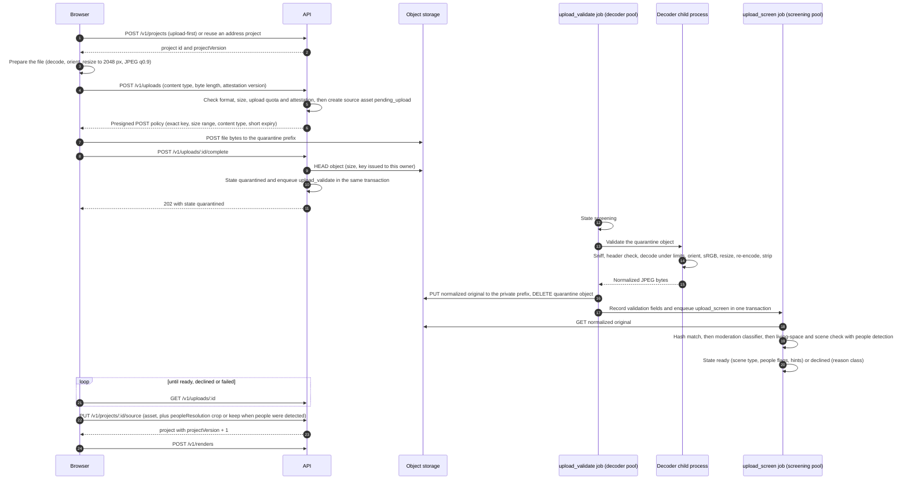

# Uploads: source specification

This specification defines how a visitor's own photograph becomes an editable source asset: the upload flow and its states, accepted formats, limits, browser-side preparation and camera capture, server-side validation, content admission, the handling of people in photos, scene type and photo guidance, and upload security. Uploads are a first-class path of the US Release (Fixed, [D-04](../decisions.md#d-04)): house exteriors, apartment entries, balconies and interiors, with no address required. The same flow serves the address path whenever Street View cannot supply an editable image (the interim experience of [D-16](../decisions.md#d-16), Accepted as amended on 2026-11-12: the `display_only` use policy, and contributor imagery under `STREET_VIEW_CONTRIBUTOR_IMAGERY=display_only`; and every `skip_to_upload` outcome). Engineers and coding agents implement from this document; request and response payloads live in the [data and API spec](data-and-api.md#http-api), screens and copy in the [experience spec](experience.md#photo-upload-and-capture), and everything after an asset is `ready` in the [render pipeline spec](render-pipeline.md#stage-contracts).

**Owns:** Upload flow; formats and HEIC; limits; client preparation; camera capture; server validation; content admission stage; people-in-photo handling; scene type and photo guidance; upload security.
**Baseline:** planning baseline 2026-11-09; external facts retrieved 2026-11-08.

## Upload flow

### Where uploads enter

| Entry | Trigger | Project |
| --- | --- | --- |
| Upload-first | The visitor chooses the landing page's secondary photo action ([experience spec](experience.md#landing)) | `POST /v1/projects` creates a project with no property; the selected holiday carries over |
| Address path fallback | Discovery returns `skip_to_upload`, or the project's Street View source mode is `display_only` ([address spec](address-and-street-view.md#street-view-source-modes)) | The existing address project; the Street View asset stays for display only and the upload becomes the editable source |
| Replacement | The user replaces the photo on any project | The existing project; the new asset supersedes the old one |

No address, unit number or account is required for any upload. An upload is owner-scoped (anonymous session or account), created independently of any project, and attached with `PUT /v1/projects/:id/source` once it is `ready`. Attaching increments `projectVersion` and supersedes any non-terminal render job on the project ([render pipeline](render-pipeline.md#lifecycle-state-machines); [concurrency rules](data-and-api.md#idempotency-and-concurrency)). The server never starts a render on its own: after attaching, the client calls `POST /v1/renders`, so allowance, verification and spend checks are the same on both paths.

### Sequence

### Steps

1. **Project.** For an upload-first journey the client creates the project first (`POST /v1/projects`, no address). For the address path the project already exists.
2. **Browser preparation.** The client decodes, orients and downsizes the photo when it can ([Limits and client-side preparation](#limits-and-client-side-preparation)); otherwise it uploads the original bytes.
3. **Upload request.** `POST /v1/uploads` carries the declared content type, byte length, whether the client prepared the file, and the attestation version the visitor accepted. The server refuses declared types outside the accepted list (`UPLOAD_UNSUPPORTED_FORMAT`), byte lengths over the cap (`UPLOAD_TOO_LARGE`), missing attestation (`VALIDATION_FAILED`) and exhausted upload quota (`RATE_LIMITED`), creates a source asset in `pending_upload` with an opaque object key, and returns a presigned POST policy ([Upload security](#upload-security)).
4. **Transfer.** The browser posts the bytes directly to object storage. The API never proxies image bytes.
5. **Complete.** `POST /v1/uploads/:id/complete` makes the server HEAD the object, verify the byte length and that the key was issued to this owner, set `quarantined`, and enqueue the `upload_validate` job in the same database transaction (transactional enqueue per [D-34](../decisions.md#d-34); [jobs and queue](../architecture.md#jobs-and-queue)). The call is idempotent: repeating it returns the current state. If the object is missing the asset stays `pending_upload` and the response is `VALIDATION_FAILED` with reason `upload_incomplete`.
6. **Validation.** The asset is `screening` from the moment the `upload_validate` job starts. That job runs on the decoder pool: it validates the upload in its isolated decoder child process, promotes the normalized original, deletes the quarantine object, and enqueues the `upload_screen` job in the promotion transaction ([Server-side validation](#server-side-validation); [jobs and queue](../architecture.md#jobs-and-queue)).
7. **Admission.** The `upload_screen` job runs on the screening pool: hash matching, the moderation classifier, the living-space and scene check, and people detection on the normalized original ([Content admission](#content-admission)). It ends in `ready` or `declined`, or holds the asset for review.
8. **Status.** The client polls `GET /v1/uploads/:id` until a terminal state; the interval is defined in [live updates](data-and-api.md#live-updates). Render jobs use SSE; uploads do not.
9. **Resolution.** If `peopleDetected` is set, the client resolves it before attaching ([People in photos](#people-in-photos)). If scene type confidence is below the auto-accept threshold, the user confirms the scene type ([Scene type and photo guidance](#scene-type-and-photo-guidance)).
10. **Attach.** `PUT /v1/projects/:id/source` attaches the `ready` asset with the confirmed scene type and, when people were detected, a `peopleResolution` whose `action` is `crop` or `keep`. A `declined` asset is refused with `UPLOAD_DECLINED`; an asset in any other non-ready state is refused with `VALIDATION_FAILED` (reason `not_ready`).
11. **Render.** The client calls `POST /v1/renders`. A project without an attached source receives `NEEDS_PHOTO`.

### Source asset states on the upload path

The normative state machine for source assets is in the [render pipeline spec](render-pipeline.md#lifecycle-state-machines). This table says what the upload path does at each state.

| State | Set by | What `GET /v1/uploads/:id` conveys | Leaves the state when |
| --- | --- | --- | --- |
| `pending_upload` | `POST /v1/uploads` | Policy issued; no bytes verified | `complete` succeeds; or the policy expires and the sweep marks the asset `expired` |
| `quarantined` | `complete` | Bytes accepted, not yet inspected | `upload_validate` starts |
| `screening` | `upload_validate` start | Validation and admission in progress; `holdForReview` when a reviewer must decide | `upload_validate` declines it, `upload_screen` ends, or a held upload's reviewer decision or hold window ends |
| `ready` | `upload_screen` or a reviewer | Scene type suggestion and confidence, people flags and boxes, quality hints, attestation reference | Attached to a project; later `expired` or `deleted` |
| `declined` | `upload_validate` (validation), `upload_screen` (admission), a reviewer, or a render-time provider refusal | `declineCode` (`UPLOAD_UNSUPPORTED_FORMAT`, `UPLOAD_TOO_LARGE`, `VALIDATION_FAILED` or `UPLOAD_DECLINED`), `declineReasonClass` and, for the guidance class only, `declineReason` | Retention or deletion |
| `failed` | Infrastructure failure after either job's retry budget (dead letter) | Try another upload | Retention or deletion |
| `expired`, `deleted` | Retention sweep or deletion | Not found | Terminal |

Retention of the normalized original follows the project's class in the [retention schedule](privacy-safety-legal.md#retention-schedule); deletion order and verification are in the [privacy spec](privacy-safety-legal.md#deletion-and-verification). Raw client bytes never outlive validation ([Upload security](#upload-security)).

### Attestation and asset policy

Every upload request carries the version of the combined age-and-rights statement the visitor accepted (Proposed [D-17](../decisions.md#d-17); wording and placement in the [experience spec](experience.md#friction-budget)). The server records `attestedAt` and `attestationVersion` on the source asset and creates its asset policy row. Evaluation to an `AssetPermission` happens at render submission and again immediately before every provider call ([rights vocabulary](../glossary.md#rights-and-permissions)).

| Use | State for an upload | Evidence |
| --- | --- | --- |
| `display` | `allowed` | attestation record |
| `store` | `allowed` | attestation record |
| `aiProcess` | `allowed` | attestation record |
| `edit` | `allowed` | attestation record |
| `commerceAdjacent` | `allowed` | attestation record |
| `distributeDerivative` | `allowed`; `denied` when the asset is `privateOnly` ([People in photos](#people-in-photos)) | attestation record; people resolution |
| `train` | `denied` | always |

Territory is `US`; there is no expiry beyond retention. An attestation does not make a copied listing photo authorized; the report route in the [privacy spec](privacy-safety-legal.md#abuse-harassment-and-takedown) handles claims from rights holders.

### Analytics

`upload_started` is emitted when the policy is issued, `upload_accepted` on `ready`, `upload_declined` on `declined` with `reasonClass` and the guidance `reason` only. No event carries image data, object keys or boxes ([event taxonomy](data-and-api.md#analytics-events)).

## Accepted formats and HEIC

Status: Open ([D-41](../decisions.md#d-41)). The default below is built unless the device test changes it; the alternative is recorded so the switch is a configuration and image-build change, not a redesign.

### Format contract

| Format | Server decision | Detection (magic bytes) | Notes |
| --- | --- | --- | --- |
| JPEG, including Ultra HDR gain-map JPEG | Accepted | `FF D8 FF` | Gain map discarded; output is SDR |
| PNG | Accepted | `89 50 4E 47 0D 0A 1A 0A` | Alpha flattened onto white; 16-bit reduced to 8-bit |
| WebP | Accepted | `RIFF....WEBP` | Animated WebP rejected (`pages` > 1) |
| HEIC/HEIF | Rejected at the server under the default | ISO BMFF `ftyp` with brand `heic`, `heix`, `hevc`, `hevx`, `mif1` or `msf1` | Converted in the browser when possible; `detectedFormat: heic` drives device-specific help copy |
| AVIF | Rejected in the US Release | `ftyp` with brand `avif` or `avis` | Decodable by sharp; excluded to keep the contract small, may be added later |
| GIF, TIFF, BMP, SVG, PDF, anything else | Rejected | `GIF8`, `II*\0` or `MM\0*`, `BM`, text starting with `<`, `%PDF` | `UPLOAD_UNSUPPORTED_FORMAT` with the detected format |
| Any multi-frame or animated file | Rejected | sharp `metadata().pages` > 1 | Reason `animated` |

Type is decided by magic bytes and a successful decode. The declared `Content-Type`, the file extension and any client hint are advisory.

### The `accept` attribute

Both file inputs use exactly `accept="image/jpeg,image/png,image/webp"`, with `image/jpeg` first. Never `image/*` and never `image/heic` or `image/heif` under the default. iOS Safari transcodes a HEIC photo to the first type in the accept list (WebKit bug 292350, https://bugs.webkit.org/show_bug.cgi?id=292350, retrieved 2026-11-08; the behavior is undocumented by Apple and varies by version), and listing `image/heic` makes Safari hand HEIC through untouched and on some versions convert JPEG or PNG to HEIC (WebKit bug 303803, https://bugs.webkit.org/show_bug.cgi?id=303803, retrieved 2026-11-08). A unit test asserts the attribute value so a well-meaning change cannot break the upload path for iPhone users.

### HEIC under the default

Servers never decode HEVC: sharp's prebuilt binaries support JPEG, PNG, Ultra HDR, WebP, AVIF, TIFF, GIF and SVG input and exclude HEIF/HEVC because HEVC is patent-encumbered (https://sharp.pixelplumbing.com/install and https://github.com/lovell/sharp/issues/3740, retrieved 2026-11-08). The worker image uses stock sharp. A HEIC photo reaches the server as JPEG by one of these routes, in order of preference:

| Route | Where it applies | What happens |
| --- | --- | --- |
| 1. Picker transcode | iOS Safari picker and camera | Safari delivers a JPEG; the browser then prepares it like any JPEG |
| 2. Native decode | Browsers that decode HEIC in web content (Safari 17 and later on iOS and macOS per https://caniuse.com/heif, retrieved 2026-11-08) | `createImageBitmap` succeeds; the preparation step emits a JPEG |
| 3. Lazily loaded decoder | Chrome, Edge and Firefox on any platform; Android devices saving HEIF | The client loads a WASM HEIF decoder only when native decode fails on a HEIC file (libheif-js 1.23.5, published 2026-10-04; heic2any is unmaintained, last release 0.0.4 on 2023-03-29; npm registry, retrieved 2026-11-08), decodes, then prepares a JPEG |
| 4. Clear refusal | Decoder unavailable or failed | The client shows the `UPLOAD_UNSUPPORTED_FORMAT` copy locally with the device hint and does not upload; if HEIC bytes reach the server anyway, sniffing returns the same code with `detectedFormat: heic` |

The server must tolerate HEIC arriving despite the accept list; route 4 guarantees a specific message rather than an opaque failure. **Verify:** counsel reviews whether shipping a WASM HEVC decoder to browsers raises patent-licensing exposure (owner: counsel; before the upload slice in [Phase 2](../backlog.md#phase-2-foundations-and-both-paths)).

### Alternative: server-side decode

Build the worker image on a custom libvips with libheif and libde265, use sharp in global-libvips mode (unsupported on Windows and on macOS under Rosetta per the sharp install page), add `image/heic,image/heif` to the accept list, add HEIC fixtures, and move the patent review to the server image. The default changes to this alternative if the device test shows Safari transcoding is unreliable on current iOS, the WASM decoder is too slow or too large on mid-range Android devices, or counsel prefers server-side exposure.

### Device test matrix

Run before the upload slice; results settle D-41 (the device test item in [Phase 1](../backlog.md#phase-1-feasibility)).

| Device and browser | How the photo arrives | Expected under the default | Verify |
| --- | --- | --- | --- |
| Current iOS Safari, library picker | HEIC photo chosen from Photos | JPEG via route 1 | Transcode happens; orientation upright; dimensions preserved; Live Photo delivers a still; byte size of a 48 MP transcode |
| Current iOS Safari, `capture="environment"` | New camera frame | JPEG via route 1 | Format; orientation; the control still offers the library (MDN says the OS may) |
| iOS Chrome and Firefox (WebKit-based) | HEIC from Photos | Same as Safari | Behavior is not documented; confirm on device |
| Android Chrome with HEIF capture enabled | `.heic` file | Route 3 | Decoder load time and decode time on a mid-range phone; camera capture format (usually JPEG) |
| macOS Safari, picker and drag-and-drop | HEIC from Photos | Route 2 (or picker transcode) | Which route fires; P3 color handling; orientation |
| Desktop Chrome, Edge, Firefox (macOS and Windows) | `.heic` file exported from Photos | Route 3 | Decoder works; message when it does not |
| Every browser | Accept attribute | `image/jpeg,image/png,image/webp` | Automated assertion in the web app tests |
| Server fixture | HEIC bytes posted directly | `UPLOAD_UNSUPPORTED_FORMAT`, `detectedFormat: heic` | Copy includes the iPhone format hint ([copy deck](experience.md#copy-deck)) |

## Limits and client-side preparation

### Limits

All values are defaults (configuration).

| Limit | Default | Enforced where | On violation |
| --- | --- | --- | --- |
| Maximum file size | 25 MB (26,214,400 bytes) | Declared length at `POST /v1/uploads`; `content-length-range` in the storage policy; HEAD at `complete` | `UPLOAD_TOO_LARGE`, reason `file_too_large` |
| Maximum decoded size | 50,000,000 pixels (width × height) | Header pre-check before decode; sharp `limitInputPixels` set explicitly (its default is 268,402,689, https://sharp.pixelplumbing.com/api-constructor, retrieved 2026-11-08) | `UPLOAD_TOO_LARGE`, reason `too_many_pixels` |
| Minimum short edge | 640 px after orientation | Client pre-check (advisory) and server | `VALIDATION_FAILED`, reason `image_too_small` |
| Client target | Long edge at most 2,048 px, JPEG quality about 0.9 | Browser, whenever it can decode the file | Not an error; the server re-encodes everything |
| Normalized original | Long edge at most 2,048 px (the same value), JPEG quality 90, sRGB, no metadata | Server | Not an error |
| Upload requests | 10 per owner per hour; 30 per owner per 24 h; failed and abandoned uploads count | `POST /v1/uploads` | `RATE_LIMITED` with `Retry-After` |
| Upload bytes | 250 MB per owner per 24 h | `POST /v1/uploads` (declared) and `complete` (verified) | `RATE_LIMITED` |

Why 50 megapixels: it bounds the decode buffer at about 200 MB of RGBA pixels, against about 1.07 GB at sharp's default. With browser preparation the server normally receives images of at most 2,048 px on the long edge, so the cap matters only on the raw-upload fallback. A 48 MP phone frame (8064 × 6048 = 48,771,072 pixels) uploaded raw is admitted; 200 MP modes (for example 16320 × 12240) are rejected, and the device test records how often the raw-upload fallback occurs. Upload quotas are independent of the render allowance and the abuse quotas in the [data and API spec](data-and-api.md#allowance-quotas-and-rate-limits); their values live here.

### Browser preparation

The browser prepares every file it can decode, which cuts upload bytes on phones, strips metadata before anything leaves the device, and makes the raw-upload fallback rare. The server still re-encodes and strips everything; the browser step is a convenience, not the guarantee.

1. **Pre-checks.** Refuse files over 25 MB locally with the `UPLOAD_TOO_LARGE` copy. Read `file.type` and the extension only as hints for the HEIC route.
2. **Decode with orientation.** `createImageBitmap(file, { imageOrientation: 'from-image', resizeWidth, resizeHeight, resizeQuality: 'high' })`, computing the target so the long edge is at most 2,048 px with the aspect ratio kept and never enlarging. `from-image` applies the EXIF orientation and is the documented default (https://developer.mozilla.org/en-US/docs/Web/API/Window/createImageBitmap, retrieved 2026-11-08); pass it explicitly. Resizing inside `createImageBitmap` avoids allocating a full-resolution canvas.
3. **Minimum size.** If the decoded short edge is below 640 px, show the `image_too_small` copy and stop; the server would reject it anyway.
4. **Encode.** Draw the bitmap into an `OffscreenCanvas` in a web worker (fallback: a main-thread canvas) with the `srgb` color space and `convertToBlob({ type: 'image/jpeg', quality: 0.9 })`. The output carries no EXIF, so GPS is gone, and no ICC profile, so sRGB is implied; wide-gamut photos are converted into the sRGB canvas by the browser. **Verify:** confirm the color handling and orientation on each device in the matrix with a Display P3 fixture (owner: web engineer; device test).
5. **Preview.** Show the prepared blob as the preview. There is no general crop control before upload in the US Release; cropping exists only in the people-detected flow ([People in photos](#people-in-photos)), and the same bitmap later serves that crop interaction.
6. **Upload.** Send the blob with `Content-Type: image/jpeg` and `clientPrepared: true` in the upload request.

**Fallback.** When native decode fails and the file is not HEIC, or the HEIC decoder is unavailable, upload the original bytes with their declared type (if at most 25 MB) and let the server decide. Upload progress comes from the fetch or XHR progress events; cancel aborts the transfer, and the abandoned `pending_upload` record expires with its policy.

## Camera capture

On phones the experience shows two controls ([experience spec](experience.md#photo-upload-and-capture)): a camera control, `<input type="file" accept="image/jpeg,image/png,image/webp" capture="environment">`, and a library control, the same input without `capture`. Both feed the preparation step above. On desktop there is one picker, which also accepts drag-and-drop.

- `capture="environment"` asks for the rear camera; the OS may still offer existing files, the attribute is not Baseline, and desktop browsers show an ordinary picker (https://developer.mozilla.org/en-US/docs/Web/HTML/Reference/Attributes/capture, retrieved 2026-11-08). Forcing capture on the only control would remove the library route on some browsers, and the library is the main route for interiors; hence two controls.
- Choose the two-control layout with the `(pointer: coarse)` media query and `navigator.maxTouchPoints > 0`. A wrong guess is harmless because `capture` degrades to a plain picker.
- Camera frames arrive at full sensor resolution and often carry GPS when the browser has location permission; browser preparation and server re-encoding remove it.
- No live viewfinder (`getUserMedia`) in the US Release; the file input is sufficient and keeps the camera permission prompt out of the flow.
- Device test: both controls on current iOS Safari and Android Chrome, format and orientation of captured frames, and that the library control never opens the camera.

## Server-side validation

Validation is the `upload_validate` job, which runs on the decoder pool; every decode runs in the job's isolated decoder child process ([decoder isolation](#decoder-isolation); [jobs and queue](../architecture.md#jobs-and-queue)). It never trusts the client: the declared type, extension and dimensions are inputs to be checked, not facts.

### Steps

1. **Fetch.** Read the quarantine object and confirm the byte length matches what `complete` verified (at most 25 MB).
2. **Sniff.** Determine `detectedFormat` from magic bytes ([format contract](#format-contract)). A format outside JPEG, PNG and WebP ends validation: state `declined`, `UPLOAD_UNSUPPORTED_FORMAT` with the detected format. A mismatch between declared and detected type is logged (without the image) and the detected type wins.
3. **Header pre-check.** `sharp(input).metadata()` reads the header without decoding pixels. Reject when the format disagrees with the sniffed type, when `width × height` exceeds 50,000,000 (`UPLOAD_TOO_LARGE`, reason `too_many_pixels`), or when `pages` is greater than 1 (`UPLOAD_UNSUPPORTED_FORMAT`, reason `animated`). Record `originalWidth`, `originalHeight`, EXIF `orientation`, `hasAlpha`, color space and whether an ICC profile is present.
4. **Decode under limits.** `sharp(input, { limitInputPixels: 50_000_000, failOn: 'warning', pages: 1, animated: false, unlimited: false, autoOrient: true })`. The sharp constructor documents `failOn` default `'warning'` with the guidance "Use the default 'warning' level with untrusted input", `pages` default 1, `animated` default false, `unlimited` default false (it removes memory-exhaustion safeguards and must stay false) and `autoOrient` default false (https://sharp.pixelplumbing.com/api-constructor, retrieved 2026-11-08). Orientation is applied before any metadata is dropped, so a sideways interior never reaches storage.
5. **Normalize.** Flatten alpha onto white (`flatten({ background: '#ffffff' })`), convert to sRGB (`toColourspace('srgb')`), downscale to at most 2,048 px on the long edge without enlarging (`resize` with `fit: 'inside'` and `withoutEnlargement: true`), and encode JPEG at quality 90. Do not call `withMetadata` or `keepMetadata`, so EXIF, XMP, IPTC and ICC are all dropped. **Verify:** with the Display P3 and CMYK fixtures confirm that sharp applies the embedded ICC profile during the sRGB conversion and that the output carries no profile (owner: backend engineer; Phase 2 upload slice).
6. **Dimension checks.** After orientation and before downscaling, the short edge must be at least 640 px; otherwise `declined`, `VALIDATION_FAILED`, reason `image_too_small`. Decode failures (truncated or corrupt data) end as `declined`, `VALIDATION_FAILED`, reason `unreadable`.
7. **Time limit.** Decode and encode run in the decoder child process under a wall-clock limit of 20 s (configuration); exceeding it fails the job, and the queue's infrastructure retry applies; after the retry budget the asset is `failed`.
8. **Checksum, blocklist and promotion.** Compute SHA-256 of the normalized bytes as `checksumSha256` and record `width` and `height` of the normalized original. If the checksum matches a `declined_checksum` tombstone ([data-and-api](data-and-api.md#entities); kept 90 days per the [retention schedule](privacy-safety-legal.md#retention-schedule)), the asset becomes `declined` with internal reason `checksum_blocklisted` (safety class, neutral copy), the normalized bytes and the quarantine object are deleted and `upload_screen` is not enqueued. Otherwise write the normalized original to the private bucket under its opaque key ([storage](../architecture.md#storage-and-media-delivery)) with `Content-Type: image/jpeg`, delete the quarantine object, then record the validation fields and enqueue the `upload_screen` job in one transaction ([jobs and queue](../architecture.md#jobs-and-queue)); that job runs [content admission](#content-admission).

### The normalized original

The normalized original is the only stored copy of an upload and the "original source" that every variant starts from. Its checksum is the lineage checksum on render attempts. Raw client bytes exist only in the quarantine prefix and are deleted inside the `upload_validate` job on promotion, with a storage lifecycle backstop ([retention schedule](privacy-safety-legal.md#retention-schedule)). Because stored pixels are regenerated by the decoder, stored bytes are never client bytes. Working and output sizes derived from the normalized original are owned by the [render pipeline](render-pipeline.md#compositing-and-resolution).

### Fields recorded on an upload source asset

The entity table is in the [data and API spec](data-and-api.md#entities); these are the fields the upload path writes. Field names are the camelCase forms of the `source_assets` columns in [data-and-api](data-and-api.md#entities).

| Field | Written by | Meaning |
| --- | --- | --- |
| `kind` = `upload`, `state` | API and jobs | Canonical kind and state |
| `objectKey`, `checksumSha256`, `contentType`, `byteLength`, `width`, `height` | `upload_validate` | Normalized original location, SHA-256, type, size and dimensions |
| `originalFormat`, `originalByteLength`, `originalWidth`, `originalHeight`, `orientationApplied` (EXIF value 1–8), `clientPrepared` | `upload_validate` | Lineage of what arrived; no raw bytes are kept |
| `attestedAt`, `attestationVersion`, `assetPolicyId` | API | Rights evidence |
| `sceneType`, `sceneTypeConfidence`, `roomType`, `buildingForm`, `multiUnitFacade`, `sceneTypeCorrected` | `upload_screen`, then attach | Scene classification and confirmation |
| `peopleDetected`, `peopleBoxes` (normalized `[x0, y0, x1, y1]`), `suggestedCropBox`, `peopleResolution` (`none`, `cropped`, `kept`), `privateOnly`, `cropBox`, `derivedFromSourceAssetId` | `upload_screen`, then attach | People handling and crop lineage |
| `qualityHints`, `existingDecorations`, `seasonCues` | `upload_screen` | Suggestions and pack inputs ([Scene type and photo guidance](#scene-type-and-photo-guidance)) |
| `screening` | `upload_screen` | Vendor decisions and scores; never images |
| `declinedCode`, `declinedReasonClass`, `declinedReason`, `holdForReview`, `providerRefusedAt` | Either job, reviewer, render job | Decline and hold bookkeeping; the `declined_*` columns are exposed in the `GET /v1/uploads/:id` payload as `declineCode`, `declineReasonClass` and `declineReason` |

### An upload that carries a map provider's marks

Some uploads are a whole Street View Static frame: a screenshot or a saved picture of the street view of a home, with Google's logo at the lower left and its copyright label at the lower right burned into the pixels. Such an upload gets the embedded attribution rectangles of a Street View source of its size (`STREET_VIEW_ATTRIBUTION_REGIONS`, today 640×640) and its looks keep both marks, as a look of a Street View source does. Without them an evening look of such a picture could never pass: the relight drops the marks and the judge rightly reports it.

- **When a picture qualifies.** Three things hold: rectangles are configured for its native size; its working image is the whole frame (no padding, and no aspect crop that cuts into a rectangle); and the attribution stroke rule finds both marks in the picture itself, with a share inside the reliable bounds ([stroke restoration](render-pipeline.md#compositing-algorithm-source-mode)). Any other upload has no rectangles. The rule is strict on purpose: on 4,228 unmarked 640×640 frames cut from the repository's photographs no frame qualified and no single rectangle was accepted. A false positive would be harmless: the corners stay as photographed, the plan avoids them and the judge is told about a map provider's marks there.
- **When it is decided.** Once, in `preparing`, from the working image's pixels (`embeddedAttributionRegions`, `attributionRegionsOf` in the render job), so a job delivered again decides the same way. A fixture source with no viewpoint is decided the same way.
- **What follows.** The plan stays clear of the rectangles, the decorated composite restores them verbatim, a relit look keeps the strokes of the marks over the relit ground, the deterministic attribution checks run and the judge gets the same attribution lines as for a Street View source ([render-pipeline.md#compositing-algorithm-source-mode](render-pipeline.md#compositing-algorithm-source-mode)).
- **What does not change.** The source stays an upload: no Street View credit line, Street View policy, sharpening, framing or zoom. The person's attestation and the review of uploads are unchanged.

### Validation and security fixtures

Each fixture is a file in the fixture library ([fixture modes](../architecture.md#external-integrations-and-fixture-modes)) with an asserted outcome; the set runs in the integration tests of the [CI strategy](../architecture.md#continuous-integration-and-testing).

| Fixture | Expected outcome |
| --- | --- |
| iPhone HEIC (HEVC) posted directly | `declined`, `UPLOAD_UNSUPPORTED_FORMAT`, `detectedFormat: heic` |
| JPEG with EXIF orientation 6; JPEG with orientation 8 | `ready`; normalized original upright; no EXIF in output |
| PNG decompression bomb (small file, header 20,000 × 20,000) | Rejected at the header pre-check, `UPLOAD_TOO_LARGE` reason `too_many_pixels`; no full decode |
| PNG bytes named `.jpg` with declared `image/jpeg` | `ready`; detected type PNG; mismatch logged |
| JPEG with an appended ZIP archive; JPEG with embedded HTML | `ready`; normalized bytes differ from the input and contain neither payload |
| Animated WebP; GIF | `declined`, `UPLOAD_UNSUPPORTED_FORMAT` (reason `animated`; `detectedFormat: gif`) |
| Zero-byte file; truncated JPEG | `declined`, `VALIDATION_FAILED`, reason `unreadable` |
| Ultra HDR gain-map JPEG | `ready`; SDR output |
| 48 MP JPEG (8064 × 6048) | `ready`; normalized to 2,048 px |
| 200 MP JPEG header (16320 × 12240) | `declined`, `UPLOAD_TOO_LARGE` reason `too_many_pixels`; no full decode |
| Display P3 JPEG; CMYK JPEG with a large ICC profile | `ready`; output sRGB without a profile; colors visually correct |
| 16-bit PNG; PNG with alpha | `ready`; 8-bit; alpha flattened onto white |
| JPEG with GPS EXIF; PNG with GPS in XMP | `ready`; output has no EXIF or XMP |
| Image with a 600 px short edge | `declined`, `VALIDATION_FAILED`, reason `image_too_small` |
| SVG; PDF; AVIF; TIFF | `declined`, `UPLOAD_UNSUPPORTED_FORMAT` with the detected format |
| Object larger than the policy range; object posted after expiry | Rejected by storage; `complete` reports `UPLOAD_TOO_LARGE` or `VALIDATION_FAILED` (`upload_incomplete`) |
| `complete` on another owner's upload ID; `complete` repeated | `NOT_FOUND`; idempotent current state |

## Content admission

Status: Proposed ([D-19](../decisions.md#d-19)); vendor selection Open ([D-44](../decisions.md#d-44)). Admission runs in the `upload_screen` job (screening pool) on the normalized original, after `upload_validate` has promoted it and before any upload can be attached to a project, so no upload reaches a paid image-edit call unscreened. What Hailiday decorates and declines at policy level is in the [privacy spec](privacy-safety-legal.md#content-policy-and-admission); this section is the pipeline that enforces it.

### Checks in order

Hash matching and the moderation classifier run before any paid vision call; the triage model and people detection run only on images that passed both.

| Order | Check | Candidates (D-44; verify eligibility and terms) | Outcome rule |
| --- | --- | --- | --- |
| 1 | Hash matching against industry child-safety hash lists | Thorn Safer (https://safer.io/); Microsoft PhotoDNA Cloud Service, free for qualified customers by application (https://www.microsoft.com/en-us/photodna, retrieved 2026-11-08); Google Content Safety API, free to approved partners by application (https://protectingchildren.google/tools-for-partners/, retrieved 2026-11-08) | Match: `declined`, safety class, child-safety procedure. Never shown to the user as a reason |
| 2 | Moderation classifier | OpenAI moderation, `omni-moderation-latest`, accepts images, free; image categories are sexual, violence and self-harm only (https://developers.openai.com/api/docs/guides/moderation, retrieved 2026-11-08); AWS Rekognition `DetectModerationLabels` (https://docs.aws.amazon.com/rekognition/latest/dg/moderation.html); Google Cloud Vision SafeSearch | Score at or above the decline threshold: `declined`, safety class. Between the review and decline thresholds: `held`. Child-safety labels: `declined` plus the child-safety procedure |
| 3 | Living-space and scene check | Triage vision model with a structured output (default candidate Claude Haiku 5.5 per [D-43](../decisions.md#d-43); [model roster](render-pipeline.md#model-roster)) | Subject is not a living space (people or a group as the subject; a document, screen, ID or mail; a vehicle, animal, food, landscape, artwork or text): `declined`, guidance class with a reason. Multi-unit facade: `declined`, reason `multi_unit_facade`. Otherwise scene type, room type or building form, quality flags, existing decorations and season cues ([Scene type and photo guidance](#scene-type-and-photo-guidance)) |
| 4 | People detection (D-18 default) | Person detector returning bounding boxes only, for example Rekognition `DetectLabels` person instances, or the triage model's boxes | Boxes recorded; the asset is `ready` with `peopleDetected`; attaching requires a resolution ([People in photos](#people-in-photos)) |

Thresholds are vendor-specific configuration set on a labeled set during the safety items of [Phase 4](../backlog.md#phase-4-commerce-safety-and-operations) and re-evaluated when a vendor changes its model. The classifier never estimates age ([People in photos](#people-in-photos)).

### Outcomes

| Outcome | Asset state | What the user sees | Internal handling |
| --- | --- | --- | --- |
| `admitted` | `ready` | Preview, scene type chips, people prompt if needed | Screening summary and ledger entries recorded |
| `declined` | `declined` | `UPLOAD_DECLINED` copy: guidance reasons are specific, safety reasons are neutral ("we can't use this photo") with no filter details | Reason class and reason recorded; safety declines feed the incident procedure |
| `held` | stays `screening` with `holdForReview` | Honest waiting copy; the user may choose another photo meanwhile | A review record in the internal review queue ([internal operations API](data-and-api.md#internal-operations-api)); a reviewer sets `ready` or `declined`; decisions audited |

The hold window is configuration: default 10 minutes in `live_private`, 0 in `live_public` (an immediate decline) unless review staff are on duty. A hold that reaches the window without a decision becomes `declined` with internal reason `hold_timeout`. Its `upload_declined` event carries the fixture flag of the held upload's own screening (fixture only when `source_assets.screening.providerMode` is `fixture`; a held upload whose triage ran live is reported as live work), not the configured screener. Hash matches and child-safety classifier signals are never held; they are declined immediately. Human reviewers see the photo at reduced size and only the flagged image, never the session's other assets.

### Decline reasons

| Class | Error code | Reasons | Shown to the user |
| --- | --- | --- | --- |
| `guidance` | `UPLOAD_UNSUPPORTED_FORMAT` | `unsupported_format` (with `detectedFormat`), `animated` | Yes, with specific copy |
| `guidance` | `UPLOAD_TOO_LARGE` | `file_too_large`, `too_many_pixels` | Yes |
| `guidance` | `VALIDATION_FAILED` | `image_too_small`, `unreadable` | Yes |
| `guidance` | `UPLOAD_DECLINED` | `not_a_living_space`, `subject_is_people`, `document_or_screen`, `multi_unit_facade` | Yes |
| `safety` | `UPLOAD_DECLINED` | `hash_match`, `classifier`, `child_safety`, `provider_refused`, `review_declined`, `hold_timeout`, `checksum_blocklisted` (recorded internally) | No; neutral copy only |

### Codes

`UPLOAD_DECLINED` carries `reasonClass` and, for the guidance class, `reason`. `PEOPLE_DETECTED` is returned by `PUT /v1/projects/:id/source` when a `ready` asset has `peopleDetected` and no resolution; it carries the boxes, `suggestedCropBox` and `permittedActions` (`crop`, `keep`, `replace`); crop and keep are sent as `peopleResolution: { "action": "crop", "box": [...] }` or `{ "action": "keep" }` on `PUT /v1/projects/:id/source` ([data-and-api](data-and-api.md#http-api)). HTTP status, retryability and copy keys are in the [error table](data-and-api.md#error-codes).

### Vendor refusals at render time

When the image-edit provider refuses an input (render job `failed` with `failureKind` `moderation_blocked`; [moderation risks](render-pipeline.md#moderation-and-model-behavior-risks)), the refusal is terminal for that photo: the source asset becomes `declined` with internal reason `provider_refused` and `providerRefusedAt`, no repair or transport retry resubmits the same image, further `POST /v1/renders` on that source return `SOURCE_NOT_EDITABLE`, the user is invited to choose another photo, and operations is notified. Which refusal categories count as reportable signals is defined with counsel in the [child-safety procedure](privacy-safety-legal.md#child-safety-reporting).

### Child-safety signals

On a hash match or a child-safety classifier signal the upload system places a preservation hold (a `preservation_holds` row) on the normalized original and any derivative (the raw bytes were deleted at promotion, before admission; [privacy spec, child safety reporting](privacy-safety-legal.md#child-safety-reporting)), so sweeps and user deletion do not touch them, blocks further uploads from the session, pages operations, shows the neutral decline copy, and records the evidence reference. Reporting, preservation periods, minimizing human viewing and not tipping off the uploader follow the [child-safety procedure](privacy-safety-legal.md#child-safety-reporting).

### Cost per screened image

| Component | Unit cost | Source |
| --- | --- | --- |
| Hash matching | $0 for qualified organizations (PhotoDNA Cloud Service; Google Content Safety API); Thorn Safer pricing is not public (verify) | URLs in the checks table |
| Moderation classifier | $0 (OpenAI moderation); or $0.0010 per image for the first million images per month (Rekognition Group 2, which also covers `DetectLabels` and `DetectFaces`; https://aws.amazon.com/rekognition/pricing/, retrieved 2026-11-08); Cloud Vision SafeSearch price to verify (https://cloud.google.com/vision/pricing) | as stated |
| Living-space, scene and quality check (one call) | About $0.0004 estimated on Claude Haiku 5.5: about 2,000 input tokens (an image of about 1,400 tokens plus the prompt) at $0.10 per million and about 300 output tokens at $0.50 per million. The live triage runs on the configured vision model, so the ledger charge (stage `screening`) is priced from the reported usage and is higher on Opus 5.5; the fallback charge is $0.005 | Anthropic model table cached 2026-10-06 (https://platform.claude.com/docs); measure in Phase 1 |
| People detection | $0.0010 per image (Rekognition `DetectLabels`), or included in the triage call | Rekognition pricing above |
| Total | About $0.001 to $0.003 per screened upload at the Haiku estimate (more on the configured vision model; measure in Phase 1), against the measured live cost per render attempt in the [cost worksheet](economics.md#measured-live-costs) | derived |

Every vendor call writes a usage ledger entry with stage `screening` ([cost recording](render-pipeline.md#cost-recording)). Screening is not reserved against the render allowance; the upload quotas bound its abuse.

### Adapters and fixture mode

Admission calls four adapter methods in `packages/server` under `providers/safety` and `providers/vision`: `ContentScreener.hashMatch`, `ContentScreener.moderate`, `ContentScreener.detectPeople` and `VisionModel.classifyUpload`, each with a fixture implementation that returns seeded results keyed by fixture ID so the whole admission path runs in `fixture` mode with no vendor account ([integration matrix](../architecture.md#external-integrations-and-fixture-modes)). Three capability records govern the path: `uploads` decides whether real uploads are accepted at all (in `fixture` mode only permissioned fixture photos flow), `content_screening` decides whether live safety vendors are called (it governs hash matching, moderation and people detection), and `vision_analysis` decides whether the live triage model is called.

The triage call follows the vision leg, not the content-screening leg, for a public audience: a live-capable vision model sees every real photo even while `SAFETY_PROVIDER` stays `fixture`, so the living-space, scene and people check runs on Claude whenever `vision_analysis` is live (`VISION_PROVIDER=anthropic`). The order is unchanged: hash matching and moderation run first, and the triage runs only on images that passed both. Before a live triage the worker checks `pause.global`, `pause.provider.<vision provider>` and the spend ceilings (one `vision_call` line at the triage price). When the triage is blocked or vision is unavailable, the fixture triage runs and `source_assets.screening` records `triageMode` `fixture` and a `triageFallbackReason`: `vision_unavailable`, `paused_global`, `paused_provider`, `spend_sku_ceiling`, `spend_daily_ceiling` or `spend_monthly_ceiling`. With `vision_analysis` in plain fixture mode the reason is null. A live triage writes a `vision_call` charge (stage `screening`, cost from the reported usage, a fallback of $0.005 when a reply reports none, `isFixture` false) and records `triageModel`, `triagePromptVersion` and `triageUsage` ([data model](data-and-api.md#entities)). The charge and the triage answer are written to `source_assets.screening` (`liveTriage`, while the screening is in progress) in one transaction; a redelivered screening reuses that answer and charge instead of calling again, and the final summary keeps `triageLedgerEntryId`. The `screened_upload` charge is written once per upload: its ledger entry ID is recorded on `source_assets.screening` (`screenedLedgerEntryId`) in the same transaction as the charge, under the source asset's row lock, and a redelivered screening that finds it does not charge again. A triage refusal is charged at the $0.005 triage list price (the refusal reports no usage), recorded the same way, and holds the upload for review. `source_assets.screening.providerMode`, the `screened_upload` charge's `isFixture` and the `upload_accepted` and `upload_declined` fixture flag are fixture only when both the screener and the triage ran on fixtures; a screening that made a live triage call is live work. A triage refusal (a provider safety refusal) holds the upload for review. Any other failure of a live triage fails the screening job, which retries once and then dead-letters: the fixture triage would give a real photo no people boxes, so it is not used as a silent fallback for a failed call. When the fixture triage serves a real photo (paused, over a ceiling, or vision unavailable), the photo gets no scene suggestion, so the person chooses it, and no people boxes from the triage.

The fixture triage reads the file name for its scene hint (the same words as the browser-test file names). A name with no hint returns no scene type (`sceneType` null, confidence 0, and no room type or building form), so the person chooses it; earlier builds pre-selected a living room. `upload-triggers.json` has no scene default: a name without a scene word yields no hint (`sceneHintForFileName` returns null).

## People in photos

Status: Open ([D-18](../decisions.md#d-18)); the build proceeds on Option A until the user and counsel decide (Phase 0 audience and people decisions in the [backlog](../backlog.md#phase-0-decide-and-prepare)).

### Option A (default): detect, suggest a crop, otherwise keep privately

Detection rules:

- Detect the presence of people and return bounding boxes only. No face templates, no face embeddings, no face recognition, no age or gender estimation, no identity of any kind. Age estimation is excluded deliberately: it would manufacture knowledge the service does not want and does not need ([audience and age](privacy-safety-legal.md#audience-and-age); [US privacy law register](privacy-safety-legal.md#us-privacy-law) for the biometric-law posture).
- Store only the flags and normalized boxes, never face crops or the detector's raw payload.
- A photo whose subject is people is declined by the living-space check (reason `subject_is_people`); this section covers incidental people in an otherwise usable photo.

Interaction (layout and copy in the [experience spec](experience.md#photo-upload-and-capture)):

1. The asset reaches `ready` with `peopleDetected: true`, `peopleBoxes` and, when one exists, `suggestedCropBox`.
2. The client shows the preview with the boxes and offers one-tap crop (accept the suggested box), adjust crop, keep the photo, or choose another photo.
3. `suggestedCropBox` is the largest axis-aligned rectangle inside the image that excludes every people box expanded by a margin of 4% of the long edge (configuration) and keeps a short edge of at least 640 px on the normalized original. When no such rectangle exists there is no suggestion, and the options are keep or another photo.
4. The client sends the choice in `PUT /v1/projects/:id/source`: `peopleResolution: { "action": "crop", "box": [x0, y0, x1, y1], "rotation": 2.5 }` (a normalized box and an optional straighten angle, see below) to crop, or `peopleResolution: { "action": "keep" }` to keep the photo ([payloads](data-and-api.md#http-api)). The asset's stored `peopleResolution` then becomes `cropped` or `kept`. Attaching without a resolution returns `PEOPLE_DETECTED`; choosing another photo (`replace`) starts a new upload.

Server-side crop:

- Straighten: `rotation` is an angle in degrees, clockwise positive, from −15 to 15 (absent means 0). The server turns the normalized original about its center by that angle (sharp `rotate`) and reads the box on the straightened view: the centered part of the turned image of size `width / s` × `height / s`, where `s = cos θ + max(width / height, height / width) · sin θ` is the smallest zoom at which the turned photo fills its own frame. The straightened view therefore has the photo's aspect ratio and lies entirely inside the photo, so a straightened crop never shows an empty corner; the server keeps the crop 2 px clear of the turned photo's edge so no resampled edge pixel reaches it. The client previews exactly this view (the photo turned by θ and zoomed by `s` inside its frame), and the math is shared from `@hailiday/core` (`straightenScale`, `straightenBoxBounds`).
- The server extracts the box from the normalized original (sharp `extract`; after the straighten turn when `rotation` is set), re-runs people detection on the result (the parent's people boxes carried through the same turn and zoom, then into the box) and re-checks the 640 px minimum on the extracted pixels, so a strong straighten of a small photo can answer `image_too_small` where the level crop would not. Remaining people return `PEOPLE_DETECTED` with the remaining boxes; a too-small crop returns `VALIDATION_FAILED` (`image_too_small`).
- A clean crop creates a child source asset in `ready` with `derivedFromSourceAssetId`, `cropBox` (the box as sent, normalized on the straightened view when straightened), `peopleResolution: cropped`, a new checksum and dimensions, and the parent's attestation, `screening` summary and scene type. The parent's object is deleted and the parent is marked `deleted`, so the cropped-out region can never reach a provider. Boxes use the normalized `[x0, y0, x1, y1]` convention of the [render pipeline](render-pipeline.md#coordinate-and-schema-conventions).

Keeping the photo:

- `peopleResolution: { "action": "keep" }` records `peopleResolution: kept` and sets `privateOnly: true` and `distributeDerivative` to `denied` on the asset policy. Every variant from this asset (across holidays, styles and lighting modes) is private: no share grant and no download, enforced where shares and downloads are created ([sharing rules](experience.md#saving-accounts-and-sharing); Proposed [D-22](../decisions.md#d-22)). The result screen shows a passive notice.
- The render proceeds normally; the pipeline must not alter the people (critical failure code `people_altered` in the [quality checks](render-pipeline.md#quality-checks)).

### Option B: guidance and attestation only

No detector runs; `peopleDetected`, `PEOPLE_DETECTED` and `privateOnly` do not exist; validation and the rest of admission are unchanged. The photography guidance still says no people, and the attestation still covers rights to the photo.

### Under both options

The guidance tells people to keep others out of the frame. The report route "a child is pictured" in the [privacy spec](privacy-safety-legal.md#abuse-harassment-and-takedown) creates actual knowledge and triggers deletion of the asset, its variants and provider-side copies ([child-safety procedure](privacy-safety-legal.md#child-safety-reporting)). Street View imagery is not covered here; Google's blurring and its limits are in the [address spec](address-and-street-view.md#panorama-changes-blur-and-takedown).

## Scene type and photo guidance

### Scene types

Scene type selects the holiday pack's scene section ([holiday model](holidays-and-content.md#holiday-model)) and the analysis mode of the pipeline ([scene analysis](render-pipeline.md#scene-analysis)). The vocabulary is canonical ([glossary](../glossary.md#holidays-and-decoration-controls)).

| `sceneType` | Attribute | Typical upload | Chip label owner |
| --- | --- | --- | --- |
| `house_exterior` | `buildingForm`: `detached`, `attached`, `other` | A house, townhome or rowhouse front from the street or yard | [experience spec](experience.md#photo-upload-and-capture) |
| `apartment_entry` | none | A unit door, stoop or hallway | experience spec |
| `balcony` | none | A balcony, patio or terrace | experience spec |
| `interior` | `roomType`: `dining_room`, `living_room`, `entryway`, `kitchen`, `bedroom`, `other` | A room | experience spec |

A photo whose subject is a whole multi-unit building facade is declined with guidance (`multi_unit_facade`) and the copy asks for a photo of the person's own entry, balcony or room: a shared facade is never decorated as someone's home, and decorating it would put decor on neighbors (critical code `neighbor_decorated`). Attached houses and duplexes are `house_exterior` with `buildingForm: attached`.

### Classification output

The triage model returns a structured `UploadTriage` record validated by a zod schema in `packages/core`: `subjectClass` (`living_space`, `people`, `document_or_screen`, `other`), `sceneType`, `sceneTypeConfidence` (0 to 1), `roomType` or `buildingForm` with confidence, `multiUnitFacade`, `qualityFlags` (`blurry`, `dark`, `too_close`, `heavy_occlusion`, `cluttered`, `screenshot`), `existingDecorations` (`none` or a holiday guess with density), `seasonCues` (`snow_visible`, `bare_trees`, `leafy`, `unknown`) and `peopleBoxes` when the triage model is the detector. The same call serves the living-space check, so one paid call produces all of it. `sceneType` is nullable: the fixture triage returns null (confidence 0) for a file name without a scene hint, and the client then requires the person to choose the scene.

### Confirmation rule

- The UI shows the detected scene type as the selected chip with the others one tap away.
- When `sceneTypeConfidence` is at least 0.8 (configuration) the detected type is accepted without a tap; below it the user must choose, and `PUT /v1/projects/:id/source` without `sceneType` returns `VALIDATION_FAILED` (reason `scene_type_required`).
- A paid render never starts before the scene type is confirmed or above the threshold: attachment enforces it, and `POST /v1/renders` on a project without an attached source returns `NEEDS_PHOTO`.
- `roomType` and `buildingForm` default to the detected value and may be `other`.

Before the first render job exists for a source asset, the scene type may be changed freely by calling `PUT /v1/projects/:id/source` again. Once a render job exists, a scene type correction creates a child source asset (same normalized original, new ID) so that the variant key, which does not include scene type, stays valid ([variant key](render-pipeline.md#variant-key-and-reuse)).

### Photo guidance

Wording lives in the [copy deck](experience.md#copy-deck); the guidance must convey:

- Show the whole wall, facade, table or balcony; step back rather than zoom.
- Hold the phone level; landscape or portrait both work.
- Daylight or bright, even indoor light. Dusk is not a capture instruction: exterior and balcony photos start in the `evening` look, and a photo that is already at dusk or night is decorated as photographed and delivered as that evening look; interiors are relit to a bright look ([lighting modes](render-pipeline.md#lighting-modes)).
- Minimal clutter; no people; no documents, screens or mail in view.
- Photograph your own space.

### Quality hints

Hints are suggestions with a "use anyway" path. They never block an upload. They are computed once in the `upload_screen` job and stored as `qualityHints` so scene analysis does not recompute them.

| Hint | Signal | Default threshold (configuration) |
| --- | --- | --- |
| Looks blurry | Variance of the Laplacian on the normalized original downscaled to 1,024 px, plus the triage `blurry` flag | Set from the permissioned corpus ([quality spec](quality-and-benchmark.md#permissioned-corpus)) |
| Looks dark | Mean luminance below 0.20 and 95th percentile below 0.50, plus the triage `dark` flag | as stated |
| Too close | Triage `too_close`, or no anchor categories visible | model flag |
| Hard to see the space | Triage `heavy_occlusion` or `cluttered` | model flag |
| Looks like a screenshot or a photo of a screen | Triage `screenshot` | model flag; the user may continue |

### Existing decorations and season cues

`existingDecorations` and `seasonCues` are recorded on the asset and passed to planning. The pack rules decide what to do with them: existing decorations are preserved and complemented (never removed, moved or covered indoors, in apartment entries and on balconies; for the exterior of a house a decoration of the chosen holiday may take the place of a removable seasonal item at its spot, and house numbers and signs are never covered), with a notice when they conflict with the chosen holiday; snow is never added unless visible in the source ([climate, culture and existing decorations](holidays-and-content.md#climate-culture-and-existing-decorations)).

## Upload security

| Threat | Control |
| --- | --- |
| Oversized or unbounded transfers | Byte cap in the signed policy and at `complete`; upload quotas |
| Decompression bombs and decoder exhaustion | Header pre-check, explicit pixel cap, sharp memory safeguards left on, decode time limit, decoder isolation |
| Polyglot files, embedded scripts, malformed metadata | Decode and re-encode; stored bytes are never client bytes; quarantine objects are never served |
| Decoder exploits reaching credentials or the network | Decoding runs in a child process with storage credentials only, no provider credentials and no egress beyond object storage |
| Server-side request forgery | No remote-URL ingestion; provider downloads only from allowlisted hosts ([security architecture](../architecture.md#security-architecture)) |
| Key guessing, replay, cross-owner access | Server-generated opaque keys, exact-key policy, short expiry, single use, owner check at `complete` and on every read |
| Abuse of free screening | Upload quotas independent of render allowance; repeat-offender blocks |
| Content abuse | Admission stage; preservation holds; session blocks ([abuse handling](privacy-safety-legal.md#abuse-harassment-and-takedown)) |

### Signed upload policy

`POST /v1/uploads` returns a presigned POST (form upload) to the quarantine prefix of the private bucket, never a presigned PUT, because a POST policy can constrain a size range while a PUT URL can only sign an exact length. Policy conditions:

- `key` equals one server-generated key under the quarantine prefix, built from opaque IDs per the [storage scheme](../architecture.md#storage-and-media-delivery); no address, email, session token or file name ever appears in a key.
- `content-length-range` of 1 to 26,214,400 bytes.
- `Content-Type` equals the declared type, one of `image/jpeg`, `image/png` or `image/webp`; the value is advisory for validation but limits what storage will accept.
- `expiration` at most 5 minutes after issue (configuration); long enough to move 25 MB on a slow mobile connection.
- One policy per upload ID; the uploads record tracks issue and completion, so a completed or expired ID cannot be reused and a foreign ID returns `NOT_FOUND`.

**Verify:** confirm the `content-length-range`, exact-key and `Content-Type` condition semantics against the S3 POST policy documentation (https://docs.aws.amazon.com/AmazonS3/latest/API/sigv4-HTTPPOSTConstructPolicy.html) and that the local RustFS emulator enforces the same conditions (owner: backend engineer; Phase 2 storage item). RustFS was confirmed to reject an upload above `content-length-range` at the B01 scaffold (2026-11-09); the exact-key and `Content-Type` conditions remain to be confirmed.

### Decoder isolation

The process model is in the [security architecture](../architecture.md#security-architecture); these are the upload-specific settings.

- The `upload_validate` job (decoder pool) spawns a short-lived decoder child process for every decode: a minimal environment with storage credentials only (no provider, safety-vendor or email credentials); outbound network limited to object storage; memory limit of 1 GB and one decode at a time per child (configuration); the parent writes the normalized original only if the child exits cleanly, and a crashed decode fails one job, never the API.
- After promotion, admission runs in the separate `upload_screen` job on the screening pool, which holds no image-edit credentials ([jobs and queue](../architecture.md#jobs-and-queue); [security architecture](../architecture.md#security-architecture)); it calls only the content-screening and vision adapters, never the image editor, and reads only the normalized original, never quarantine objects.
- Render jobs never read quarantine objects.

### Decompression bombs and resource limits

The header pre-check rejects oversize dimensions before pixels are decoded; `limitInputPixels` is set to 50,000,000 and `unlimited` stays false so sharp's own memory safeguards apply; `failOn: 'warning'` rejects invalid pixel data; `pages: 1` ignores extra frames; the 20 s decode time limit bounds CPU time. A 50-megapixel decode is about 200 MB of RGBA, which fits the 1 GB decoder memory limit with headroom for libvips working buffers.

### Re-encoding as the payload defense

Every stored image is produced by the decoder and the JPEG encoder from pixel data. Appended archives, embedded HTML or scripts, crafted EXIF, XMP or ICC blocks and format polyglots do not survive. The quarantine object, the only place client bytes exist, is deleted on promotion or by the storage lifecycle backstop and is never served to a browser.

### No SVG, no remote URLs

SVG is rejected (it is a document, not a photograph, and a script vector). The service never fetches an image from a user-supplied URL; sources are the user's upload or server-side provider fetches from allowlisted hosts.

### Quotas and repeat offenders

Upload quotas are in [Limits](#limits). A session that accumulates 3 safety-class declines in 24 h (configuration) is blocked from further uploads (`FORBIDDEN` with `reason: "upload_blocked"`) and listed for operations review; longer blocks and law-enforcement handling follow the [abuse procedure](privacy-safety-legal.md#abuse-harassment-and-takedown).

### Serving

Normalized originals and outputs are served only through signed GET URLs scoped to the owner (lifetimes in the [storage section](../architecture.md#storage-and-media-delivery)) with the stored `Content-Type`, `X-Content-Type-Options: nosniff`, and `Content-Disposition: attachment` for downloads. The web app's content security policy limits `img-src` to the storage and CDN origins.

### Malware policy

No separate antivirus scan: only decoder-regenerated pixels are stored and served. Revisit if non-image files, raw-original downloads or user-to-user file transfer are ever introduced.

### Tests

The [validation and security fixtures](#validation-and-security-fixtures) run in CI. Browser tests cover both mobile controls, the HEIC routes on the device matrix, the people prompt with crop and keep, scene type chips below and above the confidence threshold, every decline reason's copy, and the `privateOnly` share and download refusals.
